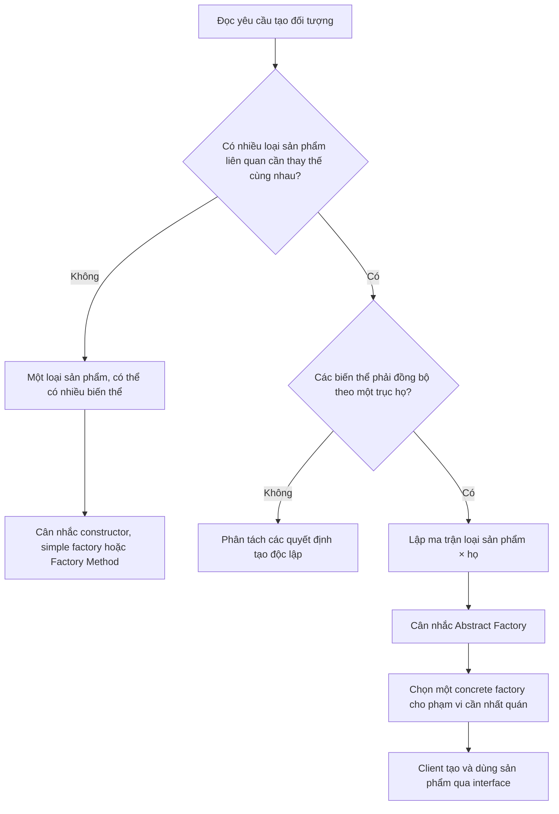

# Phân biệt nhu cầu tạo một đối tượng với nhu cầu tạo cả họ sản phẩm

> **Chương:** Nhận diện bài toán  
> **Module:** `SOFTWARE_DESIGN_DESIGN_PATTERN_CREATIONAL_ABSTRACT_FACTORY` — Học về abstract factory trong design pattern.

## 1. Mục tiêu học tập

Trong thiết kế phần mềm, gặp từ khóa “factory” chưa đủ để kết luận cần **Abstract Factory**. Cần xem hệ thống đang phải chọn cách tạo **một loại đối tượng**, hay phải chọn **một nhóm các loại sản phẩm liên quan** sao cho các biến thể của chúng tương thích.

Sau bài học, bạn có thể:

- Phân biệt **loại sản phẩm (product type)**, **biến thể sản phẩm (variant)** và **họ sản phẩm (product family)**.
- Nhận diện bài toán chỉ cần tạo **một đối tượng thuộc một loại sản phẩm** và bài toán phải quản lý **nhiều loại sản phẩm cùng một họ**.
- Tìm ra quy tắc tương thích khiến các sản phẩm cần được lựa chọn đồng bộ.
- Giải thích vì sao một factory tạo nhiều **đối tượng cùng loại** chưa chắc là Abstract Factory.
- Chọn hướng tiếp cận đơn giản hoặc Abstract Factory bằng các câu hỏi dựa trên yêu cầu, không dựa trên tên lớp.
- Lập ma trận sản phẩm ban đầu trước khi thiết kế các interface và concrete factory.

## 2. Những khái niệm cần phân biệt

Hãy xét ứng dụng giao diện có nút bấm và ô chọn, mỗi thành phần có hai kiểu hiển thị Light/Dark.

| Khái niệm | Câu hỏi nhận diện | Ví dụ |
| --- | --- | --- |
| **Loại sản phẩm** (*product type*) | Đối tượng đóng vai trò gì, cung cấp hành vi gì? | `Button`, `Checkbox` |
| **Biến thể sản phẩm** (*variant*) | Cùng một vai trò được triển khai theo cách nào? | `LightButton`, `DarkButton` |
| **Họ sản phẩm** (*product family*) | Những biến thể của các loại sản phẩm khác nhau phải đi cùng nhau theo tiêu chí nào? | Light = {`LightButton`, `LightCheckbox`}; Dark = {`DarkButton`, `DarkCheckbox`} |
| **Client** | Ai yêu cầu tạo và sử dụng sản phẩm? | `SettingsScreen` |
| **Factory** | Ai chịu trách nhiệm tạo các sản phẩm cụ thể? | `LightUIFactory`, `DarkUIFactory` |

**Điểm mấu chốt:** **Một loại sản phẩm có nhiều biến thể** khác với **nhiều loại sản phẩm có các biến thể được tổ chức thành họ**.

- Chỉ có `Button`, với các biến thể `LightButton` và `DarkButton`: hiện tại bạn có **một loại sản phẩm**. Có thể chỉ cần một factory đơn giản hoặc Factory Method tùy cấu trúc.
- Có cả `Button` và `Checkbox`, mỗi loại có biến thể Light/Dark và các thành phần trên cùng màn hình phải đồng bộ: đã xuất hiện **hai loại sản phẩm cùng thuộc các họ Light và Dark**. Đây là dấu hiệu phù hợp cho Abstract Factory.

Một “họ” được nhận diện bởi **ràng buộc nghiệp vụ hoặc kỹ thuật có ý nghĩa**, không phải chỉ bởi việc đặt tên các lớp cùng tiền tố.

## 3. Trường hợp A: cần tạo một đối tượng theo cấu hình

### 3.1. Bài toán

Một chương trình cần xuất một báo cáo. Người dùng chọn định dạng văn bản thuần hoặc Markdown. Mỗi lần xuất, chương trình sử dụng **một đối tượng xuất báo cáo** cung cấp cùng hành vi `export(String)`.

| Lựa chọn | Loại sản phẩm cần dùng | Hiện thực |
| --- | --- | --- |
| `text` | `ReportExporter` | `TextReportExporter` |
| `markdown` | `ReportExporter` | `MarkdownReportExporter` |

Dù có hai hiện thực, cả hai đều là **biến thể của cùng một loại sản phẩm** `ReportExporter`. Không tồn tại yêu cầu phải tạo thêm `Button`, `Checkbox` hoặc một loại sản phẩm thứ hai tương thích với đối tượng xuất báo cáo.

Một factory đơn giản có thể đóng gói quyết định tạo đối tượng:

```java
interface ReportExporter {
    String export(String title);
}

final class TextReportExporter implements ReportExporter {
    @Override
    public String export(String title) {
        return title;
    }
}

final class MarkdownReportExporter implements ReportExporter {
    @Override
    public String export(String title) {
        return "# " + title;
    }
}

final class ReportExporterFactory {
    static ReportExporter create(String format) {
        if ("text".equalsIgnoreCase(format)) {
            return new TextReportExporter();
        }
        if ("markdown".equalsIgnoreCase(format)) {
            return new MarkdownReportExporter();
        }
        throw new IllegalArgumentException("Định dạng không hỗ trợ: " + format);
    }
}
```

Client sử dụng:

```java
ReportExporter exporter = ReportExporterFactory.create("markdown");
System.out.println(exporter.export("Báo cáo tháng 11"));
```

Kết quả:

```text
# Báo cáo tháng 11
```

Factory này chỉ có nhiệm vụ **chọn và tạo một loại sản phẩm**. Không cần định nghĩa một abstract factory chứa nhiều phương thức tạo sản phẩm chỉ để thay thế `TextReportExporter` bằng `MarkdownReportExporter`.

**Lưu ý về thuật ngữ:** `ReportExporterFactory.create()` ở đây là một **phương thức factory đơn giản**; ví dụ không phải mẫu **Factory Method** theo nghĩa GoF, vì Factory Method thường định nghĩa điểm tạo đối tượng để các lớp con quyết định hiện thực. Cả factory đơn giản và Factory Method đều có thể phù hợp với bài toán chỉ cần một loại sản phẩm. Việc chọn giữa chúng phụ thuộc cách tổ chức mã, khả năng mở rộng và vòng đời của đối tượng.

### 3.2. Vì sao “một đối tượng” không có nghĩa là “chỉ gọi new một lần”?

Nếu ứng dụng cần tạo 10.000 `ReportExporter` trong ngày, chúng vẫn thuộc **cùng một loại sản phẩm**. Số **instance** được tạo không quyết định có nên dùng Abstract Factory hay không.

Điều cần hỏi là: “Có bao nhiêu **vai trò sản phẩm khác nhau** cần được thay thế đồng bộ theo một tiêu chí chung?”. Nếu chỉ có `ReportExporter`, bài toán chưa cho thấy nhu cầu quản lý một **họ nhiều loại sản phẩm**.

## 4. Trường hợp B: cần tạo một họ sản phẩm tương thích

### 4.1. Bài toán

Một ứng dụng có màn hình cài đặt gồm ba thành phần: nút lưu, ô chọn thông báo và hộp thoại xác nhận. Ứng dụng hỗ trợ hai theme:

- **Light:** nút, ô chọn và hộp thoại dùng thiết kế sáng.
- **Dark:** nút, ô chọn và hộp thoại dùng thiết kế tối.

Ràng buộc: **các thành phần thuộc cùng một màn hình phải đồng nhất theme**. Màn hình Light chứa `DarkDialog` có thể tạo ra giao diện lẫn lộn và vi phạm quy tắc thiết kế.

Hãy lập ma trận trước khi vẽ lớp:

| Loại sản phẩm / Vai trò | Họ Light | Họ Dark |
| --- | --- | --- |
| `Button` | `LightButton` | `DarkButton` |
| `Checkbox` | `LightCheckbox` | `DarkCheckbox` |
| `Dialog` | `LightDialog` | `DarkDialog` |

Ma trận có **ba hàng** (ba loại sản phẩm) và **hai cột** (hai họ sản phẩm). Cấu hình theme xác định **một cột**; factory được chọn phải có khả năng tạo các sản phẩm trong cột đó.

Ở đây, vấn đề không còn là chỉ chọn một loại `Button`; hệ thống cần phối hợp **nhiều loại sản phẩm liên quan**.

### 4.2. Vì sao từng factory riêng lẻ có thể gây lỗi?

Nếu mỗi nơi tự chọn biến thể, chương trình có thể thành:

```java
Button button = theme.equals("dark")
        ? new DarkButton() : new LightButton();

Checkbox checkbox = otherTheme.equals("dark")
        ? new DarkCheckbox() : new LightCheckbox();

Dialog dialog = thirdTheme.equals("dark")
        ? new DarkDialog() : new LightDialog();
```

Ba quyết định riêng biệt có thể dùng ba cấu hình khác nhau và tạo ra tổ hợp không hợp lệ. Khi có thêm theme hoặc thêm một loại thành phần, số nơi cần sửa cũng tăng.

Abstract Factory cho phép **chọn họ một lần ở ranh giới phù hợp**, rồi yêu cầu tạo từng sản phẩm qua cùng một hợp đồng:

```java
interface UIFactory {
    Button createButton();
    Checkbox createCheckbox();
    Dialog createDialog();
}
```

`LightUIFactory` chỉ tạo sản phẩm Light; `DarkUIFactory` chỉ tạo sản phẩm Dark. Client nhận `UIFactory` và sử dụng các product interface, nên không tự chọn concrete class cho từng thành phần.

### 4.3. Sơ đồ hai lựa chọn thiết kế



Đây là **luồng gợi ý nhận diện**, không phải luật cứng. Số lượng loại sản phẩm chỉ là dấu hiệu ban đầu; **tính tương thích và nhu cầu thay thế cả họ** mới quyết định Abstract Factory đem lại lợi ích hay không.

## 5. Ví dụ Java đầy đủ: hai nhu cầu, hai cách giải quyết

Ví dụ sau đặt cạnh nhau một factory đơn giản cho **một loại** `ReportExporter` và một Abstract Factory cho **họ** sản phẩm UI. Lưu thành `PatternRecognitionDemo.java`.

```java
public class PatternRecognitionDemo {
    // Phần A: chỉ có một loại sản phẩm.
    interface ReportExporter {
        String export(String title);
    }

    static final class TextReportExporter implements ReportExporter {
        @Override
        public String export(String title) {
            return title;
        }
    }

    static final class MarkdownReportExporter implements ReportExporter {
        @Override
        public String export(String title) {
            return "# " + title;
        }
    }

    static final class ReportExporterFactory {
        static ReportExporter create(String format) {
            if ("text".equalsIgnoreCase(format)) {
                return new TextReportExporter();
            }
            if ("markdown".equalsIgnoreCase(format)) {
                return new MarkdownReportExporter();
            }
            throw new IllegalArgumentException("Định dạng không hỗ trợ: " + format);
        }
    }

    // Phần B: nhiều loại sản phẩm thuộc một họ.
    interface Button {
        void click();
    }

    interface Checkbox {
        void toggle();
    }

    interface Dialog {
        void open();
    }

    // Abstract Factory: ba phương thức tạo ba loại sản phẩm.
    interface UIFactory {
        Button createButton();
        Checkbox createCheckbox();
        Dialog createDialog();
    }

    // Các sản phẩm thuộc họ Light.
    static final class LightButton implements Button {
        @Override
        public void click() {
            System.out.println("[Light] Đã nhấn nút");
        }
    }

    static final class LightCheckbox implements Checkbox {
        @Override
        public void toggle() {
            System.out.println("[Light] Đã đổi ô chọn");
        }
    }

    static final class LightDialog implements Dialog {
        @Override
        public void open() {
            System.out.println("[Light] Đã mở hộp thoại");
        }
    }

    // Các sản phẩm thuộc họ Dark.
    static final class DarkButton implements Button {
        @Override
        public void click() {
            System.out.println("[Dark] Đã nhấn nút");
        }
    }

    static final class DarkCheckbox implements Checkbox {
        @Override
        public void toggle() {
            System.out.println("[Dark] Đã đổi ô chọn");
        }
    }

    static final class DarkDialog implements Dialog {
        @Override
        public void open() {
            System.out.println("[Dark] Đã mở hộp thoại");
        }
    }

    // Concrete factories: mỗi factory quản lý một họ.
    static final class LightUIFactory implements UIFactory {
        @Override
        public Button createButton() {
            return new LightButton();
        }

        @Override
        public Checkbox createCheckbox() {
            return new LightCheckbox();
        }

        @Override
        public Dialog createDialog() {
            return new LightDialog();
        }
    }

    static final class DarkUIFactory implements UIFactory {
        @Override
        public Button createButton() {
            return new DarkButton();
        }

        @Override
        public Checkbox createCheckbox() {
            return new DarkCheckbox();
        }

        @Override
        public Dialog createDialog() {
            return new DarkDialog();
        }
    }

    // Client: không phụ thuộc vào Light*/Dark*.
    static final class SettingsScreen {
        private final Button button;
        private final Checkbox checkbox;
        private final Dialog dialog;

        SettingsScreen(UIFactory factory) {
            button = factory.createButton();
            checkbox = factory.createCheckbox();
            dialog = factory.createDialog();
        }

        void interact() {
            button.click();
            checkbox.toggle();
            dialog.open();
        }
    }

    // Chọn họ ở điểm khởi tạo, không chọn lại ở từng sản phẩm.
    static UIFactory chooseUIFactory(String theme) {
        if ("light".equalsIgnoreCase(theme)) {
            return new LightUIFactory();
        }
        if ("dark".equalsIgnoreCase(theme)) {
            return new DarkUIFactory();
        }
        throw new IllegalArgumentException("Theme không hỗ trợ: " + theme);
    }

    public static void main(String[] args) {
        // Một loại sản phẩm: dùng simple factory.
        ReportExporter exporter = ReportExporterFactory.create("markdown");
        System.out.println(exporter.export("Báo cáo tháng 11"));

        // Một họ sản phẩm: dùng Abstract Factory.
        UIFactory factory = chooseUIFactory("dark");
        SettingsScreen screen = new SettingsScreen(factory);
        screen.interact();
    }
}
```

Biên dịch và chạy bằng JDK:

```bash
javac PatternRecognitionDemo.java
java PatternRecognitionDemo
```

Kết quả dự kiến:

```text
# Báo cáo tháng 11
[Dark] Đã nhấn nút
[Dark] Đã đổi ô chọn
[Dark] Đã mở hộp thoại
```

Sự khác biệt xuất hiện ở **hợp đồng tạo sản phẩm**:

- `ReportExporterFactory.create()` trả về một `ReportExporter`, đủ cho một loại sản phẩm có nhiều biến thể.
- `UIFactory` có ba phương thức tạo **ba loại sản phẩm khác nhau**. Một concrete factory cung cấp các biến thể của **cùng một họ**.
- `SettingsScreen` không cần biết họ Dark có những class nào; nó chỉ nhận một factory và yêu cầu các vai trò cần sử dụng.

Trong ví dụ, `SettingsScreen` tạo cả ba sản phẩm lúc khởi tạo để dễ quan sát. **Abstract Factory không yêu cầu tạo tất cả sản phẩm cùng lúc**: client có thể gọi `createDialog()` về sau; khi đó vẫn cần dùng factory đúng họ đã chọn.

## 6. Sáu câu hỏi nhận diện trước khi chọn pattern

Đứng trước yêu cầu mới, hãy trả lời theo thứ tự:

### Câu 1 — Có bao nhiêu loại sản phẩm mà client cần?

Đừng đếm số class hay số instance. Hãy đếm **hợp đồng hành vi khác nhau**: `Button` và `Checkbox` là hai loại; `LightButton` và `DarkButton` là hai biến thể **của cùng một loại**.

Nếu chỉ có một loại, nên cân nhắc giải pháp tạo một sản phẩm trước.

### Câu 2 — Các loại sản phẩm đó có được triển khai thành những họ rõ ràng không?

Ví dụ, cả `Button` và `Checkbox` đều có biến thể Light/Dark. Nếu mỗi loại biến thiên theo một cấu hình hoàn toàn riêng, việc ép chúng vào chung một factory có thể tạo ra phụ thuộc không cần thiết.

### Câu 3 — Có quy tắc nào buộc các sản phẩm phải tương thích với nhau không?

Câu trả lời mạnh nhất cho Abstract Factory là một **bất biến thiết kế**, chẳng hạn:

> Tất cả thành phần giao diện trên cùng màn hình phải thuộc cùng theme.

Trong bài toán tích hợp thanh toán, bất biến tương tự có thể là: bộ thu tiền, hoàn tiền và kiểm tra webhook của cùng một giao dịch phải thuộc đúng nhà cung cấp đã được xác định.

### Câu 4 — Có cần thay cả họ mà không sửa logic sử dụng không?

Nếu thêm `HighContrastUIFactory` và client vẫn dùng `UIFactory`, `Button`, `Checkbox`, `Dialog` như cũ, Abstract Factory giúp cô lập sự thay đổi.

Nếu mỗi biến thể chỉ có một vị trí dùng và hầu như không thay thế, kiến trúc factory có thể chưa đáng với chi phí.

### Câu 5 — Khi thêm một loại sản phẩm mới, chấp nhận sửa mọi factory không?

Thêm `Slider` có thể buộc bổ sung `createSlider()` ở abstract factory, viết `LightSlider`, `DarkSlider` và cập nhật **cả hai concrete factory**. Đây là chi phí đổi lại sự nhất quán của họ sản phẩm.

Với hệ thống thường xuyên thêm **loại** sản phẩm mà ít khi thêm **họ**, chi phí này cần được cân nhắc trước.

### Câu 6 — Có một vị trí phù hợp để chọn họ và truyền factory vào client không?

Composition root, lớp cấu hình hoặc điểm khởi tạo request là những nơi thường phù hợp để chọn concrete factory. Nếu mỗi thành phần tự chọn lại họ, rủi ro trộn biến thể vẫn còn dù đã có interface factory.

## 7. Các dấu hiệu dễ gây nhầm lẫn

| Quan sát | Kết luận nên rút ra | Lý do |
| --- | --- | --- |
| Một class tạo rất nhiều instance của `Button` | **Chưa đủ** để chọn Abstract Factory | Tất cả instance vẫn là một loại sản phẩm |
| Có `LightButton` và `DarkButton` | **Chưa đủ** | Đây là hai biến thể của một loại |
| Có `Button`, `Checkbox` và `Dialog` | **Chưa đủ** | Chưa biết ba loại có cần thay thế đồng bộ hay không |
| Cả ba loại có biến thể Light/Dark và phải dùng cùng theme | **Dấu hiệu mạnh** cho Abstract Factory | Có nhiều loại sản phẩm, nhiều họ và bất biến tương thích |
| Có nhiều đối tượng được tạo trong một phương thức | **Chưa đủ** | Một phương thức tạo nhiều đối tượng có thể là builder, hàm khởi tạo nghiệp vụ hoặc mã lắp ghép |
| Một factory trả về `List<Button>` | **Chưa đủ** | Danh sách vẫn chỉ chứa một loại sản phẩm |
| Có hai chiều thay đổi độc lập như theme và ngôn ngữ | **Không tự động gộp thành một họ** | Theme và bản địa hóa có thể do hai phần khác nhau quản lý |
| Các sản phẩm có cùng tiền tố tên class | **Không đủ chứng minh cùng họ** | Cần ràng buộc tương thích thực tế, không chỉ quy ước đặt tên |

### Phân biệt với các cách tạo đối tượng khác

| Cách tiếp cận | Tập trung giải quyết | Ví dụ phù hợp |
| --- | --- | --- |
| Constructor trực tiếp | Tạo đối tượng cụ thể khi client được phép biết implementation | `new Invoice()` trong mã sở hữu đối tượng |
| Factory đơn giản | Tập trung logic chọn một hiện thực của **một loại sản phẩm** | Chọn `ReportExporter` theo định dạng |
| Factory Method (GoF) | Để lớp con quyết định loại đối tượng được tạo qua một phương thức có thể ghi đè | Các lớp con của một quy trình xử lý chọn loại `Document` |
| Abstract Factory (GoF) | Tạo **nhiều loại sản phẩm liên quan** dưới một họ đã chọn | Tạo `Button`, `Checkbox`, `Dialog` theo theme |

Các pattern có thể **kết hợp**: một concrete factory trong Abstract Factory có thể dùng Factory Method để tạo từng sản phẩm. Vì vậy, bảng trên so sánh **trọng tâm áp dụng**, không xem các cách tiếp cận là tuyệt đối loại trừ nhau.

## 8. Chiều biến thiên độc lập không nên ép vào cùng một họ

Mở rộng ví dụ giao diện: ứng dụng hỗ trợ cả Light/Dark **và** nội dung tiếng Việt/tiếng Anh.

- Theme quyết định hình thức của `Button`, `Checkbox`, `Dialog`.
- Ngôn ngữ quyết định chuỗi văn bản hiển thị.

Hai quyết định có thể thay đổi độc lập: người dùng chuyển từ tiếng Việt sang tiếng Anh **không nhất thiết** phải tạo lại họ Button/Checkbox/Dialog. Việc tạo các factory `DarkVietnameseUIFactory`, `DarkEnglishUIFactory`, `LightVietnameseUIFactory`, `LightEnglishUIFactory` ngay từ đầu có thể tạo số tổ hợp và trách nhiệm dư thừa.

Cách nhận diện hợp lý hơn là giữ `UIFactory` cho các loại sản phẩm chịu ảnh hưởng của theme, còn nội dung văn bản do hệ thống bản địa hóa đảm nhiệm. Chỉ kết hợp các chiều vào cùng một họ khi có ràng buộc kỹ thuật/nghiệp vụ thực sự buộc chúng phải thay thế đồng bộ.

## 9. Ví dụ thực tế ngoài giao diện: họ tích hợp thanh toán

Một nền tảng bán vé dùng hai nhà cung cấp thanh toán giả định: `PayNova` và `FastPay`. Mỗi nhà cung cấp có giao thức thu tiền, hoàn tiền và xác thực webhook riêng.

| Loại sản phẩm | Họ PayNova | Họ FastPay |
| --- | --- | --- |
| `PaymentProcessor` | `PayNovaPaymentProcessor` | `FastPayPaymentProcessor` |
| `RefundProcessor` | `PayNovaRefundProcessor` | `FastPayRefundProcessor` |
| `WebhookVerifier` | `PayNovaWebhookVerifier` | `FastPayWebhookVerifier` |

Đây là ứng viên cho Abstract Factory vì:

1. Có **ba vai trò riêng biệt**.
2. Cả ba vai trò cùng biến thiên theo **nhà cung cấp**.
3. Các giao dịch cần giữ **nguồn gốc nhà cung cấp**; hoàn tiền phải dùng đúng nhà cung cấp thu tiền, và webhook phải được xác thực theo giao thức của nhà cung cấp tương ứng.

`GatewayFactory` có thể cung cấp `createPaymentProcessor()`, `createRefundProcessor()`, `createWebhookVerifier()`. Tuy nhiên, chọn đúng factory thôi chưa bảo đảm toàn bộ quy tắc thanh toán: ứng dụng vẫn phải lưu nguồn gốc giao dịch, xác thực dữ liệu và kiểm tra các điều kiện nghiệp vụ.

Một điểm tinh tế: khi hoàn tiền, có thể chỉ tạo **một `RefundProcessor`**, nhưng vẫn có lý do dùng **Abstract Factory** vì loại sản phẩm này thuộc **họ nhà cung cấp** đã được xác định cùng các vai trò khác. **Không cần tạo tất cả thành viên của họ trong một thời điểm**.

## 10. Chi phí thiết kế và tiêu chí quyết định

Abstract Factory đem lại hai giá trị chính: **cô lập mã client khỏi concrete class** và **tập trung quy tắc tạo sản phẩm tương thích**. Đổi lại, thiết kế có thêm nhiều interface/concrete factory và chi phí đồng bộ khi tập loại sản phẩm thay đổi.

| Yếu tố | Chỉ tạo một loại đối tượng | Tạo nhiều loại trong một họ |
| --- | --- | --- |
| Số vai trò sản phẩm | Thường là một | Thường từ hai loại trở lên |
| Nhu cầu đồng bộ biến thể | Không có ràng buộc giữa các loại | Có ràng buộc cùng họ hoặc cùng nền tảng |
| Hợp đồng tạo đối tượng | Một phương thức chọn/tạo là đủ trong nhiều trường hợp | Một abstract factory có các phương thức tạo các loại sản phẩm |
| Thay họ/cấu hình | Đổi một implementation | Cần thay đồng bộ nhóm implementation |
| Chi phí khi thêm loại sản phẩm | Thường sửa trong phạm vi loại đó | Cần rà soát mọi concrete factory/họ đang hỗ trợ |
| Dấu hiệu nên chọn | Nhu cầu chỉ xoay quanh một loại sản phẩm | Nhiều sản phẩm liên quan có thể thay thế thành nhóm |

Không có quy tắc máy móc “hai loại sản phẩm thì bắt buộc dùng Abstract Factory”. Với hai loại **không liên quan**, giải pháp độc lập có thể rõ ràng hơn. Ngược lại, trong hệ thống mà một họ đã là abstraction quan trọng, ở một luồng cụ thể chỉ dùng một thành viên của họ vẫn có thể đúng khi sử dụng factory đó.

## 11. Bài tập nhận diện nhanh

Với mỗi tình huống, trả lời **“chưa cần Abstract Factory”**, **“nên cân nhắc Abstract Factory”**, hoặc **“cần làm rõ thêm yêu cầu”** và nêu lý do.

1. Ứng dụng tạo một `ImageDecoder` để đọc ảnh PNG hoặc JPEG, mỗi lần chỉ cần decode ảnh.
2. Thư viện giao diện hỗ trợ Mobile/Desktop, với `Button`, `TextField`, `Dialog` có quy tắc thiết kế riêng theo từng nền tảng; mọi thành phần trên cùng màn hình phải theo một nền tảng.
3. Service tạo hàng nghìn `Notification` mỗi ngày, tất cả đều cùng class.
4. Một dự án có `FrenchTranslator` và `GermanTranslator`, đồng thời có `CsvExporter` và `JsonExporter`; ngôn ngữ và định dạng xuất thay đổi độc lập.
5. Một SDK có `Client`, `Signer` và `RequestSerializer` cho ba phiên bản giao thức. Chưa rõ client nào có thể phối hợp với signer/serializer của phiên bản khác.
6. Một màn hình chỉ tạo một `Button` ở thời điểm hiện tại, nhưng nằm trong một ứng dụng đã có `UIFactory` đại diện cho họ Light/Dark của nhiều loại thành phần.

### Gợi ý đáp án

| Tình huống | Nhận định | Giải thích |
| --- | --- | --- |
| 1 | Chưa cần | Có một loại `ImageDecoder` với các biến thể; factory đơn giản hoặc Factory Method có thể đủ |
| 2 | Nên cân nhắc | Nhiều loại sản phẩm cùng biến thiên theo nền tảng và có ràng buộc đồng bộ |
| 3 | Chưa cần | Nhiều instance của một class không tạo thành nhiều loại sản phẩm |
| 4 | Chưa cần cho một factory gộp | Hai chiều biến thiên độc lập; nên quản lý chúng riêng |
| 5 | Cần làm rõ | Nếu ba vai trò phải đi cùng một phiên bản, đó là họ sản phẩm; nếu không, chưa đủ căn cứ |
| 6 | Có thể dùng factory của họ đã có | Một điểm sử dụng chỉ cần một sản phẩm không làm mất ý nghĩa họ sản phẩm của toàn hệ thống |

## 12. Thực hành phân tích yêu cầu chưa rõ ràng

Đề bài:

> Một ứng dụng quản lý dữ liệu hỗ trợ lưu trữ `Local` và `Cloud`. Ứng dụng có chức năng **ghi dữ liệu**, **đọc dữ liệu** và **ghi nhật ký**. Hãy đề xuất hướng tạo đối tượng phù hợp.

Đừng vội viết `StorageAbstractFactory`. Hãy hỏi chủ sản phẩm:

1. Bộ ghi và bộ đọc có phải dùng **chung một cơ chế lưu trữ**, ví dụ dữ liệu ghi ở Cloud thì phải đọc bằng Cloud không?
2. Nhật ký có gắn với backend Local/Cloud, hay luôn ghi vào một dịch vụ độc lập?
3. Có bao nhiêu loại đối tượng cần tạo và những biến thể nào thực sự tồn tại?
4. Có thay đổi backend theo người dùng, theo request hay toàn hệ thống?
5. Khi thêm backend mới, những vai trò nào phải được thay đồng bộ?

Nếu câu trả lời là *“Writer và Reader cùng một backend; Logger độc lập”*, ma trận hợp lý có thể là:

| Vai trò | Local | Cloud |
| --- | --- | --- |
| `StorageWriter` | `LocalWriter` | `CloudWriter` |
| `StorageReader` | `LocalReader` | `CloudReader` |

Khi đó, `StorageFactory` có thể tạo `StorageWriter` và `StorageReader` theo một backend. `Logger` nằm ngoài họ vì không phụ thuộc vào lựa chọn Local/Cloud.

Nếu ngược lại, việc đọc và ghi hoàn toàn độc lập, không có ràng buộc tương thích và đều chỉ cần chọn một implementation, chưa có đủ lý do để buộc chúng vào một Abstract Factory.

Bài tập này cho thấy **một đề bài có thể dẫn đến thiết kế khác nhau tùy bất biến được làm rõ**, chứ không phải chỉ cần thấy hai tính năng và hai nền tảng là áp dụng pattern.

## 13. Checklist khi nhận diện bài toán

Trước khi chọn Abstract Factory, hãy hoàn thành các câu sau:

- [ ] Tôi đã đếm **loại sản phẩm**, không nhầm với số instance hoặc biến thể.
- [ ] Tôi đã chỉ ra **trục tạo họ**: theme, nền tảng, nhà cung cấp hoặc một tiêu chí thực sự có ý nghĩa.
- [ ] Tôi đã lập bảng **hàng = loại sản phẩm, cột = họ sản phẩm**.
- [ ] Tôi đã xác định **bất biến tương thích** cần giữ giữa các loại sản phẩm.
- [ ] Tôi đã xem xét khả năng các chiều biến thiên là **độc lập**.
- [ ] Tôi đã biết **nơi chọn họ** và phạm vi sử dụng factory đã chọn.
- [ ] Tôi đã cân nhắc liệu constructor, simple factory hay Factory Method có đủ không.
- [ ] Tôi đã đánh giá chi phí khi **thêm họ** và khi **thêm loại sản phẩm mới**.
- [ ] Tôi có thể giải thích vì sao Abstract Factory giúp mã client rõ ràng hơn trong **chính bài toán này**.

**Ghi nhớ:** Nhu cầu tạo **một đối tượng thuộc một loại sản phẩm** thường không cần thiết kế cả một Abstract Factory. Abstract Factory trở nên có giá trị khi ứng dụng cần **tạo và sử dụng nhiều loại sản phẩm liên quan, có các biến thể được tổ chức thành họ và cần bảo đảm tính nhất quán khi thay cả họ**.
