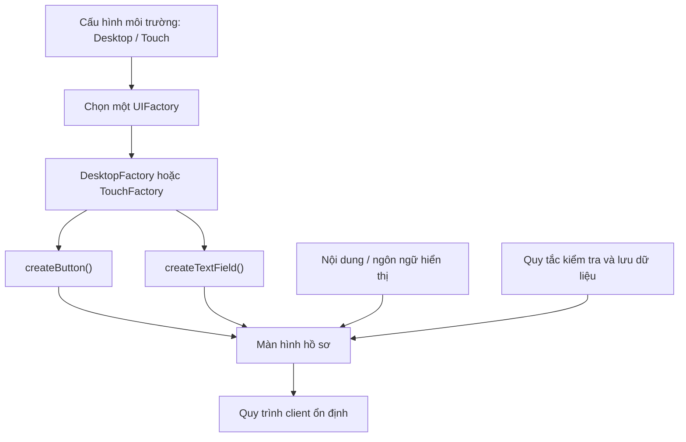

# Xác định các chiều biến thiên và phần hành vi cần giữ ổn định

## 1. Vì sao cần xác định đúng chiều biến thiên trước khi chọn Abstract Factory?

Một vấn đề phổ biến trong thiết kế phần mềm là nhiều đoạn mã cùng thay đổi khi xuất hiện một biến thể mới. Ví dụ, một ứng dụng có màn hình hồ sơ chạy theo hai kiểu giao diện:

- **Desktop:** nút bấm và ô nhập liệu tối ưu cho chuột, bàn phím.
- **Touch:** nút bấm và ô nhập liệu phù hợp với màn hình cảm ứng.

Màn hình cần hai vai trò sản phẩm: `Button` và `TextField`. Nếu ở nhiều nơi client tự viết `if (device == DESKTOP)` để tạo từng widget, việc thêm một kiểu giao diện mới có thể buộc sửa các đoạn điều kiện lặp lại và tạo nguy cơ ghép nhầm các widget thuộc những kiểu khác nhau.

Mẫu thiết kế **Abstract Factory** giải quyết tốt vấn đề này khi những sản phẩm có liên quan phải được **chọn theo cùng một họ**. Tuy nhiên, không phải sự thay đổi nào cũng cần trở thành một concrete factory mới. Nội dung nhập, nhãn nút, ngôn ngữ hiển thị hay một giá trị cấu hình có thể thay đổi độc lập với họ widget.

Để nhận diện đúng bài toán, hãy trả lời hai câu hỏi:

1. **Phần nào thay đổi cùng nhau?** Đó là các *chiều biến thiên* (axes of variation) và những quyết định cấu hình liên quan.
2. **Phần nào nên tiếp tục hoạt động theo cùng một hợp đồng dù biến thể thay đổi?** Đó là *hành vi ổn định* mà client nên phụ thuộc vào.

Không tìm được ranh giới này sẽ dẫn tới hai cực đoan: client gắn chặt với các lớp cụ thể, hoặc hệ thống tạo quá nhiều interface và factory cho những khác biệt vốn chỉ cần truyền tham số.

## 2. Phân biệt vai trò sản phẩm, họ sản phẩm và chiều biến thiên

### 2.1. Vai trò sản phẩm là *loại năng lực* client cần

Trong màn hình hồ sơ, client cần:

- `Button`: biểu diễn hành động lưu.
- `TextField`: biểu diễn ô nhập tên.

Hai vai trò này có thể được công bố qua các interface Java. Chúng mô tả *client cần làm gì với sản phẩm*, chưa quyết định sản phẩm đó trông ra sao hoặc được xây dựng bằng lớp nào.

### 2.2. Họ sản phẩm là *một bộ triển khai cùng biến thể*

Mỗi họ có triển khai tương ứng cho các vai trò:

| Họ giao diện | `Button` | `TextField` |
| --- | --- | --- |
| Desktop | `DesktopButton` | `DesktopTextField` |
| Touch | `TouchButton` | `TouchTextField` |

Đọc bảng theo **hàng**: một hàng là **một họ sản phẩm** có các thành phần được thiết kế để phối hợp. Đọc theo **cột**: một cột là **một vai trò sản phẩm** mà mỗi họ phải cung cấp.

Như vậy, thêm **họ Kiosk** thường cần thêm `KioskButton`, `KioskTextField` và `KioskFactory`; còn thêm **vai trò Checkbox** đòi thay đổi hợp đồng factory và tất cả họ hiện có. Hai kiểu thay đổi này không giống nhau.

### 2.3. Một hệ thống còn có nhiều chiều biến thiên khác

| Chiều biến thiên | Ví dụ | Có nhất thiết là một họ Abstract Factory? |
| --- | --- | --- |
| **Kiểu môi trường giao diện** | Desktop, Touch | **Có thể**, khi nhiều vai trò widget phải chuyển đồng bộ |
| **Vai trò sản phẩm** | Button, TextField, Checkbox | Đây là *tập năng lực cần được factory cung cấp*, không phải mỗi vai trò là một họ |
| **Ngôn ngữ hiển thị** | Tiếng Việt, tiếng Anh | Thường là dữ liệu bản địa hóa; không cần tạo lại cả họ widget |
| **Nội dung màn hình** | Tên, mô tả, nhãn nút | Thường chỉ là dữ liệu truyền cho sản phẩm |
| **Giao diện màu sắc** | Sáng, tối | Có thể là cấu hình dùng chung; chỉ tách thành họ nếu sự khác biệt đòi bộ triển khai tương thích riêng |
| **Chính sách nghiệp vụ** | Quy tắc kiểm tra tên, quyền sửa hồ sơ | Thường thuộc service/strategy nghiệp vụ, độc lập với lựa chọn widget |
| **Vòng đời tài nguyên** | Tạo mới, thuê từ pool, dùng chung | Là chính sách tạo và sở hữu tài nguyên; cần định nghĩa riêng theo ngữ cảnh |

Không nên gom mọi chiều biến thiên vào cùng một enum như `DESKTOP_VI_DARK`, `DESKTOP_EN_DARK`, `TOUCH_VI_LIGHT` nếu các chiều này có thể phối hợp độc lập. Làm vậy dễ dẫn tới số lượng concrete factory tăng theo tích các lựa chọn.

Ví dụ có 2 môi trường, 2 ngôn ngữ và 2 chế độ màu sẽ có **8 tổ hợp**, nhưng chưa chắc cần 8 factory. Nếu chỉ môi trường quyết định họ widget, có thể giữ **2 concrete factory**, đồng thời truyền ngôn ngữ và màu qua cơ chế cấu hình thích hợp.

## 3. Hành vi nào cần giữ ổn định?

“Ổn định” **không có nghĩa mã nguồn không bao giờ thay đổi**. Nó có nghĩa những hành vi client dựa vào có thể được mô tả bằng **hợp đồng chung**, để thay một họ sản phẩm không buộc phải viết lại quy trình sử dụng.

Đối với màn hình hồ sơ, ví dụ:

| Phần cần ổn định | Phần được phép biến thiên |
| --- | --- |
| Màn hình cần tạo ô nhập tên và nút lưu | Concrete class của ô nhập và nút |
| Màn hình yêu cầu vẽ ô nhập với placeholder | Hình dáng, kích thước hoặc quy tắc hiển thị phù hợp nền tảng |
| Màn hình yêu cầu vẽ nút với nhãn đã cho | Cách widget thể hiện nhãn và điều khiển tương tác |
| Luồng nghiệp vụ: nhập dữ liệu → kiểm tra → lưu | Kiểu hiển thị Desktop/Touch của các thành phần |
| Các thành phần trong cùng màn hình phải phù hợp với một biến thể giao diện | Factory được chọn khi mở màn hình |

Một hợp đồng giao diện có thể khai báo:

```java
interface Button {
    String render(String label);
}

interface TextField {
    String render(String placeholder);
}

interface UIFactory {
    Button createButton();
    TextField createTextField();
}
```

`Button` và `TextField` quy định *hành vi sử dụng sau khi tạo*; `UIFactory` quy định *những vai trò client có thể yêu cầu*. `DesktopFactory` và `TouchFactory` khác nhau ở cách cung cấp concrete product, trong khi client vẫn gọi cùng các phương thức.

**Cần phân biệt ổn định về kiểu với ổn định về ý nghĩa.** Hai widget đều triển khai `render(String)` mới chỉ cho thấy chúng thỏa mãn chữ ký phương thức. Nếu một implementation bỏ qua nhãn, trả sai nội dung, cần quyền khác thường hoặc không tương thích với widget còn lại, hợp đồng hành vi vẫn có thể bị vi phạm. Tính nhất quán phải được xác nhận qua đặc tả và kiểm thử, không tự xuất hiện chỉ vì có interface.

## 4. Dùng dấu hiệu thay đổi thực tế để tìm chiều biến thiên

Một cách hữu ích là phân tích những yêu cầu thay đổi gần giống nhau và hỏi **“khi yêu cầu này đến, những vị trí nào thường phải sửa cùng lúc?”**

### Dấu hiệu 1: các nhánh điều kiện lặp lại cho nhiều vai trò

```java
Button button = isTouch
        ? new TouchButton()
        : new DesktopButton();

TextField field = isTouch
        ? new TouchTextField()
        : new DesktopTextField();
```

Khi `isTouch` phải được xét ở nhiều nơi cho các vai trò có liên quan, “kiểu môi trường” là ứng viên rõ ràng cho **chiều lựa chọn họ**. Nếu thêm `Kiosk`, mọi nhánh loại này có thể phải mở rộng.

### Dấu hiệu 2: những sản phẩm được tạo có ràng buộc cùng biến thể

Nếu `TouchButton` chỉ được thiết kế để phối hợp với `TouchTextField`, việc tạo chúng qua các nguồn độc lập có thể dẫn đến trộn họ. Một concrete factory cho mỗi môi trường tập trung quyết định lựa chọn sản phẩm và làm giảm đường khởi tạo sai.

Tuy nhiên, **cùng một factory không tự chứng minh các sản phẩm tương thích**. Concrete factory phải triển khai đúng ánh xạ, đồng thời client phải dùng một lựa chọn họ ổn định cho bộ sản phẩm cần kết hợp.

### Dấu hiệu 3: hành vi client gần như không đổi giữa các biến thể

Nếu cả Desktop và Touch đều cần hiển thị tên trường rồi nút lưu, thuật toán của màn hình không cần phụ thuộc vào từng concrete product. Đây là tín hiệu nên **giữ quy trình trong client và đẩy phần tạo widget sang factory**.

Ngược lại, nếu hai chế độ có workflow nghiệp vụ hoàn toàn khác nhau, chỉ dùng Abstract Factory cho widget không loại bỏ được sự khác nhau của workflow. Có thể còn cần Strategy hoặc các application service riêng.

### Dấu hiệu 4: thông tin thay đổi chỉ là giá trị đầu vào

Việc đổi `"Lưu"` thành `"Save"` không đòi tạo `EnglishButton` và `VietnameseButton` nếu cách hiển thị nút không đổi về mặt hợp đồng. Khi đó, giải pháp thường chỉ cần truyền chuỗi được bản địa hóa:

```java
button.render(labels.save);
```

**Câu hỏi chẩn đoán:** Sự khác biệt có làm thay *loại triển khai và tập sản phẩm cần phối hợp*, hay chỉ thay *giá trị mà cùng một triển khai xử lý*?

## 5. Quy trình xác định ranh giới biến thiên và ổn định

### Bước 1 — Mô tả công việc của client mà không nhắc lớp cụ thể

Ví dụ: “Màn hình hồ sơ hiển thị tiêu đề, ô nhập tên và nút lưu theo môi trường đang chọn”. Tránh bắt đầu bằng câu “Màn hình phải dùng `DesktopButton`”; đó đã là quyết định triển khai.

### Bước 2 — Liệt kê các vai trò sản phẩm thực sự cần

Xác định `Button`, `TextField` và các hành vi mà client sử dụng. Đừng thêm vai trò chỉ vì một thư viện đang có nhiều lớp; phạm vi hợp đồng nên xuất phát từ nhu cầu client.

### Bước 3 — Lập ma trận vai trò × họ

Đặt từng vai trò ở cột và mỗi biến thể ở một hàng. Kiểm tra:

- Mỗi họ có cung cấp đủ các vai trò bắt buộc không?
- Các sản phẩm trong cùng một hàng có được thiết kế dùng cùng nhau không?
- Một vai trò có phải trả về `null` hoặc ném `UnsupportedOperationException` cho một họ không? Nếu có, có thể các họ không chia sẻ cùng một hợp đồng thật sự.

### Bước 4 — Tách những chiều độc lập

Đánh dấu các giá trị có thể đổi mà không cần thay cả họ sản phẩm: ngôn ngữ, nội dung, màu nhấn, dữ liệu người dùng, quy tắc validation. Chọn cách truyền hoặc quản lý chúng riêng, trừ khi có bằng chứng chúng chi phối cả bộ concrete product.

### Bước 5 — Xác định các bất biến cần giữ

Ví dụ:

- Client luôn gọi qua `Button`/`TextField`, không phụ thuộc vào constructor cụ thể.
- Tất cả widget của một màn hình được tạo theo cùng lựa chọn họ.
- Các giá trị nhãn/placeholder được chuyển đúng ý nghĩa đến widget.
- Việc thay họ giao diện không làm thay logic kiểm tra và lưu hồ sơ.
- Các sản phẩm đáp ứng hợp đồng tương tác, vòng đời và khả năng phối hợp đã định.

### Bước 6 — Đặt điểm lựa chọn factory

Mã khởi động hoặc composition root chọn `DesktopFactory` hay `TouchFactory` và cung cấp cho màn hình qua `UIFactory`. Màn hình giữ factory đã chọn cho toàn bộ nhóm widget cần tạo.

### Bước 7 — Thử các kịch bản thay đổi

Hãy mô phỏng: thêm họ `Kiosk`, thêm vai trò `Checkbox`, đổi tiếng Việt sang tiếng Anh, thêm chủ đề tối. Nếu mỗi thay đổi làm đúng nhóm lớp dự kiến thay đổi, ranh giới thiết kế có cơ sở. Nếu đổi ngôn ngữ buộc tạo lại toàn bộ factory, rất có thể các chiều đã bị trộn.

## 6. Sơ đồ phân định trách nhiệm



Trong sơ đồ, **kiểu môi trường** quyết định factory; **ngôn ngữ và nội dung** được cấp cho client như dữ liệu; **quy tắc nghiệp vụ** giữ vai trò riêng. Một trục biến thiên chỉ nên trở thành trục chọn họ khi các sản phẩm cần được thay đồng bộ.

Nếu màu sắc thay đổi hoàn toàn cách hiện thực nhiều widget và có ràng buộc không thể tách khỏi nền tảng, có thể thiết kế một biến thể họ khác. Nhưng trước hết nên đánh giá liệu đưa màu qua một cấu hình bất biến dùng chung có đủ hay không.

## 7. Ví dụ Java: một trục họ sản phẩm và một trục nội dung độc lập

Ví dụ dưới đây sử dụng hai họ `Desktop` và `Touch`. `Texts` chứa nhãn hiển thị theo ngôn ngữ nên không nằm trong `UIFactory`. `ProfileScreen` giữ quy trình xây màn hình giống nhau với mọi họ.

```java
// Lưu thành VariationAxesDemo.java
public class VariationAxesDemo {

    // Dữ liệu hiển thị có thể thay đổi độc lập với họ widget.
    static final class Texts {
        final String title;
        final String placeholder;
        final String saveLabel;

        Texts(String title, String placeholder, String saveLabel) {
            this.title = title;
            this.placeholder = placeholder;
            this.saveLabel = saveLabel;
        }
    }

    // AbstractProduct: hành vi mà client cần.
    interface Button {
        String render(String label);
    }

    interface TextField {
        String render(String placeholder);
    }

    // AbstractFactory: những vai trò sản phẩm bắt buộc.
    interface UIFactory {
        Button createButton();
        TextField createTextField();
    }

    // Hai sản phẩm thuộc họ Desktop.
    static final class DesktopButton implements Button {
        @Override
        public String render(String label) {
            return "Desktop button: " + label;
        }
    }

    static final class DesktopTextField implements TextField {
        @Override
        public String render(String placeholder) {
            return "Desktop field: " + placeholder;
        }
    }

    // Hai sản phẩm thuộc họ Touch.
    static final class TouchButton implements Button {
        @Override
        public String render(String label) {
            return "Touch button: " + label;
        }
    }

    static final class TouchTextField implements TextField {
        @Override
        public String render(String placeholder) {
            return "Touch field: " + placeholder;
        }
    }

    // ConcreteFactory chọn các sản phẩm thuộc cùng một họ.
    static final class DesktopFactory implements UIFactory {
        @Override
        public Button createButton() {
            return new DesktopButton();
        }

        @Override
        public TextField createTextField() {
            return new DesktopTextField();
        }
    }

    static final class TouchFactory implements UIFactory {
        @Override
        public Button createButton() {
            return new TouchButton();
        }

        @Override
        public TextField createTextField() {
            return new TouchTextField();
        }
    }

    // Client chỉ biết factory và hai vai trò sản phẩm.
    static final class ProfileScreen {
        private final UIFactory factory;

        ProfileScreen(UIFactory factory) {
            if (factory == null) {
                throw new IllegalArgumentException("factory required");
            }
            this.factory = factory;
        }

        String render(Texts texts) {
            TextField nameField = factory.createTextField();
            Button saveButton = factory.createButton();
            return texts.title + "\n  "
                    + nameField.render(texts.placeholder)
                    + "\n  " + saveButton.render(texts.saveLabel);
        }
    }

    public static void main(String[] args) {
        Texts vi = new Texts("Hồ sơ", "Nhập tên", "Lưu");
        Texts en = new Texts("Profile", "Your name", "Save");

        ProfileScreen desktop = new ProfileScreen(new DesktopFactory());
        ProfileScreen touch = new ProfileScreen(new TouchFactory());

        System.out.println("=== Desktop / VI ===");
        System.out.println(desktop.render(vi));

        System.out.println("=== Touch / VI ===");
        System.out.println(touch.render(vi));

        System.out.println("=== Desktop / EN ===");
        System.out.println(desktop.render(en));
    }
}
```

Biên dịch và chạy:

```bash
javac VariationAxesDemo.java
java VariationAxesDemo
```

Kết quả dự kiến:

```text
=== Desktop / VI ===
Hồ sơ
  Desktop field: Nhập tên
  Desktop button: Lưu
=== Touch / VI ===
Hồ sơ
  Touch field: Nhập tên
  Touch button: Lưu
=== Desktop / EN ===
Profile
  Desktop field: Your name
  Desktop button: Save
```

### Nhận diện các chiều trong ví dụ

| Khi thay đổi... | Thành phần thay đổi | Thành phần giữ nguyên |
| --- | --- | --- |
| Desktop → Touch | Chọn `TouchFactory`, các concrete product được tạo | `ProfileScreen.render()`, `Texts`, các interface |
| Tiếng Việt → tiếng Anh | Giá trị trong `Texts` | Factory và tập concrete product |
| Thay placeholder | Trường `Texts.placeholder` | Họ sản phẩm và cách tổ chức client |
| Thêm họ Kiosk | Thêm các product/factory Kiosk và điểm lựa chọn factory | Phương thức `render()` của client nếu hợp đồng không đổi |
| Thêm vai trò `Checkbox` bắt buộc | Thêm `Checkbox`, `createCheckbox()` vào hợp đồng và các concrete factory | Mục tiêu chung: client vẫn phụ thuộc vào các trừu tượng |

Ví dụ trả về chuỗi để minh họa cấu trúc; không phải một UI toolkit thực. Các widget Desktop/Touch ở đây chỉ khác cách mô tả, giúp quan sát dễ dàng trục **họ sản phẩm** và trục **ngôn ngữ** có thể thay đổi độc lập.

Đặc biệt, `desktop.render(vi)` rồi `desktop.render(en)` minh họa cùng một factory có thể phục vụ nhiều ngôn ngữ. Nếu ban đầu thiết kế `VietnameseDesktopFactory` và `EnglishDesktopFactory` chỉ để đổi nhãn, ta đã làm phức tạp hóa việc lựa chọn họ.

## 8. Kiểm tra bằng ma trận tình huống thay đổi

Một ma trận hữu ích là ghép các chiều **thực sự độc lập**, rồi hỏi liệu mỗi tổ hợp có vận hành đúng không:

| Họ | Ngôn ngữ | Kỳ vọng |
| --- | --- | --- |
| Desktop | VI | DesktopButton + DesktopTextField, nhãn tiếng Việt |
| Desktop | EN | DesktopButton + DesktopTextField, nhãn tiếng Anh |
| Touch | VI | TouchButton + TouchTextField, nhãn tiếng Việt |
| Touch | EN | TouchButton + TouchTextField, nhãn tiếng Anh |

Nếu cả bốn tổ hợp có thể tạo mà không viết `if (language)` trong các concrete factory, các trục được tách tương đối tốt.

Ngoài việc chạy đúng, cần kiểm tra các **bất biến thiết kế**:

1. Mỗi factory cung cấp đủ các vai trò sản phẩm cần thiết.
2. Một client dùng một họ tại một thời điểm, tránh ghép widget từ hai nguồn chọn họ khác nhau.
3. Widget thực hiện cùng ý nghĩa hành vi qua interface, kể cả những trường hợp lỗi, trạng thái và vòng đời quan trọng.
4. Dữ liệu đầu vào thay đổi không buộc đổi concrete factory một cách không cần thiết.
5. Thêm một họ mới không yêu cầu sửa luồng nghiệp vụ của client; nếu phải sửa, tìm xem lớp cụ thể có đang bị rò rỉ vào client không.

**Không phải mọi tổ hợp đều hợp lệ trong mọi miền nghiệp vụ.** Ví dụ, có thể có một widget chuyên biệt chỉ được hỗ trợ ở môi trường nhất định. Nếu một vai trò bắt buộc không thể được mọi họ cung cấp, cần xem lại phạm vi trừu tượng hoặc cách biểu diễn năng lực tùy chọn thay vì ép factory trả `null`.

## 9. Những dấu hiệu thiết kế lệch ranh giới

### 9.1. Một enum khổng lồ gộp mọi trục

```java
enum UiVariant {
    DESKTOP_VI_DARK,
    DESKTOP_EN_DARK,
    TOUCH_VI_LIGHT,
    TOUCH_EN_LIGHT
}
```

Nếu ngôn ngữ và màu có thể độc lập với loại widget, enum này khiến mỗi lần thêm ngôn ngữ phải xét lại tất cả biến thể giao diện. Hãy ưu tiên mô hình hóa từng chiều bằng đối tượng cấu hình hoặc nguồn dữ liệu riêng; chỉ kết hợp khi có ràng buộc thật.

### 9.2. Client biết nhiều lớp concrete product

```java
if (touch) {
    button = new TouchButton();
    field = new TouchTextField();
} else {
    button = new DesktopButton();
    field = new DesktopTextField();
}
```

Một nhánh đơn lẻ chưa hẳn là vấn đề lớn. Nhưng khi ánh xạ tương tự xuất hiện lặp lại trong nhiều client và phải giữ đồng bộ, đây là dấu hiệu nên tập trung quyết định họ vào concrete factory.

### 9.3. Factory phải biết các quy tắc không thuộc tạo sản phẩm

Nếu `DesktopFactory` bắt đầu xác thực thông tin hồ sơ, lưu dữ liệu người dùng, phân quyền hoặc dịch mọi chuỗi giao diện, factory đang gánh trách nhiệm vượt khỏi việc cung cấp họ widget. Những chức năng đó cần hợp đồng và thành phần phù hợp riêng để có thể thay đổi độc lập.

### 9.4. Coi mọi khác biệt nhỏ là một họ mới

Thay màu nút từ xanh sang tím thường chỉ cần tham số hoặc theme configuration, không nhất thiết tạo `PurpleButtonFactory`. Ngược lại, nếu hai bộ theme có cơ chế vẽ và tài nguyên khác biệt đáng kể, một mô hình factory theo theme có thể hợp lý. Quyết định phải dựa trên **mức độ thay đổi đồng bộ của các product role**, không dựa vào tên gọi của biến thể.

### 9.5. Tưởng interface bảo đảm tính tương thích hoàn toàn

Hai concrete product vẫn có thể cùng triển khai interface nhưng khác giao thức, định dạng dữ liệu hoặc quy tắc vòng đời. Abstract Factory giúp gom việc chọn các lớp vào cùng nơi; nó **không tự động kiểm chứng** toàn bộ hợp đồng tương thích. Cần kiểm thử các họ sản phẩm khi tích hợp.

## 10. Khi nào Abstract Factory là lựa chọn phù hợp?

| Dấu hiệu trong bài toán | Gợi ý quyết định |
| --- | --- |
| Nhiều loại sản phẩm cùng phải thay khi đổi môi trường | **Cân nhắc Abstract Factory** |
| Mỗi môi trường cần một bộ sản phẩm riêng, không nên trộn | **Cân nhắc Abstract Factory** và kiểm thử tính tương thích |
| Chỉ một thuật toán cần đổi theo cấu hình | **Cân nhắc Strategy** hoặc đa hình đơn giản |
| Chỉ tạo một loại đối tượng qua một phương thức có thể tùy biến | Có thể phù hợp với **Factory Method** hoặc một factory method thông thường |
| Một đối tượng có nhiều bước hoặc nhiều tham số tùy chọn | **Cân nhắc Builder** |
| Chỉ có dữ liệu hoặc nhãn hiển thị thay đổi | Thường truyền **dữ liệu/cấu hình**, chưa cần họ factory |
| Mỗi họ chỉ hỗ trợ một phần interface, phải ném `UnsupportedOperationException` | Xem lại **ranh giới product role và các họ** |

Không cần ép mọi thay đổi vào một mẫu thiết kế. Việc dùng Abstract Factory có lợi khi bạn tìm thấy một **trục lựa chọn họ rõ ràng**, có **nhiều vai trò sản phẩm liên quan** và có **luồng sử dụng ổn định** mà client nên giữ.

## 11. Bài tập nhận diện ranh giới

**Tình huống A — Bộ xuất báo cáo**

Ứng dụng tạo báo cáo bằng HTML hoặc PDF. Mỗi định dạng cần `HeaderRenderer`, `BodyRenderer` và `FooterRenderer` phù hợp với định dạng đó. Báo cáo có tiêu đề, tên người tạo và thời gian xuất.

Hãy thử tách:

- **Chiều lựa chọn họ:** HTML/PDF, vì cả ba renderer phải thay cùng nhau.
- **Product role:** header, body, footer renderer.
- **Phần hành vi ổn định:** quy trình tạo báo cáo, lấy nội dung, yêu cầu mỗi renderer xử lý phần tương ứng và ghép kết quả.
- **Dữ liệu biến thiên độc lập:** tiêu đề, tên tác giả, thời gian xuất.

Nếu một renderer định dạng PDF không thể ghép với renderer HTML, cần chọn một factory theo định dạng cho cả báo cáo. Lưu ý: thao tác ghép tài liệu và kiểu dữ liệu trả về phải được thiết kế phù hợp với cả hai định dạng; không thể giả định việc nối chuỗi đơn giản là đủ để tạo file PDF hợp lệ.

**Tình huống B — Một thuật toán tính giá vận chuyển**

Ứng dụng có ba cách tính cước: cố định, theo trọng lượng và theo quãng đường. Mỗi lần tính chỉ cần một thuật toán, không có bộ sản phẩm liên quan phải thay đồng bộ. Đây thường là vấn đề **Strategy** hoặc lựa chọn một implementation của interface tính cước. Không nên dùng Abstract Factory chỉ vì có nhiều cách thực thi.

**Tình huống C — Form nhiều tùy chọn**

Ứng dụng chỉ có một loại form nhưng người dùng chọn nhiều mục, thứ tự trường và quy tắc hiển thị. Nếu vấn đề chính là **lắp ráp một đối tượng phức tạp**, Builder có thể phù hợp hơn. Nếu form còn phải chọn một bộ widget Desktop/Touch, Builder có thể nhận `UIFactory` để kết hợp hai trách nhiệm mà không trộn lẫn.

## Ghi nhớ

Khi nhận diện bài toán Abstract Factory, hãy **tách các vai trò sản phẩm, trục lựa chọn họ và những chiều dữ liệu/cấu hình độc lập**. Tìm phần hành vi client cần giữ ổn định: quy trình sử dụng và hợp đồng của các product role. Nếu nhiều sản phẩm phải thay **cùng một họ** trong khi client vẫn làm việc theo một quy trình chung, Abstract Factory là một lựa chọn phù hợp. Ranh giới tốt cho phép đổi họ mà không sửa luồng nghiệp vụ và đổi dữ liệu/ngôn ngữ mà không phải tạo thêm một hệ factory mới.
