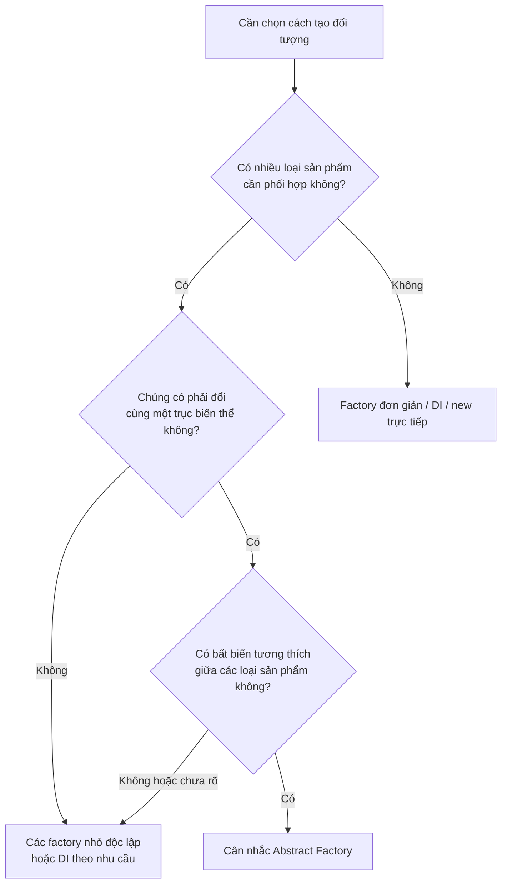

# Tiêu chí chọn Abstract Factory và trường hợp một factory đơn giản đã đủ

**Abstract Factory** là một mẫu thiết kế thuộc nhóm **Creational Design Pattern**, thường được dùng khi ứng dụng cần tạo **nhiều loại sản phẩm liên quan** theo **một họ (family) thống nhất**. Tuy nhiên, không phải cứ thấy nhiều constructor, nhiều class triển khai interface hay một câu lệnh `switch` là nên áp dụng Abstract Factory. Trong nhiều ứng dụng, **một factory đơn giản với một phương thức chọn implementation** đã giải quyết tốt bài toán, ít lớp hơn và dễ đọc hơn.

Bài học thuộc chương **Nhận diện bài toán** của module **SOFTWARE_DESIGN_DESIGN_PATTERN_CREATIONAL_ABSTRACT_FACTORY** — học về Abstract Factory trong design pattern. Mục tiêu là đưa ra **tiêu chí lựa chọn có thể kiểm chứng**, phân tích chi phí và dùng ví dụ Java 17 để xác định trường hợp nào nên dùng Abstract Factory, trường hợp nào chỉ cần một factory đơn giản.

## 1. Hai nhu cầu khởi tạo khác nhau

Hãy so sánh hai yêu cầu sau:

**Tình huống A — xuất báo cáo:** Người dùng chọn `PDF` hoặc `CSV`. Ứng dụng chỉ cần một đối tượng `ReportExporter` thực hiện việc xuất báo cáo theo định dạng đó.

**Tình huống B — giao diện đa nền tảng:** Người dùng chọn `LIGHT` hoặc `DARK`. Một màn hình cần **cả** `Button` và `Dialog` cùng theme; nếu tạo `LightButton` cùng `DarkDialog` thì giao diện không nhất quán.

| Câu hỏi | Xuất báo cáo | Giao diện đa theme |
| --- | --- | --- |
| Có bao nhiêu **loại sản phẩm** client cần tạo? | Một: `ReportExporter` | Hai: `Button`, `Dialog` |
| Có các implementation thay thế nhau không? | `PdfExporter`, `CsvExporter` | `LightButton`/`DarkButton` và `LightDialog`/`DarkDialog` |
| Có yêu cầu các loại sản phẩm **đổi cùng nhau** không? | Không phát sinh vì chỉ có một loại | Có: cả hai thành phần phải chung theme |
| Client cần yêu cầu factory làm gì? | `create(format)` trả một exporter | `createButton()` và `createDialog()` từ cùng một factory |
| Thiết kế thường đủ dùng | **Simple Factory** hoặc hàm tạo có chọn biến thể | **Abstract Factory** |

Số lượng class không phải tiêu chí quyết định. Tiêu chí có giá trị hơn là **bất biến nghiệp vụ**: *có nhiều loại sản phẩm buộc phải được tạo thành một bộ tương thích theo cùng quyết định chọn biến thể hay không?*

## 2. Hiểu đúng các thuật ngữ trước khi lựa chọn

Một số thuật ngữ factory rất dễ bị dùng thay thế cho nhau:

| Thuật ngữ | Vai trò | Dấu hiệu nhận biết |
| --- | --- | --- |
| **Simple Factory** | Một class hoặc hàm tập trung việc chọn và khởi tạo implementation | Thường có `create(type)` và `switch`/ánh xạ cấu hình bên trong |
| **Abstract Factory** | Interface khai báo cách tạo **nhiều loại sản phẩm** trong một họ; mỗi concrete factory đại diện cho một họ | `UiFactory` có `createButton()`, `createDialog()`; `LightUiFactory` hiện thực cả hai |
| **Factory Method** | Một phương thức tạo có thể được lớp con ghi đè để quyết định sản phẩm được tạo trong cấu trúc kế thừa | Lớp cơ sở gọi một factory method do subclass triển khai |
| **Builder** | Xây dựng một đối tượng có nhiều bước hoặc nhiều tùy chọn cấu hình | `builder.set...().build()` tạo ra một đối tượng hoàn chỉnh |

**Simple Factory** là một cách tổ chức mã thường gặp, không phải một trong 23 mẫu GoF được đặt tên độc lập. Việc một class tên `ReportExporterFactory` **không tự biến nó thành Abstract Factory**. Cũng không nên đồng nhất một **static factory method** như `ReportExporter.of(format)` với pattern Factory Method của GoF: tên gọi gần nhau nhưng cơ chế và mục tiêu có thể khác.

## 3. Checklist tiêu chí: khi nào Abstract Factory có giá trị?

Xem xét các câu hỏi sau theo thứ tự. Không nên chỉ đếm số chữ `new` trong code.

### Tiêu chí 1: Có từ hai **loại sản phẩm** thực sự liên quan?

Ví dụ `Button` và `Dialog` là hai loại sản phẩm. Trong mỗi loại có nhiều class triển khai, nhưng chúng có trách nhiệm khác nhau trong cùng một màn hình. Nếu chỉ có `ReportExporter` với các phiên bản `PdfExporter`, `CsvExporter`, ta mới có **nhiều lựa chọn cho một loại sản phẩm**; một factory đơn giản thường đủ.

Con số hai là một **dấu hiệu nhận diện cách dùng điển hình**, không phải yêu cầu cứng của Java hay pattern: một hệ thống có thể thiết kế abstraction sớm để chuẩn bị mở rộng, nhưng nên có **nhu cầu rõ ràng** trước khi chấp nhận thêm lớp gián tiếp.

### Tiêu chí 2: Có các họ sản phẩm cùng thay theo một trục biến thể?

Ví dụ trục `theme` tạo ra các họ:

| Theme | Button | Dialog |
| --- | --- | --- |
| `LIGHT` | `LightButton` | `LightDialog` |
| `DARK` | `DarkButton` | `DarkDialog` |

Đổi từ `LIGHT` sang `DARK` có nghĩa **đổi cả bộ sản phẩm**. Nếu `Button` thay theo theme nhưng `Dialog` độc lập hoàn toàn với theme, việc ép chúng vào một `UiFactory` duy nhất có thể không mang lại lợi ích.

### Tiêu chí 3: Có tổ hợp không tương thích hoặc không mong muốn?

Một bất biến có thể phát biểu rõ ràng là: **mọi `Button` và `Dialog` xuất hiện trong cùng một màn hình phải thuộc cùng theme**. Abstract Factory giúp tập trung trách nhiệm tuân thủ bất biến vào `LightUiFactory` hoặc `DarkUiFactory`.

Nếu *mọi tổ hợp sản phẩm đều hợp lệ*, không có yêu cầu thay cùng nhau, thì lý do gom thành một họ yếu đi rất nhiều. Chỉ có nhiều interface hoặc cùng tiền tố package chưa đủ chứng minh sự tồn tại của họ sản phẩm.

### Tiêu chí 4: Client có cần độc lập với implementation cụ thể?

Nếu nhiều màn hình, service hoặc module cùng cần `Button`/`Dialog`, việc client dùng `UiFactory`, `Button`, `Dialog` giúp tránh rải rác lệnh `new Light...` và điều kiện chọn theme. Nhưng nếu chỉ một điểm tạo ra một loại object đơn giản, **một factory nhỏ tập trung lựa chọn** cũng đã cung cấp sự tách biệt cần thiết.

### Tiêu chí 5: Trục biến thể có khả năng thay đổi cùng nhau và loại sản phẩm tương đối ổn định?

Abstract Factory thường thuận lợi khi **thêm họ mới**: thêm `HighContrastUiFactory` mà client vẫn dùng contract cũ. Ngược lại, khi **thêm loại sản phẩm** như `Tooltip`, mọi concrete factory thường phải bổ sung `createTooltip()`. Nếu danh sách loại sản phẩm liên tục thay đổi, chi phí sửa hợp đồng và các factory sẽ tăng.

### Tiêu chí 6: Có đáng chấp nhận chi phí lớp gián tiếp?

Abstract Factory thường thêm product interface, abstract factory interface, concrete factory cho từng họ, các concrete product và điểm lắp ghép chọn factory. Lợi ích chỉ rõ khi các lớp đó giúp **giảm lỗi trộn họ, tránh lựa chọn lặp lại hoặc cô lập một biến động có thật**. Nếu không, chúng làm dài đường truy vết một lời gọi khởi tạo.

## 4. Sơ đồ quyết định thực dụng



Sơ đồ là **gợi ý phân tích**, không phải thuật toán bắt buộc. Chẳng hạn có một họ hiện tại nhưng kế hoạch thêm nhiều họ đã được phê duyệt, thiết kế theo Abstract Factory vẫn có thể có cơ sở. Ngược lại, dù đủ hai loại sản phẩm và hai họ, nếu việc tạo chúng chỉ diễn ra tại một vị trí nhỏ, hãy so sánh mức đơn giản của giải pháp hiện tại trước khi tách thêm nhiều interface.

## 5. Trường hợp một Simple Factory đã đủ: chọn một ReportExporter

Yêu cầu: ứng dụng xuất cùng dữ liệu sang `PDF` hoặc `CSV`. Client chỉ cần một **loại sản phẩm** `ReportExporter`; giữa `PdfExporter` và `CsvExporter` là quan hệ **thay thế cho nhau**, không có sản phẩm thứ hai cần ghép cùng họ.

### 5.1. Ví dụ Java 17 chạy độc lập

Lưu mã sau vào `SimpleExporterDemo.java`:

```java
import java.util.Locale;

public final class SimpleExporterDemo {
    enum Format {
        PDF, CSV;

        static Format parse(String raw) {
            if (raw == null || raw.isBlank()) {
                throw new IllegalArgumentException("Format không được rỗng");
            }
            return switch (raw.trim().toLowerCase(Locale.ROOT)) {
                case "pdf" -> PDF;
                case "csv" -> CSV;
                default -> throw new IllegalArgumentException(
                        "Định dạng không hỗ trợ: " + raw);
            };
        }
    }

    interface ReportExporter {
        String export(String title);
    }

    static final class PdfExporter implements ReportExporter {
        @Override
        public String export(String title) {
            return "PDF report: " + title;
        }
    }

    static final class CsvExporter implements ReportExporter {
        @Override
        public String export(String title) {
            return "CSV report: " + title;
        }
    }

    // Một factory đơn giản, một loại sản phẩm trả về.
    static final class ReportExporterFactory {
        static ReportExporter create(Format format) {
            return switch (java.util.Objects.requireNonNull(format)) {
                case PDF -> new PdfExporter();
                case CSV -> new CsvExporter();
            };
        }
    }

    static final class ReportService {
        private final ReportExporter exporter;

        ReportService(ReportExporter exporter) {
            this.exporter = java.util.Objects.requireNonNull(exporter);
        }

        String run(String title) {
            return exporter.export(title);
        }
    }

    public static void main(String[] args) {
        if (args.length > 1) {
            throw new IllegalArgumentException("Chỉ nhận tối đa một format");
        }

        Format format = Format.parse(args.length == 0 ? "pdf" : args[0]);
        ReportExporter exporter = ReportExporterFactory.create(format);
        System.out.println(new ReportService(exporter).run("Doanh thu quý 1"));
    }
}
```

Biên dịch và chạy bằng JDK 17 trở lên:

```bash
javac -encoding UTF-8 SimpleExporterDemo.java
java SimpleExporterDemo pdf
java SimpleExporterDemo csv
```

Kết quả hai lần chạy:

```text
PDF report: Doanh thu quý 1
CSV report: Doanh thu quý 1
```

Ví dụ chỉ trả về chuỗi minh họa, không tạo file PDF/CSV thật. `ReportExporterFactory.create()` tập trung ánh xạ `Format → ReportExporter`; `ReportService` chỉ biết interface và được truyền implementation qua constructor. Như vậy **vẫn đạt sự tách biệt khỏi class cụ thể** mà không cần thêm `AbstractReportFactory`, `PdfReportFactory`, `CsvReportFactory` với nhiều phương thức tạo không có nhu cầu.

### 5.2. Khi nào còn có thể đơn giản hơn?

Nếu chỉ có một implementation `PdfExporter`, không có cấu hình chọn biến thể và chỉ tạo object ở một nơi, lời gọi `new PdfExporter()` ở composition root rồi truyền vào `ReportService` là hoàn toàn hợp lý. Một factory class riêng không tạo giá trị chỉ vì mục đích bọc duy nhất một constructor. Đặt mức trừu tượng theo **nhu cầu thay đổi thực tế**.

## 6. Trường hợp Abstract Factory phát huy giá trị: tạo cả bộ giao diện

Yêu cầu: mỗi màn hình phải tạo `Button` và `Dialog` cùng một theme. Nếu mỗi sản phẩm có factory riêng, client hoặc composition root phải nhớ chọn **đúng cả hai biến thể**. Việc để một `UiFactory` tạo trọn bộ giúp biến quy tắc này thành một ranh giới thiết kế.

### 6.1. Ma trận sản phẩm và rủi ro trộn họ

| | `LightDialog` | `DarkDialog` |
| --- | --- | --- |
| `LightButton` | Hợp lệ: cùng `LIGHT` | Không mong muốn nếu phải thống nhất theme |
| `DarkButton` | Không mong muốn nếu phải thống nhất theme | Hợp lệ: cùng `DARK` |

Điều làm Abstract Factory có ích chính là **hai ô chéo không mong muốn**. Java vẫn có thể biên dịch một đoạn tạo `LightButton` và `DarkDialog` nếu hai class đều hợp lệ theo interface. Một concrete factory được triển khai đúng sẽ tập trung trách nhiệm tạo các sản phẩm cùng họ, giúp client tránh lựa chọn độc lập.

### 6.2. Ví dụ Java 17 chạy độc lập

Lưu mã vào `UiFamilyDemo.java`:

```java
import java.util.Locale;

public final class UiFamilyDemo {
    interface Button {
        String render();
    }

    interface Dialog {
        String render();
    }

    // Abstract Factory: khai báo nhiều loại sản phẩm cùng một họ.
    interface UiFactory {
        Button createButton();
        Dialog createDialog();
    }

    record LightButton() implements Button {
        @Override
        public String render() { return "LIGHT button"; }
    }

    record LightDialog() implements Dialog {
        @Override
        public String render() { return "LIGHT dialog"; }
    }

    record DarkButton() implements Button {
        @Override
        public String render() { return "DARK button"; }
    }

    record DarkDialog() implements Dialog {
        @Override
        public String render() { return "DARK dialog"; }
    }

    static final class LightUiFactory implements UiFactory {
        @Override
        public Button createButton() { return new LightButton(); }

        @Override
        public Dialog createDialog() { return new LightDialog(); }
    }

    static final class DarkUiFactory implements UiFactory {
        @Override
        public Button createButton() { return new DarkButton(); }

        @Override
        public Dialog createDialog() { return new DarkDialog(); }
    }

    static final class SettingsScreen {
        private final UiFactory factory;

        SettingsScreen(UiFactory factory) {
            this.factory = java.util.Objects.requireNonNull(factory);
        }

        String render() {
            Button save = factory.createButton();
            Dialog confirm = factory.createDialog();
            return save.render() + " | " + confirm.render();
        }
    }

    // Điểm lắp ráp chịu trách nhiệm chọn một concrete factory.
    static UiFactory select(String rawTheme) {
        String theme = java.util.Objects.requireNonNull(rawTheme)
                .trim().toLowerCase(Locale.ROOT);
        return switch (theme) {
            case "light" -> new LightUiFactory();
            case "dark" -> new DarkUiFactory();
            default -> throw new IllegalArgumentException("Theme không hỗ trợ: " + rawTheme);
        };
    }

    public static void main(String[] args) {
        if (args.length > 1) {
            throw new IllegalArgumentException("Chỉ nhận tối đa một theme");
        }

        UiFactory factory = select(args.length == 0 ? "light" : args[0]);
        System.out.println(new SettingsScreen(factory).render());
    }
}
```

Biên dịch và chạy:

```bash
javac -encoding UTF-8 UiFamilyDemo.java
java UiFamilyDemo light
java UiFamilyDemo dark
```

Kết quả hai lần chạy:

```text
LIGHT button | LIGHT dialog
DARK button | DARK dialog
```

`SettingsScreen` không cần biết `LightButton` hoặc `DarkDialog`; nó chỉ gọi hai phương thức trên cùng một factory đã được chọn tại composition root. Đây là khác biệt cốt lõi so với Simple Factory ở phần 5: **một quyết định chọn theme chi phối nhiều loại sản phẩm cần hoạt động nhất quán**.

Abstract Factory **không tự động chứng minh** concrete factory luôn đúng: lập trình viên vẫn có thể viết nhầm `DarkUiFactory.createDialog()` trả về `LightDialog`. Vì thế cần kiểm thử tính tương thích ở cấp factory, đặc biệt khi có plugin hay implementation bên ngoài.

## 7. Đừng nhầm nhiều loại sản phẩm với một họ sản phẩm

Một ứng dụng có thể cần cả `EmailSender`, `Logger`, `Cache` và `PaymentGateway`, nhưng sự xuất hiện đồng thời của bốn interface **không chứng minh** chúng phải nằm trong `ApplicationFactory`. Cần xem chúng có cùng thay theo một quyết định và có tổ hợp nào bị cấm không.

Ví dụ:

- Nếu `Cache` có thể là Redis hoặc in-memory, còn `EmailSender` có thể là SMTP hoặc một nhà cung cấp API, và **mọi cặp kết hợp đều hợp lệ**, hai dependency nên được chọn độc lập. Constructor injection hoặc hai factory nhỏ thường dễ bảo trì hơn.
- Nếu `SqlConnection` và `SqlQueryBuilder` phải dùng cùng dialect `PostgreSQL` hoặc `SQL Server`, đó là một lý do rõ ràng để cân nhắc `DatabaseFactory` tạo cả hai theo cùng họ.
- Nếu `PdfExporter` và `CsvExporter` chỉ là hai implementation của **một** `ReportExporter`, việc có hai class chưa tạo ra một bộ sản phẩm.

Điểm khác biệt là **mối quan hệ giữa các loại sản phẩm**, không phải vị trí package, số concrete class hay tên `Factory`.

## 8. Chi phí đánh đổi khi chọn Abstract Factory

Với `P` loại sản phẩm và `F` họ sản phẩm, cấu trúc Abstract Factory thường có `P` product interface, một abstract factory, `F` concrete factory và có thể tới `P × F` concrete product nếu mỗi ô trong ma trận cần một lớp riêng. Đây là một mô hình ước lượng **số kiểu mã nguồn**, không phải công thức hiệu năng lúc chạy.

| Loại thay đổi | Simple Factory cho một product | Abstract Factory cho nhiều product |
| --- | --- | --- |
| Thêm implementation của cùng một loại sản phẩm | Thêm class và một ánh xạ trong `create(type)` | Nếu là một **họ mới**, thường thêm product của từng loại, concrete factory và lựa chọn factory |
| Thêm một loại sản phẩm độc lập | Thêm interface/class hoặc factory riêng nếu cần | Thêm product interface, phương thức vào abstract factory và cập nhật **tất cả** concrete factory bắt buộc hỗ trợ |
| Truy vết nơi tạo object | Theo `create(type)` rồi tới constructor | Theo cấu hình → selector → concrete factory → phương thức `create...()` |
| Bảo đảm các sản phẩm cùng họ | Không phát sinh nếu chỉ tạo một loại; nhiều factory độc lập cần điều phối riêng | Concrete factory tập trung trách nhiệm tạo bộ sản phẩm nhất quán |
| Chi phí cho đội nhỏ | Ít abstraction, dễ đọc | Nhiều class, hợp đồng và bài kiểm tra hơn |

Thêm họ sản phẩm thường thuận lợi với Abstract Factory vì client không đổi, nhưng thêm **loại** sản phẩm mới có thể làm hợp đồng phình to. Khi nhiều concrete factory do bên ngoài quản lý, thêm `createTooltip()` vào interface còn khiến các implementer đó phải cập nhật mã nguồn hoặc gặp rủi ro ở runtime với binary cũ.

Một hệ thống chỉ có một màn hình, hai loại sản phẩm và một theme cố định có thể dùng cấu trúc trực tiếp tương đối đơn giản. Khi đã có **nhiều client cùng phải thay bộ sản phẩm**, rủi ro điều kiện chọn biến thể bị lặp ở nhiều nơi tăng lên, và Abstract Factory trở nên đáng cân nhắc hơn.

## 9. Lộ trình đi từ Simple Factory đến Abstract Factory khi yêu cầu phát triển

Không cần dự đoán trước mọi biến thể tương lai. Một cách tiến hóa thực tế:

1. **Bắt đầu từ nhu cầu có thật.** Nếu chỉ cần `ReportExporter`, xây `ReportExporterFactory.create(format)` hoặc chọn implementation ngay tại composition root.
2. **Quan sát yêu cầu mới.** Nếu cùng định dạng xuất báo cáo còn bắt buộc chọn `DocumentWriter`, `ImageRenderer`, `ChartRenderer` nhất quán giữa `HTML`/`PDF`, hãy viết rõ ma trận các sản phẩm và bất biến tương thích.
3. **Tách các product interface.** Ví dụ `DocumentWriter`, `ChartRenderer`, xác định hành vi chung mà client cần, tránh đưa type cụ thể của từng định dạng vào hợp đồng.
4. **Tạo abstract factory.** Khai báo phương thức tạo các loại sản phẩm thực sự cần thay cùng nhau, chẳng hạn `ReportFamilyFactory.createWriter()` và `createChartRenderer()`.
5. **Tạo concrete factory theo định dạng.** `HtmlReportFactory` tạo cả hai triển khai HTML, `PdfReportFactory` tạo cả hai triển khai PDF.
6. **Chuyển lựa chọn vào composition root.** Đọc cấu hình một lần cho mỗi tác vụ xuất báo cáo, chọn một concrete factory và truyền nó cho client.
7. **Thêm contract test.** Xác minh từng factory tạo đủ sản phẩm tương thích và kiểm tra các luồng nghiệp vụ cần kết hợp chúng.

Điều quan trọng là **không duy trì đồng thời hai đường tạo sản phẩm thiếu kiểm soát**. Nếu client vẫn gọi `ReportExporterFactory.create(PDF)` nhưng một nơi khác chọn renderer `HTML`, rủi ro trộn họ vẫn tồn tại dù đã thêm abstract factory. Khi refactor, cần chuyển những client có trách nhiệm phối hợp sản phẩm sang cùng một contract.

## 10. Kiểm thử tiêu chí bằng một bất biến cụ thể

Một thiết kế Abstract Factory có giá trị khi nó giúp bảo vệ một yêu cầu có thể kiểm tra. Với ví dụ UI, bất biến là: **cặp `Button` và `Dialog` do một factory trả về phải thuộc cùng theme**.

Ví dụ kiểm thử JUnit 5 (đặt cùng package phù hợp để có quyền truy cập các lớp lồng của `UiFamilyDemo`):

```java
import org.junit.jupiter.api.Test;

import static org.junit.jupiter.api.Assertions.assertEquals;

class UiFamilyDemoTest {
    @Test
    void lightFactoryCreatesMatchingFamily() {
        var screen = new UiFamilyDemo.SettingsScreen(
                new UiFamilyDemo.LightUiFactory());
        assertEquals("LIGHT button | LIGHT dialog", screen.render());
    }

    @Test
    void darkFactoryCreatesMatchingFamily() {
        var screen = new UiFamilyDemo.SettingsScreen(
                new UiFamilyDemo.DarkUiFactory());
        assertEquals("DARK button | DARK dialog", screen.render());
    }
}
```

Test minh họa này cần dự án đã cấu hình JUnit Jupiter. Trong ứng dụng UI thật, nên kiểm tra **hành vi, quy tắc theme và tính tương thích thực tế** thay vì chỉ phụ thuộc chuỗi `LIGHT`/`DARK`. Nếu không nêu được bất biến quan trọng nào cần kiểm tra cho nhiều loại sản phẩm, đó là tín hiệu nên xem lại việc áp dụng Abstract Factory.

## 11. Các sai lầm thường gặp khi chọn pattern

| Sai lầm | Vì sao có vấn đề? | Cách xem xét lại |
| --- | --- | --- |
| "Có nhiều class nên dùng Abstract Factory" | Số class không nói lên yêu cầu tạo nhiều product type cùng một họ | Liệt kê product type, family và ma trận tương thích |
| "Có một interface với ba implementation nên cần Abstract Factory" | Vẫn chỉ là một product type | Dùng Simple Factory, DI hoặc chọn implementation tại composition root |
| Tạo `AbstractFactory` chỉ có một phương thức `create()` rồi thêm subclass cho mọi biến thể | Tăng tầng kế thừa mà không giải quyết bài toán họ sản phẩm | Chọn factory đơn giản nếu chỉ tạo một loại sản phẩm |
| Gộp mọi đối tượng thành `GlobalFactory` | Tạo contract lớn dù các object thay đổi độc lập | Chia theo các nhóm có bất biến tương thích thực sự |
| Để client `switch(theme)` riêng cho mỗi product | Dễ chọn sản phẩm khác họ trong cùng workflow | Chọn một concrete factory cho cả bộ ở điểm lắp ráp |
| Dùng Abstract Factory khi mọi tổ hợp đều hợp lệ | Đặt ràng buộc và chi phí bảo trì không cần thiết | Dùng các dependency/factory độc lập |
| Chỉ vì sợ tương lai mà dựng hàng loạt factory chưa có sản phẩm | Tăng chi phí đọc hiểu và test, chưa có giá trị kiểm chứng | Thiết kế nhỏ trước và refactor khi yêu cầu thật xuất hiện |
| Xem việc có factory là đủ bảo đảm cùng họ | Concrete factory vẫn có thể tạo nhầm product | Thêm contract test kiểm tra mỗi họ |

## 12. Ba tình huống để tự ra quyết định

**Tình huống 1 — thanh toán:** Ứng dụng chọn `StripePaymentGateway` hoặc `BankTransferGateway`. Sau khi chọn, nghiệp vụ chỉ gọi `PaymentGateway.pay()`. Nếu không có loại sản phẩm thứ hai cần thay đồng bộ, **một factory đơn giản hoặc DI** là đủ. Việc đặt tên `PaymentGatewayFactory` không tự đòi hỏi Abstract Factory.

**Tình huống 2 — giao diện đa nền tảng:** Ứng dụng chạy trên Windows và macOS; mỗi nền tảng có `Button`, `Menu` và `Dialog` khác nhau, cần giữ phong cách tương thích trong một cửa sổ. **Abstract Factory phù hợp** vì một quyết định chọn nền tảng chi phối nhiều loại sản phẩm liên quan.

**Tình huống 3 — hệ thống bán hàng:** Ứng dụng dùng `SmsSender` (nhà cung cấp A/B) và `InvoiceGenerator` (PDF/HTML). Hai lựa chọn độc lập; mọi tổ hợp đều hợp lệ. **Không nên ép vào một `SalesFactory` chỉ vì cả hai xuất hiện trong quy trình bán hàng.** Nếu sau này pháp lý hoặc nghiệp vụ yêu cầu một số bộ sender/generator phải đi cùng nhau, cần xác định rõ bất biến mới trước khi đổi thiết kế.

Để rà soát một yêu cầu khác, có thể điền vào bảng:

| Cần ghi rõ | Câu hỏi |
| --- | --- |
| Product types | Client cần **những loại sản phẩm khác nhau nào**? |
| Families | Cấu hình/biến thể nào định nghĩa một **bộ** sản phẩm? |
| Compatibility | Tổ hợp nào hợp lệ, tổ hợp nào cần cấm và vì sao? |
| Variation | Có thường thêm họ mới không, hay thường thêm loại sản phẩm mới? |
| Scope | Lựa chọn được thực hiện lúc startup, theo request hay theo tác vụ? |
| Cost | Lợi ích giữ nhất quán có bù được chi phí contract và concrete factory không? |

## 13. Checklist cuối cùng trước khi áp dụng Abstract Factory

- [ ] Có **nhiều loại sản phẩm**, không chỉ nhiều class triển khai của cùng một interface.
- [ ] Có một **trục lựa chọn chung** (theme, platform, database dialect, provider...) tác động tới các loại sản phẩm đó.
- [ ] Có **bất biến tương thích** hoặc lý do nghiệp vụ cụ thể để các sản phẩm phải cùng họ.
- [ ] Client cần hoạt động với các họ mà không biết class cụ thể.
- [ ] Có kế hoạch thêm/đổi họ khiến việc gom lựa chọn vào một factory thực sự tiết kiệm sửa đổi.
- [ ] Đã cân nhắc chi phí thêm product interface, abstract factory, concrete factory, test và điểm lắp ráp.
- [ ] Đã nhận diện hệ quả khi thêm một **loại** sản phẩm mới: các concrete factory sẽ phải cập nhật.
- [ ] Nếu chỉ chọn một implementation của một loại sản phẩm, đã cân nhắc Simple Factory, DI hoặc `new` tại composition root.
- [ ] Nếu các sản phẩm độc lập, không gộp chúng vào một factory lớn thiếu bất biến chung.
- [ ] Có thể kiểm thử tính nhất quán của từng họ sản phẩm khi chọn Abstract Factory.

**Ghi nhớ:** Hãy chọn **Abstract Factory** khi bài toán đòi tạo **một bộ sản phẩm thuộc cùng một họ** và cần cô lập quyết định chọn họ khỏi client. Hãy chọn **một factory đơn giản** khi yêu cầu chỉ là lựa chọn **một sản phẩm trong nhiều implementation**. Tiêu chí quan trọng nhất là **quan hệ tương thích và cùng thay đổi giữa các loại sản phẩm**, không phải số lượng class hay việc dự án có dùng từ `Factory`.
