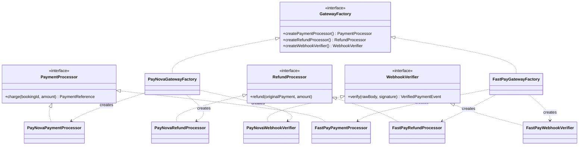
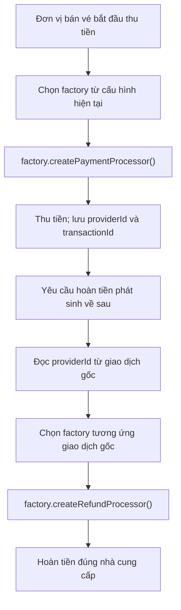

# Phân tích một đề bài và lập ma trận họ sản phẩm trước khi thiết kế lớp

> **Chương:** Bài tập thực hành  
> **Module:** `SOFTWARE_DESIGN_DESIGN_PATTERN_CREATIONAL_ABSTRACT_FACTORY` — Học về abstract factory trong design pattern.

## 1. Mục tiêu và cách thực hành

Trong Abstract Factory, sai lầm dễ gặp là vẽ ngay các lớp `Factory`, `ProductA`, `ProductB` rồi mới cố gắng gắn chúng vào bài toán. Bài tập này đi theo chiều ngược lại: **đọc yêu cầu → xác định những sản phẩm cần đi cùng nhau → lập ma trận họ sản phẩm → kiểm tra tính nhất quán → thiết kế lớp**.

Sau khi hoàn thành, bạn cần giải thích được:

- **Họ sản phẩm** là tập các biến thể được chọn cùng nhau theo một tiêu chí; **loại sản phẩm** là vai trò/hợp đồng chung xuất hiện trong mỗi họ.
- Vì sao một ma trận nên có **mỗi cột là một họ**, **mỗi hàng là một loại sản phẩm**, và mỗi ô là một hiện thực cụ thể.
- Khi nào hai đối tượng phải xuất phát từ cùng một họ, khi nào một yêu cầu không liên quan đến họ sản phẩm.
- Cách chuyển từ ma trận sang abstract products, abstract factory, concrete products và concrete factories mà không làm mã nghiệp vụ phụ thuộc vào class cụ thể.

**Cách làm:** Đọc phần đề bài và tự hoàn thành các nhiệm vụ ở mục 3 trước. Mục 4 là lời giải tham khảo, được đặt sau phần thực hành để bạn có thể đối chiếu.

## 2. Đề bài: cổng thanh toán cho hệ thống bán vé

Một hệ thống bán vé hội thảo cần tích hợp **hai nhà cung cấp thanh toán giả định**: `PayNova` và `FastPay`. Mỗi nhà cung cấp có API, thông tin xác thực và mã giao dịch riêng. Nhóm phát triển nhận được các yêu cầu sau:

| Mã | Yêu cầu nghiệp vụ hoặc kỹ thuật |
| --- | --- |
| R1 | Hệ thống hỗ trợ thanh toán qua `PayNova` và `FastPay`. Tại lúc bắt đầu giao dịch, cấu hình đơn vị bán vé quyết định nhà cung cấp được sử dụng. |
| R2 | Với mỗi nhà cung cấp, hệ thống phải **tạo giao dịch thu tiền**. |
| R3 | Với mỗi nhà cung cấp, hệ thống phải **hoàn tiền** cho một giao dịch đã thu. |
| R4 | Với mỗi nhà cung cấp, hệ thống phải **xác thực chữ ký webhook** để nhận sự kiện thanh toán bất đồng bộ. |
| R5 | Mã giao dịch và chữ ký của hai nhà cung cấp có định dạng/cơ chế riêng; không thể dùng bộ hoàn tiền hoặc xác thực webhook của nhà cung cấp này thay cho nhà cung cấp kia. |
| R6 | Khi tạo giao dịch, hệ thống lưu nhà cung cấp thực tế và mã giao dịch bên ngoài. Nếu cấu hình đơn vị bán vé đổi sau đó, lệnh hoàn tiền vẫn phải dùng nhà cung cấp của giao dịch gốc. |
| R7 | Webhook đến qua endpoint đã gắn với từng nhà cung cấp. Chỉ xử lý nội dung sau khi kiểm tra chữ ký hợp lệ; không chọn nhà cung cấp chỉ dựa vào một trường trong payload chưa xác thực. |
| R8 | Hệ thống gửi email biên nhận bằng tiếng Việt hoặc tiếng Anh; lựa chọn ngôn ngữ không phụ thuộc cổng thanh toán. |
| R9 | Trong tương lai có thể thêm nhà cung cấp thứ ba hoặc một loại thao tác thanh toán mới. |

Để tập trung vào thiết kế, giả sử cả hai nhà cung cấp đều hỗ trợ các thao tác R2–R4 và phạm vi của bài không yêu cầu viết mã gọi API thật. Các tên `PayNova` và `FastPay` chỉ là dữ liệu giả định, không đại diện cho dịch vụ thực tế.

**Nhiệm vụ chính:** Trước khi viết bất kỳ `interface` hay `class` nào, hãy tạo một ma trận mô tả **các họ sản phẩm và các loại sản phẩm** mà hệ thống phải hỗ trợ.

## 3. Phiếu bài tập: phân tích trước, vẽ lớp sau

### Bài 1 — Gạch chân các chiều biến thiên

Từ R1–R9, trả lời bằng lời ngắn gọn:

1. Yếu tố nào quyết định hệ thống dùng **họ hiện thực** nào?
2. Có bao nhiêu họ ở phiên bản đầu tiên? Hãy đặt tên cho từng họ.
3. Những **khả năng tạo ra đối tượng** nào cần tồn tại ở mọi họ? Gọi tên từng loại sản phẩm theo *vai trò*, không theo tên nhà cung cấp.
4. Tại sao hoàn tiền và kiểm tra webhook không thể chọn nhà cung cấp độc lập với giao dịch liên quan?
5. Ngôn ngữ email (`vi`/`en`) là một họ sản phẩm trong ma trận cổng thanh toán hay là một yêu cầu độc lập? Giải thích.

Gợi ý: Hãy hỏi **“Nếu chuyển toàn bộ phần thanh toán từ PayNova sang FastPay, những thành phần nào phải được thay đồng bộ?”**. Những thành phần ấy là ứng viên cho các hàng của ma trận.

### Bài 2 — Điền ma trận họ sản phẩm

Sử dụng khuôn sau, **chưa cần đặt tên class**. Ở mỗi ô, mô tả hiện thực hoặc chức năng cụ thể của nhà cung cấp tương ứng.

| Loại sản phẩm / Vai trò | Họ 1: __________ | Họ 2: __________ |
| --- | --- | --- |
| Xử lý thu tiền | __________ | __________ |
| Xử lý hoàn tiền | __________ | __________ |
| Kiểm tra tính hợp lệ webhook | __________ | __________ |

Sau khi điền, hãy thực hiện ba phép kiểm tra:

- **Đủ hàng:** Mỗi thao tác bắt buộc ở R2–R4 có một hàng chưa?
- **Đủ cột:** Mỗi nhà cung cấp ở R1 có một cột chưa? Mọi ô bắt buộc đều có hiện thực chưa?
- **Đúng ràng buộc:** Có tình huống nào tạo bộ thu tiền của PayNova nhưng bộ hoàn tiền của FastPay cho cùng một giao dịch không? Nếu có, ma trận hoặc cách chọn factory cần được xem lại.

### Bài 3 — Phân biệt sản phẩm cùng họ và phần độc lập

Điền **“Trong ma trận”** hoặc **“Ngoài ma trận”** và ghi lý do cho các đối tượng/khái niệm sau:

| Ứng viên | Phân loại của bạn | Lý do |
| --- | --- | --- |
| Thành phần gọi API thu tiền | ______ | ______ |
| Thành phần gọi API hoàn tiền | ______ | ______ |
| Thành phần xác thực webhook | ______ | ______ |
| Mẫu email biên nhận tiếng Việt | ______ | ______ |
| Mẫu email biên nhận tiếng Anh | ______ | ______ |
| Mã giao dịch bên ngoài trả về sau thu tiền | ______ | ______ |
| Thời điểm phát sinh giao dịch | ______ | ______ |

Lưu ý: **Đầu ra dữ liệu** như mã giao dịch có thể cần được lưu kèm tên nhà cung cấp để sử dụng về sau, nhưng điều đó chưa đủ để xem nó là một *loại sản phẩm cần factory tạo*.

### Bài 4 — Xác định điểm chọn họ và bất biến

Mô tả bằng 4–6 câu cách chương trình chọn và dùng họ sản phẩm trong ba luồng:

1. **Thu tiền:** Chọn nhà cung cấp theo cấu hình tại thời điểm tạo giao dịch; tạo bộ xử lý phù hợp và lưu nguồn gốc giao dịch.
2. **Hoàn tiền:** Đọc dữ liệu giao dịch đã lưu; tìm đúng nhà cung cấp để tạo bộ xử lý hoàn tiền, ngay cả khi cấu hình mới đã thay đổi.
3. **Webhook:** Xác định nhà cung cấp từ endpoint/routing đáng tin cậy; tạo bộ xác thực của nhà cung cấp đó, kiểm tra chữ ký rồi mới tin nội dung sự kiện.

Viết ít nhất hai **bất biến thiết kế** — những điều phải luôn đúng. Ví dụ: “Không hoàn tiền qua nhà cung cấp khác với nhà cung cấp đã thu tiền.”

### Bài 5 — Chỉ sau khi xong ma trận: phác thảo interface

Từ số hàng và cột ở Bài 2, xác định:

- Bao nhiêu **abstract product interface** cần có, và tên của chúng?
- Một **abstract factory interface** cần có những phương thức tạo sản phẩm nào?
- Bao nhiêu **concrete factory** cần có? Mỗi factory sẽ tạo những concrete product nào?
- Mã thu tiền/hoàn tiền có được trực tiếp gọi `new PayNova...` hoặc `new FastPay...` không? Nếu không, vị trí nào được phép biết các class đó?

Bạn có thể vẽ UML hoặc viết chữ ký phương thức. Chưa cần tích hợp SDK, cơ sở dữ liệu hay xử lý HTTP.

## 4. Lời giải tham khảo và cách suy luận

### 4.1. Chọn đúng trục họ sản phẩm

Trục biến thiên chi phối nhóm thành phần thanh toán là **nhà cung cấp**. Vì vậy, có **hai họ**: `PayNova` và `FastPay`.

Ba **loại sản phẩm** bắt buộc là:

1. **PaymentProcessor:** thực hiện lệnh thu tiền.
2. **RefundProcessor:** thực hiện lệnh hoàn tiền của giao dịch gốc.
3. **WebhookVerifier:** xác thực chữ ký sự kiện từ nhà cung cấp.

Điểm chung giữa ba vai trò là chúng đều phụ thuộc giao thức và khóa của nhà cung cấp được chọn. Vì thế, chúng cần được tạo từ một **gateway factory** của cùng nhà cung cấp. `PayNova` và `FastPay` là các **cột**; thu tiền, hoàn tiền và kiểm tra webhook là các **hàng**.

Một cách đặt tên class nhất quán là:

| Loại sản phẩm (hàng) | Họ `PayNova` | Họ `FastPay` |
| --- | --- | --- |
| `PaymentProcessor` | `PayNovaPaymentProcessor` | `FastPayPaymentProcessor` |
| `RefundProcessor` | `PayNovaRefundProcessor` | `FastPayRefundProcessor` |
| `WebhookVerifier` | `PayNovaWebhookVerifier` | `FastPayWebhookVerifier` |

Đây là **ma trận 3 hàng × 2 cột = 6 hiện thực sản phẩm**. Số hàng phản ánh các hợp đồng sản phẩm mà client cần; số cột phản ánh các họ hiện thực cần thay đồng bộ. Mỗi cột có một concrete factory tương ứng:

- `PayNovaGatewayFactory` tạo ba sản phẩm `PayNova*`.
- `FastPayGatewayFactory` tạo ba sản phẩm `FastPay*`.

**Vì sao phải lập ma trận trước?** Nếu bắt đầu bằng việc lập một `PaymentFactory` chỉ tạo đối tượng thu tiền, rất dễ bỏ quên nhu cầu hoàn tiền và xác thực webhook của cùng nhà cung cấp. Ma trận buộc bạn nhìn đầy đủ các vai trò liên quan trước khi quyết định cấu trúc lớp.

### 4.2. Những gì không thuộc ma trận này

| Ứng viên | Kết luận | Lý do |
| --- | --- | --- |
| Thành phần gọi API thu tiền | Trong ma trận | API khác nhau theo nhà cung cấp |
| Thành phần gọi API hoàn tiền | Trong ma trận | Phải tương ứng với nhà cung cấp của giao dịch |
| Thành phần xác thực webhook | Trong ma trận | Cách kiểm chữ ký/khóa khác nhau theo nhà cung cấp |
| Mẫu email tiếng Việt/tiếng Anh | Ngoài ma trận | Ngôn ngữ là một chiều cấu hình độc lập; không yêu cầu thay cùng họ cổng thanh toán |
| Mã giao dịch bên ngoài | Ngoài ma trận | Là dữ liệu đầu ra cần lưu và truy xuất, không phải dịch vụ có hành vi cần factory khởi tạo |
| Thời điểm giao dịch | Ngoài ma trận | Là dữ liệu nghiệp vụ, không phải biến thể triển khai theo nhà cung cấp |

**Mẹo phân tích:** Một đối tượng chỉ nên xuất hiện trong ma trận Abstract Factory khi nó là một **loại sản phẩm liên quan có biến thể theo cùng một trục họ**, và có lý do cần khởi tạo nhất quán với các sản phẩm khác. Không phải dữ liệu hoặc cấu hình nào cũng là sản phẩm của pattern.

### 4.3. Từ ma trận đến hợp đồng lớp

Chỉ sau khi ma trận ổn định, ta mới phác thảo các hợp đồng. Trong ví dụ Java sau, `PaymentReference` là **dữ liệu lưu vết** gồm nhà cung cấp và mã giao dịch gốc. Mẫu code tập trung vào ranh giới thiết kế, không triển khai SDK thật.

```java
// Dữ liệu dùng chung, được lưu lại sau thu tiền.
record PaymentReference(String providerId, String externalTransactionId) {}
record Money(long minorUnits, String currency) {}
record VerifiedPaymentEvent(String externalTransactionId, String eventType) {}

// Ba abstract products tương ứng với ba HÀNG trong ma trận.
interface PaymentProcessor {
    PaymentReference charge(String bookingId, Money amount);
}

interface RefundProcessor {
    void refund(PaymentReference originalPayment, Money amount);
}

interface WebhookVerifier {
    VerifiedPaymentEvent verify(String rawBody, String signature);
}

// Abstract Factory: hợp đồng tạo trọn một HỌ sản phẩm.
interface GatewayFactory {
    PaymentProcessor createPaymentProcessor();
    RefundProcessor createRefundProcessor();
    WebhookVerifier createWebhookVerifier();
}
```

Hai concrete factory sẽ hiện thực `GatewayFactory` và tạo đúng sản phẩm cùng họ. Phác thảo cấu trúc lớp:



Sơ đồ có **ba abstract product**, **một abstract factory**, **hai concrete factory** và **sáu concrete product**, đúng với ma trận. `CheckoutService`, `RefundService` và bộ xử lý webhook chỉ cần phụ thuộc vào các interface phù hợp; nơi lắp ghép hệ thống chịu trách nhiệm chọn factory.

### 4.4. Luồng chọn họ: đừng dùng cấu hình hiện tại cho giao dịch cũ



Ví dụ:

- **10:00:** Cấu hình là `PayNova`. Đơn hàng `B001` tạo giao dịch `PN-845` và lưu `{providerId: "PAYNOVA", externalTransactionId: "PN-845"}`.
- **11:00:** Đơn vị bán vé đổi cấu hình sang `FastPay` cho **giao dịch mới**.
- **14:00:** Khách yêu cầu hoàn tiền đơn `B001`. Hệ thống phải dùng `PayNovaRefundProcessor` vì **giao dịch gốc thuộc PayNova**, bất kể cấu hình lúc 14:00.

Đối với webhook, endpoint/routing đáng tin cậy quyết định dùng `PayNovaWebhookVerifier` hay `FastPayWebhookVerifier`. Thành phần xác thực phải từ chối chữ ký sai **trước khi** chuyển sự kiện vào xử lý nghiệp vụ. Sau khi xác thực, hệ thống đối chiếu mã giao dịch và nhà cung cấp với dữ liệu đã lưu để tránh liên kết nhầm giao dịch.

Hai bất biến cốt lõi có thể ghi vào tài liệu thiết kế:

1. **Nguồn gốc giao dịch được giữ nguyên:** hoàn tiền phải dùng nhà cung cấp đã thu tiền cho giao dịch đó.
2. **Xác thực trước khi tin dữ liệu:** webhook chỉ được xử lý sau khi bộ xác thực đúng nhà cung cấp kiểm tra chữ ký thành công.

Một bất biến bổ sung hữu ích là: **Mỗi concrete factory chỉ tạo các sản phẩm thuộc đúng họ của nó.** Điều này ngăn các tổ hợp không tương thích ngay từ bước khởi tạo.

## 5. Kiểm thử ma trận bằng các tình huống thay đổi

Một ma trận hợp lý phải giúp dự đoán chính xác phạm vi thay đổi khi yêu cầu phát triển.

| Tình huống | Thay đổi dự kiến | Điều cần kiểm tra |
| --- | --- | --- |
| Thêm nhà cung cấp `BluePay` có đủ ba thao tác | Thêm **một cột**: ba concrete product, một concrete factory và đăng ký lựa chọn factory | Hợp đồng `GatewayFactory` và mã client có giữ nguyên không? |
| Thêm khả năng tra cứu tranh chấp (`DisputeLookup`) cho **mọi** nhà cung cấp | Thêm **một hàng**: abstract product mới, phương thức tạo mới và hiện thực cho mỗi họ | Tất cả concrete factory đã triển khai sản phẩm mới chưa? |
| Bổ sung email biên nhận tiếng Nhật | Mở rộng thành phần mẫu email độc lập | Có bị buộc sửa mọi gateway factory một cách vô lý không? |
| Đổi cấu hình từ PayNova sang FastPay | Giao dịch **mới** dùng FastPay; giao dịch **cũ** giữ nguồn gốc | Hoàn tiền giao dịch cũ có còn đi đúng nhà cung cấp không? |
| Thêm một nhà cung cấp không hỗ trợ hoàn tiền | Phải làm rõ lại yêu cầu: không thể điền trọn ma trận hiện tại mà vẫn giữ hợp đồng hoàn tiền như cũ | Có cần giới hạn phạm vi, đổi hợp đồng, hoặc từ chối cấu hình thiếu năng lực không? |

Không nên coi ma trận là một bảng đặt tên lớp mang tính hình thức. Nó là công cụ kiểm tra **tính đầy đủ**, **tính tương thích** và **chi phí mở rộng** của thiết kế.

## 6. Những cách lập ma trận sai thường gặp

### Sai 1 — Đảo lẫn họ sản phẩm và loại sản phẩm

Ví dụ sai: cho `PaymentProcessor`, `RefundProcessor`, `WebhookVerifier` làm tên ba **họ**; còn `PayNova`, `FastPay` làm tên **loại sản phẩm**. Cách này đảo ngược trục: thu tiền, hoàn tiền và xác thực webhook không phải là ba cấu hình mà hệ thống chọn một trong ba. Chúng là **ba vai trò cần tồn tại đồng thời** dưới mỗi nhà cung cấp.

### Sai 2 — Tạo factory riêng cho từng thao tác mà không giữ ràng buộc cùng họ

Các factory như `PaymentProcessorFactory` và `RefundProcessorFactory` có thể hữu ích trong trường hợp đơn lẻ, nhưng nếu mỗi factory tự chọn nhà cung cấp theo cấu hình hiện tại thì nguy cơ **thu PayNova, hoàn FastPay** vẫn còn. Với yêu cầu này, một factory đại diện cho **cả họ sản phẩm của nhà cung cấp** làm ràng buộc đó rõ hơn.

### Sai 3 — Đưa mọi biến thể vào cùng một ma trận

Nếu thêm `VietnameseEmailTemplate` và `EnglishEmailTemplate` vào hai họ cổng thanh toán, ma trận sẽ buộc mỗi gateway quản lý cả ngôn ngữ email. Cấu trúc này tạo phụ thuộc giả giữa các yêu cầu độc lập. Hãy giới hạn ma trận vào nhóm sản phẩm thực sự cần thay thế đồng bộ.

### Sai 4 — Vẽ nhiều lớp trước khi chốt hàng và cột

Việc tạo trước các class `PayNovaFactory`, `PayNovaPayment`, `FastPayFactory` rồi mới phát hiện thiếu hoàn tiền hoặc webhook sẽ khiến mô hình chắp vá. Hãy xác nhận **mỗi họ có đủ các vai trò bắt buộc** rồi mới chuyển thành class/interface.

### Sai 5 — Cho rằng Abstract Factory tự bảo đảm tính đúng đắn khi chạy

Pattern làm rõ cách tạo các sản phẩm tương thích, nhưng **không tự kiểm tra** chữ ký webhook, không tự lưu nguồn gốc giao dịch và không ngăn gọi hoàn tiền với dữ liệu sai. Ứng dụng vẫn cần kiểm tra nghiệp vụ, quyền truy cập, lỗi API, idempotency và trạng thái giao dịch ở các lớp thích hợp.

## 7. Bài tập mở rộng tự làm

Không xem lại lời giải, hãy áp dụng đúng quy trình cho yêu cầu mới:

> Một ứng dụng giao diện đa nền tảng hỗ trợ `Windows` và `macOS`. Mỗi nền tảng cần có `Button`, `Checkbox` và `Dialog` theo quy tắc giao diện riêng. Ứng dụng cũng hỗ trợ tiếng Việt và tiếng Anh cho nội dung nhãn, nhưng ngôn ngữ có thể thay đổi độc lập với nền tảng.

Hãy nộp bốn phần: (1) xác định hai họ; (2) lập ma trận **3 hàng × 2 cột**; (3) vẽ interface factory và ba product interface; (4) giải thích vì sao `vi` và `en` không phải là hai cột bổ sung trong ma trận nền tảng.

Gợi ý đối chiếu sau khi tự làm: các cột phải là `Windows` và `macOS`; các hàng phải là `Button`, `Checkbox`, `Dialog`. Mỗi hệ điều hành có ba concrete product cùng họ. Ngôn ngữ giao diện do lớp tài nguyên bản địa hóa xử lý độc lập.

## 8. Tiêu chí tự đánh giá bài nộp

| Tiêu chí | Điểm tối đa | Dấu hiệu đạt |
| --- | ---: | --- |
| Xác định đúng trục họ sản phẩm | 25 | Chọn nhà cung cấp thanh toán làm họ, phân biệt được với ngôn ngữ email |
| Xác định đúng các loại sản phẩm | 20 | Đủ ba vai trò thu tiền, hoàn tiền, xác thực webhook |
| Ma trận đầy đủ và nhất quán | 25 | 3 hàng × 2 cột, không ô trống, không trộn thành phần giữa hai nhà cung cấp |
| Chuyển ma trận thành lớp/interface hợp lý | 15 | Một abstract factory, ba abstract products, hai concrete factories, sáu concrete products |
| Giải thích luồng và trường hợp thay đổi | 15 | Dùng provider gốc khi hoàn tiền, xác thực webhook trước khi xử lý, nêu rõ chi phí thêm hàng/cột |
| **Tổng** | **100** | |

**Câu hỏi kết thúc:** Nếu bạn phải trình bày thiết kế trong hai phút mà chưa được vẽ sơ đồ UML, bạn có mô tả được **cột nào là họ, hàng nào là sản phẩm và tại sao các ô trong một cột phải đi cùng nhau** không? Khi trả lời được câu đó, bạn đã có nền tảng vững để thiết kế lớp Abstract Factory.
