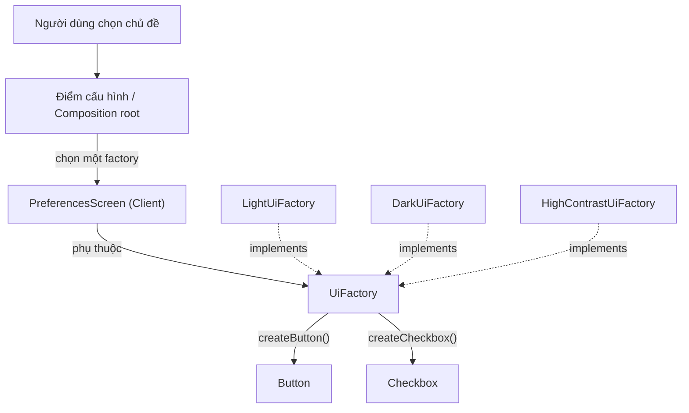

# Thêm họ HighContrast và ghi lại số điểm cần sửa trong chương trình

## 1. Mục tiêu bài thực hành

Bài tập này thuộc chương **Bài tập thực hành** của chủ đề **Abstract Factory** trong nhóm *Creational Design Patterns*. Bạn sẽ bắt đầu từ một chương trình có hai **họ sản phẩm** giao diện là **Light** và **Dark**, rồi bổ sung họ thứ ba **HighContrast**.

Mục tiêu không chỉ là làm cho chương trình hiển thị thêm một chủ đề. Bạn phải **ghi nhận chính xác những nơi cần tạo mới hoặc sửa mã** khi mở rộng theo chiều *họ sản phẩm*, đồng thời kiểm tra xem client có còn độc lập với concrete product hay không.

Kết thúc bài, bạn cần có:

- Một `HighContrastUiFactory` tạo ra cả `HighContrastButton` và `HighContrastCheckbox`.
- Một lệnh chọn chủ đề `high-contrast` chạy được mà không thay đổi logic của `PreferencesScreen`.
- Bảng **trước/sau** về số interface, concrete product và concrete factory.
- Nhật ký **số điểm thay đổi**, tách rõ *thêm mới* với *chỉnh sửa mã có sẵn*.
- Kết quả kiểm tra cho ba họ Light, Dark và HighContrast.

**Phạm vi:** Bài dùng Java 17+ và in chuỗi mô phỏng giao diện để bạn tập trung vào kiến trúc. Tên “HighContrast” trong ví dụ chỉ thể hiện một họ sản phẩm mới; **nó không chứng minh giao diện thực tế đã đạt tiêu chuẩn tương phản hoặc khả năng tiếp cận**.

## 2. Phân tích bài toán trước khi viết mã

Hệ thống ban đầu có **hai loại sản phẩm**:

1. `Button`: một nút với nhãn, có thể kết xuất thành chuỗi.
2. `Checkbox`: một ô chọn với trạng thái, có thể kết xuất thành chuỗi.

Và có **hai họ sản phẩm**:

- **Light**: `LightButton` + `LightCheckbox`, được tạo bởi `LightUiFactory`.
- **Dark**: `DarkButton` + `DarkCheckbox`, được tạo bởi `DarkUiFactory`.

Ma trận hiện tại:

| Loại sản phẩm ↓ / Họ → | Light | Dark |
|---|---|---|
| Button | `LightButton` | `DarkButton` |
| Checkbox | `LightCheckbox` | `DarkCheckbox` |

Sau khi mở rộng, ma trận mong muốn là:

| Loại sản phẩm ↓ / Họ → | Light | Dark | HighContrast |
|---|---|---|---|
| Button | `LightButton` | `DarkButton` | **`HighContrastButton`** |
| Checkbox | `LightCheckbox` | `DarkCheckbox` | **`HighContrastCheckbox`** |

Điểm cốt lõi là **thêm một cột** trong ma trận, tức một họ sản phẩm mới, **không thêm một loại sản phẩm mới**. Vì vậy `Button`, `Checkbox` và `UiFactory` vẫn có thể giữ nguyên hợp đồng nếu chúng đã được thiết kế đúng.

### Sơ đồ hợp tác mong muốn



`HighContrastUiFactory` phải trả hai concrete product của **cùng họ HighContrast**. Việc chọn họ nằm ở `Demo.main`; `PreferencesScreen` chỉ biết `UiFactory`, `Button` và `Checkbox`.

## 3. Mã nguồn ban đầu: chỉ hỗ trợ Light và Dark

Để bài tập có thể chạy độc lập, toàn bộ ví dụ ban đầu được đặt vào một file **`Demo.java`**. Trong một dự án thực, bạn có thể đặt mỗi kiểu vào một file riêng; cách đếm **điểm thay đổi logic** và **số file vật lý** sẽ được phân biệt ở phần sau.

Tạo `Demo.java` với mã sau:

```java
// Demo.java — phiên bản ban đầu, Java 17+

// Abstract products
interface Button {
    String render();
}

interface Checkbox {
    String render();
}

// Abstract factory
interface UiFactory {
    Button createButton(String label);
    Checkbox createCheckbox(boolean checked);
}

// Concrete products: họ Light
record LightButton(String label) implements Button {
    @Override
    public String render() {
        return "Light button: " + label;
    }
}

record LightCheckbox(boolean checked) implements Checkbox {
    @Override
    public String render() {
        return "Light checkbox: " + (checked ? "checked" : "unchecked");
    }
}

// Concrete products: họ Dark
record DarkButton(String label) implements Button {
    @Override
    public String render() {
        return "Dark button: " + label;
    }
}

record DarkCheckbox(boolean checked) implements Checkbox {
    @Override
    public String render() {
        return "Dark checkbox: " + (checked ? "checked" : "unchecked");
    }
}

// Concrete factories
final class LightUiFactory implements UiFactory {
    @Override
    public Button createButton(String label) {
        return new LightButton(label);
    }

    @Override
    public Checkbox createCheckbox(boolean checked) {
        return new LightCheckbox(checked);
    }
}

final class DarkUiFactory implements UiFactory {
    @Override
    public Button createButton(String label) {
        return new DarkButton(label);
    }

    @Override
    public Checkbox createCheckbox(boolean checked) {
        return new DarkCheckbox(checked);
    }
}

// Client chỉ biết các interface, không biết Light/Dark.
final class PreferencesScreen {
    private final UiFactory factory;

    PreferencesScreen(UiFactory factory) {
        this.factory = factory;
    }

    void show() {
        Button save = factory.createButton("Lưu");
        Checkbox notifications = factory.createCheckbox(true);
        System.out.println(save.render());
        System.out.println(notifications.render());
    }
}

// Composition root: nơi quyết định họ sản phẩm.
public class Demo {
    public static void main(String[] args) {
        String theme = args.length == 0 ? "light" : args[0];

        UiFactory factory = switch (theme) {
            case "light" -> new LightUiFactory();
            case "dark" -> new DarkUiFactory();
            default -> throw new IllegalArgumentException(
                    "Unknown theme: " + theme);
        };

        new PreferencesScreen(factory).show();
    }
}
```

Biên dịch và chạy trong thư mục chứa `Demo.java`:

```powershell
javac -encoding UTF-8 Demo.java
java Demo light
java Demo dark
```

Kết quả lần lượt:

```text
Light button: Lưu
Light checkbox: checked
```

```text
Dark button: Lưu
Dark checkbox: checked
```

Trước khi sửa, hãy xác nhận rằng `java Demo high-contrast` bị từ chối với thông báo chủ đề không xác định. Đây là kết quả **đúng của phiên bản ban đầu** và là mốc so sánh sau khi thực hành.

### Vì sao thiết kế ban đầu phù hợp để mở rộng?

- `UiFactory` trả về **product interfaces** `Button` và `Checkbox`.
- Mỗi concrete factory chọn cả hai concrete product thuộc một họ.
- `PreferencesScreen` gọi `render()` trên sản phẩm nhận được mà không kiểm tra `instanceof` hay tên lớp cụ thể.
- `Demo.main` là nơi duy nhất quyết định họ sẽ dùng.

Nhờ đó, khi thêm HighContrast, ta dự kiến chỉ cần viết implementation mới và cập nhật **điểm chọn factory**.

## 4. Nhiệm vụ thực hành

Thực hiện bốn bước dưới đây **trước khi xem lời giải tham khảo**. Với mỗi bước, ghi lại đó là **thêm kiểu mới** hay **chỉnh sửa vị trí đã có**.

### Bước 1 — Thêm concrete product `HighContrastButton`

Tạo một `record` hoặc `class` triển khai `Button`. Nó cần:

- Nhận tham số `label` và giữ nguyên ý nghĩa nhãn của nút.
- Triển khai `render()` theo định dạng `HighContrast button: <label>`.
- Không yêu cầu thay chữ ký của `Button`.

Ví dụ, với nhãn `"Lưu"`, kết quả cần là:

```text
HighContrast button: Lưu
```

### Bước 2 — Thêm concrete product `HighContrastCheckbox`

Tạo `record` hoặc `class` triển khai `Checkbox`. Nó cần:

- Nhận một giá trị `boolean checked`.
- Trả `HighContrast checkbox: checked` nếu `true`.
- Trả `HighContrast checkbox: unchecked` nếu `false`.
- Không thay đổi `Checkbox`.

Điểm kiểm tra: hai concrete product mới cùng mô tả một họ HighContrast; không trộn `DarkCheckbox` vào factory HighContrast chỉ để chương trình biên dịch được.

### Bước 3 — Thêm `HighContrastUiFactory`

Tạo một lớp `final class HighContrastUiFactory implements UiFactory`, triển khai đầy đủ:

```java
Button createButton(String label);
Checkbox createCheckbox(boolean checked);
```

Phương thức thứ nhất trả sản phẩm từ `HighContrastButton`, phương thức thứ hai trả sản phẩm từ `HighContrastCheckbox`. Không sửa chữ ký hay thêm tham số `theme` vào `UiFactory`.

### Bước 4 — Thêm tùy chọn ở điểm chọn factory

Mở `Demo.main`, thêm nhánh cho `"high-contrast"` vào `switch` đã có. Nhánh đó phải chọn `HighContrastUiFactory`, rồi truyền factory vào `PreferencesScreen` như hai nhánh còn lại.

**Không sửa `PreferencesScreen`** để thêm `if (theme.equals("high-contrast"))` hoặc `new HighContrastButton(...)`. Nếu buộc phải làm thế, hãy xem lại thiết kế: client đang phụ thuộc vào concrete product hoặc cách lựa chọn họ.

## 5. Bảng tự ghi điểm thay đổi

Sao chép và điền bảng dưới đây trong lúc thực hành. Một **điểm thay đổi logic** là một vị trí có trách nhiệm riêng cần thêm hoặc chỉnh sửa; không đồng nghĩa một dòng code, một lần commit hoặc một file.

| Vị trí/kiểu | Thêm mới hay sửa? | Việc thực hiện | Đã hoàn thành? |
|---|---|---|---|
| `HighContrastButton` | Thêm mới | Triển khai `Button` và `render()` | ☐ |
| `HighContrastCheckbox` | Thêm mới | Triển khai `Checkbox` và `render()` | ☐ |
| `HighContrastUiFactory` | Thêm mới | Cung cấp đủ hai sản phẩm HighContrast | ☐ |
| `Demo.main` — nhánh `switch` | Sửa vị trí có sẵn | Thêm lựa chọn `"high-contrast"` | ☐ |
| `Button` | Dự kiến giữ nguyên | Hợp đồng đã đủ để sử dụng sản phẩm mới | ☐ |
| `Checkbox` | Dự kiến giữ nguyên | Hợp đồng đã đủ để sử dụng sản phẩm mới | ☐ |
| `UiFactory` | Dự kiến giữ nguyên | Hai phương thức tạo sản phẩm đã đủ | ☐ |
| `PreferencesScreen` | Dự kiến giữ nguyên | Client chỉ dùng abstraction | ☐ |
| `LightUiFactory` / `DarkUiFactory` | Dự kiến giữ nguyên | Không cần sửa họ đang hoạt động | ☐ |

Ghi thêm ba con số của chính bạn:

- **Số kiểu thêm mới**: ______
- **Số vị trí code hiện có phải sửa**: ______
- **Tổng số điểm thay đổi logic**: ______

Nếu bạn chọn mỗi class một file riêng, ghi thêm **số file mới** và **số file cũ bị sửa** để tránh nhầm với đếm ở mức kiểu/vị trí logic.

## 6. Lời giải tham khảo

Phần này cho lời giải **tối thiểu, đủ để chạy được**. Bạn có thể dùng tên lớp khác nếu vẫn đáp ứng contract và giữ đúng họ sản phẩm.

### 6.1. Thêm ba kiểu HighContrast

Chèn các định nghĩa dưới đây vào `Demo.java` bên ngoài những lớp đã có (ví dụ sau `DarkUiFactory`):

```java
record HighContrastButton(String label) implements Button {
    @Override
    public String render() {
        return "HighContrast button: " + label;
    }
}

record HighContrastCheckbox(boolean checked) implements Checkbox {
    @Override
    public String render() {
        return "HighContrast checkbox: "
                + (checked ? "checked" : "unchecked");
    }
}

final class HighContrastUiFactory implements UiFactory {
    @Override
    public Button createButton(String label) {
        return new HighContrastButton(label);
    }

    @Override
    public Checkbox createCheckbox(boolean checked) {
        return new HighContrastCheckbox(checked);
    }
}
```

Đây là **ba kiểu mới**: hai concrete product và một concrete factory. Trong ví dụ một file, chúng là ba khối mã mới trong cùng `Demo.java`.

### 6.2. Sửa đúng một vị trí có sẵn

Thay **đoạn `switch`** trong `Demo.main` bằng:

```java
UiFactory factory = switch (theme) {
    case "light" -> new LightUiFactory();
    case "dark" -> new DarkUiFactory();
    case "high-contrast" -> new HighContrastUiFactory();
    default -> throw new IllegalArgumentException(
            "Unknown theme: " + theme);
};
```

So với phiên bản đầu, thay đổi có ý nghĩa là **thêm một nhánh `case`**. Đây là **một vị trí có sẵn phải sửa**: composition root. Các lớp `PreferencesScreen`, `UiFactory`, `Button`, `Checkbox`, `LightUiFactory` và `DarkUiFactory` vẫn không phải đổi.

### 6.3. Chạy lại và đối chiếu kết quả

```powershell
javac -encoding UTF-8 Demo.java
java Demo high-contrast
java Demo light
java Demo dark
```

Kết quả mong đợi của lệnh `java Demo high-contrast`:

```text
HighContrast button: Lưu
HighContrast checkbox: checked
```

Hai lệnh cũ vẫn phải xuất đúng kết quả Light và Dark như trước. Nếu HighContrast button hiển thị đúng nhưng checkbox vẫn có tiền tố `Dark`, code có thể vẫn hợp lệ về **kiểu trả về**, nhưng factory đã tạo sản phẩm **khác họ**.

### 6.4. Kiểm tra trạng thái chưa được chọn

Ứng dụng mẫu trong `PreferencesScreen` luôn tạo checkbox với `true`. Để kiểm tra cả nhánh `false` mà không phải sửa client, có thể thêm một đoạn kiểm thử tạm thời riêng tại điểm kiểm tra hoặc trong một test:

```java
UiFactory factory = new HighContrastUiFactory();
String unchecked = factory.createCheckbox(false).render();
if (!"HighContrast checkbox: unchecked".equals(unchecked)) {
    throw new AssertionError("Wrong HighContrast checkbox");
}
```

Đoạn trên là **mã kiểm tra bổ sung** và không bắt buộc để chương trình chính hoạt động. Nếu thêm thành test chính thức, hãy ghi nó vào cột **chi phí kiểm thử**, tránh nhập nhằng với **bốn điểm thay đổi code chính**.

## 7. Đáp án bảng đếm thay đổi

Với baseline và lời giải tham khảo ở trên:

| Hạng mục | Trước | Sau | Chênh lệch |
|---|---:|---:|---:|
| Số họ sản phẩm \(F\) | 2 | 3 | +1 |
| Số loại sản phẩm \(P\) | 2 | 2 | 0 |
| Product interface | 2 | 2 | 0 |
| Abstract factory interface | 1 | 1 | 0 |
| Concrete product class | 4 | 6 | **+2** |
| Concrete factory class | 2 | 3 | **+1** |
| **Tổng kiểu trực tiếp của pattern** | **9** | **12** | **+3** |
| Số vị trí code hiện có phải chỉnh sửa | — | `Demo.main` | **1** |

**Đáp án nhật ký điểm thay đổi:**

- **3 kiểu thêm mới:** `HighContrastButton`, `HighContrastCheckbox` và `HighContrastUiFactory`.
- **1 vị trí code có sẵn cần chỉnh sửa:** nhánh chọn factory trong `Demo.main`.
- **Tổng 4 điểm thay đổi logic chính:** 3 điểm bổ sung kiểu + 1 điểm chỉnh sửa.

Cần tách rõ **“+3 kiểu”** khỏi **“4 điểm thay đổi”**. Ba kiểu mới là ba phần cấu trúc được thêm vào. Nhánh `switch` không tạo ra một kiểu mới, nhưng vẫn là một điểm tích hợp phải sửa.

### Vì sao công thức ra đúng ba kiểu mới?

Với \(F\) là số họ và \(P\) là số loại, mô hình chuẩn (một class cho mỗi ô ma trận) có:

\[
T(F,P)=(F+1)(P+1)
\]

Bài này đi từ \(F=2,P=2\) sang \(F=3,P=2\):

\[
T(2,2)=3\times3=9,\qquad T(3,2)=4\times3=12
\]

Do đó:

\[
\Delta T=12-9=P+1=2+1=\boxed{3}
\]

Đây là số **kiểu mới cần thêm**, không phải số nơi phải sửa trong toàn bộ ứng dụng. Nơi chọn factory, cấu hình dependency injection, test và tài liệu có thể làm chi phí thay đổi cao hơn.

### Đếm file vật lý khác đếm điểm logic

Vì ví dụ để mọi kiểu trong **một `Demo.java`**, về mặt file:

- **File Java mới:** 0.
- **File Java đã sửa:** 1 (`Demo.java`).
- **Kiểu Java được khai báo thêm:** 3.
- **Vị trí tích hợp đã sửa:** 1.

Nếu tổ chức **mỗi public/top-level class ở file riêng** theo cách thông dụng, có thể có **3 file Java mới** (`HighContrastButton.java`, `HighContrastCheckbox.java`, `HighContrastUiFactory.java`) và **1 file có sẵn phải sửa** (`Demo.java` hoặc nơi cấu hình factory). Hai cách tổ chức có **cùng thay đổi kiến trúc**, nhưng số file khác nhau.

Trong hệ thống dùng DI container, thay đổi tại composition root có thể là sửa cấu hình đăng ký factory, map lựa chọn theme hay registry, thay vì nhánh `switch`. Hãy ghi số vị trí tích hợp **thực tế**, không mặc định mọi hệ thống đều đúng bốn điểm.

## 8. Kiểm tra tính đúng đắn, không chỉ số lớp

Bài thực hành được coi là hoàn thành về hành vi khi thỏa những điều sau:

| Tiêu chí | Cách quan sát |
|---|---|
| Chạy được với HighContrast | `java Demo high-contrast` trả hai dòng HighContrast tương ứng |
| Không làm hỏng Light/Dark | `java Demo light` và `java Demo dark` vẫn cho kết quả ban đầu |
| Đúng loại sản phẩm | `HighContrastButton implements Button` và `HighContrastCheckbox implements Checkbox` |
| Đúng họ sản phẩm | `HighContrastUiFactory` không tạo `LightButton` hoặc `DarkCheckbox` |
| Client không phụ thuộc implementation | `PreferencesScreen` không có nhánh theme, `instanceof` hay ép kiểu |
| Factory interface ổn định | `UiFactory` vẫn chỉ có `createButton` và `createCheckbox` |
| Kiểm thử trạng thái | Checkbox `true` và `false` đều render đúng |
| Nhật ký thay đổi rõ ràng | Phân biệt **3 kiểu mới**, **1 vị trí sửa** và thay đổi test bổ sung nếu có |

Bạn có thể dùng bộ kiểm tra hợp đồng đơn giản sau trong một lớp test hoặc phương thức chạy thử riêng:

```java
static void verify(UiFactory factory, String family) {
    Button button = factory.createButton("OK");
    Checkbox checked = factory.createCheckbox(true);
    Checkbox unchecked = factory.createCheckbox(false);

    if (!button.render().equals(family + " button: OK")) {
        throw new AssertionError("Wrong button family");
    }
    if (!checked.render().equals(family + " checkbox: checked")) {
        throw new AssertionError("Wrong checked checkbox");
    }
    if (!unchecked.render().equals(family + " checkbox: unchecked")) {
        throw new AssertionError("Wrong unchecked checkbox");
    }
}

// Chạy các trường hợp:
// verify(new LightUiFactory(), "Light");
// verify(new DarkUiFactory(), "Dark");
// verify(new HighContrastUiFactory(), "HighContrast");
```

Đây là kiểm tra với **chuỗi đầu ra của bài thực hành**. Trong sản phẩm UI thật, kiểm tra chủ đề thường dựa trên thiết lập style, token màu, hành vi và yêu cầu accessibility, không chỉ kiểm tra tiền tố chuỗi.

## 9. Bẫy thường gặp khi thêm HighContrast

### Bẫy 1 — Thêm nhiều điều kiện vào client

```java
// Cách làm không phù hợp khi muốn thực hành Abstract Factory:
if ("high-contrast".equals(theme)) {
    System.out.println(new HighContrastButton("Lưu").render());
}
```

Client giờ phải biết tên lớp và cách tạo sản phẩm thuộc từng họ. Khi thêm một chủ đề khác, số nhánh trong client tiếp tục tăng. Hãy giữ logic lựa chọn ở composition root, còn client nhận `UiFactory`.

### Bẫy 2 — Sửa interface factory để trả concrete class

```java
// Không nên đổi hợp đồng chung thành kiểu sản phẩm của riêng HighContrast:
interface BadUiFactory {
    HighContrastButton createButton(String label);
}
```

Như vậy các factory Light và Dark không còn có thể thay thế cùng một abstraction theo dự định. Factory interface phải trả về `Button` và `Checkbox`.

### Bẫy 3 — Chỉ thêm một sản phẩm của họ mới

`HighContrastUiFactory` tạo `HighContrastButton` nhưng dùng lại `DarkCheckbox` có thể biên dịch nếu cả hai cùng implements đúng product interface. Tuy nhiên, nó vi phạm mục tiêu tạo ra **họ sản phẩm tương thích**. Bài tập yêu cầu cả hai sản phẩm cùng thuộc HighContrast.

### Bẫy 4 — Đếm mọi dòng sửa là một “điểm”

Thêm 20 dòng khai báo `HighContrastUiFactory` không có nghĩa “20 điểm thiết kế”. Nếu đang đánh giá **tác động cấu trúc**, hãy đếm từng kiểu mới và từng vị trí logic hiện hữu phải thay đổi. Nếu muốn đo **khối lượng mã**, dùng thêm các số liệu như số dòng thêm/xóa, số file, độ phức tạp test; không đánh đồng chúng.

### Bẫy 5 — Kết luận Abstract Factory không có chi phí

Việc thêm một họ nhìn có vẻ gọn vì client không sửa, nhưng vẫn đòi hỏi:

- Triển khai đủ sản phẩm mới trong họ.
- Đăng ký và cung cấp cách chọn factory mới.
- Kiểm tra cả các phương thức factory và tính tương thích giữa sản phẩm.
- Bổ sung tài liệu hoặc giao diện lựa chọn chủ đề nếu sản phẩm thực tế yêu cầu.

Mẫu thiết kế giúp **khoanh vùng tác động**, nhưng không làm biến mất công việc triển khai và kiểm thử.

## 10. Nâng cao: dự đoán tác động của lần mở rộng tiếp theo

Sau khi có ba họ Light, Dark, HighContrast và hai loại Button, Checkbox, hãy thử trả lời:

**Câu A.** Nếu thêm họ `Solarized` thì mô hình chuẩn có thêm bao nhiêu kiểu?

**Câu B.** Nếu thay vì thêm họ, bạn thêm **loại sản phẩm `TextField`** thì cần thêm bao nhiêu kiểu, và những factory nào phải chỉnh sửa?

**Câu C.** Tại sao `PreferencesScreen` không cần sửa khi thêm họ HighContrast, nhưng có thể cần sửa nếu trang này muốn dùng `TextField`?

**Đáp án gợi ý:**

- **A:** \(P+1=2+1=3\) kiểu mới: một `SolarizedUiFactory` và hai concrete product; nơi đăng ký/chọn họ có thể cần sửa.
- **B:** \(F+1=3+1=4\) kiểu mới: một `TextField` interface và ba concrete product, đồng thời phải bổ sung phương thức `createTextField()` vào `UiFactory` và cập nhật **cả ba concrete factory**. Số kiểu tăng bốn nhưng số điểm chỉnh sửa hiện hữu lớn hơn.
- **C:** Khi thêm họ, contract các sản phẩm client đang sử dụng không đổi. Khi client cần một **loại sản phẩm mới**, logic sử dụng của trang sẽ có thêm thao tác với `TextField`; đó là **yêu cầu chức năng mới**, không phải lỗi của Abstract Factory.

**Ghi nhớ:** Với bài thực hành cụ thể này, việc bổ sung họ HighContrast dẫn đến **2 concrete product mới, 1 concrete factory mới và 1 vị trí chọn factory phải sửa**. Ba kiểu mới là kết quả của công thức mở rộng theo một họ; bốn điểm thay đổi là kết quả kiểm đếm trực tiếp trên chương trình mẫu. Điểm đáng giá của Abstract Factory là `PreferencesScreen`, các product interface và các concrete factory hiện có vẫn tiếp tục làm việc qua hợp đồng cũ.

