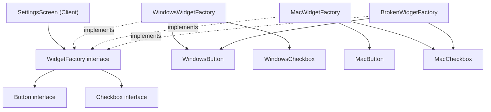

# Tạo lỗi trộn họ có chủ đích rồi bổ sung cơ chế phát hiện và kiểm thử

Trong **Abstract Factory**, một concrete factory có trách nhiệm tạo các sản phẩm thuộc **cùng một họ**. Ví dụ, `WindowsWidgetFactory` tạo `WindowsButton` và `WindowsCheckbox`; `MacWidgetFactory` tạo `MacButton` và `MacCheckbox`. Client làm việc qua các interface `Button`, `Checkbox` và `WidgetFactory`, nên không cần biết lớp cụ thể.

Tuy nhiên, Java chỉ kiểm tra rằng `createButton()` trả về một `Button` và `createCheckbox()` trả về một `Checkbox`. Nếu lập trình viên vô ý để factory Windows trả về một checkbox macOS, chương trình **vẫn có thể biên dịch**. Lỗi trộn họ có thể chỉ xuất hiện khi render giao diện, kết nối tài nguyên hoặc chạy một luồng nghiệp vụ.

Bài thuộc chương **Bài tập thực hành** của module **Học về abstract factory trong design pattern**. Bạn sẽ **cố ý tạo lỗi trộn họ**, quan sát vì sao interface chung không tự phát hiện lỗi, sau đó bổ sung **cơ chế kiểm tra ở ranh giới tạo bộ sản phẩm** và viết **kiểm thử tự động** chứng minh lỗi bị bắt. Bài học hướng tới người đã biết cơ bản về interface và lớp trong Java, có thể đọc mã Java 17.

## 1. Mục tiêu và kết quả cần nộp

Sau bài thực hành, bạn cần làm được các việc sau:

1. Giải thích khác biệt giữa **đúng kiểu interface** và **tương thích trong cùng họ sản phẩm**.
2. Tạo một `BrokenWidgetFactory` trả về `WindowsButton` cùng `MacCheckbox` mà vẫn tuân thủ chữ ký `WidgetFactory`.
3. Thiết kế một điểm kiểm tra trước khi Client bắt đầu sử dụng bộ sản phẩm; từ chối cặp không cùng họ bằng thông báo dễ hiểu.
4. Viết test chứng minh **hai factory hợp lệ được chấp nhận** và **factory trộn họ bị từ chối**.
5. Phân biệt một ràng buộc được **kiểm tra trong lúc chạy** với một ràng buộc được **bảo đảm ngay từ thiết kế API**.

Sản phẩm bàn giao là mã Java 17 mô phỏng factory và widget, bộ test JUnit 5, bảng kết quả thử nghiệm và một đoạn giải thích lựa chọn cơ chế phát hiện.

### Điều kiện hoàn thành

| Trường hợp | Kết quả mong muốn |
| --- | --- |
| `WindowsWidgetFactory` tạo nút + checkbox Windows | Được chấp nhận |
| `MacWidgetFactory` tạo nút + checkbox macOS | Được chấp nhận |
| `BrokenWidgetFactory` tạo nút Windows + checkbox macOS | Bị từ chối trước khi màn hình được dùng |
| Factory trả về một sản phẩm `null` | Bị từ chối với lỗi rõ ràng |
| Sản phẩm thiếu thông tin cần thiết để kiểm tra họ | Bị từ chối theo chính sách ví dụ |
| Hai màn hình cùng dùng factory hợp lệ | Không vô tình chia sẻ trạng thái checkbox nếu yêu cầu mỗi màn hình độc lập |

> **Lưu ý an toàn của bài thực hành:** Factory lỗi chỉ dùng trong mã thử nghiệm và kiểm thử. Không biến nó thành một cấu hình được chọn mặc định trong ứng dụng.

## 2. Ôn lại mô hình Abstract Factory trước khi gây lỗi

Ta sử dụng hai **loại sản phẩm** và hai **họ sản phẩm**:

| Họ | Loại `Button` | Loại `Checkbox` |
| --- | --- | --- |
| Windows | `WindowsButton` | `WindowsCheckbox` |
| macOS | `MacButton` | `MacCheckbox` |

Client `SettingsScreen` cần hiển thị nút Lưu, bật/tắt thông báo và thực hiện hành động Lưu. Client chỉ biết:

```java
interface Button {
    String render();
    void setOnClick(Runnable action);
    void click();
}

interface Checkbox {
    String render();
    void setChecked(boolean checked);
    boolean isChecked();
}

interface WidgetFactory {
    Button createButton();
    Checkbox createCheckbox();
}
```

Không có chữ ký nào trong ba interface trên nói rằng một `Button` và một `Checkbox` phải cùng Windows hay cùng macOS. Đó là **bất biến ở mức tập hợp sản phẩm**, thường được kỳ vọng từ một concrete factory.



Đường đi từ `BrokenWidgetFactory` tới `WindowsButton` và `MacCheckbox` là lỗi cố ý. Mỗi giá trị trả về vẫn có kiểu hợp lệ; vấn đề nằm ở **sự kết hợp**.

## 3. Phần A — Cố ý tạo lỗi và quan sát

### A1. Viết một factory sai

Giả sử đã có bốn concrete product như bảng trên. Ta cố tình viết:

```java
final class BrokenWidgetFactory implements WidgetFactory {
    @Override
    public Button createButton() {
        return new WindowsButton();
    }

    @Override
    public Checkbox createCheckbox() {
        return new MacCheckbox(); // Cố ý sai họ
    }
}
```

Đoạn mã vẫn thỏa mãn hai quy tắc của trình biên dịch:

- `WindowsButton` triển khai `Button`, nên có thể trả về dưới kiểu `Button`.
- `MacCheckbox` triển khai `Checkbox`, nên có thể trả về dưới kiểu `Checkbox`.

**Câu hỏi A:** Có phải `implements WidgetFactory` tự bảo đảm `createButton()` và `createCheckbox()` cùng họ? Vì sao?

### A2. Quan sát khi chưa có guard

Một client chưa có cơ chế phát hiện có thể làm:

```java
WidgetFactory factory = new BrokenWidgetFactory();
Button button = factory.createButton();
Checkbox checkbox = factory.createCheckbox();

System.out.println(button.render() + " / " + checkbox.render());
```

Kết quả minh họa:

```text
WindowsButton / MacCheckbox
```

Ví dụ này dùng chuỗi `render()` để lỗi dễ thấy. Trong UI thật, sự khác biệt có thể tinh vi hơn như font, phím tắt, event loop hoặc native context. Trong các hệ thống khác, trộn một `Transaction` với một `Statement` thuộc kết nối khác có thể gây sai hành vi mà không hề có nhãn trực quan.

**Câu hỏi B:** Nếu cả hai lớp đều trả về chuỗi `"Widget"`, lỗi có biến mất không? Hãy phân biệt *không nhìn thấy lỗi* với *bộ sản phẩm đã tương thích*.

## 4. Phần B — Thiết kế cơ chế phát hiện tại ranh giới

Trong bài tập này, ta giả định tập concrete product do chính thư viện kiểm soát. Mỗi sản phẩm mang một dấu nhận diện họ **ở lớp nội bộ**. Client không được biết `WindowsButton` hay `MacCheckbox`; thay vào đó, một hàm kiểm tra nội bộ xác nhận:

\[
\operatorname{family}(\text{button})
=
\operatorname{family}(\text{checkbox})
=
\operatorname{family}(\text{factory})
\]

Kiểm tra này chỉ mang ý nghĩa nếu các nhãn họ được cài đặt trung thực và nhất quán. Nó bắt được lỗi phối hợp do nhầm triển khai; nó **không chứng minh mọi quy tắc tương thích về hành vi, phiên bản hay tài nguyên**.

### B1. Dữ liệu nhận diện họ

Ta dùng một enum chỉ chứa **mã họ logic**, không chứa native widget:

```java
enum Family {
    WINDOWS, MAC
}
```

Factory có thể thông báo họ dự kiến:

```java
interface WidgetFactory {
    Family family();
    Button createButton();
    Checkbox createCheckbox();
}
```

Mỗi concrete product thực hiện thêm một interface nội bộ `FamilyTagged`, ví dụ:

```java
private interface FamilyTagged {
    Family familyTag();
}
```

`FamilyTagged` trong mã đầy đủ là **kiểu lồng private** của lớp `Demo`, không phải phương thức bắt buộc nằm trong `Button` hay `Checkbox` public. Cách tổ chức này tránh khiến Client thông thường phải hỏi sản phẩm có phải Windows hay macOS.

### B2. Kiểm tra khi nhận sản phẩm

Trước khi đưa widget cho logic màn hình sử dụng, chạy kiểm tra:

```java
private static void requireFamily(
    Family expected, Object product, String role
) {
    if (!(product instanceof FamilyTagged tagged)) {
        throw new IllegalArgumentException(
            role + " không có nhãn họ do thư viện quản lý"
        );
    }
    if (tagged.familyTag() != expected) {
        throw new IllegalArgumentException(
            role + " khác họ: expected=" + expected
                + ", actual=" + tagged.familyTag()
        );
    }
}
```

`SettingsScreen` gọi guard sau khi factory tạo cả hai widget nhưng **trước khi lưu chúng thành trạng thái sử dụng được**. Nếu factory khai báo `WINDOWS` và checkbox gắn `MAC`, constructor thất bại ngay với thông báo có bối cảnh.

### B3. Vì sao nên kiểm tra ở một ranh giới?

Không nên viết `if (button instanceof WindowsButton)` trong từng event handler. Điều đó làm Client phụ thuộc các lớp cụ thể và khiến việc thêm họ mới phải sửa mọi màn hình.

Một điểm kiểm tra tập trung (ví dụ nơi lắp `WidgetSet` hoặc khởi tạo màn hình) giúp:

- Phát hiện lỗi **sớm**, trước khi có tương tác người dùng.
- Ghi nhận **loại sản phẩm nào sai** và **họ mong đợi là gì**.
- Giữ các lời gọi nghiệp vụ như `click()`, `setChecked()`, `isChecked()` độc lập nền tảng.

Với sản phẩm có tài nguyên thật, nếu quá trình tạo một phần của bộ sản phẩm thất bại, cần giải phóng phần đã tạo theo hợp đồng vòng đời. Ví dụ console bên dưới không có native resource nên tập trung vào quy tắc phát hiện họ.

## 5. Lời giải tham khảo Java 17 chạy độc lập

Trước khi xem lời giải, hãy thử tự triển khai các bước A và B. Mã dưới đây có cả factory hợp lệ, factory cố ý sai và guard. Các concrete product là lớp `private` để mã ngoài thư viện không tự ý lắp sản phẩm bằng constructor của chúng.

Tạo tệp `Demo.java` với nội dung:

```java
import java.util.Objects;

public final class Demo {
    private Demo() {}

    public enum Family {
        WINDOWS, MAC
    }

    // 1. Product contracts: Client chỉ dùng hành vi chung.
    public interface Button {
        String render();
        void setOnClick(Runnable action);
        void click();
    }

    public interface Checkbox {
        String render();
        void setChecked(boolean checked);
        boolean isChecked();
    }

    public interface WidgetFactory {
        Family family();
        Button createButton();
        Checkbox createCheckbox();
    }

    // 2. Metadata để kiểm tra, ẩn khỏi public product API.
    private interface FamilyTagged {
        Family familyTag();
    }

    private static final class WindowsButton
            implements Button, FamilyTagged {
        private Runnable onClick = () -> {};

        @Override
        public Family familyTag() {
            return Family.WINDOWS;
        }

        @Override
        public String render() {
            return "WindowsButton";
        }

        @Override
        public void setOnClick(Runnable action) {
            onClick = Objects.requireNonNull(action);
        }

        @Override
        public void click() {
            onClick.run();
        }
    }

    private static final class MacButton
            implements Button, FamilyTagged {
        private Runnable onClick = () -> {};

        @Override
        public Family familyTag() {
            return Family.MAC;
        }

        @Override
        public String render() {
            return "MacButton";
        }

        @Override
        public void setOnClick(Runnable action) {
            onClick = Objects.requireNonNull(action);
        }

        @Override
        public void click() {
            onClick.run();
        }
    }

    private static final class WindowsCheckbox
            implements Checkbox, FamilyTagged {
        private boolean checked;

        @Override
        public Family familyTag() {
            return Family.WINDOWS;
        }

        @Override
        public String render() {
            return "WindowsCheckbox";
        }

        @Override
        public void setChecked(boolean checked) {
            this.checked = checked;
        }

        @Override
        public boolean isChecked() {
            return checked;
        }
    }

    private static final class MacCheckbox
            implements Checkbox, FamilyTagged {
        private boolean checked;

        @Override
        public Family familyTag() {
            return Family.MAC;
        }

        @Override
        public String render() {
            return "MacCheckbox";
        }

        @Override
        public void setChecked(boolean checked) {
            this.checked = checked;
        }

        @Override
        public boolean isChecked() {
            return checked;
        }
    }

    // 3. Concrete factories đúng: mỗi factory tạo một họ.
    private static final class WindowsWidgetFactory
            implements WidgetFactory {
        @Override
        public Family family() {
            return Family.WINDOWS;
        }

        @Override
        public Button createButton() {
            return new WindowsButton();
        }

        @Override
        public Checkbox createCheckbox() {
            return new WindowsCheckbox();
        }
    }

    private static final class MacWidgetFactory
            implements WidgetFactory {
        @Override
        public Family family() {
            return Family.MAC;
        }

        @Override
        public Button createButton() {
            return new MacButton();
        }

        @Override
        public Checkbox createCheckbox() {
            return new MacCheckbox();
        }
    }

    // 4. Factory sai có chủ đích, vẫn đúng kiểu Java.
    private static final class BrokenWidgetFactory
            implements WidgetFactory {
        @Override
        public Family family() {
            return Family.WINDOWS;
        }

        @Override
        public Button createButton() {
            return new WindowsButton();
        }

        @Override
        public Checkbox createCheckbox() {
            return new MacCheckbox(); // Sai họ.
        }
    }

    // Factory access: caller dùng interface, không biết concrete class.
    public static WidgetFactory windowsFactory() {
        return new WindowsWidgetFactory();
    }

    public static WidgetFactory macFactory() {
        return new MacWidgetFactory();
    }

    // Chỉ dành cho bài tập và test, không dùng làm mặc định.
    public static WidgetFactory brokenFactoryForExercise() {
        return new BrokenWidgetFactory();
    }

    // 5. Guard chạy ở ranh giới tạo bộ sản phẩm.
    private static void requireFamily(
        Family expected, Object product, String role
    ) {
        if (!(product instanceof FamilyTagged tagged)) {
            throw new IllegalArgumentException(
                role + " không có nhãn họ do thư viện quản lý"
            );
        }
        if (tagged.familyTag() != expected) {
            throw new IllegalArgumentException(
                role + " khác họ: expected=" + expected
                    + ", actual=" + tagged.familyTag()
            );
        }
    }

    // 6. Client vận hành sản phẩm qua abstraction.
    public static final class SettingsScreen {
        private final Button saveButton;
        private final Checkbox notifications;
        private int saveCount;

        public SettingsScreen(WidgetFactory factory) {
            Objects.requireNonNull(factory, "factory");
            Family expected = Objects.requireNonNull(
                factory.family(), "factory.family"
            );
            Button button = Objects.requireNonNull(
                factory.createButton(), "factory.createButton"
            );
            Checkbox checkbox = Objects.requireNonNull(
                factory.createCheckbox(), "factory.createCheckbox"
            );

            requireFamily(expected, button, "Button");
            requireFamily(expected, checkbox, "Checkbox");

            this.saveButton = button;
            this.notifications = checkbox;
            saveButton.setOnClick(() -> saveCount++);
        }

        public String preview() {
            return saveButton.render() + " / " + notifications.render();
        }

        public void chooseNotifications(boolean checked) {
            notifications.setChecked(checked);
        }

        public boolean notificationsEnabled() {
            return notifications.isChecked();
        }

        public void clickSave() {
            saveButton.click();
        }

        public int saveCount() {
            return saveCount;
        }
    }

    // Mô phỏng điều gì xảy ra khi bỏ qua kiểm tra tương thích.
    private static String previewWithoutGuard(WidgetFactory factory) {
        return factory.createButton().render()
            + " / " + factory.createCheckbox().render();
    }

    public static void main(String[] args) {
        WidgetFactory broken = brokenFactoryForExercise();
        System.out.println(
            "Khong co guard: " + previewWithoutGuard(broken)
        );

        for (WidgetFactory valid : new WidgetFactory[] {
            windowsFactory(), macFactory()
        }) {
            SettingsScreen screen = new SettingsScreen(valid);
            screen.chooseNotifications(true);
            screen.clickSave();
            System.out.println(
                valid.family() + ": " + screen.preview()
                    + "; checked=" + screen.notificationsEnabled()
                    + "; saves=" + screen.saveCount()
            );
        }

        try {
            new SettingsScreen(broken);
            throw new AssertionError("Factory sai phai bi tu choi");
        } catch (IllegalArgumentException expected) {
            System.out.println("Guard tu choi: " + expected.getMessage());
        }
    }
}
```

Biên dịch và chạy bằng JDK 17 hoặc mới hơn:

```bash
javac -encoding UTF-8 Demo.java
java Demo
```

Kết quả dự kiến:

```text
Khong co guard: WindowsButton / MacCheckbox
WINDOWS: WindowsButton / WindowsCheckbox; checked=true; saves=1
MAC: MacButton / MacCheckbox; checked=true; saves=1
Guard tu choi: Checkbox khác họ: expected=WINDOWS, actual=MAC
```

Ở dòng cuối, factory vẫn được truyền như `WidgetFactory` và sản phẩm vẫn có kiểu `Checkbox`. Chính guard nội bộ đã kiểm tra được thông tin **không có trong chữ ký của product interface**.

## 6. Phần C — Viết kiểm thử tự động

Với mã `Demo.java` ở trên, tạo `DemoTest.java` trong nguồn test của một dự án đã cấu hình **JUnit Jupiter 5**. Ví dụ dưới đây dùng `@ParameterizedTest` và `@MethodSource`, vì vậy cần cả thành phần `junit-jupiter-params` trong dependencies test.

```java
import org.junit.jupiter.api.Test;
import org.junit.jupiter.params.ParameterizedTest;
import org.junit.jupiter.params.provider.Arguments;
import org.junit.jupiter.params.provider.MethodSource;

import java.util.stream.Stream;

import static org.junit.jupiter.api.Assertions.*;

class DemoTest {
    static Stream<Arguments> validFactories() {
        return Stream.of(
            Arguments.of(
                "Windows",
                Demo.windowsFactory(),
                "WindowsButton / WindowsCheckbox"
            ),
            Arguments.of(
                "macOS",
                Demo.macFactory(),
                "MacButton / MacCheckbox"
            )
        );
    }

    @ParameterizedTest(name = "{0}: tao bo san pham dung ho")
    @MethodSource("validFactories")
    void acceptsValidFamilies(
        String name, Demo.WidgetFactory factory, String expectedPreview
    ) {
        Demo.SettingsScreen screen = new Demo.SettingsScreen(factory);

        assertEquals(expectedPreview, screen.preview());
        assertFalse(screen.notificationsEnabled());

        screen.chooseNotifications(true);
        screen.clickSave();

        assertTrue(screen.notificationsEnabled());
        assertEquals(1, screen.saveCount());
    }

    @Test
    void rejectsIntentionallyMixedFamilyBeforeUse() {
        IllegalArgumentException error = assertThrows(
            IllegalArgumentException.class,
            () -> new Demo.SettingsScreen(
                Demo.brokenFactoryForExercise()
            )
        );

        assertTrue(error.getMessage().contains("Checkbox"));
        assertTrue(error.getMessage().contains("expected=WINDOWS"));
        assertTrue(error.getMessage().contains("actual=MAC"));
    }

    @Test
    void rejectsNullProductBeforeUse() {
        Demo.WidgetFactory factory = new Demo.WidgetFactory() {
            @Override
            public Demo.Family family() {
                return Demo.Family.WINDOWS;
            }

            @Override
            public Demo.Button createButton() {
                return null;
            }

            @Override
            public Demo.Checkbox createCheckbox() {
                return Demo.windowsFactory().createCheckbox();
            }
        };

        assertThrows(
            NullPointerException.class,
            () -> new Demo.SettingsScreen(factory)
        );
    }

    @Test
    void rejectsProductWithoutInternalFamilyTag() {
        Demo.Button unknownButton = new Demo.Button() {
            private Runnable action = () -> {};

            @Override
            public String render() {
                return "ExternalButton";
            }

            @Override
            public void setOnClick(Runnable action) {
                this.action = action;
            }

            @Override
            public void click() {
                action.run();
            }
        };

        Demo.WidgetFactory factory = new Demo.WidgetFactory() {
            @Override
            public Demo.Family family() {
                return Demo.Family.WINDOWS;
            }

            @Override
            public Demo.Button createButton() {
                return unknownButton;
            }

            @Override
            public Demo.Checkbox createCheckbox() {
                return Demo.windowsFactory().createCheckbox();
            }
        };

        IllegalArgumentException error = assertThrows(
            IllegalArgumentException.class,
            () -> new Demo.SettingsScreen(factory)
        );
        assertTrue(error.getMessage().contains("Button"));
    }

    @Test
    void twoScreensFromSameFactoryHaveIndependentState() {
        Demo.WidgetFactory factory = Demo.macFactory();
        Demo.SettingsScreen first = new Demo.SettingsScreen(factory);
        Demo.SettingsScreen second = new Demo.SettingsScreen(factory);

        first.chooseNotifications(true);
        first.clickSave();

        assertTrue(first.notificationsEnabled());
        assertEquals(1, first.saveCount());
        assertFalse(second.notificationsEnabled());
        assertEquals(0, second.saveCount());
    }
}
```

### C1. Vì sao cần cả test tốt và test xấu?

- **Positive tests** với Windows/macOS đảm bảo guard không từ chối những bộ sản phẩm hợp lệ; hệ thống vẫn thực hiện đúng các hành vi `setChecked()`, `click()`.
- **Negative test** với factory trộn họ chứng minh cơ chế mới thực sự phát hiện lỗi chính đang học; việc test chỉ kiểm tra hai factory đúng là chưa đủ.
- **Null test** xác nhận xử lý một đầu ra factory không hợp lệ ngay tại ranh giới.
- **Unknown-product test** xác nhận chính sách từ chối sản phẩm không có dấu nhận diện nội bộ. Đây là chính sách của ví dụ với tập triển khai đóng, không phải quy tắc bắt buộc của mọi Abstract Factory.
- **Isolation test** bảo vệ vòng đời sản phẩm: cùng một factory có thể tạo nhiều bộ mới mà không làm các màn hình chia sẻ trạng thái ngoài ý muốn.

Thông báo lỗi cũng cần cân nhắc. Kiểm tra một phần thông điệp như `expected=WINDOWS` giúp chẩn đoán chính xác, nhưng trong dự án lớn có thể dùng **exception type** hoặc **mã lỗi ổn định** thay vì khóa mọi test vào nguyên văn chuỗi.

### C2. Ma trận test tối thiểu

| ID | Factory đầu vào | Dữ liệu tạo ra | Kết quả mong đợi |
| --- | --- | --- | --- |
| TC01 | Windows đúng | WindowsButton + WindowsCheckbox | PASS |
| TC02 | macOS đúng | MacButton + MacCheckbox | PASS |
| TC03 | Broken (khai báo Windows) | WindowsButton + MacCheckbox | Ném `IllegalArgumentException`, xác định Checkbox sai |
| TC04 | Factory trả `null` | Button là `null` | Ném `NullPointerException` sớm |
| TC05 | Factory tự tạo product không có tag | Button ngoài bộ triển khai quản lý | Từ chối theo chính sách ví dụ |
| TC06 | macOS tạo hai màn hình | Mỗi lần tạo widget mới | State giữa hai màn hình độc lập |

**Yêu cầu thực hành:** đừng chỉ đọc test rồi giả định nó sẽ chạy xanh. Hãy chạy chúng với JUnit 5 trong môi trường học của bạn, quan sát test đỏ nếu bỏ guard và xanh sau khi khôi phục guard.

## 7. Phần D — Thử nghiệm đột biến để kiểm tra chất lượng test

Để chắc chắn test không chỉ xanh do may mắn, hãy thực hiện từng thay đổi có chủ đích, chạy test tương ứng, rồi **hoàn tác thay đổi đó** trước khi làm bước tiếp theo.

| Đột biến cố ý | Test nào cần đỏ? | Điều được kiểm chứng |
| --- | --- | --- |
| `BrokenWidgetFactory.createCheckbox()` trả về `MacCheckbox` và bỏ guard | `rejectsIntentionallyMixedFamilyBeforeUse` | Test bắt được lỗi trộn họ |
| `WindowsWidgetFactory.createCheckbox()` trả `MacCheckbox` | `acceptsValidFamilies` của Windows | Factory “tên đúng” vẫn có thể cài đặt sai |
| `MacWidgetFactory.createButton()` trả `WindowsButton` | `acceptsValidFamilies` của macOS | Guard kiểm tra cả hai loại sản phẩm |
| `MacWidgetFactory.createCheckbox()` trả singleton `MacCheckbox` | `twoScreensFromSameFactoryHaveIndependentState` | Kiểm tra vòng đời / state độc lập |
| `WindowsButton.click()` không gọi callback | `acceptsValidFamilies` của Windows | Test kiểm tra hành vi ngoài nhãn họ |
| Bỏ kiểm tra `Objects.requireNonNull` cho button | `rejectsNullProductBeforeUse` có thể đổi loại/thời điểm lỗi | Phát hiện thay đổi hợp đồng lỗi |

**Chú ý:** Với mutation về `null`, nếu vẫn có một `NullPointerException` phát sinh ở nơi khác, chỉ assert kiểu ngoại lệ chưa đủ phân biệt lỗi sớm với lỗi muộn. Khi cần bảo vệ hợp đồng báo lỗi chặt chẽ, kiểm tra cả thông điệp hoặc gọi đúng điểm khởi tạo và xác nhận không có side effect ngoài ý muốn.

## 8. Phần E — Cải tiến kiến trúc sau khi phát hiện lỗi

Cơ chế `FamilyTagged` ở ví dụ cung cấp một **guard runtime** khi thư viện sở hữu toàn bộ các concrete product. Nó hữu ích để học nguyên tắc nhưng có giới hạn:

1. **Tag không chứng minh tính đúng tuyệt đối.** Một `MacCheckbox` bị cài nhầm `familyTag() = WINDOWS` sẽ vượt guard dù hành vi vẫn không phù hợp. Cần test contract và integration.
2. **Tập triển khai bị đóng.** `FamilyTagged` là interface `private`, nên product từ plugin bên ngoài không thể khai báo triển khai nó theo cách thông thường. Vì thế ví dụ chủ động **từ chối** product ngoài thư viện.
3. **Kiểm tra lúc chạy.** Bug đã qua bước biên dịch và chỉ bị phát hiện khi lắp màn hình. Đó là điểm tốt hơn việc lỗi tới lúc người dùng nhấn nút, nhưng chưa mạnh bằng API hạn chế hẳn đường tạo bộ sai.
4. **Bảo đảm còn phụ thuộc vòng đời và môi trường.** Hai product cùng `WINDOWS` có thể vẫn dùng các context khác nhau không tương thích, hoặc đòi hỏi các phiên bản API khác nhau.

Nếu cần kiến trúc sản xuất, cân nhắc các hướng bổ sung:

### E1. Hạn chế constructor để caller không trộn hai sản phẩm

Thiết kế Client nhận **một factory** hoặc một **family handle**:

```java
SettingsScreen(WidgetFactory factory)
```

Tránh mở constructor công khai sau nếu nghiệp vụ không thực sự cần ghép product tùy ý:

```java
SettingsScreen(Button button, Checkbox checkbox)
```

Constructor thứ hai cho phép caller lấy button từ Windows và checkbox từ macOS rồi truyền vào mà không qua factory. Khi có nhiều nơi tiêu thụ sản phẩm, hãy tập trung việc lắp bộ tương thích tại một nơi.

### E2. Chọn họ tại composition root

Ứng dụng quyết định một `WidgetFactory` cho màn hình tại điểm cấu hình, chẳng hạn theo hệ điều hành hoặc theme. Các event handler không cần tự `new WindowsButton()` hoặc phân nhánh theo kiểu concrete.

### E3. Nếu cần plugin, phải có giao thức xác thực công khai

Không thể đồng thời yêu cầu plugin bên ngoài cài `FamilyTagged` mà lại giữ interface đó `private`. Khi cần third-party factory, hãy thiết kế một **extension contract** rõ ràng: chẳng hạn `ProductDescriptor` chứa family ID, version, context/capability, registry chỉ chấp nhận bộ sản phẩm đầy đủ. Cần thêm integration tests để xác minh hành vi; chỉ so khớp family ID là chưa đủ.

### E4. Dùng generic hoặc sealed types khi cần bảo vệ ở compile time

Với tập họ đóng, có thể thiết kế các kiểu marker theo họ hoặc mô hình `sealed` để giảm tổ hợp không hợp lệ. Nhưng đây là lựa chọn nâng cao: Java có type erasure và các unchecked cast vẫn có thể làm suy yếu ràng buộc. Đừng thêm tầng generic phức tạp nếu factory/constructor đã bảo vệ đủ trường hợp thực tế.

### E5. Gộp khâu lắp ráp và xác thực thành một đơn vị

Một hướng khác là factory cấp một `WidgetSet` đã được xác thực:

```java
record WidgetSet(Button button, Checkbox checkbox) {
    WidgetSet {
        Objects.requireNonNull(button);
        Objects.requireNonNull(checkbox);
    }
}
```

`WidgetSet` trên **chỉ kiểm tra khác null**, chưa tự kiểm tra cùng họ. Nếu dùng cách này, cần đặt guard tại **điểm tạo `WidgetSet` được kiểm soát** và tránh công khai constructor cho phép caller lắp cặp tùy ý. Một record public với constructor public như ví dụ nhỏ này không tự chống được việc trộn họ.

## 9. Hướng dẫn suy luận nguyên nhân khi test thất bại

| Hiện tượng | Nơi kiểm tra đầu tiên | Hướng xử lý |
| --- | --- | --- |
| Test BrokenFactory vẫn tạo được màn hình | Guard có được gọi trước khi gán sản phẩm vào Client? | Đặt kiểm tra tại ranh giới nhận bộ sản phẩm |
| Test Windows thất bại với `actual=MAC` | `WindowsWidgetFactory.createCheckbox()` | Kiểm tra nó đã trả đúng concrete product |
| Test đúng bị từ chối vì “không có nhãn” | Product có triển khai `FamilyTagged` nội bộ không? | Cập nhật giao thức xác thực hoặc làm rõ chính sách plugin |
| Test state giữa hai màn hình thất bại | Factory trả singleton có state không? | Tạo widget mới hoặc quy định scope đúng |
| Test click thất bại nhưng guard vẫn pass | Callback `setOnClick()` và `click()` có đúng hợp đồng không? | Sửa hành vi concrete product; family tag không thay thế contract test |
| Ngoại lệ chỉ xuất hiện khi người dùng thao tác | Kiểm tra có đang thực hiện sau khi UI đã hiển thị không | Chuyển kiểm tra sớm hơn, cân nhắc cleanup khi tạo một phần |

Một guard có ích phải giải quyết **nguyên nhân cần phát hiện** mà không che lỗi bằng fallback âm thầm như “nếu checkbox macOS thì đổi thành Windows”. Fallback như vậy có thể làm mất trạng thái hoặc che sai cấu hình, khiến sự cố khó truy ra.

## 10. Câu hỏi tự đánh giá

**1. Vì sao đoạn mã sai vẫn biên dịch?**

Vì Java chỉ kiểm tra kiểu trả về ở từng phương thức: `WindowsButton` là `Button` và `MacCheckbox` là `Checkbox`. Interface `WidgetFactory` chưa biểu diễn mối quan hệ cùng họ giữa hai giá trị đó.

**2. Nếu `BrokenWidgetFactory.family()` trả `MAC` thay vì `WINDOWS`, guard còn phát hiện không?**

Có, trong ví dụ hiện tại. `WindowsButton` gắn `WINDOWS`, khác `MAC`; guard sẽ từ chối ở sản phẩm `Button`.

**3. Nếu cả `Button` và `Checkbox` đều khai tag `WINDOWS` nhưng một sản phẩm thực chất dùng native context macOS, guard có đủ không?**

Không. Tag chỉ là metadata do implementation cung cấp; cần kiểm thử hành vi, context và kiểm tra tích hợp thích hợp.

**4. Vì sao Client không nên dùng `instanceof WindowsButton` để kiểm tra mọi nơi?**

Vì Client sẽ phải biết tên các concrete class, khó thêm họ mới và dễ rải logic phụ thuộc nền tảng. Nên đặt kiểm tra ở ranh giới cấu hình/lắp ráp.

**5. Có bắt buộc mọi dự án Abstract Factory phải thêm `family()` hay `FamilyTagged` không?**

Không. Đây là một lựa chọn cho bài tập phát hiện lỗi runtime. Với thiết kế factory đóng, constructor hạn chế và contract/integration tests đủ mạnh, có thể không cần đưa family metadata vào sản phẩm.

## 11. Bài tập mở rộng

**Mức 1 — Thay lỗi tại vị trí khác.** Sửa `BrokenWidgetFactory` để tạo `MacButton` và `WindowsCheckbox`, vẫn khai báo họ `WINDOWS`. Viết test xác nhận guard từ chối ngay ở `Button` và thông báo gồm `expected=WINDOWS`, `actual=MAC`.

**Mức 2 — Giải quyết lỗi ở cấu hình.** Xây dựng một `WidgetFactoryRegistry` chọn đúng factory theo `Family`. Chỉ cho Client nhận factory từ registry; giữ các concrete factory ở phạm vi nội bộ. Viết test chứng minh hai lựa chọn hợp lệ và trường hợp đầu vào `null` được xử lý rõ ràng.

**Mức 3 — Thêm loại sản phẩm.** Tạo `Dialog` và hai triển khai `WindowsDialog`, `MacDialog`; thêm `createDialog()` vào `WidgetFactory`. Tạo một factory lỗi trả về dialog khác họ, bổ sung guard/test để tránh việc chỉ kiểm tra `Button` và `Checkbox`.

**Mức 4 — Phân tích rủi ro thật.** Thay bối cảnh UI bằng báo cáo: một factory tạo `Formatter` và `Exporter` của cùng định dạng PDF/HTML. Mô tả trường hợp formatter PDF được ghép với exporter HTML; thiết kế cơ chế kiểm tra phù hợp với version và protocol. Trình bày lý do vì sao chỉ một trường `familyId` có thể chưa đủ.

## 12. Tiêu chí tự chấm

| Tiêu chí | Tỷ trọng | Bằng chứng cần có |
| --- | ---: | --- |
| Tạo được lỗi trộn họ đúng mục tiêu | 20% | Factory sai vẫn biên dịch; quan sát cặp Windows/Mac |
| Guard chạy đúng ranh giới và báo lỗi rõ | 25% | Không cho tạo `SettingsScreen` với factory sai |
| Positive/negative tests có ý nghĩa | 25% | Test đúng cho hai họ, test đỏ khi bỏ guard |
| Không làm Client phụ thuộc concrete class | 15% | Client giữ `Button`, `Checkbox`, `WidgetFactory` |
| Phân tích giới hạn và cải tiến | 15% | Giải thích tag không đủ, constructor/factory lifecycle và plugin |

**Ghi nhớ:** Abstract Factory giúp tạo sản phẩm theo **họ**, nhưng việc cùng thực hiện các product interface không tự bảo đảm các sản phẩm được ghép **đúng họ**. Hãy tạo lỗi trộn họ một cách có kiểm soát để hiểu giới hạn đó, thêm cơ chế phát hiện tại điểm lắp ráp, và viết cả test chấp nhận bộ đúng lẫn test từ chối bộ sai. Khi áp dụng vào dự án thật, hãy kết hợp kiểm soát API, vòng đời và kiểm thử hợp đồng để bảo vệ tính tương thích của cả họ sản phẩm.
