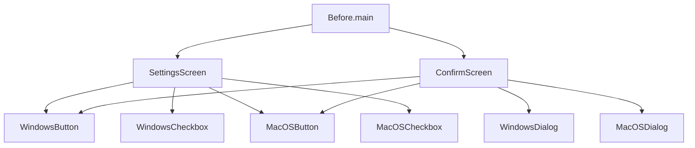
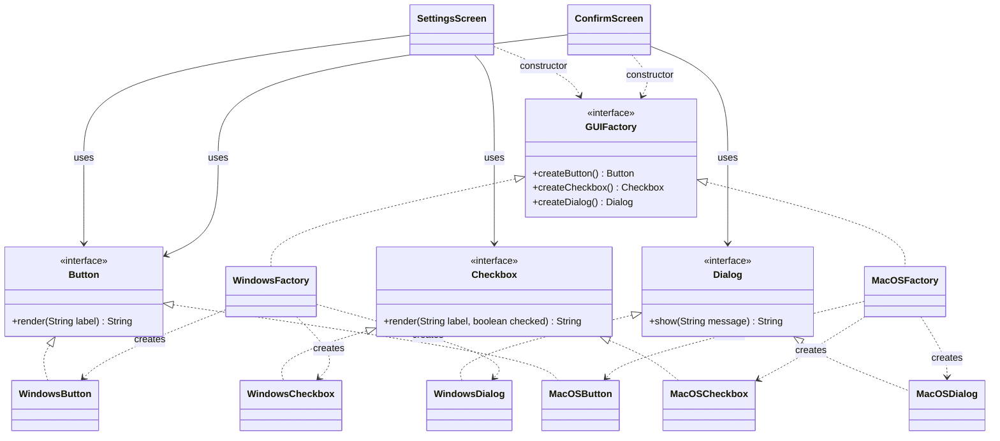
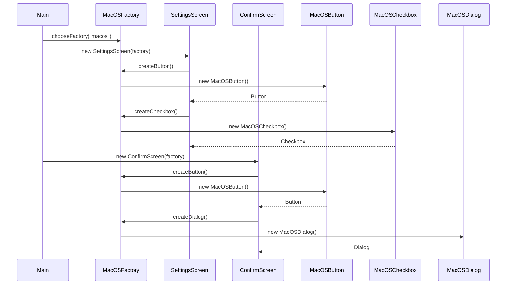

# Tái cấu trúc chương trình chứa nhiều nhánh khởi tạo sang Abstract Factory

## 1. Mục tiêu và bối cảnh bài tập

**Abstract Factory** là mẫu thiết kế thuộc nhóm *Creational Design Patterns*, giúp cung cấp **nhiều loại sản phẩm có quan hệ tương thích** mà client không phụ thuộc trực tiếp vào lớp sản phẩm cụ thể. Bài thực hành này yêu cầu **refactor một chương trình Java đã chạy được**: chương trình ban đầu chứa nhiều nhánh `if/else` chọn và tạo đối tượng ngay bên trong các màn hình.

Giả sử phần mềm quản lý công việc có hai giao diện:

- **Windows**: nút, ô chọn và hộp thoại đều có cách hiển thị Windows.
- **macOS**: nút, ô chọn và hộp thoại đều có cách hiển thị macOS.

Hai màn hình đang dùng chung những loại thành phần sau:

| Client | Loại product cần dùng | Quy tắc bắt buộc |
| --- | --- | --- |
| `SettingsScreen` | `Button` và `Checkbox` | Nút Save và ô Auto-save cùng phong cách hệ điều hành đã chọn. |
| `ConfirmScreen` | `Button` và `Dialog` | Nút Confirm và hộp thoại xác nhận cùng phong cách hệ điều hành đã chọn. |

Hiện tại mỗi client lại tự kiểm tra `platform` và gọi các constructor cụ thể. Khi thêm một nền tảng, nhóm phát triển phải đi tìm các nhánh lựa chọn bị rải rác.

**Nhiệm vụ của bạn:** thay những nhánh tạo sản phẩm lặp lại bằng `GUIFactory` và các concrete factory. Chương trình sau refactor phải giữ **hành vi quan sát được** của hai màn hình và tạo trọn bộ sản phẩm theo đúng nền tảng.

### Kết quả học tập mong đợi

Sau bài này, bạn có thể:

1. Nhận ra những nhánh `if/else` đang quyết định **họ sản phẩm**, khác với nhánh xử lý nghiệp vụ thông thường.
2. Tách `Button`, `Checkbox`, `Dialog` thành các **Abstract Product** và gom quy tắc tạo chúng vào **Abstract Factory**.
3. Hiện thực `WindowsFactory` và `MacOSFactory`, mỗi factory tạo đủ ba loại product cùng họ.
4. Cho `SettingsScreen` và `ConfirmScreen` nhận một `GUIFactory` qua constructor.
5. Đưa phần chọn Windows/macOS về `Main`, là nơi lắp ghép đối tượng (*composition root*).
6. So sánh đầu ra trước/sau, nhận diện rủi ro trộn họ và đánh giá điểm cần thay đổi khi mở rộng.

> Bài dùng `String` để mô phỏng cách trình bày UI; không mở cửa sổ Swing/JavaFX. Mục tiêu là quan sát cấu trúc tạo sản phẩm. Cần JDK 8+ để biên dịch các ví dụ bằng `javac` và chạy bằng `java`.

## 2. Chương trình ban đầu: nhiều nhánh khởi tạo lặp lại

Lưu toàn bộ mã sau vào tệp **`Before.java`**. Các lớp được đặt lồng trong `Before` để người học có thể giữ tệp này cùng tệp lời giải `Main.java` mà không trùng tên lớp khi biên dịch.

```java
// Before.java
public class Before {
    // Hợp đồng sản phẩm đã có sẵn.
    interface Button {
        String render(String label);
    }

    interface Checkbox {
        String render(String label, boolean checked);
    }

    interface Dialog {
        String show(String message);
    }

    // Các concrete product của Windows.
    static final class WindowsButton implements Button {
        @Override
        public String render(String label) {
            return "Windows/Button [" + label + "]";
        }
    }

    static final class WindowsCheckbox implements Checkbox {
        @Override
        public String render(String label, boolean checked) {
            return "Windows/Checkbox ["
                    + (checked ? "x" : " ") + "] " + label;
        }
    }

    static final class WindowsDialog implements Dialog {
        @Override
        public String show(String message) {
            return "Windows/Dialog {" + message + "}";
        }
    }

    // Các concrete product của macOS.
    static final class MacOSButton implements Button {
        @Override
        public String render(String label) {
            return "macOS/Button (" + label + ")";
        }
    }

    static final class MacOSCheckbox implements Checkbox {
        @Override
        public String render(String label, boolean checked) {
            return "macOS/Checkbox ("
                    + (checked ? "x" : " ") + ") " + label;
        }
    }

    static final class MacOSDialog implements Dialog {
        @Override
        public String show(String message) {
            return "macOS/Dialog <" + message + ">";
        }
    }

    // Client 1: tự quyết định và tạo hai product.
    static final class SettingsScreen {
        private final Button saveButton;
        private final Checkbox autoSaveCheckbox;

        SettingsScreen(String platform) {
            if ("windows".equalsIgnoreCase(platform)) {
                saveButton = new WindowsButton();
                autoSaveCheckbox = new WindowsCheckbox();
            } else if ("macos".equalsIgnoreCase(platform)) {
                saveButton = new MacOSButton();
                autoSaveCheckbox = new MacOSCheckbox();
            } else {
                throw new IllegalArgumentException(
                        "Unsupported platform: " + platform);
            }
        }

        void show() {
            System.out.println(saveButton.render("Save"));
            System.out.println(
                    autoSaveCheckbox.render("Auto-save", true));
        }
    }

    // Client 2: lặp lại logic chọn nền tảng.
    static final class ConfirmScreen {
        private final Button confirmButton;
        private final Dialog confirmDialog;

        ConfirmScreen(String platform) {
            if ("windows".equalsIgnoreCase(platform)) {
                confirmButton = new WindowsButton();
                confirmDialog = new WindowsDialog();
            } else if ("macos".equalsIgnoreCase(platform)) {
                confirmButton = new MacOSButton();
                confirmDialog = new MacOSDialog();
            } else {
                throw new IllegalArgumentException(
                        "Unsupported platform: " + platform);
            }
        }

        void show() {
            System.out.println(confirmButton.render("Confirm"));
            System.out.println(
                    confirmDialog.show("Delete this item?"));
        }
    }

    public static void main(String[] args) {
        String platform = args.length == 0 ? "windows" : args[0];
        new SettingsScreen(platform).show();
        new ConfirmScreen(platform).show();
    }
}
```

### 2.1. Ghi nhận hành vi trước khi sửa

Chạy riêng chương trình ban đầu:

```bash
javac Before.java
java Before windows
```

Kết quả kỳ vọng với Windows:

```text
Windows/Button [Save]
Windows/Checkbox [x] Auto-save
Windows/Button [Confirm]
Windows/Dialog {Delete this item?}
```

Chạy với macOS:

```bash
java Before macos
```

Kết quả kỳ vọng:

```text
macOS/Button (Save)
macOS/Checkbox (x) Auto-save
macOS/Button (Confirm)
macOS/Dialog <Delete this item?>
```

Hai khối đầu ra trên là **hợp đồng quan sát được** của bài tập: sau refactor, giữ nguyên nội dung, thứ tự và số dòng trong trường hợp hợp lệ. Dùng cùng đầu vào để so sánh kết quả trước/sau.

Nếu nền tảng không được hỗ trợ, chương trình cũ ném `IllegalArgumentException` ngay khi tạo `SettingsScreen`. Phần refactor nên tiếp tục **từ chối giá trị không hợp lệ**, nhưng có thể cải thiện cách báo lỗi ở ranh giới chương trình.

### 2.2. Phân tích vấn đề trong mã cũ

Hai client cùng có một chuỗi nhánh:

```text
platform == "windows" ?
    new Windows...()
platform == "macos" ?
    new MacOS...()
ngược lại:
    báo lỗi
```

Các nhánh trong constructor **không quyết định hành vi màn hình**; chúng chỉ quyết định **lớp sản phẩm cụ thể nào được tạo**. Đây là tín hiệu phù hợp để đưa quyết định tạo product vào một factory.

Hệ quả của thiết kế cũ:

- **Trùng logic lựa chọn:** `SettingsScreen` và `ConfirmScreen` cùng diễn giải chuỗi `platform`.
- **Client bị gắn vào concrete product:** cả hai màn hình đều biết `WindowsButton`, `MacOSButton` và các lớp theo nền tảng.
- **Dễ tạo bộ sản phẩm không nhất quán:** một nhánh có thể tạo nhầm nút Windows với ô chọn macOS mà trình biên dịch vẫn chấp nhận vì kiểu trả về đều đúng interface.
- **Khó thêm họ mới:** thêm Linux có thể yêu cầu sửa nhiều màn hình và các vị trí tạo product khác.
- **Khó kiểm thử độc lập:** một màn hình không dễ nhận product giả lập vì tự tạo đối tượng thật theo nền tảng.

Sơ đồ phụ thuộc rút gọn trước refactor:



Ở đây, nhiều mũi tên từ client trỏ trực tiếp đến concrete product. Mục tiêu refactor là làm cho những phụ thuộc đó chuyển sang **các abstraction ổn định**.

## 3. Yêu cầu thực hành trước khi xem lời giải

Hãy tự triển khai theo bốn chặng sau. Bạn có thể dừng tại mỗi chặng, đọc lại mã và đối chiếu tiêu chí.

### Chặng A — Xác định họ sản phẩm

Tạo bảng gồm ba **loại sản phẩm** `Button`, `Checkbox`, `Dialog` và hai **họ** Windows/macOS. Kiểm tra rằng mỗi cột họ đều có đủ ba concrete product.

| Loại product | Windows | macOS |
| --- | --- | --- |
| `Button` | `WindowsButton` | `MacOSButton` |
| `Checkbox` | `WindowsCheckbox` | `MacOSCheckbox` |
| `Dialog` | `WindowsDialog` | `MacOSDialog` |

Sau đó trả lời: “Nếu một màn hình dùng `WindowsButton` cùng `MacOSDialog` thì chương trình vẫn có thể biên dịch không? Vì sao thiết kế đó không đạt yêu cầu?”

### Chặng B — Thiết kế Abstract Factory

Định nghĩa interface mới:

```java
interface GUIFactory {
    Button createButton();
    Checkbox createCheckbox();
    Dialog createDialog();
}
```

Tiếp theo, hiện thực hai lớp:

```java
// Hoàn thiện thân phương thức theo đúng họ sản phẩm.
final class WindowsFactory implements GUIFactory { /* TODO */ }
final class MacOSFactory implements GUIFactory { /* TODO */ }
```

Yêu cầu: `WindowsFactory` chỉ cung cấp các product Windows; `MacOSFactory` chỉ cung cấp các product macOS. Các phương thức trả về kiểu **interface** (`Button`, `Checkbox`, `Dialog`) chứ không buộc client nhận concrete class.

### Chặng C — Loại bỏ nhánh khởi tạo trong client

Sửa constructor của hai client để nhận `GUIFactory`:

```java
SettingsScreen(GUIFactory factory) {
    saveButton = factory.createButton();
    autoSaveCheckbox = factory.createCheckbox();
}

ConfirmScreen(GUIFactory factory) {
    confirmButton = factory.createButton();
    confirmDialog = factory.createDialog();
}
```

**Điều kiện hoàn thành:** không còn việc so sánh `platform`, gọi `new Windows...()` hoặc `new MacOS...()` trong hai client. Các phương thức `show()` và hợp đồng product giữ nguyên.

### Chặng D — Chọn factory đúng một nơi

Trong `Main`, đọc tên nền tảng và chọn **một** concrete factory, sau đó truyền **cùng instance factory** cho cả hai màn hình:

```java
// Phác thảo. Thực hiện hàm chooseFactory ở composition root.
GUIFactory factory = chooseFactory(platform);
new SettingsScreen(factory).show();
new ConfirmScreen(factory).show();
```

Một nhánh cấu hình tại composition root là hợp lý: nơi này cần biết concrete factory để lắp ghép ứng dụng. Bài tập **không yêu cầu xóa sạch tất cả câu lệnh `if` khỏi chương trình**; mục tiêu là xóa những nhánh chọn concrete product bị lặp lại ở các client.

## 4. Sơ đồ cấu trúc mong muốn sau refactor



Sơ đồ cho thấy:

- `GUIFactory` **khai báo** những loại product mà client được yêu cầu.
- `WindowsFactory`/`MacOSFactory` **hiện thực** hợp đồng, biết cách tạo product cụ thể và giữ đúng họ.
- `SettingsScreen`/`ConfirmScreen` chỉ **yêu cầu và sử dụng** interface; chúng không phụ thuộc trực tiếp vào các lớp Windows/macOS.
- `Main` là nơi biết các concrete factory để chọn theo cấu hình (đã lược bỏ khỏi sơ đồ lớp để giữ trọng tâm).

Đường nét đứt có tam giác rỗng biểu diễn một lớp **implements interface** (*realization*); đường nét đứt có mũi tên thường biểu diễn phụ thuộc tạo/sử dụng; đường liền từ client đến product interface biểu diễn tham chiếu product được lưu trong trường.

## 5. Lời giải tham khảo: mã Java sau refactor

Bạn nên tự làm bài trước khi đọc phần này. Nếu cần đối chiếu, lưu mã dưới đây vào **`Main.java`** trong thư mục chứa `Before.java`. Các interface và lớp phụ trợ trong `Main.java` là các kiểu top-level không khai báo `public`, nên chúng không trùng tên với các lớp lồng của `Before`.

```java
// Main.java
import java.util.Objects;

// 1. Abstract Products: client chỉ cần các hợp đồng này.
interface Button {
    String render(String label);
}

interface Checkbox {
    String render(String label, boolean checked);
}

interface Dialog {
    String show(String message);
}

// 2. Abstract Factory: hợp đồng tạo toàn bộ họ GUI.
interface GUIFactory {
    Button createButton();
    Checkbox createCheckbox();
    Dialog createDialog();
}

// 3. Concrete Products thuộc họ Windows.
final class WindowsButton implements Button {
    @Override
    public String render(String label) {
        return "Windows/Button [" + label + "]";
    }
}

final class WindowsCheckbox implements Checkbox {
    @Override
    public String render(String label, boolean checked) {
        return "Windows/Checkbox ["
                + (checked ? "x" : " ") + "] " + label;
    }
}

final class WindowsDialog implements Dialog {
    @Override
    public String show(String message) {
        return "Windows/Dialog {" + message + "}";
    }
}

// 4. Concrete Products thuộc họ macOS.
final class MacOSButton implements Button {
    @Override
    public String render(String label) {
        return "macOS/Button (" + label + ")";
    }
}

final class MacOSCheckbox implements Checkbox {
    @Override
    public String render(String label, boolean checked) {
        return "macOS/Checkbox ("
                + (checked ? "x" : " ") + ") " + label;
    }
}

final class MacOSDialog implements Dialog {
    @Override
    public String show(String message) {
        return "macOS/Dialog <" + message + ">";
    }
}

// 5. Concrete Factories: mỗi factory luôn cấp đúng một họ.
final class WindowsFactory implements GUIFactory {
    @Override
    public Button createButton() {
        return new WindowsButton();
    }

    @Override
    public Checkbox createCheckbox() {
        return new WindowsCheckbox();
    }

    @Override
    public Dialog createDialog() {
        return new WindowsDialog();
    }
}

final class MacOSFactory implements GUIFactory {
    @Override
    public Button createButton() {
        return new MacOSButton();
    }

    @Override
    public Checkbox createCheckbox() {
        return new MacOSCheckbox();
    }

    @Override
    public Dialog createDialog() {
        return new MacOSDialog();
    }
}

// 6. Client 1: chỉ nhận GUIFactory và sử dụng abstract products.
final class SettingsScreen {
    private final Button saveButton;
    private final Checkbox autoSaveCheckbox;

    SettingsScreen(GUIFactory factory) {
        Objects.requireNonNull(factory, "factory");
        saveButton = factory.createButton();
        autoSaveCheckbox = factory.createCheckbox();
    }

    void show() {
        System.out.println(saveButton.render("Save"));
        System.out.println(
                autoSaveCheckbox.render("Auto-save", true));
    }
}

// 7. Client 2: không còn lặp lại điều kiện chọn nền tảng.
final class ConfirmScreen {
    private final Button confirmButton;
    private final Dialog confirmDialog;

    ConfirmScreen(GUIFactory factory) {
        Objects.requireNonNull(factory, "factory");
        confirmButton = factory.createButton();
        confirmDialog = factory.createDialog();
    }

    void show() {
        System.out.println(confirmButton.render("Confirm"));
        System.out.println(
                confirmDialog.show("Delete this item?"));
    }
}

// 8. Composition root: chọn một factory rồi lắp ghép các client.
public class Main {
    public static void main(String[] args) {
        String platform = args.length == 0 ? "windows" : args[0];
        GUIFactory factory;

        try {
            factory = chooseFactory(platform);
        } catch (IllegalArgumentException error) {
            System.err.println(error.getMessage());
            System.err.println("Usage: java Main [windows|macos]");
            return;
        }

        new SettingsScreen(factory).show();
        new ConfirmScreen(factory).show();
    }

    // Để package-private nhằm có thể kiểm tra trực tiếp khi thực hành.
    static GUIFactory chooseFactory(String platform) {
        if ("windows".equalsIgnoreCase(platform)) {
            return new WindowsFactory();
        }
        if ("macos".equalsIgnoreCase(platform)) {
            return new MacOSFactory();
        }
        throw new IllegalArgumentException(
                "Unsupported platform: " + platform);
    }
}
```

### 5.1. Biên dịch và xác nhận đầu ra

Từ thư mục chứa hai tệp:

```bash
javac Before.java Main.java
java Main windows
java Main macos
```

Với Windows, chương trình sau refactor phải in:

```text
Windows/Button [Save]
Windows/Checkbox [x] Auto-save
Windows/Button [Confirm]
Windows/Dialog {Delete this item?}
```

Với macOS:

```text
macOS/Button (Save)
macOS/Checkbox (x) Auto-save
macOS/Button (Confirm)
macOS/Dialog <Delete this item?>
```

Hai kết quả này phải trùng với kết quả `java Before windows` và `java Before macos` tương ứng. Việc đổi tên lớp hay cấu trúc constructor **không được làm thay đổi hợp đồng hiển thị** của bài toán.

Trường hợp không hỗ trợ:

```bash
java Main linux
```

Chương trình tham khảo in trên stderr:

```text
Unsupported platform: linux
Usage: java Main [windows|macos]
```

Trường hợp này `Main` kết thúc trước khi tạo màn hình nào. Đây là một cải thiện về cách báo lỗi ở ranh giới chương trình; điều kiện đầu vào hợp lệ Windows/macOS và kết quả đầu ra vẫn được giữ nguyên.

## 6. So sánh cấu trúc trước và sau

| Câu hỏi | Trước refactor | Sau refactor |
| --- | --- | --- |
| Ai kiểm tra tên nền tảng? | Mỗi client tự kiểm tra `platform`. | `Main.chooseFactory()` kiểm tra một nơi. |
| Ai gọi `new WindowsButton()`? | `SettingsScreen` và `ConfirmScreen`. | `WindowsFactory`. |
| Ai gọi `new MacOSDialog()`? | `ConfirmScreen`. | `MacOSFactory`. |
| Client biết concrete class không? | Có, ngay trong constructor. | Không; chỉ biết `GUIFactory` và product interface. |
| Ai đảm nhận việc tạo các product cùng họ? | Từng client tự phối hợp các lệnh `new`. | Một concrete factory cấp đầy đủ product cho họ. |
| Khi thêm Linux phải sửa những đâu? | Có thể phải sửa nhiều client. | Thêm concrete products/factory và cập nhật chỗ chọn factory; client giữ nguyên. |
| Có thể cung cấp fake product khi kiểm thử client? | Khó vì client tự tạo product. | Có thể truyền fake `GUIFactory`. |

Điều quan trọng là chương trình **vẫn phải lựa chọn cấu hình ở đâu đó**. Abstract Factory chuyển quyết định từ các client sang lớp cấu hình/lắp ghép; nó không tự đoán Windows hay macOS. Một nhánh `if` ngắn ở composition root là bình thường.

### 6.1. Lần theo luồng tạo sản phẩm

Với lệnh `java Main macos`:



Factory trong ví dụ không có trạng thái, và mỗi lần `createButton()` gọi `new` để tạo một instance mới. Hai màn hình dùng **chung đối tượng factory**, nhưng **không dùng chung instance Button**. Abstract Factory không yêu cầu product phải được tạo mới mỗi lần hoặc yêu cầu factory phải là singleton; đây là quyết định hiện thực tùy vòng đời sản phẩm.

## 7. Kiểm tra tự động tối thiểu cho lời giải

Để tránh chỉ dựa vào quan sát console, có thể kiểm tra tính nhất quán của mỗi factory. Đặt tệp sau cạnh `Main.java`, đặt tên **`RefactorCheck.java`**. Đây là mã tham khảo trong bài học; bạn tự tạo tệp khi làm bài.

```java
// RefactorCheck.java
public class RefactorCheck {
    public static void main(String[] args) {
        checkFamily(
                new WindowsFactory(),
                "Windows/Button [Save]",
                "Windows/Checkbox [x] Auto-save",
                "Windows/Dialog {Delete this item?}");

        checkFamily(
                new MacOSFactory(),
                "macOS/Button (Save)",
                "macOS/Checkbox (x) Auto-save",
                "macOS/Dialog <Delete this item?>");

        if (!(Main.chooseFactory("WINDOWS") instanceof WindowsFactory)) {
            throw new AssertionError("Case-insensitive Windows selection failed");
        }
        if (!(Main.chooseFactory("MaCoS") instanceof MacOSFactory)) {
            throw new AssertionError("Case-insensitive macOS selection failed");
        }

        boolean rejected = false;
        try {
            Main.chooseFactory("linux");
        } catch (IllegalArgumentException expected) {
            rejected = true;
        }
        if (!rejected) {
            throw new AssertionError("Unknown platform must be rejected");
        }

        System.out.println("Refactor checks: PASS");
    }

    private static void checkFamily(
            GUIFactory factory,
            String expectedButton,
            String expectedCheckbox,
            String expectedDialog) {

        Button button = factory.createButton();
        Checkbox checkbox = factory.createCheckbox();
        Dialog dialog = factory.createDialog();

        check(expectedButton, button.render("Save"));
        check(expectedCheckbox, checkbox.render("Auto-save", true));
        check(expectedDialog, dialog.show("Delete this item?"));
    }

    private static void check(String expected, String actual) {
        if (!expected.equals(actual)) {
            throw new AssertionError(
                    "Expected <" + expected + "> but was <" + actual + ">");
        }
    }
}
```

Lệnh chạy:

```bash
javac Main.java RefactorCheck.java
java RefactorCheck
```

Khi mọi điều kiện đều đúng:

```text
Refactor checks: PASS
```

Các kiểm tra này xác nhận factory trả về product có **hành vi đúng họ** và `Main` chọn factory theo cấu hình. Một bộ kiểm thử lớn hơn có thể kiểm tra đầu ra của cả hai màn hình hoặc dùng JUnit. Việc mã Java biên dịch được **không tự chứng minh** tính nhất quán giữa các product của một họ.

Lưu ý: việc kiểm tra concrete factory trong test có thể nhắc trực tiếp đến `WindowsFactory`/`MacOSFactory`. Điều đó không mâu thuẫn với yêu cầu client nghiệp vụ chỉ biết abstraction.

## 8. Những lỗi dễ xảy ra khi refactor

### Lỗi A — Dời các nhánh sang một client khác

```java
// Đây chỉ là cách dời logic, chưa đóng gói họ sản phẩm.
class AppSetup {
    Button createButton(String platform) {
        if ("windows".equalsIgnoreCase(platform)) {
            return new WindowsButton();
        }
        return new MacOSButton();
    }
}
```

Đoạn trên chỉ xử lý **một loại product**, bỏ qua quy tắc tạo cả `Checkbox` và `Dialog` theo cùng họ, đồng thời không xác định rõ nền tảng không hợp lệ. Cần một hợp đồng `GUIFactory` có đủ phương thức tạo các loại product liên quan, hoặc một thiết kế khác bảo đảm nhất quán theo yêu cầu.

### Lỗi B — Client vẫn tự khởi tạo một phần sản phẩm

```java
// Lỗi: một nửa sản phẩm lấy qua factory, nửa còn lại cố định Windows.
SettingsScreen(GUIFactory factory) {
    saveButton = factory.createButton();
    autoSaveCheckbox = new WindowsCheckbox();
}
```

Với `MacOSFactory`, màn hình trở thành hỗn hợp macOS/Windows. Sửa bằng cách lấy **cả hai** qua cùng factory.

### Lỗi C — Concrete factory tạo sai họ

```java
// Đoạn minh họa lỗi, không có trong lời giải đúng.
final class BrokenMacOSFactory implements GUIFactory {
    public Button createButton() { return new MacOSButton(); }
    public Checkbox createCheckbox() { return new WindowsCheckbox(); }
    public Dialog createDialog() { return new MacOSDialog(); }
}
```

Lớp này vẫn thỏa các **kiểu trả về Java**, nhưng trả về checkbox Windows, vi phạm quy tắc họ macOS. Hãy đánh giá sự tương thích bằng một phép kiểm tra toàn bộ nhóm product, không chỉ xem chương trình có biên dịch hay không.

### Lỗi D — Tạo một factory khổng lồ cho mọi thứ

`GUIFactory` ở bài này chỉ cần các loại sản phẩm GUI có liên quan. Không nên tự ý thêm `createInvoiceExporter()` hay `createEmailSender()` nếu định dạng hóa đơn và kênh email không có quy tắc tương thích với Windows/macOS. Abstract Factory cần tập trung vào **một họ sản phẩm có ý nghĩa**, không phải một kho gom mọi lệnh `new`.

### Lỗi E — Giữ cả hai đường tạo sản phẩm

Khi client đã nhận `GUIFactory` và dùng các phương thức `create...`, các nhánh cũ theo `platform` trong client trở nên dư thừa. Giữ chúng lại có thể khiến hành vi giữa hai đường tạo sản phẩm lệch nhau sau này. Nên bỏ đường cũ khi đã xác nhận mọi nơi dùng đã chuyển sang factory mới.

## 9. Đánh giá mức độ hoàn thành (10 điểm)

| Tiêu chí | Điểm tối đa | Dấu hiệu đạt |
| --- | ---: | --- |
| **Xác định đúng họ sản phẩm** | 2 | Nêu được ba loại product và hai họ, giải thích vì sao các product cùng theme phải phối hợp. |
| **Thiết kế Abstract Factory** | 2 | `GUIFactory` khai báo đủ ba phương thức; mỗi concrete factory tạo đủ product đúng họ. |
| **Tách phụ thuộc khỏi client** | 2 | `SettingsScreen` và `ConfirmScreen` không còn nhánh chọn nền tảng hay `new` concrete product. |
| **Lắp ghép tập trung** | 1 | `Main` chọn factory một nơi và truyền vào cả hai client. |
| **Giữ hành vi trước/sau** | 2 | Đầu ra Windows/macOS giữ nguyên; giá trị nền tảng lạ được từ chối. |
| **Giải thích được đánh đổi** | 1 | Nêu được thêm họ mới tác động chủ yếu tới concrete products/factory, còn thêm loại product mới sẽ buộc mở rộng hợp đồng factory. |
| **Tổng** | **10** | |

Thang điểm này phục vụ tự đánh giá quá trình học, không phải tiêu chuẩn chính thức của GoF. Một lời giải có cách tổ chức khác vẫn hợp lệ nếu đáp ứng đúng các ràng buộc, giữ hành vi và giải thích được sự phân chia trách nhiệm.

## 10. Bài mở rộng sau khi hoàn thành

### Mở rộng 1 — Thêm họ Linux

Viết `LinuxButton`, `LinuxCheckbox`, `LinuxDialog` và `LinuxFactory`, sau đó bổ sung lựa chọn `linux` tại `Main.chooseFactory()`. Kiểm tra rằng:

- Hai client giữ nguyên mã.
- Cả ba loại product nhận từ Linux factory đều mang phong cách Linux.
- Không có nhánh chọn Linux bị thêm trở lại `SettingsScreen` hay `ConfirmScreen`.

### Mở rộng 2 — Thêm loại product `Menu`

Giả sử cả Windows và macOS đều có thanh menu. Tạo `Menu` và hai concrete product theo nền tảng; bổ sung `Menu createMenu()` vào `GUIFactory` rồi hiện thực trong **tất cả** concrete factory hiện có.

Vì sao bước này tốn nhiều sửa đổi hơn thêm Linux? Bởi bạn đang mở rộng **số loại sản phẩm** trong hợp đồng Abstract Factory, khiến mọi concrete factory phải được cập nhật. Đây là đánh đổi đặc trưng của mẫu.

### Mở rộng 3 — Cho phép chọn nền tảng qua cấu hình

Thay cách lấy `platform` từ tham số dòng lệnh bằng giá trị cấu hình được cung cấp từ bên ngoài hoặc từ DI container. Hãy giữ nguyên hợp đồng `GUIFactory` và hai client. Nếu dùng Spring, có thể đăng ký và tiêm bean `GUIFactory` tại lớp cấu hình; trách nhiệm tạo các product cùng họ vẫn thuộc về factory.

### Mở rộng 4 — Kiểm thử lỗi trộn họ

Cố ý thay `MacOSFactory.createCheckbox()` bằng `return new WindowsCheckbox();`. Mã có thể vẫn biên dịch; dùng `RefactorCheck` để phát hiện sai lệch. Sau đó sửa lại, giải thích vì sao **type safety** chưa tự bảo đảm **family consistency**.

## 11. Câu hỏi tự kiểm tra

**Câu 1.** Vì sao chỉ đưa nhánh `if (platform)` vào một hàm `createButton()` chưa đủ để hoàn thành bài refactor sang Abstract Factory?

*Định hướng:* Bài toán cần phối hợp ba **loại product** cùng một **họ**. Abstract Factory cần công bố hợp đồng tạo đủ `Button`, `Checkbox` và `Dialog`; từng concrete factory chịu trách nhiệm tạo bộ sản phẩm cùng nền tảng.

**Câu 2.** Client còn phụ thuộc vào điều gì sau refactor?

*Định hướng:* Client vẫn phụ thuộc vào **abstraction** `GUIFactory` và các interface `Button`, `Checkbox` hoặc `Dialog`. Điểm cải thiện là client không còn phụ thuộc trực tiếp vào lớp Windows/macOS.

**Câu 3.** Vì sao một câu lệnh `if` trong `Main.chooseFactory()` không được xem là thất bại của refactor?

*Định hướng:* Tại composition root, chương trình cần chọn implementation theo cấu hình. Refactor nhằm tập trung lựa chọn đó, để các client không tự tạo concrete product và không lặp nhánh chọn nền tảng.

**Câu 4.** Nếu `SettingsScreen` và `ConfirmScreen` cần sản phẩm mới sau khi khởi tạo, thiết kế có thay đổi không?

*Định hướng:* Có thể giữ `GUIFactory` trong một trường rồi gọi phương thức tạo khi cần, thay vì tạo hết product trong constructor. Khi đó đánh giá thêm vòng đời và trạng thái product. Abstract Factory không bắt buộc mọi product được tạo vào cùng một thời điểm.

**Câu 5.** Bạn dùng dấu hiệu nào để kết luận refactor đã thành công ngoài việc so sánh console?

*Định hướng:* Kiểm tra phụ thuộc trong mã nguồn (client chỉ biết các interface), không còn nhánh tạo product trùng lặp, concrete factory giữ tính nhất quán họ, thêm family mới không sửa client và kiểm thử client bằng fake factory được.

## 12. Kết luận của bài thực hành

Refactor sang Abstract Factory không chỉ là đổi tên các lớp tạo đối tượng. Cấu trúc sau refactor phải thể hiện rõ **một quyết định lựa chọn họ sản phẩm được đưa về điểm lắp ghép**, còn **từng concrete factory chịu trách nhiệm cấp trọn bộ product tương thích**. Hai màn hình `SettingsScreen` và `ConfirmScreen` có thể tiếp tục gọi các phương thức đã có trên `Button`, `Checkbox` và `Dialog` mà không cần biết Windows hay macOS đang được chọn.

Khi đánh giá lời giải, hãy kiểm tra đồng thời **hành vi không đổi, phụ thuộc tĩnh của client đã giảm, và tính nhất quán của họ sản phẩm được bảo toàn**. Đó mới là kết quả mong muốn của bài tập tái cấu trúc nhiều nhánh khởi tạo sang Abstract Factory.
