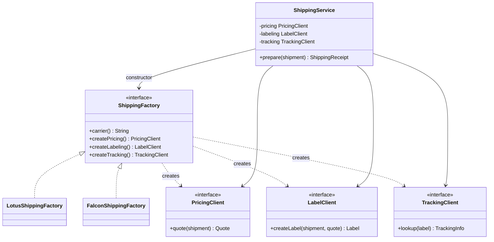

# Xây dựng một tình huống ứng dụng khác và giải thích lựa chọn cùng phương án thay thế

## 1. Mục tiêu bài thực hành

Trong module **Abstract Factory** thuộc nhóm *Creational Design Patterns*, mục tiêu không chỉ là nhớ sơ đồ các interface. Người học cần nhận diện một bài toán thực tế có **nhiều họ đối tượng liên quan**, tự thiết kế hệ thống, kiểm chứng hành vi và bảo vệ lựa chọn kiến trúc trước những phương án đơn giản hơn.

Bài thực hành này sử dụng một tình huống mới: **tích hợp nhiều hãng giao vận cho một hệ thống bán hàng**. Mỗi hãng cung cấp một bộ chức năng liên quan gồm:

- **Tính cước** giao hàng dựa trên khối lượng và nơi nhận.
- **Tạo nhãn vận đơn** chứa mã theo dõi đúng định dạng của hãng.
- **Tra cứu trạng thái** từ mã theo dõi do chính hãng đó phát hành.

Hệ thống hỗ trợ hai hãng giả định **Lotus Delivery** và **Falcon Parcel**. Đây là tên minh họa, không phải SDK hay dịch vụ thương mại có thật. Các thao tác trong mã Java chỉ tạo dữ liệu và giả lập tra cứu; chúng **không gửi đơn hàng hoặc gọi mạng**.

Sau bài này, bạn cần làm được bốn việc:

1. Xác định đâu là **abstract products**, **concrete products**, **abstract factory**, **concrete factories** và **client**.
2. Triển khai Java sao cho cùng một luồng nghiệp vụ dùng được nhiều hãng mà không chứa `if/else` theo hãng bên trong client.
3. Viết kiểm thử phát hiện lỗi **trộn họ sản phẩm**, tham số sai và quy trình bị phá vỡ.
4. Giải thích **vì sao chọn Abstract Factory**, khi nào nên chọn **Strategy**, **Factory Method**, một factory đơn giản, **Bridge** hoặc chỉ dùng **dependency injection**.

## 2. Đề bài và các quy tắc bắt buộc

Một đơn giao hàng có các trường:

| Trường | Ý nghĩa | Quy tắc |
| --- | --- | --- |
| `orderId` | Mã đơn hàng | Không `null` hoặc rỗng |
| `weightGrams` | Khối lượng tính bằng gram | Số nguyên lớn hơn 0 |
| `destination` | Mã nơi nhận nội bộ | Không `null` hoặc rỗng |

Quy trình xử lý một đơn:

1. Nhận đơn giao hàng.
2. Yêu cầu **pricing client** tính báo giá.
3. Dùng báo giá để tạo nhãn vận đơn qua **label client**.
4. Dùng nhãn để tra cứu trạng thái ban đầu qua **tracking client**.
5. Trả một `ShippingReceipt` chứa báo giá, nhãn và trạng thái.

Trong ví dụ, mọi kết quả của một lượt xử lý phải mang **cùng mã hãng**. Hai hãng có quy tắc minh họa khác nhau:

| Thuộc tính | Lotus Delivery | Falcon Parcel |
| --- | --- | --- |
| Mã hãng | `LOTUS` | `FALCON` |
| Cước giả lập | `15_000 + 12 × weightGrams` VND | `22_000 + 9 × weightGrams` VND |
| Tiền tố mã theo dõi | `LT-` | `FC-` |
| Nhãn vận đơn | Bắt đầu bằng `LOTUS`, các trường được ngăn cách bằng dấu gạch đứng | Bắt đầu bằng `FALCON`, các trường được ngăn cách bằng dấu gạch đứng |
| Trạng thái ban đầu | `CREATED` | `CREATED` |

**Các công thức cước chỉ phục vụ bài tập.** Hệ thống thật còn có kích thước kiện hàng, địa chỉ, vùng phục vụ, phụ phí, thuế, thời hạn hiệu lực báo giá và các điều khoản của hãng.

### Giới hạn phạm vi

Chúng ta thiết kế **một bộ adapter tương thích cho mỗi hãng**. Việc tạo nhãn mới chỉ tạo dữ liệu giả lập, chưa đăng ký vận đơn lên hệ thống bên ngoài. `TrackingClient` trả trạng thái mô phỏng để có ví dụ độc lập, không phát biểu về trạng thái giao nhận thật. Không giả định việc lấy báo giá, đăng ký vận đơn và tra cứu có thể gộp thành một giao dịch nguyên tử khi tích hợp API thật.

## 3. Bắt đầu từ thiết kế kém linh hoạt

Một cách viết ban đầu là để client tự chọn hãng ở từng bước:

```java
// Phản ví dụ; các lớp này chỉ mang tính minh họa.
Quote quote;
if ("lotus".equals(carrier)) {
    quote = new LotusPricingClient().quote(shipment);
} else {
    quote = new FalconPricingClient().quote(shipment);
}

Label label;
if ("lotus".equals(carrier)) {
    label = new LotusLabelClient().createLabel(shipment, quote);
} else {
    label = new FalconLabelClient().createLabel(shipment, quote);
}

// Những client khác lại có thể tự chọn TrackingClient một lần nữa.
```

Với thiết kế này, `ShippingService` vừa thực hiện nghiệp vụ vừa biết tên các lớp concrete. Nếu thêm một hãng mới, nhiều nhánh phải được sửa. Nếu một nhánh bỏ sót, báo giá hãng Lotus có thể bị chuyển cho bộ tạo nhãn Falcon.

Câu hỏi cần trả lời trước khi viết mã là:

> Có phải chúng ta chỉ thay một thuật toán tính cước, hay đang thay **đồng thời cả bộ cách tính cước, tạo nhãn và theo dõi** theo hãng?

Ở đây, mỗi hãng cung cấp **ba loại sản phẩm liên quan** và một bất biến nhất quán. Điều này tạo cơ sở để cân nhắc Abstract Factory.

## 4. Thiết kế một họ sản phẩm

Đặt các kiểu ứng dụng trung lập với hãng:

- `PricingClient`: `Quote quote(Shipment shipment)`.
- `LabelClient`: `Label createLabel(Shipment shipment, Quote quote)`.
- `TrackingClient`: `TrackingInfo lookup(Label label)`.
- `ShippingFactory`: tạo đủ ba client trên, công bố mã hãng.
- `ShippingService`: nhận `ShippingFactory` qua constructor và thực hiện quy trình.

Các dữ liệu như `Shipment`, `Quote`, `Label`, `TrackingInfo` chỉ là **kiểu kết quả nghiệp vụ chung**. Chúng không cần kế thừa hay triển khai SDK cụ thể.



Một `LotusShippingFactory` phải tạo **trọn bộ Lotus**, còn `FalconShippingFactory` phải tạo **trọn bộ Falcon**. Client không phải biết constructor của ba concrete product.

### Bất biến cần bảo vệ

Giả sử `Quote.carrier()` là `LOTUS`. `LabelClient` được dùng ở bước sau phải thuộc họ tương thích, và `Label.carrier()` cũng là `LOTUS`. Tương tự, khi tra cứu mã có tiền tố `LT-`, bộ tracking Lotus nhận mã này. Việc kiểm tra một số giá trị chung trong mã giúp phát hiện lỗi sớm, nhưng **không thay thế việc kiểm thử các adapter với API thật**.

## 5. Lời giải tham khảo Java 17

Đây là lời giải mẫu để đối chiếu **sau khi bạn đã thử tự thiết kế**. Tạo tệp `ShippingFactoryPractice.java`. Mã dùng nested types để chạy độc lập và kiểm soát phạm vi ví dụ; trong dự án thật, các interface và adapter thường nằm ở những package riêng.

```java
import java.util.Locale;
import java.util.Objects;

public final class ShippingFactoryPractice {
    private ShippingFactoryPractice() {}

    // ===== Dữ liệu nghiệp vụ độc lập với hãng =====

    record Shipment(String orderId, int weightGrams, String destination) {
        Shipment {
            if (orderId == null || orderId.isBlank()) {
                throw new IllegalArgumentException("orderId không hợp lệ");
            }
            if (weightGrams <= 0) {
                throw new IllegalArgumentException(
                    "weightGrams phải lớn hơn 0");
            }
            if (destination == null || destination.isBlank()) {
                throw new IllegalArgumentException("destination không hợp lệ");
            }
        }
    }

    record Quote(String carrier, long feeVnd) {}
    record Label(String carrier, String trackingCode, String body) {}
    record TrackingInfo(String carrier, String trackingCode, String status) {}
    record ShippingReceipt(Quote quote, Label label, TrackingInfo tracking) {}

    // ===== Abstract products =====

    interface PricingClient {
        Quote quote(Shipment shipment);
    }

    interface LabelClient {
        Label createLabel(Shipment shipment, Quote quote);
    }

    interface TrackingClient {
        TrackingInfo lookup(Label label);
    }

    // ===== Abstract Factory =====

    interface ShippingFactory {
        String carrier();
        PricingClient createPricing();
        LabelClient createLabeling();
        TrackingClient createTracking();
    }

    // ===== Họ LOTUS =====

    static final class LotusPricingClient implements PricingClient {
        @Override
        public Quote quote(Shipment shipment) {
            return new Quote(
                "LOTUS",
                15_000L + 12L * shipment.weightGrams()
            );
        }
    }

    static final class LotusLabelClient implements LabelClient {
        @Override
        public Label createLabel(Shipment shipment, Quote quote) {
            if (!"LOTUS".equals(quote.carrier())) {
                throw new IllegalArgumentException(
                    "Lotus không chấp nhận báo giá của hãng khác"
                );
            }
            String trackingCode = "LT-" + shipment.orderId();
            String body = "LOTUS | " + shipment.orderId()
                + " | " + shipment.destination()
                + " | " + shipment.weightGrams() + "g";
            return new Label("LOTUS", trackingCode, body);
        }
    }

    static final class LotusTrackingClient implements TrackingClient {
        @Override
        public TrackingInfo lookup(Label label) {
            if (!"LOTUS".equals(label.carrier())
                    || !label.trackingCode().startsWith("LT-")) {
                throw new IllegalArgumentException(
                    "Mã theo dõi không thuộc hãng Lotus"
                );
            }
            return new TrackingInfo(
                "LOTUS", label.trackingCode(), "CREATED");
        }
    }

    static final class LotusShippingFactory implements ShippingFactory {
        @Override
        public String carrier() {
            return "LOTUS";
        }

        @Override
        public PricingClient createPricing() {
            return new LotusPricingClient();
        }

        @Override
        public LabelClient createLabeling() {
            return new LotusLabelClient();
        }

        @Override
        public TrackingClient createTracking() {
            return new LotusTrackingClient();
        }
    }

    // ===== Họ FALCON =====

    static final class FalconPricingClient implements PricingClient {
        @Override
        public Quote quote(Shipment shipment) {
            return new Quote(
                "FALCON",
                22_000L + 9L * shipment.weightGrams()
            );
        }
    }

    static final class FalconLabelClient implements LabelClient {
        @Override
        public Label createLabel(Shipment shipment, Quote quote) {
            if (!"FALCON".equals(quote.carrier())) {
                throw new IllegalArgumentException(
                    "Falcon không chấp nhận báo giá của hãng khác"
                );
            }
            String trackingCode = "FC-" + shipment.orderId();
            String body = "FALCON | " + shipment.orderId()
                + " | " + shipment.destination()
                + " | " + shipment.weightGrams() + "g";
            return new Label("FALCON", trackingCode, body);
        }
    }

    static final class FalconTrackingClient implements TrackingClient {
        @Override
        public TrackingInfo lookup(Label label) {
            if (!"FALCON".equals(label.carrier())
                    || !label.trackingCode().startsWith("FC-")) {
                throw new IllegalArgumentException(
                    "Mã theo dõi không thuộc hãng Falcon"
                );
            }
            return new TrackingInfo(
                "FALCON", label.trackingCode(), "CREATED");
        }
    }

    static final class FalconShippingFactory implements ShippingFactory {
        @Override
        public String carrier() {
            return "FALCON";
        }

        @Override
        public PricingClient createPricing() {
            return new FalconPricingClient();
        }

        @Override
        public LabelClient createLabeling() {
            return new FalconLabelClient();
        }

        @Override
        public TrackingClient createTracking() {
            return new FalconTrackingClient();
        }
    }

    // ===== Client sử dụng bộ sản phẩm =====

    static final class ShippingService {
        private final String carrier;
        private final PricingClient pricing;
        private final LabelClient labeling;
        private final TrackingClient tracking;

        ShippingService(ShippingFactory factory) {
            Objects.requireNonNull(factory, "factory");
            this.carrier = Objects.requireNonNull(
                factory.carrier(), "carrier");
            this.pricing = Objects.requireNonNull(
                factory.createPricing(), "pricing");
            this.labeling = Objects.requireNonNull(
                factory.createLabeling(), "labeling");
            this.tracking = Objects.requireNonNull(
                factory.createTracking(), "tracking");
        }

        ShippingReceipt prepare(Shipment shipment) {
            Objects.requireNonNull(shipment, "shipment");

            Quote quote = Objects.requireNonNull(
                pricing.quote(shipment), "quote");
            if (!carrier.equals(quote.carrier())) {
                throw new IllegalStateException(
                    "Báo giá không thuộc hãng được chọn");
            }

            Label label = Objects.requireNonNull(
                labeling.createLabel(shipment, quote), "label");
            if (!carrier.equals(label.carrier())) {
                throw new IllegalStateException(
                    "Nhãn vận đơn không thuộc hãng được chọn");
            }

            TrackingInfo status = Objects.requireNonNull(
                tracking.lookup(label), "tracking");
            if (!carrier.equals(status.carrier())
                    || !label.trackingCode().equals(
                        status.trackingCode())) {
                throw new IllegalStateException(
                    "Thông tin theo dõi không khớp vận đơn");
            }

            return new ShippingReceipt(quote, label, status);
        }
    }

    // ===== Điểm khởi tạo: chọn một factory =====

    enum Carrier {
        LOTUS, FALCON;

        static Carrier parse(String raw) {
            if (raw == null || raw.isBlank()) {
                throw new IllegalArgumentException(
                    "carrier phải là lotus hoặc falcon");
            }
            return switch (raw.strip().toLowerCase(Locale.ROOT)) {
                case "lotus" -> LOTUS;
                case "falcon" -> FALCON;
                default -> throw new IllegalArgumentException(
                    "Hãng không hỗ trợ: " + raw);
            };
        }
    }

    static ShippingFactory selectFactory(Carrier carrier) {
        return switch (Objects.requireNonNull(carrier, "carrier")) {
            case LOTUS -> new LotusShippingFactory();
            case FALCON -> new FalconShippingFactory();
        };
    }

    public static void main(String[] args) {
        if (args.length > 1) {
            throw new IllegalArgumentException(
                "Cú pháp: java ShippingFactoryPractice [lotus|falcon]");
        }

        Carrier carrier = args.length == 0
            ? Carrier.LOTUS : Carrier.parse(args[0]);

        ShippingService service = new ShippingService(
            selectFactory(carrier));

        ShippingReceipt receipt = service.prepare(
            new Shipment("ORDER-105", 1_250, "HN"));

        System.out.println("Hãng: " + receipt.quote().carrier());
        System.out.println(
            "Cước: " + receipt.quote().feeVnd() + " VND");
        System.out.println("Nhãn: " + receipt.label().body());
        System.out.println(
            "Theo dõi: " + receipt.tracking().trackingCode()
                + " (" + receipt.tracking().status() + ")");
    }
}
```

### Chạy thử

Biên dịch với JDK 17 trở lên:

```bash
javac -encoding UTF-8 ShippingFactoryPractice.java
java ShippingFactoryPractice lotus
```

Kết quả mong đợi:

```text
Hãng: LOTUS
Cước: 30000 VND
Nhãn: LOTUS | ORDER-105 | HN | 1250g
Theo dõi: LT-ORDER-105 (CREATED)
```

Chuyển sang Falcon:

```bash
java ShippingFactoryPractice falcon
```

```text
Hãng: FALCON
Cước: 33250 VND
Nhãn: FALCON | ORDER-105 | HN | 1250g
Theo dõi: FC-ORDER-105 (CREATED)
```

Với `java ShippingFactoryPractice unknown`, chương trình báo `IllegalArgumentException` cho hãng không được hỗ trợ. **Không dùng mặc định để che giá trị người dùng đã cung cấp nhưng sai.** Giá trị mặc định `LOTUS` chỉ áp dụng khi không có tham số CLI.

### Kiến thức Abstract Factory thể hiện trong mã

| Vai trò | Trong ví dụ |
| --- | --- |
| Abstract factory | `ShippingFactory` |
| Concrete factories | `LotusShippingFactory`, `FalconShippingFactory` |
| Abstract products | `PricingClient`, `LabelClient`, `TrackingClient` |
| Concrete products | Sáu lớp `Lotus*Client` và `Falcon*Client` |
| Client | `ShippingService` |
| Composition root | `main()` gọi `selectFactory(Carrier)` |
| Kết quả nghiệp vụ | `ShippingReceipt` gồm `Quote`, `Label`, `TrackingInfo` |

Hãy thử tìm trong `ShippingService` các tên `LotusPricingClient` và `FalconTrackingClient`: **không có**. Client chỉ sử dụng abstraction, còn tên concrete product chỉ xuất hiện tại phần định nghĩa các lớp và concrete factory.

Trong chương trình mẫu, `ShippingService` kiểm tra mã hãng trong các kết quả để có thể **phát hiện sai lệch hợp đồng khi chạy**. Trong hệ thống thực, cần kiểm tra thêm thông tin phiên bản, vùng, account, quyền truy cập và tương thích của các mã theo dõi; một chuỗi `carrier` giống nhau chưa đủ bảo đảm các dịch vụ bên ngoài thuộc cùng cấu hình.

## 6. Kiểm thử hành vi chung và tính nhất quán của họ

Dù có hai factory, luồng nghiệp vụ của `ShippingService` phải giữ nguyên. Có thể dùng **JUnit Jupiter 5** với `@ParameterizedTest` và `@MethodSource` để thực hiện cùng một hợp đồng kiểm thử trên nhiều concrete factory.

Ví dụ dưới đây nằm trong `ShippingFactoryPracticeTest.java` ở **cùng package** với `ShippingFactoryPractice`. Dự án cần dependency JUnit Jupiter và công cụ chạy test thích hợp. Đây là đoạn mã tham khảo để người học triển khai, không yêu cầu thực thi trong bước soạn học liệu.

```java
import static org.junit.jupiter.api.Assertions.*;

import java.util.function.Supplier;
import java.util.stream.Stream;

import org.junit.jupiter.api.Test;
import org.junit.jupiter.params.ParameterizedTest;
import org.junit.jupiter.params.provider.Arguments;
import org.junit.jupiter.params.provider.MethodSource;

class ShippingFactoryPracticeTest {

    static Stream<Arguments> factories() {
        return Stream.of(
            Arguments.of(
                "LOTUS",
                (Supplier<ShippingFactoryPractice.ShippingFactory>)
                    ShippingFactoryPractice.LotusShippingFactory::new,
                "LT-"
            ),
            Arguments.of(
                "FALCON",
                (Supplier<ShippingFactoryPractice.ShippingFactory>)
                    ShippingFactoryPractice.FalconShippingFactory::new,
                "FC-"
            )
        );
    }

    @ParameterizedTest(name = "{0}: cùng hợp đồng nghiệp vụ")
    @MethodSource("factories")
    void worksWithEveryFactory(
            String expectedCarrier,
            Supplier<ShippingFactoryPractice.ShippingFactory> supplier,
            String expectedPrefix) {

        var shipment = new ShippingFactoryPractice.Shipment(
            "ORDER-105", 1_250, "HN");
        var receipt = new ShippingFactoryPractice.ShippingService(
            supplier.get()).prepare(shipment);

        assertAll(
            () -> assertEquals(
                expectedCarrier, receipt.quote().carrier()),
            () -> assertTrue(receipt.quote().feeVnd() > 0),
            () -> assertEquals(
                expectedCarrier, receipt.label().carrier()),
            () -> assertTrue(
                receipt.label().trackingCode().startsWith(
                    expectedPrefix)),
            () -> assertEquals(
                expectedCarrier, receipt.tracking().carrier()),
            () -> assertEquals(
                receipt.label().trackingCode(),
                receipt.tracking().trackingCode()),
            () -> assertEquals(
                "CREATED", receipt.tracking().status())
        );
    }

    @Test
    void rejectsCrossCarrierQuote() {
        var shipment = new ShippingFactoryPractice.Shipment(
            "ORDER-105", 1_250, "HN");
        var quoteFromFalcon =
            new ShippingFactoryPractice.Quote("FALCON", 33_250);

        assertThrows(
            IllegalArgumentException.class,
            () -> new ShippingFactoryPractice.LotusLabelClient()
                .createLabel(shipment, quoteFromFalcon)
        );
    }

    @Test
    void rejectsUnknownCarrierAndInvalidShipment() {
        assertThrows(
            IllegalArgumentException.class,
            () -> ShippingFactoryPractice.Carrier.parse("unknown")
        );
        assertThrows(
            IllegalArgumentException.class,
            () -> new ShippingFactoryPractice.Shipment(
                "ORDER-105", 0, "HN")
        );
    }
}
```

Với hai factory trong nguồn tham số, `worksWithEveryFactory` chạy **hai lượt**, cùng với hai phương thức `@Test` độc lập. Mỗi lượt dùng một `Supplier` để tạo factory mới, tránh chia sẻ trạng thái bất ngờ.

### Các trường hợp nên mở rộng kiểm thử

| Tình huống | Kỳ vọng |
| --- | --- |
| Lotus tạo cả ba sản phẩm | Đều mang kết quả tương thích với `LOTUS` |
| Falcon tạo cả ba sản phẩm | Đều mang kết quả tương thích với `FALCON` |
| Báo giá Lotus đưa sang label Falcon | Bị từ chối trước khi tạo nhãn |
| Nhãn Falcon đưa cho tracker Lotus | Bị từ chối vì không cùng họ |
| `orderId` hoặc `destination` rỗng | `IllegalArgumentException` |
| `weightGrams` bằng 0 hoặc âm | `IllegalArgumentException` |
| Tham số hãng không tồn tại | Lỗi rõ ràng, không fallback sang Lotus |
| Thêm hãng thứ ba | Các test hành vi chung chạy lại cho factory mới |
| Client nhận factory trả một sản phẩm `null` | Fail-fast khi khởi tạo client |
| Adapter mạng thất bại trong ứng dụng thật | Có chiến lược lỗi/retry/cleanup riêng, không báo nhầm “hãng không hỗ trợ” |

Không chỉ so sánh `getClass().getName()` của sản phẩm: điều quan trọng là **hành vi và dữ liệu đầu ra theo hợp đồng**. Nếu hai adapter cùng tạo ra kết quả hợp lệ nhưng dùng cấu trúc nội bộ khác nhau, bộ test vẫn nên cho phép chúng thay thế nhau.

## 7. Giải thích lựa chọn: tại sao Abstract Factory phù hợp?

Đây là phần bắt buộc của bài tập, có thể viết thành một quyết định thiết kế ngắn:

> Chúng ta chọn Abstract Factory vì mỗi hãng giao vận cung cấp **ba loại client có quan hệ và cần được cấu hình tương thích**: tính cước, nhãn và theo dõi. `ShippingService` cần dùng cùng một quy trình cho mọi hãng, chỉ phụ thuộc các interface, trong khi concrete factory chịu trách nhiệm lắp đúng họ sản phẩm. Khi thêm hãng, ta thêm ba adapter và factory mới rồi cập nhật vị trí lựa chọn; không cần thêm các nhánh theo hãng trong mỗi bước nghiệp vụ.

Đánh giá lựa chọn này theo các trục:

| Tiêu chí | Lợi ích trong bài tập | Chi phí cần chấp nhận |
| --- | --- | --- |
| Giảm phụ thuộc concrete class | Client không biết SDK và constructor của từng hãng | Có thêm các interface và lớp factory |
| Nhất quán sản phẩm | Một factory tập hợp ba client cùng họ | Concrete factory vẫn phải triển khai đúng và được kiểm thử |
| Mở rộng theo hãng | Thêm hãng mới ít tác động client | Phải thêm adapter, cấu hình và bước lựa chọn |
| Thay thế trong kiểm thử | Có thể cung cấp một factory giả | Test hợp đồng phải bảo vệ cả bộ sản phẩm |
| Rõ trách nhiệm | Chọn hãng ở composition root | Cần quản lý vòng đời của các client được tạo |

Một tiêu chí quyết định đặc biệt quan trọng: **thay đổi dự kiến thường xuyên nhất là thêm hoặc thay hãng**, còn ba loại client `Pricing`, `Label` và `Tracking` tương đối ổn định. Nếu dự án thường xuyên thêm loại dịch vụ hoàn toàn mới cho tất cả hãng, interface factory có thể phình to, kéo theo sửa hàng loạt concrete factory.

## 8. Phương án thay thế và khi nào nên chọn

Không có nghĩa hễ có hai hãng là bắt buộc dùng Abstract Factory. Cần so sánh với bài toán thực tế và trả lời được **đổi điều gì sẽ tốn chi phí**.

### 8.1. Strategy khi chỉ thay một hành vi

Giả sử ứng dụng chỉ cần **tính cước**; mọi hãng sử dụng chung quy trình tạo nhãn và theo dõi. Khi đó, có thể truyền trực tiếp một `PricingStrategy`:

```java
interface PricingStrategy {
    long calculateFee(int weightGrams);
}

final class LotusPricing implements PricingStrategy {
    @Override
    public long calculateFee(int weightGrams) {
        return 15_000L + 12L * weightGrams;
    }
}

final class FalconPricing implements PricingStrategy {
    @Override
    public long calculateFee(int weightGrams) {
        return 22_000L + 9L * weightGrams;
    }
}
```

Ở đây chỉ thay **một thuật toán**, không có một bộ ba sản phẩm cần lắp đồng bộ. `PricingStrategy` đơn giản, dễ đọc và đủ để đạt mục tiêu. Nếu sau này nhãn và theo dõi cũng biến đổi theo hãng, hãy đánh giá lại nhu cầu lắp **một họ adapter**.

### 8.2. Factory Method hoặc factory đơn giản khi chỉ có một loại sản phẩm

Nếu một dịch vụ chỉ cần tạo `TrackingClient` từ tên hãng, một hàm lựa chọn tập trung có thể đủ:

```java
static TrackingClient createTracking(String carrier) {
    return switch (carrier) {
        case "lotus" -> new LotusTrackingClient();
        case "falcon" -> new FalconTrackingClient();
        default -> throw new IllegalArgumentException(carrier);
    };
}
```

Đây là **hàm factory đơn giản** theo ví dụ, không nhất thiết là mẫu *Factory Method* theo định nghĩa GoF. Factory Method chính thức thường để **lớp con quyết định loại đối tượng** được tạo qua phương thức factory. Abstract Factory có ích hơn khi việc lựa chọn phải tạo **nhiều loại sản phẩm liên quan**.

### 8.3. Constructor injection thuần khi cấu hình đơn giản

Nếu ứng dụng chỉ hỗ trợ một nhà vận chuyển và các dependency đã được lắp tại startup, client có thể nhận trực tiếp:

```java
ShippingService(
    PricingClient pricing,
    LabelClient labeling,
    TrackingClient tracking
) {
    // Lưu các dependency, kiểm tra null.
}
```

Không nhất thiết phải tạo `ShippingFactory`. Tuy nhiên, khi có nhiều họ và nhiều nơi cần bộ ba cùng hãng, việc lắp riêng lẻ đòi hỏi composition root kiểm soát chặt tính tương thích. **Dependency injection là cơ chế cung cấp dependency**, còn Abstract Factory là cách **đóng gói quy tắc tạo một họ sản phẩm**; chúng có thể phối hợp.

### 8.4. Bridge khi có hai chiều biến thiên độc lập

Giả sử quy trình giao vận có **hai loại luồng** là `RetailShipment` và `WholesaleShipment`, còn **cách thực thi** là Lotus hoặc Falcon. Nếu hệ thống có `RetailLotusShipment`, `RetailFalconShipment`, `WholesaleLotusShipment`, `WholesaleFalconShipment`, cần cân nhắc **Bridge**:

- Abstraction: `ShipmentFlow` và các loại luồng bán lẻ/bán buôn.
- Implementation: `ShippingProvider` với các cách triển khai Lotus/Falcon.
- Mỗi luồng giữ tham chiếu đến một `ShippingProvider` để ủy quyền các thao tác.

Bridge tập trung **tách hai chiều abstraction/implementation** khỏi tổ hợp lớp con. Abstract Factory tập trung **tạo bộ Pricing/Label/Tracking client theo provider**. Với hệ thống đủ lớn, Bridge có thể dùng một implementation được lắp từ Abstract Factory; không cần coi hai mẫu loại trừ nhau.

### Bảng quyết định nhanh

| Tình huống | Ưu tiên xem xét |
| --- | --- |
| Chỉ khác một công thức giá | **Strategy** |
| Chỉ tạo một `TrackingClient` theo cấu hình | **Factory đơn giản** hoặc Factory Method nếu có hệ phân cấp creator |
| Chỉ một hãng và các dependency ổn định | **Constructor injection** trực tiếp |
| Hai chiều luồng nghiệp vụ và provider tiến hóa độc lập | **Bridge** |
| Nhiều loại client phải nhất quán theo từng hãng | **Abstract Factory** |
| Hai chiều luồng + nhiều họ adapter phức tạp | **Bridge kết hợp Abstract Factory** nếu chi phí thiết kế hợp lý |

## 9. Các tình huống mở rộng để tự thực hành

### Yêu cầu A — Thêm hãng thứ ba

Bổ sung hãng giả định **Cedar Express**:

- Mã hãng `CEDAR`.
- Báo giá `18_000 + 10 × weightGrams`.
- Mã theo dõi có tiền tố `CD-`.
- Có đủ pricing, labeling, tracking.

Cần thêm những lớp nào? `ShippingService` có phải sửa không? Hãy cập nhật `Carrier`, điểm `selectFactory` và nguồn tham số test. Nếu vẫn phải sửa các nhánh trong `ShippingService`, hãy tìm lại nơi client đang phụ thuộc vào concrete class.

### Yêu cầu B — Một hãng thiếu tracking

Giả sử hãng Cedar không có API theo dõi. Hãy lựa chọn **một chính sách có lý do**:

1. Không cho cấu hình Cedar nếu nghiệp vụ bắt buộc tracking.
2. Định nghĩa hợp đồng khác cho các provider có và không có tracking.
3. Cho phép một adapter tracking hợp lệ từ nguồn khác, nhưng chỉ khi các mã vận đơn và quyền truy cập thực sự tương thích.

**Không âm thầm tạo `LotusTrackingClient` trong `CedarShippingFactory`** chỉ để thỏa mãn interface: đó là hành vi dễ gây trộn họ và sai dữ liệu. Cần xác định lại bất biến của hệ thống nếu tracking là khả năng tùy chọn.

### Yêu cầu C — Thay provider sau khi đã phát hành vận đơn

Nếu đơn hàng `ORDER-105` đã có nhãn Lotus, hệ thống không thể chỉ đổi factory sang Falcon rồi giả định mã `LT-ORDER-105` tra cứu được trong Falcon. Hãy thiết kế cách lưu **carrier đi kèm từng vận đơn**, chọn đúng tracking adapter khi tra cứu và kế hoạch chuyển đổi dữ liệu nếu có nghiệp vụ chuyển hãng. Abstract Factory giúp chọn bộ adapter khi tạo đơn, nhưng **không tự di chuyển dữ liệu hay chuyển đổi mã theo dõi**.

### Yêu cầu D — Lỗi hạ tầng và idempotency

Trong một tích hợp thật, tạo nhãn có thể là thao tác có tác dụng phụ, dẫn tới vận đơn được đăng ký ngay với hãng. Nếu lời gọi timeout sau khi hãng đã tạo vận đơn, retry mù có thể tạo hai vận đơn. Hãy mô tả:

- Khóa idempotency theo `orderId` hoặc mã nghiệp vụ tương đương.
- Cách lưu trạng thái, mã yêu cầu và kết quả tạo nhãn.
- Chính sách phân biệt lỗi tham số, lỗi nghiệp vụ và lỗi mạng.
- Cơ chế retry, đối soát và xử lý kết quả không chắc chắn.

Những vấn đề này **không được giải quyết chỉ bằng việc chọn Abstract Factory**. Cần thiết kế thêm phần xử lý tác dụng phụ, độ tin cậy và quan sát.

## 10. Tiêu chí hoàn thành và rubric tự đánh giá

Một bài nộp tốt nên có mã Java, sơ đồ hoặc mô tả vai trò, các kiểm thử có ý nghĩa và một đoạn **giải thích quyết định thiết kế**. Có thể dùng rubric tham khảo sau:

| Tiêu chí | Điểm tối đa | Dấu hiệu đạt |
| --- | ---: | --- |
| Nhận diện đúng họ sản phẩm và bất biến tương thích | 20 | Ba abstract products, hai concrete factories, không trộn hãng |
| Tách client và việc khởi tạo | 25 | `ShippingService` không biết constructor các concrete product |
| Chạy cùng nghiệp vụ với nhiều hãng | 15 | Cả Lotus và Falcon cho kết quả hợp lệ theo quy ước |
| Kiểm thử hợp đồng và nhánh lỗi | 20 | Có test tham số hóa, sai hãng, sai đầu vào và null |
| Phân tích lựa chọn và phương án thay thế | 15 | Nêu được lúc nên dùng Strategy, simple factory, Bridge, DI |
| Khả năng đọc, bảo trì và giải thích giới hạn | 5 | Tên rõ, code dễ đọc, không khẳng định mô phỏng là tích hợp thật |
| **Tổng** | **100** | Dựa trên bằng chứng cụ thể trong mã và kết quả kiểm tra |

### Các câu hỏi phản biện trước khi nộp

1. Nếu thêm Cedar, có phải sửa logic tính cước, tạo nhãn hoặc tracking bên trong `ShippingService` không?
2. Nếu `FalconShippingFactory` vô tình trả `LotusTrackingClient`, bài test nào sẽ thất bại?
3. Vì sao `Quote`/`Label` là dữ liệu nghiệp vụ chung, còn các `*Client` mới là các sản phẩm do factory tạo?
4. Vì sao một `switch` tập trung ở composition root không phá ý tưởng Abstract Factory?
5. Nếu dự án chỉ đổi thuật toán tính giá, vì sao Abstract Factory có thể là thiết kế quá phức tạp?
6. Khi một hãng thiếu tracking, hợp đồng cần thay đổi ở đâu thay vì tự trả một sản phẩm không tương thích?
7. Những lỗi nào phải xử lý tại ranh giới nghiệp vụ và những lỗi nào thuộc về adapter của hãng?

Bạn có thể tự viết đáp án dưới mỗi câu hỏi, gắn với một dòng code, một test hoặc một trường hợp cụ thể. Đây là cách luyện **giải thích phương án thiết kế bằng chứng cứ**, thay vì chỉ nêu định nghĩa mẫu.

---

**Ghi nhớ:** Abstract Factory đáng chọn khi ứng dụng cần tạo **nhiều loại sản phẩm thuộc cùng một họ**, và client không nên biết cách lắp từng biến thể. Trong bài này, nhà giao vận là **chiều biến thiên của họ**, còn tính cước, tạo nhãn và theo dõi là **các loại sản phẩm**. Hãy ưu tiên cách đơn giản hơn nếu chỉ có một thuật toán, một loại sản phẩm hoặc một cấu hình ít thay đổi; luôn giải thích những đánh đổi và giới hạn của lựa chọn.
