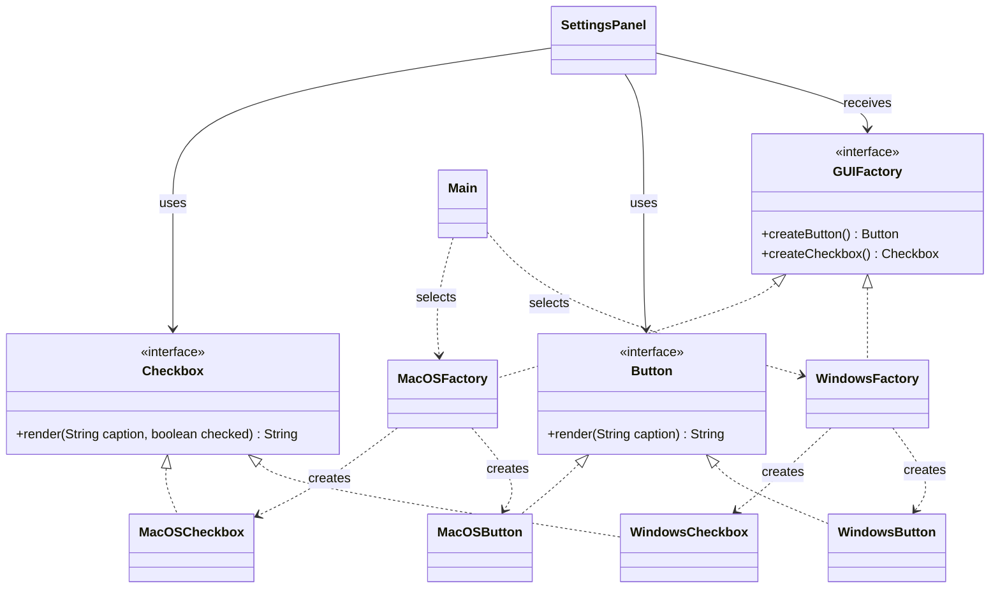
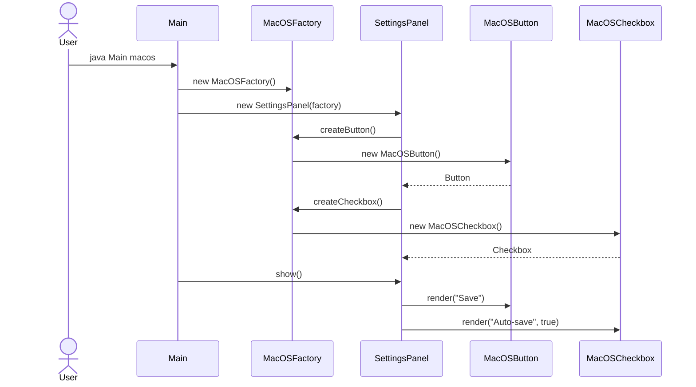

# Kiểm tra khả năng giải thích đúng vai trò factory, product và client

## 1. Mục tiêu đánh giá

Trong **Abstract Factory** (mẫu thiết kế thuộc nhóm *Creational Design Patterns*), việc ghi nhớ tên lớp chưa đủ để khẳng định một thiết kế tốt. Người học cần giải thích được **ai tạo đối tượng, ai sử dụng đối tượng và vì sao các đối tượng được tạo phải thuộc cùng một họ**.

Bài đánh giá này tập trung vào ba nhóm vai trò:

1. **Factory:** Định nghĩa và thực hiện việc tạo các loại sản phẩm liên quan.
2. **Product:** Định nghĩa hợp đồng sử dụng; cung cấp các biến thể cụ thể theo từng họ.
3. **Client:** Sử dụng các sản phẩm thông qua hợp đồng chung, không tự quyết định lớp sản phẩm cụ thể.

Sau bài học, bạn cần có khả năng đọc mã Java và trả lời có căn cứ:

- Thành phần nào là *Abstract Factory*, *Concrete Factory*, *Abstract Product*, *Concrete Product* và *Client*?
- Một yêu cầu tạo sản phẩm đi qua những đối tượng nào, và lớp nào thực sự gọi `new`?
- Vì sao factory Windows phải tạo cả nút bấm lẫn ô chọn theo phong cách Windows?
- Thêm một **họ sản phẩm** mới khác gì thêm một **loại sản phẩm** mới?
- Những trường hợp nào làm client phụ thuộc sai vào lớp cụ thể hoặc làm trộn các họ sản phẩm?

Đối tượng được đánh giá ở đây là **cách lập luận về thiết kế**, không chỉ việc chương trình biên dịch và cho ra kết quả mong đợi.

## 2. Tình huống xuyên suốt: màn hình cài đặt đa nền tảng

Một ứng dụng có màn hình cài đặt gồm `Button` (nút lưu) và `Checkbox` (bật/tắt tự động lưu). Ứng dụng chạy với hai họ giao diện:

| Họ giao diện | Button | Checkbox |
| --- | --- | --- |
| Windows | `WindowsButton` | `WindowsCheckbox` |
| macOS | `MacOSButton` | `MacOSCheckbox` |

Yêu cầu thiết kế: màn hình cài đặt phải dùng **cùng một họ giao diện** cho cả hai thành phần. Đồng thời mã của màn hình cài đặt phải hoạt động cho cả Windows lẫn macOS mà không cần rẽ nhánh dựa trên tên nền tảng.

Lược đồ phụ thuộc:



**Lưu ý về thuật ngữ:** `GUIFactory` là **Abstract Factory**, còn `WindowsFactory` và `MacOSFactory` là các **Concrete Factory**. Tương tự, `Button`/`Checkbox` là **Abstract Product**, trong khi các biến thể Windows/macOS là **Concrete Product**. `SettingsPanel` là **Client** dùng sản phẩm; `Main` là điểm cấu hình và lắp ghép (*composition root*) lựa chọn nhà máy.

## 3. Mã Java để phân tích vai trò

Đoạn mã sau tự chứa, đặt toàn bộ trong `Main.java`. Các phương thức `render` trả về chuỗi để có thể quan sát luồng thiết kế mà không phụ thuộc thư viện GUI; đây là mô phỏng cấu trúc Abstract Factory, không tạo cửa sổ thật.

```java
// Main.java

// Abstract Product: hợp đồng dùng nút bấm.
interface Button {
    String render(String caption);
}

// Abstract Product: hợp đồng dùng ô chọn.
interface Checkbox {
    String render(String caption, boolean checked);
}

// Abstract Factory: khai báo các loại sản phẩm trong một họ.
interface GUIFactory {
    Button createButton();
    Checkbox createCheckbox();
}

// Concrete Products thuộc họ Windows.
final class WindowsButton implements Button {
    @Override
    public String render(String caption) {
        return "Windows button: [" + caption + "]";
    }
}

final class WindowsCheckbox implements Checkbox {
    @Override
    public String render(String caption, boolean checked) {
        return "Windows checkbox: [" + (checked ? "x" : " ") + "] " + caption;
    }
}

// Concrete Products thuộc họ macOS.
final class MacOSButton implements Button {
    @Override
    public String render(String caption) {
        return "macOS button: (" + caption + ")";
    }
}

final class MacOSCheckbox implements Checkbox {
    @Override
    public String render(String caption, boolean checked) {
        return "macOS checkbox: (" + (checked ? "x" : " ") + ") " + caption;
    }
}

// Concrete Factory: tạo toàn bộ sản phẩm thuộc họ Windows.
final class WindowsFactory implements GUIFactory {
    @Override
    public Button createButton() {
        return new WindowsButton();
    }

    @Override
    public Checkbox createCheckbox() {
        return new WindowsCheckbox();
    }
}

// Concrete Factory: tạo toàn bộ sản phẩm thuộc họ macOS.
final class MacOSFactory implements GUIFactory {
    @Override
    public Button createButton() {
        return new MacOSButton();
    }

    @Override
    public Checkbox createCheckbox() {
        return new MacOSCheckbox();
    }
}

// Client: yêu cầu sản phẩm qua factory, sử dụng qua interface.
final class SettingsPanel {
    private final Button saveButton;
    private final Checkbox autoSaveCheckbox;

    SettingsPanel(GUIFactory factory) {
        saveButton = factory.createButton();
        autoSaveCheckbox = factory.createCheckbox();
    }

    void show() {
        System.out.println(saveButton.render("Save"));
        System.out.println(autoSaveCheckbox.render("Auto-save", true));
    }
}

// Composition root: chọn factory cho toàn bộ màn hình.
public class Main {
    public static void main(String[] args) {
        String platform = args.length == 0 ? "windows" : args[0];
        GUIFactory factory;

        if ("windows".equalsIgnoreCase(platform)) {
            factory = new WindowsFactory();
        } else if ("macos".equalsIgnoreCase(platform)) {
            factory = new MacOSFactory();
        } else {
            System.err.println("Use: java Main [windows|macos]");
            return;
        }

        new SettingsPanel(factory).show();
    }
}
```

Chạy thử với JDK:

```bash
javac Main.java
java Main windows
java Main macos
```

Kết quả của `java Main windows`:

```text
Windows button: [Save]
Windows checkbox: [x] Auto-save
```

Kết quả của `java Main macos`:

```text
macOS button: (Save)
macOS checkbox: (x) Auto-save
```

Hai lệnh chạy tạo ra các sản phẩm cụ thể khác nhau nhưng đều sử dụng **cùng mã `SettingsPanel`**. Đây là bằng chứng quan sát được về việc client không phụ thuộc trực tiếp vào các lớp sản phẩm Windows/macOS.

## 4. Giải thích đúng từng vai trò

### 4.1. Factory: nơi quyết định *bộ sản phẩm* được tạo

`GUIFactory` **khai báo** `createButton()` và `createCheckbox()`. Nó chưa chỉ ra sẽ trả về `WindowsButton` hay `MacOSButton`. Đây là hợp đồng tạo sản phẩm, giúp client yêu cầu sản phẩm mà không nêu tên lớp cụ thể.

`WindowsFactory` và `MacOSFactory` **hiện thực** hợp đồng đó. Chính các factory cụ thể dùng `new` để tạo sản phẩm của một họ. Vì `WindowsFactory.createButton()` tạo `WindowsButton` và `WindowsFactory.createCheckbox()` tạo `WindowsCheckbox`, người dùng factory này nhận bộ sản phẩm Windows đồng nhất.

Một cách giải thích chưa chính xác là: “`GUIFactory` tự vẽ giao diện cho ứng dụng”. Trên thực tế, factory chịu trách nhiệm **tạo hoặc cung cấp** sản phẩm. Việc sử dụng hoặc hiển thị sản phẩm thuộc về các đối tượng sử dụng sản phẩm và phần cài đặt của chính sản phẩm.

> **Câu kiểm tra:** Nếu đổi `WindowsFactory` thành `MacOSFactory` ở `Main`, lớp nào phải thay đổi?  
> **Trả lời chuẩn:** Việc lựa chọn ở `Main` thay đổi; `SettingsPanel` không cần sửa vì chỉ nhận `GUIFactory` và dùng các interface sản phẩm.

### 4.2. Product: hợp đồng chung và hành vi đặc thù của mỗi họ

`Button` và `Checkbox` là **hai loại sản phẩm khác nhau**, mỗi loại có hợp đồng thao tác riêng. `WindowsButton` và `MacOSButton` cùng hiện thực `Button`; `WindowsCheckbox` và `MacOSCheckbox` cùng hiện thực `Checkbox`.

Hai trục phải được phân biệt:

| Trục phân loại | Câu hỏi | Trong ví dụ |
| --- | --- | --- |
| **Loại sản phẩm** | Đây là thành phần gì? | `Button` hoặc `Checkbox` |
| **Họ sản phẩm** | Thành phần mang biến thể nào? | Windows hoặc macOS |

Vì thế, `WindowsButton` và `MacOSButton` là các **biến thể của cùng một loại** sản phẩm. Còn `WindowsButton` và `WindowsCheckbox` thuộc **cùng một họ**, dù là hai loại khác nhau.

`Button` và `Checkbox` không tự bảo đảm quy tắc phối hợp của cả họ; các factory cụ thể chịu trách nhiệm chọn đúng biến thể. Sự tương thích theo họ là một **cam kết của thiết kế và phần cài đặt factory**, không phải điều được Java tự kiểm chứng chỉ nhờ kiểu trả về `Button`/`Checkbox`.

> **Câu kiểm tra:** `WindowsCheckbox` thuộc loại sản phẩm và họ sản phẩm nào?  
> **Trả lời chuẩn:** Nó là Concrete Product thuộc **loại `Checkbox`** và **họ Windows**.

### 4.3. Client: dùng sản phẩm mà không gắn với lớp cụ thể

`SettingsPanel` là client vì nó cần dùng `Button` và `Checkbox` để thể hiện màn hình cài đặt. Nó nhận `GUIFactory` qua constructor, yêu cầu sản phẩm và lưu các kết quả vào biến kiểu interface.

Trong `SettingsPanel` không có:

```java
// Các biểu thức sau KHÔNG xuất hiện trong SettingsPanel mẫu.
// new WindowsButton();
// new MacOSCheckbox();
// if (platform.equals("windows")) { ... }
```

Client **được phép biết đến `GUIFactory`** và gọi các phương thức tạo sản phẩm qua interface đó. Yêu cầu quan trọng là client không phải quyết định *concrete product* nào được tạo. Nếu một client có điều kiện đặc biệt để chọn `WindowsButton` trực tiếp, khả năng thay thế họ qua factory đã bị suy giảm.

Trong ví dụ, `Main` biết các tên `WindowsFactory` và `MacOSFactory` để lắp ghép hệ thống. Điều này **không vi phạm** ý tưởng của mẫu: một nơi cấu hình thường cần biết lớp cụ thể; phụ thuộc vào sản phẩm cụ thể được giữ bên ngoài logic của `SettingsPanel`.

> **Câu kiểm tra:** Vì sao `Main` có thể gọi `new WindowsFactory()` mà `SettingsPanel` vẫn được xem là độc lập nền tảng?  
> **Trả lời chuẩn:** `Main` chịu trách nhiệm chọn và truyền phụ thuộc; `SettingsPanel` chỉ nhận `GUIFactory`, làm việc với `Button`/`Checkbox` và không phân nhánh theo nền tảng.

## 5. Kiểm tra luồng tạo và sử dụng đối tượng

Khi chạy `java Main macos`, hãy lần theo các bước:

1. `Main` chọn `new MacOSFactory()` và giữ tham chiếu kiểu `GUIFactory`.
2. `Main` truyền factory cho constructor của `SettingsPanel`.
3. `SettingsPanel` gọi `factory.createButton()`; `MacOSFactory` tạo `MacOSButton`.
4. `SettingsPanel` gọi `factory.createCheckbox()`; `MacOSFactory` tạo `MacOSCheckbox`.
5. `SettingsPanel.show()` sử dụng hai sản phẩm qua các interface `Button` và `Checkbox`.



Một lời giải thích đầy đủ nên nêu **cả hai chặng**: factory tạo đối tượng và client dùng đối tượng. Chỉ nói “factory giúp tách code” là quá chung chung, không chỉ ra được phụ thuộc cụ thể nào đã được chuyển ra khỏi client.

## 6. Thử phát hiện và sửa lỗi giải thích hoặc thiết kế

### Trường hợp A: factory trộn hai họ sản phẩm

```java
// Biến thể lỗi về mặt thiết kế, dù kiểu Java vẫn hợp lệ.
final class BrokenWindowsFactory implements GUIFactory {
    @Override
    public Button createButton() {
        return new WindowsButton();
    }

    @Override
    public Checkbox createCheckbox() {
        return new MacOSCheckbox(); // Sai họ sản phẩm.
    }
}
```

**Cần giải thích:** `BrokenWindowsFactory` vẫn thỏa kiểu trả về của `GUIFactory`, vì `MacOSCheckbox` có kiểu `Checkbox`. Nhưng nó phá vỡ cam kết cung cấp một **họ sản phẩm nhất quán**. Cách sửa là trả về `WindowsCheckbox` hoặc thiết kế lại tên và hợp đồng factory nếu chủ ý hỗ trợ giao diện pha trộn.

### Trường hợp B: client tự tạo concrete product

```java
// Trích đoạn phụ thuộc trực tiếp vào lớp cụ thể.
final class RigidPanel {
    private final Button saveButton = new WindowsButton();
    private final Checkbox autoSaveCheckbox = new WindowsCheckbox();
}
```

**Cần giải thích:** `RigidPanel` không nhận factory, và việc chọn giao diện Windows đã được cố định trong client. Muốn dùng macOS phải sửa client hoặc thêm nhánh điều kiện ngay tại đây. Sửa thiết kế bằng cách nhận `GUIFactory` trong constructor và gọi `createButton()`/`createCheckbox()` như `SettingsPanel` ở trên.

### Trường hợp C: client phụ thuộc vào loại cụ thể để sử dụng sản phẩm

```java
// Ví dụ minh họa: không phải đoạn mã độc lập có thể chạy.
if (button instanceof WindowsButton) {
    // Xử lý riêng cho Windows.
} else if (button instanceof MacOSButton) {
    // Xử lý riêng cho macOS.
}
```

**Cần giải thích:** Nếu client thường xuyên dùng `instanceof` để chọn thao tác theo lớp cụ thể, hợp đồng `Button` có thể đang thiếu hành vi cần dùng hoặc abstraction đang đặt sai chỗ. Nên cân nhắc đưa hành vi chung vào interface và để từng Concrete Product hiện thực. Không phải mọi `instanceof` đều sai, nhưng đây là tín hiệu cần xét lại tính độc lập nền tảng của client.

### Trường hợp D: nhầm factory với product

Nhận định: “`WindowsFactory` là `Button` vì nó tạo nút bấm.”

**Cần giải thích:** Sai. Factory là đối tượng **cung cấp sản phẩm**, còn `WindowsButton` mới là một **Concrete Product** hiện thực `Button`. Vai trò trong sơ đồ mẫu thiết kế dựa vào hợp đồng và trách nhiệm, không dựa vào việc một lớp có nhắc đến tên lớp khác.

## 7. Câu hỏi đánh giá tình huống thay đổi

Việc chỉ ra đúng tên vai trò mới là mức cơ bản. Một người hiểu mẫu cần dự đoán được thiết kế sẽ thay đổi thế nào trước yêu cầu mới.

| Yêu cầu mới | Cách xử lý hợp lý | Vai trò bị tác động |
| --- | --- | --- |
| Thêm giao diện Linux gồm `Button` và `Checkbox`. | Thêm `LinuxButton`, `LinuxCheckbox` và `LinuxFactory`; cập nhật điểm chọn factory ở `Main`. | Thêm Concrete Product và Concrete Factory; `SettingsPanel` giữ nguyên. |
| Thêm loại thành phần `Slider` cho **mọi** họ. | Tạo interface `Slider`, bổ sung `createSlider()` vào `GUIFactory`, hiện thực slider trong mỗi họ và cập nhật các factory. | Thay đổi Abstract Factory và tất cả Concrete Factory; thêm các Abstract/Concrete Product liên quan. |
| Chỉ đổi kiểu hiển thị của nút Windows. | Sửa `WindowsButton` hoặc phần hiện thực giao diện tương ứng. | Concrete Product Windows; factory và client thường không cần đổi. |
| Tạo màn hình mới dùng nút và ô chọn hiện có. | Cho client mới nhận `GUIFactory` hoặc các abstract product được truyền từ ngoài vào. | Thêm Client; tái sử dụng hệ thống factory/product. |
| Người dùng muốn đổi theme sau khi mở màn hình. | Tạo lại sản phẩm theo factory mới và cập nhật các thành phần đang dùng, hoặc tạo lại client tương ứng. | Thiết kế vòng đời và cơ chế thay thế sản phẩm; không tự động xảy ra khi đổi một biến factory. |

Vì sao hai dòng đầu khác nhau? Abstract Factory được tổ chức để **dễ thêm một họ sản phẩm hoàn chỉnh**. Ngược lại, thêm **một loại sản phẩm mới** làm thay đổi hợp đồng nhà máy, kéo theo việc cập nhật mọi factory cụ thể. Đây là một đánh đổi quan trọng khi đánh giá lựa chọn mẫu thiết kế.

## 8. Bộ tiêu chí chấm lời giải thích (10 điểm)

Người chấm có thể dùng bảng sau khi yêu cầu người học xem đoạn mã ở mục 3 và giải thích thiết kế. Mỗi tiêu chí cho tối đa **2 điểm**:

| Tiêu chí | 0 điểm | 1 điểm | 2 điểm |
| --- | --- | --- | --- |
| **1. Nhận diện factory** | Gọi nhầm factory là product/client. | Nêu đúng tên lớp nhưng chưa giải thích trách nhiệm. | Phân biệt `GUIFactory` với `WindowsFactory`/`MacOSFactory`, chỉ ra nơi tạo sản phẩm cụ thể. |
| **2. Nhận diện product** | Không phân biệt loại và họ sản phẩm. | Xác định được một số interface/lớp. | Phân biệt Abstract/Concrete Product, giải thích đúng loại `Button`/`Checkbox` và họ Windows/macOS. |
| **3. Nhận diện client** | Nói client phải khởi tạo mọi concrete product. | Nêu `SettingsPanel` là client nhưng thiếu căn cứ. | Chỉ ra việc nhận factory, sử dụng interface và vai trò cấu hình riêng của `Main`. |
| **4. Giải thích luồng và tính nhất quán** | Không theo dõi được luồng tạo/sử dụng. | Nêu được thứ tự chung nhưng bỏ qua lý do cùng họ. | Theo dõi `Main` → factory → product → client sử dụng; nêu được cam kết không trộn sản phẩm. |
| **5. Dự đoán thay đổi và đánh đổi** | Không chỉ ra điểm cần sửa khi yêu cầu đổi. | Chỉ trả lời được một trong hai hướng mở rộng. | Phân biệt rõ thêm họ mới và thêm loại sản phẩm mới, nêu ảnh hưởng tương ứng. |

Gợi ý diễn giải kết quả:

- **9–10 điểm:** Giải thích chính xác, có bằng chứng từ mã và dự đoán được tác động khi thay đổi thiết kế.
- **7–8 điểm:** Nắm được phần lớn vai trò và luồng xử lý, còn thiếu một số chi tiết về nhất quán họ hoặc đánh đổi mở rộng.
- **5–6 điểm:** Biết nhận diện lớp nhưng giải thích trách nhiệm và hậu quả của thay đổi còn chưa chắc chắn.
- **0–4 điểm:** Có nhầm lẫn nền tảng giữa factory, product và client; nên đọc và lần theo mã lại từ đầu.

Thang điểm là **công cụ đánh giá học tập**, không phải tiêu chuẩn chính thức của GoF hoặc một thước đo chất lượng thiết kế có thể dùng máy móc cho mọi hệ thống.

## 9. Bài kiểm tra ứng dụng và đáp án định hướng

Hãy đọc lại `Main.java` ở mục 3 rồi tự trả lời trước khi xem phần đáp án.

**Câu 1.** Khi chạy `java Main macos`, lớp nào chọn họ sản phẩm và lớp nào thực hiện lệnh `new MacOSCheckbox()`?

<details>
<summary>Đáp án</summary>

`Main` chọn `MacOSFactory`; phương thức `MacOSFactory.createCheckbox()` thực hiện `new MacOSCheckbox()`. `SettingsPanel` chỉ yêu cầu một `Checkbox` qua factory.

</details>

**Câu 2.** Vì sao `SettingsPanel` có thể dùng `WindowsButton` và `MacOSButton` mà không nhắc đến tên hai lớp này?

<details>
<summary>Đáp án</summary>

Cả hai đều hiện thực interface `Button`. `SettingsPanel` nhận tham chiếu kiểu `Button` và gọi `render()`. Việc chọn biến thể cụ thể nằm ở factory được truyền vào.

</details>

**Câu 3.** Nếu `WindowsFactory.createCheckbox()` trả về `MacOSCheckbox`, Java có buộc báo lỗi kiểu không? Chất lượng thiết kế có vấn đề gì?

<details>
<summary>Đáp án</summary>

Không. `MacOSCheckbox` hiện thực `Checkbox`, nên kiểu trả về vẫn hợp lệ. Tuy nhiên factory đã trộn hai họ, phá vỡ quy ước đồng nhất của bộ sản phẩm được tạo.

</details>

**Câu 4.** Khi thêm nền tảng Linux, có buộc sửa `SettingsPanel` không? Khi thêm loại `Slider` cho mọi nền tảng, có buộc sửa `GUIFactory` không?

<details>
<summary>Đáp án</summary>

Thêm Linux theo cùng các loại sản phẩm hiện có không buộc sửa `SettingsPanel` vì nó dùng interface. Cần thêm sản phẩm và factory Linux rồi thêm cơ chế chọn factory. Thêm `Slider` làm thay đổi tập loại sản phẩm, nên phải bổ sung `createSlider()` vào `GUIFactory` và cập nhật các factory cụ thể.

</details>

**Câu 5.** Có thể đánh giá một lớp là Client chỉ vì tên của nó là `Application`, `Screen` hoặc `Panel` không?

<details>
<summary>Đáp án</summary>

Không. Cần đọc trách nhiệm và phụ thuộc: lớp nào dùng các sản phẩm để thực hiện nghiệp vụ, nó nhận các abstraction hay tạo sản phẩm cụ thể, và nó có tự chọn nền tảng hay không. Tên lớp chỉ là gợi ý, không quyết định vai trò mẫu thiết kế.

</details>

## 10. Mẫu giải thích đạt yêu cầu

Một lời giải thích ngắn nhưng đủ chính xác có thể trình bày như sau:

> `GUIFactory` là Abstract Factory vì nó khai báo cách yêu cầu hai loại sản phẩm `Button` và `Checkbox` mà không gắn với biến thể cụ thể. `WindowsFactory` và `MacOSFactory` là Concrete Factory vì chúng hiện thực các phương thức tạo, mỗi lớp cấp một bộ sản phẩm đồng nhất của nền tảng. `Button` và `Checkbox` là Abstract Product; các lớp `WindowsButton`, `MacOSButton`, `WindowsCheckbox`, `MacOSCheckbox` là Concrete Product. `SettingsPanel` là Client: nó nhận `GUIFactory`, lấy sản phẩm và gọi `render()` qua interface, không tự khởi tạo sản phẩm Windows/macOS. `Main` chọn factory cụ thể khi khởi chạy. Vì vậy có thể thay họ giao diện bằng cách đổi factory được cung cấp, trong khi logic dùng sản phẩm của `SettingsPanel` không đổi. Nếu thêm một loại sản phẩm hoàn toàn mới, hợp đồng `GUIFactory` và mọi factory hiện có phải được mở rộng.

Khi tự đánh giá, hãy đối chiếu phần giải thích của mình với **mã thực tế**: lớp nào khai báo hợp đồng, lớp nào cấp đối tượng, lớp nào sử dụng đối tượng và điểm nào quyết định họ sản phẩm. Nêu rõ những bằng chứng đó là cách chắc chắn nhất để chứng tỏ bạn hiểu đúng ba vai trò **factory – product – client** trong Abstract Factory.
