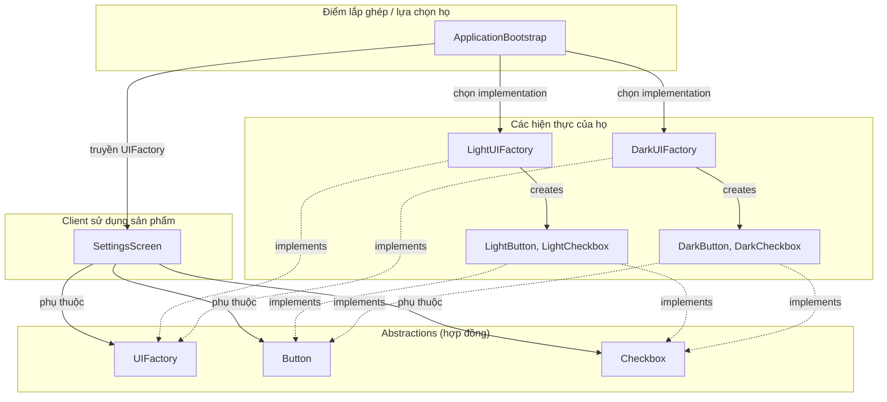

# Kiểm tra client chỉ phụ thuộc abstraction ở các ranh giới đã xác định

> **Chương:** Đánh giá thiết kế  
> **Module:** `SOFTWARE_DESIGN_DESIGN_PATTERN_CREATIONAL_ABSTRACT_FACTORY` — Học về abstract factory trong design pattern.

## 1. Mục tiêu của bài đánh giá

Abstract Factory giúp client làm việc với **nhiều họ sản phẩm có liên quan** mà không phải tự khởi tạo từng class cụ thể. Khi đánh giá thiết kế, không chỉ hỏi “có interface `Factory` hay không”, mà cần xác định **class nào được phép chọn họ, class nào tạo sản phẩm và class nào chỉ sử dụng chúng**.

Sau bài này, bạn có thể:

- Chỉ ra các **ranh giới phụ thuộc** trong một thiết kế Abstract Factory.
- Phát hiện client phụ thuộc vào concrete factory/concrete product qua `new`, kiểu dữ liệu, ép kiểu, kiểm tra kiểu hoặc nhánh điều kiện.
- Kiểm tra việc tạo ra một bộ sản phẩm **cùng họ**, kể cả khi client chỉ khai báo interface.
- Đánh giá thiết kế thông qua ma trận trách nhiệm, sơ đồ phụ thuộc, ví dụ Java và bộ tiêu chí kiểm tra.
- Phân biệt chỗ cần dùng abstraction với chỗ hợp lệ để biết concrete class, tránh áp dụng interface một cách máy móc.

## 2. “Client chỉ phụ thuộc abstraction” có nghĩa gì?

Trong ngữ cảnh Abstract Factory, **client** là đoạn mã cần dùng các sản phẩm (ví dụ: `SettingsScreen`), còn **abstraction** là hợp đồng chung của nhà máy (`UIFactory`) và sản phẩm (`Button`, `Checkbox`).

Giả sử có hai họ thành phần giao diện:

| Loại sản phẩm | Họ Light | Họ Dark |
| --- | --- | --- |
| Nút thao tác | `LightButton` | `DarkButton` |
| Ô chọn | `LightCheckbox` | `DarkCheckbox` |
| Factory | `LightUIFactory` | `DarkUIFactory` |

Khi đã nhận một `UIFactory`, màn hình có thể yêu cầu `createButton()` và `createCheckbox()`, rồi gọi hành vi trên `Button` và `Checkbox`. Màn hình **không cần phụ thuộc ở thời điểm biên dịch** vào `LightButton` hoặc `DarkUIFactory`.

Điều này **không có nghĩa là toàn bộ ứng dụng không được nhắc đến concrete class**. Để chương trình thực sự chạy, một thành phần lắp ghép phải tạo hoặc lấy `LightUIFactory` hay `DarkUIFactory`. Concrete factory cũng phải biết class sản phẩm mà nó tạo. Quy tắc cần áp dụng **tại ranh giới đã chọn**, chẳng hạn ranh giới giữa màn hình và họ thành phần giao diện.

### Ma trận ranh giới

| Vị trí | Được biết concrete class? | Phụ thuộc nên có |
| --- | --- | --- |
| `ApplicationBootstrap` / composition root | **Có**, để chọn họ và nối các thành phần | Concrete factories và interface của factory |
| `LightUIFactory` / `DarkUIFactory` | **Có**, để xây dựng sản phẩm của họ mình | Abstract factory, abstract products, concrete products cùng họ |
| `SettingsScreen` (client sử dụng UI) | **Không cần** biết concrete UI | `UIFactory`, `Button`, `Checkbox` |
| Lớp xử lý hành vi của màn hình | **Không cần** biết concrete UI | Product interfaces và hợp đồng nghiệp vụ |
| Kiểm thử riêng concrete factory/product | **Có**, trong phạm vi kiểm thử | Class được kiểm thử và hợp đồng tương ứng |

**Nguyên tắc đánh giá:** Ở phía client của ranh giới Abstract Factory, sự phụ thuộc tĩnh hướng tới **interface**. Phía lắp ghép và hiện thực được phép phụ thuộc vào **class cụ thể** vì đó là trách nhiệm của chúng.

## 3. Vẽ ranh giới trước khi review code

Một sơ đồ làm rõ quyết định thiết kế:



Trong sơ đồ này, đường phụ thuộc `SettingsScreen → UIFactory/Button/Checkbox` là **hợp lệ**. Nếu thêm mũi tên `SettingsScreen → DarkButton` hoặc `SettingsScreen → LightUIFactory`, cần kiểm tra vì ranh giới đã bị vượt qua.

Một sơ đồ lớp chỉ là bằng chứng định hướng; phần review còn phải đọc chữ ký hàm, thân hàm và đường khởi tạo thực tế.

## 4. Nhận diện vi phạm ranh giới

### 4.1. Client khởi tạo concrete product trực tiếp

```java
// Ví dụ vi phạm: client tự chọn sản phẩm Light.
class SettingsScreen {
    private final Button saveButton = new LightButton();
}
```

`SettingsScreen` đã biết `LightButton`. Khi cần Dark, client phải sửa mã hoặc thêm nhánh điều kiện. Đây là một phụ thuộc cụ thể tại đúng ranh giới đáng ra phải độc lập với họ sản phẩm.

### 4.2. Client chọn từng sản phẩm bằng các nhánh riêng lẻ

```java
// Ví dụ vi phạm: tạo nhiều biến thể bằng nhiều quyết định độc lập.
Button button = darkMode ? new DarkButton() : new LightButton();
Checkbox checkbox = darkMode ? new DarkCheckbox() : new LightCheckbox();
```

Ngay cả khi hiện tại hai nhánh cùng sử dụng `darkMode`, client vẫn phải biết cả hai họ. Một lần sửa thiếu điều kiện có thể tạo bộ sản phẩm không cùng họ. Nên chọn **một factory cho một phạm vi cần nhất quán**, rồi gọi các phương thức tạo của factory ấy.

### 4.3. Phụ thuộc cụ thể rò rỉ qua chữ ký

```java
// Vi phạm: hợp đồng factory phơi bày một concrete product.
interface UIFactory {
    DarkButton createButton();
}

// Mong muốn:
interface UIFactory {
    Button createButton();
}
```

Đặt tên interface cho factory là chưa đủ. Nếu phương thức trả về `DarkButton`, mã gọi vẫn phụ thuộc vào biến thể Dark; các họ mới sẽ không thể tuân theo cùng một hợp đồng chung một cách tự nhiên.

### 4.4. Client ép kiểu hoặc kiểm tra kiểu hiện thực

```java
Button button = factory.createButton();

if (button instanceof DarkButton) {
    ((DarkButton) button).enableDarkGlow();
}
```

Client đang dựa vào hành vi chỉ có trên `DarkButton`. Điều này phá vỡ khả năng thay thế bằng `LightButton`. Hãy hỏi liệu hành vi đó có phải **khả năng chung của mọi nút** hay là **cấu hình nội bộ** của họ Dark. Nếu là khả năng chung, cân nhắc đưa hợp đồng phù hợp vào abstraction; nếu là cấu hình riêng, đưa xử lý vào phía hiện thực hoặc một cơ chế cấu hình hợp lý.

Không nên thêm mọi phương thức riêng của từng họ vào interface: như vậy interface sẽ ngày càng đầy các hành vi không có ý nghĩa với họ khác.

### 4.5. Client gọi bộ chọn factory ở nhiều nơi

```java
// Mùi thiết kế: client biết registry và chọn lại family khi tạo từng sản phẩm.
Button button = FactoryRegistry.forTheme(theme).createButton();
Checkbox checkbox = FactoryRegistry.forTheme(otherTheme).createCheckbox();
```

Dù registry trả về `UIFactory`, việc client chọn lại họ cho từng sản phẩm vẫn khiến quyết định cấu hình trộn vào mã sử dụng. Với phạm vi giao diện cần đồng bộ, hãy chọn factory tại điểm lắp ghép rồi truyền instance đó cho client.

## 5. Ví dụ Java: thiết kế tuân thủ ranh giới

Ví dụ sau giữ các lớp thực thi nằm phía sau `UIFactory`, `Button` và `Checkbox`. Điểm được phép biết `LightUIFactory`/`DarkUIFactory` là `chooseFactory()`.

Lưu thành `BoundaryEvaluationDemo.java`:

```java
public class BoundaryEvaluationDemo {
    // Hai abstract products.
    interface Button {
        void click();
    }

    interface Checkbox {
        void toggle();
    }

    // Abstract factory: không lộ tên Light/Dark trong chữ ký.
    interface UIFactory {
        Button createButton();
        Checkbox createCheckbox();
    }

    // Các concrete products thuộc họ Light.
    static final class LightButton implements Button {
        @Override
        public void click() {
            System.out.println("Nhấn nút [Light]");
        }
    }

    static final class LightCheckbox implements Checkbox {
        @Override
        public void toggle() {
            System.out.println("Đổi trạng thái ô chọn [Light]");
        }
    }

    // Các concrete products thuộc họ Dark.
    static final class DarkButton implements Button {
        @Override
        public void click() {
            System.out.println("Nhấn nút [Dark]");
        }
    }

    static final class DarkCheckbox implements Checkbox {
        @Override
        public void toggle() {
            System.out.println("Đổi trạng thái ô chọn [Dark]");
        }
    }

    // Concrete factories: nơi hợp lệ để biết và tạo concrete products.
    static final class LightUIFactory implements UIFactory {
        @Override
        public Button createButton() {
            return new LightButton();
        }

        @Override
        public Checkbox createCheckbox() {
            return new LightCheckbox();
        }
    }

    static final class DarkUIFactory implements UIFactory {
        @Override
        public Button createButton() {
            return new DarkButton();
        }

        @Override
        public Checkbox createCheckbox() {
            return new DarkCheckbox();
        }
    }

    // Client: chỉ biết hợp đồng factory và hợp đồng sản phẩm.
    static final class SettingsScreen {
        private final Button button;
        private final Checkbox checkbox;

        SettingsScreen(UIFactory factory) {
            this.button = factory.createButton();
            this.checkbox = factory.createCheckbox();
        }

        void interact() {
            button.click();
            checkbox.toggle();
        }
    }

    // Composition root: được quyền chọn concrete factory.
    static UIFactory chooseFactory(String theme) {
        if ("light".equalsIgnoreCase(theme)) {
            return new LightUIFactory();
        }
        if ("dark".equalsIgnoreCase(theme)) {
            return new DarkUIFactory();
        }
        throw new IllegalArgumentException("Theme không hợp lệ: " + theme);
    }

    public static void main(String[] args) {
        String theme = args.length == 0 ? "light" : args[0];
        UIFactory factory = chooseFactory(theme);
        SettingsScreen screen = new SettingsScreen(factory);
        screen.interact();
    }
}
```

Biên dịch/chạy bằng JDK:

```bash
javac BoundaryEvaluationDemo.java
java BoundaryEvaluationDemo dark
```

Kết quả dự kiến:

```text
Nhấn nút [Dark]
Đổi trạng thái ô chọn [Dark]
```

Khi đổi tham số thành `light`, chỉ `chooseFactory()` quyết định hiện thực được cấp. Code `SettingsScreen` không thay đổi. Đây là bằng chứng trực tiếp rằng ranh giới client không bị buộc vào một họ cụ thể.

**Lưu ý:** Khi cần đổi theme sau khi màn hình đã tạo sản phẩm, ứng dụng thường phải tái tạo màn hình/sản phẩm hoặc áp dụng cơ chế cập nhật phù hợp. Đổi biến trỏ tới factory không tự chuyển những đối tượng đã tạo sang họ mới.

## 6. Quy trình review phụ thuộc theo từng bước

### Bước 1 — Chốt phạm vi cần tính thay thế

Ghi rõ cấu hình nào quyết định họ sản phẩm và những loại sản phẩm nào phải đi cùng nhau.

Ví dụ: “Trong một màn hình cài đặt, mọi `Button` và `Checkbox` đều thuộc họ Light hoặc đều thuộc họ Dark”. Đây là **bất biến** của phạm vi đang đánh giá.

### Bước 2 — Định danh phía client và phía lắp ghép

Trên sơ đồ hoặc trong tài liệu thiết kế, đánh dấu:

- **Phía chọn họ:** `main`, composition root, provider/registry được gọi khi khởi tạo.
- **Phía tạo:** concrete factories và concrete products.
- **Phía sử dụng:** màn hình, service hoặc use case thực thi hành vi.

Không nên đánh giá một đoạn `new LightUIFactory()` là sai chỉ vì có từ khóa `new`. Nó hợp lệ ở composition root, nhưng đáng nghi khi xuất hiện trong mã xử lý hành vi của màn hình.

### Bước 3 — Kiểm tra phụ thuộc tĩnh của client

Đọc **import, kiểu trường, tham số constructor, kiểu trả về và thân phương thức** của từng client. Tìm các dấu hiệu:

| Dấu hiệu trong client | Câu hỏi review |
| --- | --- |
| `new LightButton()` | Tại sao client tự tạo sản phẩm thay vì yêu cầu factory? |
| `LightUIFactory factory` | Client có cần biết loại factory cụ thể hay chỉ cần `UIFactory`? |
| `DarkButton button` | Có thể khai báo biến theo `Button` không? |
| `instanceof LightButton` hoặc ép kiểu | Có hành vi nào bị rò khỏi abstraction không? |
| `switch(theme)`/`if (providerId)` quanh thao tác sản phẩm | Quyết định chọn họ có đang nằm trong client? |
| `FactoryRegistry.getCurrent()` ở nhiều nơi | Client có đang ngầm chọn lại factory, gây lệch họ hoặc phụ thuộc trạng thái toàn cục? |

Đây là **danh sách tìm điểm cần đọc kỹ**, không phải quy tắc cấm mọi `new`, `if` hay phụ thuộc cụ thể trong toàn bộ codebase.

### Bước 4 — Kiểm tra abstraction có đủ và ổn định

Kiểm tra `UIFactory` trả về đúng các product interface, còn product interface khai báo những hành vi client cần mà không gắn với một họ cụ thể.

Nếu client vẫn phải ép kiểu, nguyên nhân thường là **hợp đồng chưa khớp nhu cầu thực tế** hoặc trách nhiệm đang đặt sai lớp. Không chữa bằng cách thêm `instanceof` cho mọi họ.

### Bước 5 — Kiểm tra từng concrete factory

Dùng ma trận để rà soát đầu ra:

| Phương thức | `LightUIFactory` | `DarkUIFactory` |
| --- | --- | --- |
| `createButton()` | `LightButton` | `DarkButton` |
| `createCheckbox()` | `LightCheckbox` | `DarkCheckbox` |

Một factory có thể **đúng interface nhưng sai họ**. Ví dụ, `DarkUIFactory.createCheckbox()` trả về `LightCheckbox` vẫn hợp lệ về kiểu `Checkbox`, nhưng vi phạm bất biến Light/Dark. Vì vậy cần kiểm tra cả **cài đặt concrete factory** và các tình huống chạy thực tế.

### Bước 6 — Kiểm tra nơi chọn và truyền factory

Đặt quyết định chọn họ ở điểm hợp lý như composition root, sau đó truyền `UIFactory` vào client bằng constructor hoặc cơ chế dependency injection của ứng dụng.

Nếu một request/màn hình phải dùng chung họ, các đối tượng trong phạm vi đó cần nhận cùng quyết định factory. Tránh một trạng thái `currentFactory` toàn cục có thể bị thay đổi bất ngờ giữa nhiều request hoặc luồng chạy.

### Bước 7 — Kiểm chứng kịch bản thay đổi

Đặt hai yêu cầu giả định:

1. **Thêm họ `HighContrast`:** Có thể viết `HighContrastUIFactory`, `HighContrastButton` và `HighContrastCheckbox`, sau đó cập nhật điểm lựa chọn, mà không sửa `SettingsScreen` không?
2. **Thêm loại sản phẩm `Slider`:** Có cần cập nhật `UIFactory` và tất cả concrete factories không? Nếu có, đó là chi phí mở rộng **theo loại sản phẩm** vốn có của Abstract Factory.

Nếu thêm họ mới luôn buộc sửa các nhánh xử lý trong client, mục tiêu tách phụ thuộc đã không đạt.

## 7. Chỉ dựa vào interface có đủ không?

**Chưa đủ.** Một client chỉ khai báo `Button` và `Checkbox` vẫn có thể nhận sản phẩm không tương thích nếu việc chọn họ không thống nhất hoặc concrete factory tạo sai sản phẩm.

Phân biệt hai tầng kiểm tra:

| Tầng | Cần xác minh | Ví dụ lỗi |
| --- | --- | --- |
| **Cấu trúc tại thời điểm biên dịch** | Client chỉ phụ thuộc vào abstract factory/product ở ranh giới đã chọn | `SettingsScreen` sử dụng `DarkButton` trong chữ ký |
| **Tính nhất quán khi tạo ở runtime** | Mỗi factory tạo đầy đủ sản phẩm của một họ và client nhận đúng factory theo phạm vi | `DarkUIFactory` trả về `LightCheckbox` |
| **Luồng cấu hình và vòng đời** | Factory được chọn đúng thời điểm, đúng phạm vi và sản phẩm được cập nhật/tạo lại khi cần | Theme đã đổi nhưng màn hình vẫn giữ sản phẩm cũ |

Abstraction giảm kết nối với hiện thực, nhưng **không tự chứng minh các sản phẩm cùng họ hay cấu hình lúc chạy là đúng**.

## 8. Kiểm thử và tiêu chí chấp nhận

Những kiểm thử sau có thể hỗ trợ đánh giá:

| Ca kiểm tra | Cách thực hiện | Kết quả cần đạt |
| --- | --- | --- |
| Client dùng factory giả | Cấp một `UIFactory` giả trả về `Button`/`Checkbox` ghi nhận lời gọi | Client khởi tạo và hoạt động mà không cần concrete Light/Dark |
| Họ Light | Gọi hai phương thức tạo của `LightUIFactory` | Cả hai sản phẩm là biến thể Light |
| Họ Dark | Gọi hai phương thức tạo của `DarkUIFactory` | Cả hai sản phẩm là biến thể Dark |
| Chuyển cấu hình | Chạy ứng dụng lần lượt với `light` và `dark` | Hành vi thay đổi theo họ; client không đổi |
| Thêm họ thứ ba (bài tập giả định) | Thiết kế `HighContrastUIFactory` | Không cần thêm nhánh vào `SettingsScreen` |
| Thử lỗi chọn cấu hình | Truyền giá trị theme không hỗ trợ | Bị từ chối rõ ràng; không tự trộn biến thể của hai họ |

Ví dụ một factory giả đơn giản để kiểm thử phía client:

```java
// Đặt trong test hoặc trong phạm vi phù hợp với các interface đã khai báo.
final class FakeUIFactory implements UIFactory {
    int buttonsCreated;
    int checkboxesCreated;

    @Override
    public Button createButton() {
        buttonsCreated++;
        return () -> { /* ghi nhận click nếu cần */ };
    }

    @Override
    public Checkbox createCheckbox() {
        checkboxesCreated++;
        return () -> { /* ghi nhận toggle nếu cần */ };
    }
}

// Test tạo SettingsScreen bằng FakeUIFactory, sau đó kiểm tra
// buttonsCreated == 1 và checkboxesCreated == 1.
```

Factory giả sử dụng lambda vì `Button` và `Checkbox` trong ví dụ mỗi interface chỉ có một phương thức trừu tượng. Trong dự án thực, có thể dùng fake, stub hoặc mock phù hợp với bộ công cụ kiểm thử.

## 9. Phiếu đánh giá thiết kế

Chấm mỗi tiêu chí **0 = chưa đạt, 1 = đạt một phần, 2 = đạt**.

| Tiêu chí | Dấu hiệu đạt 2 điểm | Điểm |
| --- | --- | ---: |
| Xác định ranh giới | Phân biệt rõ composition root, factory implementation và client | /2 |
| Phụ thuộc tĩnh của client | Không tham chiếu concrete factory/product trong client qua kiểu, tạo mới, ép kiểu hay nhánh phân loại | /2 |
| Hợp đồng abstraction | Abstract factory trả về product interface; hành vi client cần có trong hợp đồng phù hợp | /2 |
| Nhất quán trong họ | Mỗi concrete factory tạo các biến thể đúng họ và đủ loại sản phẩm | /2 |
| Khả năng thay thế và kiểm thử | Đổi họ hoặc cung cấp fake factory không cần sửa code client | /2 |
| **Tổng** | **10 điểm** | **/10** |

**Gợi ý kết luận:**

- **9–10:** Ranh giới rõ, cấu trúc tốt; vẫn cần kiểm tra hành vi và vòng đời theo yêu cầu thực tế.
- **7–8:** Phần lớn đúng; cần xử lý một số chỗ phụ thuộc hoặc thiếu bằng chứng kiểm thử.
- **0–6:** Cần xem lại thiết kế tại ranh giới Abstract Factory trước khi mở rộng họ sản phẩm.

Thang điểm chỉ là công cụ hướng dẫn review, không thay thế yêu cầu nghiệp vụ hoặc kiểm thử chạy thật.

## 10. Bài tập tự đánh giá

Xem đoạn code sau:

```java
class ProfileScreen {
    private final UIFactory factory;

    ProfileScreen(UIFactory factory) {
        this.factory = factory;
    }

    void show() {
        Button button = factory.createButton();
        button.click();

        if (button instanceof DarkButton) {
            System.out.println("Đang dùng giao diện tối");
        }
    }
}
```

Hãy trả lời:

1. Constructor của `ProfileScreen` đã tuân thủ ranh giới abstraction chưa?
2. Biểu thức `instanceof DarkButton` cho thấy phụ thuộc nào vẫn bị rò vào client?
3. Nếu chỉ muốn hiển thị văn bản “Đang dùng giao diện tối”, có nhất thiết phải truy vấn kiểu của `Button` không? Thông tin trạng thái theme nên do thành phần nào chịu trách nhiệm cung cấp?
4. Nếu thêm `HighContrastButton`, client này có thật sự mở rộng mà không sửa không?
5. Hãy viết lại phần `show()` sao cho không phụ thuộc vào concrete product.

**Hướng trả lời:** Constructor đã nhận abstraction; điểm vi phạm là kiểm tra concrete type trong `show()`. Trạng thái theme có thể được cung cấp như dữ liệu cấu hình/hình thức hiển thị tách khỏi việc xác định loại `Button`. Sau khi bỏ đoạn kiểm tra kiểu, phần hành vi của client chỉ cần:

```java
void show() {
    Button button = factory.createButton();
    button.click();
}
```

Không phải thông tin theme nào cũng nên được thêm vào `Button`. Hãy đặt dữ liệu tại thành phần có trách nhiệm sở hữu trạng thái đó.

## 11. Kết luận kiểm tra

Một thiết kế Abstract Factory đạt mục tiêu **“client chỉ phụ thuộc abstraction ở ranh giới đã xác định”** khi có thể chỉ ra rõ:

1. **Ranh giới nằm ở đâu:** chẳng hạn giữa `SettingsScreen` và nhóm thành phần UI.
2. **Client dùng hợp đồng nào:** `UIFactory`, `Button`, `Checkbox`.
3. **Class cụ thể xuất hiện ở đâu:** composition root và các concrete factories/products.
4. **Các sản phẩm được tạo có nhất quán không:** mỗi factory cung cấp trọn họ của mình.
5. **Bằng chứng khi đổi họ:** thêm hoặc thay họ mà client không phải viết lại phần sử dụng sản phẩm.

**Ghi nhớ:** Đánh giá Abstract Factory bằng cả **hướng phụ thuộc** và **tính nhất quán của họ sản phẩm**. Interface là công cụ để tách client khỏi hiện thực; ranh giới trách nhiệm và cách chọn factory mới quyết định thiết kế có thực sự linh hoạt hay không.
