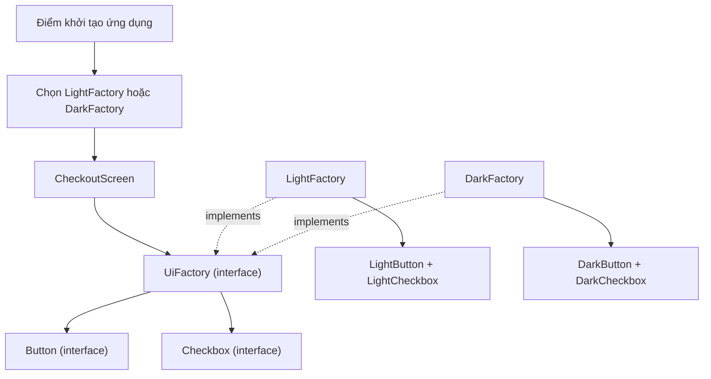

# Đánh giá chất lượng mã Java, kiểm thử và xử lý lỗi trong bài thực hành

## 1. Mục tiêu của bước đánh giá

Trong bài thực hành **Abstract Factory**, việc chạy được chương trình chưa đủ để kết luận thiết kế tốt. Một lời giải có thể tạo đúng nút bấm và ô chọn nhưng vẫn để mã khách (`client`) tự kiểm tra tên biến thể, gọi `new` cho các lớp cụ thể hoặc bỏ qua lỗi cấu hình. Khi yêu cầu thay đổi, các hạn chế này mới bộc lộ.

Bài học thuộc chương **Đánh giá thiết kế** hướng dẫn cách xem xét một lời giải Java theo ba góc độ liên kết với nhau:

1. **Chất lượng thiết kế và mã Java:** các vai trò của Abstract Factory có rõ ràng, quan hệ phụ thuộc có đúng chiều, họ sản phẩm có được giữ nhất quán không?
2. **Chất lượng kiểm thử:** bài kiểm thử có chứng minh được hành vi chung của client với nhiều factory, phát hiện lỗi trộn họ và bao phủ các trường hợp thất bại không?
3. **Hợp đồng xử lý lỗi:** tham số sai, trạng thái nghiệp vụ không hợp lệ, sản phẩm thiếu hoặc lỗi hạ tầng có được phát hiện và thông báo đúng lúc không?

Mục tiêu cuối cùng là biết **chỉ ra bằng chứng cụ thể trong mã** để kết luận một thiết kế đáng tin cậy hoặc cần cải thiện, thay vì chỉ kiểm tra xem có các lớp mang tên `AbstractFactory` và `ConcreteFactory` hay không.

### Bài toán mẫu

Ứng dụng có hai họ giao diện:

- **Light:** `LightButton` và `LightCheckbox`.
- **Dark:** `DarkButton` và `DarkCheckbox`.

Lớp `CheckoutScreen` sử dụng một nút xác nhận và một ô đồng ý điều khoản. Quy tắc nghiệp vụ: chỉ cho phép xác nhận khi người dùng đã đồng ý. Một lần chạy dùng **một họ sản phẩm**; thêm họ giao diện mới không được buộc sửa quy tắc nghiệp vụ trong `CheckoutScreen`.

Để đánh giá, hãy dựa trên các yêu cầu quan sát được:

| Yêu cầu | Bằng chứng cần tìm |
| --- | --- |
| Client không biết lớp sản phẩm cụ thể | `CheckoutScreen` chỉ dùng `Button`, `Checkbox` và `UiFactory` |
| Mọi sản phẩm cùng biến thể | `LightFactory` tạo cả hai sản phẩm Light; `DarkFactory` tạo cả hai sản phẩm Dark |
| Cấu hình không hợp lệ bị từ chối | `theme=drak` gây lỗi rõ ràng, không tự chuyển sang Light |
| Quy tắc đồng ý không phụ thuộc giao diện | Cùng một kiểm thử chạy với cả hai factory |
| Lỗi không bị che giấu | Không trả về `null` cho sản phẩm bắt buộc, không nuốt ngoại lệ |
| Bổ sung biến thể ít ảnh hưởng client | Thêm factory và sản phẩm mới mà không sửa `CheckoutScreen` |

## 2. Đọc mã theo các vai trò của Abstract Factory

Trước khi chấm chất lượng, hãy nhận diện các thành phần và chiều phụ thuộc.



Đọc từ client ra ngoài:

- `CheckoutScreen` có thể nhận một `UiFactory` qua constructor, sau đó yêu cầu tạo `Button` và `Checkbox`.
- `UiFactory` mô tả **các loại sản phẩm cần tạo**, không đọc biến môi trường hay quyết định theme.
- Mỗi concrete factory biết cách tạo **một họ sản phẩm hoàn chỉnh**.
- Điểm khởi tạo ứng dụng (*composition root*) chuyển cấu hình thành một concrete factory và đưa nó cho client.

Một dấu hiệu cần sửa:

```java
// Phản ví dụ: client biết và tự chọn từng concrete product.
if ("dark".equals(theme)) {
    button = new DarkButton();
    checkbox = new DarkCheckbox();
} else {
    button = new LightButton();
    checkbox = new LightCheckbox();
}
```

Đoạn này không sai chỉ vì có `if` hoặc `new`. Nó đáng lo **khi cùng quyết định chọn họ xuất hiện trong nhiều client**, vì việc thêm một biến thể sẽ lan sang nhiều lớp. Một `switch` tập trung tại điểm khởi tạo để chọn factory lại hoàn toàn hợp lý.

## 3. Tiêu chí đánh giá chất lượng mã Java

### 3.1. Tách vai trò và phụ thuộc vào abstraction

Cần xác nhận:

- Concrete factory **implements** đúng interface factory.
- Concrete product **implements** đúng interface sản phẩm.
- Client chỉ gọi những phương thức trong interface, không ép kiểu xuống `LightButton` hay `DarkCheckbox`.
- Constructor injection thể hiện rõ dependency, thay vì client tự đọc cấu hình toàn cục.
- Mỗi factory tạo **đúng bộ sản phẩm** cần dùng; không tạo sản phẩm của nhà cung cấp/biến thể khác.

Ví dụ, nếu `DarkFactory.createCheckbox()` trả `LightCheckbox`, chương trình có thể vẫn biên dịch và chạy, nhưng **bất biến cùng họ** đã bị phá vỡ. Đây là lỗi thiết kế cần phát hiện, kể cả khi hai checkbox cùng triển khai một interface.

### 3.2. Đặt trách nhiệm ở đúng nơi

| Thành phần | Nên làm | Nên tránh |
| --- | --- | --- |
| `Theme.parse` | Chuẩn hóa và xác thực lựa chọn `light`/`dark` | Tạo widget hoặc quyết định nghiệp vụ thanh toán |
| `selectFactory` | Ánh xạ theme hợp lệ sang concrete factory | Lặp quyết định ở nhiều client |
| `LightFactory` / `DarkFactory` | Tạo các sản phẩm thuộc cùng họ | Đọc CLI hoặc tự chọn họ khác |
| `CheckoutScreen` | Dùng các sản phẩm và thực hiện quy tắc đồng ý | Biết tên concrete class, gọi SDK hoặc đọc biến môi trường |
| `Button` / `Checkbox` | Công bố hành vi chung mà client cần | Tiết lộ quá nhiều chi tiết riêng của một biến thể |

Hỏi thêm: một phương thức có đang làm cả **xác thực cấu hình, tạo đối tượng và xử lý nghiệp vụ** không? Nếu có, nên cân nhắc chia lại trách nhiệm.

### 3.3. Đánh giá kiểu dữ liệu, khả năng đọc và tính bất biến

Với Java 17, một lời giải có thể tận dụng:

- `enum Theme` để tránh truyền chuỗi tự do khắp hệ thống.
- `switch expression` khi chọn factory để compiler nhắc bổ sung nhánh nếu enum tăng biến thể và không có `default` che trường hợp.
- `private final` cho các dependency đã được inject, giúp tránh thay đổi ngoài ý muốn sau khởi tạo.
- `Objects.requireNonNull` để phát hiện factory/sản phẩm bắt buộc bị thiếu ngay tại ranh giới constructor.
- Tên phương thức nhất quán như `createButton()` và `createCheckbox()`, không lẫn với các thao tác nghiệp vụ.
- Tránh tạo abstract interface chỉ để bọc một giá trị nếu nó không giúp thay thế hay kiểm thử.

Không nên đánh giá số lượng lớp càng nhiều là càng tốt. Một lời giải đáng tin cần **đủ abstraction để bảo vệ trục thay đổi**, đồng thời tránh lớp trung gian không có trách nhiệm rõ.

## 4. Ví dụ Java 17 làm mốc đánh giá

Lưu mã trong `FactoryReviewDemo.java`. Đây là ví dụ tự chứa để quan sát **thiết kế và hành vi**; các sản phẩm mô phỏng giao diện bằng chuỗi, không thực hiện thanh toán thật.

```java
import java.util.Locale;
import java.util.Objects;

public final class FactoryReviewDemo {
    private FactoryReviewDemo() {}

    // Hai abstract products.
    interface Button {
        String render();
        String click();
    }

    interface Checkbox {
        String render();
        void setChecked(boolean checked);
        boolean isChecked();
    }

    // Abstract factory.
    interface UiFactory {
        Button createButton();
        Checkbox createCheckbox();
    }

    // Họ Light.
    static final class LightButton implements Button {
        @Override
        public String render() {
            return "[Light/Button]";
        }

        @Override
        public String click() {
            return "CONFIRM_REQUESTED";
        }
    }

    static final class LightCheckbox implements Checkbox {
        private boolean checked;

        @Override
        public String render() {
            return "[Light/Checkbox]";
        }

        @Override
        public void setChecked(boolean checked) {
            this.checked = checked;
        }

        @Override
        public boolean isChecked() {
            return checked;
        }
    }

    static final class LightFactory implements UiFactory {
        @Override
        public Button createButton() {
            return new LightButton();
        }

        @Override
        public Checkbox createCheckbox() {
            return new LightCheckbox();
        }
    }

    // Họ Dark.
    static final class DarkButton implements Button {
        @Override
        public String render() {
            return "[Dark/Button]";
        }

        @Override
        public String click() {
            return "CONFIRM_REQUESTED";
        }
    }

    static final class DarkCheckbox implements Checkbox {
        private boolean checked;

        @Override
        public String render() {
            return "[Dark/Checkbox]";
        }

        @Override
        public void setChecked(boolean checked) {
            this.checked = checked;
        }

        @Override
        public boolean isChecked() {
            return checked;
        }
    }

    static final class DarkFactory implements UiFactory {
        @Override
        public Button createButton() {
            return new DarkButton();
        }

        @Override
        public Checkbox createCheckbox() {
            return new DarkCheckbox();
        }
    }

    // Client không tham chiếu tới LightButton hoặc DarkCheckbox.
    static final class CheckoutScreen {
        private final Button button;
        private final Checkbox terms;

        CheckoutScreen(UiFactory factory) {
            Objects.requireNonNull(factory, "factory");
            this.button = Objects.requireNonNull(
                factory.createButton(), "button"
            );
            this.terms = Objects.requireNonNull(
                factory.createCheckbox(), "checkbox"
            );
        }

        String render() {
            return button.render() + " | " + terms.render();
        }

        void acceptTerms(boolean accepted) {
            terms.setChecked(accepted);
        }

        String confirm() {
            if (!terms.isChecked()) {
                throw new IllegalStateException(
                    "Phải đồng ý điều khoản trước khi xác nhận"
                );
            }
            return button.click();
        }
    }

    enum Theme {
        LIGHT, DARK;

        static Theme parse(String raw) {
            if (raw == null || raw.isBlank()) {
                throw new IllegalArgumentException(
                    "theme phải là light hoặc dark"
                );
            }
            return switch (raw.strip().toLowerCase(Locale.ROOT)) {
                case "light" -> LIGHT;
                case "dark" -> DARK;
                default -> throw new IllegalArgumentException(
                    "Theme không hỗ trợ: " + raw
                );
            };
        }
    }

    // Composition root chọn factory một lần.
    static UiFactory selectFactory(Theme theme) {
        return switch (Objects.requireNonNull(theme, "theme")) {
            case LIGHT -> new LightFactory();
            case DARK -> new DarkFactory();
        };
    }

    public static void main(String[] args) {
        if (args.length > 1) {
            throw new IllegalArgumentException(
                "Cú pháp: java FactoryReviewDemo [light|dark]"
            );
        }

        // Mặc định chỉ áp dụng khi người chạy không cung cấp tham số.
        Theme theme = args.length == 0
            ? Theme.LIGHT : Theme.parse(args[0]);

        CheckoutScreen screen = new CheckoutScreen(
            selectFactory(theme)
        );

        System.out.println(screen.render());
        screen.acceptTerms(true);
        System.out.println(screen.confirm());
    }
}
```

Chạy với JDK 17 trở lên:

```bash
javac -encoding UTF-8 FactoryReviewDemo.java
java FactoryReviewDemo dark
```

Kết quả mong đợi:

```text
[Dark/Button] | [Dark/Checkbox]
CONFIRM_REQUESTED
```

Nếu gọi `java FactoryReviewDemo drak`, chương trình ném `IllegalArgumentException` với thông báo nêu biến thể không hỗ trợ, thay vì tự đổi về Light. Chương trình mẫu cố ý để ngoại lệ lan ra `main`, nhằm dễ thấy lỗi ở dòng lệnh; dịch vụ hoặc ứng dụng thật nên xử lý tại ranh giới vào phù hợp, ví dụ chuyển thành thông báo CLI hoặc mã lỗi API.

### Quan sát code mẫu như một người review

**Điểm tốt:** client chỉ phụ thuộc ba interface; hai factory tạo đúng hai họ; dữ liệu điều khiển đã có `Theme`; giá trị cấu hình sai được từ chối; dependency quan trọng không thể là `null` khi client đã khởi tạo xong.

**Giới hạn có chủ ý:** `render()` là chuỗi để giảng dạy, chưa phản ánh UI thật; `confirm()` chỉ trả sự kiện giả lập, chưa tích hợp thanh toán; chưa kiểm tra accessibility, thread safety hay vòng đời tài nguyên vì ví dụ không có yêu cầu tương ứng. Đừng tự suy ra lời giải đã sẵn sàng triển khai thực tế chỉ từ việc mã chạy thành công.

## 5. Đánh giá kiểm thử: chứng minh hành vi và bất biến

Một bài thực hành nên có **bằng chứng chạy được** hoặc tối thiểu có test được thiết kế rõ, thay vì lời khẳng định “đã kiểm thử”. Với Abstract Factory, cần tách hai mục tiêu:

- **Hành vi chung của client:** thao tác xác nhận bị chặn khi chưa đồng ý, thành công sau khi đồng ý và bị chặn nếu bỏ chọn lại. Những yêu cầu này **không thay đổi** giữa Light và Dark.
- **Tính nhất quán của họ sản phẩm:** nút và checkbox đều thuộc Light hoặc đều thuộc Dark. Các kỳ vọng này **khác theo factory**.

### 5.1. Một test tham số hóa dùng cho mọi factory

Ví dụ JUnit Jupiter 5 dưới đây giả định `FactoryReviewDemo.java` và `FactoryReviewDemoTest.java` nằm trong cùng package. Dự án cần dependency kiểm thử `junit-jupiter` và cơ chế chạy JUnit tương thích.

```java
import static org.junit.jupiter.api.Assertions.*;

import java.util.function.Supplier;
import java.util.stream.Stream;

import org.junit.jupiter.params.ParameterizedTest;
import org.junit.jupiter.params.provider.Arguments;
import org.junit.jupiter.params.provider.MethodSource;

class FactoryReviewDemoTest {

    static Stream<Arguments> factories() {
        return Stream.of(
            Arguments.of(
                "light",
                (Supplier<FactoryReviewDemo.UiFactory>)
                    FactoryReviewDemo.LightFactory::new,
                "[Light/Button] | [Light/Checkbox]"
            ),
            Arguments.of(
                "dark",
                (Supplier<FactoryReviewDemo.UiFactory>)
                    FactoryReviewDemo.DarkFactory::new,
                "[Dark/Button] | [Dark/Checkbox]"
            )
        );
    }

    @ParameterizedTest(name = "{0}: quy tắc đồng ý")
    @MethodSource("factories")
    void clientBehaviorDoesNotDependOnFamily(
            String family,
            Supplier<FactoryReviewDemo.UiFactory> createFactory,
            String expectedRender) {

        FactoryReviewDemo.CheckoutScreen screen =
            new FactoryReviewDemo.CheckoutScreen(
                createFactory.get()
            );

        assertThrows(IllegalStateException.class, screen::confirm);

        screen.acceptTerms(true);
        assertEquals("CONFIRM_REQUESTED", screen.confirm());

        screen.acceptTerms(false);
        assertThrows(IllegalStateException.class, screen::confirm);
    }

    @ParameterizedTest(name = "{0}: sản phẩm cùng họ")
    @MethodSource("factories")
    void factoryProducesConsistentProducts(
            String family,
            Supplier<FactoryReviewDemo.UiFactory> createFactory,
            String expectedRender) {

        FactoryReviewDemo.CheckoutScreen screen =
            new FactoryReviewDemo.CheckoutScreen(
                createFactory.get()
            );

        assertEquals(expectedRender, screen.render());
    }
}
```

Với hai nguồn factory và hai phương thức, JUnit thực hiện **bốn lượt kiểm thử**. `Supplier<UiFactory>` tạo factory mới cho từng lượt, tránh chia sẻ trạng thái giữa các bài test. Test thứ nhất kiểm tra quy tắc nghiệp vụ; test thứ hai kiểm tra đặc tính quan sát được của họ sản phẩm.

Nếu `DarkFactory.createCheckbox()` bị sửa nhầm thành `new LightCheckbox()`, test **hành vi chung** vẫn có thể đạt nhưng test **đúng họ** sẽ thất bại. Điều này giải thích vì sao cần cả hai loại.

Trong ứng dụng thật, chuỗi render chỉ là công cụ minh họa. Nên kiểm tra hợp đồng quan sát được phù hợp (giao diện, cấu trúc DOM, định dạng đầu ra, hành vi API) thay vì chỉ so sánh `getClass().getName()` của concrete product.

### 5.2. Kiểm thử đầu vào sai và trạng thái sai

Những nhánh lỗi cần một nhóm test riêng. Ví dụ bổ sung vào lớp `FactoryReviewDemoTest` ở trên:

```java
import org.junit.jupiter.api.Test;
import org.junit.jupiter.params.provider.NullAndEmptySource;
import org.junit.jupiter.params.provider.ValueSource;

@ParameterizedTest
@NullAndEmptySource
@ValueSource(strings = {"drak", "blue", "   "})
void rejectsInvalidTheme(String raw) {
    assertThrows(
        IllegalArgumentException.class,
        () -> FactoryReviewDemo.Theme.parse(raw)
    );
}

@Test
void rejectsNullFactory() {
    assertThrows(
        NullPointerException.class,
        () -> new FactoryReviewDemo.CheckoutScreen(null)
    );
}

@Test
void parsesThemeCaseInsensitively() {
    assertEquals(
        FactoryReviewDemo.Theme.DARK,
        FactoryReviewDemo.Theme.parse(" DARK ")
    );
}
```

Đây là **đoạn bổ sung minh họa cho cùng lớp test**: các import phải đặt ở đầu tệp Java, bên cạnh các import hiện có, và các phương thức phải nằm **bên trong** `FactoryReviewDemoTest`. Không dán nguyên khối gồm `import` vào cuối lớp, vì Java yêu cầu import ở cấp tệp.

Nếu không có `@NullAndEmptySource` hoặc muốn kiểm tra phân loại lỗi chi tiết hơn, cũng có thể dùng nhiều test độc lập. Mấu chốt là **hợp đồng của từng lỗi được kiểm tra**; không chỉ kiểm tra đường thành công.

### 5.3. Bộ kiểm thử tối thiểu đáng tin cậy

| Nhóm | Trường hợp | Lý do |
| --- | --- | --- |
| Khởi tạo | `LightFactory` tạo Button và Checkbox không null | Phát hiện factory thiếu sản phẩm |
| Khởi tạo | `DarkFactory` tạo hai sản phẩm cùng họ | Phát hiện factory trộn họ |
| Hành vi | Chưa đồng ý → `confirm()` ném lỗi | Bảo vệ bất biến nghiệp vụ |
| Hành vi | Đồng ý → trả `CONFIRM_REQUESTED` | Xác nhận luồng thành công |
| Hành vi | Bỏ chọn lại → không được xác nhận | Kiểm tra cập nhật trạng thái |
| Cấu hình | `light`/`dark` hợp lệ, không phân biệt hoa thường | Kiểm tra parse |
| Cấu hình | Chuỗi rỗng, `null`, tên sai | Không fallback âm thầm |
| Dependency | `null` factory hoặc trả về sản phẩm null | Lỗi được phát hiện sớm |
| Mở rộng | Thêm factory mới vào nguồn tham số | Test hành vi cũ chạy lại trên biến thể mới |

Một bài có nhiều test nhưng mọi test đều chỉ gọi `createButton()` không nên được xem là có độ bao phủ tốt. Chọn test từ **hợp đồng và các rủi ro thực tế**, không dựa trên số lượng assertion.

## 6. Đánh giá hợp đồng xử lý lỗi

Chất lượng xử lý lỗi thể hiện ở cách chương trình phản ứng **khi không thể thực hiện lời hứa của interface**. Những lỗi khác nhau cần được phân biệt.

| Lỗi | Ví dụ | Hành vi đánh giá là phù hợp |
| --- | --- | --- |
| **Tham số không hợp lệ** | `Theme.parse("drak")` | `IllegalArgumentException` hoặc exception có cấu trúc; nêu giá trị không hợp lệ |
| **Dependency bắt buộc bị thiếu** | `new CheckoutScreen(null)` | Fail-fast qua `Objects.requireNonNull`; chỉ ra dependency |
| **Trạng thái nghiệp vụ sai** | Xác nhận khi chưa đồng ý | `IllegalStateException`, hoặc kiểu kết quả nghiệp vụ có trạng thái từ chối rõ |
| **Factory không hỗ trợ một sản phẩm tùy chọn** | Factory xuất văn bản không cung cấp biểu đồ | Công bố khả năng/tách interface hoặc báo lỗi `UnsupportedProductException` nhất quán |
| **Lỗi vận hành** | Không thể kết nối dịch vụ ngoài | Bảo toàn nguyên nhân và thông tin an toàn, xử lý retry/cleanup ở lớp phù hợp |

Có hai nguyên tắc cần chú ý trong Abstract Factory:

**Thứ nhất, phương thức tạo sản phẩm bắt buộc phải giữ đúng hợp đồng.** Nếu `UiFactory` hứa tạo Button và Checkbox cho mọi họ, `createCheckbox()` không nên trả `null` hay ném `UnsupportedOperationException` ở một concrete factory. Điều đó khiến client không thể tin vào interface. Nếu một loại sản phẩm thật sự tùy chọn, nên xem xét interface tách theo khả năng hoặc một hợp đồng hỗ trợ được mô tả tường minh.

**Thứ hai, một lỗi cấu hình không đồng nghĩa một giá trị mặc định.** Ví dụ `theme` vắng mặt có thể dùng Light nếu đặc tả cho phép; `theme="drak"` là giá trị được cung cấp nhưng sai và phải báo rõ. Tự chuyển sang Light sẽ che lỗi cấu hình và gây khó khăn khi kiểm thử.

### Fail-fast và xử lý tại đúng ranh giới

`Objects.requireNonNull` giúp lỗi dependency xuất hiện ngay khi tạo client. `Theme.parse` giúp lỗi cấu hình xuất hiện trước khi chọn concrete factory. Quy tắc đồng ý được kiểm tra ngay trước `confirm()`. Cách này giúp lỗi gần nguồn gốc hơn và giảm tác dụng phụ.

Tuy nhiên, **fail-fast không có nghĩa là dừng toàn bộ ứng dụng với stack trace trong mọi ngữ cảnh**. Một CLI có thể in thông báo và trả mã thoát khác 0; REST API có thể trả thông báo lỗi 4xx; UI có thể hiển thị lời nhắc. Lớp nghiệp vụ nên giữ thông tin lỗi có cấu trúc, còn ranh giới vào quyết định cách trình bày.

### Phản ví dụ: nuốt lỗi rồi tiếp tục

```java
// Phản ví dụ: làm mất tín hiệu sai cấu hình.
UiFactory choose(String rawTheme) {
    try {
        return selectFactory(Theme.parse(rawTheme));
    } catch (IllegalArgumentException ex) {
        return new LightFactory(); // Che giấu input sai.
    }
}
```

Đoạn trên mang tính minh họa với `selectFactory` và `Theme` trong cùng phạm vi truy cập. Nếu sản phẩm đòi hỏi tuân thủ cấu hình được khai báo, việc fallback này là lỗi. Chỉ nên fallback khi đặc tả **nêu rõ các trường hợp được phép**, có chiến lược log/quan sát phù hợp và đã kiểm thử.

## 7. Cách review một lời giải theo từng bước

Một quy trình review hiệu quả đi từ yêu cầu đến mã rồi đến bằng chứng kiểm thử:

1. **Ghi lại các họ và loại sản phẩm.** Ví dụ: hai loại là Button/Checkbox; hai họ là Light/Dark. Đặt câu hỏi: mỗi factory có đủ bộ hay không?
2. **Theo đường đi của dependency.** Bắt đầu ở `CheckoutScreen`; tìm mọi `new Light...`, `new Dark...`, `instanceof` và `switch(theme)` có nằm trong client hay không. Xác định nơi thực sự cần chọn factory.
3. **Xem hợp đồng public.** Phương thức tạo có trả abstract product đúng kiểu không? Input và trạng thái không hợp lệ có quy tắc rõ không? Có trả null hay ép kiểu ngoài hợp đồng không?
4. **Kiểm tra một thay đổi giả định.** Thử thêm họ `HighContrast`. Có phải sửa client không? Phải sửa nơi nào và bao nhiêu lần? Đây là phép thử khả năng bảo trì.
5. **Đối chiếu test với từng yêu cầu.** Tìm bằng chứng cho hành vi chung, tính nhất quán họ, trường hợp lỗi và ranh giới dependency.
6. **Đánh giá kết quả kiểm thử.** Đối chiếu output thực tế với tiêu chí; nếu chưa chạy test, nêu rõ đây mới là đánh giá tĩnh.
7. **Phân loại phát hiện theo tác động.** Lỗi sai họ, bỏ qua hợp đồng, trả null cho sản phẩm bắt buộc là lỗi ưu tiên sửa; chuyện đặt tên hoặc formatting không làm đổi hành vi có thể sửa sau.

Một bảng review có thể ghi lại:

| Phát hiện | Dẫn chứng | Tác động | Đề xuất |
| --- | --- | --- | --- |
| `CheckoutScreen` gọi `new DarkButton()` | Client có nhánh theo theme | Thêm biến thể phải sửa client | Đưa lựa chọn về composition root, inject `UiFactory` |
| `DarkFactory` trả `LightCheckbox` | Kết quả render của Dark có checkbox Light | Vi phạm tính nhất quán họ | Sửa concrete factory, bổ sung contract test |
| `parse("drak")` rơi về Light | Cấu hình sai nhưng không có lỗi | Che giấu lỗi vận hành | Từ chối giá trị không hợp lệ |
| Test chỉ chạy Light | Không có nguồn trường hợp Dark | Hành vi Dark chưa được chứng minh | Tham số hóa test theo danh sách factory |
| Chưa có test bỏ chọn lại | Chỉ test trạng thái đã đồng ý | Có thể bỏ lọt bug quản lý trạng thái | Thêm trường hợp chuyển trạng thái |

## 8. Rubric đánh giá bài thực hành (tham khảo)

Thang **100 điểm minh họa** sau giúp người học hoặc người review đưa ra nhận xét có thể đối chiếu. Đây không phải chuẩn bắt buộc của Abstract Factory; có thể điều chỉnh theo yêu cầu bài thực hành.

| Tiêu chí | Điểm tối đa | Đạt tốt khi |
| --- | ---: | --- |
| **Thiết kế Abstract Factory và tính nhất quán họ** | 30 | Vai trò rõ, client phụ thuộc abstraction, mỗi factory tạo đúng họ |
| **Chất lượng triển khai Java** | 20 | Đúng kiểu dữ liệu, dependency rõ, logic tập trung, ít trùng lặp |
| **Kiểm thử** | 25 | Có test hành vi chung với mọi factory, test đúng họ, test nhánh lỗi |
| **Hợp đồng xử lý lỗi** | 15 | Parse và kiểm tra null đúng, không fallback im lặng, lỗi đúng loại |
| **Khả năng đọc và mở rộng** | 10 | Tên rõ, ví dụ/README hướng dẫn chạy, thêm họ mới ít chạm client |
| **Tổng** | **100** | Dựa trên bằng chứng từ mã, test và kết quả chạy |

### Gợi ý cách đọc điểm

- **85–100:** có bằng chứng rõ về tính nhất quán, test các biến thể và lỗi; thiết kế dễ mở rộng.
- **70–84:** phần lớn yêu cầu đạt; còn lỗ hổng nhỏ ở test, hợp đồng lỗi hoặc cấu trúc.
- **50–69:** chạy được một số luồng nhưng phụ thuộc cụ thể còn nhiều hoặc test thiếu các bất biến trọng tâm.
- **Dưới 50:** nhiều yêu cầu cốt lõi chưa được thể hiện hoặc hành vi thiếu tin cậy.

**Điều kiện cần sửa trước khi chấp nhận:** dù tổng điểm số cao, một lời giải có factory trộn họ, client phụ thuộc rộng vào concrete products, sản phẩm bắt buộc bị trả null, hoặc cấu hình sai bị âm thầm bỏ qua **chưa đạt mục tiêu thiết kế và an toàn hành vi**. Không nên để các điểm dễ lấy về định dạng mã che mất lỗi chức năng trọng yếu.

### Một ví dụ chấm cụ thể

Giả sử bài nộp có cấu trúc factory và hai họ đúng nhưng `CheckoutScreen` vẫn chứa một `if (theme)` để chọn checkbox; test chỉ bao phủ đường thành công của Light; cấu hình sai có thông báo hợp lý.

Cách nhận xét có thể là: “Các interface và factory đã có, nhưng client vẫn biết cách lựa chọn concrete product, nên khó thêm biến thể và có nguy cơ trộn họ. Hãy truyền factory vào constructor, bỏ nhánh chọn checkbox, bổ sung test chung cho Light/Dark và kiểm tra một trường hợp checkbox sai họ.” Nhận xét này **nêu chính xác hành động tiếp theo**; việc cho một con số điểm chỉ là phụ trợ.

## 9. Đánh giá khả năng mở rộng bằng tình huống thay đổi

Thử đặt yêu cầu mới: thêm `HighContrastButton`, `HighContrastCheckbox` và `HighContrastFactory`.

Kỳ vọng với thiết kế tốt:

- Thêm các concrete product mới và một concrete factory mới.
- Bổ sung trường hợp `HIGH_CONTRAST` trong enum/cơ chế lựa chọn factory tại điểm khởi tạo.
- Đưa factory mới vào `@MethodSource` để chạy lại các test hành vi chung.
- Không sửa quy tắc `confirm()`, `acceptTerms()` hoặc cách client gọi `render()`.

Kỳ vọng **không** có nghĩa là mọi thay đổi đều chỉ cần thêm lớp. Nếu thêm **loại sản phẩm mới** như `Slider`, abstract factory phải có hợp đồng tạo Slider và các concrete factory hiện có phải bổ sung triển khai. Đây là đánh đổi quan trọng: Abstract Factory thường dễ thêm **họ sản phẩm**, còn thêm **loại sản phẩm** có thể ảnh hưởng nhiều factory.

Cần đánh giá thiết kế theo **trục thay đổi có khả năng xảy ra nhất**, không áp dụng mẫu chỉ vì bài toán đang có hai giá trị cấu hình. Nếu chỉ thay màu sắc bằng dữ liệu mà không thay các loại sản phẩm, một `ThemeConfig` có thể phù hợp hơn.

## 10. Bài tập tự đánh giá

Một ứng dụng báo cáo có `PdfReportFactory` và `HtmlReportFactory`. Cả hai phải tạo `TextRenderer`, `TableRenderer` và `ChartRenderer`. Client `SalesReport` nhận tham số `format`, tự tạo text/table bằng factory nhưng lại dùng `new HtmlChartRenderer()` trong mọi trường hợp.

Bài nộp có 5 test: hai test tạo factory, hai test xuất dữ liệu HTML, một test kiểm tra `format="pdf"`. Khi người dùng nhập `format="pdff"`, chương trình tự chọn HTML.

Hãy thực hiện:

1. **Chỉ ra ít nhất ba phát hiện review** từ mã, kiểm thử và xử lý lỗi; ghi mức tác động và cách sửa.
2. **Vẽ lại quan hệ phụ thuộc** để `SalesReport` không cần biết `HtmlChartRenderer` hoặc `PdfChartRenderer`.
3. **Đề xuất một bộ test tham số hóa** chạy chung trên PDF và HTML, kèm một test chứng minh không trộn các renderer khác họ.
4. **Thiết kế hành vi lỗi** khi `format` sai hoặc một factory thiếu `ChartRenderer` bắt buộc.
5. **Áp dụng rubric 100 điểm** ở trên, giải thích bằng bằng chứng cụ thể thay vì chấm cảm tính.
6. **Giả lập việc thêm `MarkdownReportFactory`**. Xác định phần nào cần sửa và phần nào phải giữ nguyên; lưu ý Markdown có thể cần cách biểu diễn biểu đồ khác PDF/HTML.

### Hướng phân tích

- Việc dùng `new HtmlChartRenderer()` ngay trong client là một dấu hiệu **vi phạm tính trừu tượng và dễ trộn họ** khi chọn PDF.
- Test chỉ kiểm tra constructor chưa đủ chứng minh tính tương thích của cả bộ sản phẩm.
- `format="pdff"` cần được báo là cấu hình không hợp lệ, thay vì tự đổi định dạng.
- Bộ test tốt phải tách **hành vi chung của `SalesReport`**, **đầu ra đặc trưng của từng định dạng** và **nhánh lỗi**.
- Khi thêm Markdown, nên bổ sung concrete factory và kiểm tra lại **hợp đồng biểu đồ**, không giả định mọi định dạng hỗ trợ cùng một cách biểu diễn.

---

**Ghi nhớ:** đánh giá bài thực hành Abstract Factory cần đồng thời xem **đúng cấu trúc**, **đúng hành vi có kiểm thử** và **đúng hợp đồng lỗi**. Một lời giải tốt cho phép client sử dụng các sản phẩm qua abstraction, bảo vệ tính nhất quán của họ và làm cho lỗi cấu hình hay trạng thái sai xuất hiện rõ ràng ở đúng ranh giới.
