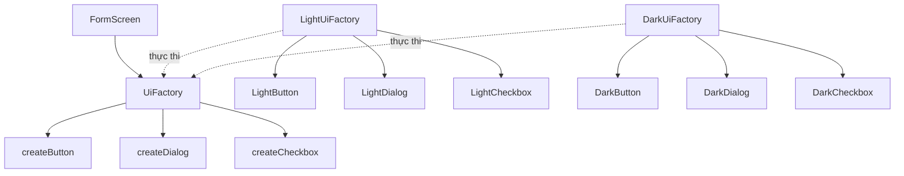

# Lập ma trận loại sản phẩm và biến thể để xác định phạm vi factory

Khi thiết kế **Abstract Factory**, câu hỏi đầu tiên không nên là “cần tạo bao nhiêu lớp factory?”, mà là: **những loại đối tượng nào cần phối hợp với nhau, và chúng thay đổi theo những họ biến thể nào?** Một ma trận *loại sản phẩm × biến thể* giúp trả lời câu hỏi này trước khi viết interface hoặc concrete factory.

Trong chủ đề **Họ sản phẩm**, ma trận đóng vai trò bản thiết kế: mỗi **hàng** là một loại sản phẩm trừu tượng mà client cần; mỗi **cột** là một biến thể hoặc họ có thể được chọn nhất quán; mỗi **ô** là một cách triển khai cụ thể của loại sản phẩm đó trong biến thể tương ứng. Từ các cột của ma trận, ta xác định các concrete factory; từ các hàng, ta xác định các phương thức tạo của abstract factory.

## 1. Hiểu đúng ba khái niệm trước khi lập ma trận

| Khái niệm | Câu hỏi cần trả lời | Ví dụ trong giao diện người dùng |
| --- | --- | --- |
| **Loại sản phẩm** (*product type*) | Client cần những vai trò đối tượng nào? | `Button`, `Dialog`, `Checkbox` |
| **Biến thể** (*variant*) | Cùng một vai trò có những cách triển khai nào? | `LightButton`, `DarkButton` là hai biến thể của `Button` |
| **Họ sản phẩm** (*product family*) | Tổ hợp những biến thể nào được thiết kế để làm việc cùng nhau? | Bộ `LightButton`, `LightDialog`, `LightCheckbox` |

Một **loại sản phẩm** thường được biểu diễn bằng interface hoặc abstract class. Một **họ sản phẩm** là tập hợp các triển khai cho **nhiều loại sản phẩm** nhưng cùng tuân thủ một quyết định biến thể, chẳng hạn chủ đề giao diện, nhà cung cấp dịch vụ, giao thức hoặc môi trường triển khai.

Vì vậy, “ba lớp Button” chỉ là ba biến thể của **một loại**. Muốn áp dụng Abstract Factory một cách có ý nghĩa, cần nhận diện thêm những **loại sản phẩm khác** có quan hệ phối hợp và được chọn cùng một biến thể. Nếu chỉ có một loại sản phẩm độc lập, Factory Method hoặc một factory đơn giản thường đã đủ.

## 2. Ví dụ: lập ma trận cho bộ thành phần giao diện

Giả sử ứng dụng hiển thị một biểu mẫu. Biểu mẫu cần nút xác nhận (`Button`), hộp thoại (`Dialog`) và ô chọn (`Checkbox`). Người dùng có thể chọn chủ đề **Light** hoặc **Dark**; ba thành phần trong cùng một biểu mẫu phải đi theo chủ đề đã chọn.

| Loại sản phẩm ↓ / Họ → | **Light** | **Dark** |
| --- | --- | --- |
| `Button` | `LightButton` | `DarkButton` |
| `Dialog` | `LightDialog` | `DarkDialog` |
| `Checkbox` | `LightCheckbox` | `DarkCheckbox` |

Đọc ma trận theo **hàng** để biết các interface sản phẩm và những lớp triển khai tương ứng. Đọc theo **cột** để thấy một **bộ sản phẩm hoàn chỉnh** mà một concrete factory phải cung cấp.

Từ bảng trên có thể suy ra thiết kế:

- **Abstract products:** `Button`, `Dialog`, `Checkbox`.
- **Abstract factory:** `UiFactory` với `createButton()`, `createDialog()`, `createCheckbox()`.
- **Concrete factories:** `LightUiFactory` và `DarkUiFactory`; mỗi factory tạo đúng ba sản phẩm trong một cột.
- **Client:** `FormScreen` nhận một `UiFactory` và sử dụng các sản phẩm tạo từ factory đó.



Mỗi concrete factory tương ứng với **một cột**, còn các phương thức của `UiFactory` tương ứng với **các hàng**. Đây là quy tắc ánh xạ dễ kiểm tra nhất khi chuyển từ phân tích yêu cầu sang cấu trúc lớp.

## 3. Quy trình lập ma trận từ yêu cầu nghiệp vụ

### Bước 1 — Liệt kê các loại sản phẩm mà client thực sự dùng chung

Bắt đầu từ một tác vụ cụ thể, chẳng hạn *hiển thị và xác nhận biểu mẫu*. Ghi lại những vai trò đối tượng mà tác vụ cần tạo và các tương tác giữa chúng:

| Vai trò | Vì sao cần? | Quan hệ với sản phẩm khác |
| --- | --- | --- |
| `Button` | Cung cấp hành động xác nhận | Có thể nằm trong `Dialog` |
| `Dialog` | Hiển thị thông báo và hành động | Chứa hoặc gọi `Button` |
| `Checkbox` | Nhận lựa chọn của người dùng | Phải có giao diện thống nhất với biểu mẫu |
| `AnalyticsClient` | Ghi sự kiện sử dụng | Không phụ thuộc vào chủ đề giao diện |

`AnalyticsClient` có thể được biểu mẫu sử dụng, nhưng **không cần** nằm trong `UiFactory`: thay đổi Light ↔ Dark không đòi hỏi thay đổi cách triển khai analytics. Ma trận nên chứa những loại sản phẩm cùng một **trục biến thể có ý nghĩa**, không phải mọi dependency của client.

### Bước 2 — Xác định trục biến thể chung

Hỏi: “Nếu chọn một biến thể, những loại sản phẩm nào phải thay đổi đồng bộ?”. Trong ví dụ này, trục biến thể là **chủ đề** (`Light`, `Dark`). Điều quan trọng là cùng một lựa chọn chủ đề áp dụng cho cả `Button`, `Dialog` và `Checkbox` trong phạm vi biểu mẫu.

Những thuộc tính thay đổi độc lập như ngôn ngữ (`vi`, `en`), quyền truy cập hay kích thước cửa sổ **chưa chắc** là các cột mới. Chỉ gộp chúng vào cùng một trục khi thực sự có ràng buộc cần thay thế cả một bộ sản phẩm theo tổ hợp đó.

### Bước 3 — Điền từng ô bằng triển khai cụ thể

Với mỗi cặp *(loại sản phẩm, biến thể)*, xác định lớp hoặc thành phần triển khai và quy ước mà nó phải tuân theo. Đừng chỉ đặt tên lớp: cần biết mỗi ô có thực sự giải quyết được vai trò ở hàng đó không.

Nếu một ô chưa có triển khai, hãy đánh dấu rõ là **chưa hỗ trợ**. Đó là thông tin thiết kế quan trọng, không nên che giấu bằng cách tự ý lấy sản phẩm của họ khác.

### Bước 4 — Kiểm tra tính đầy đủ và tương thích của từng cột

Một cột được coi là ứng viên concrete factory khi nó cung cấp **đủ các loại sản phẩm mà hợp đồng factory yêu cầu** và các sản phẩm đó phối hợp đúng. Cần kiểm tra hai khía cạnh:

1. **Đầy đủ:** Mỗi phương thức của abstract factory đều có triển khai hợp lệ trong họ này.
2. **Nhất quán:** Các sản phẩm cùng cột chia sẻ những quy ước cần thiết, chẳng hạn theme, giao thức, định dạng dữ liệu, phiên bản API hoặc ngữ cảnh phiên làm việc.

Ma trận có đủ tên lớp mới cho ta thấy **độ phủ về cấu trúc**; tính tương thích về hành vi vẫn cần được xác nhận bằng thiết kế hợp đồng và kiểm thử.

### Bước 5 — Chọn phạm vi sống và điểm lựa chọn factory

Xác định thời điểm client chọn cột và phạm vi cần giữ lựa chọn ấy. Với biểu mẫu theo chủ đề, factory có thể được chọn khi dựng một màn hình, sau đó được truyền vào `FormScreen`. Mọi thành phần trong màn hình dùng factory này để tạo sản phẩm cùng họ.

Không bắt buộc cả ứng dụng dùng một singleton factory. Hai cửa sổ có thể sử dụng hai chủ đề khác nhau, miễn là **mỗi cửa sổ giữ nhất quán lựa chọn factory trong phạm vi các sản phẩm cần cộng tác**.

## 4. Từ ma trận sang code Java

Ví dụ dưới đây ánh xạ trực tiếp ba hàng và hai cột của ma trận vào Java. Để giữ trọng tâm vào Abstract Factory, hành vi render được mô phỏng bằng `System.out.println`.

```java
public class ProductFamilyMatrixDemo {
    enum Theme { LIGHT, DARK }

    // Ba hàng của ma trận: ba loại sản phẩm trừu tượng.
    interface Button {
        Theme theme();
        void render();
    }

    interface Dialog {
        Theme theme();
        void open(Button action);
    }

    interface Checkbox {
        Theme theme();
        void render();
    }

    // Hợp đồng factory: một phương thức cho mỗi hàng.
    interface UiFactory {
        Button createButton();
        Dialog createDialog();
        Checkbox createCheckbox();
    }

    // Cột Light.
    static final class LightButton implements Button {
        public Theme theme() { return Theme.LIGHT; }
        public void render() { System.out.println("Button: Light"); }
    }

    static final class LightDialog implements Dialog {
        public Theme theme() { return Theme.LIGHT; }
        public void open(Button action) {
            requireSameTheme(theme(), action);
            System.out.println("Dialog: Light");
        }
    }

    static final class LightCheckbox implements Checkbox {
        public Theme theme() { return Theme.LIGHT; }
        public void render() { System.out.println("Checkbox: Light"); }
    }

    // Cột Dark.
    static final class DarkButton implements Button {
        public Theme theme() { return Theme.DARK; }
        public void render() { System.out.println("Button: Dark"); }
    }

    static final class DarkDialog implements Dialog {
        public Theme theme() { return Theme.DARK; }
        public void open(Button action) {
            requireSameTheme(theme(), action);
            System.out.println("Dialog: Dark");
        }
    }

    static final class DarkCheckbox implements Checkbox {
        public Theme theme() { return Theme.DARK; }
        public void render() { System.out.println("Checkbox: Dark"); }
    }

    // Mỗi concrete factory triển khai một cột hoàn chỉnh.
    static final class LightUiFactory implements UiFactory {
        public Button createButton() { return new LightButton(); }
        public Dialog createDialog() { return new LightDialog(); }
        public Checkbox createCheckbox() { return new LightCheckbox(); }
    }

    static final class DarkUiFactory implements UiFactory {
        public Button createButton() { return new DarkButton(); }
        public Dialog createDialog() { return new DarkDialog(); }
        public Checkbox createCheckbox() { return new DarkCheckbox(); }
    }

    static void requireSameTheme(Theme expected, Button button) {
        if (button == null || button.theme() != expected) {
            throw new IllegalArgumentException("Button và Dialog khác chủ đề");
        }
    }

    // Client chỉ biết abstract factory và abstract products.
    static final class FormScreen {
        private final UiFactory factory;

        FormScreen(UiFactory factory) {
            this.factory = factory;
        }

        void render() {
            Button confirm = factory.createButton();
            Dialog dialog = factory.createDialog();
            Checkbox acceptTerms = factory.createCheckbox();

            // Kiểm tra hợp đồng của ví dụ, phòng khi factory lỗi.
            if (confirm.theme() != acceptTerms.theme()
                    || dialog.theme() != acceptTerms.theme()) {
                throw new IllegalStateException("Factory tạo sản phẩm khác họ");
            }

            confirm.render();
            acceptTerms.render();
            dialog.open(confirm);
        }
    }

    public static void main(String[] args) {
        boolean dark = args.length > 0
                && "dark".equalsIgnoreCase(args[0]);
        UiFactory factory = dark
                ? new DarkUiFactory()
                : new LightUiFactory();

        new FormScreen(factory).render();
    }
}
```

Lưu mã vào `ProductFamilyMatrixDemo.java`, biên dịch và chạy:

```bash
javac -encoding UTF-8 ProductFamilyMatrixDemo.java
java ProductFamilyMatrixDemo dark
```

Kết quả với biến thể Dark:

```text
Button: Dark
Checkbox: Dark
Dialog: Dark
```

Để chọn Light, chạy `java ProductFamilyMatrixDemo`. Điểm đáng chú ý là `FormScreen` không chứa nhánh `if` cho từng loại sản phẩm. Quyết định Light hay Dark được thực hiện **một lần** tại điểm tạo `UiFactory`, sau đó cả ba sản phẩm được lấy qua cùng một interface factory.

## 5. Xử lý những ô trống và các trường hợp ma trận không đều

Giả sử một tính năng mới cần `Tooltip`, nhưng hiện tại chỉ có `LightTooltip`:

| Loại sản phẩm ↓ / Họ → | Light | Dark |
| --- | --- | --- |
| `Button` | `LightButton` | `DarkButton` |
| `Dialog` | `LightDialog` | `DarkDialog` |
| `Checkbox` | `LightCheckbox` | `DarkCheckbox` |
| `Tooltip` | `LightTooltip` | **Chưa hỗ trợ** |

Ma trận giúp phát hiện ngay rằng **hợp đồng factory mới chưa thể được triển khai đầy đủ cho cả hai họ**. Cách xử lý phụ thuộc vào yêu cầu:

- Nếu mọi màn hình Light và Dark **đều phải có Tooltip**, cần triển khai `DarkTooltip` theo hợp đồng trước khi đưa `createTooltip()` vào `UiFactory` chung.
- Nếu Tooltip là tính năng **chỉ tồn tại ở một nhóm màn hình**, cân nhắc đặt nó sau một interface năng lực riêng hoặc một factory khác có phạm vi nhỏ hơn.
- Nếu Tooltip thực sự **không phụ thuộc chủ đề** và có thể dùng cùng cách trong mọi màn hình, không nhất thiết phải đưa nó vào `UiFactory`. Có thể inject riêng một dịch vụ hoặc đối tượng độc lập.
- Nếu một tổ hợp là **không hợp lệ theo nghiệp vụ**, biểu diễn rõ giới hạn hỗ trợ ở tầng chọn tính năng/biến thể thay vì trả `null`, tự ý lấy sản phẩm của họ khác hoặc ném `UnsupportedOperationException` từ một phương thức mà client mặc định luôn dùng được.

Một ô trống không luôn đồng nghĩa với việc phải tạo thêm lớp. Đôi khi nó cho thấy **ranh giới của abstract factory đang quá rộng** và các hàng không thực sự thuộc cùng một họ.

## 6. Khi có nhiều trục biến thể, đừng vội nhân tất cả thành một ma trận lớn

Giả sử ứng dụng có hai chủ đề (`Light`, `Dark`), hai ngôn ngữ (`vi`, `en`) và hai nền tảng (`Desktop`, `Mobile`). Nếu gộp tất cả vào một họ sản phẩm duy nhất, có thể xuất hiện **2 × 2 × 2 = 8** cột cấu hình. Khi số lựa chọn tăng, việc tạo một factory cho mọi tổ hợp sẽ phình nhanh.

Hãy kiểm tra xem các trục có **thực sự cần thay đổi cùng nhau** hay không:

| Trục thay đổi | Tác động chính | Gợi ý phạm vi |
| --- | --- | --- |
| Chủ đề Light/Dark | Màu sắc và trạng thái của Button, Dialog, Checkbox | `UiFactory` theo chủ đề |
| Ngôn ngữ vi/en | Nội dung thông báo và bản dịch | Dịch vụ `Localization` độc lập nếu không ràng buộc cấu trúc UI |
| Nền tảng Desktop/Mobile | Bố cục, tương tác, khả năng của thiết bị | Thành phần nền tảng hoặc factory riêng nếu cần cả một bộ sản phẩm đặc thù |

**Chỉ tạo factory theo tổ hợp biến thể** khi các thành phần của tổ hợp đó thực sự có ràng buộc và phải được triển khai, kiểm thử, phát hành như một bộ. Nếu các trục độc lập, có thể kết hợp những abstraction nhỏ ở tầng composition. Cách này giữ ma trận phản ánh **quan hệ tương thích thật**, tránh tạo hàng loạt concrete factory chỉ để biểu diễn mọi hoán vị.

## 7. Dùng ma trận để quyết định biên giới của Abstract Factory

Không phải cứ có một bảng nhiều hàng và cột là nên sử dụng Abstract Factory. Trước khi chốt thiết kế, tự trả lời các câu hỏi sau:

| Câu hỏi kiểm tra | Tín hiệu nên gom vào một factory | Tín hiệu nên tách phạm vi |
| --- | --- | --- |
| Các loại sản phẩm có được **sử dụng hoặc phối hợp trong cùng một tác vụ** không? | Button, Dialog và Checkbox cùng tạo nên biểu mẫu | Analytics hoạt động độc lập với chủ đề UI |
| Chúng có cùng **trục lựa chọn biến thể** không? | Cả ba đều đổi Light/Dark | Một loại đổi theo nhà cung cấp, loại khác đổi theo ngôn ngữ |
| Có cần **chọn và thay cả bộ** không? | Đổi chủ đề màn hình phải đổi đồng bộ ba loại | Từng loại được lựa chọn độc lập mà không ảnh hưởng nhau |
| Mỗi cột có **đủ triển khai hợp lệ** không? | Mọi phương thức factory đều tạo được sản phẩm tương thích | Một số biến thể thiếu sản phẩm bắt buộc |
| Factory có **phạm vi sống và cấu hình rõ ràng** không? | Một màn hình dùng một cấu hình chủ đề | Factory toàn cục bị đổi cấu hình trong lúc nhiều màn hình đang dùng |

Ba kết luận thiết kế có thể rút ra từ ma trận:

1. **Nhiều hàng, nhiều cột, cần thay đồng bộ:** Đây là ứng viên điển hình cho Abstract Factory.
2. **Một hàng, nhiều cột:** Có thể phù hợp hơn với Factory Method hoặc factory đơn giản; chưa có nhu cầu quản lý cả họ sản phẩm.
3. **Nhiều hàng nhưng biến thể độc lập hoặc không cần cộng tác:** Nên cân nhắc các factory nhỏ hoặc dependency injection riêng cho từng nhóm.

## 8. Kiểm chứng ma trận sau khi triển khai

Ma trận nên trở thành căn cứ cho các kiểm thử hợp đồng. Với mỗi **cột**, tạo tất cả sản phẩm và xác nhận chúng có cùng quy ước, đồng thời thử những luồng cộng tác thực tế. Với mỗi **hàng**, xác nhận các biến thể đều tuân thủ interface mà client sử dụng.

Đối với ví dụ Java trên, có thể thêm đoạn kiểm tra trong một phương thức chạy thử của `ProductFamilyMatrixDemo`:

```java
UiFactory[] factories = {
    new LightUiFactory(),
    new DarkUiFactory()
};

for (UiFactory factory : factories) {
    Button button = factory.createButton();
    Dialog dialog = factory.createDialog();
    Checkbox checkbox = factory.createCheckbox();

    if (button.theme() != dialog.theme()
            || button.theme() != checkbox.theme()) {
        throw new AssertionError("Một cột có sản phẩm khác họ");
    }

    dialog.open(button); // Kiểm tra một tương tác thực tế.
}
```

Trong hệ thống thực, kiểm tra cùng `theme()` chỉ là ví dụ đơn giản. Hợp đồng tương thích có thể gồm phiên bản giao thức, cấu hình kết nối, ngữ nghĩa lỗi, vòng đời đối tượng hoặc quyền truy cập. **Abstract Factory định hướng cách tạo bộ sản phẩm nhất quán, nhưng không tự động chứng minh mọi cặp sản phẩm hoạt động đúng** nếu concrete factory hoặc hợp đồng của chúng bị triển khai sai.

Khi thêm một hàng mới vào abstract factory, hãy kiểm tra **mọi cột**; khi thêm một cột mới, hãy kiểm tra **mọi hàng**. Quy tắc này giúp phát hiện những thay đổi ảnh hưởng nhiều triển khai trước khi mã được đưa vào sử dụng.

## 9. Bài tập thiết kế: ma trận tích hợp thanh toán

Một hệ thống thanh toán cần tạo yêu cầu **thu tiền** và **hoàn tiền** qua hai nhà cung cấp A và B. Hai thao tác phải sử dụng đúng định dạng giao dịch và mã tham chiếu của cùng nhà cung cấp.

Hãy tự phác thảo ma trận:

| Loại sản phẩm ↓ / Nhà cung cấp → | Provider A | Provider B |
| --- | --- | --- |
| `ChargeService` | `AChargeService` | `BChargeService` |
| `RefundService` | `ARefundService` | `BRefundService` |

Từ đó hãy xác định `PaymentFactory` có hai phương thức `createChargeService()` và `createRefundService()`, cùng hai triển khai `ProviderAPaymentFactory` và `ProviderBPaymentFactory`. Chú ý rằng mỗi cột còn có thể cần chia sẻ **tài khoản merchant**, **môi trường sandbox/production** và **ngữ cảnh giao dịch**. Chỉ cùng tên nhà cung cấp chưa bảo đảm rằng hai đối tượng đang làm việc trên cùng một tài khoản hoặc môi trường.

**Câu hỏi tự kiểm tra:** Nếu bổ sung `NotificationSender` gửi email sau thanh toán, có nên thêm `createNotificationSender()` vào `PaymentFactory` không? Thông thường không, nếu hệ thống gửi email như nhau bất kể nhà cung cấp thanh toán. Nó không cùng trục biến thể với các bộ xử lý thu và hoàn tiền; hãy giữ nó là dependency độc lập, trừ khi có yêu cầu thực sự buộc nó thay đổi theo từng provider.

## Tổng kết

Để xác định phạm vi Abstract Factory, hãy bắt đầu từ **những sản phẩm cần cộng tác**, đặt chúng thành **các hàng**, xác định **trục biến thể dùng chung** làm **các cột**, rồi kiểm tra từng ô về khả năng triển khai và tính tương thích. Một abstract factory có phương thức tương ứng với các hàng; mỗi concrete factory chịu trách nhiệm cung cấp **một cột hoàn chỉnh**.

Ma trận là công cụ thiết kế ranh giới: nó cho biết sản phẩm nào nên đi cùng nhau, sản phẩm nào độc lập, biến thể nào còn thiếu và factory nên được chọn tại phạm vi nào. Khi ranh giới đúng, client có thể chuyển giữa các họ bằng cách thay factory mà không phải tự phối hợp từng lớp triển khai cụ thể.
