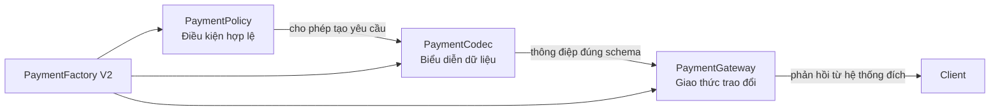

# Định nghĩa tính tương thích về giao thức, dữ liệu và quy tắc nghiệp vụ

## 1. Tính tương thích trong một họ sản phẩm nghĩa là gì?

Trong mẫu thiết kế khởi tạo **Abstract Factory**, một *họ sản phẩm* (product family) là tập hợp các sản phẩm có liên quan, được thiết kế để phối hợp với nhau theo một biến thể hoặc môi trường xác định. Ví dụ, khi tích hợp một cổng thanh toán, ứng dụng có thể cần ba vai trò sản phẩm:

- **`PaymentCodec`**: chuyển yêu cầu thanh toán từ mô hình nội bộ thành dữ liệu trao đổi với cổng.
- **`PaymentGateway`**: gửi yêu cầu theo giao thức và nhận kết quả.
- **`PaymentPolicy`**: kiểm tra yêu cầu có thỏa mãn quy tắc thanh toán của biến thể đó không.

Ba vai trò có thể có một họ cho **API V1** và một họ cho **API V2**. Một `PaymentFactory` tạo các sản phẩm thuộc cùng họ, để client không phải ghép thủ công codec V1 với gateway V2 hoặc policy V1 với giao dịch V2.

**Tính tương thích** ở đây là khả năng các sản phẩm **trao đổi thông tin, hiểu dữ liệu và phối hợp đúng quy tắc nghiệp vụ trong một ngữ cảnh sử dụng đã xác định**. Nó rộng hơn việc các lớp cùng triển khai interface Java.

Một tập sản phẩm được coi là tương thích khi:

1. **Giao thức** của chúng thống nhất: dùng đúng phiên bản, cách trao đổi và quy ước xử lý phản hồi.
2. **Dữ liệu** trao đổi có cùng ý nghĩa: đúng schema, đơn vị, định dạng, độ chính xác và ràng buộc giá trị.
3. **Quy tắc nghiệp vụ** nhất quán: cùng thừa nhận điều kiện hợp lệ, chuỗi trạng thái và ý nghĩa của thao tác.

Ví dụ, `V1Codec` và `V2Gateway` vẫn có thể lần lượt triển khai đúng `PaymentCodec` và `PaymentGateway`, nhưng **không tương thích với nhau** nếu một bên gửi trường `amountMajor` dạng thập phân còn bên kia chỉ nhận `amountMinor` dạng số nguyên. Lỗi nằm ở hợp đồng phối hợp, không nằm ở quan hệ kế thừa interface.

## 2. Ba lớp của hợp đồng tương thích

### 2.1. Tương thích về giao thức (protocol compatibility)

Hai sản phẩm tương thích về giao thức khi **cách chúng trao đổi thông điệp và phản ứng với thông điệp** khớp nhau. Điều này có thể bao gồm:

| Thành phần giao thức | Câu hỏi cần xác định | Ví dụ không tương thích |
| --- | --- | --- |
| Địa chỉ/đích trao đổi | Có dùng đúng endpoint, kênh hoặc topic? | Codec tạo thông điệp cho `/v1/payments`, gateway gửi tới `/v2/payments`. |
| Phiên bản và kiểu thông điệp | Hai bên thống nhất version, media type, schema ID? | Bên gửi khai báo `payment-v1`, bên nhận chỉ chấp nhận `payment-v2`. |
| Trình tự tương tác | Có cùng quy ước gọi, xác nhận, retry? | Bên A gửi `capture` trước khi `authorize` dù giao thức yêu cầu ngược lại. |
| Xử lý lỗi | Mã lỗi, timeout, trạng thái kết quả được hiểu giống nhau? | Client coi `202 Accepted` là đã hoàn tất trong khi server chỉ mới xếp hàng. |
| Điều kiện phiên/kết nối | Có cùng quy định xác thực, phiên bản handshake, transaction? | Adapter không gửi khóa idempotency bắt buộc của endpoint mới. |

Đây là **hợp đồng trao đổi** giữa các bên; cùng dùng HTTP hay cùng dùng JSON **chưa đủ** để kết luận tương thích. Hai API cùng dùng HTTP vẫn có thể khác endpoint, thứ tự gọi và ngữ nghĩa trạng thái.

### 2.2. Tương thích về dữ liệu (data compatibility)

Hai sản phẩm tương thích dữ liệu khi bên nhận có thể **giải mã và diễn giải chính xác** thông tin mà bên gửi tạo ra. Không chỉ tên trường, mà cả ý nghĩa của giá trị đều phải thống nhất.

| Khía cạnh dữ liệu | Ví dụ API V1 | Ví dụ API V2 | Nguy cơ khi trộn |
| --- | --- | --- | --- |
| Tên trường | `amountMajor` | `amountMinor` | Bên nhận không tìm được trường cần thiết. |
| Đơn vị tiền | `12.50` đơn vị tiền chính | `1250` đơn vị nhỏ nhất | Có thể tính sai số tiền gấp 100 lần. |
| Kiểu và độ chính xác | Chuỗi thập phân, ví dụ `"12.50"` | Số nguyên, ví dụ `1250` | Ép kiểu/rounding làm mất giá trị. |
| Trạng thái | `paid`, `refunded` | `CAPTURED`, `REVERSED` | Ánh xạ trạng thái sai dẫn đến quyết định sai. |
| Trường tùy chọn | Không có `requestId` | `requestId` bắt buộc | Dữ liệu hợp lệ ở V1 có thể không hợp lệ ở V2. |

Ví dụ: `12.50` (đơn vị tiền chính) và `1250` (đơn vị nhỏ nhất, giả sử đồng tiền có 2 chữ số thập phân) **có thể biểu diễn cùng số tiền**, nhưng không thể hoán đổi trực tiếp nếu không có quy tắc chuyển đổi rõ ràng. Trong Java, dữ liệu tiền nên được xử lý bằng `BigDecimal` hoặc số nguyên đơn vị nhỏ nhất, tránh dùng `double` cho phép tính yêu cầu độ chính xác.

Khi xác định tương thích dữ liệu, còn cần xem: mã hóa ký tự, timezone, số chữ số thập phân của từng đồng tiền, mã định danh, giá trị `null`, trường bắt buộc, khả năng đọc dữ liệu phiên bản cũ và hành vi khi gặp trường chưa biết.

### 2.3. Tương thích về quy tắc nghiệp vụ (business-rule compatibility)

Ngay cả khi gửi đúng giao thức và đúng schema, các sản phẩm vẫn có thể phối hợp sai nếu **định nghĩa “giao dịch hợp lệ” hoặc “thao tác thành công” khác nhau**.

Giả sử có quy tắc minh họa:

- **API V1**: nhận thanh toán từ **100** đơn vị nhỏ nhất.
- **API V2**: nhận thanh toán từ **500** đơn vị nhỏ nhất và yêu cầu `requestId` để nhận diện lần gửi lại.

Nếu client dùng `V1PaymentPolicy` để xác nhận khoản thanh toán `300` là hợp lệ nhưng lại gửi qua gateway V2, yêu cầu có thể bị từ chối ở hệ thống đích dù tên trường và kiểu dữ liệu đã đúng. Quy tắc nghiệp vụ có thể liên quan đến:

- Điều kiện tạo giao dịch: số tiền tối thiểu, giới hạn hạn mức, loại khách hàng, quyền hạn.
- Quy trình và trạng thái: `authorize → capture → refund`, trạng thái cho phép hủy hoặc hoàn tiền.
- Tính lặp lại của thao tác: idempotency key, cho phép retry hay không, ngăn gửi trùng.
- Quy tắc số học và đối soát: làm tròn, thuế, chiết khấu, ngày hiệu lực.
- Ràng buộc theo ngữ cảnh: thị trường, sản phẩm, cấu hình đối tác, thời điểm.

Các ngưỡng trên **chỉ dùng cho ví dụ học tập**, không đại diện cho quy định thanh toán của bất kỳ nhà cung cấp thực tế nào.

### Ba lớp liên hệ với nhau ra sao?



Hình trên cho thấy một `PaymentFactory` được chọn cho API V2 tạo ra các sản phẩm có hợp đồng **phối hợp với nhau**. Không thể chỉ sửa `PaymentCodec` để tạo dữ liệu V2 nếu `PaymentPolicy` và `PaymentGateway` vẫn dựa trên ngữ nghĩa V1.

## 3. Định nghĩa tương thích theo ngữ cảnh, không chỉ theo tên họ

“Cùng họ” là **ý định thiết kế** để gom các sản phẩm tương thích. Nó không phải phép chứng minh tự động. Nên mô tả mỗi họ bằng một **hợp đồng tương thích** rõ ràng:

| Thành phần hợp đồng | Họ Payment V1 | Họ Payment V2 |
| --- | --- | --- |
| Giao thức | Thông điệp `payment-v1`; endpoint V1 | Thông điệp `payment-v2`; endpoint V2 |
| Biểu diễn tiền | Trường `amountMajor` với chuỗi thập phân | Trường `amountMinor` với số nguyên |
| Điều kiện nghiệp vụ | Tối thiểu 100 đơn vị nhỏ nhất | Tối thiểu 500 và có `requestId` |
| Thành phần phải đi cùng | `V1PaymentPolicy`, `V1PaymentCodec`, `V1PaymentGateway` | `V2PaymentPolicy`, `V2PaymentCodec`, `V2PaymentGateway` |

Với một giao dịch cụ thể, có thể đặt ba câu hỏi:

1. **Giao thức:** Gateway có hiểu phiên bản và trình tự trao đổi mà codec/client dùng không?
2. **Dữ liệu:** Gateway có diễn giải chính xác các trường, kiểu và đơn vị mà codec tạo ra không?
3. **Nghiệp vụ:** Điều kiện mà policy cho phép có phù hợp với điều kiện của gateway không?

Muốn một nhóm sản phẩm hoạt động đúng cần cả ba câu trả lời phù hợp. Một adapter được thiết kế và kiểm chứng có thể chuyển đổi giữa hai họ; vì vậy **khác họ không đồng nghĩa chắc chắn bất tương thích trong mọi trường hợp**. Tuy nhiên, không được coi việc trộn hai họ là an toàn khi chưa có hợp đồng chuyển đổi rõ ràng.

## 4. Ví dụ Java: đúng interface vẫn có thể sai hợp đồng

Ví dụ này là **mô phỏng cục bộ**, không gửi HTTP thật. `WirePayment` là dạng thông điệp logic tối giản gồm phiên bản giao thức, tên trường tiền, giá trị và `requestId`. `PaymentGateway` giả lập việc tiếp nhận tại hệ thống đích để minh họa cách ba lớp tương thích cùng ảnh hưởng đến kết quả.

```java
// Lưu thành CompatibilityContractDemo.java
import java.math.BigDecimal;

public class CompatibilityContractDemo {
    static final class Payment {
        final int amountMinor;
        final String requestId;

        Payment(int amountMinor, String requestId) {
            this.amountMinor = amountMinor;
            this.requestId = requestId;
        }
    }

    // Dạng thông điệp logic; không phải một HTTP request hoàn chỉnh.
    static final class WirePayment {
        final String protocol;
        final String amountField;
        final String amountValue;
        final String requestId;

        WirePayment(String protocol, String amountField,
                    String amountValue, String requestId) {
            this.protocol = protocol;
            this.amountField = amountField;
            this.amountValue = amountValue;
            this.requestId = requestId;
        }
    }

    interface PaymentCodec {
        WirePayment encode(Payment payment);
    }

    interface PaymentGateway {
        String submit(WirePayment request);
    }

    interface PaymentPolicy {
        void validate(Payment payment);
    }

    // AbstractFactory: cung cấp ba vai trò thuộc cùng một họ.
    interface PaymentFactory {
        PaymentCodec codec();
        PaymentGateway gateway();
        PaymentPolicy policy();
    }

    static final class V1Codec implements PaymentCodec {
        public WirePayment encode(Payment payment) {
            String major = BigDecimal
                    .valueOf(payment.amountMinor, 2)
                    .toPlainString();
            return new WirePayment(
                    "payment-v1", "amountMajor", major, payment.requestId);
        }
    }

    static final class V2Codec implements PaymentCodec {
        public WirePayment encode(Payment payment) {
            return new WirePayment(
                    "payment-v2", "amountMinor",
                    Integer.toString(payment.amountMinor), payment.requestId);
        }
    }

    static final class V1Policy implements PaymentPolicy {
        public void validate(Payment payment) {
            if (payment.amountMinor < 100) {
                throw new IllegalArgumentException("V1: amount below minimum");
            }
        }
    }

    static final class V2Policy implements PaymentPolicy {
        public void validate(Payment payment) {
            if (payment.amountMinor < 500) {
                throw new IllegalArgumentException("V2: amount below minimum");
            }
            if (payment.requestId == null || payment.requestId.trim().isEmpty()) {
                throw new IllegalArgumentException("V2: requestId required");
            }
        }
    }

    static final class V1Gateway implements PaymentGateway {
        public String submit(WirePayment request) {
            if (!"payment-v1".equals(request.protocol)
                    || !"amountMajor".equals(request.amountField)) {
                throw new IllegalArgumentException("V1 protocol/schema mismatch");
            }
            // Hệ thống đích đọc đơn vị chính rồi quy đổi chính xác sang minor.
            int minor = new BigDecimal(request.amountValue)
                    .movePointRight(2).intValueExact();
            if (minor < 100) {
                throw new IllegalArgumentException("V1 business rule rejected");
            }
            return "V1 accepted";
        }
    }

    static final class V2Gateway implements PaymentGateway {
        public String submit(WirePayment request) {
            if (!"payment-v2".equals(request.protocol)
                    || !"amountMinor".equals(request.amountField)) {
                throw new IllegalArgumentException("V2 protocol/schema mismatch");
            }
            int minor = Integer.parseInt(request.amountValue);
            if (minor < 500) {
                throw new IllegalArgumentException("V2 business rule rejected");
            }
            if (request.requestId == null
                    || request.requestId.trim().isEmpty()) {
                throw new IllegalArgumentException("V2 requestId required");
            }
            return "V2 accepted";
        }
    }

    static final class V1Factory implements PaymentFactory {
        public PaymentCodec codec() { return new V1Codec(); }
        public PaymentGateway gateway() { return new V1Gateway(); }
        public PaymentPolicy policy() { return new V1Policy(); }
    }

    static final class V2Factory implements PaymentFactory {
        public PaymentCodec codec() { return new V2Codec(); }
        public PaymentGateway gateway() { return new V2Gateway(); }
        public PaymentPolicy policy() { return new V2Policy(); }
    }

    // Client không biết tên lớp concrete product.
    static final class CheckoutClient {
        private final PaymentCodec codec;
        private final PaymentGateway gateway;
        private final PaymentPolicy policy;

        CheckoutClient(PaymentFactory factory) {
            this.codec = factory.codec();
            this.gateway = factory.gateway();
            this.policy = factory.policy();
        }

        String pay(Payment payment) {
            policy.validate(payment);
            return gateway.submit(codec.encode(payment));
        }
    }

    public static void main(String[] args) {
        Payment valid = new Payment(1200, "req-001");
        System.out.println(new CheckoutClient(new V1Factory()).pay(valid));
        System.out.println(new CheckoutClient(new V2Factory()).pay(valid));

        // Trộn V1Codec và V2Gateway: lệch giao thức + schema.
        try {
            new V2Gateway().submit(new V1Codec().encode(valid));
        } catch (IllegalArgumentException ex) {
            System.out.println("Rejected: " + ex.getMessage());
        }

        // Dữ liệu V2 đúng dạng, nhưng giá trị vi phạm quy tắc V2.
        Payment tooSmallForV2 = new Payment(300, "req-002");
        try {
            new V2Gateway().submit(new V2Codec().encode(tooSmallForV2));
        } catch (IllegalArgumentException ex) {
            System.out.println("Rejected: " + ex.getMessage());
        }
    }
}
```

Biên dịch và chạy:

```bash
javac CompatibilityContractDemo.java
java CompatibilityContractDemo
```

Kết quả dự kiến:

```text
V1 accepted
V2 accepted
Rejected: V2 protocol/schema mismatch
Rejected: V2 business rule rejected
```

Tại sao các trường hợp trên quan trọng?

1. **Cùng factory:** `V1Factory` và `V2Factory` mỗi cái tạo đúng bộ `codec`, `gateway` và `policy` của mình; client chỉ nhận một `PaymentFactory`.
2. **Trộn giao thức/dữ liệu:** `V1Codec` tạo `payment-v1` với `amountMajor`, trong khi `V2Gateway` mong đợi `payment-v2` với `amountMinor`. Hai đối tượng vẫn đúng interface nhưng không trao đổi được.
3. **Sai quy tắc nghiệp vụ:** khoản tiền `300` đủ điều kiện V1 nhưng không đủ điều kiện V2. Ngay cả một thông điệp V2 đúng schema cũng bị gateway V2 từ chối theo quy tắc.
4. **Phát hiện lỗi ở ranh giới:** kiểm tra trong gateway giả lập giúp minh họa việc phải xác minh tính hợp lệ ở nơi tiếp nhận; kiểm tra trong policy giúp client báo lỗi sớm. Trong hệ thống thật, kiểm tra phía server vẫn phải là nguồn quyết định cuối cùng.

Lưu ý: ví dụ cố ý lược bỏ mạng, tiền tệ cụ thể, phân quyền, bảo mật và các lỗi vận hành khác để tập trung vào **ba chiều tương thích**. Phương thức `submit` chỉ minh họa hợp đồng, chưa đại diện cho một SDK thanh toán hoàn chỉnh.

## 5. Cách biểu diễn hợp đồng tương thích khi thiết kế Abstract Factory

Khi thiết kế mỗi họ sản phẩm, nên xác định một **hồ sơ tương thích** (compatibility profile). Một hồ sơ không chỉ liệt kê tên lớp, mà ghi rõ:

| Nội dung cần định nghĩa | Câu hỏi và kết quả mong muốn |
| --- | --- |
| Định danh họ và phiên bản | Ví dụ `payment-v2`; phiên bản giao thức và chính sách áp dụng là gì? |
| Vai trò sản phẩm | `PaymentCodec`, `PaymentGateway`, `PaymentPolicy` có được tạo đủ và đi cùng nhau không? |
| Giao thức | Endpoint, phiên bản, kiểu thông điệp, trạng thái, retry và lỗi được quy định thế nào? |
| Schema dữ liệu | Tên trường, kiểu, đơn vị, nullability, precision, phiên bản schema và chuyển đổi ra sao? |
| Bất biến nghiệp vụ | Số tiền tối thiểu, điều kiện trạng thái, idempotency và quy tắc xử lý là gì? |
| Ranh giới vòng đời | Một lựa chọn họ có hiệu lực cho một giao dịch, phiên hay toàn bộ ứng dụng? |
| Xử lý bất tương thích | Từ chối sớm, chọn lại factory, dùng adapter hay migrate dữ liệu? |
| Bằng chứng kiểm chứng | Test nào chứng minh các concrete product phối hợp đúng? |

Không bắt buộc triển khai bảng này thành một class chạy thực tế. Nó có thể là tài liệu thiết kế, bộ test hợp đồng hoặc một phần cấu hình version. Điểm quan trọng là **mọi concrete factory phải thực hiện lời hứa tương thích được mô tả**, không chỉ trả về đúng loại interface.

### Bất biến cho một họ sản phẩm

Với họ `Payment V2`, có thể viết các bất biến minh họa:

- `V2Codec` luôn tạo thông điệp mang `payment-v2` và trường `amountMinor`.
- `V2Gateway` hiểu những thông điệp mà `V2Codec` sinh ra; số tiền giữ nguyên ý nghĩa sau khi mã hóa và giải mã.
- `V2Policy` không chấp nhận một yêu cầu mà quy tắc nghiệp vụ cơ bản của gateway V2 chắc chắn sẽ bác bỏ.
- Nếu họ yêu cầu `requestId`, mọi đường gửi yêu cầu đều cung cấp giá trị hợp lệ.

Các bất biến này cụ thể hơn câu nói chung chung “các sản phẩm cùng họ thì tương thích”. Chúng tạo ra tiêu chí có thể kiểm thử.

## 6. Những nhầm lẫn cần tránh

### “Cùng triển khai một interface thì tương thích”

Interface như `PaymentGateway` chỉ xác định **hình dạng lời gọi ở mức kiểu Java**. Nó không tự xác nhận phiên bản giao thức, đơn vị dữ liệu hay quy tắc xử lý. Tính thay thế về kiểu là điều kiện cần cho nhiều thiết kế đa hình, nhưng chưa đủ để khẳng định hai implementation có thể phối hợp tùy ý.

### “Cùng một ConcreteFactory thì chắc chắn đúng”

Một `V2Factory` vẫn có thể bị lập trình sai, chẳng hạn `codec()` trả `V1Codec`. Trình biên dịch chấp nhận vì `V1Codec` vẫn triển khai `PaymentCodec`. **Abstract Factory là cơ chế tổ chức và đóng gói lựa chọn**, còn việc ánh xạ đúng họ phụ thuộc vào hiện thực và kiểm thử.

### “Dữ liệu đọc được là dữ liệu đúng”

Server có thể nhận được chuỗi `"1250"` và parse thành số. Nếu bên gửi hiểu đó là đơn vị nhỏ nhất còn bên nhận hiểu là đơn vị chính, hệ thống không nhất thiết báo lỗi cú pháp nhưng có thể gây sai lệch nghiệp vụ nghiêm trọng. Kiểm tra cần bao gồm **ý nghĩa và đơn vị**, ngoài cú pháp.

### “Tương thích hiện tại sẽ tồn tại với mọi phiên bản sau”

Một API mới có thể giữ lại tên trường nhưng thay quy tắc làm tròn, trạng thái hoặc hạn mức. Vì thế cần gắn hồ sơ tương thích với phiên bản hoặc phạm vi cấu hình cụ thể, và đánh giá lại khi hợp đồng bên ngoài thay đổi.

### “Mọi sản phẩm khác họ đều phải bị cấm phối hợp”

Đôi khi V1 và V2 có thể dùng chung một sản phẩm không phụ thuộc phiên bản, hoặc có **adapter chuyển đổi đã được kiểm chứng**. Có thể tái sử dụng hợp lệ nếu các yêu cầu giao thức, dữ liệu và nghiệp vụ thực sự được đáp ứng. Tuy nhiên, không nên suy luận rằng chúng tương thích chỉ vì tên interface giống nhau.

## 7. Đánh giá và kiểm thử tính tương thích của từng họ

Nên kiểm thử ít nhất ở ba mức:

| Mức kiểm thử | Ví dụ cần xác minh | Lỗi có thể phát hiện |
| --- | --- | --- |
| **Hợp đồng giao thức** | `V2Codec` và `V2Gateway` thống nhất `payment-v2`, thông tin định tuyến, cách xử lý lỗi/retry | Phiên bản sai, trạng thái bị hiểu nhầm, thông điệp bị từ chối |
| **Hợp đồng dữ liệu** | Round-trip bảo toàn số tiền, tên trường và đơn vị; thử biên, `null`, phiên bản cũ | Sai schema, sai đơn vị, mất độ chính xác, trường bắt buộc thiếu |
| **Hợp đồng nghiệp vụ** | Test số tiền sát ngưỡng, trạng thái hợp lệ/không hợp lệ, idempotency và retry | Policy chấp nhận thao tác mà gateway từ chối hoặc gây hiệu ứng lặp |

Ngoài test thành phần, cần **test phối hợp cả bộ sản phẩm** do từng factory tạo. Ví dụ, với `V2Factory`:

1. Tạo `codec`, `gateway`, `policy` thông qua **chính factory này**.
2. Gửi yêu cầu hợp lệ: policy cho qua, codec bảo toàn ý nghĩa số tiền, gateway nhận đúng phiên bản.
3. Thử yêu cầu không hợp lệ: thiếu `requestId`, số tiền dưới ngưỡng, trạng thái nghiệp vụ sai.
4. Thử ghép nhầm `V1Codec` vào `V2Gateway` để xác nhận hệ thống từ chối hoặc dùng adapter phù hợp.
5. Kiểm tra khi đổi phiên bản: những sản phẩm tồn tại trước đó có còn được dùng sai với gateway mới không?

**Kiểm thử phủ định (negative testing)** đặc biệt hữu ích: không chỉ chứng minh một họ hoạt động đúng, mà còn kiểm tra hệ thống phản ứng có kiểm soát khi nhận sản phẩm hoặc dữ liệu từ họ không tương thích.

## 8. Khi nào cần chọn họ mới hoặc tạo adapter?

Khi hợp đồng đối tác thay đổi, có ba hướng xử lý phổ biến:

- **Giữ nguyên họ:** nếu thay đổi hoàn toàn tương thích ngược theo cả ba chiều, có thể cập nhật implementation mà vẫn giữ hợp đồng hiện hành, kèm kiểm thử hồi quy.
- **Tạo họ mới:** khi xuất hiện khác biệt mang tính phá vỡ (định dạng mới không tương thích, trình tự giao thức đổi, nghiệp vụ đổi), bổ sung `V3Factory` và các concrete product tương ứng. Client chọn họ theo môi trường/phiên bản.
- **Dùng adapter:** khi cần phối hợp hai hợp đồng khác nhau và có phép chuyển đổi được xác định rõ. Adapter phải xử lý đúng cả quy tắc dữ liệu lẫn ý nghĩa nghiệp vụ; chỉ đổi tên trường chưa chắc đủ.

Chọn phương án dựa trên **mức độ tương thích thật**, không dựa riêng vào tên sản phẩm, số phiên bản hoặc việc Java có biên dịch được không.

## Ghi nhớ

Trong Abstract Factory, **tính tương thích của một họ sản phẩm phải được định nghĩa trên ba chiều: giao thức trao đổi, ý nghĩa dữ liệu và quy tắc nghiệp vụ**. `AbstractFactory` giúp client nhận một bộ sản phẩm theo cùng lựa chọn họ; `ConcreteFactory` có trách nhiệm trả về các implementation tuân thủ một hợp đồng phối hợp thống nhất. Để biến mục tiêu “cùng họ” thành bảo đảm đáng tin cậy, cần có hồ sơ tương thích, bất biến rõ ràng và kiểm thử phối hợp cho từng họ.
