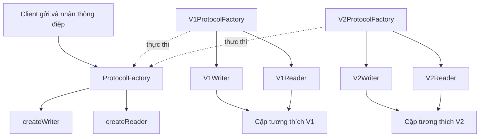

# Phân biệt tương thích về kiểu dữ liệu với tương thích về ngữ nghĩa

Trong **Abstract Factory**, các sản phẩm do một factory tạo ra thường được dùng chung: nút bấm và hộp thoại trong cùng giao diện, bộ mã hóa và giải mã cùng giao thức, hoặc các adapter cùng nhà cung cấp. Khi thiết kế **họ sản phẩm**, một điều rất dễ bị bỏ sót là: **hai đối tượng có thể tương thích về kiểu dữ liệu nhưng vẫn không tương thích về ngữ nghĩa**.

Ví dụ, một bộ mã hóa trả về `String` và một bộ giải mã nhận `String`. Java cho phép kết nối hai phương thức này. Tuy nhiên, nếu bên mã hóa tạo chuỗi theo định dạng V1 còn bên giải mã chỉ hiểu định dạng V2, chương trình có thể lỗi lúc chạy hoặc đọc sai thông tin.

Vì thế, Abstract Factory giúp giải quyết một vấn đề lớn hơn việc chọn đúng interface: **tạo các biến thể thuộc một họ có cùng quy ước để có thể cộng tác**. Bài học này phân biệt rõ hai loại tương thích, cách định nghĩa hợp đồng ngữ nghĩa và cách kiểm chứng chúng trong thiết kế Abstract Factory.

## 1. Hai tầng tương thích: “gọi được” và “hiểu đúng”

| Tiêu chí | Tương thích về kiểu dữ liệu (*type compatibility*) | Tương thích về ngữ nghĩa (*semantic compatibility*) |
| --- | --- | --- |
| Câu hỏi chính | Đối tượng/giá trị có thể được truyền vào vị trí này theo hợp đồng kiểu không? | Các đối tượng có hiểu và xử lý dữ liệu, trạng thái, quy tắc theo cách phù hợp không? |
| Căn cứ | Interface, class, tham số và kiểu trả về, ràng buộc generic, quy tắc của hệ kiểu | Định dạng và ý nghĩa dữ liệu, đơn vị, tiền/hậu điều kiện, trạng thái, phiên bản, cấu hình, quyền sở hữu |
| Phát hiện lỗi thường gặp | Lúc biên dịch với Java tĩnh kiểu; một số phép kiểm tra kiểu xảy ra lúc chạy | Thường qua kiểm thử hợp đồng, kiểm tra lúc chạy hoặc lỗi khi tích hợp |
| Ví dụ | `MessageReader.read(String)` nhận giá trị `String` do `MessageWriter.write(String)` trả về | Reader phải hiểu đúng phiên bản giao thức mà writer dùng để tạo chuỗi |
| Một sản phẩm thay thế sản phẩm khác | Cả hai cùng triển khai `MessageWriter` | Cả hai còn phải tuân theo những điều kiện hành vi mà client dựa vào |

**Tương thích về kiểu** cho biết chương trình *có thể ghép* các đối tượng ở mức chữ ký phương thức. **Tương thích về ngữ nghĩa** cho biết việc ghép đó *có ý nghĩa đúng* trong một tình huống nghiệp vụ cụ thể.

Chẳng hạn, cùng là kiểu `long` nhưng một giá trị có thể biểu diễn **mili giây** còn giá trị khác biểu diễn **giây**; cùng là `String` nhưng một chuỗi có thể là **JSON** còn chuỗi kia là **CSV**. Compiler không tự suy ra ý nghĩa này từ các kiểu nguyên thủy và kiểu chuỗi.

### Một ví dụ ngắn

Giả sử có hai interface:

```java
interface MessageWriter {
    String write(String message);
}

interface MessageReader {
    String read(String wireData);
}
```

Đoạn mã sau **hợp lệ về kiểu**:

```java
String encoded = writer.write("Xin chào");
String decoded = reader.read(encoded);
```

Nhưng để `decoded` đúng bằng `"Xin chào"`, ta cần thêm một **hợp đồng ngữ nghĩa**: `reader` phải hiểu đúng cách `writer` đã đóng gói dữ liệu. Chữ ký `String -> String` không nói gì về định dạng, phiên bản hay quy tắc lỗi.

## 2. Tại sao “cùng interface” vẫn có thể không cộng tác được?

Trong Abstract Factory, **mỗi hàng** của ma trận biểu diễn một loại sản phẩm trừu tượng; **mỗi cột** biểu diễn một họ biến thể cần phối hợp. Xét hệ thống truyền thông điệp hỗ trợ hai phiên bản giao thức:

| Loại sản phẩm ↓ / Họ → | Giao thức V1 | Giao thức V2 |
| --- | --- | --- |
| `MessageWriter` | `V1Writer` | `V2Writer` |
| `MessageReader` | `V1Reader` | `V2Reader` |
| Dạng dữ liệu truyền đi | Tiền tố `V1:` + nội dung gốc | Tiền tố `V2:` + nội dung mã hóa Base64URL từ UTF-8 |
| Bộ sản phẩm cần chọn | Writer V1 + Reader V1 | Writer V2 + Reader V2 |

Về kiểu:

- `V1Writer` và `V2Writer` đều triển khai `MessageWriter`.
- `V1Reader` và `V2Reader` đều triển khai `MessageReader`.
- Phương thức ghi trả về `String` và phương thức đọc nhận `String` trong **cả hai họ**.

Về ngữ nghĩa:

- `V1Reader` chỉ chấp nhận dữ liệu theo định dạng V1.
- `V2Reader` chỉ chấp nhận dữ liệu theo định dạng V2.
- Lấy `V1Writer` rồi ghép với `V2Reader` sẽ không tạo thành một cặp hợp lệ theo **hợp đồng của ví dụ**.

Lúc này, **một concrete factory phải tạo được cả writer và reader của cùng một cột**, thay vì để client tự chọn mỗi đối tượng một cách độc lập.



**Điều được bảo đảm ở mức thiết kế:** nếu mỗi concrete factory thực hiện đúng hợp đồng và client lấy cả hai sản phẩm từ cùng factory, client sẽ dùng bộ sản phẩm đã được thiết kế cho cùng phiên bản. Abstract Factory **không tự chứng minh** mọi implementation là đúng và cũng không ngăn client cố tình trộn hai factory ở mức kiểu Java thông thường.

## 3. Ví dụ Java đầy đủ: ghép đúng kiểu nhưng sai ngữ nghĩa

Chương trình dưới đây chạy được với JDK phổ biến và **chỉ mô phỏng định dạng giao thức**. V1 dùng tiền tố và nội dung nguyên bản; V2 dùng tiền tố và Base64URL để biểu diễn byte UTF-8. Base64URL là **cách biểu diễn dữ liệu, không phải mã hóa bảo mật**.

```java
import java.nio.charset.StandardCharsets;
import java.util.Base64;
import java.util.Objects;

public class SemanticCompatibilityDemo {
    // Abstract products: hợp đồng về kiểu.
    interface MessageWriter {
        String write(String message);
    }

    interface MessageReader {
        String read(String wireData);
    }

    // Abstract Factory: trả về hai loại sản phẩm cùng một họ.
    interface ProtocolFactory {
        MessageWriter createWriter();
        MessageReader createReader();
    }

    static final class V1Writer implements MessageWriter {
        public String write(String message) {
            return "V1:" + Objects.requireNonNull(message);
        }
    }

    static final class V1Reader implements MessageReader {
        public String read(String wireData) {
            if (wireData == null || !wireData.startsWith("V1:")) {
                throw new IllegalArgumentException("Reader V1 yêu cầu V1:");
            }
            return wireData.substring(3);
        }
    }

    static final class V2Writer implements MessageWriter {
        public String write(String message) {
            byte[] bytes = Objects.requireNonNull(message)
                    .getBytes(StandardCharsets.UTF_8);
            String encoded = Base64.getUrlEncoder()
                    .withoutPadding()
                    .encodeToString(bytes);
            return "V2:" + encoded;
        }
    }

    static final class V2Reader implements MessageReader {
        public String read(String wireData) {
            if (wireData == null || !wireData.startsWith("V2:")) {
                throw new IllegalArgumentException("Reader V2 yêu cầu V2:");
            }
            byte[] bytes = Base64.getUrlDecoder()
                    .decode(wireData.substring(3));
            return new String(bytes, StandardCharsets.UTF_8);
        }
    }

    // Mỗi concrete factory trả về một bộ triển khai tương thích.
    static final class V1ProtocolFactory implements ProtocolFactory {
        public MessageWriter createWriter() {
            return new V1Writer();
        }

        public MessageReader createReader() {
            return new V1Reader();
        }
    }

    static final class V2ProtocolFactory implements ProtocolFactory {
        public MessageWriter createWriter() {
            return new V2Writer();
        }

        public MessageReader createReader() {
            return new V2Reader();
        }
    }

    // Client dùng sản phẩm thông qua các interface trừu tượng.
    static String roundTrip(ProtocolFactory factory, String message) {
        MessageWriter writer = factory.createWriter();
        MessageReader reader = factory.createReader();

        String wireData = writer.write(message);
        return reader.read(wireData);
    }

    public static void main(String[] args) {
        String message = "Xin chào";

        System.out.println("V1 -> "
                + roundTrip(new V1ProtocolFactory(), message));
        System.out.println("V2 -> "
                + roundTrip(new V2ProtocolFactory(), message));

        // Ghép hai interface hợp lệ nhưng thuộc hai họ khác nhau.
        MessageWriter v1Writer = new V1ProtocolFactory().createWriter();
        MessageReader v2Reader = new V2ProtocolFactory().createReader();

        try {
            System.out.println(v2Reader.read(v1Writer.write(message)));
        } catch (IllegalArgumentException error) {
            System.out.println("Trộn họ bị từ chối: " + error.getMessage());
        }
    }
}
```

Lưu mã vào `SemanticCompatibilityDemo.java`, rồi biên dịch và chạy:

```bash
javac -encoding UTF-8 SemanticCompatibilityDemo.java
java SemanticCompatibilityDemo
```

Kết quả dự kiến:

```text
V1 -> Xin chào
V2 -> Xin chào
Trộn họ bị từ chối: Reader V2 yêu cầu V2:
```

**Vì sao Java cho biên dịch?** `v1Writer.write(message)` trả về `String` và `v2Reader.read(...)` nhận `String`. Phép gọi thỏa hợp đồng về kiểu, dù nội dung chuỗi không thỏa hợp đồng ngữ nghĩa của reader V2.

**Vì sao chọn một factory giải quyết được lỗi thường gặp này?** Trong `roundTrip(...)`, cả writer và reader cùng được lấy qua một biến `factory`, nên client không phải tự quyết định phiên bản cho từng sản phẩm. Nếu concrete factory được triển khai đúng, cả hai sử dụng cùng quy ước.

**Giới hạn cần hiểu:** ví dụ chủ động từ chối tiền tố sai. Trong hệ thống khác, dữ liệu sai ngữ nghĩa đôi khi **không gây ngoại lệ** mà trở thành kết quả âm thầm sai, ví dụ đọc số tiền bằng đơn vị khác hoặc hiểu sai mã trạng thái. Vì vậy, chỉ thấy chương trình chạy không lỗi vẫn chưa đủ để kết luận tương thích.

## 4. Hợp đồng ngữ nghĩa gồm những gì?

Với mỗi loại sản phẩm và mỗi họ, cần xác định các quy ước ngoài chữ ký của interface:

| Thành phần hợp đồng | Câu hỏi cần làm rõ | Ví dụ sai ngữ nghĩa dù đúng kiểu |
| --- | --- | --- |
| Định dạng dữ liệu | Reader hiểu định dạng nào do writer tạo? | Cả hai dùng `String` nhưng bên tạo CSV, bên đọc JSON |
| Đơn vị đo và độ chính xác | Giá trị mang đơn vị, scale, rounding nào? | Cả hai dùng `long` nhưng một bên tính giây, một bên tính mili giây |
| Định danh và ngữ cảnh | Mã tham chiếu thuộc tài khoản, phiên hoặc vùng dữ liệu nào? | Cùng kiểu `String id` nhưng ở hai tenant khác nhau |
| Trạng thái và thứ tự | Thao tác nào được phép ở trạng thái nào? | Client gọi `commit()` khi đối tượng chỉ cho phép sau `prepare()` |
| Xử lý lỗi | Mã lỗi, retry, timeout và tính idempotent được hiểu thế nào? | Một adapter coi timeout là chưa thực hiện, adapter khác coi kết quả chưa biết |
| Phiên bản và khả năng | Các sản phẩm có hỗ trợ cùng tập tính năng/giao thức không? | Một bên tạo dữ liệu V2, bên kia chỉ giải mã V1 |
| Vòng đời và tài nguyên | Ai mở, ai đóng, sản phẩm nào phải sống lâu hơn? | Reader tiếp tục đọc khi session đã đóng |
| An toàn và bảo mật | Điều kiện xác thực, phân quyền và tính toàn vẹn được áp dụng ra sao? | Hai adapter dùng cùng kiểu token nhưng khác miền xác thực |

Không phải mọi hệ thống đều cần tất cả các dòng trên. Hãy chọn các quy ước **thực sự ảnh hưởng đến sự cộng tác giữa sản phẩm** rồi diễn đạt thành điều kiện có thể kiểm tra.

### Tiền điều kiện, hậu điều kiện và bất biến

Hợp đồng ngữ nghĩa thường có ba lớp:

1. **Tiền điều kiện (*precondition*)**: những gì phải đúng trước lời gọi, chẳng hạn `read(wireData)` cần dữ liệu đúng phiên bản và không `null`.
2. **Hậu điều kiện (*postcondition*)**: những gì phải đúng sau lời gọi thành công, chẳng hạn `read(write(x))` trả về đúng thông điệp `x` trong miền đầu vào hỗ trợ.
3. **Bất biến (*invariant*)**: những gì phải được duy trì trong cả vòng đời hoặc phạm vi phối hợp, chẳng hạn writer và reader của một luồng cùng dùng một phiên bản giao thức.

Đối với ví dụ, có thể diễn đạt ngắn gọn:

```text
Với factory F hợp lệ và thông điệp x được hỗ trợ:
    F.createReader().read(F.createWriter().write(x)) == x
```

Đây là **điều kiện kiểm thử hữu ích**, không phải định nghĩa đầy đủ cho mọi giao thức. Một hệ thống có thể còn yêu cầu xử lý chính xác metadata, checksum, mã lỗi, giao dịch, bảo mật hoặc tính nhất quán giữa nhiều lời gọi.

## 5. Vai trò thực tế của Abstract Factory trong tương thích ngữ nghĩa

Xét ba mức trách nhiệm:

**Mức 1 — Interface của sản phẩm.** `MessageWriter` và `MessageReader` mô tả những thao tác client có thể gọi. Java kiểm tra phần lớn ràng buộc về kiểu tại đây.

**Mức 2 — Concrete factory.** `V1ProtocolFactory` chọn một **cặp triển khai** dùng chung ngữ nghĩa V1; `V2ProtocolFactory` chọn cặp dùng chung ngữ nghĩa V2. Đây là nơi lưu giữ quyết định chọn họ một cách tập trung.

**Mức 3 — Luồng sử dụng và kiểm thử.** Client phải lấy các sản phẩm cộng tác từ đúng factory trong phạm vi công việc, còn kiểm thử xác nhận hành vi thật của bộ sản phẩm. Nếu sản phẩm vẫn có thể được tạo ở nơi khác, cần quy định rõ quyền sở hữu và ranh giới truyền đối tượng.

Abstract Factory cung cấp **cấu trúc hỗ trợ tính nhất quán**; nó không phải một công cụ chứng minh ngữ nghĩa. Hai factory có cùng interface vẫn có thể được triển khai sai. Ngoài ra, việc khác họ **không mặc nhiên có nghĩa là không bao giờ tương thích**: nếu V2 được thiết kế để đọc cả dữ liệu V1, phối hợp chéo có thể được hỗ trợ chính thức. Quy tắc tương thích phải dựa trên **hợp đồng thực tế**, không chỉ dựa trên tên lớp.

### Có thể tăng độ an toàn kiểu dữ liệu đến đâu?

Nếu sai phiên bản là rủi ro lớn, có thể thay `String` bằng **kiểu miền riêng** như `V1WireMessage` và `V2WireMessage` hoặc dùng tham số kiểu để ràng buộc writer/reader. Nhờ vậy, một số trường hợp trộn sai có thể bị phát hiện từ lúc biên dịch.

Tuy nhiên, một giá trị có đúng kiểu `V1WireMessage` vẫn có thể mang dữ liệu hỏng; hai đối tượng cùng kiểu vẫn có thể sử dụng sai tenant, token hết hạn hoặc sai ngữ cảnh giao dịch. **Tăng độ chặt của hệ kiểu giúp loại bỏ một số lỗi, nhưng không thay thế kiểm chứng ngữ nghĩa**.

## 6. Quy trình xác định các họ sản phẩm theo ngữ nghĩa

Để thiết kế một Abstract Factory mới, có thể đi theo quy trình:

**Bước 1 — Xác định những loại sản phẩm cần cộng tác.** Chẳng hạn một giao thức yêu cầu `MessageWriter`, `MessageReader` và có thể thêm `MessageValidator`.

**Bước 2 — Liệt kê các trục thay đổi có ý nghĩa.** Giao thức V1/V2 là trục quan trọng nếu tất cả sản phẩm phải hiểu chung một định dạng. Những chi tiết độc lập như ngôn ngữ UI không nhất thiết thuộc cùng factory.

**Bước 3 — Lập ma trận loại sản phẩm × họ.** Kiểm tra mỗi cột có đủ các loại sản phẩm cần dùng; nhận diện ngay các ô chưa hỗ trợ.

**Bước 4 — Ghi rõ hợp đồng ngữ nghĩa của từng cột.** Mô tả định dạng, quy tắc trạng thái, lỗi và những giả định chung. Đừng chỉ đặt tên `V1Writer` và `V1Reader` rồi coi như đã tương thích.

**Bước 5 — Đặt lựa chọn factory tại một điểm cấu hình.** Ví dụ, hệ thống quyết định phiên bản giao thức khi thiết lập kết nối, rồi truyền `ProtocolFactory` đến client sử dụng trong kết nối đó.

**Bước 6 — Xác minh bằng kiểm thử hợp đồng.** Mỗi concrete factory phải được kiểm tra với cùng tập điều kiện bắt buộc; từng họ có thể có kiểm thử bổ sung cho tính năng đặc thù.

Kết quả mong muốn là **một cột thể hiện một tập sản phẩm có thể cộng tác**, chứ không đơn thuần là một nhóm lớp có tên giống nhau.

## 7. Kiểm thử tính tương thích: cần kiểm tra hơn việc biên dịch

Một kiểm thử đơn giản cho ví dụ ở phần 3 có thể chạy cùng hợp đồng trên **mọi** concrete factory:

```java
// Đặt trong một phương thức của SemanticCompatibilityDemo.
static void verifyRoundTripContract(ProtocolFactory factory) {
    MessageWriter writer = factory.createWriter();
    MessageReader reader = factory.createReader();

    String[] samples = {"", "hello", "Xin chào", "Dòng 1\nDòng 2"};
    for (String message : samples) {
        String decoded = reader.read(writer.write(message));
        if (!message.equals(decoded)) {
            throw new AssertionError("Không khôi phục đúng thông điệp");
        }
    }
}

static void verifyFactories() {
    verifyRoundTripContract(new V1ProtocolFactory());
    verifyRoundTripContract(new V2ProtocolFactory());
}
```

Khi kiểm thử thực tế, nên phân chia các nhóm trường hợp:

| Nhóm kiểm thử | Điều cần xác nhận |
| --- | --- |
| **Hợp đồng interface** | Mọi implementation cho phép client gọi các thao tác theo cùng ý nghĩa đã cam kết |
| **Cộng tác trong cùng họ** | Writer/reader hoặc các sản phẩm khác trong một cột phối hợp đúng với dữ liệu điển hình và dữ liệu biên |
| **Dữ liệu sai định dạng** | Reader từ chối rõ ràng dữ liệu mà hợp đồng không hỗ trợ; không đọc sai một cách âm thầm |
| **Khác họ** | Tổ hợp không được hỗ trợ phải bị từ chối, hoặc được xử lý theo quy tắc chuyển đổi tương thích đã công bố |
| **Bất biến nghiệp vụ** | Đơn vị đo, quyền sở hữu, mã định danh, trạng thái và tính toàn vẹn được bảo toàn |
| **Đổi concrete factory** | Client vẫn hoạt động qua các interface trừu tượng và đạt kết quả theo hợp đồng chung |

Với cặp writer/reader ở phần 3, có thể thêm trường hợp sai họ:

```java
MessageWriter writer = new V1ProtocolFactory().createWriter();
MessageReader reader = new V2ProtocolFactory().createReader();

try {
    reader.read(writer.write("hello"));
    throw new AssertionError("Đã chấp nhận tổ hợp không được hỗ trợ");
} catch (IllegalArgumentException expected) {
    // Đúng kỳ vọng của ví dụ: V2Reader từ chối dữ liệu V1.
}
```

Đoạn trên giúp xác minh cơ chế từ chối của **ví dụ cụ thể**. Không nên mặc định mọi hệ thống phải bác bỏ dữ liệu khác phiên bản: một số hệ thống có yêu cầu tương thích ngược, lúc đó kiểm thử cần phản ánh chính sách hỗ trợ được xác định trước.

## 8. Những nhầm lẫn phổ biến

### “Cùng interface nghĩa là luôn thay thế được cho nhau”

Interface bảo đảm sự phù hợp về các thao tác và kiểu dữ liệu, nhưng việc **thay thế đúng về hành vi** còn phụ thuộc vào hợp đồng mà client trông đợi. Hai adapter cùng trả về `long` nhưng khác đơn vị tiền tệ hoặc cách làm tròn có thể gây sai lệch dữ liệu dù không lỗi biên dịch.

### “Đặt tên lớp cùng tiền tố là đã cùng họ”

Hai lớp tên `V2Writer` và `V2Reader` chưa chắc dùng cùng bản đặc tả V2, cùng tùy chọn nén hoặc cùng cấu hình. Concrete factory phải được triển khai theo một hợp đồng chung và được kiểm thử; cách đặt tên chỉ giúp giao tiếp ý định.

### “Abstract Factory tự động chặn việc trộn họ”

Nếu các sản phẩm trả về qua interface chung, Java thường vẫn cho phép client ghép sản phẩm từ các factory khác nhau. Cần truyền một factory thống nhất theo phạm vi, hạn chế tạo đối tượng trực tiếp khi phù hợp, bổ sung kiểm tra lúc chạy hoặc thiết kế kiểu cụ thể chặt hơn nếu cần.

### “Chỉ cần dữ liệu không ném exception là tương thích”

Sai khác về độ chính xác, timezone, trạng thái hay mức độ an toàn có thể tạo ra **kết quả sai nhưng nhìn có vẻ hợp lệ**. Kiểm thử phải xác nhận ý nghĩa kết quả, tiền/hậu điều kiện và bất biến nghiệp vụ.

### “Các họ khác nhau phải hoàn toàn không tương thích”

Không nhất thiết. Một reader V2 có thể hỗ trợ đọc dữ liệu V1 nếu đặc tả yêu cầu. Abstract Factory giúp tạo những bộ mặc định nhất quán; **khả năng tương thích chéo**, nếu tồn tại, vẫn phải được mô tả và kiểm chứng riêng.

## 9. Bài tập vận dụng

Một hệ thống bán hàng có hai họ adapter: **Provider A** và **Provider B**. Mỗi họ cung cấp `ChargeGateway` để thu tiền và `RefundGateway` để hoàn tiền. Cả hai interface nhận một `String transactionId`, nhưng mã giao dịch do A cấp không được B nhận diện. Ngoài ra, A dùng đơn vị tiền nhỏ nhất, còn một đoạn tích hợp B có cấu hình số tiền theo đơn vị chính.

Hãy trả lời:

1. Những thao tác nào **tương thích về kiểu** mà vẫn có nguy cơ sai về ngữ nghĩa?
2. Abstract Factory nên tạo những loại sản phẩm nào để client làm việc nhất quán theo provider?
3. Ngoài chọn cùng provider, cần diễn đạt thêm hợp đồng nào về **đơn vị tiền**, **mã giao dịch**, **tài khoản merchant** và **môi trường**?
4. Kiểm thử nào giúp phát hiện lỗi trộn provider hoặc xử lý sai đơn vị?
5. Nếu A và B thật sự dùng chung một định dạng mã giao dịch chuẩn, có thể khẳng định chắc chắn là tương thích chéo không? Vì sao?

**Gợi ý:** cả `ChargeGateway` và `RefundGateway` có thể dùng chữ ký hợp lệ nhưng không thể trao đổi mọi `String transactionId` tùy ý. Thiết kế `PaymentFactory` với `createChargeGateway()` và `createRefundGateway()` theo một provider cho từng luồng. Định nghĩa rõ đơn vị tiền, ràng buộc về merchant, môi trường và cách xác thực mã giao dịch, rồi kiểm thử từ bước thu đến hoàn tiền. Trùng định dạng mã giao dịch **chưa đủ** nếu quyền sở hữu hoặc trạng thái giao dịch khác nhau.

## Tổng kết

**Tương thích về kiểu dữ liệu** trả lời câu hỏi “các giá trị và đối tượng có thể ghép với nhau theo interface không?”. **Tương thích về ngữ nghĩa** trả lời câu hỏi “khi ghép lại, chúng có hiểu dữ liệu và hành vi của nhau đúng theo hợp đồng không?”.

Trong Abstract Factory, mỗi concrete factory nên cung cấp **một họ sản phẩm đã được thiết kế để cộng tác** theo những quy ước chung. Client sử dụng cùng factory cho các sản phẩm liên quan; người thiết kế làm rõ các bất biến về định dạng, trạng thái, đơn vị và ngữ cảnh; kiểm thử hợp đồng xác nhận cả hành vi thành công lẫn tình huống không tương thích. **Cùng interface là điểm khởi đầu để ghép nối; hợp đồng ngữ nghĩa mới quyết định việc cộng tác có đúng hay không.**
