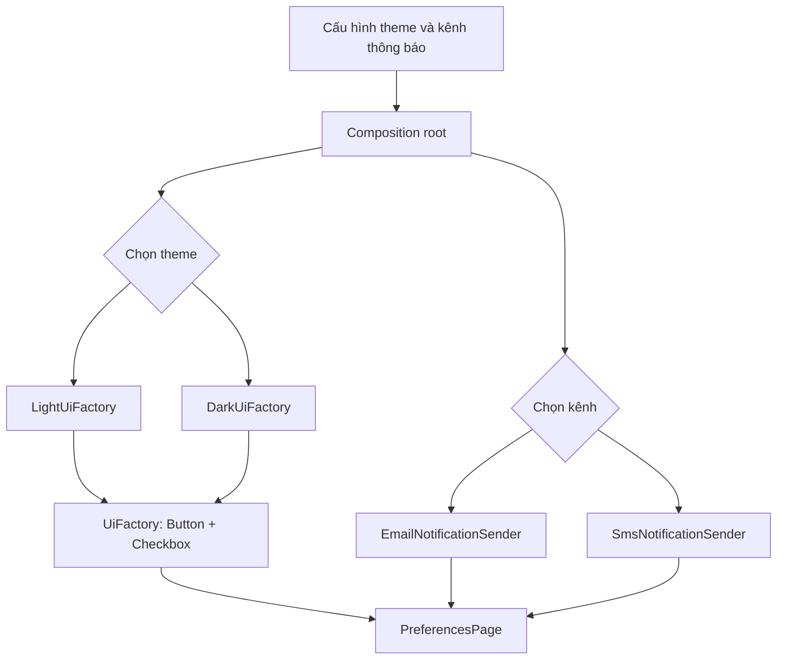

# Giữ ranh giới họ sản phẩm đủ gắn kết để tránh factory ôm nhiều trách nhiệm

**Chương:** Họ sản phẩm  
**Chuyên đề:** `SOFTWARE_DESIGN_DESIGN_PATTERN_CREATIONAL_ABSTRACT_FACTORY` — Học về abstract factory trong design pattern.

## Mục tiêu học tập

Sau bài này, bạn có thể:

- Giải thích vì sao **Abstract Factory** nên đại diện cho một **họ sản phẩm có quan hệ thực sự**, thay vì trở thành nơi tạo mọi đối tượng trong ứng dụng.
- Xác định ranh giới họ dựa vào **các sản phẩm cần thay đổi cùng nhau**, **quy tắc tương thích** và **lý do thay đổi**.
- Phát hiện dấu hiệu một factory đang ôm nhiều trách nhiệm: phương thức tạo thuộc những miền không liên quan, các trục cấu hình độc lập và việc thêm một biến thể gây sửa mã lan rộng.
- Tách một `MegaFactory` thành các factory hoặc dependency thích hợp mà vẫn giữ khả năng thay cả một họ sản phẩm một cách nhất quán.
- Đánh giá chi phí của việc tách quá nhỏ, tạo factory không cần thiết và xử lý các trường hợp thật sự cần phối hợp nhiều họ.

## 1. “Họ sản phẩm” phải là một nhóm có ý nghĩa

Trong mẫu thiết kế **Abstract Factory**, một factory cung cấp các phương thức tạo **nhiều loại sản phẩm liên quan**, còn một concrete factory tạo **những biến thể tương thích** của các loại sản phẩm đó. Một ứng dụng Java có thể có hai loại thành phần giao diện:

- `Button`: nút bấm.
- `Checkbox`: ô chọn.

Các thành phần này tồn tại ở hai họ giao diện:

| Họ | Sản phẩm `Button` | Sản phẩm `Checkbox` | Concrete factory |
| --- | --- | --- | --- |
| Light | `LightButton` | `LightCheckbox` | `LightUiFactory` |
| Dark | `DarkButton` | `DarkCheckbox` | `DarkUiFactory` |

Ở đây, **Light/Dark là chiều biến thiên của cả bộ giao diện**. Khi màn hình chọn họ Dark, cả hai thành phần cần cùng tuân thủ quy ước của Dark. Việc gọi một `UiFactory` đã chọn để tạo cả `Button` và `Checkbox` có ý nghĩa: các sản phẩm cùng phục vụ giao diện và cần được thay thế như **một bộ nhất quán**.

Giả sử ứng dụng còn phải gửi thông báo bằng **email** hoặc **SMS**. Hai kênh này có thể được cấu hình độc lập với Light/Dark. Nếu người dùng đổi từ Light sang Dark, hệ thống không có lý do tự đổi kênh gửi thông báo. Ngược lại, chuyển từ email sang SMS không nhất thiết làm thay đổi màu nút bấm.

Đó là dấu hiệu cho thấy **kênh thông báo không thuộc cùng họ sản phẩm giao diện**. Ta cần phân biệt:

- **Quan hệ thuộc cùng họ:** hai loại sản phẩm có một nhóm quy tắc tương thích hoặc lựa chọn biến thể chung cần được thực hiện đồng bộ.
- **Quan hệ chỉ cùng xuất hiện trong ứng dụng:** hai dependency được một màn hình hoặc use case dùng chung, nhưng có thể thay thế độc lập.

Một factory ôm cả hai nhóm chỉ vì chúng cùng xuất hiện trong một màn hình là **gộp theo nơi sử dụng**, không phải **gộp theo tính gắn kết của họ sản phẩm**.

## 2. Nhìn vào các trục biến thiên độc lập

Để xác định ranh giới, hãy lập bảng các lựa chọn của ứng dụng:

| Trục thay đổi | Lựa chọn | Những sản phẩm thực sự liên quan |
| --- | --- | --- |
| Theme giao diện | `light` / `dark` | `Button`, `Checkbox` |
| Kênh thông báo | `email` / `sms` | `NotificationSender` |

Hai trục trên độc lập. Có bốn cấu hình hợp lệ:

| Cấu hình | Họ giao diện | Kênh thông báo |
| --- | --- | --- |
| A | Light | Email |
| B | Light | SMS |
| C | Dark | Email |
| D | Dark | SMS |

Nếu gom hai trục vào một `ApplicationFactory` cho từng cấu hình, ta có nguy cơ phải duy trì bốn biến thể như `LightEmailFactory`, `LightSmsFactory`, `DarkEmailFactory`, `DarkSmsFactory`. Khi tăng lên **m** theme và **n** kênh, việc mô hình hóa mọi cặp thành một loại factory có thể dẫn đến **m × n tổ hợp**. Đây là hệ quả của cách thiết kế gom các trục vào một họ, **không phải** yêu cầu của Abstract Factory.

Giải pháp tự nhiên hơn là:

1. Chọn **một** `UiFactory` cho theme đã yêu cầu.
2. Chọn **một** `NotificationSender` phù hợp kênh thông báo.
3. Lắp hai dependency vào client tại **composition root**.

Lưu ý: `NotificationSender` chỉ có **một loại sản phẩm** trong ví dụ, nên không nhất thiết phải tạo thêm một Abstract Factory cho nó. Chọn trực tiếp implementation ở composition root hoặc qua một factory method nhỏ có thể đơn giản và rõ hơn.

## 3. Phản ví dụ: `MegaFactory` và những thay đổi lan rộng

Giả sử ứng dụng khai báo một factory tạo đủ loại đối tượng:

```java
// Phản ví dụ: một interface ôm các trục thay đổi độc lập.
interface ApplicationFactory {
    Button createButton();
    Checkbox createCheckbox();
    NotificationSender createNotificationSender();
    OrderRepository createOrderRepository();
    AuditTrail createAuditTrail();
}
```

Thoạt nhìn, mọi client đều có thể gọi `factory.create...()`, nhưng interface này đang gộp:

| Nhóm phương thức | Lý do có thể thay đổi |
| --- | --- |
| `createButton()` và `createCheckbox()` | Thay theme, style, quy ước UI |
| `createNotificationSender()` | Thay kênh thông báo, nhà cung cấp gửi |
| `createOrderRepository()` và `createAuditTrail()` | Thay cơ chế lưu dữ liệu, audit, giao dịch |

Khi có yêu cầu thay SMS provider, một factory vốn chỉ quan tâm UI cũng có thể bị kéo vào thay đổi. Khi thêm một sản phẩm UI, mọi concrete factory của “toàn ứng dụng” có thể phải bổ sung phương thức dù chúng không liên quan đến giao diện. Số lượng tổ hợp và sự phụ thuộc ngày càng khó hiểu.

Đây là một biến thể của vấn đề **thiếu tính gắn kết** và **một thành phần có quá nhiều lý do thay đổi**. Tuy nhiên, cũng không nên nhìn số phương thức rồi kết luận ngay factory là sai. Một factory tạo năm loại thành phần thuộc **cùng bộ giao diện nhất quán** có thể gắn kết tốt hơn factory tạo hai sản phẩm thuộc hai miền hoàn toàn độc lập.

### Dấu hiệu nhận diện ở code review

- Một yêu cầu thay đổi chỉ liên quan đến **kênh email/SMS** nhưng phải sửa hoặc kiểm thử nhiều factory chuyên về theme.
- Tên concrete factory nối nhiều chiều lựa chọn: `DarkEmailFileFactory`.
- Nhiều factory triển khai các phương thức không thuộc trách nhiệm của chúng, trả giá trị mặc định, ném `UnsupportedOperationException` hoặc ủy quyền vòng vèo.
- Client cần `UiFactory` nhưng buộc nhìn thấy `createOrderRepository()` và `createNotificationSender()` trong cùng interface.
- Việc thêm một loại sản phẩm ít liên quan khiến mọi concrete factory của hệ thống phải được chỉnh sửa để biên dịch.

Một vài dấu hiệu này không tự chứng minh thiết kế sai, nhưng là lời nhắc cần **xác định lại ranh giới trách nhiệm**.

## 4. Năm câu hỏi để quyết định có cùng họ hay không

Trước khi thêm một phương thức `createX()` vào Abstract Factory, hãy kiểm tra:

| Câu hỏi | Nếu “có” | Nếu “không” |
| --- | --- | --- |
| **1. Sản phẩm có cần được chọn theo cùng một biến thể?** | Có lý do để tạo chúng từ cùng factory. | Có thể thuộc hai trục cấu hình độc lập. |
| **2. Có quy tắc tương thích giữa chúng?** | Factory có thể bảo đảm lựa chọn bộ thích hợp. | Chỉ cùng là dependency không đủ để gộp. |
| **3. Chúng thường thay đổi hoặc được phát hành cùng nhau?** | Có thể là một đơn vị thay đổi ổn định. | Việc gộp dễ tăng phạm vi ảnh hưởng. |
| **4. Các client có thường cần đúng bộ đó?** | Có thể truyền một factory hoặc bộ sản phẩm đã lắp ráp. | Nên cân nhắc interface/factory nhỏ hơn. |
| **5. Khi thêm một biến thể, mọi loại sản phẩm hiện có đều cần biến thể tương ứng?** | Ma trận Abstract Factory có ý nghĩa. | Có thể đang buộc những sản phẩm không liên quan cùng tiến hóa. |

**Không nên dùng một câu hỏi như tiêu chí máy móc.** Chẳng hạn, một bộ sản phẩm có thể cần được chọn đồng bộ nhưng các nhóm phát triển lại phát hành mã nguồn theo lịch khác nhau. Hãy tìm **ràng buộc tương thích có thể diễn đạt rõ ràng**, rồi đánh giá khả năng duy trì ràng buộc đó theo thời gian.

### Ví dụ về ràng buộc đủ mạnh

Một họ UI có thể quy định: `LightButton` và `LightCheckbox` cùng tuân thủ bộ design tokens Light, còn `DarkButton` và `DarkCheckbox` cùng tuân thủ bộ tokens Dark. Nếu phải chuyển theme cả màn hình, việc tạo tất cả sản phẩm từ `DarkUiFactory` giảm nguy cơ phối trộn.

Ngược lại, `EmailNotificationSender` và `DarkButton` không có một bộ quy tắc chung cần bảo toàn chỉ vì chúng cùng xuất hiện trong trang cài đặt. Đổi theme không đòi hỏi đổi kênh thông báo.

## 5. Cách phân chia trách nhiệm

Sơ đồ sau cho thấy ranh giới sau khi tách:



Điểm quan trọng:

- `UiFactory` quản lý **một nhóm sản phẩm có quan hệ theme**. Concrete factory tạo nút và ô chọn đúng họ.
- `NotificationSender` là một abstraction **độc lập**; kênh email/SMS không nằm trong interface `UiFactory`.
- **Composition root** là nơi duy nhất chọn các implementation và truyền chúng cho `PreferencesPage`. Nó có thể biết nhiều miền, vì trách nhiệm của nó chính là **lắp ráp hệ thống**, khác với trách nhiệm của một factory chuyên tạo một họ sản phẩm.
- Client sử dụng abstraction, không cần biết Light/Dark hay Email/SMS được chọn bằng cách nào.

## 6. Ví dụ Java hoàn chỉnh: giữ một factory gắn kết

Để quan sát tính độc lập giữa hai trục cấu hình, ví dụ dùng:

- `UiFactory`: abstract factory tạo `Button` và `Checkbox` thuộc họ Light/Dark.
- `NotificationSender`: một interface gửi thông báo với hai implementation Email/SMS.
- `PreferencesPage`: client chỉ biết abstraction, hiển thị màn hình và gửi thông báo khi lưu cài đặt.
- `CompositionRoot`: chọn theme và kênh **riêng biệt**, sau đó lắp ráp client.

Mã in chuỗi ra console; Email/SMS là **mô phỏng**, không gửi tin thật. Lưu toàn bộ đoạn sau vào tệp **`CohesiveProductFamiliesDemo.java`** và chạy với Java 8 trở lên:

```java
import java.util.Locale;
import java.util.Objects;

// 1. Hai abstract products cần nhất quán theme.
interface Button {
    String render(String label);
}

interface Checkbox {
    String render(String label, boolean checked);
}

// 2. Abstract Factory chỉ lo họ UI.
interface UiFactory {
    Button createButton();
    Checkbox createCheckbox();
}

// 3. Họ sản phẩm Light.
final class LightButton implements Button {
    @Override
    public String render(String label) {
        return "[Light] Button: " + label;
    }
}

final class LightCheckbox implements Checkbox {
    @Override
    public String render(String label, boolean checked) {
        return "[Light] Checkbox: " + label
                + (checked ? " [x]" : " [ ]");
    }
}

final class LightUiFactory implements UiFactory {
    @Override
    public Button createButton() {
        return new LightButton();
    }

    @Override
    public Checkbox createCheckbox() {
        return new LightCheckbox();
    }
}

// 4. Họ sản phẩm Dark.
final class DarkButton implements Button {
    @Override
    public String render(String label) {
        return "[Dark] Button: " + label;
    }
}

final class DarkCheckbox implements Checkbox {
    @Override
    public String render(String label, boolean checked) {
        return "[Dark] Checkbox: " + label
                + (checked ? " [x]" : " [ ]");
    }
}

final class DarkUiFactory implements UiFactory {
    @Override
    public Button createButton() {
        return new DarkButton();
    }

    @Override
    public Checkbox createCheckbox() {
        return new DarkCheckbox();
    }
}

// 5. Một abstraction độc lập với theme.
interface NotificationSender {
    String send(String recipient, String message);
}

final class EmailNotificationSender implements NotificationSender {
    @Override
    public String send(String recipient, String message) {
        return "EMAIL -> " + recipient + ": " + message;
    }
}

final class SmsNotificationSender implements NotificationSender {
    @Override
    public String send(String recipient, String message) {
        return "SMS -> " + recipient + ": " + message;
    }
}

// 6. Client nhận đúng những dependency nó cần.
final class PreferencesPage {
    private final Button saveButton;
    private final Checkbox alertsCheckbox;
    private final NotificationSender notifier;

    PreferencesPage(UiFactory uiFactory, NotificationSender notifier) {
        Objects.requireNonNull(uiFactory, "uiFactory");
        this.saveButton = Objects.requireNonNull(
                uiFactory.createButton(), "saveButton");
        this.alertsCheckbox = Objects.requireNonNull(
                uiFactory.createCheckbox(), "alertsCheckbox");
        this.notifier = Objects.requireNonNull(notifier, "notifier");
    }

    String render() {
        return alertsCheckbox.render("Nhận thông báo", true)
                + System.lineSeparator()
                + saveButton.render("Lưu");
    }

    String saveSettings(String recipient) {
        // Logic nghiệp vụ/màn hình không cần biết kênh cụ thể.
        return notifier.send(recipient, "Cài đặt đã lưu");
    }
}

// 7. Composition root quyết định hai trục cấu hình độc lập.
final class CompositionRoot {
    private CompositionRoot() { }

    static PreferencesPage build(String theme, String channel) {
        UiFactory uiFactory = selectUiFactory(theme);
        NotificationSender notifier = selectNotifier(channel);
        return new PreferencesPage(uiFactory, notifier);
    }

    private static UiFactory selectUiFactory(String theme) {
        String selected = Objects.requireNonNull(theme, "theme")
                .trim().toLowerCase(Locale.ROOT);

        switch (selected) {
            case "light":
                return new LightUiFactory();
            case "dark":
                return new DarkUiFactory();
            default:
                throw new IllegalArgumentException(
                        "Theme không hỗ trợ: " + theme);
        }
    }

    private static NotificationSender selectNotifier(String channel) {
        String selected = Objects.requireNonNull(channel, "channel")
                .trim().toLowerCase(Locale.ROOT);

        switch (selected) {
            case "email":
                return new EmailNotificationSender();
            case "sms":
                return new SmsNotificationSender();
            default:
                throw new IllegalArgumentException(
                        "Kênh không hỗ trợ: " + channel);
        }
    }
}

// 8. Chương trình chính.
public final class CohesiveProductFamiliesDemo {
    public static void main(String[] args) {
        String theme = args.length > 0 ? args[0] : "light";
        String channel = args.length > 1 ? args[1] : "email";

        PreferencesPage page = CompositionRoot.build(theme, channel);
        System.out.println(page.render());
        System.out.println(page.saveSettings("user@example.test"));
    }
}
```

### Biên dịch và chạy

```bash
javac -encoding UTF-8 CohesiveProductFamiliesDemo.java
java CohesiveProductFamiliesDemo light email
java CohesiveProductFamiliesDemo dark sms
```

Đầu ra với `light email`:

```text
[Light] Checkbox: Nhận thông báo [x]
[Light] Button: Lưu
EMAIL -> user@example.test: Cài đặt đã lưu
```

Đầu ra với `dark sms`:

```text
[Dark] Checkbox: Nhận thông báo [x]
[Dark] Button: Lưu
SMS -> user@example.test: Cài đặt đã lưu
```

Trong bản demo, chuỗi `user@example.test` chỉ là **dữ liệu minh họa**, không phải số điện thoại dùng để gửi SMS thực; implementation `SmsNotificationSender` chỉ trả về chuỗi. Nếu triển khai thật, kênh SMS cần định dạng địa chỉ đích, hợp đồng xử lý lỗi và kiểm tra dữ liệu phù hợp.

Hãy thử `light sms` hoặc `dark email`: các cấu hình này vẫn hợp lệ và chạy độc lập. Khi chuyển `light` sang `dark`, chỉ dòng thể hiện các thành phần giao diện đổi họ; kênh gửi vẫn giữ nguyên nếu đối số `channel` không đổi. Khi chuyển `email` sang `sms`, cách hiển thị UI không đổi.

Chương trình từ chối theme hoặc channel chưa được hỗ trợ bằng `IllegalArgumentException` ở composition root. Điều này tránh âm thầm tạo một bộ UI thiếu nhất quán hoặc gán nhầm kênh thông báo.

### Điều gì thực sự cần thay đổi khi mở rộng?

| Yêu cầu mới | Lớp/nhóm cần bổ sung hoặc sửa | Những phần không phải thay đổi |
| --- | --- | --- |
| Thêm họ `HighContrast` | `HighContrastButton`, `HighContrastCheckbox`, `HighContrastUiFactory`; nhánh chọn theme | `NotificationSender`, các sender, `PreferencesPage` |
| Thêm kênh `push` | `PushNotificationSender`; nhánh chọn kênh | `UiFactory`, tất cả factory Light/Dark, các sản phẩm UI |
| Thêm một loại sản phẩm UI `Dialog` | Interface `Dialog`, `UiFactory.createDialog()`, sản phẩm Dialog tương ứng ở các họ, các client cần Dialog | Các sender thông báo |
| Thay cách xử lý SMS | `SmsNotificationSender` hoặc adapter hạ tầng của nó | `UiFactory` và các sản phẩm của UI |

**Lợi ích của ranh giới rõ:** một thay đổi thường chỉ lan đến **nhóm phụ thuộc vào trục biến thiên liên quan**. Abstract Factory không tự bảo đảm mọi thay đổi nằm trong một file: khi thêm **loại sản phẩm mới vào một họ**, hợp đồng chung và mọi concrete factory thuộc họ đó vẫn phải cập nhật.

## 7. Đánh giá tính gắn kết bằng những thay đổi thực tế

Một cách hữu ích để đánh giá factory hiện tại là thử mô phỏng ba yêu cầu trong tương lai:

**Yêu cầu A: thêm theme HighContrast.** Nếu một `UiFactory` đúng ranh giới, ta phải thêm cặp sản phẩm UI và factory tương ứng. Nếu phải sửa `EmailNotificationSender` hoặc các factory thông báo chỉ để hỗ trợ theme mới, đó là dấu hiệu hai trục đang bị ghép chặt không cần thiết.

**Yêu cầu B: thay SMS provider.** Nếu yêu cầu này buộc sửa `DarkUiFactory`, ranh giới họ sản phẩm có thể bị mở rộng quá mức. Kênh thông báo và kiểu dáng UI không có quan hệ tương thích trong đặc tả hiện tại.

**Yêu cầu C: bổ sung tooltip cho mọi theme.** Nếu tooltip thực sự cần tuân thủ Light/Dark cùng Button/Checkbox, việc thêm `createTooltip()` vào `UiFactory` có thể hợp lý: đây là một **loại sản phẩm cùng họ UI**, không phải một trách nhiệm ngoài miền.

Từ đó có thể đặt câu hỏi khi code review: *“Nếu chỉ có yêu cầu này thay đổi, những phương thức nào trong factory bị ảnh hưởng, và vì sao?”* Nếu nhiều phương thức không có chung lý do thay đổi, chúng có thể thuộc các họ hoặc abstraction khác nhau.

## 8. Tách factory quá nhỏ cũng có vấn đề

Tránh `MegaFactory` **không có nghĩa** mỗi loại sản phẩm phải có một factory riêng. Ví dụ:

```java
// Hai factory độc lập làm client tự phối hợp theme.
interface ButtonFactory {
    Button createButton();
}

interface CheckboxFactory {
    Checkbox createCheckbox();
}
```

Nếu toàn bộ màn hình cần cùng một theme, client hoặc composition root có thể vô tình nhận `DarkButtonFactory` và `LightCheckboxFactory`. Khi đó, quy tắc **chọn cả bộ Light/Dark** bị phân tán hoặc phải được quản lý ở một lớp ghép nối khác.

Trong trường hợp theme là ràng buộc chung, `UiFactory` tạo **cả hai** loại sản phẩm là thiết kế gắn kết hơn. Ranh giới tốt không nhất thiết là **nhỏ nhất**, mà là nhóm các sản phẩm thực sự cần đi cùng nhau.

Ngược lại, một `InfrastructureFactory` tạo `Repository` và `AuditTrail` chỉ hợp lý nếu hai adapter đó cần được chọn/cấu hình như **một bộ hạ tầng**. Nếu chúng vận hành độc lập, chỉ vì cùng liên quan hạ tầng chưa đủ để xem chúng là cùng họ.

## 9. Khi nào cần phối hợp nhiều họ ở cấp ứng dụng?

Có những use case dùng đồng thời một factory UI và một factory hạ tầng. **Composition root** có thể quản lý cả hai lựa chọn mà không phải ép chúng trở thành một họ sản phẩm:

```java
// Sơ đồ ý tưởng, các kiểu OrderRepository/AuditTrail chưa khai báo ở ví dụ.
UiFactory ui = chooseUiFactory(config.theme);
InfrastructureFactory storage = chooseInfrastructureFactory(config.storage);

Button button = ui.createButton();
Checkbox checkbox = ui.createCheckbox();
OrderRepository orders = storage.createOrderRepository();
AuditTrail audit = storage.createAuditTrail();

// Lắp các dependency vào những client cần chúng.
```

Đoạn trên là **mã minh họa kiến trúc** để diễn đạt ranh giới; nó không thuộc file Java hoàn chỉnh của mục 6. Các factory có thể dùng chung một giá trị cấu hình khi yêu cầu nghiệp vụ thực sự đòi hỏi, nhưng điều đó không mặc nhiên biến các sản phẩm của chúng thành một họ duy nhất.

Nếu bắt buộc có các cặp kết hợp được chứng nhận như `Dark + EncryptedStorage`, hãy thể hiện điều kiện này thành **chính sách phối hợp ở nơi lắp ráp hoặc validator**, và chỉ cho phép các tổ hợp hợp lệ. Không nhất thiết phải tạo một factory riêng cho mọi tổ hợp chéo.

### Chú ý về vòng đời và tính tương thích

- Abstract Factory giúp **tập trung lựa chọn họ**, nhưng type system Java không tự bảo đảm concrete factory trả đúng mọi thành viên của họ; cần kiểm tra hợp đồng khi có yêu cầu.
- Nếu tạo UI tại các thời điểm khác nhau trong khi theme đổi, việc có một interface factory không tự bảo đảm mọi thành phần hiện có đồng bộ. Cần chiến lược cập nhật toàn bộ phạm vi giao diện.
- Các factory khác miền có thể chia sẻ resource nếu được thiết kế có chủ đích; khi đó composition root phải xác định vòng đời, thứ tự khởi tạo và cách giải phóng tài nguyên.
- Không nên đưa một tên miền quá rộng như `EverythingFactory` hoặc `ApplicationObjectFactory` vào core chỉ để giảm số constructor; điều đó che mờ dependency thật.

## 10. Cách kiểm tra sau khi tái cấu trúc

Sau khi tách `MegaFactory` thành `UiFactory` và `NotificationSender`, nên xác nhận:

| Kiểm tra | Mục đích |
| --- | --- |
| Tạo màn hình Light có cả `LightButton` và `LightCheckbox` | Factory UI tuân thủ quy tắc cùng họ |
| Tạo màn hình Dark có cả `DarkButton` và `DarkCheckbox` | Concrete factory Dark không phối trộn Light |
| Thay email thành SMS trong cùng theme | Kênh thông báo không kéo theo việc thay UI |
| Thay Light thành Dark với cùng kênh | Theme không kéo theo việc thay kênh |
| Cấu hình theme/channel sai bị từ chối | Composition root không tạo bộ dependency không xác định |
| Test `PreferencesPage` với fake `UiFactory` và fake `NotificationSender` | Client chỉ phụ thuộc abstraction và dễ kiểm thử |

Kiểm tra độc lập hai chiều theme và channel qua các cấu hình `light/email`, `light/sms`, `dark/email` và `dark/sms` giúp phát hiện ràng buộc ngầm. Không cần tạo bốn concrete factory tương ứng với bốn tổ hợp chỉ để chạy các test đó.

Trong dự án lớn, có thể theo dõi sự thay đổi qua nhiều yêu cầu: nếu các phương thức tạo luôn được sửa cùng nhau vì **cùng một quy tắc tương thích**, chúng có lý do nằm chung. Nếu chúng liên tục thay đổi độc lập, nên cân nhắc chia lại. Đây là một **bằng chứng thiết kế**, không phải công thức cứng dựa trên số lần sửa commit.

## 11. Câu hỏi tự kiểm tra

**Câu 1.** Một `UiFactory` tạo `Button`, `Checkbox` và `Dialog` cho hai theme Light/Dark. Có nên tách thành ba factory vì có ba phương thức tạo?

**Gợi ý đáp án:** Không nhất thiết. Nếu các sản phẩm đều phải theo cùng theme và các quy tắc UI, chúng tạo thành một họ gắn kết. Số phương thức không phải tiêu chí quyết định.

**Câu 2.** Một `ApplicationFactory` tạo cả `DarkButton` và `SmsNotificationSender`. Vì sao cách tổ chức này đáng nghi?

**Gợi ý đáp án:** Theme và kênh thông báo là hai trục cấu hình độc lập nếu không có quy tắc ràng buộc. Gộp chúng dễ làm nổ số tổ hợp và tăng lý do thay đổi của factory.

**Câu 3.** Nếu ứng dụng thêm một kênh thông báo Push, `UiFactory` có cần cập nhật không?

**Gợi ý đáp án:** Không, theo thiết kế ở mục 6. Thêm `PushNotificationSender` và cách chọn ở composition root; giữ nguyên hợp đồng và concrete factory UI.

**Câu 4.** Nếu chỉ có một `NotificationSender` với các implementation Email/SMS, có bắt buộc tạo thêm `NotificationAbstractFactory` không?

**Gợi ý đáp án:** Không. Một abstraction hoặc một factory method để chọn implementation có thể là đủ. Chỉ cân nhắc Abstract Factory nếu xuất hiện **một bộ các loại sản phẩm liên quan** cần được tạo/đổi như một họ.

**Câu 5.** Khi nào nhóm `OrderRepository` và `AuditTrail` vào một factory hạ tầng là hợp lý?

**Gợi ý đáp án:** Khi chúng thực sự được chọn/cấu hình cùng nhau và có các điều kiện tương thích chung cần duy trì. Nếu hai adapter được chọn độc lập thì nên để composition root lắp ghép theo nhu cầu.

**Bài thực hành.** Mở rộng ví dụ `CohesiveProductFamiliesDemo`:

1. Thêm `HighContrastButton`, `HighContrastCheckbox` và `HighContrastUiFactory`.
2. Thêm nhánh `high-contrast` vào `selectUiFactory()`.
3. Chạy `high-contrast email` và `high-contrast sms`.
4. Xác nhận chỉ phần UI đổi họ, còn sender được chọn độc lập; `PreferencesPage` không thêm một nhánh theme nào.

## Kết luận

Trong **Abstract Factory**, ranh giới họ sản phẩm tốt được quyết định bằng **tính gắn kết của các sản phẩm cần tương thích và thay thế cùng nhau**. `Button` và `Checkbox` cùng tuân thủ Light/Dark là một họ UI hợp lý; kênh gửi email/SMS là trục thay đổi độc lập nếu không có ràng buộc liên quan. Tránh biến factory thành một nơi tạo đủ thứ vì điều đó làm tăng trách nhiệm, phạm vi ảnh hưởng và số tổ hợp phải duy trì. Đồng thời, đừng tách một họ thật sự gắn kết thành quá nhiều factory nhỏ khiến client phải tự đảm bảo tính nhất quán. Hãy để mỗi factory đại diện cho **một bộ sản phẩm có lý do thay đổi chung**, rồi để composition root phối hợp các bộ đó thành ứng dụng hoàn chỉnh.
