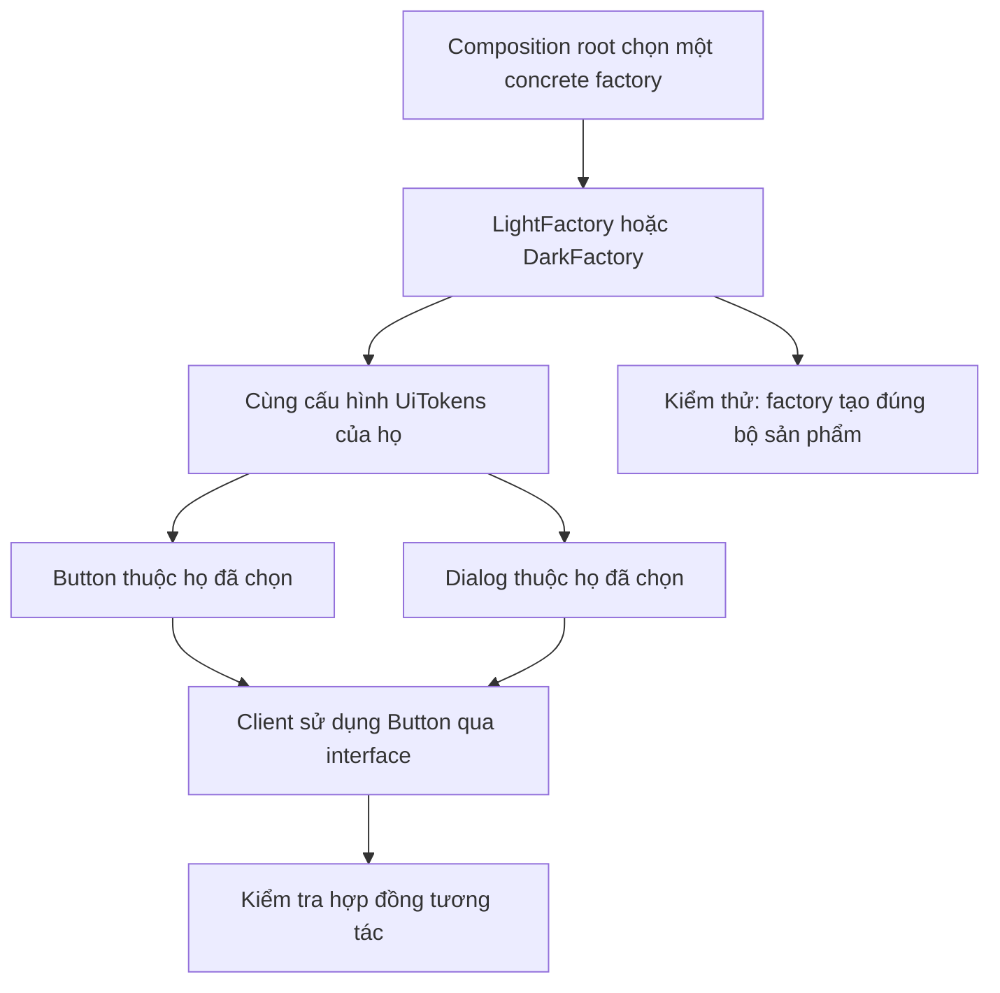

# Mô tả bất biến mà mọi sản phẩm trong cùng một họ phải tuân thủ

Trong module `SOFTWARE_DESIGN_DESIGN_PATTERN_CREATIONAL_ABSTRACT_FACTORY` (*Học về abstract factory trong design pattern*), khái niệm **họ sản phẩm (product family)** là nền tảng của mẫu **Abstract Factory**. Một họ không đơn thuần là tập hợp các lớp có tên giống nhau như `LightButton` và `LightDialog`: các sản phẩm trong họ phải tuân thủ những **quy tắc chung** để có thể được sử dụng cùng nhau một cách nhất quán.

Bài học thuộc chương **Họ sản phẩm**. Ta sẽ xác định **bất biến cấp họ**, phân biệt chúng với hợp đồng của từng loại sản phẩm, diễn đạt các bất biến thành tiêu chí kiểm chứng và dùng một ví dụ Java để minh họa cách concrete factory duy trì chúng khi tạo `Button` và `Dialog`.

## 1. Bất biến của một họ sản phẩm là gì?

**Bất biến (invariant)** là một điều kiện phải luôn đúng trong phạm vi đã xác định. Với Abstract Factory, ta quan tâm đến các điều kiện cần đúng đối với **bộ sản phẩm được tạo bởi một concrete factory**.

Giả sử một ứng dụng hỗ trợ giao diện **Light** và **Dark**, mỗi giao diện gồm hai loại sản phẩm:

| Loại sản phẩm | Họ Light | Họ Dark |
| --- | --- | --- |
| `Button` | `LightButton` | `DarkButton` |
| `Dialog` | `LightDialog` | `DarkDialog` |
| Factory của họ | `LightFactory` | `DarkFactory` |

Với một concrete factory `F`, đặt:

- `b = F.createButton()` là nút bấm do factory tạo ra;
- `d = F.createDialog()` là hộp thoại do cùng factory tạo ra;
- `family(x)` là thông tin họ mà một đối tượng thuộc về.

Bất biến quan trọng đầu tiên có thể diễn đạt:

```text
family(b) = family(d) = family(F)
```

Nói cách khác, **mọi loại sản phẩm liên quan phải thuộc cùng họ đã chọn**. Nếu dùng `LightFactory` mà nhận được `LightButton` và `DarkDialog`, bất biến bị vi phạm mặc dù cả hai đối tượng đều có thể triển khai đúng interface.

Một họ thường còn có những **bất biến về thiết kế và hành vi**, chẳng hạn cùng bộ màu, cùng quy ước tương tác và cùng chính sách xử lý khả năng truy cập. Các bất biến cụ thể phải xuất phát từ **yêu cầu hệ thống**. Bản thân Abstract Factory **không tự quy định** màu nào là hợp lệ hoặc cách một hộp thoại phải hiển thị.

> Cần phân biệt: **“thuộc cùng họ”** không có nghĩa mọi sản phẩm phải **giống hệt nhau**. Button và Dialog có chức năng và kích thước khác nhau; điều bắt buộc là những thuộc tính cần phối hợp giữa chúng phải **tương thích theo hợp đồng của họ**.

## 2. Những bất biến thường cần xác định

Đối với một bộ giao diện, nhóm phát triển có thể mô tả bất biến theo bảng sau:

| Nhóm bất biến | Ví dụ yêu cầu trong cùng họ | Cách kiểm chứng |
| --- | --- | --- |
| **Danh tính họ** | Factory Light không tạo sản phẩm Dark | Kiểm tra từng phương thức tạo sản phẩm |
| **Theme và design tokens** | Button và Dialog cùng sử dụng phiên bản bảng màu/kiểu chữ của theme đã chọn | So sánh cấu hình style; kiểm thử giao diện |
| **Quy tắc tương tác** | Cùng quy ước focus, disabled, thao tác bàn phím và phản hồi trạng thái | Kiểm thử hành vi và tích hợp |
| **Khả năng cộng tác** | Button có thể yêu cầu Dialog thực hiện thao tác thông qua interface chung | Kiểm thử hợp đồng và luồng tương tác |
| **Tài nguyên phụ thuộc** | Các thành phần dùng bộ icon, định dạng hoặc adapter tương thích | Kiểm tra cấu hình/tài nguyên mà factory cung cấp |
| **Khả năng truy cập** | Thành phần đáp ứng các yêu cầu truy cập đã đặt ra cho cùng bộ giao diện | Kiểm tra tương phản, nhãn, focus, bàn phím bằng công cụ phù hợp |
| **Vòng đời và môi trường** | Widget được tạo trong context/toolkit phù hợp, không dùng tài nguyên đã đóng | Kiểm thử tích hợp và quản lý vòng đời |

Không phải dự án nào cũng cần áp dụng đầy đủ mọi dòng. Chẳng hạn, một họ parser/serializer có thể cần bất biến về **định dạng dữ liệu và phiên bản giao thức** thay vì màu sắc. Nguyên tắc chung là tìm ra những đặc điểm **nếu không thống nhất sẽ khiến các sản phẩm trong cùng bộ không thể làm việc đúng với nhau**.

### Ba lớp hợp đồng nên tách rõ

1. **Hợp đồng loại sản phẩm:** `Button` có khả năng hiển thị/xử lý nút; `Dialog` có khả năng hiển thị hộp thoại. Hợp đồng này áp dụng cho **mọi họ**.
2. **Hợp đồng cấp họ:** các sản phẩm cùng factory dùng đúng **bối cảnh và chính sách của họ**; ví dụ cả Button và Dialog đều thuộc theme Dark.
3. **Hợp đồng nghiệp vụ của client:** màn hình có thể thực hiện công việc, ví dụ “Lưu cài đặt và hiển thị xác nhận”, thông qua các interface mà không kiểm tra tên lớp cụ thể.

Nếu chỉ kiểm tra lớp có `implements Button` hoặc `implements Dialog`, ta mới kiểm tra được **một phần của hợp đồng loại sản phẩm**. Điều đó chưa chứng minh được bất biến cấp họ.

## 3. Nơi định nghĩa và duy trì bất biến



Trong thiết kế này:

- **Abstract product** quy định những thao tác chung mà client có thể gọi.
- **Abstract factory** quy định những **loại** sản phẩm nào phải được tạo.
- **Concrete product** thực thi hành vi và quy ước của họ.
- **Concrete factory** giữ vai trò tập trung việc tạo bộ sản phẩm phù hợp, có thể cấp **chung một cấu hình bất biến** cho các sản phẩm.
- **Client** yêu cầu toàn bộ đối tượng liên quan thông qua cùng một factory, tránh tự trộn sản phẩm từ hai họ.
- **Kiểm thử** xác nhận cả việc tuân thủ hợp đồng kiểu và những yêu cầu mà trình biên dịch không thể biết.

Việc dùng một đối tượng cấu hình chung là **một kỹ thuật hiện thực**, không phải điều kiện bắt buộc của mẫu Abstract Factory. Dự án khác có thể sử dụng các giá trị cấu hình tương đương thay vì chia sẻ đúng một tham chiếu.

## 4. Ví dụ Java: Light và Dark dùng chung cấu hình của từng họ

Ta định nghĩa `UiTokens` lưu thông tin theme, màu nền, màu chữ và màu nhấn. Mỗi concrete factory giữ **một đối tượng `UiTokens` bất biến** và cấp cùng đối tượng đó cho cả Button lẫn Dialog của mình.

Vì vậy, ví dụ lựa chọn một bất biến **có thể kiểm chứng tự động**:

```text
button.tokens().theme == factory.family()
dialog.tokens().theme == factory.family()
button.tokens() == dialog.tokens()   // Cùng tham chiếu trong ví dụ này
```

Hàng thứ ba là **quy ước riêng của cách cài đặt đang học**. Trong hệ thống khác, hai đối tượng token riêng nhưng có giá trị tương đương cũng có thể hợp lệ. Việc cùng tham chiếu còn an toàn ở đây vì `UiTokens` không có phương thức thay đổi trạng thái.

Lưu toàn bộ đoạn mã sau thành `ProductFamilyInvariantsDemo.java`:

```java
import java.util.Locale;
import java.util.Objects;

public class ProductFamilyInvariantsDemo {

    enum Theme {
        LIGHT, DARK
    }

    // Cấu hình style bất biến, được chia sẻ trong từng factory.
    static final class UiTokens {
        final Theme theme;
        final String background;
        final String foreground;
        final String accent;

        UiTokens(Theme theme, String background,
                 String foreground, String accent) {
            this.theme = Objects.requireNonNull(theme, "theme");
            this.background =
                    Objects.requireNonNull(background, "background");
            this.foreground =
                    Objects.requireNonNull(foreground, "foreground");
            this.accent = Objects.requireNonNull(accent, "accent");
        }
    }

    // Các abstract product công bố hành vi và style dùng chung.
    interface StyledProduct {
        UiTokens tokens();
    }

    interface Button extends StyledProduct {
        String render(String label);
    }

    interface Dialog extends StyledProduct {
        String render(String question);
    }

    interface UiFactory {
        Theme family();
        Button createButton();
        Dialog createDialog();
    }

    // Lớp hỗ trợ tái sử dụng cấu hình trong concrete product.
    static abstract class TokenizedProduct implements StyledProduct {
        private final UiTokens tokens;

        TokenizedProduct(UiTokens tokens) {
            this.tokens = Objects.requireNonNull(tokens, "tokens");
        }

        @Override
        public final UiTokens tokens() {
            return tokens;
        }
    }

    // Concrete product của họ Light.
    static final class LightButton
            extends TokenizedProduct implements Button {
        LightButton(UiTokens tokens) {
            super(tokens);
        }

        @Override
        public String render(String label) {
            return "[Light] Button (accent="
                    + tokens().accent + "): " + label;
        }
    }

    static final class LightDialog
            extends TokenizedProduct implements Dialog {
        LightDialog(UiTokens tokens) {
            super(tokens);
        }

        @Override
        public String render(String question) {
            return "[Light] Dialog (fg=" + tokens().foreground
                    + ", bg=" + tokens().background + "): " + question;
        }
    }

    // Concrete product của họ Dark.
    static final class DarkButton
            extends TokenizedProduct implements Button {
        DarkButton(UiTokens tokens) {
            super(tokens);
        }

        @Override
        public String render(String label) {
            return "[Dark] Button (accent="
                    + tokens().accent + "): " + label;
        }
    }

    static final class DarkDialog
            extends TokenizedProduct implements Dialog {
        DarkDialog(UiTokens tokens) {
            super(tokens);
        }

        @Override
        public String render(String question) {
            return "[Dark] Dialog (fg=" + tokens().foreground
                    + ", bg=" + tokens().background + "): " + question;
        }
    }

    // Hai concrete factory tạo trọn bộ sản phẩm đúng theme.
    static final class LightFactory implements UiFactory {
        private final UiTokens tokens =
                new UiTokens(Theme.LIGHT, "#FFFFFF", "#111111", "#0055AA");

        @Override
        public Theme family() {
            return Theme.LIGHT;
        }

        @Override
        public Button createButton() {
            return new LightButton(tokens);
        }

        @Override
        public Dialog createDialog() {
            return new LightDialog(tokens);
        }
    }

    static final class DarkFactory implements UiFactory {
        private final UiTokens tokens =
                new UiTokens(Theme.DARK, "#161616", "#F5F5F5", "#84B6FF");

        @Override
        public Theme family() {
            return Theme.DARK;
        }

        @Override
        public Button createButton() {
            return new DarkButton(tokens);
        }

        @Override
        public Dialog createDialog() {
            return new DarkDialog(tokens);
        }
    }

    // Client chỉ biết các interface, không biết tên lớp Light/Dark.
    static final class SettingsScreen {
        private final UiFactory factory;

        SettingsScreen(UiFactory factory) {
            this.factory = Objects.requireNonNull(factory, "factory");
        }

        String render() {
            Button save = factory.createButton();
            Dialog confirm = factory.createDialog();
            return save.render("Lưu cài đặt") + "\n"
                    + confirm.render("Xác nhận lưu?");
        }
    }

    // Kiểm tra các bất biến cụ thể của ví dụ.
    static void verifyFamilyInvariant(UiFactory factory) {
        Button button = Objects.requireNonNull(
                factory.createButton(), "button");
        Dialog dialog = Objects.requireNonNull(
                factory.createDialog(), "dialog");

        if (button.tokens().theme != factory.family()
                || dialog.tokens().theme != factory.family()) {
            throw new AssertionError("Sản phẩm sai theme của factory");
        }

        if (button.tokens() != dialog.tokens()) {
            throw new AssertionError(
                    "Hai sản phẩm không cùng bộ UiTokens");
        }

        if (button.render("Lưu").isEmpty()
                || dialog.render("Xác nhận").isEmpty()) {
            throw new AssertionError("Hành vi sản phẩm không hợp lệ");
        }
    }

    // Kiểm tra thêm ánh xạ concrete product tại ranh giới factory.
    static void verifyConcreteFamilies() {
        UiFactory light = new LightFactory();
        UiFactory dark = new DarkFactory();

        verifyFamilyInvariant(light);
        verifyFamilyInvariant(dark);

        if (!(light.createButton() instanceof LightButton)
                || !(light.createDialog() instanceof LightDialog)) {
            throw new AssertionError("LightFactory trộn họ sản phẩm");
        }
        if (!(dark.createButton() instanceof DarkButton)
                || !(dark.createDialog() instanceof DarkDialog)) {
            throw new AssertionError("DarkFactory trộn họ sản phẩm");
        }
    }

    static UiFactory selectFactory(String theme) {
        String key = Objects.requireNonNull(theme, "theme")
                .trim().toLowerCase(Locale.ROOT);
        switch (key) {
            case "light":
                return new LightFactory();
            case "dark":
                return new DarkFactory();
            default:
                throw new IllegalArgumentException(
                        "Theme không hỗ trợ: " + theme);
        }
    }

    public static void main(String[] args) {
        verifyConcreteFamilies();
        System.out.println("PASS: Light và Dark giữ các bất biến đã định nghĩa");

        String theme = args.length == 0 ? "light" : args[0];
        UiFactory factory = selectFactory(theme);
        System.out.println(new SettingsScreen(factory).render());
    }
}
```

Biên dịch và chạy:

```bash
javac -encoding UTF-8 ProductFamilyInvariantsDemo.java
java ProductFamilyInvariantsDemo light
java ProductFamilyInvariantsDemo dark
```

Đầu ra dự kiến với `light`:

```text
PASS: Light và Dark giữ các bất biến đã định nghĩa
[Light] Button (accent=#0055AA): Lưu cài đặt
[Light] Dialog (fg=#111111, bg=#FFFFFF): Xác nhận lưu?
```

Đầu ra dự kiến với `dark`:

```text
PASS: Light và Dark giữ các bất biến đã định nghĩa
[Dark] Button (accent=#84B6FF): Lưu cài đặt
[Dark] Dialog (fg=#F5F5F5, bg=#161616): Xác nhận lưu?
```

Ở cả hai lần chạy, **cùng mã `SettingsScreen`** nhận một concrete factory thông qua interface. Factory đó đưa **cùng `UiTokens`** cho mọi sản phẩm thuộc bộ do nó tạo. Các concrete product vẫn có các chức năng riêng: `Button` hiển thị nhãn thao tác, còn `Dialog` hiển thị câu hỏi xác nhận.

Ví dụ dùng màu chỉ để minh họa việc **chia sẻ bộ cấu hình của một họ**. Không thể khẳng định một giao diện đáp ứng tiêu chuẩn accessibility chỉ từ những chuỗi mã màu này; ứng dụng thực cần kiểm tra độ tương phản, trạng thái focus, trạng thái lỗi và các yêu cầu tương ứng.

## 5. Vì sao interface không tự bảo đảm bất biến cấp họ?

Giả sử viết nhầm:

```java
// Phản ví dụ: giả định đặt trong LightFactory.
@Override
public Dialog createDialog() {
    return new DarkDialog(
            new UiTokens(Theme.DARK, "#161616", "#F5F5F5", "#84B6FF"));
}
```

Đoạn này vẫn **phù hợp về kiểu** vì `DarkDialog implements Dialog`. Trình biên dịch Java không biết rằng `LightFactory` chỉ được phép tạo thành phần Light. Tuy nhiên, `verifyFamilyInvariant()` sẽ phát hiện token của dialog thuộc họ Dark và không dùng cùng bộ token với button; `verifyConcreteFamilies()` còn phát hiện loại concrete product bị trộn.

Điều này minh họa ba mức độ khác nhau:

| Mức độ | Ai bảo đảm chính? | Giới hạn |
| --- | --- | --- |
| **Tương thích chữ ký phương thức** | Hệ thống kiểu và trình biên dịch Java | Không kiểm tra ý nghĩa của “cùng họ” |
| **Đúng bộ sản phẩm** | Hiện thực concrete factory, cùng các kiểm thử hợp đồng cấp họ | Vẫn có thể bị sai logic hoặc cấu hình |
| **Nhất quán hành vi/thiết kế thực tế** | Định nghĩa yêu cầu, kiểm thử tích hợp/visual/accessibility | Không suy ra được từ tên class hoặc mã màu |

Hơn nữa, việc hai sản phẩm cùng báo `theme = LIGHT` cũng chưa đủ để chứng minh các thuộc tính khác tương thích. Nếu một Button dùng phiên bản token cũ còn Dialog dùng bộ mới, hoặc một widget không tôn trọng hành vi disabled, **bất biến thực tế** vẫn có thể bị phá vỡ. Những quy tắc cần được viết thành tiêu chí rõ ràng và kiểm tra riêng.

## 6. Bất biến phải phản ánh nhu cầu phối hợp, không phải sự đồng nhất tuyệt đối

Một lỗi thiết kế thường gặp là yêu cầu mọi thuộc tính của Button và Dialog phải bằng nhau. Trong khi đó:

- Button và Dialog có **vai trò khác nhau**: một thành phần khởi phát thao tác, thành phần kia trình bày xác nhận.
- Font size, padding hoặc độ rộng có thể khác nhau theo **quy tắc thiết kế của từng loại sản phẩm**.
- Trạng thái focus/disabled có thể có biểu hiện khác nhau nhưng vẫn cần tuân thủ **một hệ thống tương tác chung**.
- Cùng một bộ theme không có nghĩa hai đối tượng phải là **cùng một instance**; chúng thường là những đối tượng khác nhau.

Do đó, nên viết một yêu cầu như:

> “Mọi Button và Dialog do `DarkFactory` tạo đều sử dụng các token thuộc theme Dark; trạng thái focus của từng thành phần phải có chỉ báo rõ theo quy ước của bộ giao diện.”

Thay vì:

> “Mọi thành phần Dark phải có đúng cùng một màu nền, font size và padding.”

Yêu cầu đầu tiên mô tả **tính tương thích của họ**, còn yêu cầu thứ hai có thể áp đặt sự giống nhau không phù hợp giữa các loại sản phẩm.

### Không lạm dụng một đối tượng cấu hình dùng chung

Ví dụ Java chọn chia sẻ `UiTokens` vì nó là đối tượng **bất biến**. Nếu một factory chia sẻ đối tượng cấu hình **có thể thay đổi**, một sản phẩm có thể vô ý chỉnh màu hoặc trạng thái chung làm ảnh hưởng sản phẩm khác. Khi cần hỗ trợ đổi theme lúc runtime, hãy thiết kế rõ cách cập nhật, tạo lại hoặc theo dõi sự thay đổi của các widget.

Việc chia sẻ **giá trị cấu hình** không đồng nghĩa phải chia sẻ **trạng thái tương tác**: một checkbox đang được chọn hay một dialog đang mở thường có vòng đời riêng. Bất biến cần bao quát tính tương thích mà không gom mọi trạng thái vào factory.

## 7. Xác định bất biến cho một họ sản phẩm khác GUI

Abstract Factory không giới hạn ở widget. Giả sử một hệ thống cần tạo một bộ `Parser` và `Serializer` cho hai phiên bản định dạng dữ liệu V1 và V2:

| Loại sản phẩm | Họ V1 | Họ V2 |
| --- | --- | --- |
| Parser | `V1Parser` | `V2Parser` |
| Serializer | `V1Serializer` | `V2Serializer` |
| Factory | `V1CodecFactory` | `V2CodecFactory` |

Những bất biến có thể bao gồm:

1. **Cùng phiên bản định dạng:** `V1CodecFactory` tạo parser và serializer đều tương thích V1.
2. **Cùng quy ước dữ liệu:** encoding, naming, xử lý giá trị null hoặc định dạng ngày tháng thống nhất theo hợp đồng đã công bố.
3. **Cộng tác được:** dữ liệu hợp lệ do serializer của họ đó tạo ra có thể được parser cùng họ đọc lại theo quy tắc hệ thống.
4. **Xử lý lỗi phù hợp:** các sản phẩm thể hiện lỗi theo những quy ước mà client hiểu được.

Một kiểm tra bất biến cấp họ có thể viết ở mức ý tưởng:

```text
factory = V2CodecFactory
parser = factory.createParser()
serializer = factory.createSerializer()
data = serializer.serialize(sample)
assert parser.parse(data) == sample
```

Kết quả so sánh cần theo **quy tắc tương đương dữ liệu** của ứng dụng (ví dụ bỏ qua thứ tự trường khi thứ tự không có ý nghĩa). Đây là minh họa về **hợp đồng ngữ nghĩa giữa các sản phẩm**, không phải cam kết mọi parser và serializer đều bảo đảm round-trip tuyệt đối cho mọi dữ liệu.

Ví dụ này cho thấy bất biến cấp họ có thể là **tính tương thích giao thức**, khác hoàn toàn với sự nhất quán màu sắc của các widget.

## 8. Kiểm thử bất biến theo các lớp trách nhiệm

Một chiến lược kiểm tra thực tế nên tách ba nhóm:

### 8.1. Kiểm thử từng loại sản phẩm

Kiểm tra rằng mỗi `Button` hoặc `Dialog` thực hiện đúng phương thức công khai của nó. Trong ví dụ, `render()` phải trả kết quả phù hợp với dữ liệu đầu vào. Với GUI thực, cần kiểm tra các tương tác và trạng thái quan trọng của từng widget.

### 8.2. Kiểm thử concrete factory và bộ sản phẩm

Với **mỗi factory**, gọi **mọi phương thức tạo sản phẩm**, xác nhận chúng trả về đối tượng hợp lệ, thuộc cùng họ và dùng đúng cấu hình/phiên bản. Hàm `verifyFamilyInvariant()` và `verifyConcreteFamilies()` trong ví dụ thuộc nhóm này.

Khi thêm loại sản phẩm thứ ba, ví dụ `Checkbox`, cần bổ sung kiểm tra cho `createCheckbox()` ở cả LightFactory lẫn DarkFactory. Để tự động hóa trong dự án lớn, có thể tạo **bộ kiểm thử hợp đồng dùng chung** nhận một factory và chạy cùng tiêu chí cho mọi họ.

### 8.3. Kiểm thử luồng client và tích hợp

Truyền lần lượt các factory vào **cùng một client**, xác nhận luồng nghiệp vụ không cần phụ thuộc tên lớp Light/Dark và các sản phẩm cộng tác đúng. Khi liên quan UI, kiểm thử bằng mắt hoặc công cụ automation còn cần xác nhận tương phản, focus, phím tắt và cách hiển thị thật.

Không nên đưa các nhánh `instanceof LightButton` hoặc `instanceof DarkDialog` vào **mã nghiệp vụ** để xử lý khác nhau theo họ. Chúng có thể xuất hiện hợp lý **trong kiểm thử factory**, nhưng client nên làm việc qua `Button`, `Dialog` và `UiFactory`.

## 9. Những lỗi thường gặp khi thiết kế bất biến

| Lỗi | Hậu quả | Cách phòng tránh |
| --- | --- | --- |
| Chỉ kiểm tra `implements` interface | Không phát hiện factory tạo sản phẩm sai họ | Kiểm tra toàn bộ bộ sản phẩm do factory tạo |
| Factory tự trộn Light và Dark | Giao diện thiếu nhất quán dù vẫn biên dịch | Tập trung cấu hình của một họ và kiểm thử mapping |
| Bất biến quá mơ hồ (“phải đồng bộ”) | Không có tiêu chí chấp nhận hoặc kiểm thử rõ | Diễn đạt thuộc tính, quan hệ và phạm vi cụ thể |
| Bất biến quá cứng (mọi padding phải bằng nhau) | Ngăn các loại sản phẩm phát huy vai trò riêng | Phân biệt giống hệt với tương thích theo quy ước |
| Chia sẻ cấu hình mutable giữa mọi sản phẩm | Thay đổi không dự kiến, khó dự đoán trạng thái | Dùng cấu hình bất biến hoặc vòng đời cập nhật rõ |
| Kiểm tra chỉ một phương thức của factory | Bỏ sót sản phẩm khác cùng họ | Duyệt hết các loại sản phẩm mà factory công bố |
| Coi tên `HighContrast` là bằng chứng accessibility | Giao diện có thể không đạt yêu cầu thực tế | Định nghĩa/đo tiêu chí truy cập và kiểm thử UI thật |

Khi mở rộng một họ mới, hãy viết tiêu chí bất biến **trước** khi chỉ chú ý tới việc tạo lớp. Ví dụ, thêm `HighContrastFactory` không chỉ là tạo `HighContrastButton` và `HighContrastDialog`; cần xác định những yêu cầu về tương phản, focus và tương tác mà các sản phẩm mới phải cùng tuân thủ.

## 10. Bài tập thực hành

**Bài tập 1 — Cố tình phá vỡ họ.** Đổi `LightFactory.createDialog()` để trả về `DarkDialog` với token Dark. Dự đoán kết quả biên dịch và kết quả chạy `verifyConcreteFamilies()`. Giải thích tại sao interface `Dialog` không phát hiện lỗi ở thời điểm biên dịch.

**Bài tập 2 — Thêm loại sản phẩm.** Định nghĩa `Checkbox extends StyledProduct` và thêm `createCheckbox()` vào `UiFactory`. Cài đặt `LightCheckbox` và `DarkCheckbox`, cấp cho chúng cấu hình của factory. Mở rộng kiểm thử để khẳng định cả ba loại sản phẩm thuộc cùng một họ.

**Bài tập 3 — Thêm họ High Contrast.** Viết `HighContrastFactory` với các sản phẩm tương ứng. Đặt ra ít nhất ba bất biến có thể quan sát hoặc đo lường. Phân biệt những điều có thể kiểm tra bằng unit test và những điều cần kiểm thử giao diện thực.

**Bài tập 4 — Áp dụng ngoài GUI.** Thiết kế cặp `Parser`/`Serializer` cho V1 và V2. Viết hợp đồng về phiên bản và một kịch bản round-trip. Chỉ ra các trường hợp cần chuẩn hóa hoặc so sánh theo ngữ nghĩa thay vì so sánh byte đầu ra.

**Câu hỏi tự đánh giá:** Vì sao mọi sản phẩm trong cùng họ **không nhất thiết có cùng mọi thuộc tính**? Bất biến nào được kiểm tra bởi kiểu Java, bất biến nào do factory và các phép thử phải bảo đảm? Khi thêm họ mới, làm sao xác nhận cả sản phẩm mới lẫn client cũ vẫn tuân thủ các quy tắc tương thích?

## Kết luận

Một **họ sản phẩm** trong Abstract Factory cần được mô tả bằng các **bất biến có ý nghĩa và có thể kiểm chứng**: các sản phẩm được tạo thuộc đúng họ, dùng các quy tắc chung thích hợp và cộng tác được theo hợp đồng đã đặt ra. Abstract Factory tập trung quyền tạo bộ sản phẩm, còn độ đúng của các bất biến phụ thuộc vào **hiện thực concrete factory, concrete product và kiểm thử**. Khi thiết kế rõ những bất biến này, việc mở rộng thêm một họ mới trở nên an toàn và dễ đánh giá hơn là chỉ dựa vào tên lớp hoặc sự tương thích về kiểu dữ liệu.
