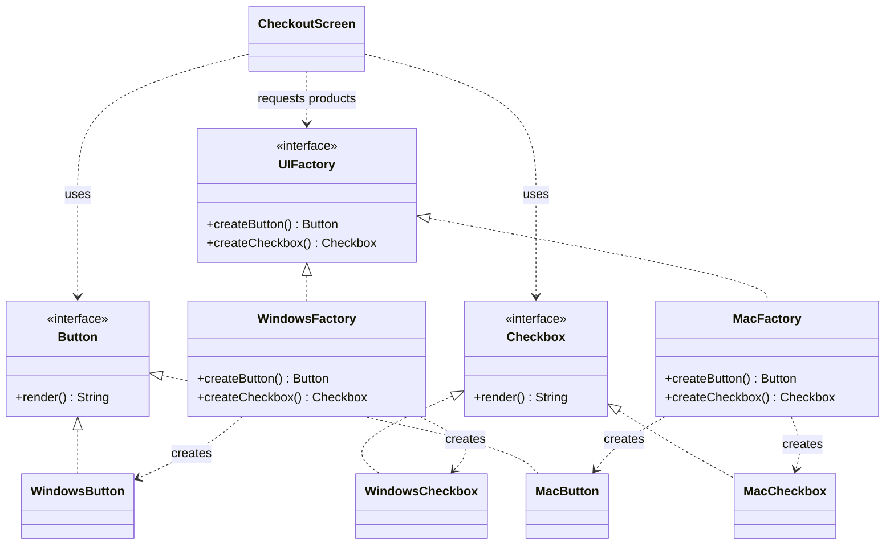

# Vai trò của AbstractFactory trong việc công bố các phương thức tạo sản phẩm

## 1. Đặt vấn đề: client cần biết *có thể tạo gì*, không cần biết *tạo bằng lớp nào*

Trong **Abstract Factory**, ứng dụng thường cần tạo **một nhóm sản phẩm có liên quan** nhưng có nhiều biến thể triển khai. Ví dụ, một ứng dụng giao diện có thể cần cả `Button` và `Checkbox` theo phong cách Windows hoặc macOS. Từng kiểu nút bấm và ô chọn có cách xây dựng khác nhau, còn màn hình sử dụng chúng chỉ cần biết chúng hỗ trợ những hành vi nào.

| Vai trò sản phẩm (product role) | Họ Windows | Họ macOS |
| --- | --- | --- |
| `Button` | `WindowsButton` | `MacButton` |
| `Checkbox` | `WindowsCheckbox` | `MacCheckbox` |

Nếu mã của màn hình tự gọi `new WindowsButton()`, `new MacCheckbox()` hoặc tự viết điều kiện chọn từng lớp, màn hình sẽ phải biết chi tiết từng nền tảng. Mỗi lần thay đổi biến thể, các nơi khởi tạo sản phẩm đều có nguy cơ phải sửa. Đặc biệt, hai sản phẩm trong cùng một màn hình có thể vô tình đến từ **hai họ không tương thích**.

**Vai trò cốt lõi của `AbstractFactory` là công bố một tập phương thức tạo sản phẩm dưới dạng hợp đồng thống nhất.** Client biết các *loại sản phẩm trừu tượng* có thể yêu cầu và cách gọi chúng; việc lựa chọn lớp cụ thể và xây dựng sản phẩm thuộc trách nhiệm của factory cụ thể.

## 2. AbstractFactory công bố điều gì?

Một `AbstractFactory` thường là interface hoặc abstract class khai báo **một phương thức tạo cho mỗi vai trò sản phẩm** cần được hỗ trợ:

```java
interface Button {
    String render();
}

interface Checkbox {
    String render();
}

interface UIFactory {
    Button createButton();
    Checkbox createCheckbox();
}
```

Trong hợp đồng trên:

- `createButton()` công bố khả năng cung cấp một sản phẩm thuộc vai trò `Button`.
- `createCheckbox()` công bố khả năng cung cấp một sản phẩm thuộc vai trò `Checkbox`.
- Kiểu trả về là **interface sản phẩm trừu tượng**. Client không cần biết đối tượng thực tế là `WindowsButton` hay `MacButton`.
- `UIFactory` chỉ xác định *các thao tác tạo mà mọi họ phải cung cấp*. Nó không quyết định trực tiếp constructor hoặc lớp triển khai nào được sử dụng.

Có thể hiểu hợp đồng này như một **danh mục năng lực tạo sản phẩm**: các factory triển khai cùng một danh mục, nhưng mỗi factory cung cấp một họ sản phẩm cụ thể.

Điểm cần phân biệt: `Button` và `Checkbox` mô tả **hành vi của sản phẩm sau khi được tạo**; `UIFactory` mô tả **cách client yêu cầu các sản phẩm ấy**. Chúng là các loại trừu tượng với trách nhiệm khác nhau.

### Vì sao thường có nhiều phương thức tạo?

Một họ sản phẩm có thể bao gồm nhiều vai trò phải vận hành nhất quán với nhau. Nếu chỉ công bố `createButton()`, client vẫn phải tự quyết định cách tạo `Checkbox`; trách nhiệm khởi tạo của họ sản phẩm chưa được gom vào một điểm. Khi `UIFactory` công bố cả hai phương thức, client có thể lấy các sản phẩm cần thiết từ **cùng một factory**.

Số lượng phương thức phụ thuộc vào số vai trò sản phẩm mà nghiệp vụ thực sự cần, không phụ thuộc vào số họ: với hai vai trò (`Button`, `Checkbox`) và ba họ (Windows, macOS, Linux), hợp đồng thường vẫn có **hai phương thức tạo**; ba concrete factory lần lượt triển khai chúng.

## 3. Vị trí trong cấu trúc và sự cộng tác

Các thành phần tham gia:

| Thành phần | Trách nhiệm |
| --- | --- |
| **AbstractFactory** (`UIFactory`) | Công bố các phương thức `createButton()`, `createCheckbox()`; quy định kiểu trả về trừu tượng. |
| **ConcreteFactory** (`WindowsFactory`, `MacFactory`) | Hiện thực từng phương thức, lựa chọn và khởi tạo các sản phẩm thuộc cùng một họ. |
| **AbstractProduct** (`Button`, `Checkbox`) | Công bố các thao tác mà client có thể thực hiện trên sản phẩm được trả về. |
| **ConcreteProduct** (`WindowsButton`, `MacCheckbox`...) | Cung cấp hành vi thực tế của sản phẩm theo từng họ. |
| **Client** (`CheckoutScreen`) | Giữ tham chiếu đến `UIFactory`, gọi các phương thức tạo và làm việc với `Button`, `Checkbox` thông qua interface. |



Mũi tên từ client đến `UIFactory` thể hiện **phụ thuộc vào hợp đồng**. Mũi tên `creates` thể hiện **trách nhiệm khởi tạo của concrete factory**. Client không cần phụ thuộc trực tiếp vào `WindowsButton`, `MacCheckbox` hoặc constructor của chúng.

Một trình tự cộng tác điển hình:

1. Mã cấu hình/khởi động chọn một concrete factory, chẳng hạn `WindowsFactory`, rồi cung cấp đối tượng đó cho `CheckoutScreen` dưới kiểu `UIFactory`.
2. `CheckoutScreen` gọi `factory.createButton()` và `factory.createCheckbox()` thông qua hợp đồng.
3. `WindowsFactory` tạo `WindowsButton` và `WindowsCheckbox`, sau đó trả chúng về dưới kiểu `Button` và `Checkbox`.
4. `CheckoutScreen` dùng các thao tác trên `Button`/`Checkbox`; không phải kiểm tra sản phẩm thuộc nền tảng nào.

Như vậy, **quyết định chọn họ sản phẩm** được đặt bên ngoài đoạn mã sử dụng các sản phẩm. Factory đóng vai trò cầu nối giữa **yêu cầu trừu tượng** của client và **đối tượng cụ thể** được tạo.

## 4. Ví dụ Java hoàn chỉnh

Đoạn mã dưới đây minh họa hợp đồng công bố phương thức tạo và cách client dùng một họ sản phẩm thống nhất. Các phương thức `render()` trả về chuỗi để dễ chạy thử; trong ứng dụng thực, chúng có thể vẽ thành phần giao diện hoặc gọi API UI.

```java
// Lưu thành AbstractFactoryDemo.java
public class AbstractFactoryDemo {

    // AbstractProduct: hành vi mà client sử dụng
    interface Button {
        String render();
    }

    interface Checkbox {
        String render();
    }

    // AbstractFactory: danh mục phương thức tạo sản phẩm
    interface UIFactory {
        Button createButton();
        Checkbox createCheckbox();
    }

    // ConcreteProduct của họ Windows
    static class WindowsButton implements Button {
        @Override
        public String render() {
            return "Windows button";
        }
    }

    static class WindowsCheckbox implements Checkbox {
        @Override
        public String render() {
            return "Windows checkbox";
        }
    }

    // ConcreteProduct của họ macOS
    static class MacButton implements Button {
        @Override
        public String render() {
            return "Mac button";
        }
    }

    static class MacCheckbox implements Checkbox {
        @Override
        public String render() {
            return "Mac checkbox";
        }
    }

    // Mỗi ConcreteFactory hiện thực toàn bộ hợp đồng
    static class WindowsFactory implements UIFactory {
        @Override
        public Button createButton() {
            return new WindowsButton();
        }

        @Override
        public Checkbox createCheckbox() {
            return new WindowsCheckbox();
        }
    }

    static class MacFactory implements UIFactory {
        @Override
        public Button createButton() {
            return new MacButton();
        }

        @Override
        public Checkbox createCheckbox() {
            return new MacCheckbox();
        }
    }

    // Client chỉ phụ thuộc vào interface
    static class CheckoutScreen {
        private final Button payButton;
        private final Checkbox agreeCheckbox;

        CheckoutScreen(UIFactory factory) {
            this.payButton = factory.createButton();
            this.agreeCheckbox = factory.createCheckbox();
        }

        void render() {
            System.out.println(payButton.render());
            System.out.println(agreeCheckbox.render());
        }
    }

    public static void main(String[] args) {
        UIFactory factory = new WindowsFactory();
        new CheckoutScreen(factory).render();

        // Chỉ thay factory được cấp cho client:
        UIFactory anotherFactory = new MacFactory();
        new CheckoutScreen(anotherFactory).render();
    }
}
```

Chạy bằng `javac AbstractFactoryDemo.java` rồi `java AbstractFactoryDemo`. Kết quả:

```text
Windows button
Windows checkbox
Mac button
Mac checkbox
```

Quan sát hai điểm:

- Constructor `CheckoutScreen(UIFactory factory)` không hề có tham số `isWindows`, nhánh `switch` theo hệ điều hành, hay lệnh `new` cho các lớp sản phẩm cụ thể.
- Khi nhận `WindowsFactory`, cả hai lời gọi tạo đều trả về sản phẩm Windows; khi nhận `MacFactory`, cả hai lời gọi tạo đều trả về sản phẩm macOS. **Client giữ nguyên**, chỉ factory được cấp vào thay đổi.

Ở đây, `UIFactory` là nơi **công bố phương thức**, `WindowsFactory`/`MacFactory` là nơi **hiện thực việc tạo**, còn `CheckoutScreen` là nơi **tiêu thụ kết quả**.

## 5. Những quy tắc thiết kế hợp đồng phương thức tạo

### 5.1. Đặt phương thức theo vai trò sản phẩm, kiểu trả về theo trừu tượng

Ưu tiên `createButton(): Button` hơn `createWindowsButton(): WindowsButton` trong `UIFactory`. Cách thứ hai khiến hợp đồng chung bị gắn chặt với một họ cụ thể và làm client phải biết nền tảng, đi ngược mục đích của pattern.

Tên phương thức nên thể hiện rõ sản phẩm mà client yêu cầu (`createButton`, `createCheckbox`, `createConnection`, `createTransaction`...), còn đối tượng thực tế do concrete factory quyết định.

### 5.2. Mọi concrete factory phải đáp ứng cùng danh mục phương thức

Nếu hợp đồng khai báo hai phương thức thì mỗi concrete factory phải triển khai cả hai. Điều này giúp client có thể thay `WindowsFactory` bằng `MacFactory` mà không phải thay danh sách lời gọi tạo sản phẩm.

Một dấu hiệu thiết kế thiếu nhất quán là concrete factory chỉ hỗ trợ một vài phương thức rồi ném `UnsupportedOperationException` cho phần còn lại. Khi đó, hai factory **không còn thay thế được cho nhau** trong mọi ngữ cảnh mà hợp đồng đã hứa hẹn; cần xem lại ranh giới họ sản phẩm và phạm vi interface.

### 5.3. Factory cụ thể chịu trách nhiệm tính nhất quán của họ

Hợp đồng `UIFactory` chỉ khai báo kiểu trả về. Hệ thống kiểu Java đảm bảo `createButton()` trả về một `Button`, **không tự chứng minh** rằng mọi sản phẩm do cùng factory tạo ra thuộc một họ tương thích. Đó là quy ước thiết kế được thực thi bởi concrete factory, chẳng hạn `WindowsFactory` phải tạo cả `WindowsButton` lẫn `WindowsCheckbox`.

Ví dụ cần tránh:

```java
class BrokenWindowsFactory implements UIFactory {
    public Button createButton() {
        return new WindowsButton();
    }

    public Checkbox createCheckbox() {
        return new MacCheckbox(); // Trộn hai họ, dù vẫn hợp lệ về kiểu Java
    }
}
```

Do đó, khi thêm hoặc bảo trì concrete factory, cần kiểm tra **toàn bộ tập sản phẩm mà nó tạo**, không chỉ từng phương thức riêng lẻ.

### 5.4. “Tạo” là trách nhiệm cung cấp sản phẩm, không bắt buộc luôn gọi `new`

Ví dụ đơn giản dùng constructor, nhưng một concrete factory cũng có thể cấu hình đối tượng, lấy từ cache, dùng object pool hoặc ủy quyền cho thành phần tạo khác. Hợp đồng có thể chỉ hứa rằng client nhận được một sản phẩm phù hợp. Có tạo đối tượng mới ở mỗi lần gọi hay không là một phần ngữ nghĩa vòng đời cần được làm rõ nếu client phụ thuộc vào điều đó.

### 5.5. Hiểu chi phí khi mở rộng hợp đồng

- **Thêm họ sản phẩm** (chẳng hạn `LinuxFactory`): tạo các concrete product Linux và triển khai lại những phương thức đã công bố; mã `CheckoutScreen` thường không đổi.
- **Thêm vai trò sản phẩm** (chẳng hạn `Slider`): phải bổ sung `createSlider()` vào `UIFactory` và cập nhật *mọi* concrete factory. Vì vậy, Abstract Factory phù hợp hơn khi danh mục vai trò sản phẩm tương đối ổn định.

## 6. Phân biệt các hợp đồng dễ nhầm

| Cách thiết kế | Client biết gì? | Hệ quả |
| --- | --- | --- |
| Client gọi trực tiếp `new WindowsButton()` | Biết lớp sản phẩm cụ thể | Client bị gắn với họ Windows. |
| Một phương thức `create(type)` nhận chuỗi bất kỳ và trả `Object` | Biết mã loại sản phẩm, có thể phải ép kiểu | Mất một phần tính rõ ràng và an toàn kiểu của từng vai trò. |
| `UIFactory` công bố `createButton(): Button` và `createCheckbox(): Checkbox` | Biết vai trò sản phẩm và kiểu trả về | Client có thể yêu cầu cả họ qua một hợp đồng ổn định. |

**Abstract Factory khác với Factory Method ở trọng tâm cấu trúc:** Abstract Factory biểu diễn một *hợp đồng cung cấp một họ sản phẩm liên quan*, thường có nhiều phương thức tạo; Factory Method tập trung vào *một thao tác tạo có thể được lớp con ghi đè*. Một concrete factory vẫn có thể sử dụng các kỹ thuật của Factory Method bên trong.

## 7. Khi đọc thiết kế, hãy tự kiểm tra

Giả sử một nhóm đang xây dựng công cụ xuất báo cáo với hai vai trò `ReportHeader` và `ReportBody`, cần hỗ trợ họ PDF và HTML. Một thiết kế theo Abstract Factory có thể công bố:

```java
interface ReportFactory {
    ReportHeader createHeader();
    ReportBody createBody();
}
```

`PdfReportFactory` và `HtmlReportFactory` lần lượt hiện thực cả hai phương thức. Mã tạo báo cáo nhận `ReportFactory`, tạo header/body rồi ghép chúng thông qua các interface sản phẩm.

Khi đánh giá thiết kế đó, hãy trả lời ba câu hỏi:

1. **Client cần những vai trò nào?** Mỗi vai trò cần thiết đã có phương thức tạo và kiểu trả về trừu tượng phù hợp chưa?
2. **Ai quyết định lớp cụ thể?** Các lệnh khởi tạo `PdfHeader`/`HtmlBody` có còn rải rác trong client không?
3. **Ai bảo đảm một họ nhất quán?** Mỗi concrete factory có cung cấp đủ các vai trò thuộc đúng biến thể của mình không?

Nếu các câu trả lời lần lượt là **hợp đồng AbstractFactory**, **concrete factory** và **concrete factory**, ranh giới trách nhiệm đang rõ ràng.

## Ghi nhớ

`AbstractFactory` công bố **những phương thức tạo sản phẩm mà client được phép gọi**, với **kiểu trả về là AbstractProduct**. `ConcreteFactory` triển khai những phương thức đó để cung cấp **một họ ConcreteProduct tương thích**. Nhờ vậy, client làm việc thông qua interface và có thể thay họ sản phẩm bằng cách nhận một factory khác, trong khi logic tiêu thụ sản phẩm không phụ thuộc vào lớp triển khai.
