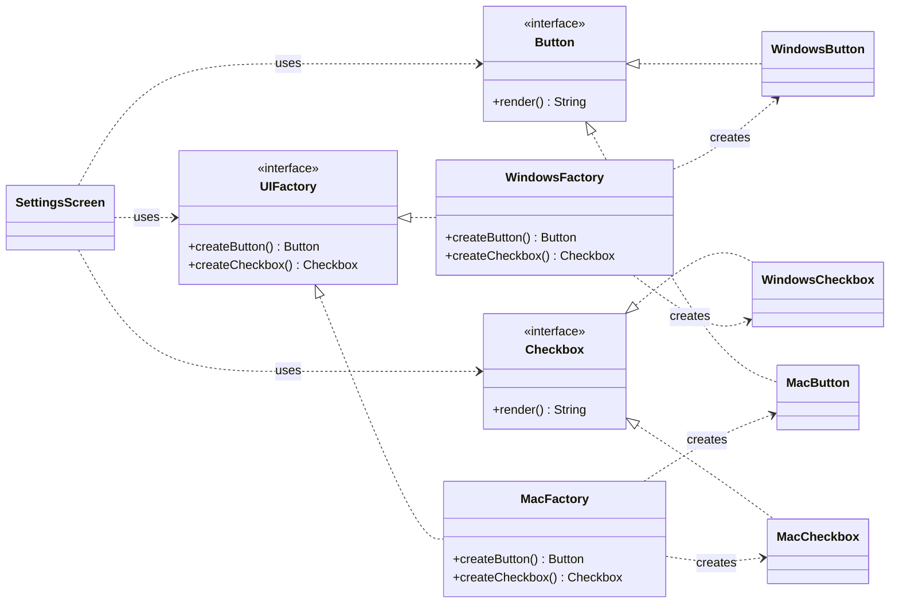
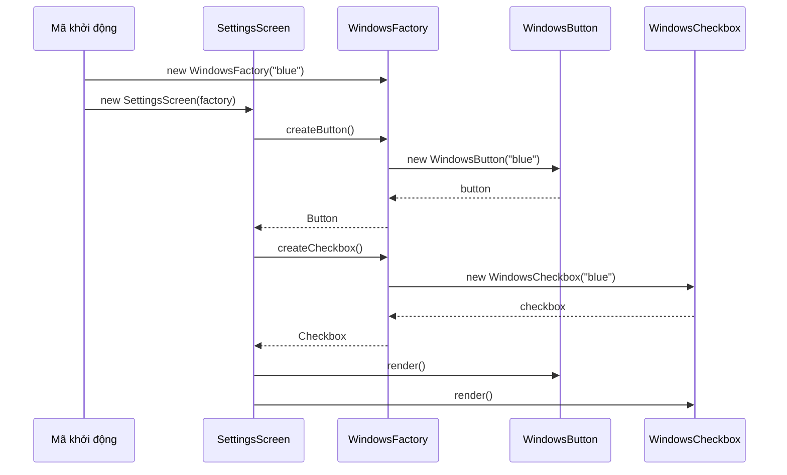

# Vai trò ConcreteFactory trong việc hiện thực một họ sản phẩm cụ thể

## 1. ConcreteFactory giải quyết phần việc nào?

Trong **Abstract Factory** (mẫu thiết kế khởi tạo), ứng dụng làm việc với nhiều **họ sản phẩm**: mỗi họ gồm các loại sản phẩm liên quan và được thiết kế để sử dụng nhất quán với nhau. Chẳng hạn, giao diện một ứng dụng có hai loại thành phần `Button` và `Checkbox`, nhưng mỗi loại có hai phiên bản Windows và macOS.

| Vai trò sản phẩm | Họ Windows | Họ macOS |
| --- | --- | --- |
| Nút bấm (`Button`) | `WindowsButton` | `MacButton` |
| Ô chọn (`Checkbox`) | `WindowsCheckbox` | `MacCheckbox` |

**AbstractFactory** công bố rằng hệ thống có thể yêu cầu `createButton()` và `createCheckbox()`. Tuy nhiên, hợp đồng này chưa cho biết sẽ khởi tạo lớp cụ thể nào.

**ConcreteFactory** là thành phần **hiện thực toàn bộ các phương thức tạo của AbstractFactory cho một họ sản phẩm đã xác định**. Trong ví dụ trên:

- `WindowsFactory` tạo `WindowsButton` và `WindowsCheckbox`.
- `MacFactory` tạo `MacButton` và `MacCheckbox`.

Nhờ đó, client chỉ cần nhận một đối tượng dưới kiểu `UIFactory`, gọi các phương thức tạo và sử dụng sản phẩm qua các interface `Button`/`Checkbox`. Quyết định dùng sản phẩm Windows hay macOS được đóng gói trong concrete factory.

## 2. Bốn trách nhiệm chính của ConcreteFactory

### 2.1. Hiện thực đúng hợp đồng của AbstractFactory

Giả sử hợp đồng chung là:

```java
interface UIFactory {
    Button createButton();
    Checkbox createCheckbox();
}
```

Một concrete factory triển khai **cả hai** phương thức. Mỗi phương thức phải trả về đối tượng thỏa mãn interface sản phẩm tương ứng:

```java
final class WindowsFactory implements UIFactory {
    @Override
    public Button createButton() {
        return new WindowsButton();
    }

    @Override
    public Checkbox createCheckbox() {
        return new WindowsCheckbox();
    }
}
```

Ở đây, `WindowsFactory` là nơi biết rõ `WindowsButton` và `WindowsCheckbox` được tạo bằng constructor nào. Kiểu trả về vẫn là `Button` và `Checkbox`, vì đó là những gì hợp đồng hứa với client.

### 2.2. Ánh xạ từng vai trò sản phẩm đến lớp cụ thể *cùng họ*

Một concrete factory không chỉ chọn lớp triển khai cho *một* phương thức. Nó xác định **trọn bộ ánh xạ** cho họ mình đại diện:

| Lời gọi qua `UIFactory` | `WindowsFactory` trả về | `MacFactory` trả về |
| --- | --- | --- |
| `createButton()` | `WindowsButton` | `MacButton` |
| `createCheckbox()` | `WindowsCheckbox` | `MacCheckbox` |

Tính nhất quán này là một **bất biến thiết kế**: nếu client sử dụng một factory cho toàn bộ màn hình, các thành phần được tạo sẽ thuộc cùng biến thể.

Lưu ý: Java kiểm tra rằng `createCheckbox()` trả về một `Checkbox`, nhưng **không tự kiểm tra** `WindowsFactory` có đang trả nhầm `MacCheckbox` hay không. Concrete factory và các kiểm thử của nó phải duy trì quy tắc cùng họ.

### 2.3. Tập trung chi tiết khởi tạo và cấu hình dùng chung

Concrete factory có thể quản lý các giá trị riêng của họ sản phẩm, ví dụ bảng màu, tham số nền tảng, bộ tạo đối tượng hoặc tài nguyên cần dùng. Thay vì client truyền lại cùng một cấu hình cho nhiều constructor, factory có thể giữ cấu hình ấy và áp dụng nhất quán khi tạo từng sản phẩm.

Ví dụ, `WindowsFactory("blue")` có thể tạo cả `WindowsButton("blue")` lẫn `WindowsCheckbox("blue")`. Client không cần biết constructor nào đòi tham số màu hoặc cách áp dụng giao diện Windows.

Tuy vậy, *concrete factory không nhất thiết tự gọi `new`*. Nó có thể ủy quyền cho builder, lấy đối tượng từ cache hoặc tạo qua API khác. Việc tái sử dụng đối tượng có phù hợp hay không phụ thuộc vào hợp đồng vòng đời và trạng thái của sản phẩm.

### 2.4. Tách quyết định tạo sản phẩm khỏi mã sử dụng

Concrete factory **biết các lớp cụ thể**; client **biết các interface**. Mã khởi động (composition root) là nơi quyết định cung cấp `WindowsFactory` hay `MacFactory` cho client.

Điều này cho phép thay họ sản phẩm bằng cách đổi factory được cấp vào, miễn các sản phẩm của những họ đó thỏa mãn cùng hợp đồng hành vi.

## 3. Vị trí trong cấu trúc và luồng cộng tác



Sơ đồ cho thấy mỗi concrete factory có **hai quan hệ khác nhau**:

1. **Hiện thực** `UIFactory`: phải cung cấp đủ những phương thức tạo đã được công bố.
2. **Phụ thuộc vào các concrete product của họ mình**: biết chính xác lớp nào cần khởi tạo và cách khởi tạo lớp đó.

Client không cần phụ thuộc trực tiếp vào `WindowsFactory`, `WindowsButton` hoặc `MacCheckbox`. Vị trí lựa chọn concrete factory thường thuộc mã khởi động, bộ cấu hình hoặc dependency injection.

Luồng điển hình khi ứng dụng chọn Windows:



Chi tiết quan trọng: tại thời điểm `SettingsScreen` gọi `createButton()`, đối tượng thực sự nhận lời gọi là `WindowsFactory`. Đây là **đa hình**: cùng một lời gọi qua `UIFactory` nhưng triển khai cụ thể quyết định sản phẩm được tạo.

## 4. Ví dụ Java hoàn chỉnh: hai concrete factory cho hai họ giao diện

Đoạn mã sau sử dụng hai họ Windows và macOS. Mỗi concrete factory giữ một giá trị màu nhấn (`accent`) và dùng giá trị ấy khi tạo **cả hai loại sản phẩm**. `render()` trả về chuỗi để dễ quan sát; ứng dụng thực tế có thể thay bằng thao tác vẽ giao diện.

```java
// Lưu trong file ConcreteFactoryDemo.java
public class ConcreteFactoryDemo {

    // Hai AbstractProduct: hành vi mà màn hình cần
    interface Button {
        String render();
    }

    interface Checkbox {
        String render();
    }

    // AbstractFactory: hợp đồng chung cho mọi họ
    interface UIFactory {
        Button createButton();
        Checkbox createCheckbox();
    }

    // ConcreteProduct thuộc họ Windows
    static final class WindowsButton implements Button {
        private final String accent;

        WindowsButton(String accent) {
            this.accent = accent;
        }

        @Override
        public String render() {
            return "Windows button [" + accent + "]";
        }
    }

    static final class WindowsCheckbox implements Checkbox {
        private final String accent;

        WindowsCheckbox(String accent) {
            this.accent = accent;
        }

        @Override
        public String render() {
            return "Windows checkbox [" + accent + "]";
        }
    }

    // ConcreteProduct thuộc họ macOS
    static final class MacButton implements Button {
        private final String accent;

        MacButton(String accent) {
            this.accent = accent;
        }

        @Override
        public String render() {
            return "macOS button [" + accent + "]";
        }
    }

    static final class MacCheckbox implements Checkbox {
        private final String accent;

        MacCheckbox(String accent) {
            this.accent = accent;
        }

        @Override
        public String render() {
            return "macOS checkbox [" + accent + "]";
        }
    }

    // ConcreteFactory số 1: lựa chọn và cấu hình họ Windows
    static final class WindowsFactory implements UIFactory {
        private final String accent;

        WindowsFactory(String accent) {
            this.accent = accent;
        }

        @Override
        public Button createButton() {
            return new WindowsButton(accent);
        }

        @Override
        public Checkbox createCheckbox() {
            return new WindowsCheckbox(accent);
        }
    }

    // ConcreteFactory số 2: lựa chọn và cấu hình họ macOS
    static final class MacFactory implements UIFactory {
        private final String accent;

        MacFactory(String accent) {
            this.accent = accent;
        }

        @Override
        public Button createButton() {
            return new MacButton(accent);
        }

        @Override
        public Checkbox createCheckbox() {
            return new MacCheckbox(accent);
        }
    }

    // Client dùng các loại trừu tượng, không biết lớp cụ thể
    static final class SettingsScreen {
        private final Button saveButton;
        private final Checkbox autoSaveCheckbox;

        SettingsScreen(UIFactory factory) {
            saveButton = factory.createButton();
            autoSaveCheckbox = factory.createCheckbox();
        }

        void show() {
            System.out.println(saveButton.render());
            System.out.println(autoSaveCheckbox.render());
        }
    }

    // Nơi quyết định họ sản phẩm: mã khởi động
    static UIFactory selectFactory(String platform) {
        if ("windows".equals(platform)) {
            return new WindowsFactory("blue");
        }
        if ("mac".equals(platform)) {
            return new MacFactory("graphite");
        }
        throw new IllegalArgumentException("Unsupported platform: " + platform);
    }

    public static void main(String[] args) {
        SettingsScreen windowsScreen =
                new SettingsScreen(selectFactory("windows"));
        windowsScreen.show();

        SettingsScreen macScreen =
                new SettingsScreen(selectFactory("mac"));
        macScreen.show();
    }
}
```

Biên dịch và chạy:

```bash
javac ConcreteFactoryDemo.java
java ConcreteFactoryDemo
```

Kết quả dự kiến:

```text
Windows button [blue]
Windows checkbox [blue]
macOS button [graphite]
macOS checkbox [graphite]
```

Đọc ví dụ theo **trách nhiệm của concrete factory**:

- `WindowsFactory` và `MacFactory` cùng triển khai `UIFactory`, nhưng mỗi phương thức chọn một concrete product khác nhau.
- Mỗi factory giữ `accent` và áp dụng giá trị đó cho cả `Button` lẫn `Checkbox`, giúp cả họ có cùng cấu hình.
- `SettingsScreen` chỉ gọi `factory.createButton()` và `factory.createCheckbox()`. Khi chuyển từ Windows sang macOS, không cần sửa constructor hay các lời gọi của màn hình.
- Hàm `selectFactory()` biết tên các concrete factory nhưng nằm ngoài `SettingsScreen`. Đây là vị trí phù hợp để nối cấu hình ứng dụng với các lớp khởi tạo cụ thể.

## 5. Điều gì xảy ra nếu ConcreteFactory hiện thực sai?

### Sai lầm 1: trả về sản phẩm thuộc hai họ khác nhau

```java
final class MixedFactory implements UIFactory {
    @Override
    public Button createButton() {
        return new WindowsButton("blue");
    }

    @Override
    public Checkbox createCheckbox() {
        return new MacCheckbox("graphite"); // Sai quy ước: trộn hai họ
    }
}
```

**Đoạn mã trên có thể biên dịch**, vì hai giá trị trả về vẫn là `Button` và `Checkbox`. Tuy nhiên, nó vi phạm mục tiêu cung cấp một họ sản phẩm nhất quán. Trong thực tế, hậu quả có thể là giao diện lệch phong cách, thư viện thành phần không tương thích hoặc tài nguyên bị trộn cấu hình.

### Sai lầm 2: không hỗ trợ toàn bộ phương thức đã cam kết

```java
@Override
public Checkbox createCheckbox() {
    throw new UnsupportedOperationException("No checkbox");
}
```

Nếu mọi client của `UIFactory` có quyền gọi `createCheckbox()`, concrete factory này không còn thay thế các triển khai khác một cách đáng tin cậy. Nên xem lại ranh giới interface hoặc tập họ sản phẩm thay vì tạo một triển khai chỉ hỗ trợ một phần hợp đồng.

### Sai lầm 3: đặt logic lựa chọn sản phẩm cụ thể trong client

```java
// Client phải hiểu cách tạo của từng họ:
Button button = isWindows
        ? new WindowsButton("blue")
        : new MacButton("graphite");
```

Khi logic tương tự lặp lại cho `Checkbox`, `Menu`, `Dialog`..., khả năng chọn nhầm biến thể tăng lên. Đặt ánh xạ các lớp cụ thể trong một concrete factory giúp quản lý thay đổi tại một vị trí rõ ràng.

### Sai lầm 4: nhầm việc chọn họ với việc tạo từng sản phẩm

`WindowsFactory` chỉ biết cách cung cấp họ Windows; nó **không nhất thiết** phải tự phát hiện hệ điều hành, đọc cấu hình toàn cục hoặc quyết định khi nào chuyển sang macOS. Thường nên để mã khởi động quyết định concrete factory nào cần dùng, sau đó cung cấp nó cho client.

Khi một màn hình đã giữ các sản phẩm được tạo, việc thay biến `factory` ở nơi khác **không tự biến đổi** những sản phẩm cũ thành họ mới. Muốn đổi giao diện đang hiển thị, ứng dụng phải có cơ chế tạo lại hoặc cập nhật các thành phần phù hợp.

## 6. Thêm một họ mới và thêm một loại sản phẩm mới

Hai kiểu thay đổi sau ảnh hưởng khác nhau đến ConcreteFactory:

| Thay đổi | Công việc chính | Ảnh hưởng lên các ConcreteFactory cũ |
| --- | --- | --- |
| **Thêm họ Linux** | Tạo `LinuxButton`, `LinuxCheckbox`, `LinuxFactory`; đưa lựa chọn mới vào mã khởi động | Thông thường không phải sửa `WindowsFactory`/`MacFactory`. |
| **Thêm loại sản phẩm Slider** | Thêm interface `Slider`, thêm `createSlider()` vào `UIFactory` và các concrete product tương ứng | Phải cập nhật **mọi concrete factory** để hiện thực phương thức mới. |

Đây là đánh đổi tiêu biểu của Abstract Factory: dễ thêm **họ sản phẩm** nếu các vai trò đã ổn định, nhưng thêm **vai trò sản phẩm mới** đòi thay đổi đồng loạt ở những factory hiện có.

Nếu yêu cầu của từng nền tảng khác nhau đến mức không thể cung cấp cùng một tập vai trò, một `UIFactory` lớn có thể là trừu tượng không phù hợp; hãy cân nhắc tách interface theo nhóm trách nhiệm thực tế.

## 7. Cách kiểm tra một ConcreteFactory

Vì concrete factory là nơi cam kết chọn đúng họ, có thể kiểm tra theo **bảng ánh xạ sản phẩm** của nó. Ví dụ (các lớp sử dụng chính là lớp lồng trong `ConcreteFactoryDemo` phía trên):

```java
ConcreteFactoryDemo.UIFactory factory =
        new ConcreteFactoryDemo.WindowsFactory("blue");

assert factory.createButton()
        instanceof ConcreteFactoryDemo.WindowsButton;
assert factory.createCheckbox()
        instanceof ConcreteFactoryDemo.WindowsCheckbox;
```

Ở đây `instanceof` được sử dụng trong **mã kiểm thử để xác nhận ánh xạ**, không phải trong client nghiệp vụ để phân nhánh hành vi. Nếu dùng câu lệnh Java `assert`, cần bật `-ea` khi chạy kiểm thử. Với hệ thống thực, các kiểm thử còn nên xác nhận rằng các sản phẩm tạo ra có cấu hình tương thích và hoạt động cùng nhau đúng kỳ vọng.

Một checklist khi đọc mã ConcreteFactory:

1. Factory có triển khai **đủ** các phương thức của AbstractFactory không?
2. Mỗi phương thức có trả về đúng **vai trò** và đúng **họ** sản phẩm không?
3. Các giá trị cấu hình hoặc tài nguyên chung có được truyền nhất quán không?
4. Client có nhận factory qua interface mà không cần biết concrete product không?
5. Khi thêm họ mới, có thể bổ sung factory tương ứng mà không sửa logic sử dụng sản phẩm không?

## Ghi nhớ

**ConcreteFactory hiện thực một họ sản phẩm cụ thể** bằng cách triển khai toàn bộ các phương thức của `AbstractFactory`, ánh xạ từng phương thức tới `ConcreteProduct` phù hợp và giữ nhất quán giữa các sản phẩm được cung cấp. Nó là nơi tập trung quyết định **tạo lớp nào và cấu hình ra sao**; mã sử dụng sản phẩm làm việc qua `AbstractProduct`. Khi concrete factory được chọn ở ranh giới khởi động, việc thay họ sản phẩm thường không làm thay đổi client.
