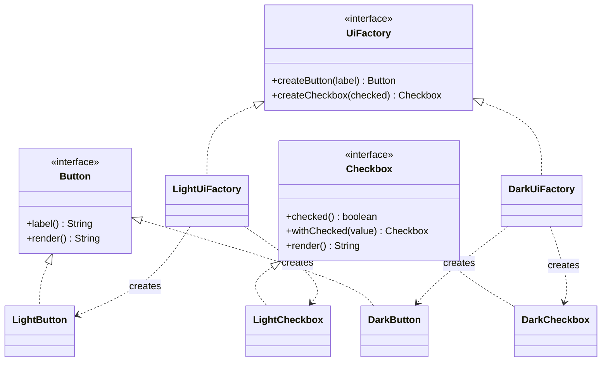
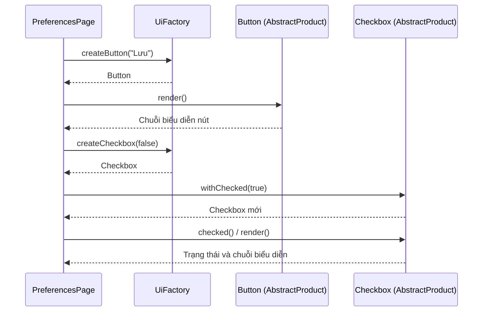

# Vai trò AbstractProduct trong việc định nghĩa hợp đồng của từng loại sản phẩm

## 1. AbstractProduct là gì và vì sao cần có?

Trong mẫu thiết kế **Abstract Factory** (*Creational Design Pattern*), client yêu cầu các đối tượng thuộc một **họ sản phẩm liên quan** mà không cần biết lớp nào được khởi tạo. Để client có thể sử dụng những đối tượng đó, mỗi **loại sản phẩm** cần có một hợp đồng chung. Hợp đồng ấy được biểu diễn bằng **AbstractProduct**, thường là một `interface` hoặc lớp trừu tượng.

Ví dụ một bộ giao diện có hai họ **Light** và **Dark**, mỗi họ gồm:

- Một **nút bấm** (`Button`): hiển thị nhãn và biểu diễn nút theo chủ đề.
- Một **ô chọn** (`Checkbox`): lưu trạng thái được chọn và biểu diễn ô chọn theo chủ đề.

`LightButton` và `DarkButton` cùng tuân thủ hợp đồng `Button`. Tương tự, `LightCheckbox` và `DarkCheckbox` cùng tuân thủ hợp đồng `Checkbox`. Nhờ vậy, client dùng `Button` và `Checkbox` mà không cần biết sản phẩm nào thuộc họ Light hay Dark.

**AbstractProduct không nhất thiết là một interface tên `AbstractProduct`.** Đây là **vai trò** trong pattern. Trong ví dụ, `Button` và `Checkbox` là hai AbstractProduct khác nhau, vì chúng đại diện cho hai loại sản phẩm có trách nhiệm riêng.

Sau bài học, bạn sẽ biết cách:

1. Xác định đúng AbstractProduct cho **từng loại sản phẩm**.
2. Thiết kế hợp đồng gồm phương thức, kiểu dữ liệu, quy tắc trạng thái và hành vi quan sát được.
3. Hiểu cách client, AbstractFactory, ConcreteFactory và ConcreteProduct phối hợp thông qua hợp đồng đó.
4. Tránh phụ thuộc vào lớp cụ thể, ép kiểu và các interface ôm quá nhiều trách nhiệm.
5. Kiểm tra tính thay thế được của các sản phẩm thuộc nhiều họ.

## 2. Vị trí của AbstractProduct trong cấu trúc Abstract Factory

Một triển khai Abstract Factory thường có những thành phần sau:

| Thành phần | Ví dụ | Trách nhiệm |
|---|---|---|
| **AbstractFactory** | `UiFactory` | Khai báo phương thức để yêu cầu các loại sản phẩm thuộc cùng một họ |
| **AbstractProduct A** | `Button` | Định nghĩa hợp đồng công khai cho **mọi nút bấm** |
| **AbstractProduct B** | `Checkbox` | Định nghĩa hợp đồng công khai cho **mọi ô chọn** |
| **ConcreteFactory** | `LightUiFactory`, `DarkUiFactory` | Chọn và tạo các sản phẩm cụ thể cùng một họ |
| **ConcreteProduct** | `LightButton`, `DarkButton`, `LightCheckbox`, `DarkCheckbox` | Triển khai hợp đồng của từng loại sản phẩm |
| **Client** | `PreferencesPage` | Yêu cầu và sử dụng sản phẩm qua các abstraction |



Cần phân biệt hai hợp đồng:

- **AbstractFactory trả lời “lấy sản phẩm loại nào và bằng cách nào?”** Ví dụ `UiFactory.createButton("Lưu")` có kiểu trả về `Button`.
- **AbstractProduct trả lời “sản phẩm được dùng như thế nào?”** Ví dụ `Button.render()` cho phép client biểu diễn nút mà không biết `LightButton` hay `DarkButton`.

Nếu factory khai báo kiểu trả về `Button` nhưng client vẫn phải ép sang `DarkButton` để làm công việc bình thường, abstraction đang thiếu hành vi hoặc đặt sai ranh giới.

## 3. “Hợp đồng” của AbstractProduct gồm những gì?

Trong Java, một interface xác định **chữ ký** của các thao tác: tên phương thức, tham số, kiểu trả về và khả năng hiển thị. Tuy nhiên, hợp đồng thiết kế còn bao gồm **ý nghĩa của các thao tác**.

Ví dụ:

```java
interface Button {
    String label();
    String render();
}

interface Checkbox {
    boolean checked();
    Checkbox withChecked(boolean value);
    String render();
}
```

Ở đây:

- `Button.label()` cung cấp nhãn nút; `Button.render()` mô tả hình thức biểu diễn.
- `Checkbox.checked()` cung cấp trạng thái hiện tại.
- `Checkbox.withChecked(value)` yêu cầu một ô chọn với trạng thái mới; kiểu trả về là **`Checkbox`**, không rò rỉ `LightCheckbox` hay `DarkCheckbox`.
- Cả hai loại đều có `render()`, nhưng **không vì thế phải kế thừa một interface chung chứa mọi thứ**. Mỗi loại vẫn có hợp đồng riêng.

Để các concrete product thực sự **thay thế được nhau**, nên xác định thêm:

| Khía cạnh hợp đồng | Câu hỏi cần trả lời | Quy ước trong ví dụ |
|---|---|---|
| **Đầu vào hợp lệ (precondition)** | Nhãn rỗng hoặc `null` có được chấp nhận? | Nhãn `Button` phải khác `null` và không được để trống |
| **Kết quả (postcondition)** | Phương thức có thể trả `null`? | `render()` trả chuỗi khác `null`; factory trả sản phẩm khác `null` |
| **Trạng thái** | Có thay đổi đối tượng đang sử dụng không? | `Checkbox` bất biến; `withChecked` trả đối tượng mới |
| **Ý nghĩa hành vi** | `checked()` có phản ánh trạng thái mà client yêu cầu? | Đúng; `withChecked(true).checked()` là `true` |
| **Lỗi** | Khi vi phạm đầu vào, lỗi nào phát sinh? | Tạo `Button` với nhãn không hợp lệ ném `IllegalArgumentException` |
| **Tính nhất quán** | Hành vi có giữ nguyên ý nghĩa qua Light/Dark? | Có; chỉ cách biểu diễn phụ thuộc họ |
| **Vòng đời và tài nguyên** | Client có phải `close()` hay được giữ lại? | Ví dụ dùng các value object bất biến, không có tài nguyên cần đóng |

Các quy ước ở bảng này là **quyết định thiết kế của ví dụ**, không phải nghĩa vụ mặc định của Abstract Factory. Trong hệ thống thật, có thể dùng sản phẩm mutable hoặc tài nguyên `AutoCloseable`, nhưng phải ghi rõ hành vi và quyền sở hữu trong API.

### Hợp đồng không đồng nghĩa cách thực hiện

Contract `render()` không buộc mọi sản phẩm phải tạo ra chuỗi giống hệt nhau: `LightButton` có thể dùng phong cách Light, còn `DarkButton` dùng phong cách Dark. Điều không được thay đổi là **ý nghĩa đối với client**: biểu diễn một nút hợp lệ có nhãn đã cung cấp.

Tương tự, contract `Checkbox.withChecked(true)` không quy định constructor hay thuật toán tạo ra giá trị mới. Nó chỉ quy định kết quả có trạng thái `true`, đối tượng gốc không đổi (nếu contract cam kết bất biến) và kết quả tiếp tục đáp ứng `Checkbox`.

Một interface chỉ có chữ ký mà không có quy ước ý nghĩa sẽ yếu: hai implementation vẫn có thể biên dịch thành công nhưng trả về hành vi trái ngược, khiến client không thể thay thế chúng an toàn.

## 4. Ví dụ Java 17: AbstractProduct giữ client độc lập với họ sản phẩm

Đoạn mã dưới đây có thể lưu thành **`Demo.java`** và chạy với Java 17+. Để tập trung vào Abstract Factory, `render()` chỉ trả về chuỗi mô tả giao diện; đây không phải bộ render HTML hay GUI thực.

```java
import java.util.Objects;

// AbstractProduct A: hợp đồng cho mọi loại nút bấm.
interface Button {
    String label();
    String render();
}

// AbstractProduct B: hợp đồng riêng cho ô chọn.
interface Checkbox {
    boolean checked();
    Checkbox withChecked(boolean value);
    String render();
}

// AbstractFactory: phương thức trả về AbstractProduct.
interface UiFactory {
    Button createButton(String label);
    Checkbox createCheckbox(boolean checked);
}

// ConcreteProducts thuộc họ Light.
record LightButton(String label) implements Button {
    LightButton {
        if (label == null || label.isBlank()) {
            throw new IllegalArgumentException(
                    "Button label must not be blank");
        }
    }

    @Override
    public String render() {
        return "Light button: " + label;
    }
}

record LightCheckbox(boolean checked) implements Checkbox {
    @Override
    public Checkbox withChecked(boolean value) {
        return new LightCheckbox(value);
    }

    @Override
    public String render() {
        return "Light checkbox: " + checked;
    }
}

// ConcreteProducts thuộc họ Dark.
record DarkButton(String label) implements Button {
    DarkButton {
        if (label == null || label.isBlank()) {
            throw new IllegalArgumentException(
                    "Button label must not be blank");
        }
    }

    @Override
    public String render() {
        return "Dark button: " + label;
    }
}

record DarkCheckbox(boolean checked) implements Checkbox {
    @Override
    public Checkbox withChecked(boolean value) {
        return new DarkCheckbox(value);
    }

    @Override
    public String render() {
        return "Dark checkbox: " + checked;
    }
}

// Mỗi concrete factory tạo đủ sản phẩm cùng họ.
final class LightUiFactory implements UiFactory {
    @Override
    public Button createButton(String label) {
        return new LightButton(label);
    }

    @Override
    public Checkbox createCheckbox(boolean checked) {
        return new LightCheckbox(checked);
    }
}

final class DarkUiFactory implements UiFactory {
    @Override
    public Button createButton(String label) {
        return new DarkButton(label);
    }

    @Override
    public Checkbox createCheckbox(boolean checked) {
        return new DarkCheckbox(checked);
    }
}

// Client chỉ biết các interface.
final class PreferencesPage {
    private final UiFactory factory;

    PreferencesPage(UiFactory factory) {
        this.factory = Objects.requireNonNull(factory);
    }

    void show() {
        Button save = factory.createButton("Lưu");
        Checkbox notification = factory.createCheckbox(false);

        System.out.println(save.render());
        System.out.println(notification.render());

        Checkbox selected = notification.withChecked(true);
        System.out.println(selected.render());
        System.out.println(notification.checked()); // false: bản gốc không đổi
    }
}

public class Demo {
    public static void main(String[] args) {
        new PreferencesPage(new LightUiFactory()).show();
        new PreferencesPage(new DarkUiFactory()).show();
    }
}
```

Kết quả mô phỏng:

```text
Light button: Lưu
Light checkbox: false
Light checkbox: true
false
Dark button: Lưu
Dark checkbox: false
Dark checkbox: true
false
```

**Tác dụng của AbstractProduct ở ví dụ này:**

1. `PreferencesPage` khai báo `Button save` và `Checkbox notification`, không khai báo các lớp Light/Dark.
2. `UiFactory` trả về **đúng abstraction của từng loại sản phẩm**. Trình biên dịch biết `Button` có `label()/render()`, còn `Checkbox` có `checked()/withChecked()/render()`.
3. Cả `LightButton` và `DarkButton` đều thỏa cùng contract về nhãn và biểu diễn; cả hai loại checkbox cùng giữ ý nghĩa của trạng thái.
4. `withChecked(...)` giữ abstraction ở **giá trị được trả về tiếp theo**. Client không cần ép kiểu sản phẩm mới để dùng nó.
5. Việc đổi từ Light sang Dark diễn ra ở nơi chọn `UiFactory`, không thay logic của `PreferencesPage`.

`record` được dùng để minh họa sản phẩm bất biến, phù hợp cho việc so sánh contract. Với nút bấm có tương tác thật, bạn có thể dùng class thường và bổ sung hành vi vào `Button`, miễn bảo đảm mọi concrete button có thể tuân thủ ý nghĩa của hợp đồng.

## 5. Cách các đối tượng cộng tác qua AbstractProduct

Trong một lần chạy của `PreferencesPage`, chuỗi lời gọi diễn ra như sau:



Sơ đồ dùng kiểu interface để mô tả tương tác mà client nhìn thấy. Trong runtime, concrete factory và concrete product sẽ thực thi các lời gọi tương ứng.

Hãy tách ba trách nhiệm:

- **Factory** quyết định lớp nào được tạo cho mỗi loại: `LightUiFactory` chọn `LightButton` và `LightCheckbox`.
- **AbstractProduct** giới hạn các thao tác client được phép kỳ vọng: `Button.render()`, `Checkbox.checked()`...
- **ConcreteProduct** quyết định cách thực hiện những thao tác ấy.

Client không cần tham gia quyết định lớp thực thi khi sản phẩm đã được trả về. Vì vậy, AbstractProduct là điểm kết nối **phía sử dụng** trong pattern; AbstractFactory là điểm kết nối **phía tạo đối tượng**.

### Hai cấp nhất quán

AbstractProduct đảm bảo một loại sản phẩm có thể được dùng qua cùng API. Nhưng **chỉ có product interface chưa đủ đảm bảo mọi sản phẩm cùng họ**.

Ví dụ, `LightUiFactory` trả về `LightButton` và `DarkCheckbox` vẫn có thể biên dịch: cả hai đều implement đúng product interface. Tuy nhiên, điều đó vi phạm mục tiêu kết hợp các sản phẩm **tương thích** của Abstract Factory. Concrete factory và các bài kiểm tra cần đảm bảo quy tắc họ sản phẩm.

Nói cách khác:

- **Đúng loại:** một sản phẩm trả về từ `createButton()` phải là `Button`.
- **Đúng họ:** khi dùng `LightUiFactory`, các loại sản phẩm được tạo phải cùng thuộc họ Light theo chính sách hệ thống.

Hai điều kiện khác nhau và đều quan trọng.

## 6. Thiết kế AbstractProduct: từ hành vi của client tới interface

### Bước 1 — Xác định các *loại sản phẩm*, không phải từng biến thể

Hãy liệt kê những đối tượng client cần sử dụng: Button, Checkbox, Dialog... Mỗi loại là ứng viên cho một AbstractProduct riêng.

**Sai hướng:** bắt đầu tạo `LightButtonInterface` và `DarkButtonInterface` vì đang có hai theme. Cách chia theo biến thể khiến client khó thay thế sản phẩm, vì mỗi theme lại có một contract.

**Đúng hướng:** các theme là **concrete variants**, còn `Button` là hợp đồng chung cho loại nút bấm.

### Bước 2 — Xác định hành vi thiết yếu của từng loại

Phân tích **client làm gì với sản phẩm**, rồi đưa các hành vi có ý nghĩa chung vào interface.

Ví dụ:

- Mọi nút cần cung cấp nhãn và cách biểu diễn: `Button.label()`, `Button.render()`.
- Mọi checkbox cần trả trạng thái và biểu diễn: `Checkbox.checked()`, `Checkbox.render()`.
- Nếu client cần chuyển trạng thái checkbox, thêm một hành vi với ý nghĩa nhất quán: `Checkbox.withChecked(value)`.

Không nên đưa chi tiết `setDarkBorderColor()`, `getSwingComponent()` hay `getCssSelector()` vào `Button` chỉ vì một implementation đang dùng chúng. Những chi tiết đó khiến concrete product khác bị ép phụ thuộc vào công nghệ không liên quan.

### Bước 3 — Viết rõ ràng quy tắc dữ liệu và lỗi

Các phương thức giống chữ ký nhưng khác hành vi sẽ khó thay thế. Tối thiểu, cần làm rõ:

- Có cho phép `null` hoặc chuỗi trống trong đầu vào không?
- Khi lỗi xảy ra, ném ngoại lệ, trả kết quả lỗi, hay dùng một cơ chế đã thống nhất?
- Phương thức có làm thay đổi trạng thái không? Nếu có thì thay đổi nào là quan sát được?
- Kết quả có thể là `null` không?
- Một lời gọi có sử dụng hoặc sở hữu tài nguyên cần đóng hay không?

Ví dụ, nếu client kỳ vọng `Button.label()` không bao giờ rỗng nhưng `DarkButton` lại chấp nhận và trả về chuỗi rỗng, cả hai cùng implement interface mà **không đồng nhất hợp đồng ngữ nghĩa**.

### Bước 4 — Giữ nguyên tắc thay thế (LSP)

Theo tinh thần **Liskov Substitution Principle**, client nên sử dụng được `LightButton` và `DarkButton` qua cùng kiểu `Button` mà không làm sai các giả định hợp lệ về hợp đồng.

Một concrete product không nên:

- Đòi thêm điều kiện đầu vào khắt khe hơn so với contract của `Button`.
- Trả kết quả vi phạm điều kiện đã được cam kết.
- Đột ngột ném `UnsupportedOperationException` cho hành vi mà interface coi là bắt buộc.
- Thay đổi ý nghĩa `checked()` thành “đã bị vô hiệu hóa” ở một họ sản phẩm.

Interface trong Java bảo đảm **khả năng gọi phương thức**, còn LSP yêu cầu **khả năng thay thế về hành vi**. Đây là điểm phải xác minh trong review và kiểm thử.

### Bước 5 — Tránh AbstractProduct quá lớn

Đừng đưa mọi thao tác của mọi widget vào một interface chung:

```java
// Thiết kế kém: Button bị buộc hỗ trợ cả trạng thái của Checkbox.
interface GiantWidget {
    void click();
    boolean checked();
    void setChecked(boolean value);
    String render();
}
```

Nếu `LightButton` phải implement `checked()` bằng một giá trị giả hoặc ném lỗi, interface đang gộp các trách nhiệm không liên quan.

Nên có **`Button` và `Checkbox` độc lập**, mỗi interface mô tả hành vi của loại sản phẩm đó. Đây cũng là cách áp dụng **Interface Segregation Principle**: client chỉ phụ thuộc các thao tác cần thiết.

Nếu nhiều loại sản phẩm thực sự có khả năng chung, có thể trích một interface nhỏ như `Renderable`. Nhưng không cần tạo thêm abstraction chỉ vì một phương thức tình cờ cùng tên.

## 7. Phân biệt AbstractProduct với những thành phần dễ nhầm

| Thành phần | Ý nghĩa | Ví dụ |
|---|---|---|
| **AbstractProduct** | Hợp đồng công khai của **một loại sản phẩm** | `Button` |
| **ConcreteProduct** | Hiện thực một biến thể của loại sản phẩm | `DarkButton` |
| **AbstractFactory** | Hợp đồng tạo ra **nhiều loại sản phẩm trong một họ** | `UiFactory` |
| **ConcreteFactory** | Tạo các concrete product tương thích với một họ | `DarkUiFactory` |
| **Interface chung cấp cao khác** | Hợp đồng khả năng được nhiều loại chia sẻ, nếu thật sự cần | `Renderable` |

Một số nhầm lẫn điển hình:

**Nhầm 1 — Chỉ cần AbstractFactory là đủ.**

```java
// Factory đã trừu tượng, nhưng kiểu trả về vẫn khóa vào họ Light.
interface BadUiFactory {
    LightButton createButton(String label);
}
```

Nếu `LightButton` là lớp cụ thể, client bị buộc biết lớp đó. Hãy khai báo `Button createButton(String label)` để trừu tượng hóa **đối tượng trả về**.

**Nhầm 2 — Dùng `Object` để tránh tạo product interface.**

```java
interface WeakUiFactory {
    Object createButton(String label);
}
```

Client sẽ phải kiểm tra kiểu/ép kiểu để gọi `render()`. Kiểu `Object` che mất thông tin ngữ nghĩa cần thiết, trong khi `Button` vừa giúp trừu tượng hóa vừa an toàn về kiểu.

**Nhầm 3 — Một AbstractProduct đại diện cho cả họ.**

Họ Light không phải một loại sản phẩm để client gọi `render()`. Họ là tập hợp các **biến thể tương thích** của những loại khác nhau. `Button` và `Checkbox` mới là AbstractProduct; `LightUiFactory` lựa chọn các implementation của chúng.

**Nhầm 4 — AbstractProduct bắt buộc phải là `interface`.**

Một **abstract class** cũng có thể làm AbstractProduct, ví dụ khi cần chia sẻ mã hoặc trạng thái chung thật sự. Đánh đổi là Java chỉ cho phép kế thừa một class, và base class có thể làm các concrete product phụ thuộc chặt vào cấu trúc bên trong. Nếu mục tiêu là định nghĩa khả năng sử dụng độc lập implementation, `interface` thường đơn giản hơn.

## 8. Mở rộng họ sản phẩm và mở rộng loại sản phẩm

Giả sử cần thêm theme **High Contrast**:

- Tạo `HighContrastButton implements Button`.
- Tạo `HighContrastCheckbox implements Checkbox`.
- Tạo `HighContrastUiFactory implements UiFactory`.

Nếu những contract hiện tại đã đủ, client `PreferencesPage` **không cần sửa**. Đây là lợi ích nổi bật của việc chọn đúng AbstractProduct ngay từ đầu.

Ngược lại, nếu bổ sung **một loại sản phẩm mới `Dialog`**, cần:

1. Thiết kế **AbstractProduct mới** `Dialog` dựa trên hành vi thực tế client cần.
2. Thêm `Dialog createDialog(...)` vào `UiFactory`.
3. Triển khai concrete dialog trong **từng họ**.
4. Cập nhật các concrete factory để tạo dialog đúng họ.

Vì vậy, Abstract Factory thường thuận lợi cho việc **thêm họ** hơn là thêm **loại sản phẩm**, bởi loại mới làm thay đổi factory contract và ảnh hưởng đến tất cả concrete factory. Không nên vì muốn mở rộng nhanh mà nhét một phương thức trả `Object` vào factory rồi để client tự xử lý.

Nếu sản phẩm mới chỉ cần ở một số client, hãy xem xét phạm vi factory interface và việc phân tách hợp đồng. Không phải mọi khả năng tùy chọn đều phải thêm vào một AbstractFactory duy nhất.

## 9. Kiểm tra contract của AbstractProduct

Việc có cùng interface chưa chứng minh các concrete product có **hành vi tương thích**. Nên áp dụng cùng một nhóm kiểm tra cho mọi concrete factory, sau đó bổ sung kiểm tra đặc thù của từng họ.

Một kiểm thử hợp đồng đơn giản (dùng các class ở ví dụ Java trước) có thể viết như sau:

```java
// Đặt các phương thức này trong một lớp kiểm thử hoặc lớp Demo.
static void check(boolean condition, String message) {
    if (!condition) {
        throw new AssertionError(message);
    }
}

static void verifyProductContracts(UiFactory factory, String family) {
    Button button = factory.createButton("OK");
    check(button != null, "Button must not be null");
    check("OK".equals(button.label()), "Button label differs");
    check(button.render() != null, "Button render must not be null");

    Checkbox original = factory.createCheckbox(false);
    check(original != null, "Checkbox must not be null");
    check(!original.checked(), "Initial checkbox state is wrong");

    Checkbox updated = original.withChecked(true);
    check(updated != null, "Updated checkbox must not be null");
    check(updated.checked(), "Updated state must be true");
    check(!original.checked(), "Original checkbox must stay unchanged");
    check(updated.render() != null, "Checkbox render must not be null");

    // Quy ước biểu diễn riêng của ví dụ: tên họ ở đầu chuỗi.
    check(button.render().startsWith(family + " button:"),
            "Button belongs to a different family");
    check(updated.render().startsWith(family + " checkbox:"),
            "Checkbox belongs to a different family");
}

// Ví dụ gọi:
// verifyProductContracts(new LightUiFactory(), "Light");
// verifyProductContracts(new DarkUiFactory(), "Dark");
```

Trong code ứng dụng thực tế, việc xác minh “đúng họ” nên dựa trên **thuộc tính nghiệp vụ có ý nghĩa** hoặc hành vi quan sát được; không nhất thiết dùng tiền tố chuỗi như ví dụ mô phỏng.

Cần kiểm thử cả trường hợp không hợp lệ, chẳng hạn `createButton(null)` và `createButton(" ")`, để bảo đảm các concrete factory cùng tuân theo quy định về đầu vào. Nếu có nhiều concrete factory, có thể dùng **parameterized tests** để chạy cùng bộ kiểm thử contract qua mọi implementation.

### Checklist tự đánh giá

- [ ] Mỗi **loại** sản phẩm có AbstractProduct phù hợp; không đặt interface riêng chỉ vì khác theme/vendor.
- [ ] Factory interface trả đúng product interface và không buộc client biết concrete class.
- [ ] Các phương thức AbstractProduct phản ánh nhu cầu thực của client và có ý nghĩa nhất quán.
- [ ] Các concrete product không tăng điều kiện đầu vào hoặc làm yếu hậu điều kiện của hợp đồng.
- [ ] Client không cần `instanceof`, ép kiểu hay import lớp concrete để sử dụng hành vi thông thường.
- [ ] Mỗi concrete factory tạo các sản phẩm đúng họ và có thể phối hợp.
- [ ] Quy tắc về trạng thái, `null`, ngoại lệ và quyền sở hữu tài nguyên được xác định rõ.

**Ghi nhớ:** AbstractProduct là **hợp đồng sử dụng của từng loại sản phẩm** trong Abstract Factory. Nó không quyết định sản phẩm nào được tạo; nhiệm vụ đó thuộc về AbstractFactory và ConcreteFactory. Khi các concrete product tuân thủ cùng một hợp đồng ngữ nghĩa, client có thể làm việc qua abstraction, còn factory có thể thay toàn bộ họ sản phẩm mà không buộc client viết lại logic sử dụng.

