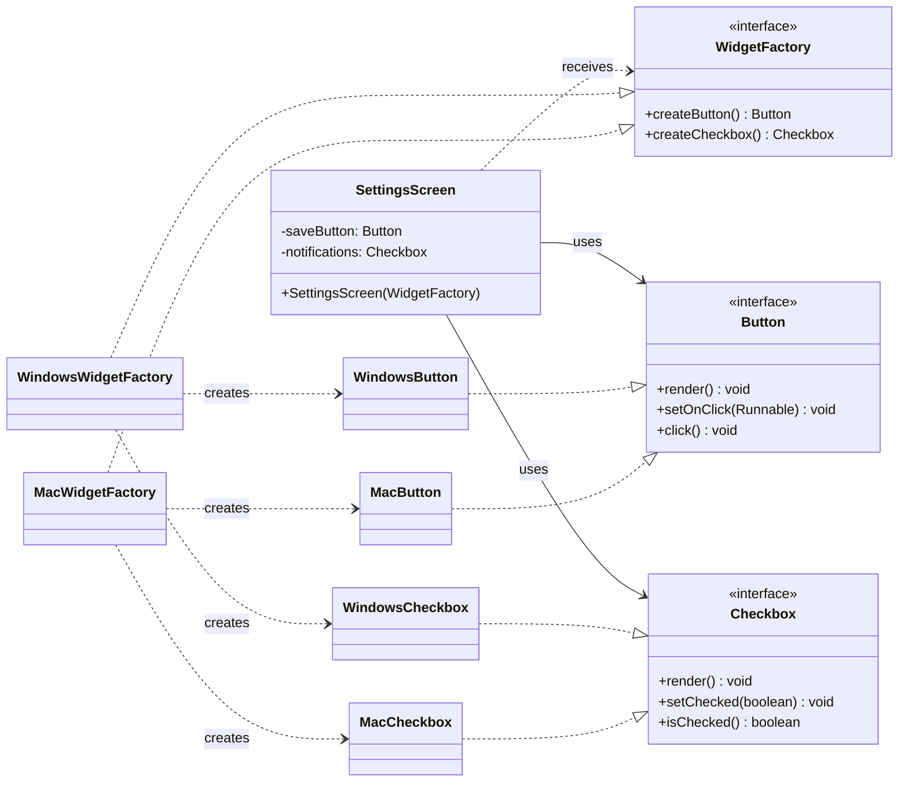
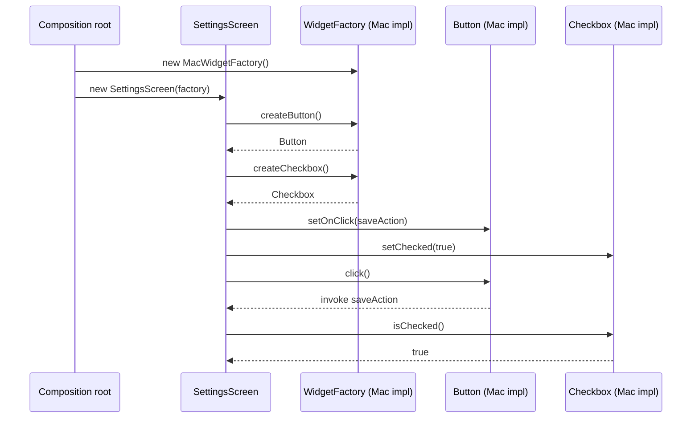

# Vai trò Client khi chỉ làm việc với factory và product qua abstraction

Trong **Abstract Factory**, Client là thành phần cần sử dụng một **họ sản phẩm liên quan**, nhưng không trực tiếp quyết định lớp cụ thể nào được khởi tạo. Client nhận một **abstract factory**, gọi các phương thức tạo sản phẩm và tiếp tục làm việc với những sản phẩm nhận về thông qua **product interfaces**. Nhờ vậy, cùng một luồng nghiệp vụ có thể hoạt động với nhiều họ sản phẩm khác nhau.

Bài học thuộc chương **Cấu trúc và cộng tác** của module **Học về abstract factory trong design pattern**. Trọng tâm là vai trò của Client trong các mối quan hệ phụ thuộc, các lời gọi khi chạy chương trình và những giới hạn thực tế khi nói rằng Client “chỉ biết abstraction”.

## 1. Client là ai trong cấu trúc Abstract Factory?

Ví dụ một màn hình cài đặt có hai loại widget:

- `Button`: hiển thị nút Lưu và thực hiện hành động khi được nhấn.
- `Checkbox`: hiển thị tùy chọn Nhận thông báo, cho phép người dùng bật hoặc tắt.

Hệ thống cung cấp hai **họ sản phẩm**: Windows và macOS. Màn hình cài đặt cần cùng một chức năng trên cả hai nền tảng, nhưng cách thể hiện và tích hợp widget do từng họ phụ trách.

| Vai trò | Đối tượng minh họa | Trách nhiệm chính |
| --- | --- | --- |
| **Abstract Factory** | `WidgetFactory` | Khai báo `createButton()`, `createCheckbox()` trả về interface sản phẩm. |
| **Concrete Factory** | `WindowsWidgetFactory`, `MacWidgetFactory` | Chọn và khởi tạo các sản phẩm thuộc cùng một họ. |
| **Abstract Product** | `Button`, `Checkbox` | Xác định hành vi mà Client được phép dùng. |
| **Concrete Product** | `WindowsButton`, `MacCheckbox`, ... | Triển khai hành vi cho nền tảng tương ứng. |
| **Client** | `SettingsScreen` | Dùng factory để lấy sản phẩm, phối hợp sản phẩm theo luồng nghiệp vụ. |
| **Composition root** | `main`, ứng dụng bootstrap hoặc cấu hình DI | Quyết định concrete factory nào được cấp cho Client. |

**Phân biệt quan trọng:** Client **không đồng nghĩa với người dùng cuối**. Trong sơ đồ design pattern, Client là mã tiêu thụ các interface; người dùng cuối là người nhấn nút hoặc thay đổi tùy chọn trên màn hình mà Client tổ chức.

Client vẫn có logic riêng: gắn hành động Lưu, kiểm tra trạng thái checkbox, điều phối thứ tự thao tác. Abstract Factory chỉ thay đổi **cách Client nhận sản phẩm** và **mức độ Client phải biết về triển khai**.

## 2. Hai tầng trừu tượng mà Client cần phụ thuộc

Giả sử viết:

```java
interface Button {
    void render();
    void setOnClick(Runnable action);
    void click();
}

interface Checkbox {
    void render();
    void setChecked(boolean checked);
    boolean isChecked();
}

interface WidgetFactory {
    Button createButton();
    Checkbox createCheckbox();
}
```

Một Client đúng hướng:

```java
final class SettingsScreen {
    private final Button saveButton;
    private final Checkbox notifications;

    SettingsScreen(WidgetFactory factory) {
        saveButton = factory.createButton();
        notifications = factory.createCheckbox();
    }
}
```

Chỉ có **một** factory được truyền vào constructor, từ đó Client lấy cả hai sản phẩm. Ba kiểu được nhắc đến trong `SettingsScreen` đều là abstraction:

1. `WidgetFactory` trả lời câu hỏi **cần lấy các loại sản phẩm nào**.
2. `Button` trả lời câu hỏi **Client có thể yêu cầu một nút làm gì**.
3. `Checkbox` trả lời câu hỏi **Client có thể yêu cầu một checkbox làm gì**.

Đây là hai mức tách biệt: **trừu tượng hóa cách tạo** (factory) và **trừu tượng hóa cách sử dụng** (product). Chỉ áp dụng một mức là chưa đủ. Ví dụ factory trả về `WindowsButton` khiến Client vẫn phụ thuộc vào Windows; ngược lại Client lưu `Button` nhưng tự gọi `new WindowsButton()` thì vẫn tự quyết định họ triển khai.

## 3. Phụ thuộc lúc biên dịch và đối tượng lúc chạy

Nhìn vào sơ đồ cấu trúc sau:



Ở **thời điểm biên dịch**, `SettingsScreen` chỉ cần biết chữ ký của `WidgetFactory`, `Button` và `Checkbox`. Nó không cần import `WindowsButton`, `MacCheckbox` hoặc concrete factory.

Ở **thời điểm chạy**, biến có kiểu `WidgetFactory` trỏ đến một đối tượng cụ thể như `MacWidgetFactory`. Lời gọi `createButton()` dùng cơ chế đa hình để chạy implementation tương ứng và trả về một `MacButton`, nhưng Client tiếp tục giữ nó trong biến kiểu `Button`.

Điều này **không có nghĩa** chương trình không có concrete class. Cụ thể vẫn cần tồn tại trong concrete factory, tại nơi cấu hình phụ thuộc và trong hệ thống chạy thực tế. Ý nghĩa của “chỉ làm việc qua abstraction” là **mã Client không gắn hợp đồng hoặc điều kiện nghiệp vụ với chúng**.

## 4. Chuỗi cộng tác khi một màn hình được dựng

Khi mở màn hình cài đặt trên macOS:

1. Composition root xác định môi trường và tạo `MacWidgetFactory`.
2. Composition root truyền factory đó cho `SettingsScreen`.
3. Client gọi `factory.createButton()` và `factory.createCheckbox()`.
4. Concrete factory tạo `MacButton` và `MacCheckbox`, sau đó trả về dưới các kiểu `Button` và `Checkbox`.
5. Client gắn callback cho nút và sử dụng checkbox theo các phương thức đã cam kết.
6. Người dùng tương tác; mã Client điều phối nghiệp vụ mà không hỏi widget thuộc hệ điều hành nào.



Lưu ý: sơ đồ thể hiện lời gọi dưới góc nhìn Client và dùng `click()` để mô phỏng sự kiện người dùng. Trong một framework UI thực, hệ thống sự kiện của nền tảng có thể phát tín hiệu nhấn và gọi callback mà không cần mã Client trực tiếp gọi `click()`.

Việc **Client lấy cả hai sản phẩm từ cùng một factory** giúp tập trung trách nhiệm tạo một bộ cùng họ. Tuy nhiên, interface `WidgetFactory` không tự chứng minh mọi concrete factory đều tạo đúng họ; implementation vẫn cần được kiểm tra.

## 5. Ví dụ Java 17 hoàn chỉnh: Client độc lập với họ sản phẩm

Ví dụ sau chạy bằng Java thuần, dùng console để minh họa. Các implementation Windows/macOS khác nhau ở thông tin hiển thị, nhưng cùng tuân thủ `Button` và `Checkbox`. Client `SettingsScreen` **không tham chiếu bất kỳ lớp triển khai nào**.

Lưu thành `Demo.java`:

```java
import java.util.Objects;

public final class Demo {
    private Demo() {}

    // Các hợp đồng mà Client được phép sử dụng
    public interface Button {
        void render();
        void setOnClick(Runnable action);
        void click();
    }

    public interface Checkbox {
        void render();
        void setChecked(boolean checked);
        boolean isChecked();
    }

    public interface WidgetFactory {
        Button createButton();
        Checkbox createCheckbox();
    }

    // Client chỉ giữ interface, không phân nhánh theo hệ điều hành
    public static final class SettingsScreen {
        private final Button saveButton;
        private final Checkbox notifications;
        private int saves;

        public SettingsScreen(WidgetFactory factory) {
            Objects.requireNonNull(factory, "factory");
            saveButton = Objects.requireNonNull(factory.createButton());
            notifications = Objects.requireNonNull(factory.createCheckbox());

            saveButton.setOnClick(() -> {
                saves++;
                System.out.println(
                    "Da luu; thong bao = " + notifications.isChecked()
                );
            });
        }

        public void render() {
            notifications.render();
            saveButton.render();
        }

        public void chooseNotifications(boolean checked) {
            notifications.setChecked(checked);
        }

        public void save() {
            saveButton.click(); // Mo phong nguoi dung nhan nut
        }

        public int saveCount() {
            return saves;
        }

        public boolean notificationsEnabled() {
            return notifications.isChecked();
        }
    }

    // Sản phẩm thuộc họ Windows
    private static final class WindowsButton implements Button {
        private Runnable onClick = () -> {};

        @Override
        public void render() {
            System.out.println("[Windows] Nut Luu");
        }

        @Override
        public void setOnClick(Runnable action) {
            onClick = Objects.requireNonNull(action);
        }

        @Override
        public void click() {
            onClick.run();
        }
    }

    private static final class WindowsCheckbox implements Checkbox {
        private boolean checked;

        @Override
        public void render() {
            System.out.println("[Windows] Thong bao = " + checked);
        }

        @Override
        public void setChecked(boolean checked) {
            this.checked = checked;
        }

        @Override
        public boolean isChecked() {
            return checked;
        }
    }

    // Sản phẩm thuộc họ macOS
    private static final class MacButton implements Button {
        private Runnable onClick = () -> {};

        @Override
        public void render() {
            System.out.println("[macOS] Nut Luu");
        }

        @Override
        public void setOnClick(Runnable action) {
            onClick = Objects.requireNonNull(action);
        }

        @Override
        public void click() {
            onClick.run();
        }
    }

    private static final class MacCheckbox implements Checkbox {
        private boolean checked;

        @Override
        public void render() {
            System.out.println("[macOS] Thong bao = " + checked);
        }

        @Override
        public void setChecked(boolean checked) {
            this.checked = checked;
        }

        @Override
        public boolean isChecked() {
            return checked;
        }
    }

    // Concrete factories: nơi quyết định và khởi tạo cả họ
    private static final class WindowsWidgetFactory implements WidgetFactory {
        @Override
        public Button createButton() {
            return new WindowsButton();
        }

        @Override
        public Checkbox createCheckbox() {
            return new WindowsCheckbox();
        }
    }

    private static final class MacWidgetFactory implements WidgetFactory {
        @Override
        public Button createButton() {
            return new MacButton();
        }

        @Override
        public Checkbox createCheckbox() {
            return new MacCheckbox();
        }
    }

    // Composition root chọn họ đúng một lần cho màn hình
    public enum Platform { WINDOWS, MAC }

    public static WidgetFactory factoryFor(Platform platform) {
        return switch (Objects.requireNonNull(platform, "platform")) {
            case WINDOWS -> new WindowsWidgetFactory();
            case MAC -> new MacWidgetFactory();
        };
    }

    public static void main(String[] args) {
        Platform platform = args.length > 0
                && args[0].equalsIgnoreCase("mac")
            ? Platform.MAC
            : Platform.WINDOWS;

        WidgetFactory factory = factoryFor(platform);
        SettingsScreen screen = new SettingsScreen(factory);
        screen.render();
        screen.chooseNotifications(true);
        screen.save();
        System.out.println("So lan luu = " + screen.saveCount());
    }
}
```

Biên dịch và chạy:

```bash
javac Demo.java
java Demo windows
java Demo mac
```

Kết quả dự kiến khi dùng `java Demo mac`:

```text
[macOS] Thong bao = false
[macOS] Nut Luu
Da luu; thong bao = true
So lan luu = 1
```

Chạy với Windows thì hai dòng render có tiền tố `[Windows]`, còn các bước chọn thông báo và Lưu có cùng ý nghĩa. `SettingsScreen` không hề được sửa khi thay factory.

### 5.1. Chỉ ra chính xác Client làm gì

Trong mã trên, Client:

- **Nhận** `WidgetFactory` qua constructor injection.
- **Yêu cầu tạo** hai product interface từ **cùng một factory**.
- **Lưu tham chiếu** dưới kiểu `Button` và `Checkbox`.
- **Gắn sự kiện** cho nút và kết nối sự kiện đó với trạng thái checkbox.
- **Phối hợp nghiệp vụ** theo chuỗi tương tác của màn hình.

Client không chọn native widget, không quyết định class nào thực hiện `Button`, không ép kiểu sang `MacButton`, cũng không kiểm tra `instanceof WindowsCheckbox`.

### 5.2. Đoạn nào biết về lớp cụ thể?

Chỉ các concrete factory và nơi chọn factory mới biết:

```java
// Trong concrete factory
return new MacButton();

// Trong composition root / điểm cấu hình
WidgetFactory factory = Demo.factoryFor(Demo.Platform.MAC);
```

Lựa chọn `Platform.MAC` là **quyết định cấu hình ứng dụng**, không phải quy tắc nghiệp vụ của `SettingsScreen`. Sự tách biệt này cho phép cùng mã Client được tái sử dụng.

## 6. Kiểm thử Client bằng fake factory

Khi Client chỉ phụ thuộc abstraction, kiểm thử không cần dựng widget thật hoặc thư viện UI của nền tảng. Ta có thể tạo **fake products** để quan sát xem Client có truyền đúng hành vi hay không.

Ví dụ JUnit 5 (tệp `SettingsScreenTest.java` đặt cạnh `Demo.java`, dự án đã cấu hình JUnit Jupiter):

```java
import org.junit.jupiter.api.Test;

import static org.junit.jupiter.api.Assertions.*;

class SettingsScreenTest {
    static final class FakeButton implements Demo.Button {
        private Runnable action = () -> {};
        int clicks;

        @Override
        public void render() {}

        @Override
        public void setOnClick(Runnable action) {
            this.action = action;
        }

        @Override
        public void click() {
            clicks++;
            action.run();
        }
    }

    static final class FakeCheckbox implements Demo.Checkbox {
        boolean checked;

        @Override
        public void render() {}

        @Override
        public void setChecked(boolean checked) {
            this.checked = checked;
        }

        @Override
        public boolean isChecked() {
            return checked;
        }
    }

    static final class FakeFactory implements Demo.WidgetFactory {
        final FakeButton button = new FakeButton();
        final FakeCheckbox checkbox = new FakeCheckbox();
        int buttonCreates;
        int checkboxCreates;

        @Override
        public Demo.Button createButton() {
            buttonCreates++;
            return button;
        }

        @Override
        public Demo.Checkbox createCheckbox() {
            checkboxCreates++;
            return checkbox;
        }
    }

    @Test
    void clientUsesProductsThroughInterfaces() {
        FakeFactory factory = new FakeFactory();
        Demo.SettingsScreen screen = new Demo.SettingsScreen(factory);

        screen.chooseNotifications(true);
        screen.save();
        screen.save();

        assertTrue(factory.checkbox.checked);
        assertEquals(2, factory.button.clicks);
        assertEquals(2, screen.saveCount());
        assertTrue(screen.notificationsEnabled());
    }

    @Test
    void screenObtainsEachRequiredProductFromFactory() {
        FakeFactory factory = new FakeFactory();
        new Demo.SettingsScreen(factory);

        assertEquals(1, factory.buttonCreates);
        assertEquals(1, factory.checkboxCreates);
    }

    @Test
    void swappingConcreteFactoryDoesNotChangeSaveContract() {
        for (Demo.Platform platform : Demo.Platform.values()) {
            Demo.SettingsScreen screen =
                new Demo.SettingsScreen(Demo.factoryFor(platform));

            assertFalse(screen.notificationsEnabled());
            screen.chooseNotifications(true);
            screen.save();

            assertTrue(screen.notificationsEnabled());
            assertEquals(1, screen.saveCount());
        }
    }
}
```

Test đầu tiên kiểm tra **hành vi Client**: thay trạng thái và nhấn Lưu. Test thứ hai xác nhận cách sử dụng factory theo thiết kế ví dụ; nó hữu ích khi số lượng đối tượng là yêu cầu, nhưng **không nên biến thứ tự gọi `create...` hoặc số lần tạo không có ý nghĩa nghiệp vụ thành ràng buộc cứng**. Test cuối kiểm tra cùng một contract trên cả hai họ thực tế.

Trong mã ứng dụng, fake chỉ là một implementation khác của abstraction, không đòi hỏi `SettingsScreen` biết về `FakeButton`. Đây cũng là lợi ích của **Dependency Inversion Principle**: logic cấp cao phụ thuộc vào các hợp đồng ổn định thay vì chi tiết bên dưới.

## 7. Client có trách nhiệm gì, và không có trách nhiệm gì?

| Client nên thực hiện | Client nên giao cho thành phần khác |
| --- | --- |
| Điều phối luồng nghiệp vụ, sự kiện và trạng thái mà màn hình cần | Chọn concrete product nào phù hợp với hệ điều hành |
| Gọi `factory.create...` theo loại sản phẩm cần dùng | Viết lệnh `new WindowsButton()` hoặc `new MacCheckbox()` |
| Thao tác qua `Button`, `Checkbox` với ngữ nghĩa đã quy định | Đọc field nội bộ hay gọi API native của widget |
| Nhận factory đã cấu hình qua constructor | Rải nhánh `if (platform == ...)` trong mọi sự kiện của màn hình |
| Xử lý lỗi nghiệp vụ hoặc phản hồi từ product theo hợp đồng | Tự hòa giải khác biệt kỹ thuật giữa hai họ sản phẩm |

Client vẫn có thể quyết định **cần loại sản phẩm nào**: một màn hình cần một nút và hai checkbox hoàn toàn có thể gọi `createButton()` một lần, `createCheckbox()` hai lần. Abstract Factory không yêu cầu tạo toàn bộ các loại trong mọi lần dùng; nó cung cấp **các khả năng tạo liên quan** trong cùng một họ.

Client cũng có thể giữ state nghiệp vụ bên ngoài product. Ví dụ màn hình đọc `notifications.isChecked()` để lưu một tùy chọn; nó không nhất thiết phải biết `MacCheckbox` lưu trạng thái bằng field nào.

## 8. Các ranh giới phụ thuộc dễ nhầm

### 8.1. Client nhận factory qua abstraction nhưng vẫn ép kiểu product

```java
WidgetFactory factory = /* được inject từ nơi cấu hình */;
Button button = factory.createButton();

// Không nên có trong Client dùng chung:
WindowsButton concrete = (WindowsButton) button;
```

Nếu factory thực tế tạo `MacButton`, phép ép kiểu có thể gây `ClassCastException`. Kể cả khi không lỗi ngay, Client đã tự khóa vào một biến thể. Nếu có hành vi thật sự cần cho mọi nút, hãy thiết kế nó trong `Button` với quy tắc chung. Nếu chỉ thuộc một nền tảng, đặt nó ở adapter hoặc một API chuyên biệt thay vì kéo toàn bộ Client xuyên nền tảng về triển khai cụ thể.

### 8.2. Factory trả về `Object` hoặc kiểu cụ thể

```java
interface WeakFactory {
    Object createButton();
    Object createCheckbox();
}
```

Client phải tự ép kiểu và đoán sản phẩm nhận được. Dùng `Button`, `Checkbox` làm **kiểu trả về** giúp hệ thống kiểu của Java kiểm tra hành vi mà Client được phép gọi ngay lúc biên dịch.

Nếu abstract factory trả về `WindowsButton`, chính hợp đồng tạo lại làm lộ họ Windows. Concrete factory có thể dùng **covariant return** hợp lệ trong Java, nhưng Client dùng chung vẫn nên giữ biến qua `WidgetFactory` để chỉ nhìn thấy kiểu `Button`.

### 8.3. Client tự tạo hai factory rồi trộn sản phẩm

```java
Button button = windowsFactory.createButton();
Checkbox checkbox = macFactory.createCheckbox();
```

Đoạn trên có thể hợp lệ về mặt interface nhưng phá vỡ ý nghĩa **bộ sản phẩm cùng họ**. Thiết kế tốt truyền **một factory đã chọn** đến Client. Nếu cần chặn cách lắp ghép sai ở API công khai, constructor của Client nên nhận factory hoặc một family handle, tránh nhận nhiều concrete product rời mà bất kỳ caller nào cũng ghép được.

### 8.4. Client hỏi `instanceof` để tự quyết định logic

```java
if (button instanceof MacButton) {
    // Nhánh macOS trong màn hình dùng chung
}
```

Dấu hiệu này thường cho thấy hợp đồng chung thiếu một hành vi cần thiết, hoặc logic đặc thù đã bị đặt sai nơi. Dù dùng `instanceof` không phải lúc nào cũng sai, dùng nó thường xuyên để phân nhánh theo từng concrete product khiến việc thêm họ mới phải sửa Client.

### 8.5. Client tự tạo factory ở mọi nơi

```java
// Đặt ngay trong một màn hình dùng chung:
WidgetFactory factory = new WindowsWidgetFactory();
```

Factory là abstraction nhưng Client đã cố định lựa chọn họ. Đưa `new WindowsWidgetFactory()` vào composition root hoặc DI configuration, rồi inject `WidgetFactory` sẽ giúp Client độc lập thực sự với nền tảng.

## 9. Thay họ sản phẩm và mở rộng loại sản phẩm ảnh hưởng Client thế nào?

**Thêm một họ sản phẩm** như Linux:

1. Viết `LinuxButton implements Button` và `LinuxCheckbox implements Checkbox`.
2. Viết `LinuxWidgetFactory implements WidgetFactory`.
3. Cập nhật nơi chọn factory để có thể tạo họ Linux.

`SettingsScreen` không cần sửa nếu hai product interface vẫn bảo đảm cùng hành vi. Đây là hướng mở rộng mà Abstract Factory hỗ trợ rất tốt.

**Thêm một loại sản phẩm** như `TextField`:

1. Thiết kế `TextField` theo hành vi mà Client cần (nhập, đọc văn bản, kiểm tra hợp lệ nếu phù hợp).
2. Bổ sung `createTextField()` vào `WidgetFactory`.
3. Cập nhật **mọi concrete factory** và thêm concrete product của từng họ.
4. Chỉ thay những Client có nhu cầu sử dụng loại sản phẩm mới.

Việc bổ sung một loại sản phẩm thường tốn nhiều thay đổi hơn vì mỗi họ phải cung cấp loại đó. Đây là đánh đổi kiến trúc quan trọng; Abstract Factory phù hợp nhất khi **tập loại sản phẩm tương đối ổn định, còn số họ triển khai có thể tăng**.

## 10. Những giới hạn của câu “Client chỉ phụ thuộc abstraction”

**Abstraction không tự bảo đảm tương thích ngữ nghĩa.** `MacCheckbox` và `WindowsCheckbox` có thể cùng triển khai `isChecked()`, nhưng một implementation lỗi vẫn có thể trả kết quả sai. Nên kiểm thử contract chung trên mỗi họ.

**Không đồng nghĩa mọi class trong ứng dụng đều trừu tượng.** Concrete factory vẫn cần tạo object thật; DI container hoặc composition root vẫn cần biết có những class nào. Ranh giới cần bảo vệ là **mã dùng chung và logic nghiệp vụ của Client**.

**Không xóa bỏ việc quản lý vòng đời và lỗi.** Nếu widget cần được đóng hoặc giải phóng tài nguyên, hợp đồng sản phẩm hay scope của factory phải diễn tả điều này. Client không thể giả định mọi factory luôn trả sản phẩm mới hoặc luôn trả singleton nếu hợp đồng chưa nói rõ.

**Không thay thế thiết kế interface tốt.** Nếu `Button` buộc mọi loại nút cài đặt `setWindowsStyle(...)`, Client vẫn bị ràng buộc nền tảng dù đã dùng interface. Hợp đồng nên mô tả hành vi chung mà mọi triển khai có thể thực hiện với cùng ý nghĩa.

**Không bắt buộc Client tự gọi factory trong mọi hệ thống.** Một composition root có thể tạo sẵn một bộ sản phẩm và truyền qua một abstraction như `WidgetSet` cho Client. Khi đó Client vẫn làm việc qua product interfaces; trách nhiệm tạo đã được chuyển ra một tầng khác. Hình thức phổ biến trong Abstract Factory là Client nhận factory, nhưng nguyên tắc cốt lõi là giữ chi tiết sản phẩm cụ thể ngoài Client.

## 11. Checklist review sự cộng tác

Khi đọc một đoạn mã sử dụng Abstract Factory, hãy đặt các câu hỏi:

1. Client đang giữ **kiểu** nào cho factory và sản phẩm?
2. Có `new Windows...`, `new Mac...`, `instanceof` hoặc ép kiểu nền tảng bên trong Client dùng chung không?
3. Client lấy các sản phẩm liên quan từ **một factory** đã được cấu hình hay tự ghép nhiều factory?
4. Nơi nào quyết định concrete factory? Quyết định ấy có nằm ở composition root hay bị lặp trong các màn hình?
5. Product interfaces có mô tả đủ hành vi mà Client cần mà không lộ API native không?
6. Một họ mới có thể thay thế họ cũ mà không sửa logic nghiệp vụ của Client không?
7. Cùng các bài test hành vi có thể chạy với nhiều factory không?
8. Có quy định về vòng đời, lỗi, null và tính nhất quán giữa sản phẩm không?

## 12. Bài tập thực hành

**Bài tập 1 — nhận diện phụ thuộc:** Xem mã sau và chỉ ra nơi nào làm mất tính độc lập của Client:

```java
final class ReportScreen {
    private final PdfHeader header;
    private final PdfTable table;

    ReportScreen(ReportFactory factory) {
        header = (PdfHeader) factory.createHeader();
        table = (PdfTable) factory.createTable();
    }
}
```

Hãy đổi thành `Header`, `Table` interfaces và cho `ReportFactory` trả về đúng các interface đó. Giải thích chuyện gì xảy ra với phiên bản cũ khi truyền `HtmlReportFactory`.

**Bài tập 2 — vẽ chuỗi cộng tác:** Ứng dụng hỗ trợ các họ `DarkThemeFactory` và `LightThemeFactory`, mỗi họ có `Menu` và `Dialog`. Hãy vẽ sequence diagram từ lúc composition root chọn theme, truyền `ThemeFactory` cho `Dashboard`, đến lúc dashboard gọi `createMenu()`, `createDialog()` và sử dụng sản phẩm qua interface. Đánh dấu rõ nơi biết concrete class.

**Bài tập 3 — kiểm tra khả năng thay thế:** Viết `FakeReportFactory` trả về `FakeHeader` và `FakeTable` để kiểm tra rằng `ReportScreen` tạo một báo cáo đúng dữ liệu mà không có bất kỳ phụ thuộc nào vào PDF, HTML hay native renderer. Sau đó thêm một họ XML và đánh giá xem Client có cần sửa không.

**Ghi nhớ:** Trong Abstract Factory, **Client phụ thuộc vào factory interface để nhận đối tượng và product interfaces để vận hành đối tượng**. Concrete factory quyết định bộ sản phẩm thực tế, còn composition root chọn concrete factory thích hợp. Tách đúng ba trách nhiệm này giúp thay cả họ sản phẩm mà vẫn giữ nguyên luồng nghiệp vụ của Client, đồng thời làm cho mã dễ kiểm thử và mở rộng hơn.
