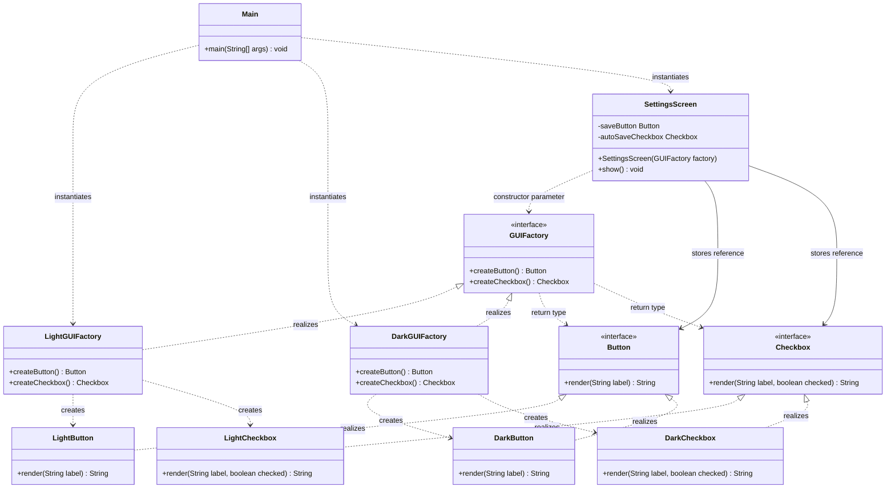
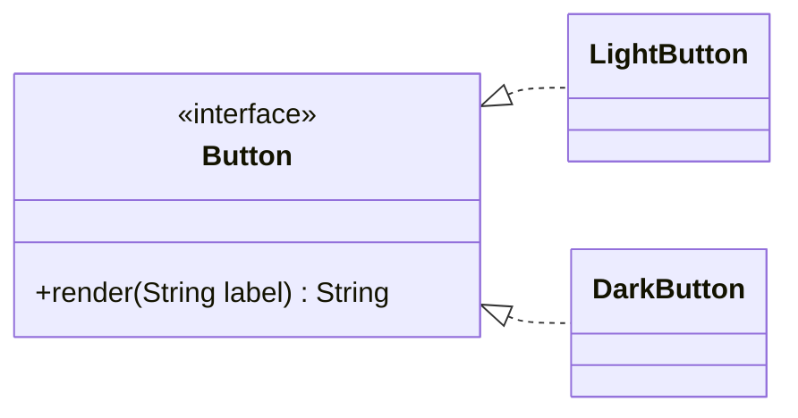
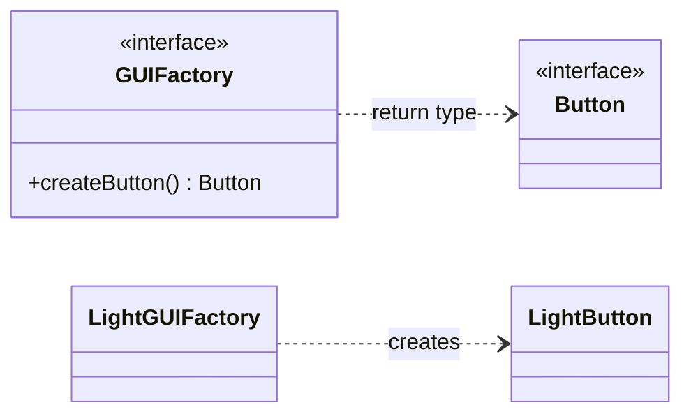
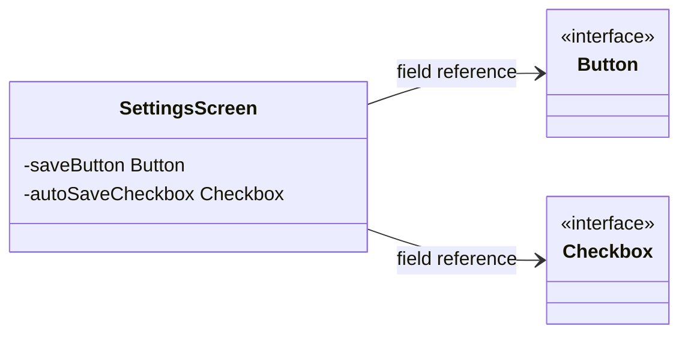
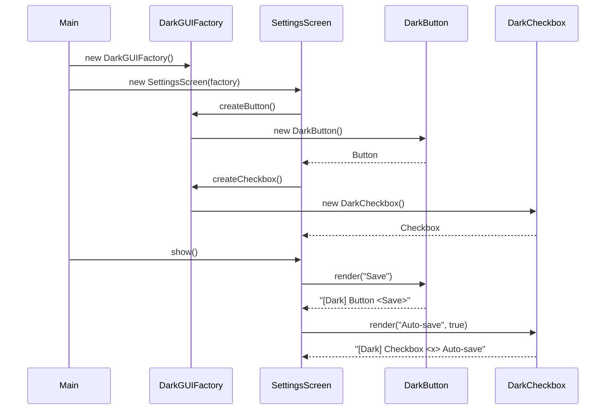

# Sơ đồ lớp UML và quan hệ phụ thuộc giữa factory, product và client

## 1. Mục tiêu: đọc được thiết kế qua các mũi tên

**Abstract Factory** là mẫu thiết kế khởi tạo (*Creational Design Pattern*) cho phép một client tạo và sử dụng **các họ sản phẩm liên quan** thông qua những hợp đồng trừu tượng. Để hiểu cấu trúc của mẫu, cần nhìn rõ hai câu hỏi:

- **Ai biết ai?** Lớp nào phụ thuộc vào interface, lớp nào bắt buộc biết tên concrete class?
- **Ai tạo và ai sử dụng?** Factory tạo sản phẩm, còn client sử dụng sản phẩm vào công việc của mình như thế nào?

Một sơ đồ lớp UML tốt giúp trả lời hai câu hỏi này ngay cả khi chưa đọc toàn bộ mã nguồn. Bài học giải thích vai trò của **Abstract Factory, Concrete Factory, Abstract Product, Concrete Product, Client** và nơi lắp ghép (*composition root*), sau đó dùng sơ đồ UML và ví dụ Java để kiểm tra từng quan hệ.

Sau bài này, bạn có thể:

1. Phân biệt các mũi tên **realization**, **dependency** và **association** trong sơ đồ lớp.
2. Chỉ ra các phụ thuộc cần có giữa factory, product và client.
3. Đối chiếu mũi tên trên sơ đồ với từng khai báo interface, trường dữ liệu, tham số và lệnh `new` trong Java.
4. Phát hiện sơ đồ có client bị gắn cứng vào concrete product hoặc factory trộn các họ.
5. Dự đoán lớp nào cần bổ sung khi thêm một họ sản phẩm hay một loại sản phẩm mới.

## 2. Ví dụ xuyên suốt: giao diện Light và Dark

Giả sử màn hình cài đặt có hai loại thành phần:

| Loại sản phẩm | Hợp đồng | Họ Light | Họ Dark |
| --- | --- | --- | --- |
| Nút bấm | `Button` | `LightButton` | `DarkButton` |
| Ô chọn | `Checkbox` | `LightCheckbox` | `DarkCheckbox` |

Quy tắc nghiệp vụ là **một màn hình phải sử dụng nút bấm và ô chọn cùng một theme**. Khi được cấp Light theme, màn hình sử dụng cả `LightButton` lẫn `LightCheckbox`; với Dark theme, nó dùng cả `DarkButton` lẫn `DarkCheckbox`.

Ta tổ chức mã theo các vai trò:

| Vai trò Abstract Factory | Thành phần | Trách nhiệm |
| --- | --- | --- |
| **Abstract Product** | `Button`, `Checkbox` | Khai báo hành vi mà client cần ở từng **loại** sản phẩm. |
| **Concrete Product** | `LightButton`, `LightCheckbox`, `DarkButton`, `DarkCheckbox` | Hiện thực hành vi theo từng **họ** sản phẩm. |
| **Abstract Factory** | `GUIFactory` | Khai báo phương thức tạo các loại sản phẩm liên quan. |
| **Concrete Factory** | `LightGUIFactory`, `DarkGUIFactory` | Cấp một bộ sản phẩm của cùng theme. |
| **Client** | `SettingsScreen` | Dùng `Button` và `Checkbox` qua interface, yêu cầu chúng từ `GUIFactory`. |
| **Composition root** | `Main` | Quyết định dùng factory Light hay Dark và truyền vào client. |

**Loại sản phẩm** trả lời “đây là nút hay ô chọn?”; **họ sản phẩm** trả lời “sản phẩm thuộc phong cách nào?”. `LightButton` và `DarkButton` cùng loại `Button` nhưng khác họ. `LightButton` và `LightCheckbox` khác loại nhưng thuộc cùng họ Light.

## 3. Sơ đồ lớp UML của Abstract Factory

Đây là sơ đồ UML mô tả đầy đủ hai họ sản phẩm trong ví dụ:



Sơ đồ có nhiều mũi tên, nhưng không phải tất cả đều mang cùng ý nghĩa. Hãy đọc theo ba nhóm:

1. **Các lớp hiện thực interface**: đường nét đứt với tam giác rỗng hướng về `Button`, `Checkbox`, `GUIFactory`.
2. **Các lớp cần biết tới lớp khác**: đường nét đứt có mũi tên thường hướng tới thành phần được dùng; ví dụ `LightGUIFactory` cần biết `LightButton` để gọi constructor.
3. **Các lớp giữ tham chiếu tới sản phẩm**: đường liền có hướng từ `SettingsScreen` tới `Button`, `Checkbox`; ở đây hai trường của client có các kiểu interface đó.

Mối quan hệ giữa `GUIFactory` với `Button`/`Checkbox` xuất hiện vì **kiểu trả về** của các phương thức factory. Mối quan hệ giữa `LightGUIFactory` với `LightButton`/`LightCheckbox` xuất hiện vì **mã hiện thực thực sự tạo các lớp cụ thể**. Đây là khác biệt then chốt khi đánh giá độ phụ thuộc.

## 4. Đọc đúng ký pháp UML trước khi phân tích mã

### 4.1. Realization: lớp hiện thực một interface

UML dùng đường **nét đứt** kết thúc bằng **tam giác rỗng** để chỉ quan hệ *realization* (lớp hiện thực hợp đồng của interface):



Mermaid viết `Button <|.. LightButton`, tương ứng trong Java:

```java
interface Button {
    String render(String label);
}

final class LightButton implements Button {
    @Override
    public String render(String label) {
        return "[Light] Button [" + label + "]";
    }
}
```

Tam giác **chỉ về interface `Button`**, vì `LightButton` là lớp hiện thực. Không nên đảo chiều và suy ra `Button` phụ thuộc vào `LightButton`. `Button` không cần biết theme nào tồn tại.

Tương tự:

- `GUIFactory <|.. LightGUIFactory`: `LightGUIFactory implements GUIFactory`.
- `Checkbox <|.. DarkCheckbox`: `DarkCheckbox implements Checkbox`.

**Phân biệt với kế thừa:** UML *generalization* giữa hai lớp dùng **đường liền** với tam giác rỗng (Mermaid `<|--`). Trong bài này quan hệ interface–class là **realization** (`<|..`). Cả hai đều thể hiện khả năng thay thế ở mức kiểu, nhưng là hai quan hệ khác nhau trong UML.

### 4.2. Dependency: một lớp dùng thành phần khác

Đường **nét đứt có mũi tên thường** biểu diễn *dependency*. Trong Mermaid: `A ..> B` nghĩa là **A phụ thuộc vào B** tại một điểm sử dụng, ví dụ:



Trong Java, một số nguồn tạo dependency thường gặp là:

- **Kiểu tham số**: constructor `SettingsScreen(GUIFactory factory)` khiến client dùng interface `GUIFactory`.
- **Kiểu trả về**: `Button createButton()` khiến `GUIFactory` dùng kiểu `Button`.
- **Biến cục bộ**: một phương thức khai báo `Button button` cần biết kiểu `Button`.
- **Lệnh tạo đối tượng**: `new LightButton()` khiến lớp chứa lời gọi phải biết `LightButton`.
- **Lời gọi phương thức static** hoặc sử dụng một lớp trong thân phương thức cũng có thể tạo dependency.

Dependency mô tả **quan hệ sử dụng**, không có nghĩa A phải sở hữu hoặc giữ B trong suốt vòng đời. Trong sơ đồ chính, `SettingsScreen ..> GUIFactory` là dependency vì constructor nhận factory nhưng **không lưu factory vào trường**.

### 4.3. Association: một đối tượng giữ liên kết tới đối tượng khác

*Association* thường được vẽ bằng **đường liền**. Đường liền có mũi tên trong sơ đồ chính biểu diễn hướng điều hướng của liên kết:



Hai trường trong Java:

```java
private final Button saveButton;
private final Checkbox autoSaveCheckbox;
```

cho thấy `SettingsScreen` giữ tham chiếu tới các đối tượng sản phẩm. Sơ đồ dùng association vì liên kết được lưu trong trạng thái của client.

Một số sơ đồ UML giản lược có thể dùng dependency nét đứt ngay cả khi nói về phụ thuộc tổng quát. Ở đây ta cố ý phân biệt **association cho trường được giữ lâu dài** và **dependency cho việc dùng kiểu hoặc gọi constructor tạm thời** để dễ ánh xạ tới mã.

> **Đừng vẽ composition chỉ vì có từ khóa `new`.** Quan hệ composition UML (hình thoi tô đen) hàm ý quyền sở hữu toàn thể–thành phần và ràng buộc vòng đời mạnh hơn. Một factory vừa tạo sản phẩm rồi trả về không mặc nhiên sở hữu product đó; `SettingsScreen` giữ tham chiếu cũng chưa đủ để khẳng định độc quyền sở hữu hoặc hủy đồng thời theo nghĩa UML.

### 4.4. Bảng tra nhanh các nét vẽ

| Ký pháp Mermaid/UML | Ý nghĩa ở ví dụ | Bằng chứng trong Java |
| --- | --- | --- |
| `Button <|.. LightButton` | `LightButton` hiện thực `Button`. | `implements Button` |
| `GUIFactory <|.. LightGUIFactory` | Factory Light hiện thực hợp đồng tạo product. | `implements GUIFactory` |
| `GUIFactory ..> Button` | Factory dùng `Button` như một kiểu trả về. | `Button createButton()` |
| `LightGUIFactory ..> LightButton` | Factory Light biết constructor product Light. | `new LightButton()` |
| `SettingsScreen ..> GUIFactory` | Client cần factory khi khởi tạo. | Tham số `GUIFactory factory` |
| `SettingsScreen --> Button` | Client giữ một tham chiếu kiểu `Button`. | Trường `Button saveButton` |
| `Main ..> LightGUIFactory` | Nơi lắp ghép biết concrete factory. | `new LightGUIFactory()` |

Các nhãn `creates`, `return type`, `stores reference` trong Mermaid là **ghi chú giải thích**, không phải những kiểu mũi tên UML bổ sung.

## 5. Mã Java tương ứng với sơ đồ lớp

Ví dụ sau đặt toàn bộ vào tệp **`Main.java`** và chạy được bằng JDK 8+. Phương thức `render` chỉ trả về chuỗi để nhìn thấy theme đang được sử dụng; đây không phải mã tạo giao diện đồ họa thật.

```java
// Main.java
import java.util.Objects;

// Abstract Product #1
interface Button {
    String render(String label);
}

// Abstract Product #2
interface Checkbox {
    String render(String label, boolean checked);
}

// Abstract Factory: hai phương thức tạo hai loại product liên quan.
interface GUIFactory {
    Button createButton();
    Checkbox createCheckbox();
}

// Concrete Products: họ Light.
final class LightButton implements Button {
    @Override
    public String render(String label) {
        return "[Light] Button [" + label + "]";
    }
}

final class LightCheckbox implements Checkbox {
    @Override
    public String render(String label, boolean checked) {
        return "[Light] Checkbox [" + (checked ? "x" : " ")
                + "] " + label;
    }
}

// Concrete Products: họ Dark.
final class DarkButton implements Button {
    @Override
    public String render(String label) {
        return "[Dark] Button <" + label + ">";
    }
}

final class DarkCheckbox implements Checkbox {
    @Override
    public String render(String label, boolean checked) {
        return "[Dark] Checkbox <" + (checked ? "x" : " ")
                + "> " + label;
    }
}

// Concrete Factory: cấp trọn bộ sản phẩm Light.
final class LightGUIFactory implements GUIFactory {
    @Override
    public Button createButton() {
        return new LightButton();
    }

    @Override
    public Checkbox createCheckbox() {
        return new LightCheckbox();
    }
}

// Concrete Factory: cấp trọn bộ sản phẩm Dark.
final class DarkGUIFactory implements GUIFactory {
    @Override
    public Button createButton() {
        return new DarkButton();
    }

    @Override
    public Checkbox createCheckbox() {
        return new DarkCheckbox();
    }
}

// Client: nhận factory qua constructor và giữ abstract products.
final class SettingsScreen {
    private final Button saveButton;
    private final Checkbox autoSaveCheckbox;

    SettingsScreen(GUIFactory factory) {
        Objects.requireNonNull(factory, "factory");
        saveButton = factory.createButton();
        autoSaveCheckbox = factory.createCheckbox();
    }

    void show() {
        System.out.println(saveButton.render("Save"));
        System.out.println(
                autoSaveCheckbox.render("Auto-save", true));
    }
}

// Composition root: một nơi chọn concrete factory để lắp ghép hệ thống.
public class Main {
    public static void main(String[] args) {
        String theme = args.length == 0 ? "light" : args[0];
        GUIFactory factory;

        if ("light".equalsIgnoreCase(theme)) {
            factory = new LightGUIFactory();
        } else if ("dark".equalsIgnoreCase(theme)) {
            factory = new DarkGUIFactory();
        } else {
            System.err.println("Unknown theme: " + theme);
            System.err.println("Usage: java Main [light|dark]");
            return;
        }

        SettingsScreen screen = new SettingsScreen(factory);
        screen.show();
    }
}
```

### 5.1. Biên dịch và chạy

Lưu thành `Main.java`, mở terminal tại thư mục chứa tệp rồi chạy:

```bash
javac Main.java
java Main light
```

Kết quả mong đợi:

```text
[Light] Button [Save]
[Light] Checkbox [x] Auto-save
```

Chạy lại với factory Dark:

```bash
java Main dark
```

Kết quả mong đợi:

```text
[Dark] Button <Save>
[Dark] Checkbox <x> Auto-save
```

Khi không truyền tham số, chương trình chọn Light. Nếu đưa tên theme khác, chương trình in hướng dẫn và kết thúc, tránh âm thầm dùng một họ không mong muốn.

### 5.2. Gắn từng quan hệ UML với vị trí trong mã

| Trong mã | Mũi tên hợp lý | Điều nó chứng minh |
| --- | --- | --- |
| `final class LightGUIFactory implements GUIFactory` | `GUIFactory <|.. LightGUIFactory` | Concrete Factory hiện thực hợp đồng Abstract Factory. |
| `final class LightCheckbox implements Checkbox` | `Checkbox <|.. LightCheckbox` | Concrete Product hiện thực Abstract Product. |
| `Button createButton()` trong `GUIFactory` | `GUIFactory ..> Button` | Factory trừu tượng chỉ dùng **kiểu sản phẩm chung**. |
| `return new LightButton();` | `LightGUIFactory ..> LightButton` | Factory cụ thể biết lớp product cụ thể. |
| `SettingsScreen(GUIFactory factory)` | `SettingsScreen ..> GUIFactory` | Client yêu cầu factory nhưng không lưu trong một trường. |
| `private final Button saveButton` | `SettingsScreen --> Button` | Client giữ tham chiếu tới abstract product. |
| `factory.createCheckbox()` | Phụ thuộc sử dụng phương thức của `GUIFactory` | Client yêu cầu product qua hợp đồng factory. |
| `new DarkGUIFactory()` trong `Main` | `Main ..> DarkGUIFactory` | Lựa chọn nền tảng/theme nằm ở điểm lắp ghép. |

Vì `SettingsScreen` không có lệnh `new LightButton()`, `new DarkButton()` hay tham số kiểu concrete product, **không cần vẽ dependency trực tiếp** từ client tới các lớp sản phẩm cụ thể. Trong lúc chạy, client *có thể giữ một instance* của `LightButton`, nhưng ở mức mã nguồn nó chỉ biết tham chiếu kiểu `Button`.

Điểm này rất quan trọng: **sơ đồ lớp biểu diễn quan hệ kiểu và phụ thuộc tĩnh**, không tự cho biết chính xác đối tượng cụ thể nào được tạo trong mỗi lần chạy. Ta cần kết hợp sơ đồ lớp với luồng thực thi để hiểu phần động.

## 6. Cộng tác lúc chạy: đọc từ sơ đồ lớp sang sơ đồ trình tự

Khi chạy `java Main dark`, luồng tương tác là:

1. `Main` tạo `DarkGUIFactory` và truyền nó vào `SettingsScreen` dưới kiểu `GUIFactory`.
2. Constructor của `SettingsScreen` gọi `createButton()` và `createCheckbox()` trên **cùng factory**.
3. `DarkGUIFactory` tạo `DarkButton`, `DarkCheckbox` rồi trả về dưới kiểu `Button`, `Checkbox`.
4. Client lưu hai tham chiếu và gọi `render()` khi `show()` được thực thi.



Trong sơ đồ trình tự, các mũi tên cho biết **lời gọi qua thời gian**. Cùng một thông tin này, sơ đồ lớp cho biết **quan hệ ổn định giữa các kiểu**: client nhận một `GUIFactory`, concrete factory hiện thực interface và phụ thuộc vào product cụ thể.

Sơ đồ trình tự cho thấy lệnh `createButton()` tạo `DarkButton`; sơ đồ lớp giải thích vì sao code `SettingsScreen` vẫn biên dịch nếu thay `DarkGUIFactory` bằng `LightGUIFactory`: cả hai trả về `Button` và `Checkbox` như hợp đồng đã khai báo.

### Sự khác nhau giữa phụ thuộc lúc biên dịch và instance lúc chạy

- **Phụ thuộc tĩnh:** `SettingsScreen` tham chiếu tới interface `Button`, `Checkbox`, `GUIFactory`; mã client không nhắc đến class Dark hoặc Light.
- **Đối tượng thực tế:** với `DarkGUIFactory`, các tham chiếu tại runtime trỏ đến instance `DarkButton`/`DarkCheckbox`.
- **Phân phối động:** Java gọi đúng implementation của `render()` trên đối tượng thực tế, dù biến có kiểu interface.

**Đảo ngược phụ thuộc** ở đây có nghĩa mã nghiệp vụ cấp cao (client) phụ thuộc vào **abstraction** của sản phẩm và factory. Các concrete factory phụ thuộc vào concrete product, còn nơi lựa chọn implementation được đưa về `Main`. Không nên mô tả điều này là “client không có bất kỳ phụ thuộc nào”: client vẫn phụ thuộc vào **interface** mà nó sử dụng.

## 7. Các mũi tên cho biết thay đổi sẽ lan tới đâu

### 7.1. Thêm một họ mới: HighContrast

Giả sử ứng dụng có yêu cầu giao diện tương phản cao. Ta bổ sung:

- `HighContrastButton implements Button`.
- `HighContrastCheckbox implements Checkbox`.
- `HighContrastGUIFactory implements GUIFactory`, trả về đúng hai product mới.
- Một nhánh lựa chọn factory trong `Main` hoặc cấu hình lắp ghép.

Trên sơ đồ UML, ta chỉ cần thêm các quan hệ realization tới interface cũ, cộng dependency từ concrete factory mới tới concrete product mới. `SettingsScreen` vẫn phụ thuộc vào `GUIFactory`/`Button`/`Checkbox`; không có mũi tên mới từ client tới lớp HighContrast.

Điều này thể hiện thế mạnh của Abstract Factory: **thêm họ sản phẩm mới tương đối ít tác động đến client** nếu các loại sản phẩm và hợp đồng của chúng không đổi.

### 7.2. Thêm một loại sản phẩm mới: Slider

Giả sử mọi theme đều cần thêm thanh trượt `Slider`. Ta phải:

1. Tạo interface `Slider`.
2. Bổ sung `Slider createSlider()` vào `GUIFactory`.
3. Thêm `LightSlider`, `DarkSlider` cùng những biến thể theo họ đang hỗ trợ.
4. Hiện thực `createSlider()` trong **mọi** concrete factory.
5. Chỉ chỉnh `SettingsScreen` nếu client này thực sự cần sử dụng slider.

Trên sơ đồ, `GUIFactory` có thêm dependency tới `Slider`; từng factory cụ thể có thêm dependency tới concrete slider thuộc họ mình. Các implementation `GUIFactory` bị ảnh hưởng bởi việc mở rộng hợp đồng, ngay cả khi một client hiện tại chưa cần slider.

**Đánh đổi thiết kế:** mô hình giúp thêm **họ** mới dễ hơn, nhưng thêm **loại sản phẩm** mới thường chạm vào toàn bộ các concrete factory.

## 8. Những sơ đồ hoặc diễn giải sai cần phát hiện

### Lỗi 1: Client phụ thuộc trực tiếp vào concrete product

Nếu một lớp màn hình viết:

```java
// Ví dụ phụ thuộc chặt; không thuộc chương trình Main.java ở trên.
final class RigidScreen {
    private final Button button = new LightButton();
    private final Checkbox checkbox = new LightCheckbox();
}
```

thì sơ đồ lớp phải thể hiện dependency từ `RigidScreen` tới `LightButton` và `LightCheckbox`, vì chính client chứa lệnh `new`. Client bị gắn với theme Light; muốn đổi theme có thể phải sửa nó.

**Cách sửa:** nhận `GUIFactory` qua constructor, yêu cầu cả hai product qua factory và lưu chúng dưới kiểu interface như `SettingsScreen`.

### Lỗi 2: Concrete Factory trộn sản phẩm hai họ

```java
// Ví dụ lỗi về tính nhất quán; kiểu Java vẫn hợp lệ.
final class BrokenLightGUIFactory implements GUIFactory {
    @Override
    public Button createButton() {
        return new LightButton();
    }

    @Override
    public Checkbox createCheckbox() {
        return new DarkCheckbox(); // Sai họ cho Light factory.
    }
}
```

Trên sơ đồ, factory này có dependency tới `LightButton` **và** `DarkCheckbox`. Nó vẫn hiện thực `GUIFactory` vì cả hai phương thức có kiểu trả về đúng, nhưng nó phá vỡ cam kết tạo **một họ tương thích**.

UML cho thấy rõ dependency “sai họ”; Java type system không tự ngăn được lỗi này chỉ bằng hai kiểu `Button` và `Checkbox`. Cần kiểm tra hợp đồng factory hoặc dùng các cơ chế kiểu phức tạp hơn nếu bài toán yêu cầu chặt chẽ.

### Lỗi 3: Vẽ sai hướng mũi tên realization

`LightButton` **hiện thực** `Button`, vậy tam giác rỗng phải hướng **về `Button`**. Nếu đảo hướng, người đọc có thể hiểu interface phụ thuộc hoặc hiện thực lớp cụ thể, trái với mã nguồn.

### Lỗi 4: Nhầm dependency với association hoặc composition

Factory gọi `new LightButton()` rồi **trả ngay đối tượng**, không nhất thiết lưu lại object này. Trong UML, quan hệ `LightGUIFactory ..> LightButton` (*creates/depends on*) thường đủ; vẽ association có sở hữu lâu dài hoặc composition hình thoi đen mà không có thông tin về quyền sở hữu/vòng đời sẽ dễ gây hiểu lầm.

Trong ví dụ `SettingsScreen` lưu các trường `Button`/`Checkbox`, nên association với các interface đó có ý nghĩa. Nếu client chỉ tạo product trong một phương thức, dùng xong rồi bỏ, dependency nét đứt có thể phản ánh chính xác hơn.

### Lỗi 5: Nghĩ composition root phải phụ thuộc vào abstraction mà thôi

Một nơi phải quyết định sử dụng `LightGUIFactory` hay `DarkGUIFactory`. `Main` biết cả hai concrete factory để chọn khi khởi tạo. Đây là phụ thuộc hợp lý ở **ranh giới lắp ghép**; điều quan trọng là sự lựa chọn không bị lặp lại rải rác trong các client như `SettingsScreen`.

### Lỗi 6: Gộp các product không liên quan vào một factory

Một `GUIFactory` nên tạo các thành phần cần đồng bộ theme. Nếu thêm `createInvoiceExporter()`, `createEmailSender()` chỉ vì chúng cũng cần `new`, sơ đồ có thể xuất hiện nhiều dependency từ factory tới những subsystem không có quan hệ tương thích với theme. Khi đó cần xét lại ranh giới của họ sản phẩm và nguyên tắc tách trách nhiệm.

## 9. Checklist khi đọc sơ đồ lớp Abstract Factory

Hãy đọc sơ đồ bất kỳ theo thứ tự sau:

1. **Tìm Abstract Products.** Có những interface nào mô tả các loại sản phẩm client cần? Chúng có độc lập với tên theme/nền tảng không?
2. **Tìm các họ Concrete Products.** Những lớp nào cùng hiện thực một loại product? Những lớp nào thuộc cùng một họ?
3. **Tìm Abstract Factory.** Nó khai báo đủ phương thức để cấp các loại product liên quan hay chỉ tạo một đối tượng đơn lẻ?
4. **Kiểm tra realization.** Mỗi concrete factory có hiện thực đúng interface factory không? Mỗi product có hiện thực đúng interface product không?
5. **Kiểm tra các dependency từ factory.** Mỗi concrete factory có cấp trọn bộ sản phẩm cùng họ không?
6. **Tìm Client.** Client lưu hoặc sử dụng các abstraction hay khởi tạo concrete product trực tiếp?
7. **Tìm điểm chọn implementation.** Có một composition root/configuration chọn concrete factory rồi truyền cho client không?
8. **Đánh giá khả năng thay đổi.** Khi thêm họ sản phẩm mới, có thể giữ nguyên client không? Khi thêm một loại sản phẩm mới, những factory nào phải sửa?

Một sơ đồ đạt yêu cầu phải giải thích được cả **phụ thuộc tĩnh** (mã phải biết các kiểu nào) lẫn **khả năng thay thế ở runtime** (factory cụ thể nào đang cung cấp các product tương thích).

## 10. Tự luyện tập đọc và sửa UML

**Bài 1.** Giả sử có đoạn mã:

```java
class PreviewPanel {
    private final GUIFactory factory;

    PreviewPanel(GUIFactory factory) {
        this.factory = factory;
    }

    String preview() {
        return factory.createButton().render("Preview");
    }
}
```

Hãy xác định sự khác nhau giữa quan hệ `PreviewPanel` với `GUIFactory` và quan hệ với `Button`.

**Gợi ý đáp án:** `PreviewPanel` **giữ trường** kiểu `GUIFactory`, nên có thể vẽ association từ panel tới factory. Phương thức `preview()` dùng product `Button` tạm thời và không lưu một trường `Button`, nên có thể vẽ dependency từ panel tới `Button`. Cách chọn ký pháp cần nhất quán với thông tin vòng đời được biểu diễn.

**Bài 2.** Trong sơ đồ có mũi tên `SettingsScreen ..> DarkButton` nhưng mã Java của `SettingsScreen` chỉ khai báo `Button` và gọi `factory.createButton()`. Mũi tên này có phản ánh phụ thuộc tĩnh không?

**Gợi ý đáp án:** Không, nếu client không nhắc đến `DarkButton` ở bất kỳ vị trí kiểu/lời gọi nào khác. Client có thể nhận instance `DarkButton` ở runtime nhưng mã của client chỉ phụ thuộc vào `Button` và `GUIFactory`. Sơ đồ lớp nên phản ánh đúng quan hệ kiểu, còn một sơ đồ đối tượng hoặc sơ đồ trình tự có thể cho thấy instance thực tế.

**Bài 3.** Một concrete factory tên `LightGUIFactory` dùng `new LightButton()` và `new DarkCheckbox()`. Những mũi tên nào giúp phát hiện vấn đề?

**Gợi ý đáp án:** Hai dependency từ `LightGUIFactory` đến `LightButton` và `DarkCheckbox` cho thấy factory đang trộn product Light/Dark. Lỗi nằm ở **tính nhất quán họ** dù các kiểu trả về vẫn là `Button` và `Checkbox`.

**Bài 4.** Nếu `SettingsScreen` cần tạo nút mới mỗi lần nhấn một phím tắt, sơ đồ lớp thay đổi như thế nào khi client **giữ factory** trong một trường thay vì chỉ dùng factory trong constructor?

**Gợi ý đáp án:** Lúc này client có thể có association tới `GUIFactory` vì lưu factory để gọi nhiều lần. Tùy cách sử dụng, client có thể không còn giữ mọi `Button` thành trường lâu dài. Thay đổi quan hệ **lưu giữ** được phản ánh trên sơ đồ, nhưng các interface và họ sản phẩm vẫn không thay đổi.

**Bài 5.** Có thể tạo một sơ đồ lớp chỉ gồm `GUIFactory` và `LightGUIFactory` mà kết luận đã mô tả đủ Abstract Factory chưa?

**Gợi ý đáp án:** Chưa. Cần chỉ ra **những loại Abstract Product nào được tạo**, các concrete product của mỗi họ và client phụ thuộc vào abstraction ra sao. Bỏ phần product sẽ mất lý do vì sao cần một nhà máy tạo **họ sản phẩm** thay vì một lớp tạo một đối tượng đơn lẻ.

## 11. Điều cần nhớ

Sơ đồ lớp UML của Abstract Factory có một cấu trúc phụ thuộc đặc trưng:

- **Client → Abstract Factory và Abstract Product**: client yêu cầu và dùng các interface, nên có thể thay họ sản phẩm mà không sửa logic sử dụng.
- **Concrete Factory → Concrete Product**: mỗi factory biết lớp cụ thể để tạo **đúng bộ sản phẩm của cùng một họ**.
- **Concrete Factory/Concrete Product → interface tương ứng** qua realization: các implementation tuân thủ hợp đồng đã công bố.
- **Composition root → Concrete Factory**: điểm lắp ghép quyết định họ sản phẩm nào sẽ được sử dụng khi chạy.

Khi nhìn các mũi tên này, hãy luôn tự hỏi **mũi tên đại diện cho loại quan hệ UML nào, chứng cứ trong mã nằm ở đâu, và thay đổi một họ sản phẩm sẽ tác động tới lớp nào**. Đó là cách dùng UML để đánh giá kiến trúc Abstract Factory thay vì chỉ xem sơ đồ như một danh sách tên lớp.
