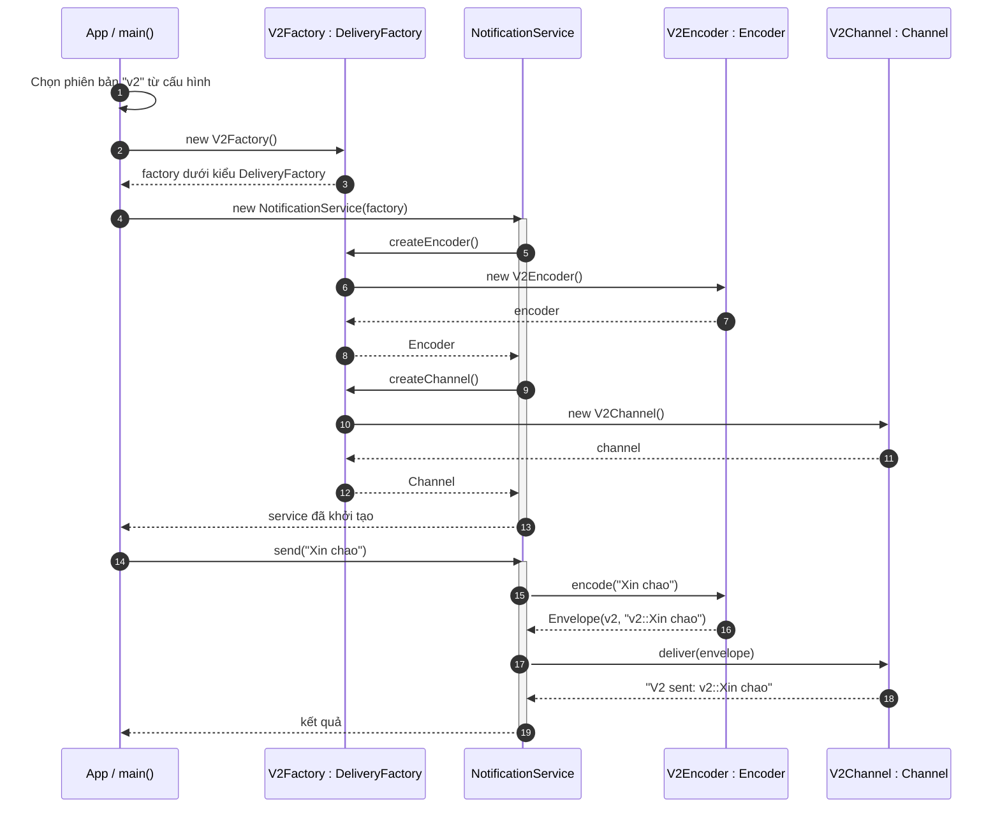
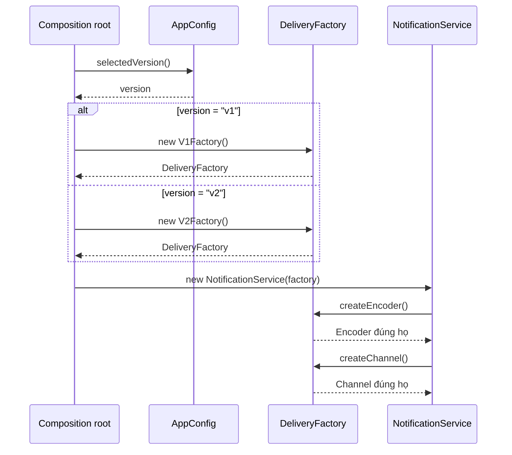
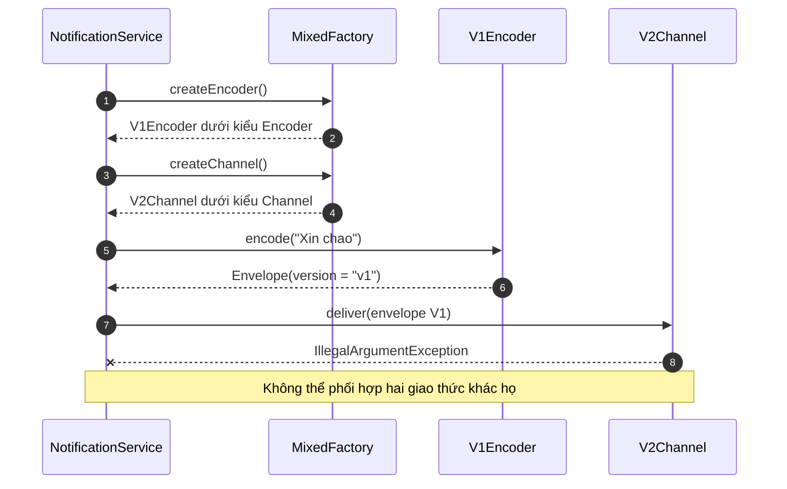
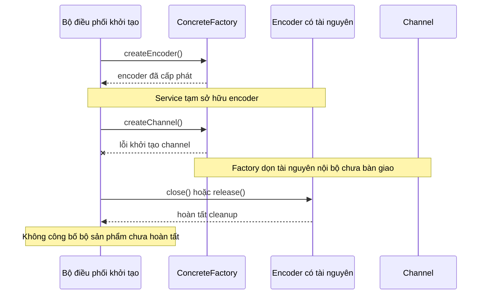

# Sơ đồ tuần tự từ chọn factory đến tạo và phối hợp các sản phẩm

## 1. Vì sao cần nhìn Abstract Factory theo trình tự thời gian?

**Abstract Factory** là mẫu thiết kế khởi tạo giúp client yêu cầu **nhiều vai trò sản phẩm liên quan thuộc cùng một họ** mà không phải phụ thuộc vào tên lớp sản phẩm cụ thể. Sơ đồ lớp cho biết ai triển khai interface nào; **sơ đồ tuần tự (sequence diagram)** trả lời một câu hỏi khác: *Trong một lần chạy, ai chọn factory, ai gọi phương thức tạo, sản phẩm đến tay client bằng cách nào và chúng phối hợp ra sao?*

Để theo dõi, giả sử hệ thống gửi thông báo tới một dịch vụ hỗ trợ hai phiên bản giao thức giả lập:

| Vai trò sản phẩm | Họ V1 | Họ V2 |
| --- | --- | --- |
| `Encoder`: mã hóa nội dung thành thông điệp | `V1Encoder` | `V2Encoder` |
| `Channel`: gửi thông điệp đúng phiên bản | `V1Channel` | `V2Channel` |
| Concrete factory | `V1Factory` | `V2Factory` |

Hai sản phẩm trong một họ có **hợp đồng cộng tác**: `Encoder` tạo `Envelope` mang phiên bản giao thức mà `Channel` cùng họ có thể hiểu. Chẳng hạn, `V2Encoder` tạo thông điệp phiên bản V2 và `V2Channel` chấp nhận thông điệp đó.

Trong ví dụ này, `DeliveryFactory` là *AbstractFactory*, `Encoder` và `Channel` là *AbstractProduct*, còn `NotificationService` là client. Các chuỗi `v1|` và `v2::` chỉ là quy ước minh họa, **không phải giao thức mạng hay chuẩn dữ liệu thực tế**.

## 2. Những thành phần xuất hiện trong sơ đồ tuần tự

| Thành phần tham gia | Điều nó biết | Trách nhiệm trong luồng chạy |
| --- | --- | --- |
| **Composition root** (mã khởi động) | Cấu hình phiên bản và các concrete factory khả dụng | Chọn một concrete factory rồi truyền nó cho client |
| **`DeliveryFactory`** (AbstractFactory) | Hai vai trò sản phẩm có thể được yêu cầu | Công bố `createEncoder()` và `createChannel()` |
| **`V1Factory`/`V2Factory`** (ConcreteFactory) | Tên và cách tạo concrete products của một họ | Hiện thực các phương thức tạo, trả về sản phẩm đúng vai trò |
| **`Encoder`** (AbstractProduct) | Cách mã hóa một thông điệp | Trả về dữ liệu trung gian `Envelope` |
| **`Channel`** (AbstractProduct) | Cách tiếp nhận và gửi `Envelope` | Đọc thông điệp theo hợp đồng giao thức, trả kết quả |
| **`NotificationService`** (Client) | Chỉ các interface của factory và sản phẩm | Yêu cầu tạo sản phẩm, sau đó điều phối luồng mã hóa → gửi |

**Lưu ý khi đọc sơ đồ:** `DeliveryFactory` là **kiểu trừu tượng của biến** mà client giữ. Đối tượng **thực sự nhận lời gọi lúc chạy** là `V1Factory` hoặc `V2Factory`. Trên sơ đồ tuần tự, ta có thể ghi tên lifeline là `V2Factory : DeliveryFactory` để thể hiện cả hai cấp độ.

## 3. Sáu bước từ cấu hình đến kết quả

1. **Chọn họ tại ranh giới ứng dụng.** Mã khởi động đọc lựa chọn phiên bản, ví dụ `"v2"`, rồi tạo `V2Factory`. Việc chọn họ diễn ra **trước khi client yêu cầu các sản phẩm liên quan**.
2. **Cấp factory cho client.** Mã khởi động gọi `new NotificationService(factory)`, trong đó tham số được khai báo bằng kiểu `DeliveryFactory`, không phải `V2Factory`.
3. **Tạo sản phẩm thứ nhất.** Client gọi `factory.createEncoder()`; Java định tuyến lời gọi tới `V2Factory.createEncoder()`, nơi tạo `V2Encoder`. Client chỉ giữ đối tượng dưới kiểu `Encoder`.
4. **Tạo sản phẩm thứ hai.** Client gọi `factory.createChannel()` **trên cùng đối tượng factory**; `V2Factory` tạo `V2Channel`. Sau hai bước này, client sở hữu hai vai trò cần thiết.
5. **Phối hợp sản phẩm.** Khi cần gửi, client gọi `encoder.encode(message)`, nhận `Envelope`, rồi chuyển `Envelope` ấy vào `channel.deliver(envelope)`. Hai sản phẩm không nhất thiết phải gọi nhau trực tiếp; chúng phối hợp **thông qua dữ liệu và luồng điều phối của client**.
6. **Trả kết quả.** `Channel` trả kết quả gửi; `NotificationService` chuyển kết quả về nơi gọi. Việc tạo và việc sử dụng sản phẩm là **hai giai đoạn có thể diễn ra ở các thời điểm khác nhau**.

Trong kịch bản này, client tạo sản phẩm ngay tại constructor (*eager initialization*). Abstract Factory **không bắt buộc** thứ tự tạo hoặc thời điểm tạo như trên; các ứng dụng khác có thể tạo lazily khi thực sự cần. Dù chọn cách nào, cần giữ nguyên hợp đồng về họ và vòng đời.

## 4. Sơ đồ tuần tự chính: chọn V2Factory và gửi thông điệp



### Cách đọc từng loại mũi tên

- `Main -> Factory` với nội dung `new V2Factory()`: mã khởi động biết lớp factory cụ thể và quyết định họ được dùng.
- `Service -> Factory` với nội dung `createEncoder()`/`createChannel()`: client chỉ gọi **hợp đồng Abstract Factory**; concrete factory quyết định thực hiện `new` lớp nào.
- `Factory -> Encoder` hoặc `Factory -> Channel`: minh họa thao tác khởi tạo các concrete product. Đây là mô tả khái niệm; ký pháp chính xác có thể khác nếu dùng Mermaid `create participant` hoặc UML chuyên dụng.
- Mũi tên nét đứt quay về client biểu diễn **giá trị trả về**. Kiểu mà client nhìn thấy là `Encoder`/`Channel`, không nhất thiết là tên concrete product.
- `Service -> Encoder -> Service -> Channel`: chuỗi **cộng tác sau khi tạo**. `Encoder` và `Channel` không cần biết tên lớp cụ thể của nhau, nhưng phải thống nhất ý nghĩa của `Envelope`.

**Điểm quan trọng nhất trên sơ đồ:** cả `createEncoder()` và `createChannel()` đều đi tới **cùng lifeline factory**. Đó là nơi quyết định *cả họ* được tập trung. Trên thực tế, lựa chọn factory và truyền dependency có thể do một DI container thực hiện; trách nhiệm vẫn tương tự.

## 5. Sơ đồ chọn biến thể: nhánh V1 hoặc V2 nằm ngoài client

Trong sequence diagram, một khối `alt` thể hiện những đường thực thi thay thế. Mã khởi động có thể chọn một trong hai concrete factory, nhưng **không đưa nhánh chọn họ vào `NotificationService`**:



Sơ đồ đã lược bỏ đường lỗi khi cấu hình không được hỗ trợ. Trong mã thật, nên **từ chối phiên bản không hợp lệ** thay vì âm thầm chọn một họ mặc định ngoài dự kiến. Sau khi factory được chọn, client giữ nguyên chuỗi lời gọi bất kể đang chạy họ V1 hay V2.

Ở đây, `Factory` là **lifeline khái niệm** có kiểu `DeliveryFactory`, đại diện cho instance cụ thể vừa được chọn. Hai nhánh `alt` loại trừ nhau: một lần khởi tạo chỉ chọn một họ.

## 6. Ví dụ Java hoàn chỉnh khớp với sơ đồ

Chương trình sau mô phỏng hai họ V1 và V2. Mỗi họ gồm `Encoder` và `Channel` có thể phối hợp qua `Envelope`. `NotificationService` không hề tham chiếu đến tên `V1Encoder` hay `V2Channel`.

```java
// Lưu trong file FactorySequenceDemo.java
import java.util.Objects;

public class FactorySequenceDemo {

    // Dữ liệu trung gian mà Encoder tạo, Channel tiếp nhận.
    static final class Envelope {
        final String version;
        final String body;

        Envelope(String version, String body) {
            this.version = version;
            this.body = body;
        }
    }

    // AbstractProduct: hai vai trò tham gia chuỗi xử lý.
    interface Encoder {
        Envelope encode(String message);
    }

    interface Channel {
        String deliver(Envelope envelope);
    }

    // AbstractFactory: hợp đồng tạo cả hai vai trò sản phẩm.
    interface DeliveryFactory {
        Encoder createEncoder();
        Channel createChannel();
    }

    // Các concrete product của họ V1.
    static final class V1Encoder implements Encoder {
        @Override
        public Envelope encode(String message) {
            return new Envelope("v1", "v1|" + message);
        }
    }

    static final class V1Channel implements Channel {
        @Override
        public String deliver(Envelope envelope) {
            if (!"v1".equals(envelope.version)
                    || !envelope.body.startsWith("v1|")) {
                throw new IllegalArgumentException(
                        "V1Channel requires v1 envelope");
            }
            return "V1 sent: " + envelope.body;
        }
    }

    // Các concrete product của họ V2.
    static final class V2Encoder implements Encoder {
        @Override
        public Envelope encode(String message) {
            return new Envelope("v2", "v2::" + message);
        }
    }

    static final class V2Channel implements Channel {
        @Override
        public String deliver(Envelope envelope) {
            if (!"v2".equals(envelope.version)
                    || !envelope.body.startsWith("v2::")) {
                throw new IllegalArgumentException(
                        "V2Channel requires v2 envelope");
            }
            return "V2 sent: " + envelope.body;
        }
    }

    // Hai ConcreteFactory: mỗi factory chọn trọn bộ cùng họ.
    static final class V1Factory implements DeliveryFactory {
        @Override
        public Encoder createEncoder() {
            return new V1Encoder();
        }

        @Override
        public Channel createChannel() {
            return new V1Channel();
        }
    }

    static final class V2Factory implements DeliveryFactory {
        @Override
        public Encoder createEncoder() {
            return new V2Encoder();
        }

        @Override
        public Channel createChannel() {
            return new V2Channel();
        }
    }

    // Cố ý sai: đúng kiểu trả về nhưng trộn concrete product.
    static final class MixedFactory implements DeliveryFactory {
        @Override
        public Encoder createEncoder() {
            return new V1Encoder();
        }

        @Override
        public Channel createChannel() {
            return new V2Channel();
        }
    }

    // Client: một quy trình duy nhất cho cả hai họ.
    static final class NotificationService {
        private final Encoder encoder;
        private final Channel channel;

        NotificationService(DeliveryFactory factory) {
            Objects.requireNonNull(factory, "factory");
            this.encoder = Objects.requireNonNull(
                    factory.createEncoder(), "encoder");
            this.channel = Objects.requireNonNull(
                    factory.createChannel(), "channel");
        }

        String send(String message) {
            Envelope envelope = encoder.encode(message);
            return channel.deliver(envelope);
        }
    }

    // Composition root: quyết định họ, không phải client.
    static DeliveryFactory selectFactory(String version) {
        if ("v1".equals(version)) {
            return new V1Factory();
        }
        if ("v2".equals(version)) {
            return new V2Factory();
        }
        throw new IllegalArgumentException(
                "Unsupported version: " + version);
    }

    public static void main(String[] args) {
        NotificationService serviceV1 =
                new NotificationService(selectFactory("v1"));
        NotificationService serviceV2 =
                new NotificationService(selectFactory("v2"));

        System.out.println(serviceV1.send("Xin chao"));
        System.out.println(serviceV2.send("Xin chao"));

        // Factory có thể sai ở mức họ dù đúng kiểu interface.
        try {
            new NotificationService(new MixedFactory()).send("Xin chao");
        } catch (IllegalArgumentException failure) {
            System.out.println("Mixed family: " + failure.getMessage());
        }
    }
}
```

Biên dịch và chạy bằng JDK:

```bash
javac FactorySequenceDemo.java
java FactorySequenceDemo
```

Kết quả dự kiến:

```text
V1 sent: v1|Xin chao
V2 sent: v2::Xin chao
Mixed family: V2Channel requires v2 envelope
```

### Đối chiếu code với chuỗi lời gọi

| Bước trên sơ đồ | Vị trí trong code | Ý nghĩa |
| --- | --- | --- |
| Chọn `V2Factory` | `selectFactory("v2")` | Chọn **một họ** tại composition root |
| Bàn giao factory cho client | `new NotificationService(selectFactory(...))` | Client nhận kiểu `DeliveryFactory`, không phụ thuộc lớp chọn họ |
| Tạo encoder | `factory.createEncoder()` trong constructor client | Đa hình định tuyến tới `V2Factory.createEncoder()` |
| Tạo channel | `factory.createChannel()` trong cùng constructor | Yêu cầu vai trò thứ hai **từ cùng factory** |
| Tạo dữ liệu trung gian | `encoder.encode(message)` | Sản phẩm thứ nhất chuyển đầu vào sang `Envelope` |
| Sử dụng dữ liệu trung gian | `channel.deliver(envelope)` | Sản phẩm thứ hai tiếp nhận kết quả của sản phẩm thứ nhất |
| Trả kết quả | `return channel.deliver(envelope)` | Client hoàn tất quy trình mà không cần biết concrete products |

Trong chương trình này, `Encoder` và `Channel` **không gọi trực tiếp nhau**. Sự phối hợp được hiện thực qua `Envelope` và `NotificationService`. Trong thiết kế khác, các sản phẩm cùng họ cũng có thể truyền tham chiếu cho nhau hoặc gọi phương thức của nhau trực tiếp, miễn là phụ thuộc được quản lý rõ ràng.

## 7. Sơ đồ đường lỗi: nhận đúng interface nhưng sai họ

`MixedFactory` trong ví dụ cố ý trả `V1Encoder` và `V2Channel`. Điều này **biên dịch được** vì cả hai vẫn triển khai các interface mà `DeliveryFactory` công bố. Tuy nhiên, thông điệp do encoder V1 tạo không được channel V2 chấp nhận.



Bài học từ sơ đồ lỗi:

1. **Kiểu trả về đúng** không đồng nghĩa **hợp đồng tương thích đúng**. Java kiểm tra `Encoder`/`Channel`, không tự đảm bảo hai sản phẩm cùng phiên bản.
2. Abstract Factory giúp **tập trung trách nhiệm lựa chọn họ**, nhưng concrete factory vẫn có thể được triển khai sai.
3. Việc kiểm tra `version` bên trong `Channel` là **cơ chế bảo vệ minh họa**, không phải thành phần bắt buộc của Abstract Factory.
4. Có thể phát hiện lỗi sớm hơn bằng kiểm thử hợp đồng cho từng concrete factory, kiểm thử tích hợp toàn bộ quy trình, hoặc thiết kế ràng buộc dữ liệu mạnh hơn nếu miền nghiệp vụ yêu cầu.

## 8. Phân biệt ba thời điểm trong luồng cộng tác

### 8.1. Thời điểm chọn họ

Trong ví dụ, `selectFactory(...)` chạy trước khi `NotificationService` được xây dựng. Điều này giúp một instance client có một **lựa chọn họ nhất quán**.

Trong hệ thống có cấu hình thay đổi lúc chạy, không nên gọi lại `factoryProvider.currentFactory()` trước **mỗi** lần tạo sản phẩm nếu cần giữ cùng họ. Hai lần gọi có thể trả hai concrete factory khác nhau khi cấu hình đổi giữa chừng.

```java
// Có nguy cơ nếu provider thay đổi theo thời gian:
Encoder encoder = provider.currentFactory().createEncoder();
Channel channel = provider.currentFactory().createChannel();
```

Một cách an toàn hơn cho một lần lắp ráp:

```java
DeliveryFactory selected = provider.currentFactory();
Encoder encoder = selected.createEncoder();
Channel channel = selected.createChannel();
```

Hai khối mã này là **minh họa độc lập**; `provider` đại diện một thành phần cấu hình giả định, không phải class thuộc chương trình Java ở phần 6. Việc chốt tham chiếu chỉ đủ khi **concrete factory không tự đổi họ** giữa hai lời gọi.

### 8.2. Thời điểm tạo sản phẩm

Đoạn mã chính tạo sản phẩm trong constructor (*eager*). Nếu cần tối ưu khởi động, một client khác có thể tạo `Channel` ở lần `send()` đầu tiên (*lazy*). Sơ đồ tuần tự khi ấy sẽ đặt lời gọi `createChannel()` sau lời gọi `send()` thay vì trong constructor.

Chính sách tạo mới, lấy từ cache, mượn pool hay chia sẻ instance **không được Abstract Factory quyết định tự động**. Sơ đồ cần diễn đạt đúng cơ chế thực tế nếu hành vi đó ảnh hưởng đến vòng đời hoặc sự đồng thời.

### 8.3. Thời điểm sản phẩm phối hợp

Mã khởi tạo có thể kết thúc rất lâu trước khi client gọi `send()`. Tại thời điểm sử dụng, client vẫn cần các sản phẩm đã được tạo hoạt động đúng giao thức, dữ liệu và quy tắc nghiệp vụ. Việc cả hai được tạo từ một factory là một **cấu trúc tổ chức nhằm duy trì nhất quán**, không thay thế kiểm chứng hành vi.

Ví dụ, dữ liệu `Envelope(version="v2")` có thể đúng nhãn phiên bản nhưng sai định dạng ở phần `body`. Vì vậy `V2Channel` trong bài cũng kiểm tra tiền tố `v2::` và không chỉ kiểm tra kiểu Java.

## 9. Nếu tạo sản phẩm thứ hai thất bại thì sao?

Giả sử `createEncoder()` tạo thành công một đối tượng giữ tài nguyên, nhưng `createChannel()` ném ngoại lệ. Sequence diagram cần thể hiện rõ **đường lỗi và quyền sở hữu**, thay vì ngầm giả định mọi lời gọi luôn thành công:



Đây là một **kịch bản vòng đời giả định**: trong ví dụ Java chính, `Encoder` và `Channel` không giữ tài nguyên cần đóng. Với sản phẩm có socket, file, session hoặc lease, bộ điều phối cần dùng `try-with-resources`, cleanup stack hoặc cơ chế chuyển quyền sở hữu phù hợp để không làm rò rỉ tài nguyên khi chỉ tạo được một phần.

Nên phân biệt **tài nguyên nội bộ** mà factory chưa trả về (factory phải dọn) với **sản phẩm đã bàn giao** cho bên gọi (bên đang sở hữu phải xử lý). Không dùng `close()` trên một tài nguyên dùng chung hay mượn từ pool nếu hợp đồng yêu cầu `release()` theo cách khác.

## 10. Cách tự vẽ sơ đồ tuần tự cho bài toán Abstract Factory

Một quy trình thực hành từ code sang sơ đồ:

1. **Tìm điểm chọn họ:** `selectFactory()`, composition root, cấu hình hoặc DI binding. Xem đối tượng nào biết tên concrete factory.
2. **Liệt kê các vai trò:** các phương thức `create...` trả về `AbstractProduct` nào? Với ví dụ này là `Encoder` và `Channel`.
3. **Đặt các lifeline:** mã khởi động, client, concrete factory được chọn, và từng concrete product cần theo dõi. Ghi rõ kiểu trừu tượng bên cạnh tên instance khi có ích.
4. **Vẽ pha khởi tạo:** từ mã khởi động đến factory, từ client đến factory và từ factory đến concrete products; thêm các mũi tên trả về mang kiểu trừu tượng.
5. **Vẽ pha sử dụng:** client gọi phương thức nào trên từng sản phẩm? Dữ liệu/trạng thái đi từ sản phẩm này sang sản phẩm khác như thế nào?
6. **Thêm nhánh `alt`, `opt`, `loop` khi cần:** lựa chọn factory theo cấu hình, tạo tùy chọn, retry hoặc vòng lặp tạo nhiều sản phẩm. Không đưa mọi trường hợp vào một sơ đồ khiến nó khó đọc.
7. **Xét lỗi và kết thúc vòng đời:** nếu sản phẩm giữ tài nguyên hoặc có bước khởi tạo thất bại, vẽ rõ cleanup, rollback hoặc việc không trả về bundle chưa hoàn tất.
8. **Đối chiếu mã thực tế:** một mũi tên tạo phải tương ứng với thao tác tạo hoặc cấp phát có thể xảy ra; không vẽ hai đối tượng liên lạc trực tiếp nếu mã chỉ cho thấy client làm trung gian.

### Quy ước khi đọc Mermaid

| Ký pháp | Cách đọc trong ngữ cảnh bài |
| --- | --- |
| `A->>B: call()` | A gọi B thực hiện thao tác |
| `B-->>A: result` | B trả kết quả về A |
| `B--xA: error` | Mô tả đường lỗi/thất bại |
| `activate A`, `deactivate A` | Đánh dấu khoảng A đang thực thi xử lý |
| `alt` / `else` / `end` | Các nhánh thay thế theo điều kiện |
| `opt` / `end` | Một đoạn xử lý tùy chọn |
| `Note over A,B:` | Ghi chú giải thích quy tắc tương thích hoặc vòng đời |

Mermaid hỗ trợ mô tả luồng dễ đọc, nhưng không thay thế yêu cầu kiểm tra code thật. Ví dụ, chỉ vẽ `new V2Channel()` không có nghĩa mọi triển khai của `createChannel()` bắt buộc luôn cấp phát đối tượng mới; factory cũng có thể dùng cache hoặc pool tùy hợp đồng.

## 11. Những lỗi thường gặp khi diễn giải sơ đồ

### Nhầm lúc chọn factory với lúc client tạo sản phẩm

Mã khởi động quyết định **họ**; client quyết định **khi nào cần vai trò sản phẩm**. Nếu để `NotificationService` gọi `new V2Factory()` hoặc phân nhánh `if (version)`, client đã biết chi tiết chọn họ và khó thay bằng một họ khác chỉ qua dependency injection.

### Nhầm AbstractFactory với ConcreteFactory trên lifeline

`DeliveryFactory` là kiểu của hợp đồng, còn khi chạy lời gọi sẽ đi đến instance `V1Factory` hoặc `V2Factory`. Trên sơ đồ có thể ghi `V2Factory : DeliveryFactory` để tránh hiểu rằng một interface được khởi tạo bằng `new`.

### Nhầm quan hệ “cùng họ” với việc các sản phẩm bắt buộc gọi nhau

Sản phẩm cùng họ có thể **phối hợp gián tiếp qua client**. Trong ví dụ, `Encoder` xuất `Envelope` và `Channel` nhận chính dữ liệu đó; `Encoder` không cần giữ tham chiếu đến `Channel`.

### Bỏ qua đường lỗi hoặc thay đổi cấu hình

Nếu có thể đổi phiên bản giữa hai lần gọi factory, hai sản phẩm có thể thuộc hai họ. Nếu một sản phẩm khởi tạo thất bại sau khi sản phẩm khác được tạo, phải xác định cleanup. Sơ đồ thành công là **một đường chạy**, không phải bằng chứng mọi đường chạy đều an toàn.

### Giả định interface tự bảo đảm tương thích

Java kiểm tra rằng `createEncoder()` trả về `Encoder` và `createChannel()` trả về `Channel`; nó không bảo đảm `V1Encoder` tương thích với `V2Channel`. Sơ đồ tuần tự trộn họ ở phần 7 giúp thấy rõ vấn đề xuất hiện **khi sản phẩm thực sự cộng tác**.

## 12. Tự kiểm tra qua ba tình huống

**Tình huống A.** `main()` chọn `V1Factory`, đưa factory vào `NotificationService`; service gọi `createEncoder()`, `createChannel()`, rồi `send()`. **Cần bao nhiêu quyết định chọn họ trong một lần khởi tạo service?** Về mặt thiết kế, chỉ cần **một**, diễn ra tại composition root; client dùng cả hai sản phẩm được cung cấp qua factory đã chọn.

**Tình huống B.** Một ứng dụng có `Channel` được tạo lazily sau lần gửi đầu tiên. **Mũi tên `createChannel()` nên xuất hiện ở đâu?** Trong đoạn xử lý được kích hoạt bởi `send()` lần đầu, không phải tự động tại constructor; sơ đồ phải phản ánh thứ tự thực thi thật.

**Tình huống C.** `V1Encoder` và `V2Channel` đều triển khai đúng interface, nhưng thông điệp V1 bị từ chối. **Mũi tên nào thể hiện sự cố?** Lời gọi từ client đến `V2Channel.deliver(envelopeV1)` và đường trả lỗi từ `V2Channel` về client; việc gọi `create...` có thể vẫn thành công.

## Ghi nhớ

Sơ đồ tuần tự của Abstract Factory nên thể hiện **ba giai đoạn riêng biệt nhưng liên kết**: **chọn một concrete factory**, **tạo các vai trò sản phẩm thông qua hợp đồng factory**, rồi **phối hợp các sản phẩm thông qua client hoặc giao thức chung**. Client không cần biết tên concrete product, nhưng các sản phẩm được trả về vẫn phải tuân thủ hợp đồng tương thích của họ. Khi đọc hoặc vẽ sơ đồ, hãy kiểm tra cả nhánh chọn họ, thứ tự lời gọi, luồng dữ liệu, điểm lỗi và quyền sở hữu tài nguyên để hiểu đầy đủ cách mẫu thiết kế hoạt động lúc chạy.
