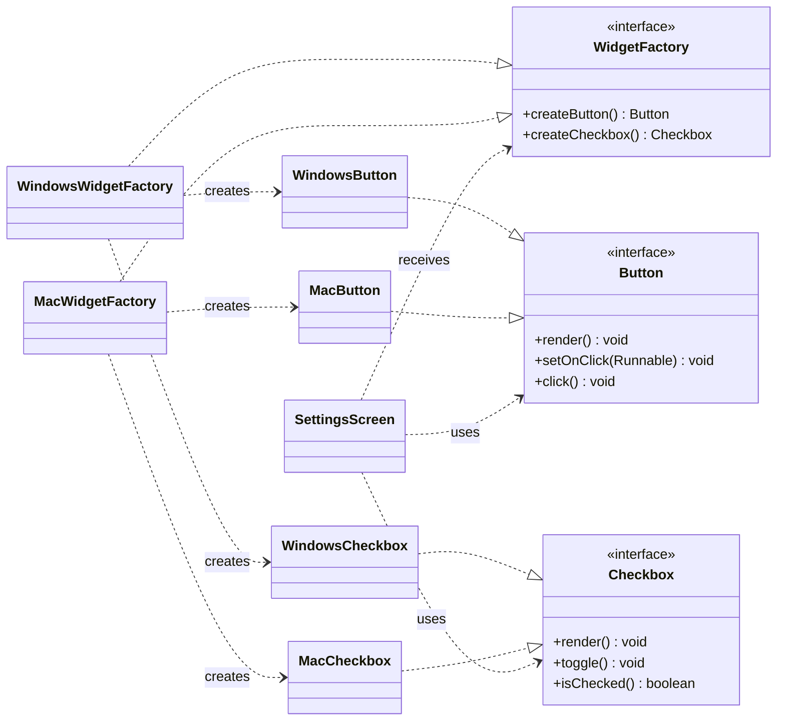

# Thiết kế interface riêng cho từng loại sản phẩm theo hành vi người dùng cần

Trong **Abstract Factory**, một ứng dụng thường cần nhiều **loại sản phẩm** phối hợp với nhau, chẳng hạn `Button` và `Checkbox` của cùng một bộ giao diện. Mỗi loại sản phẩm có hành vi riêng, trong khi mỗi **họ sản phẩm** cung cấp các cách triển khai tương ứng (ví dụ Windows và macOS).

Bài học thuộc chương **Thiết kế interface** của chủ đề **Học về abstract factory trong design pattern**. Trọng tâm là xác định người dùng của hệ thống cần làm gì với từng loại sản phẩm, rồi biến những nhu cầu đó thành các hợp đồng rõ ràng để mã nghiệp vụ không phụ thuộc vào lớp cụ thể.

## 1. Phân biệt loại sản phẩm, họ sản phẩm và hành vi

Giả sử một ứng dụng cài đặt có hai thành phần:

- Nút **Lưu**: cần hiển thị, nhận một hành động khi được nhấn và phát sinh sự kiện nhấn.
- Ô **Nhận thông báo**: cần hiển thị, cho phép chuyển trạng thái chọn/bỏ chọn và đọc trạng thái hiện tại.

Ứng dụng chạy trên Windows hoặc macOS; mỗi hệ điều hành có cách thể hiện hai thành phần khác nhau nhưng vẫn phải đáp ứng cùng những thao tác mà màn hình cài đặt sử dụng.

| Khái niệm | Ví dụ | Vai trò |
| --- | --- | --- |
| Loại sản phẩm (product type) | `Button`, `Checkbox` | Xác định **hành vi** mà mã sử dụng sản phẩm được phép gọi. |
| Họ sản phẩm (product family) | Windows, macOS | Nhóm các sản phẩm cụ thể được thiết kế để hoạt động nhất quán với nhau. |
| Sản phẩm cụ thể (concrete product) | `WindowsButton`, `MacCheckbox` | Cài đặt hợp đồng của một loại sản phẩm theo một họ. |
| Abstract Factory | `WidgetFactory` | Khai báo cách tạo **từng loại** sản phẩm qua kiểu trả về là interface. |
| Concrete Factory | `WindowsWidgetFactory`, `MacWidgetFactory` | Tạo các sản phẩm cụ thể cùng một họ. |
| Client | `SettingsScreen` | Sử dụng `Button` và `Checkbox` qua hợp đồng, không cần biết nền tảng. |

**Điểm mấu chốt:** tạo một interface cho `Button` và một interface cho `Checkbox`, **không** tạo `WindowsProduct` để chứa mọi thao tác của tất cả thành phần, và cũng không tạo interface `WindowsButton` chỉ vì có thêm một hệ điều hành.

## 2. Bắt đầu từ hành vi cần dùng, không bắt đầu từ lớp triển khai

Khi thiết kế một loại sản phẩm, hãy phân tích **luồng sử dụng** trước:

1. **Ai sử dụng sản phẩm?** Người dùng cuối thao tác với UI; `SettingsScreen` là client gọi các phương thức của sản phẩm.
2. **Client cần làm gì?** Hiển thị nút, gán xử lý sự kiện, nhận cú nhấn; hoặc hiển thị checkbox, thay đổi và đọc trạng thái chọn.
3. **Hành vi nào có ý nghĩa với tất cả biến thể?** Cả nút Windows lẫn nút macOS đều có thể được hiển thị và được nhấn. Cách vẽ, âm thanh hoặc hiệu ứng là chi tiết từng nền tảng.
4. **Hành vi nào chỉ thuộc một loại sản phẩm?** Việc đọc trạng thái chọn thuộc `Checkbox`, không nên bắt buộc `Button` cài đặt.
5. **Giá trị trả về và tác dụng phụ là gì?** `isChecked()` trả về trạng thái; `toggle()` đảo trạng thái; `click()` kích hoạt callback đã đăng ký.

Ánh xạ từ nhu cầu đến hợp đồng có thể lập như sau:

| Nhu cầu của màn hình | Interface chịu trách nhiệm | Phương thức đề xuất | Cam kết chung |
| --- | --- | --- | --- |
| Hiển thị nút Lưu | `Button` | `render()` | Mọi biến thể đều hiển thị được nút. |
| Xử lý hành động Lưu | `Button` | `setOnClick(Runnable)` và `click()` | Khi có sự kiện nhấn, thực thi hành động đã đăng ký. |
| Hiển thị tùy chọn thông báo | `Checkbox` | `render()` | Mọi biến thể đều thể hiện trạng thái chọn. |
| Thay đổi tùy chọn | `Checkbox` | `toggle()` | Mỗi lần gọi đảo trạng thái đúng một lần. |
| Lưu trạng thái tùy chọn | `Checkbox` | `isChecked()` | Trả về trạng thái hiện tại, không làm thay đổi nó. |

Trong framework UI thực tế, sự kiện nhấn được hệ thống giao diện phát tới handler. Phương thức `click()` trong ví dụ bên dưới mô phỏng sự kiện đó để minh họa hợp đồng và cho phép chạy ví dụ bằng Java thuần, không phải quy tắc mọi framework đều cần có `click()`.

## 3. Khai báo hợp đồng theo loại sản phẩm

Hai interface sản phẩm chỉ chứa những hành vi thực sự chung cho mọi biến thể của **chính loại sản phẩm đó**:

```java
interface Button {
    void render();
    void setOnClick(Runnable action);
    void click();
}

interface Checkbox {
    void render();
    void toggle();
    boolean isChecked();
}
```

Lựa chọn này có ba hệ quả quan trọng:

- **Tách biệt trách nhiệm:** `Button` không cần `isChecked()`; `Checkbox` không cần `setOnClick(...)` nếu màn hình chưa dùng đến sự kiện thay đổi của nó. Nếu sau này xuất hiện yêu cầu theo dõi thay đổi checkbox, có thể cân nhắc bổ sung `setOnChange(...)` cùng quy ước rõ ràng.
- **Cùng ngữ nghĩa giữa các biến thể:** `WindowsCheckbox.toggle()` và `MacCheckbox.toggle()` phải cùng đảo trạng thái. Khác biệt hình thức không được làm thay đổi ý nghĩa của hành vi.
- **Giấu chi tiết nền tảng:** interface không chứa `drawWindowsBorder()`, `useMacAnimation()` hay kiểu dữ liệu chỉ một hệ điều hành hiểu.

Sau khi có các loại sản phẩm, Abstract Factory định nghĩa cách tạo ra một bộ tương thích:

```java
interface WidgetFactory {
    Button createButton();
    Checkbox createCheckbox();
}
```

Kiểu trả về là interface sản phẩm, vì vậy client không cần ép kiểu sang `WindowsButton` hay `MacCheckbox`. Factory chỉ chịu trách nhiệm **khởi tạo sản phẩm**; hành vi của sản phẩm vẫn nằm trong `Button` và `Checkbox`.

## 4. Sơ đồ quan hệ



Nhìn theo hàng ngang, `Button` và `Checkbox` phân chia **hành vi**. Nhìn theo họ Windows/macOS, mỗi concrete factory chọn một **bộ triển khai nhất quán**. Hai chiều phân chia này là cơ sở của Abstract Factory.

## 5. Ví dụ Java hoàn chỉnh

Ví dụ tạo giao diện cài đặt chạy trên hai nền tảng. Để giữ ví dụ độc lập với thư viện GUI, `render()` ghi thông tin ra console; trong ứng dụng thực, các lớp cụ thể sẽ kết nối với API của nền tảng.

Lưu toàn bộ mã sau thành `Demo.java`:

```java
// 1. Hợp đồng theo từng loại sản phẩm
interface Button {
    void render();
    void setOnClick(Runnable action);
    void click();
}

interface Checkbox {
    void render();
    void toggle();
    boolean isChecked();
}

// 2. Hợp đồng tạo ra một họ sản phẩm
interface WidgetFactory {
    Button createButton();
    Checkbox createCheckbox();
}

// 3. Các sản phẩm của họ Windows
final class WindowsButton implements Button {
    private Runnable action = () -> {};

    @Override
    public void render() {
        System.out.println("[Windows] Button: Luu");
    }

    @Override
    public void setOnClick(Runnable action) {
        this.action = java.util.Objects.requireNonNull(action);
    }

    @Override
    public void click() {
        System.out.println("[Windows] Nhan nut Luu");
        action.run();
    }
}

final class WindowsCheckbox implements Checkbox {
    private boolean checked;

    @Override
    public void render() {
        System.out.println("[Windows] Checkbox thong bao = " + checked);
    }

    @Override
    public void toggle() {
        checked = !checked;
    }

    @Override
    public boolean isChecked() {
        return checked;
    }
}

// 4. Các sản phẩm của họ macOS
final class MacButton implements Button {
    private Runnable action = () -> {};

    @Override
    public void render() {
        System.out.println("[macOS] Button: Luu");
    }

    @Override
    public void setOnClick(Runnable action) {
        this.action = java.util.Objects.requireNonNull(action);
    }

    @Override
    public void click() {
        System.out.println("[macOS] Nhan nut Luu");
        action.run();
    }
}

final class MacCheckbox implements Checkbox {
    private boolean checked;

    @Override
    public void render() {
        System.out.println("[macOS] Checkbox thong bao = " + checked);
    }

    @Override
    public void toggle() {
        checked = !checked;
    }

    @Override
    public boolean isChecked() {
        return checked;
    }
}

// 5. Mỗi factory trả về các sản phẩm thuộc cùng họ
final class WindowsWidgetFactory implements WidgetFactory {
    @Override
    public Button createButton() {
        return new WindowsButton();
    }

    @Override
    public Checkbox createCheckbox() {
        return new WindowsCheckbox();
    }
}

final class MacWidgetFactory implements WidgetFactory {
    @Override
    public Button createButton() {
        return new MacButton();
    }

    @Override
    public Checkbox createCheckbox() {
        return new MacCheckbox();
    }
}

// 6. Client chỉ làm việc với các interface
final class SettingsScreen {
    private final Button saveButton;
    private final Checkbox notificationCheckbox;

    SettingsScreen(WidgetFactory factory) {
        saveButton = factory.createButton();
        notificationCheckbox = factory.createCheckbox();

        saveButton.setOnClick(() -> System.out.println(
            "Da luu: nhan thong bao = " + notificationCheckbox.isChecked()
        ));
    }

    void render() {
        notificationCheckbox.render();
        saveButton.render();
    }

    void simulateUserFlow() {
        notificationCheckbox.toggle(); // Nguoi dung bat thong bao
        saveButton.click();             // Nguoi dung nhan Luu
    }
}

// 7. Composition root chon ho san pham mot lan
public class Demo {
    public static void main(String[] args) {
        WidgetFactory factory =
            args.length > 0 && args[0].equalsIgnoreCase("mac")
                ? new MacWidgetFactory()
                : new WindowsWidgetFactory();

        SettingsScreen screen = new SettingsScreen(factory);
        screen.render();
        screen.simulateUserFlow();
    }
}
```

Chạy từ thư mục chứa `Demo.java`:

```bash
javac Demo.java
java Demo windows
java Demo mac
```

Khi chạy `java Demo mac`, kết quả minh họa là:

```text
[macOS] Checkbox thong bao = false
[macOS] Button: Luu
[macOS] Nhan nut Luu
Da luu: nhan thong bao = true
```

Chạy bản Windows cho kết quả tương ứng với tiền tố `[Windows]`, trong khi dòng lưu cài đặt vẫn có cùng ý nghĩa. `SettingsScreen` không hề chứa `if (platform == "mac")`, không khởi tạo `new MacButton()` và không gọi API riêng của macOS.

Việc ứng dụng chọn concrete factory ở `main` gọi là **composition root**: nơi quyết định triển khai cụ thể và truyền phụ thuộc cho các phần còn lại. Đổi họ sản phẩm chỉ cần thay factory cung cấp cho màn hình.

## 6. Những tiêu chí để một interface sản phẩm tốt

### 6.1. Tên và phương thức mô tả ý nghĩa trong miền bài toán

Ưu tiên các hành vi như `click()`, `toggle()`, `isChecked()`, `show()`, `close()` tùy từng loại sản phẩm. Những tên như `doAction(int mode)` buộc client biết các mã tùy chọn, khó đọc và khó kiểm tra.

**Hợp đồng cần nói rõ tính chất hành vi:** `isChecked()` chỉ đọc; `toggle()` đổi trạng thái; `setOnClick(...)` thay callback; `click()` gọi callback hiện tại. Các concrete product phải tuân thủ cùng quy ước, kể cả khi cách thể hiện khác nhau.

### 6.2. Không buộc sản phẩm cài đặt hành vi vô nghĩa

Thiết kế sau gom mọi loại sản phẩm vào một interface:

```java
interface Widget {
    void click();
    void toggle();
    String getText();
}
```

Một `Button` có thể không có trạng thái chọn để `toggle()`; một `Checkbox` không nhất thiết hỗ trợ `getText()`. Nếu các lớp cài đặt bằng cách ném `UnsupportedOperationException`, client dễ gặp lỗi dù đã lập trình theo interface.

Cách khắc phục là **tách interface theo khả năng mà client thực sự sử dụng**, chẳng hạn `Button`, `Checkbox` và `TextField`; tránh gom chúng lại chỉ vì chúng đều là UI component. Đây là cách áp dụng *Interface Segregation Principle*.

### 6.3. Không rò rỉ chi tiết của một họ vào hợp đồng chung

Ví dụ `Button` có `setWindowsAccentColor(...)` sẽ khiến nút macOS phải giả lập API Windows. Hãy đặt thiết lập đặc thù trong adapter, cấu hình factory hoặc lớp triển khai phù hợp. Nếu client thật sự cần một khả năng xuyên nền tảng như `setThemeColor(Color)`, định nghĩa một kiểu `Color` và ngữ nghĩa trung lập với nền tảng, rồi yêu cầu tất cả biến thể hỗ trợ nhất quán.

### 6.4. Tôn trọng khả năng thay thế

Nếu thay `WindowsCheckbox` bằng `MacCheckbox` mà `toggle()` đột nhiên xóa trạng thái hoặc `isChecked()` có tác dụng phụ, interface không còn đáng tin cậy. Trong Abstract Factory, **khả năng thay thế ở mức hành vi** là điều kiện để đổi cả họ sản phẩm một cách an toàn; đây cũng là tinh thần của *Liskov Substitution Principle*.

### 6.5. Đặt sự nhất quán của cả họ ở factory

`WindowsWidgetFactory` phải tạo `WindowsButton` cùng `WindowsCheckbox`; `MacWidgetFactory` tương tự. Đừng cho client gọi `createButton("windows")` rồi `createCheckbox("mac")` vì như vậy client tự phối hợp biến thể và factory mất trách nhiệm duy trì một họ nhất quán.

## 7. Mở rộng hệ thống: thêm họ và thêm loại sản phẩm khác nhau thế nào?

**Thêm một họ sản phẩm** (ví dụ Linux) thường là:

1. Cài đặt `LinuxButton implements Button`.
2. Cài đặt `LinuxCheckbox implements Checkbox`.
3. Viết `LinuxWidgetFactory implements WidgetFactory`.
4. Cập nhật nơi chọn factory để có thể chọn Linux.

Hợp đồng sản phẩm và màn hình cài đặt không cần đổi **nếu nhu cầu hành vi giữ nguyên**. Đây là thế mạnh của Abstract Factory khi có nhiều biến thể của một bộ sản phẩm ổn định.

**Thêm một loại sản phẩm** (ví dụ `TextField`) thường là:

1. Phân tích luồng người dùng: nhập, sửa và đọc văn bản; từ đó khai báo `TextField` với các hành vi tương ứng.
2. Thêm `TextField createTextField()` vào `WidgetFactory`.
3. Bổ sung triển khai `WindowsTextField`, `MacTextField` và phương thức tạo ở **mọi** concrete factory.
4. Chỉ cập nhật những client thực sự cần nhập văn bản.

Việc thêm loại sản phẩm buộc mọi factory thay đổi là **đánh đổi có chủ ý** của Abstract Factory: mẫu này thuận lợi hơn cho việc thêm *họ mới* so với thường xuyên thêm *loại sản phẩm mới*. Nếu tập loại sản phẩm thay đổi liên tục, cần cân nhắc lại ranh giới factory hoặc cách tổ chức đối tượng.

## 8. Những lỗi thiết kế thường gặp

| Cách làm | Vấn đề | Cách cải thiện |
| --- | --- | --- |
| Một `Widget` chứa tất cả `click()`, `toggle()`, `typeText()` | Nhiều sản phẩm buộc cài đặt phương thức không có ý nghĩa. | Tạo hợp đồng theo loại sản phẩm và nhu cầu tương tác. |
| `WidgetFactory.create(String type)` trả về `Object` | Client phải truyền chuỗi, ép kiểu và tự kiểm tra lỗi. | Khai báo phương thức có kiểu rõ ràng: `createButton()`, `createCheckbox()`. |
| `Button` chứa `setWindowsBorder(...)` | Phơi lộ chi tiết nền tảng trong hợp đồng chung. | Giữ chi tiết nền tảng trong concrete product. |
| Màn hình tự `new WindowsButton()` | Client bị khóa vào một triển khai, khó đổi cả họ. | Inject `WidgetFactory`; làm việc qua `Button`, `Checkbox`. |
| Factory tạo nút Windows và checkbox macOS | Bộ sản phẩm có thể thiếu nhất quán về cách thể hiện hoặc tương tác. | Concrete factory chọn sản phẩm cùng họ. |
| `toggle()` ở một nền tảng không đảo trạng thái | Vi phạm hợp đồng hành vi; thay factory làm hỏng logic. | Kiểm tra các quy tắc chung trên mọi triển khai. |

## 9. Tự kiểm tra thiết kế qua kịch bản

Trước khi chấp nhận thiết kế interface, có thể tự hỏi:

- **Thử thay thế:** dùng `SettingsScreen` với `WindowsWidgetFactory` và `MacWidgetFactory`. Luồng `toggle() → isChecked() → click()` có cùng ý nghĩa không?
- **Thử bỏ một phương thức:** nếu xóa phương thức khỏi interface, client nào thực sự bị ảnh hưởng? Nếu không có client nào cần, phương thức có thể đang thừa.
- **Thử thêm biến thể:** có phải sửa `SettingsScreen` khi hỗ trợ thêm Linux không? Nếu có, kiểm tra xem chi tiết nền tảng đã lọt vào client ở đâu.
- **Thử thêm loại sản phẩm:** một loại như `TextField` có hợp đồng riêng theo hành vi nhập liệu không? Các factory có cung cấp đủ biến thể không?
- **Thử lỗi hợp đồng:** nếu callback chưa được gán, nhấn nút sẽ ra sao? Ví dụ chọn hành vi mặc định an toàn là không làm gì; nếu hệ thống yêu cầu bắt buộc phải gán callback, phải quy định và kiểm tra rõ.

### Bài tập vận dụng

Mở rộng màn hình cài đặt bằng sản phẩm `Dialog` để xác nhận trước khi lưu. Bắt đầu từ hành vi cần dùng: `show()`, `confirm()`, `cancel()` (có thể thiết kế callback hoặc kết quả phù hợp với luồng ứng dụng). Sau đó tạo `WindowsDialog`, `MacDialog`, bổ sung `createDialog()` vào factory và sửa màn hình chỉ sử dụng interface `Dialog`. Cuối cùng kiểm tra rằng cả hai họ đều thực hiện cùng quy tắc: chỉ lưu khi người dùng xác nhận.

**Điểm cần ghi nhớ:** trong Abstract Factory, interface của **mỗi loại sản phẩm** là hợp đồng về hành vi client cần; concrete product quyết định cách thực hiện theo từng họ; còn abstract factory bảo đảm client nhận được các sản phẩm thuộc một họ phù hợp. Khi ranh giới này rõ ràng, hệ thống dễ thay đổi nền tảng mà vẫn giữ ổn định luồng nghiệp vụ.
