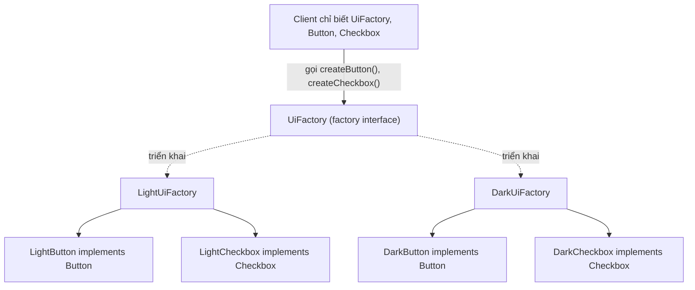

# Thiết kế factory interface với kiểu trả về là product interface

## Mục tiêu của bài học

Trong mẫu thiết kế **Abstract Factory** thuộc nhóm *Creational Design Patterns*, client cần tạo ra các **họ đối tượng có liên quan** mà không biết lớp triển khai cụ thể. Điểm quyết định trong thiết kế API là: **các phương thức của factory interface trả về product interface**, để client làm việc qua một hợp đồng ổn định.

Sau bài này, bạn có thể:

- Phân biệt **factory interface**, **product interface**, **concrete factory** và **concrete product**.
- Khai báo các phương thức factory với kiểu trả về là abstraction phù hợp, thay vì tên lớp cụ thể hoặc `Object`.
- Thiết kế một họ sản phẩm có các phương thức nhất quán; thay cả họ chỉ bằng cách thay factory.
- Nhận diện những lỗi làm rò rỉ implementation và những thay đổi interface gây ảnh hưởng tới tất cả factory.

## 1. Hai tầng abstraction trong Abstract Factory

Xét ứng dụng cần chuyển giao diện giữa hai chế độ **Light** và **Dark**. Mỗi chế độ cung cấp một bộ sản phẩm tương thích: `Button` và `Checkbox`.

Trong thiết kế này có **hai loại interface với hai trách nhiệm khác nhau**:

| Thành phần | Vai trò | Câu hỏi cần trả lời |
|---|---|---|
| **Product interface** (`Button`, `Checkbox`) | Quy định hành vi mà client sử dụng trên từng sản phẩm | “Một nút/ô chọn làm được gì?” |
| **Factory interface** (`UiFactory`) | Quy định các loại sản phẩm mà một factory có thể cung cấp | “Làm sao yêu cầu một nút hoặc ô chọn thuộc cùng họ?” |
| **Concrete product** (`LightButton`, `DarkCheckbox`, ...) | Cài đặt hành vi của product interface cho một biến thể | “Nút/ô chọn Light hoặc Dark hoạt động ra sao?” |
| **Concrete factory** (`LightUiFactory`, `DarkUiFactory`) | Tạo các concrete product **thuộc cùng một họ** | “Ở chế độ Dark cần trả về những đối tượng nào?” |

Mối quan hệ cần giữ:



Client gọi `UiFactory.createButton(...)` và nhận **`Button`**. Factory Light có thể tạo `LightButton`, còn factory Dark tạo `DarkButton`. Cả hai đều có cùng API `Button` nên client không cần biết tên lớp nào đã được dùng.

Đây là hai ranh giới quan trọng:

1. **Ranh giới tạo đối tượng:** client phụ thuộc `UiFactory`, còn việc lựa chọn concrete product nằm trong concrete factory.
2. **Ranh giới sử dụng đối tượng:** client phụ thuộc `Button`/`Checkbox`, còn chi tiết hiển thị và triển khai nằm trong concrete product.

Nếu chỉ trừu tượng hóa bước tạo nhưng trả về lớp cụ thể, client vẫn bị phụ thuộc vào implementation ở bước sử dụng.

## 2. Viết factory interface trả về product interface

Trước hết, xác định hành vi client thực sự cần ở từng sản phẩm:

```java
interface Button {
    String render();
}

interface Checkbox {
    String render();
}
```

Hai product interface cùng có `render()` trong ví dụ vì cả hai cần được biểu diễn, nhưng **không có yêu cầu mọi product interface phải có cùng phương thức**. Trong hệ thống thật, `Button` có thể có hành vi click, còn `Checkbox` có hành vi kiểm tra trạng thái riêng. Mỗi interface nên mô tả đúng vai trò của loại sản phẩm đó.

Tiếp theo, khai báo **factory interface**:

```java
interface UiFactory {
    Button createButton(String label);
    Checkbox createCheckbox(boolean checked);
}
```

Hãy chú ý **kiểu trả về**:

- `createButton(...)` trả về **`Button`**, không phải `LightButton` hoặc `DarkButton`.
- `createCheckbox(...)` trả về **`Checkbox`**, không phải `LightCheckbox` hoặc `DarkCheckbox`.
- `UiFactory` không có tham số `theme` ở từng phương thức: **concrete factory được chọn** đã quyết định họ Light hay Dark.

Mỗi phương thức thể hiện rõ *loại sản phẩm* và *đầu vào để xây dựng sản phẩm*. Client có thể gọi factory một cách an toàn ở thời điểm biên dịch: Java biết `createButton()` trả về `Button` và những hành vi nào có sẵn trên `Button`.

### Vì sao không trả về concrete class?

Thiết kế sau làm hỏng mục tiêu thay thế họ sản phẩm:

```java
// Thiết kế không nên dùng cho abstract factory đa họ:
interface BadUiFactory {
    LightButton createButton(String label);
    LightCheckbox createCheckbox(boolean checked);
}
```

Khi chuyển sang họ Dark, client vẫn nhìn thấy `LightButton` và `LightCheckbox` trong API. Nhà phát triển có thể bị buộc sửa kiểu dữ liệu, ép kiểu hoặc thay đổi logic client dù chỉ muốn đổi theme.

Trả về `Object` cũng không giải quyết vấn đề:

```java
// Cũng không nên dùng:
interface WeakUiFactory {
    Object createButton(String label);
}
```

Với `Object`, client mất các phương thức chuyên biệt của sản phẩm, phải kiểm tra kiểu hoặc ép kiểu; lỗi có thể chỉ xuất hiện lúc chạy. **Product interface là abstraction vừa đủ:** giấu lớp cụ thể nhưng vẫn giữ hợp đồng rõ ràng.

## 3. Ví dụ Java hoàn chỉnh: một interface, hai họ sản phẩm

Toàn bộ đoạn sau có thể đặt trong file **`Demo.java`**, sử dụng Java 17 trở lên. Để tập trung vào thiết kế interface, phương thức `render()` trả về chuỗi mô phỏng giao diện; ví dụ không phụ thuộc thư viện GUI.

```java
import java.util.Objects;

// Abstract products
interface Button {
    String render();
}

interface Checkbox {
    String render();
}

// Abstract factory: mọi kiểu trả về đều là product interface
interface UiFactory {
    Button createButton(String label);
    Checkbox createCheckbox(boolean checked);
}

// Họ Light
record LightButton(String label) implements Button {
    LightButton {
        Objects.requireNonNull(label, "label");
    }

    @Override
    public String render() {
        return "[Light] Button: " + label;
    }
}

record LightCheckbox(boolean checked) implements Checkbox {
    @Override
    public String render() {
        return "[Light] Checkbox: " + (checked ? "checked" : "unchecked");
    }
}

final class LightUiFactory implements UiFactory {
    @Override
    public Button createButton(String label) {
        return new LightButton(label);
    }

    @Override
    public Checkbox createCheckbox(boolean checked) {
        return new LightCheckbox(checked);
    }
}

// Họ Dark
record DarkButton(String label) implements Button {
    DarkButton {
        Objects.requireNonNull(label, "label");
    }

    @Override
    public String render() {
        return "[Dark] Button: " + label;
    }
}

record DarkCheckbox(boolean checked) implements Checkbox {
    @Override
    public String render() {
        return "[Dark] Checkbox: " + (checked ? "checked" : "unchecked");
    }
}

final class DarkUiFactory implements UiFactory {
    @Override
    public Button createButton(String label) {
        return new DarkButton(label);
    }

    @Override
    public Checkbox createCheckbox(boolean checked) {
        return new DarkCheckbox(checked);
    }
}

// Client chỉ phụ thuộc abstraction
final class SettingsScreen {
    private final UiFactory factory;

    SettingsScreen(UiFactory factory) {
        this.factory = Objects.requireNonNull(factory, "factory");
    }

    void show() {
        Button save = factory.createButton("Lưu");
        Checkbox notifications = factory.createCheckbox(true);
        System.out.println(save.render());
        System.out.println(notifications.render());
    }
}

public class Demo {
    public static void main(String[] args) {
        // Thành phần khởi tạo ứng dụng chọn concrete factory.
        UiFactory light = new LightUiFactory();
        UiFactory dark = new DarkUiFactory();

        new SettingsScreen(light).show();
        new SettingsScreen(dark).show();
    }
}
```

Kết quả minh họa:

```text
[Light] Button: Lưu
[Light] Checkbox: checked
[Dark] Button: Lưu
[Dark] Checkbox: checked
```

Có thể quan sát ba điểm:

1. **`SettingsScreen` không chứa `new LightButton(...)`, `new DarkButton(...)` hoặc bất cứ ép kiểu nào.** Client chỉ làm việc qua `UiFactory`, `Button` và `Checkbox`.
2. **Hai concrete factory triển khai cùng một contract.** Mỗi factory trả về cả `Button` lẫn `Checkbox` thuộc đúng họ của mình.
3. **Đổi nguyên họ bằng một đối tượng factory.** Trong ứng dụng thực tế, thành phần khởi tạo (*composition root*) có thể chọn `new LightUiFactory()` hay `new DarkUiFactory()` theo cấu hình rồi truyền vào các client.

Trong Java, phương thức ghi đè có thể dùng **kiểu trả về hiệp biến** (*covariant return type*), chẳng hạn concrete factory khai báo `LightButton createButton(...)`. Điều này hợp lệ nếu `LightButton` implements `Button`; tuy nhiên khi client giữ tham chiếu kiểu `UiFactory`, kiểu trả về mà client nhìn thấy vẫn là `Button`. Trong thiết kế mẫu ở trên, các concrete factory cũng khai báo trực tiếp kiểu trả về là product interface để nhất quán.

## 4. Quy trình thiết kế interface từ yêu cầu

Không nên bắt đầu bằng việc liệt kê tên các lớp đã có. Hãy đi từ cách client sử dụng sản phẩm.

### Bước 1 — Xác định các loại sản phẩm client cần

Ví dụ, màn hình cài đặt cần `Button` và `Checkbox`. Đây là **hai loại sản phẩm**, không phải hai biến thể Light/Dark. Đặt mỗi loại trong một abstraction riêng khi hành vi của chúng khác nhau.

**Câu hỏi:** Nếu thay Light bằng Dark, thao tác nào của client phải giữ nguyên? Những thao tác đó là ứng viên cho phương thức trong product interface.

### Bước 2 — Thiết kế product interface đủ dùng

Nếu client chỉ cần `render()`, interface trong ví dụ đã đủ. Với ứng dụng có tương tác thực, có thể cần bổ sung hành vi chung phù hợp như `setEnabled(boolean)` cho `Button`. Không nên đưa phương thức chỉ tồn tại ở `DarkButton` vào interface chung chỉ để một lớp sử dụng.

Một product interface tốt:

- Mô tả **hành vi công khai** mà client cần, không lộ chi tiết widget toolkit, CSS class hay constructor.
- Có quy ước nhất quán về tham số, kiểu trả về, trạng thái và lỗi.
- Cho phép nhiều concrete product khác nhau cùng đáp ứng một contract có ý nghĩa.

Nếu hai kiểu chỉ tình cờ có một phương thức cùng tên nhưng ý nghĩa khác nhau, không nên ép chúng vào cùng product interface.

### Bước 3 — Thiết kế factory interface theo **loại sản phẩm**

Mỗi phương thức trả về **đúng abstract product** tương ứng:

| Phương thức factory | Kiểu trả về tốt | Trách nhiệm |
|---|---|---|
| `createButton(String label)` | `Button` | Yêu cầu một nút phù hợp với họ đã chọn |
| `createCheckbox(boolean checked)` | `Checkbox` | Yêu cầu một ô chọn phù hợp với họ đã chọn |
| `createDialog(String title)`, nếu hệ thống thật cần | `Dialog` | Yêu cầu hộp thoại cùng họ, khi product interface `Dialog` đã được xác định |

Đặt tên `create...` phù hợp khi API diễn tả việc yêu cầu sản phẩm. Tên gọi **không tự bảo đảm mỗi lần đều cấp phát mới**: nếu implementation dùng lại hoặc cache, tài liệu API cần nói rõ chính sách vòng đời, khả năng chia sẻ trạng thái và chủ sở hữu tài nguyên.

Tránh phương thức mơ hồ như `Object create(String type)`: chuỗi `type` và kiểu trả về `Object` khiến việc kiểm tra hợp đồng kém rõ ràng và dễ phát sinh ép kiểu.

### Bước 4 — Ràng buộc tính nhất quán của họ sản phẩm

`LightUiFactory` phải tạo `LightButton` và `LightCheckbox`; `DarkUiFactory` phải tạo `DarkButton` và `DarkCheckbox`. Một factory trả `LightButton` nhưng `DarkCheckbox` có thể vẫn **đúng kiểu Java**, nhưng **sai cam kết về họ sản phẩm**.

Điều này rất quan trọng: compiler kiểm tra rằng `LightButton` là `Button`, nhưng không tự biết quy tắc nghiệp vụ “mọi sản phẩm của factory này phải thuộc họ Light”. Cần quy ước rõ và kiểm thử ở concrete factory.

### Bước 5 — Đưa quyết định chọn họ ra ngoài client

Client nhận `UiFactory` qua constructor, dependency injection hoặc tham số. Đừng để client tự gọi `new LightUiFactory()` ở giữa logic nghiệp vụ nếu nhu cầu là có thể thay đổi họ sản phẩm.

Khi cần thêm `HighContrastUiFactory`, phần sử dụng sản phẩm có thể giữ nguyên nếu factory mới tuân theo `UiFactory` và các product interface hiện có.

## 5. Lợi ích và giới hạn của kiểu trả về là interface

**Giảm phụ thuộc:** Client cần import và hiểu `UiFactory`, `Button`, `Checkbox`, thay vì phụ thuộc tất cả concrete product.

**Thay thế implementation:** Cùng một đoạn code sử dụng `Button` có thể hoạt động với họ Light, Dark hoặc một họ khác miễn là hành vi mà interface cam kết được đáp ứng.

**Dễ kiểm thử client:** Test có thể truyền một factory giả (*fake/stub*) trả về những product đơn giản, thay vì cần thư viện giao diện hay cấu hình theme thật. Nhờ đó có thể kiểm tra cách client sử dụng contract.

**Phù hợp với Dependency Inversion Principle:** Phần sử dụng sản phẩm và phần cài đặt factory cùng phụ thuộc vào abstraction. Tuy nhiên, chỉ “dùng interface” chưa đủ; các phương thức, ý nghĩa hành vi và quản lý trạng thái vẫn phải nhất quán.

Có hai giới hạn cần nhận thức:

- **Thêm họ sản phẩm mới** (ví dụ `HighContrastUiFactory`) thường thuận lợi: triển khai các phương thức hiện có của `UiFactory`.
- **Thêm một loại sản phẩm mới** (ví dụ thêm `createSlider()` vào `UiFactory`) khiến **mọi concrete factory** triển khai interface đó phải bổ sung phương thức, trừ khi hợp đồng được tách hoặc phát triển theo một chiến lược tương thích thích hợp. Vì vậy, chỉ đưa vào factory interface các loại sản phẩm thực sự thuộc cùng nhóm nhu cầu client.

Nếu một phần client chỉ dùng `Button`, còn phần khác cần bộ UI rộng hơn, có thể cân nhắc tách interface theo nhu cầu thực tế (*Interface Segregation Principle*) thay vì tạo một factory khổng lồ chứa mọi sản phẩm tùy chọn.

## 6. Phân biệt ba thiết kế dễ bị nhầm

### Factory interface trả về product interface

```java
interface UiFactory {
    Button createButton(String label);
}
```

Đây là trọng tâm bài: client có contract rõ ràng cho cả việc tạo (`UiFactory`) và việc dùng sản phẩm (`Button`).

### Factory method trả về một concrete product

```java
final class DirectButtonFactory {
    LightButton createButton(String label) {
        return new LightButton(label);
    }
}
```

Đoạn này có thể hợp lý trong code không yêu cầu thay thế họ sản phẩm, nhưng nó không tạo abstraction cho một client muốn dùng nhiều họ Light/Dark. Tên hàm “factory” một mình không làm nó trở thành **Abstract Factory**.

### Một factory chung trả về `Object` theo chuỗi

```java
interface GenericObjectFactory {
    Object create(String productType);
}
```

Kiểu này thường ép client biết tên và kiểu runtime của sản phẩm. Nếu không có lý do thực sự cần cơ chế sản phẩm động (như plugin registry), nên ưu tiên những phương thức có kiểu trả về product interface tường minh.

Cũng cần phân biệt **Abstract Factory** với **Factory Method**: Factory Method tập trung vào phương thức tạo một loại sản phẩm có thể được lớp con cài đặt khác nhau; Abstract Factory tập hợp các phương thức tạo **một họ sản phẩm liên quan**. Trên thực tế, concrete factory có thể sử dụng factory methods nội bộ; hai pattern không loại trừ nhau.

## 7. Những lỗi thường gặp khi định nghĩa contract

| Lỗi | Tác động | Cách xử lý |
|---|---|---|
| Factory interface trả về `LightButton`/`DarkButton` | API gắn chặt vào một họ | Trả về `Button` |
| Factory trả về `Object` hoặc bắt client ép kiểu | Mất hợp đồng sản phẩm khi biên dịch | Có product interface riêng cho mỗi loại |
| Đưa `theme` vào từng lời gọi của factory đã được chọn theo theme | Client vẫn phải quyết định biến thể mỗi lần | Chọn concrete factory tại composition root |
| Client kiểm tra `instanceof DarkButton` để sử dụng tính năng cần thiết | Logic client phụ thuộc loại concrete product | Thiết kế hành vi thích hợp trên abstraction hoặc tách capability |
| Concrete factory vô tình phối trộn họ Light/Dark | Kiểu trả về vẫn hợp lệ nhưng sản phẩm không tương thích | Kiểm tra nhất quán họ sản phẩm trong factory |
| Product interface quá rộng, chứa hành vi chỉ một biến thể hỗ trợ | Implementation phải ném lỗi hoặc cài đặt giả | Tách các contract theo vai trò/capability |
| Thêm mọi loại sản phẩm vào một factory interface lớn | Mỗi factory mới phải cài đặt nhiều chức năng không cần | Chia interface theo nhóm sản phẩm có liên quan |
| Không mô tả ý nghĩa trả về `null`, lỗi hay chia sẻ instance | Client không biết cách xử lý và quản lý vòng đời | Quy định rõ contract; ưu tiên kết quả không `null` hoặc lỗi có chủ đích |

**Quy tắc thực dụng:** nếu phần code sử dụng factory phải biết `LightButton`, `DarkButton` hoặc ép kiểu sản phẩm để hoàn thành tác vụ bình thường, hãy kiểm tra lại thiết kế của product interface trước khi bổ sung thêm điều kiện cho client.

## 8. Tự đánh giá một thiết kế factory interface

Giả sử yêu cầu bổ sung **họ giao diện High Contrast**. Hãy kiểm tra:

1. Client có đang giữ biến kiểu `UiFactory` và các biến sản phẩm kiểu `Button`/`Checkbox` không?
2. Có thể viết `HighContrastUiFactory implements UiFactory` mà không sửa `SettingsScreen` không?
3. Từng phương thức của concrete factory mới có trả về sản phẩm thuộc đúng họ High Contrast không?
4. Client có hoạt động dựa trên hành vi công khai của product interface, không ép kiểu hoặc gọi API của lớp concrete không?
5. Quy tắc đầu vào, giá trị `null`, ngoại lệ và vòng đời của sản phẩm có nhất quán giữa các implementation không?

Một cách kiểm thử hiệu quả là dùng **cùng một bộ bài kiểm tra contract** cho mỗi concrete factory: tạo từng loại sản phẩm, xác minh có thể sử dụng hành vi từ product interface, xác minh thuộc đúng họ và kiểm tra các tình huống đầu vào không hợp lệ. Kiểm thử client riêng bằng fake factory để khẳng định client không phụ thuộc theme cụ thể.

**Ghi nhớ:** trong Abstract Factory, **factory interface mô tả cách yêu cầu các loại sản phẩm**, còn **product interface mô tả cách client sử dụng từng loại**. Khi mọi phương thức factory trả về đúng product interface và mỗi concrete factory tạo một họ nhất quán, hệ thống có thể thay implementation mà không buộc client thay đổi cách sử dụng sản phẩm.

