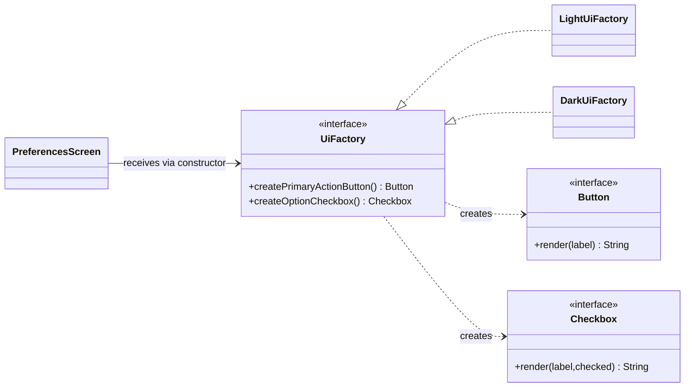

# Đặt tên phương thức tạo thể hiện rõ sản phẩm và ý nghĩa sử dụng

**Chương:** Thiết kế interface  
**Chuyên đề:** `SOFTWARE_DESIGN_DESIGN_PATTERN_CREATIONAL_ABSTRACT_FACTORY` — Học về abstract factory trong design pattern.

## Mục tiêu học tập

Sau bài học, bạn có thể:

- Đặt tên các phương thức tạo sản phẩm trong **Abstract Factory** sao cho người đọc nhận biết **loại sản phẩm** và, khi cần, **vai trò sử dụng** của sản phẩm đó.
- Phân biệt tên dựa trên *hợp đồng trừu tượng* với tên phụ thuộc vào từng họ triển khai như `Light`, `Dark`.
- Nhận ra tác hại của những tên mơ hồ (`create()`, `makeItem()`), quá cụ thể theo nghiệp vụ (`createSaveButton()` khi factory chỉ quản lý kiểu dáng) hoặc gây hiểu sai về vòng đời đối tượng.
- Viết và sử dụng interface factory Java có cách đặt tên nhất quán, dễ mở rộng và dễ đọc tại nơi gọi.
- Quyết định khi nào `createButton()` là đủ rõ và khi nào cần `createPrimaryActionButton()` hoặc một tham số vai trò.

## 1. Vì sao tên phương thức tạo quan trọng?

Trong **Abstract Factory**, một interface mô tả tập hợp các phương thức tạo ra những **loại sản phẩm có liên quan**. Các factory cụ thể tạo các biến thể tương ứng với từng **họ sản phẩm**. Ví dụ, một ứng dụng Java hỗ trợ hai họ thành phần giao diện `Light` và `Dark`:

| Loại/vai trò sản phẩm | Họ Light | Họ Dark |
| --- | --- | --- |
| Nút hành động chính (`Button`) | `LightPrimaryActionButton` | `DarkPrimaryActionButton` |
| Ô chọn tùy chọn (`Checkbox`) | `LightOptionCheckbox` | `DarkOptionCheckbox` |

Factory được chọn phải cung cấp **đủ bộ sản phẩm tương thích**. Một màn hình được tạo bằng `DarkUiFactory` nên nhận các sản phẩm Dark, nhưng mã màn hình chỉ phụ thuộc vào `UiFactory`, `Button` và `Checkbox`.

Nếu interface chỉ có các phương thức như:

```java
interface PoorlyNamedFactory {
    Button create();
    Checkbox createOther();
}
```

thì nơi gọi `factory.createOther()` không cho người đọc biết đang tạo thứ gì hoặc nó dùng để làm gì. Để hiểu, họ phải nhảy tới khai báo kiểu trả về hoặc lần theo implementation. Khi hệ thống bổ sung sản phẩm thứ ba, các tên kiểu `createThird()` càng khó duy trì.

Tên tốt nên cung cấp đủ thông tin **ngay tại điểm gọi**:

```java
Button saveButton = factory.createPrimaryActionButton();
Checkbox notifications = factory.createOptionCheckbox();
```

Người đọc thấy rõ sản phẩm thứ nhất là **button** có vai trò **primary action**, sản phẩm thứ hai là **checkbox** dùng để chọn một tùy chọn. Tên không nhắc đến Light/Dark vì họ cụ thể đã được quyết định bằng instance factory.

## 2. Hai lớp thông tin trong tên phương thức

Một cách đặt tên dễ áp dụng là:

```text
create + [vai trò/biến thể có ý nghĩa] + [loại sản phẩm]
```

Trong đó:

1. **Động từ tạo**: `create` cho biết đây là một thao tác cung cấp sản phẩm; đặt nhất quán cho các phương thức cùng một factory.
2. **Loại sản phẩm**: `Button`, `Checkbox`, `Dialog`... cho biết **đối tượng trả về thuộc loại nào**.
3. **Vai trò hoặc biến thể có ý nghĩa** (nếu cần): `PrimaryAction`, `Option`, `Confirmation`... cho biết sản phẩm được tạo để thực hiện **vai trò nào trong hợp đồng factory**.

Ví dụ:

| Tên phương thức | Sản phẩm | Ý nghĩa người đọc nhận được |
| --- | --- | --- |
| `createButton()` | `Button` | Tạo button; phù hợp nếu factory chỉ cung cấp một kiểu button. |
| `createCheckbox()` | `Checkbox` | Tạo checkbox; phù hợp nếu chưa cần phân loại vai trò. |
| `createPrimaryActionButton()` | `Button` | Tạo button dành cho hành động chính của màn hình. |
| `createSecondaryActionButton()` | `Button` | Tạo button dành cho hành động phụ, nếu đây là biến thể riêng trong thiết kế. |
| `createOptionCheckbox()` | `Checkbox` | Tạo checkbox sử dụng cho một lựa chọn bật/tắt. |
| `createConfirmationDialog()` | `Dialog` | Tạo dialog dành cho thao tác xác nhận, nếu factory có sản phẩm loại này. |

**Không bắt buộc phương thức nào cũng phải có ba phần.** Nếu trong `UiFactory` chỉ tồn tại một loại button và không có các biến thể riêng, `createButton()` vừa ngắn vừa đủ rõ. Chỉ thêm vai trò khi nó **được định nghĩa ổn định trong hợp đồng** và giúp phân biệt các sản phẩm được tạo.

Một quy tắc kiểm tra: nếu xóa phần bổ nghĩa mà người gọi có thể lấy nhầm một sản phẩm khác hoặc bỏ lỡ một khác biệt quan trọng, phần bổ nghĩa có giá trị. Ngược lại, nếu phần bổ nghĩa chỉ lặp lại điều đã hiển nhiên trong ngữ cảnh, có thể bỏ.

## 3. Đặt tên theo abstraction, không theo họ triển khai

Giả sử `UiFactory` cần hỗ trợ Light và Dark. Cách thiết kế sau buộc client biết các họ cụ thể:

```java
// Phản ví dụ: tên phương thức chứa họ triển khai.
interface UiFactory {
    Button createLightButton();
    Button createDarkButton();
    Checkbox createLightCheckbox();
    Checkbox createDarkCheckbox();
}
```

Thiết kế này làm mất ý nghĩa của việc **chọn một factory để đổi cả họ sản phẩm**: bản thân interface lại công khai khả năng chọn Light/Dark cho từng sản phẩm. Nó cũng khiến việc thêm họ thứ ba phải sửa interface và mọi factory đang triển khai.

Cách phù hợp hơn:

```java
interface UiFactory {
    Button createPrimaryActionButton();
    Checkbox createOptionCheckbox();
}

// Factory cụ thể Light và Dark đều implements UiFactory,
// nhưng tự quyết định lớp sản phẩm thuộc họ của mình.
```

Điểm khác biệt:

- **Phương thức cùng một tên ở mọi họ**: `createPrimaryActionButton()` có cùng ý nghĩa bất kể factory hiện tại là Light hay Dark.
- **Factory cụ thể quyết định phiên bản**: `LightUiFactory` trả về `LightPrimaryActionButton`, còn `DarkUiFactory` trả về `DarkPrimaryActionButton`.
- **Client không nhắc tên họ**: muốn đổi Light sang Dark chỉ cần thay factory được truyền vào.

Tên class triển khai vẫn có thể chứa Light/Dark để người bảo trì nhận diện chúng. Hạn chế áp dụng cho **hợp đồng abstract factory** mà client phụ thuộc vào.

## 4. Đừng biến factory của giao diện thành nơi chứa nghiệp vụ của một màn hình

Giả sử màn hình cài đặt có nút **Lưu** và màn hình hồ sơ có nút **Cập nhật**. Cả hai đều là hành động chính với cùng kiểu dáng. Nếu tạo:

```java
// Quá cụ thể cho một UI factory dùng chung:
Button createSavePreferencesButton();
Button createUpdateProfileButton();
Button createSubmitRegistrationButton();
```

thì interface có nguy cơ phình lên mỗi khi thêm chức năng mới. Factory đang sở hữu **kiểu dáng và cấu trúc thành phần giao diện**, trong khi “lưu cài đặt”, “cập nhật hồ sơ” hoặc “đăng ký” là **mục đích nghiệp vụ của nơi sử dụng**.

Một phương thức có vai trò ổn định hơn:

```java
interface UiFactory {
    Button createPrimaryActionButton();
    Checkbox createOptionCheckbox();
}

// Nhãn "Lưu" và hành vi lưu nằm ở client;
// factory chỉ quyết định sản phẩm cần có phong cách primary.
```

Điều này **không có nghĩa mọi tên theo nghiệp vụ đều sai**. Nếu đang thiết kế một factory chuyên tạo *bộ chứng từ hóa đơn*, các tên `createInvoiceHeader()` và `createInvoiceLineItem()` có thể rất phù hợp vì đó chính là các sản phẩm thuộc hợp đồng của factory. Phạm vi trách nhiệm của factory quyết định thông tin “ý nghĩa sử dụng” nào nên xuất hiện trong tên.

## 5. Ví dụ Java hoàn chỉnh: tên thể hiện sản phẩm và vai trò

Ví dụ sau mô phỏng một màn hình cài đặt, gồm nút hành động chính và ô chọn tùy chọn. Các sản phẩm dùng `render()` để trả về chuỗi mô tả thay vì vẽ giao diện thật. Mục tiêu là quan sát **tên phương thức, cách phụ thuộc và tính nhất quán của họ sản phẩm**.

Lưu toàn bộ mã vào **`FactoryMethodNamingDemo.java`**, chạy bằng Java 8 trở lên.

```java
import java.util.Locale;
import java.util.Objects;

// 1. Abstract products: mô tả hành vi của từng loại sản phẩm.
interface Button {
    String render(String label);
}

interface Checkbox {
    String render(String label, boolean checked);
}

// 2. Abstract Factory: phương thức nói rõ sản phẩm và vai trò.
interface UiFactory {
    Button createPrimaryActionButton();
    Checkbox createOptionCheckbox();
}

// 3. Họ Light.
final class LightPrimaryActionButton implements Button {
    @Override
    public String render(String label) {
        return "[Light] Primary Button: " + label + " (nền sáng, chữ tối)";
    }
}

final class LightOptionCheckbox implements Checkbox {
    @Override
    public String render(String label, boolean checked) {
        return "[Light] Option Checkbox: " + label
                + " " + (checked ? "[x]" : "[ ]") + " (nền sáng)";
    }
}

final class LightUiFactory implements UiFactory {
    @Override
    public Button createPrimaryActionButton() {
        return new LightPrimaryActionButton();
    }

    @Override
    public Checkbox createOptionCheckbox() {
        return new LightOptionCheckbox();
    }
}

// 4. Họ Dark.
final class DarkPrimaryActionButton implements Button {
    @Override
    public String render(String label) {
        return "[Dark] Primary Button: " + label + " (nền tối, chữ sáng)";
    }
}

final class DarkOptionCheckbox implements Checkbox {
    @Override
    public String render(String label, boolean checked) {
        return "[Dark] Option Checkbox: " + label
                + " " + (checked ? "[x]" : "[ ]") + " (nền tối)";
    }
}

final class DarkUiFactory implements UiFactory {
    @Override
    public Button createPrimaryActionButton() {
        return new DarkPrimaryActionButton();
    }

    @Override
    public Checkbox createOptionCheckbox() {
        return new DarkOptionCheckbox();
    }
}

// 5. Client: không biết tên lớp Light*/Dark*.
final class PreferencesScreen {
    private final Button saveButton;
    private final Checkbox notificationsCheckbox;

    PreferencesScreen(UiFactory factory) {
        Objects.requireNonNull(factory, "factory");
        this.saveButton = factory.createPrimaryActionButton();
        this.notificationsCheckbox = factory.createOptionCheckbox();
    }

    String render() {
        return notificationsCheckbox.render("Nhận thông báo", true)
                + System.lineSeparator()
                + saveButton.render("Lưu");
    }
}

// 6. Composition root: chọn một factory cho cả màn hình.
public final class FactoryMethodNamingDemo {
    private static UiFactory selectFactory(String theme) {
        String normalized = Objects.requireNonNull(theme, "theme")
                .trim().toLowerCase(Locale.ROOT);

        switch (normalized) {
            case "light":
                return new LightUiFactory();
            case "dark":
                return new DarkUiFactory();
            default:
                throw new IllegalArgumentException(
                        "Theme không được hỗ trợ: " + theme);
        }
    }

    public static void main(String[] args) {
        String theme = args.length == 0 ? "light" : args[0];
        UiFactory factory = selectFactory(theme);
        PreferencesScreen screen = new PreferencesScreen(factory);
        System.out.println(screen.render());
    }
}
```

### Biên dịch và quan sát

```bash
javac -encoding UTF-8 FactoryMethodNamingDemo.java
java FactoryMethodNamingDemo light
java FactoryMethodNamingDemo dark
```

Kết quả khi truyền `light`:

```text
[Light] Option Checkbox: Nhận thông báo [x] (nền sáng)
[Light] Primary Button: Lưu (nền sáng, chữ tối)
```

Kết quả khi truyền `dark`:

```text
[Dark] Option Checkbox: Nhận thông báo [x] (nền tối)
[Dark] Primary Button: Lưu (nền tối, chữ sáng)
```

Không truyền đối số thì ví dụ chọn Light. Nếu truyền `blue`, chương trình báo `IllegalArgumentException` tại điểm chọn factory.

**Tại điểm gọi**, tên `factory.createPrimaryActionButton()` nói cả loại sản phẩm (`Button`) và vai trò (`PrimaryAction`); `factory.createOptionCheckbox()` nói đó là ô chọn cho một tùy chọn. Không có tên họ Light/Dark trong phương thức. Trong khi đó, nhãn `"Lưu"` và `"Nhận thông báo"` được truyền bởi client qua `render()` vì chúng thuộc nội dung riêng của màn hình cài đặt.

## 6. Sơ đồ: interface ổn định qua nhiều họ



Tất cả các factory triển khai **đúng cùng tên phương thức**. Client chỉ cần biết hợp đồng `UiFactory`. Các lớp triển khai sản phẩm của từng họ là chi tiết phía sau factory.

## 7. Khi nào nên dùng phương thức riêng, khi nào dùng tham số?

Giả sử một thư viện giao diện có **hai** vai trò button rõ ràng: chính và phụ. Có hai cách thiết kế hợp lý.

**Cách A — Phương thức có tên theo vai trò:**

```java
interface UiFactory {
    Button createPrimaryActionButton();
    Button createSecondaryActionButton();
    Checkbox createOptionCheckbox();
}
```

Ưu điểm: dễ tìm khi gõ tên phương thức, không cần truyền tham số, mỗi vai trò lộ rõ trên interface. Phù hợp khi số vai trò **ít, ổn định và khác biệt về cách tạo**. Nhược điểm: với nhiều biến thể, số phương thức tăng nhanh; việc thêm phương thức mới yêu cầu cập nhật tất cả factory cụ thể.

**Cách B — Truyền vai trò có kiểu rõ ràng:**

```java
enum ButtonRole {
    PRIMARY_ACTION,
    SECONDARY_ACTION
}

interface UiFactory {
    Button createButton(ButtonRole role);
    Checkbox createOptionCheckbox();
}

// Nơi gọi:
// Button save = factory.createButton(ButtonRole.PRIMARY_ACTION);
```

Ưu điểm: tránh tăng số lượng phương thức khi có nhiều vai trò cùng một loại sản phẩm. Đổi lại, các factory cụ thể cần xử lý mọi giá trị `ButtonRole`, và việc thêm một vai trò vẫn cần cập nhật các implementation tương ứng. Với enum, compiler không ép một `switch` dạng statement phải xử lý mọi giá trị mới; cần kiểm tra các nhánh hoặc quy ước báo lỗi để tránh giá trị bị bỏ qua.

Một API cần nhiều tùy chọn nhưng **không có khác biệt về loại sản phẩm hoặc cách khởi tạo** có thể đơn giản hơn với một phương thức `createButton()` và một cấu hình style/data riêng. Đừng tạo nhiều phương thức chỉ để phản ánh các nhãn giao diện thay đổi theo từng màn hình.

## 8. Các tên dễ gây hiểu lầm và cách sửa

| Tên có vấn đề | Rủi ro | Cách đặt rõ hơn |
| --- | --- | --- |
| `create()` | Không nhận ra đang tạo sản phẩm nào tại nơi gọi. | `createButton()` |
| `createOther()` | Tên phụ thuộc thứ tự hoặc sản phẩm khác; dễ sai khi mở rộng. | `createOptionCheckbox()` |
| `makeThing()` | Không biểu đạt loại sản phẩm, thiếu nhất quán về động từ. | `createConfirmationDialog()`, nếu đó là vai trò thực sự. |
| `createLightButton()` trong interface dùng chung | Lộ họ triển khai; client có thể trộn sản phẩm. | `createPrimaryActionButton()`, mỗi factory tự chọn Light/Dark. |
| `createSaveButton()` trong factory giao diện tổng quát | Gắn API tạo style với một hành vi nghiệp vụ cụ thể. | `createPrimaryActionButton()`, để client cung cấp nhãn và hành vi lưu. |
| `getPrimaryActionButton()` nhưng mỗi lần đều tạo một đối tượng mới | `get` có thể khiến người đọc kỳ vọng đang lấy instance đã có. | `createPrimaryActionButton()` nếu đó là quy ước API về việc tạo; tài liệu hóa vòng đời. |
| `createPrimary()` | Thiếu loại sản phẩm; “primary” là button, dialog hay cái khác? | `createPrimaryActionButton()` |
| `createButton(boolean primary)` | `true`/`false` không tự giải thích được tại nơi gọi. | Hai phương thức có tên rõ hoặc `createButton(ButtonRole.PRIMARY_ACTION)`. |

### `create`, `get` và `build` có bắt buộc một ý nghĩa duy nhất?

Không có một quy tắc ngôn ngữ Java buộc các động từ này mang chính xác một cơ chế triển khai. Thông thường, `create...` gợi ý **tạo/cung cấp một sản phẩm**, `get...` gợi ý **lấy một đối tượng hoặc giá trị**, còn `build...` thường được dùng cho quá trình **lắp ráp từ cấu hình hoặc builder**. Tuy nhiên, một phương thức factory tên `create...` không được Java bảo đảm luôn trả về instance mới. Nếu object có cache, pool, vòng đời đặc biệt hoặc là singleton, cần thiết kế hợp đồng và tài liệu cho rõ, tránh để caller suy đoán sai.

Trong cùng một `UiFactory`, hãy chọn quy ước động từ thống nhất theo **ý nghĩa API**, thay vì đổi giữa `make...`, `get...` và `new...` một cách tùy tiện.

## 9. Kiểm tra chất lượng thiết kế interface trước khi công bố

Trước khi chốt một tên phương thức tạo sản phẩm, hãy lần lượt đặt các câu hỏi:

1. **Loại sản phẩm có rõ không?** Chỉ đọc `factory.create...()` đã biết đó là button, checkbox hay dialog chưa?
2. **Vai trò có cần thiết không?** Nếu có nhiều biến thể cùng loại, phần tên nào giúp phân biệt chúng? Nếu chỉ có một biến thể, có thể bỏ phần vai trò không?
3. **Tên có ổn định khi đổi họ không?** Khi chuyển từ Light sang Dark hoặc HighContrast, client vẫn gọi đúng tên phương thức chứ?
4. **Tên phản ánh trách nhiệm của factory chưa?** `createSavePreferencesButton()` có khiến UI factory phụ thuộc một màn hình cụ thể không?
5. **Các phương thức trong interface có nhất quán không?** Cùng quy ước động từ, cùng mức độ cụ thể và không lẫn giữa tên nghiệp vụ với tên kiểu dáng?
6. **Tất cả factory có triển khai được ý nghĩa đó không?** `createPrimaryActionButton()` trong từng họ đều tạo một button mang vai trò chính, dù phong cách thể hiện khác nhau?
7. **Người bảo trì có hiểu qua nơi gọi không?** So sánh `factory.createOther()` với `factory.createOptionCheckbox()` để kiểm chứng.

Lưu ý khi đổi tên một phương thức đã được sử dụng rộng rãi: trong Java, đây là **thay đổi API** đối với client và tất cả lớp `implements UiFactory`. Khi refactor cần cập nhật các điểm gọi và các implementation; với thư viện công khai, có thể cần một giai đoạn tương thích ngược phù hợp thay vì xóa ngay phương thức cũ.

## 10. Bài luyện tập

**Bài 1 — Nhận diện tên chưa rõ.** Một factory tạo button, checkbox và dialog đang khai báo:

```java
interface ScreenFactory {
    Button create();
    Checkbox create2();
    Dialog create3();
}
```

Hãy đề xuất tên mới. **Đáp án gợi ý:** `createButton()`, `createCheckbox()`, `createDialog()` là đủ rõ khi mỗi loại chỉ có một biến thể. Nếu có vai trò riêng, hãy bổ sung phần mô tả vai trò thực sự.

**Bài 2 — Tránh lộ họ sản phẩm.** Đánh giá `createDarkCheckbox()` trong `UiFactory` áp dụng cho cả Light và Dark. **Đáp án gợi ý:** không phù hợp; tên đã phụ thuộc implementation. Dùng `createOptionCheckbox()` hoặc `createCheckbox()` tùy hợp đồng, để `DarkUiFactory` quyết định lớp cụ thể.

**Bài 3 — Phân biệt vai trò và nghiệp vụ.** `createDeleteAccountButton()` nên đặt ở factory kiểu dáng tổng quát hay không? **Đáp án gợi ý:** thường không. Nếu factory chỉ cung cấp style, có thể dùng `createDestructiveActionButton()` khi “hành động nguy hiểm” là biến thể thiết kế chính thức, hoặc cấu hình style bằng một tham số có kiểu rõ ràng. Nội dung xóa tài khoản thuộc client.

**Bài 4 — Mở rộng hệ thống.** Thêm một họ `HighContrast` cho ví dụ Java ở trên. **Gợi ý:** triển khai `HighContrastPrimaryActionButton`, `HighContrastOptionCheckbox` và `HighContrastUiFactory implements UiFactory`; đăng ký chọn factory mới ở `selectFactory()`. Các tên phương thức `createPrimaryActionButton()` và `createOptionCheckbox()` **giữ nguyên**.

**Bài 5 — Cân nhắc API.** Khi có sáu vai trò button, bạn chọn sáu phương thức `create...Button()` hay `createButton(ButtonRole role)`? **Gợi ý:** không có đáp án cố định. So sánh độ ổn định của các vai trò, khác biệt cách tạo, tần suất thêm vai trò và độ dễ đọc tại nơi gọi; tránh boolean hoặc chuỗi không rõ nghĩa như `createButton("2")`.

## Kết luận

Khi **thiết kế interface** của Abstract Factory, tên phương thức tạo nên nói rõ **đang tạo loại sản phẩm nào** và **vai trò sử dụng của nó nếu vai trò đó có ý nghĩa trong hợp đồng**. `createButton()` đủ tốt cho một loại button duy nhất; `createPrimaryActionButton()` hữu ích khi cần phân biệt button hành động chính. Tên phương thức trên interface phải **ổn định qua các họ Light, Dark, HighContrast**, còn việc chọn lớp triển khai thuộc về factory cụ thể. Đặt tên theo trách nhiệm thực sự của factory giúp mã tại nơi gọi dễ hiểu, giảm ghép nối với implementation và giữ lợi ích thay thế cả họ sản phẩm mà Abstract Factory hướng tới.
