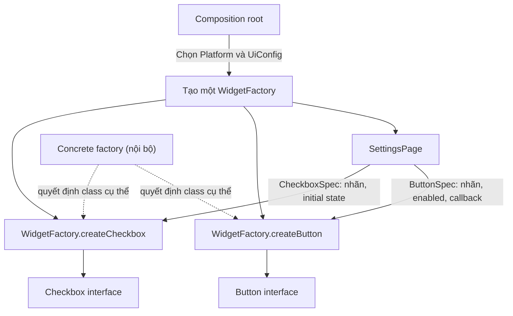

# Truyền cấu hình chung và tham số riêng mà không làm lộ lớp triển khai

Trong **Abstract Factory**, client sử dụng một tập **loại sản phẩm trừu tượng** (ví dụ `Button`, `Checkbox`) và chọn **một họ triển khai** (Windows hoặc macOS) thông qua factory. Vấn đề xuất hiện khi các sản phẩm cần cấu hình: ngôn ngữ và giao diện chung cho cả màn hình, nhãn riêng của từng nút, trạng thái ban đầu của checkbox và đôi khi là những tùy chọn đặc thù nền tảng.

Thiết kế không khéo sẽ buộc client biết `WindowsButtonConfig`, `MacCheckbox` hoặc native toolkit để tạo đúng đối tượng. Điều đó làm mất phần lớn lợi ích của Abstract Factory.

Bài thuộc chương **Thiết kế interface** của module **Học về abstract factory trong design pattern**. Mục tiêu là xây dựng API phân biệt rõ **cấu hình chung**, **tham số riêng lúc tạo sản phẩm**, **trạng thái thay đổi khi sử dụng** và **chi tiết triển khai nội bộ**. Cách phân chia này giúp client truyền đủ thông tin mà vẫn lập trình qua interface.

## 1. Năm nhóm thông tin cần phân biệt

Giả sử màn hình cài đặt có nút Lưu và checkbox Nhận thông báo. Yêu cầu gồm:

| Nhóm thông tin | Ví dụ | Ai quyết định? | Nơi phù hợp |
| --- | --- | --- | --- |
| **Chọn họ sản phẩm** | Windows hoặc macOS | Composition root / phần khởi động ứng dụng | Chọn concrete factory **một lần** |
| **Cấu hình chung của họ** | Theme sáng/tối, `Locale`, mật độ hiển thị | Cấu hình ứng dụng hoặc màn hình | Cung cấp khi tạo factory; factory dùng cho các sản phẩm |
| **Tham số riêng của mỗi sản phẩm** | Nhãn nút, enabled, callback; nhãn checkbox, giá trị ban đầu | Client hiểu ngữ nghĩa nghiệp vụ | Truyền qua `createButton(ButtonSpec)`, `createCheckbox(CheckboxSpec)` |
| **Trạng thái trong quá trình sử dụng** | Checkbox hiện đang chọn hay bỏ chọn | Tương tác người dùng | Phương thức trên `Checkbox`, ví dụ `setChecked()` |
| **Chi tiết riêng của nền tảng** | Native handle, Win32 style flag, AppKit control, renderer | Concrete factory và concrete product | Ẩn trong lớp triển khai hoặc adapter |

Nhóm thứ hai và thứ ba đều là “cấu hình” theo nghĩa rộng nhưng có **vòng đời khác nhau**. Theme có thể áp dụng cho mọi widget trong một màn hình; nhãn “Lưu” chỉ thuộc một nút cụ thể. Trạng thái checkbox lại có thể thay đổi sau khi sản phẩm đã được tạo.

**Quy tắc hữu ích:** Thông tin dùng nhất quán cho cả họ thường đi vào **factory**; thông tin thay đổi theo từng sản phẩm đi vào **phương thức tạo sản phẩm**; thông tin thay đổi theo tương tác đi vào **hợp đồng hành vi của sản phẩm**.

## 2. Phản ví dụ: API làm lộ lớp triển khai

Xét một factory tưởng như tổng quát nhưng yêu cầu caller biết kiểu của từng nền tảng:

```java
interface UiFactory {
    WindowsButton createButton(WindowsButtonConfig config);
    WindowsCheckbox createCheckbox(WindowsCheckboxConfig config);
}
```

API trên chỉ phục vụ Windows. Một `MacUiFactory` không thể trả về `MacButton` khác kiểu mà vẫn thỏa hợp đồng này. Client phải import `WindowsButtonConfig`, biết chi tiết riêng của Windows, rồi sửa lại khi đổi họ.

Một biến thể khác trộn việc chọn họ và thông số sản phẩm trong từng lời gọi:

```java
interface UiFactory {
    Button createButton(String platform, String label, int nativeStyle);
    Checkbox createCheckbox(String platform, String label, int nativeFlags);
}
```

Nhược điểm:

- Caller có thể truyền `"windows"` cho nút và `"mac"` cho checkbox, tạo bộ không nhất quán.
- `nativeStyle` và `nativeFlags` buộc client dùng chung hiểu các mã của toolkit.
- Danh sách tham số dài, dễ truyền nhầm; mỗi lần thêm tùy chọn lại phải thay chữ ký.
- Cấu hình dùng chung như theme hoặc locale bị lặp ở nhiều lệnh tạo sản phẩm.

Tách đối tượng cấu hình không tự động giải quyết vấn đề nếu đối tượng đó chỉ là một lớp triển khai cụ thể. Điều quan trọng là **kiểu dữ liệu công khai phải diễn đạt nhu cầu mà client thật sự có**, không phản chiếu chi tiết của một nền tảng.

## 3. Phác thảo API hướng tới nhu cầu người dùng

Trong ví dụ, ta định nghĩa:

```java
record UiConfig(Theme theme, Locale locale, int density) {}
record ButtonSpec(String label, boolean enabled, Runnable onClick) {}
record CheckboxSpec(String label, boolean initiallyChecked) {}

interface WidgetFactory {
    Button createButton(ButtonSpec spec);
    Checkbox createCheckbox(CheckboxSpec spec);
}
```

Ý nghĩa:

- `UiConfig` mô tả **thuộc tính trung lập nền tảng** dùng cho các sản phẩm cùng họ; factory giữ cấu hình này.
- `ButtonSpec` và `CheckboxSpec` mô tả **yêu cầu riêng cho từng instance**. Chúng không chứa `WindowsButton`, `MacCheckbox` hay native control.
- `WidgetFactory` trả về **product interfaces**; caller chỉ biết nút hỗ trợ hành vi nào và checkbox hỗ trợ hành vi nào.
- Concrete factory sử dụng cả `UiConfig` đã giữ và `spec` vừa nhận để chọn lớp triển khai thích hợp.

Sơ đồ luồng dữ liệu:



Điểm quyết định nền tảng và cấu hình chung nằm ở **composition root**. Khi trang tạo sản phẩm, trang chỉ cung cấp các thông tin riêng theo loại; việc chọn `WindowsButton` hay `MacButton` do concrete factory thực hiện.

## 4. Ví dụ Java 17 hoàn chỉnh

Ví dụ dùng Java thuần để chạy độc lập, không phụ thuộc framework GUI. `render()` trả về chuỗi mô phỏng giao diện để dễ quan sát; trong ứng dụng thực, mỗi concrete product có thể gọi API render native hoặc web tương ứng.

Lưu toàn bộ mã sau vào tệp `Demo.java`:

```java
import java.util.Locale;
import java.util.Objects;

public final class Demo {
    private Demo() {}

    // 1. Hai trục độc lập: họ sản phẩm và cấu hình dùng chung
    public enum Platform { WINDOWS, MAC }
    public enum Theme { LIGHT, DARK }

    public record UiConfig(Theme theme, Locale locale, int density) {
        public UiConfig {
            Objects.requireNonNull(theme, "theme");
            Objects.requireNonNull(locale, "locale");
            if (density < 1 || density > 3) {
                throw new IllegalArgumentException("density must be 1..3");
            }
        }
    }

    // 2. Tham số riêng cho mỗi lần tạo sản phẩm
    public record ButtonSpec(
        String label, boolean enabled, Runnable onClick
    ) {
        public ButtonSpec {
            if (label == null || label.isBlank()) {
                throw new IllegalArgumentException("button label is blank");
            }
            Objects.requireNonNull(onClick, "onClick");
        }
    }

    public record CheckboxSpec(String label, boolean initiallyChecked) {
        public CheckboxSpec {
            if (label == null || label.isBlank()) {
                throw new IllegalArgumentException("checkbox label is blank");
            }
        }
    }

    // 3. Product interfaces: hợp đồng mà client sử dụng
    public interface Button {
        String render();
        void click();
    }

    public interface Checkbox {
        String render();
        void setChecked(boolean value);
        boolean isChecked();
    }

    // 4. Abstract Factory không nhắc đến các concrete class
    public interface WidgetFactory {
        Button createButton(ButtonSpec spec);
        Checkbox createCheckbox(CheckboxSpec spec);
    }

    // 5. Composition root gọi một entry point công khai
    public static WidgetFactory createFactory(
        Platform platform, UiConfig config
    ) {
        Objects.requireNonNull(platform, "platform");
        Objects.requireNonNull(config, "config");

        return switch (platform) {
            case WINDOWS -> new WindowsFactory(config);
            case MAC -> new MacFactory(config);
        };
    }

    // Helper nội bộ chỉ để mô phỏng cách render
    private static String describe(
        String family, UiConfig config, String kind, String label
    ) {
        return "[" + family + "] [" + config.theme()
            + ", " + config.locale().toLanguageTag()
            + ", density=" + config.density() + "] "
            + kind + ": " + label;
    }

    // 6. Concrete factories giữ một bản cấu hình chung
    private static final class WindowsFactory implements WidgetFactory {
        private final UiConfig config;

        private WindowsFactory(UiConfig config) {
            this.config = config;
        }

        @Override
        public Button createButton(ButtonSpec spec) {
            return new WindowsButton(config, Objects.requireNonNull(spec));
        }

        @Override
        public Checkbox createCheckbox(CheckboxSpec spec) {
            return new WindowsCheckbox(config, Objects.requireNonNull(spec));
        }
    }

    private static final class MacFactory implements WidgetFactory {
        private final UiConfig config;

        private MacFactory(UiConfig config) {
            this.config = config;
        }

        @Override
        public Button createButton(ButtonSpec spec) {
            return new MacButton(config, Objects.requireNonNull(spec));
        }

        @Override
        public Checkbox createCheckbox(CheckboxSpec spec) {
            return new MacCheckbox(config, Objects.requireNonNull(spec));
        }
    }

    // 7. Concrete products: xử lý chi tiết của từng họ
    private static final class WindowsButton implements Button {
        private final UiConfig config;
        private final ButtonSpec spec;

        private WindowsButton(UiConfig config, ButtonSpec spec) {
            this.config = config;
            this.spec = spec;
        }

        @Override
        public String render() {
            return describe("Windows", config, "Button", spec.label());
        }

        @Override
        public void click() {
            if (spec.enabled()) {
                spec.onClick().run();
            }
        }
    }

    private static final class MacButton implements Button {
        private final UiConfig config;
        private final ButtonSpec spec;

        private MacButton(UiConfig config, ButtonSpec spec) {
            this.config = config;
            this.spec = spec;
        }

        @Override
        public String render() {
            return describe("macOS", config, "Button", spec.label());
        }

        @Override
        public void click() {
            if (spec.enabled()) {
                spec.onClick().run();
            }
        }
    }

    private static final class WindowsCheckbox implements Checkbox {
        private final UiConfig config;
        private final CheckboxSpec spec;
        private boolean checked;

        private WindowsCheckbox(UiConfig config, CheckboxSpec spec) {
            this.config = config;
            this.spec = spec;
            this.checked = spec.initiallyChecked();
        }

        @Override
        public String render() {
            return describe("Windows", config, "Checkbox", spec.label())
                + ", checked=" + checked;
        }

        @Override
        public void setChecked(boolean value) {
            checked = value;
        }

        @Override
        public boolean isChecked() {
            return checked;
        }
    }

    private static final class MacCheckbox implements Checkbox {
        private final UiConfig config;
        private final CheckboxSpec spec;
        private boolean checked;

        private MacCheckbox(UiConfig config, CheckboxSpec spec) {
            this.config = config;
            this.spec = spec;
            this.checked = spec.initiallyChecked();
        }

        @Override
        public String render() {
            return describe("macOS", config, "Checkbox", spec.label())
                + ", checked=" + checked;
        }

        @Override
        public void setChecked(boolean value) {
            checked = value;
        }

        @Override
        public boolean isChecked() {
            return checked;
        }
    }

    // 8. Client chỉ nhìn thấy factory, product interface và spec
    public static final class SettingsPage {
        private final Button saveButton;
        private final Checkbox notifications;
        private int saveCount;

        public SettingsPage(WidgetFactory factory) {
            Objects.requireNonNull(factory, "factory");

            notifications = factory.createCheckbox(
                new CheckboxSpec("Nhận thông báo", false)
            );
            saveButton = factory.createButton(
                new ButtonSpec("Lưu", true, () -> saveCount++)
            );
        }

        public void simulate() {
            notifications.setChecked(true);
            System.out.println(saveButton.render());
            System.out.println(notifications.render());
            saveButton.click();
            System.out.println("saved=" + saveCount);
        }
    }

    public static void main(String[] args) {
        Platform platform =
            args.length > 0 && args[0].equalsIgnoreCase("mac")
                ? Platform.MAC : Platform.WINDOWS;

        UiConfig common = new UiConfig(
            Theme.DARK, Locale.forLanguageTag("vi-VN"), 2
        );
        WidgetFactory factory = createFactory(platform, common);
        new SettingsPage(factory).simulate();
    }
}
```

Chạy từ thư mục chứa `Demo.java`:

```bash
javac Demo.java
java Demo windows
java Demo mac
```

Kết quả minh họa với `java Demo mac`:

```text
[macOS] [DARK, vi-VN, density=2] Button: Lưu
[macOS] [DARK, vi-VN, density=2] Checkbox: Nhận thông báo, checked=true
saved=1
```

Chạy cấu hình Windows cho tiền tố `[Windows]` nhưng giữ nguyên `DARK`, `vi-VN`, `density=2` và quy tắc lưu. Các thông số chung được chọn một lần; nhãn nút, trạng thái checkbox và callback được truyền riêng ở lúc tạo sản phẩm.

### 4.1. Vì sao ví dụ không làm lộ lớp triển khai?

- `WidgetFactory` trả về `Button` và `Checkbox`, không trả về `WindowsButton` hoặc `MacCheckbox`.
- `createButton(...)` chỉ nhận `ButtonSpec` trung lập nền tảng; `createCheckbox(...)` chỉ nhận `CheckboxSpec`.
- `createFactory(platform, common)` chọn họ và chuyển cấu hình vào concrete factory. Client không tự chọn lớp widget cho từng phương thức.
- Các concrete factory và concrete product là **lớp lồng `private`**, nên caller bên ngoài `Demo` không thể tham chiếu trực tiếp các class đó.
- `SettingsPage` làm việc hoàn toàn với interface. Cùng một client có thể dùng factory Windows hoặc macOS.

Điểm cần hiểu: code tạo `new WindowsButton(config, spec)` vẫn hiện diện trong **concrete factory**. Abstract Factory không xóa đi các lớp cụ thể; nó đưa trách nhiệm chọn và tạo chúng về đúng nơi.

## 5. Chọn nơi truyền tham số dựa trên vòng đời

Không có quy tắc bắt buộc mọi cấu hình phải đi vào constructor factory. Cần phân biệt **phạm vi tác động** và **thời điểm thay đổi**:

| Thông tin | Cần đổi theo từng lần tạo? | Cách truyền thường hợp lý |
| --- | --- | --- |
| Họ nền tảng | Không, trong suốt vòng đời một factory | Chọn concrete factory lúc khởi tạo |
| Theme của cả màn hình | Thường không | `UiConfig` của factory |
| Locale của cả màn hình | Thường không | `UiConfig` của factory |
| Nhãn của nút A và nút B | Có | `ButtonSpec` của từng lần `createButton()` |
| Enabled ban đầu | Có | `ButtonSpec.enabled` |
| Checkbox được chọn ban đầu | Có | `CheckboxSpec.initiallyChecked` |
| Checkbox được chọn sau khi người dùng nhấn | Thay đổi trong vòng đời sản phẩm | `Checkbox.setChecked()` |
| Native style mask, toolkit context | Tùy implementation | Concrete factory/product nội bộ |

Nếu một thông số cần thay đổi thường xuyên **giữa các lần tạo sản phẩm**, đừng tùy tiện đặt nó trong factory bất biến rồi cập nhật bằng setter. Hãy xác định rõ nó là tham số riêng của từng lần tạo hay cần một factory mới cho một cấu hình chung khác.

Ví dụ, hai nút chung theme nhưng có nhãn khác nhau nên được tạo từ **cùng factory**:

```java
Demo.WidgetFactory factory = Demo.createFactory(
    Demo.Platform.WINDOWS,
    new Demo.UiConfig(
        Demo.Theme.LIGHT, java.util.Locale.forLanguageTag("vi-VN"), 1
    )
);

Demo.Button save = factory.createButton(
    new Demo.ButtonSpec("Lưu", true, () -> System.out.println("Lưu"))
);
Demo.Button cancel = factory.createButton(
    new Demo.ButtonSpec("Hủy", true, () -> System.out.println("Hủy"))
);
```

Không cần tạo `WindowsSaveButtonFactory`, `WindowsCancelButtonFactory` hoặc constructor riêng cho từng nhãn.

## 6. Đặc thù nền tảng nên nằm ở đâu?

Đôi khi UI trên một nền tảng cần cờ native hoặc thông số không tồn tại ở nền tảng khác. Ví dụ, một nút macOS có kiểu focus ring riêng và một nút Windows có cờ native style.

**Không nên** mở rộng hợp đồng chung thành:

```java
record ButtonSpec(
    String label,
    int windowsStyleFlags,
    MacFocusRing macFocusRing
) {}
```

Client macOS sẽ phải biết Windows, và client Windows phải biết macOS. Mỗi lần bổ sung họ mới, `ButtonSpec` lại phình ra.

Thay vào đó, cân nhắc các hướng sau theo yêu cầu:

1. **Ánh xạ từ thuộc tính chung sang thuộc tính native:** nếu client muốn nút mang ý nghĩa `PRIMARY` hoặc `DANGER`, khai báo một kiểu trung lập như `ButtonRole`; concrete product tự chuyển nó sang native style thích hợp.
2. **Cấu hình nằm trong adapter/concrete factory:** nếu thuộc tính chỉ là chi tiết kỹ thuật để render, đừng yêu cầu client khai báo. Concrete factory biết cách dựng native control.
3. **Capability interface riêng:** nếu chỉ một số nền tảng hỗ trợ một tính năng có ý nghĩa với client, tách hợp đồng tùy chọn với cách phát hiện khả năng rõ ràng; không ép mọi `Button` cài đặt thao tác vô nghĩa.
4. **Extension point cấp nền tảng:** nếu thư viện phục vụ mã chỉ dành cho Windows, có thể mở một API chuyên biệt trong module Windows. Phần client xuyên nền tảng vẫn chỉ dùng `WidgetFactory` chung.

Ví dụ nâng cấp `ButtonSpec` theo ý nghĩa sản phẩm:

```java
enum ButtonRole { PRIMARY, SECONDARY, DANGER }

record ButtonSpec(String label, ButtonRole role, Runnable onClick) {}
```

`WindowsButton` và `MacButton` có thể render `PRIMARY` theo cách khác nhau. Điều cần thống nhất là **ý nghĩa nghiệp vụ của role**, không phải pixel hay tên API native. Mẫu ở mục 4 dùng `enabled` cho đơn giản; trong dự án thật có thể kết hợp `role` và các tham số khác đã được xác nhận.

## 7. Thiết kế object cấu hình an toàn

### 7.1. Ưu tiên cấu hình bất biến và validation tại ranh giới

Khi nhiều sản phẩm dùng chung config, đối tượng bất biến giúp tránh tình huống nút A được tạo theo theme cũ nhưng checkbox B lại dùng theme mới do caller sửa `config` ở giữa.

`UiConfig` ở ví dụ là Java `record`, chứa `Theme`, `Locale` và `int`; các kiểu này không mang trạng thái thay đổi từ bên ngoài nên phù hợp làm **snapshot bất biến**. `record` chỉ bất biến ở mức tham chiếu các field, không tự sao chép sâu các cấu trúc mutable. Nếu bổ sung `List`, `Map` hoặc object có trạng thái, cần phòng vệ bằng `List.copyOf`, `Map.copyOf` hoặc cơ chế copy phù hợp.

Validation nên đặt ở nơi lỗi được phát hiện sớm:

- `UiConfig`: theme và locale khác null; density nằm trong miền hỗ trợ.
- `ButtonSpec`: nhãn không rỗng; callback bắt buộc khác null nếu hợp đồng yêu cầu.
- `CheckboxSpec`: nhãn hợp lệ; trạng thái boolean đã có miền giá trị rõ.
- Concrete factory: xác minh những điều kiện nội bộ (ví dụ tài nguyên nền tảng sẵn sàng) và thông báo lỗi có nghĩa.

Tránh để một tham số được chấp nhận ở public API nhưng chỉ gây lỗi khó hiểu tại native renderer nhiều bước sau.

### 7.2. Phân biệt cấu hình ban đầu với trạng thái hiện tại

`CheckboxSpec.initiallyChecked` chỉ quyết định trạng thái **khi mới tạo**. Sau đó `Checkbox.setChecked(boolean)` thay đổi trạng thái hiện tại. Một sai lầm là đọc mãi `initiallyChecked` trong `isChecked()`, khiến checkbox không bao giờ lưu được thay đổi của người dùng.

Với `ButtonSpec.enabled`, nếu ứng dụng cần bật/tắt nút theo kết quả kiểm tra form sau khi đã tạo, hợp đồng `Button` có thể thêm `setEnabled(boolean)` với ngữ nghĩa nhất quán. Không nên yêu cầu client tạo lại toàn bộ factory chỉ để thay một thuộc tính runtime của một nút.

### 7.3. Thay cấu hình chung lúc chạy

Ví dụ theme đổi từ `LIGHT` sang `DARK` trong khi màn hình đang hiển thị. Hai cách tiếp cận thường gặp:

- **Snapshot và tạo lại bộ sản phẩm:** tạo `UiConfig` mới, factory mới, rồi dựng lại cả nhóm widget cần đổi theme. Cách này dễ đảm bảo tất cả sản phẩm cùng cấu hình tại thời điểm xây dựng.
- **Nguồn cấu hình thay đổi có kiểm soát:** product nhận interface theo dõi theme và cập nhật khi có sự kiện. Cách này phức tạp hơn: phải xác định đồng bộ, vòng đời subscription, khả năng update đồng thời và xử lý lỗi.

Không nên mặc định sửa `UiConfig` mutable giữa hai lời gọi `createButton()` và `createCheckbox()`, vì cả hai sản phẩm có thể chụp hai phiên bản khác nhau. Nếu yêu cầu thay theme cùng lúc, cần có **ranh giới cập nhật nhất quán** cho cả bộ.

## 8. Kiểm thử API, tham số và hợp đồng

Khi viết test, kiểm tra các hành vi client có thể quan sát **qua interface**, ví dụ nút disabled không gọi callback, checkbox bắt đầu đúng trạng thái đã khai báo, và hai factory áp dụng cấu hình/nhãn cùng ý nghĩa.

Ví dụ JUnit 5 cho các interface công khai ở mục 4 (cần cấu hình JUnit Jupiter trong dự án):

```java
import org.junit.jupiter.api.Test;
import java.util.Locale;
import java.util.concurrent.atomic.AtomicInteger;

import static org.junit.jupiter.api.Assertions.*;

class WidgetFactoryTest {
    private static Demo.UiConfig config() {
        return new Demo.UiConfig(
            Demo.Theme.DARK, Locale.forLanguageTag("vi-VN"), 2
        );
    }

    @Test
    void buttonUsesPerProductOptionsWithoutExposingConcreteClass() {
        var presses = new AtomicInteger();
        Demo.WidgetFactory factory = Demo.createFactory(
            Demo.Platform.WINDOWS, config()
        );

        Demo.Button disabled = factory.createButton(
            new Demo.ButtonSpec("Đăng ký", false, presses::incrementAndGet)
        );
        disabled.click();
        assertEquals(0, presses.get());
        assertTrue(disabled.render().contains("Đăng ký"));

        Demo.Button enabled = factory.createButton(
            new Demo.ButtonSpec("Tiếp tục", true, presses::incrementAndGet)
        );
        enabled.click();
        assertEquals(1, presses.get());
    }

    @Test
    void checkboxUsesInitialStateThenChangesIndependently() {
        Demo.WidgetFactory factory = Demo.createFactory(
            Demo.Platform.MAC, config()
        );
        Demo.Checkbox first = factory.createCheckbox(
            new Demo.CheckboxSpec("Nhận thông báo", true)
        );
        Demo.Checkbox second = factory.createCheckbox(
            new Demo.CheckboxSpec("Đồng ý", false)
        );

        assertTrue(first.isChecked());
        assertFalse(second.isChecked());
        first.setChecked(false);
        assertFalse(first.isChecked());
        assertFalse(second.isChecked());
    }

    @Test
    void invalidCommonConfigIsRejectedEarly() {
        assertThrows(IllegalArgumentException.class,
            () -> new Demo.UiConfig(Demo.Theme.DARK, Locale.ROOT, 0));
    }
}
```

Trong ví dụ mô phỏng, `render()` cho phép nhìn thấy nhãn; kiểm thử có thể so sánh phần nhãn thay vì ép kiểu về `WindowsButton`. Với UI thật, hãy kiểm tra observable output hoặc hành vi user-facing phù hợp. Có thể thêm parameterized tests áp dụng cùng contract cho cả hai họ, kết hợp integration test để xác minh nền tảng tạo đúng loại widget.

**Lưu ý:** `ButtonSpec` là record có tham chiếu `Runnable`. Record giữ nguyên tham chiếu callback, chứ không làm cho mọi tác dụng phụ của callback trở nên bất biến; việc nhấn nút có thể cập nhật trạng thái bên ngoài như `AtomicInteger` trong test.

## 9. Các lỗi thường gặp và cách xử lý

| Dấu hiệu | Hệ quả | Cách cải thiện |
| --- | --- | --- |
| `createButton(WindowsButtonConfig)` trong factory chung | Client phụ thuộc Windows; khó thay họ | Dùng `ButtonSpec` trung lập nền tảng |
| `createButton(platform, ...)` và `createCheckbox(platform, ...)` | Caller có thể trộn họ khác nhau | Chọn họ khi tạo factory |
| Mỗi lần tạo nút lại truyền theme/locale giống nhau | Lặp dữ liệu, dễ truyền lệch cấu hình | Cho factory giữ `UiConfig` dùng chung |
| Một `GenericOptions` có mọi trường của nút/checkbox/dialog | Nhiều trường vô nghĩa, nhiều nhánh và null | Tách spec theo từng **loại sản phẩm** |
| Spec chứa native handle hoặc enum của một toolkit | Lộ lớp triển khai vào public API | Mapping nội bộ hoặc extension point riêng |
| Factory giữ một `CheckboxSpec` mutable chia sẻ giữa các widget | Trạng thái có thể ảnh hưởng chéo | Snapshot immutable và state riêng cho mỗi product |
| Gọi `setTheme` giữa lúc tạo một bộ widget | Các sản phẩm có thể lấy cấu hình khác nhau | Snapshot cấu hình và cập nhật cả bộ nhất quán |
| Ném `UnsupportedOperationException` với option phổ biến ở một họ | Contract không thay thế được giữa các họ | Định nghĩa khả năng chung thực sự hoặc tách capability |
| Thêm 10 tham số positional vào `createButton()` | Khó đọc và dễ đảo thứ tự | Spec có tên field, validation, default rõ |

## 10. Khi nào không nên dùng một object cấu hình chung?

`UiConfig` chỉ nên chứa những gì thật sự được **nhiều sản phẩm cùng dùng và có cùng ngữ nghĩa**. Không gom vào đó các thông số chỉ xuất hiện ở một sản phẩm:

- Kích thước tối đa của một `TextField` cụ thể nên là `TextFieldSpec.maxLength`, không phải `UiConfig.globalMaxLength`, trừ khi đây thực sự là chính sách toàn cục.
- URL ảnh của một thumbnail chỉ thuộc sản phẩm thumbnail, không thuộc mọi factory.
- Callback nhấn Lưu thường thuộc `ButtonSpec` hoặc client đăng ký trên `Button`, không phải `UiConfig.onAnyButtonClicked`.

Ngược lại, một dịch vụ hạ tầng có thể dùng chung nhiều sản phẩm nhưng không nên xuất hiện trong spec nghiệp vụ: ví dụ native resource manager, telemetry, font resolver. Nơi wiring có thể truyền những dependency này vào concrete factory thông qua constructor **nội bộ**, giữ API client đơn giản.

Số lượng record/spec nên phản ánh **các nhóm hành vi thực tế**, không phải mỗi biến thể nền tảng một DTO. Abstract Factory có thể hỗ trợ nhiều họ nhưng không yêu cầu nhân bản `ButtonSpec` thành `WindowsButtonSpec`, `MacButtonSpec`, `LinuxButtonSpec`.

## 11. Checklist review thiết kế interface

Trước khi chấp nhận API Abstract Factory, hãy kiểm tra:

1. **Client cần điều gì?** Họ sản phẩm, thuộc tính chung, thuộc tính riêng và trạng thái hiện tại đã được tách rõ chưa?
2. **Ai chọn họ?** Có một nơi chọn `Platform` và cấp factory, hay caller được chọn nền tảng ở từng phương thức?
3. **Product interface có trung lập nền tảng?** Kiểu trả về và phương thức có tránh `WindowsButton` hay `MacCheckbox` không?
4. **Spec có đúng loại sản phẩm?** `ButtonSpec` chỉ có dữ liệu cần cho nút; `CheckboxSpec` chỉ có dữ liệu cần cho checkbox?
5. **Validation đặt ở đâu?** Lỗi null, nhãn rỗng, miền giá trị không hợp lệ có được phát hiện trước khi vào native API?
6. **Cấu hình chung có bất biến?** Khi tạo nhiều sản phẩm cùng họ, tất cả có nhận cùng snapshot mong muốn?
7. **Trạng thái runtime có được tách khỏi initial config?** Có cho client đổi state đúng cách mà không phá tính nhất quán của factory?
8. **Tùy chọn đặc thù được giấu đúng nơi?** Có thể thêm một họ mới mà không buộc client sửa import hay truyền native flags?
9. **Test dùng abstraction?** Test có thể kiểm tra hành vi qua `Button`, `Checkbox`, `WidgetFactory` thay vì ép kiểu về concrete product?

## 12. Bài tập vận dụng

**Tình huống:** Ứng dụng bán hàng xuất báo cáo PDF và HTML. Cả hai họ sản phẩm đều có `Header` và `Table`. Các tài liệu cùng dùng locale và thương hiệu, nhưng mỗi header có tiêu đề khác nhau, mỗi table nhận tập dữ liệu khác nhau.

Hãy tự thiết kế:

1. `ReportConfig` chứa những thông tin **chung** và được truyền khi tạo `ReportFactory`.
2. `HeaderSpec` chứa tiêu đề và phụ đề; `TableSpec` chứa danh sách hàng và cách trình bày mang ý nghĩa trung lập định dạng.
3. `ReportFactory.createHeader(HeaderSpec)` và `createTable(TableSpec)` trả về `Header`, `Table` interfaces; `PdfReportFactory` và `HtmlReportFactory` tạo các concrete product tương ứng.
4. Một `ReportScreen` chỉ nhận `ReportFactory`, không cần import `PdfHeader` hoặc `HtmlTable`.

**Câu hỏi mở rộng:** Nếu PDF cần font embedding còn HTML cần CSS class, bạn sẽ đưa chi tiết đó vào đâu để `ReportFactory` và `ReportScreen` không rò rỉ lớp triển khai? Nếu người dùng đổi locale giữa hai lần xuất báo cáo, bạn sẽ tạo factory mới hay dùng cơ chế cấu hình động, và vì sao?

**Ghi nhớ:** Trong Abstract Factory, việc truyền tham số tốt bắt đầu từ **phạm vi và vòng đời của thông tin**. Đưa cấu hình chung vào factory, đưa thông số theo từng sản phẩm vào `Spec` của đúng loại, đặt trạng thái runtime trong product interface và giữ chi tiết nền tảng bên trong concrete factory/product. Nhờ vậy client có thể cấu hình đúng nhu cầu mà vẫn thay cả họ sản phẩm bằng một quyết định ở ranh giới tạo đối tượng.
