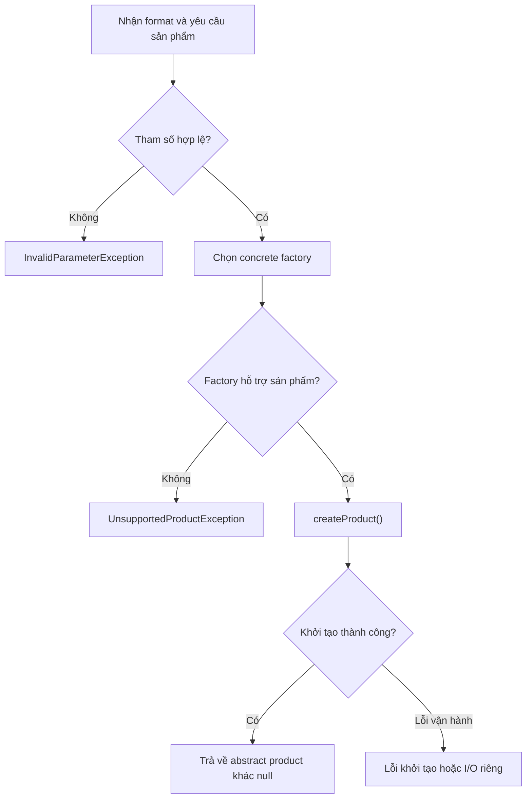

# Thiết kế hợp đồng lỗi khi tham số không hợp lệ hoặc sản phẩm không được hỗ trợ

## 1. Vì sao Abstract Factory cần hợp đồng lỗi rõ ràng?

**Abstract Factory** cung cấp một interface để tạo ra **một họ sản phẩm liên quan** mà mã khách (*client*) không cần biết các lớp triển khai cụ thể. Trong thực tế, hai câu hỏi xuất hiện ngay khi thiết kế interface:

1. Điều gì xảy ra nếu người gọi truyền **tham số không hợp lệ**, ví dụ tên định dạng bị gõ sai, tiêu đề rỗng hoặc dữ liệu biểu đồ có giá trị âm?
2. Điều gì xảy ra nếu người gọi yêu cầu **một sản phẩm mà họ factory được chọn không hỗ trợ**, ví dụ muốn tạo biểu đồ từ một factory chỉ xuất văn bản thuần?

Nếu không định nghĩa trước hợp đồng, các concrete factory dễ xử lý khác nhau: nơi trả về `null`, nơi âm thầm dùng định dạng khác, nơi ném `RuntimeException` chung chung. Kết quả là client phải đoán lỗi thuộc loại nào và có thể tiếp tục chạy với sản phẩm sai họ.

Trong chương **Thiết kế interface**, mục tiêu không chỉ là đặt tên cho `createTextRenderer()` hay `createChartRenderer()`. Interface tốt còn cần công bố **đầu vào hợp lệ, sản phẩm được bảo đảm, các khả năng tùy chọn và cách báo lỗi**. Những quyết định này giúp mọi concrete factory thực hiện cùng một hợp đồng.

Ví dụ xuyên suốt: ứng dụng xuất báo cáo theo hai định dạng giả định:

- **HTML** hỗ trợ `TextRenderer` và `ChartRenderer`.
- **Plain Text** hỗ trợ `TextRenderer` nhưng theo yêu cầu sản phẩm của ví dụ **không hỗ trợ biểu đồ**.

Văn bản thuần về mặt kỹ thuật có thể biểu diễn biểu đồ bằng ký tự ASCII. Trong bài này, đội sản phẩm cố ý **không cung cấp chức năng đó**, để làm rõ khái niệm *unsupported product* là một quyết định của hợp đồng ứng dụng, không phải một giới hạn tuyệt đối của định dạng.

## 2. Phân biệt ba loại lỗi thường bị trộn lẫn

| Tình huống | Ví dụ | Loại lỗi và phản hồi mong đợi |
| --- | --- | --- |
| **Tham số hoặc cấu hình không hợp lệ** | `format=htlm`, tiêu đề rỗng, giá trị biểu đồ âm | `InvalidParameterException`: chỉ rõ tham số sai và cách sửa |
| **Yêu cầu sản phẩm không được hỗ trợ** | `PlainTextFactory.createChartRenderer()` | `UnsupportedProductException`: nêu họ factory và sản phẩm không hỗ trợ |
| **Lỗi khi vận hành sản phẩm đã tạo** | Ghi file thất bại, mạng gián đoạn, hết dung lượng | Lỗi I/O/SDK hoặc lỗi vận hành riêng; không đánh đồng với hai lỗi hợp đồng ở trên |

Điểm khác nhau quyết định cách xử lý:

- **Tham số sai**: người gọi sửa dữ liệu đầu vào hoặc cấu hình.
- **Không hỗ trợ sản phẩm**: người gọi chọn một họ khác, đổi yêu cầu hoặc không cung cấp tính năng đó.
- **Lỗi vận hành**: có thể cần retry, điều tra hạ tầng hoặc phục hồi tài nguyên tùy tình huống.

Ví dụ, `format=htlm` **không phải** một định dạng được hỗ trợ nhưng thiếu biểu đồ; đó là **lựa chọn factory không hợp lệ**. Ngược lại, `format=plain-text` là giá trị hợp lệ, nhưng yêu cầu `chart` vượt quá khả năng đã công bố của họ sản phẩm này.

### Quy ước hợp đồng nên ghi rõ

| Điều kiện | Cam kết |
| --- | --- |
| Đầu vào bắt buộc bị `null`, rỗng hoặc sai miền giá trị | Báo lỗi tham số cụ thể, không tự sửa im lặng |
| Chọn một tên biến thể không có trong danh sách | Báo lỗi cấu hình/lựa chọn, liệt kê lựa chọn hợp lệ |
| Chọn biến thể hợp lệ nhưng yêu cầu sản phẩm không hỗ trợ | Báo lỗi không hỗ trợ có chứa biến thể và sản phẩm |
| Tạo thành công một sản phẩm được hỗ trợ | Trả về đối tượng khác `null`, tuân thủ abstract product tương ứng |
| Xảy ra lỗi kết nối hay ghi dữ liệu sau khi tạo | Báo lỗi vận hành phù hợp; không gắn nhầm nhãn “unsupported” |
| Client không yêu cầu một khả năng tùy chọn | Không nên tạo sản phẩm tùy chọn đó chỉ để kiểm tra sự tồn tại |

**Không dùng `null` làm kết quả mặc định cho “không hỗ trợ”.** Nếu client quên kiểm tra `null`, nó sẽ gặp `NullPointerException` ở một bước xa nguyên nhân. Cũng không nên âm thầm trả về `HtmlChartRenderer` từ `PlainTextFactory`: cách đó có thể làm hỏng tính nhất quán của họ sản phẩm.

## 3. Thiết kế hợp đồng khả năng trước khi tạo sản phẩm

Một interface có phương thức `createChartRenderer()` thường khiến người gọi kỳ vọng mọi factory sẽ tạo được biểu đồ. Khi không phải họ nào cũng hỗ trợ, cần đưa quy tắc này thành một phần **được công bố** của hợp đồng.

Một phương án là cung cấp phép hỏi khả năng (*capability query*) cùng một lỗi rõ ràng khi yêu cầu không được hỗ trợ:

```java
enum ProductKind {
    TEXT, CHART
}

interface DocumentFactory {
    boolean supports(ProductKind product);
    TextRenderer createTextRenderer();
    ChartRenderer createChartRenderer();
}
```

Các quy tắc đi kèm:

1. `supports(TEXT)` và `supports(CHART)` trả lời dựa trên khả năng **đã khai báo**, không chạy thao tác ghi file hay gọi mạng.
2. Nếu `supports(X) == true`, `createX()` phải tạo sản phẩm hợp lệ hoặc báo lỗi khởi tạo/vận hành thực sự; **không được báo “không hỗ trợ”** một cách mâu thuẫn.
3. Nếu `supports(X) == false`, yêu cầu `createX()` phải kết thúc nhất quán bằng `UnsupportedProductException` có thể nhận diện được.
4. Khả năng hỗ trợ phải được quyết định ở cấp **loại sản phẩm và định dạng**. Một trường hợp bị từ chối vì dữ liệu không hợp lệ vẫn là **lỗi tham số**, dù factory có hỗ trợ loại sản phẩm đó.
5. Nếu cần tạo nhiều thành phần cho một báo cáo, client nên kiểm tra khả năng được yêu cầu **trước khi thực hiện thao tác có tác dụng phụ**.



**Lưu ý quan trọng:** `supports` chỉ phản ánh **khả năng theo hợp đồng**, không phải lời hứa dịch vụ bên ngoài luôn sẵn sàng. Ví dụ, một factory hỗ trợ gửi thông báo vẫn có thể gặp lỗi mạng khi gửi; không vì thế mà `supports(NOTIFICATION)` cần trả về `false`.

## 4. Ví dụ Java 17: báo lỗi tường minh, không fallback im lặng

Mã sau đặt toàn bộ kiểu vào một tệp `FactoryErrorContractDemo.java`. Đây là ví dụ học thuật có thể biên dịch bằng JDK 17, không dùng thư viện ngoài. `HtmlFactory` có renderer văn bản và biểu đồ; `PlainTextFactory` chỉ có renderer văn bản.

```java
import java.util.List;
import java.util.Locale;
import java.util.Objects;

public final class FactoryErrorContractDemo {

    private FactoryErrorContractDemo() {}

    enum Format {
        HTML, PLAIN_TEXT;

        static Format parse(String raw) {
            if (raw == null || raw.isBlank()) {
                throw new InvalidParameterException(
                    "format", "phải là html hoặc plain-text"
                );
            }
            return switch (raw.strip().toLowerCase(Locale.ROOT)) {
                case "html" -> HTML;
                case "plain-text" -> PLAIN_TEXT;
                default -> throw new InvalidParameterException(
                    "format", "không nhận '" + raw
                        + "'; chỉ nhận html hoặc plain-text"
                );
            };
        }
    }

    enum ProductKind {
        TEXT, CHART
    }

    // Lỗi do lựa chọn hoặc dữ liệu đầu vào không hợp lệ.
    static final class InvalidParameterException
            extends IllegalArgumentException {
        private final String parameter;

        InvalidParameterException(String parameter, String detail) {
            super("Tham số '" + parameter + "': " + detail);
            this.parameter = parameter;
        }

        String parameter() {
            return parameter;
        }
    }

    // Lỗi do factory hợp lệ không cung cấp loại sản phẩm được yêu cầu.
    static final class UnsupportedProductException
            extends UnsupportedOperationException {
        private final Format format;
        private final ProductKind product;

        UnsupportedProductException(Format format, ProductKind product) {
            super("Định dạng " + format
                + " không hỗ trợ sản phẩm " + product);
            this.format = format;
            this.product = product;
        }

        Format format() {
            return format;
        }

        ProductKind product() {
            return product;
        }
    }

    // Abstract products.
    interface TextRenderer {
        String render(String text);
    }

    interface ChartRenderer {
        String render(List<Integer> percentages);
    }

    // Abstract factory và hợp đồng lỗi chung.
    interface DocumentFactory {
        Format format();
        boolean supports(ProductKind product);
        TextRenderer createTextRenderer();
        ChartRenderer createChartRenderer();

        default void require(ProductKind product) {
            if (product == null) {
                throw new InvalidParameterException(
                    "product", "không được null"
                );
            }
            if (!supports(product)) {
                throw new UnsupportedProductException(format(), product);
            }
        }
    }

    // Hai thao tác validate chỉ liên quan đến dữ liệu đầu vào.
    static void validateTitle(String title) {
        if (title == null || title.isBlank()) {
            throw new InvalidParameterException(
                "title", "không được rỗng"
            );
        }
    }

    static void validatePercentages(List<Integer> values) {
        if (values == null || values.isEmpty()) {
            throw new InvalidParameterException(
                "percentages", "cần ít nhất một giá trị"
            );
        }
        for (Integer value : values) {
            if (value == null || value < 0 || value > 100) {
                throw new InvalidParameterException(
                    "percentages",
                    "mọi phần tử phải là số nguyên trong [0, 100]"
                );
            }
        }
    }

    // Concrete factory HTML: hỗ trợ cả văn bản lẫn biểu đồ.
    static final class HtmlFactory implements DocumentFactory {

        @Override
        public Format format() {
            return Format.HTML;
        }

        @Override
        public boolean supports(ProductKind product) {
            return product == ProductKind.TEXT
                || product == ProductKind.CHART;
        }

        @Override
        public TextRenderer createTextRenderer() {
            return text -> "<h1>" + escapeHtml(text) + "</h1>";
        }

        @Override
        public ChartRenderer createChartRenderer() {
            return values -> {
                validatePercentages(values);
                StringBuilder html = new StringBuilder("<section>");
                for (int value : values) {
                    html.append("<div><meter min=\"0\" max=\"100\" value=\"")
                        .append(value)
                        .append("\">")
                        .append(value)
                        .append("</meter></div>");
                }
                return html.append("</section>").toString();
            };
        }

        private static String escapeHtml(String text) {
            return text.replace("&", "&amp;")
                .replace("<", "&lt;")
                .replace(">", "&gt;")
                .replace("\"", "&quot;");
        }
    }

    // Concrete factory Plain Text: không cung cấp ChartRenderer.
    static final class PlainTextFactory implements DocumentFactory {

        @Override
        public Format format() {
            return Format.PLAIN_TEXT;
        }

        @Override
        public boolean supports(ProductKind product) {
            return product == ProductKind.TEXT;
        }

        @Override
        public TextRenderer createTextRenderer() {
            return text -> "TIEU DE: " + text;
        }

        @Override
        public ChartRenderer createChartRenderer() {
            // Nhất quán với supports(CHART) == false.
            throw new UnsupportedProductException(
                format(), ProductKind.CHART
            );
        }
    }

    record ReportRequest(
        String title,
        boolean includeChart,
        List<Integer> percentages
    ) {}

    // Client dùng abstraction; kiểm tra lỗi trước khi tạo nội dung.
    static final class ReportService {
        private final DocumentFactory factory;

        ReportService(DocumentFactory factory) {
            this.factory = Objects.requireNonNull(factory, "factory");
        }

        String render(ReportRequest request) {
            if (request == null) {
                throw new InvalidParameterException(
                    "request", "không được null"
                );
            }
            validateTitle(request.title());

            if (request.includeChart()) {
                validatePercentages(request.percentages());
            }

            // Preflight cho toàn bộ sản phẩm sẽ sử dụng.
            factory.require(ProductKind.TEXT);
            if (request.includeChart()) {
                factory.require(ProductKind.CHART);
            }

            // Chỉ tạo renderer sau khi kiểm tra thành công.
            String text = factory.createTextRenderer()
                .render(request.title());

            if (!request.includeChart()) {
                return text;
            }

            String chart = factory.createChartRenderer()
                .render(request.percentages());
            return text + System.lineSeparator() + chart;
        }
    }

    public static void main(String[] args) {
        try {
            if (args.length > 2) {
                throw new InvalidParameterException(
                    "args",
                    "cú pháp: java FactoryErrorContractDemo "
                        + "[html|plain-text] [text|chart]"
                );
            }

            String rawFormat = args.length >= 1 ? args[0] : "html";
            String rawMode = args.length == 2 ? args[1] : "text";
            Format format = Format.parse(rawFormat);

            boolean includeChart = switch (
                    rawMode.strip().toLowerCase(Locale.ROOT)) {
                case "text" -> false;
                case "chart" -> true;
                default -> throw new InvalidParameterException(
                    "product",
                    "chỉ nhận text hoặc chart; nhận '" + rawMode + "'"
                );
            };

            DocumentFactory factory = switch (format) {
                case HTML -> new HtmlFactory();
                case PLAIN_TEXT -> new PlainTextFactory();
            };

            ReportRequest report = new ReportRequest(
                "Báo cáo tháng", includeChart, List.of(30, 65, 45)
            );
            System.out.println(
                new ReportService(factory).render(report)
            );
        } catch (InvalidParameterException ex) {
            System.err.println("[INVALID_PARAMETER] " + ex.getMessage());
            System.exit(2);
        } catch (UnsupportedProductException ex) {
            System.err.println("[UNSUPPORTED_PRODUCT] " + ex.getMessage());
            System.exit(3);
        }
    }
}
```

### Chạy các tình huống

Biên dịch:

```bash
javac -encoding UTF-8 FactoryErrorContractDemo.java
```

Chạy thành công với HTML và biểu đồ:

```bash
java FactoryErrorContractDemo html chart
```

Đầu ra chứa tiêu đề `<h1>Báo cáo tháng</h1>` và một `<section>` gồm ba phần tử `<meter>` có giá trị 30, 65, 45.

Chạy thành công với Plain Text và chỉ yêu cầu văn bản:

```bash
java FactoryErrorContractDemo plain-text text
```

```text
TIEU DE: Báo cáo tháng
```

Yêu cầu biểu đồ trong Plain Text:

```bash
java FactoryErrorContractDemo plain-text chart
```

```text
[UNSUPPORTED_PRODUCT] Định dạng PLAIN_TEXT không hỗ trợ sản phẩm CHART
```

Chương trình kết thúc với mã thoát **3** trong ví dụ. Không có `ChartRenderer` nào được tạo và không có cơ chế tự chuyển thành HTML.

Nhập định dạng không hợp lệ:

```bash
java FactoryErrorContractDemo htlm chart
```

```text
[INVALID_PARAMETER] Tham số 'format': không nhận 'htlm'; chỉ nhận html hoặc plain-text
```

Chương trình kết thúc với mã thoát **2**. Không có factory nào được tạo vì đầu vào đã bị loại ở bước phân tích định dạng.

Kiểm tra tham số sản phẩm:

```bash
java FactoryErrorContractDemo html map
```

```text
[INVALID_PARAMETER] Tham số 'product': chỉ nhận text hoặc chart; nhận 'map'
```

Trong mã ứng dụng khác, gọi `render(new ReportRequest("", true, List.of(10)))` sẽ gây `InvalidParameterException` cho `title`; gọi với `List.of(-1, 30)` sẽ gây lỗi ở `percentages`. Những trường hợp này độc lập với việc HTML có hỗ trợ biểu đồ hay không.

## 5. Quyết định thứ tự kiểm tra và nơi báo lỗi

Một quy trình rõ ràng là:

1. **Parse và xác thực lựa chọn factory:** `format` có nằm trong danh sách định dạng hợp lệ không?
2. **Xác thực dữ liệu đầu vào của lời gọi:** `title`, số liệu, kích thước, tùy chọn có hợp lệ không?
3. **Kiểm tra khả năng của factory:** các sản phẩm cần dùng có được hỗ trợ không?
4. **Tạo các sản phẩm:** chỉ sau khi các bước kiểm tra sơ bộ đã thành công.
5. **Thực thi công việc:** lỗi I/O hoặc lỗi từ SDK được xử lý theo chính sách vận hành riêng.

Trong `ReportService`, toàn bộ kiểm tra đầu vào và khả năng được thực hiện trước khi gọi renderer. Cách tổ chức này hữu ích nếu quy trình tạo tài liệu thực sự có thể ghi file hoặc phát sinh tài nguyên.

Không phải lúc nào cũng cần dùng chính xác thứ tự trên. Ví dụ, hệ thống có thể ưu tiên báo “sản phẩm không được hỗ trợ” trước khi kiểm tra dữ liệu chi tiết của một sản phẩm không dùng đến. Nhưng **hợp đồng phải thống nhất** và test phải thể hiện thứ tự ưu tiên lỗi đã chọn. Trong ví dụ này, lỗi tham số được ưu tiên trước lỗi hỗ trợ sản phẩm.

### Không dùng ngoại lệ để thay thế kiểm tra khả năng một cách tùy tiện

Một client biết trước rằng biểu đồ là tùy chọn có thể viết:

```java
if (factory.supports(ProductKind.CHART)) {
    ChartRenderer chart = factory.createChartRenderer();
    // Thêm biểu đồ nếu yêu cầu sản phẩm cho phép bỏ qua.
} else {
    // Thông báo rõ rằng định dạng này không có biểu đồ,
    // hoặc đề nghị người dùng chọn định dạng khác.
}
```

Đây là phương án hợp lệ **chỉ khi bỏ qua biểu đồ là hành vi nghiệp vụ được chấp nhận**. Nếu báo cáo bắt buộc có biểu đồ, bỏ qua im lặng làm hỏng ý nghĩa tài liệu. Khi đó nên gọi `factory.require(ProductKind.CHART)` và báo lỗi cho người dùng.

### Một nguyên tắc về phương thức create

- Phương thức `createX()` **thành công** phải trả sản phẩm khác `null` và thuộc đúng họ.
- Phương thức `createX()` **không hỗ trợ** phải báo lỗi chuyên biệt hoặc không xuất hiện trong interface của loại factory đó.
- Phương thức `createX()` gặp **lỗi khởi tạo thật** phải báo nguyên nhân thực tế; không biến mọi lỗi thành `UnsupportedProductException`.

Nếu sản phẩm cần đóng tài nguyên, hợp đồng còn phải nói rõ ai sở hữu và đóng client/stream, và phải giải phóng những tài nguyên đã tạo khi một bước tiếp theo thất bại.

## 6. Có nên đặt createChartRenderer trong mọi factory?

Ví dụ chọn `createChartRenderer()` ở interface chung và báo lỗi rõ khi một factory không hỗ trợ để minh họa trường hợp **khả năng tùy chọn**. Tuy nhiên, cách này tạo ra một phương thức mà `PlainTextFactory` không thể thực hiện theo đường thành công; nó có thể gây bất ngờ cho người dùng interface và làm yếu **nguyên tắc thay thế Liskov** nếu caller mặc định mọi phương thức đều thành công.

Khi thiết kế một hệ thống lâu dài, cần cân nhắc những lựa chọn sau:

| Phương án | Hợp đồng | Khi nào hợp lý | Chi phí |
| --- | --- | --- | --- |
| **Giao diện chung + capability query** | `supports(CHART)` và `createChartRenderer()` có lỗi `UnsupportedProductException` được công bố | Nhiều factory, tập khả năng thay đổi theo biến thể, client có thể lựa chọn theo khả năng | Client phải hiểu phần nào là tùy chọn; test cả `supports` và `create` |
| **Tách interface theo khả năng** | `TextDocumentFactory`; `ChartCapableFactory extends TextDocumentFactory` | Phân nhóm khả năng ổn định, caller yêu cầu rõ factory có biểu đồ | Cần chọn hoặc kiểm tra interface phù hợp, tránh ép kiểu mù |
| **Không cho phép factory thiếu sản phẩm** | Mọi `DocumentFactory` bắt buộc hỗ trợ mọi phương thức `create` | Một họ sản phẩm đầy đủ là bất biến cốt lõi của ứng dụng | Nhà cung cấp thiếu một sản phẩm phải được loại từ bước cấu hình hoặc có adapter tương đương hợp lệ |
| **Trả về `Optional<ChartRenderer>`** | Vắng mặt được biểu diễn trong kiểu trả về | Không có biểu đồ là kết quả thường gặp và caller phải xử lý nhánh thiếu | `Optional.empty()` không nêu lý do chi tiết; vẫn cần quy tắc lỗi tham số |

Ví dụ thiết kế tách khả năng:

```java
interface TextDocumentFactory {
    TextRenderer createTextRenderer();
}

interface ChartCapableFactory extends TextDocumentFactory {
    ChartRenderer createChartRenderer();
}
```

Khi dịch vụ **bắt buộc có biểu đồ**, constructor có thể yêu cầu `ChartCapableFactory` thay vì `TextDocumentFactory`. Lúc đó, loại factory thiếu biểu đồ bị loại ngay tại bước lắp ráp dependency. Đây thường là lựa chọn sạch hơn nếu các nhóm khả năng ít thay đổi và được xác định ngay lúc biên dịch.

**Không nên dùng `instanceof` ở khắp mã nghiệp vụ** để lần lượt đoán mọi concrete class. Nếu cần lựa chọn factory có khả năng phù hợp, hãy thực hiện tại composition root hoặc cơ chế lựa chọn capability có trách nhiệm rõ ràng.

## 7. Thiết kế thông tin lỗi cho người gọi

Ngoại lệ có ích khi chúng cung cấp thông tin đủ để phía gọi quyết định hành động:

| Thuộc tính | `InvalidParameterException` | `UnsupportedProductException` |
| --- | --- | --- |
| Mục đích | Chỉ ra yêu cầu không hợp lệ | Chỉ ra factory không cung cấp sản phẩm |
| Thông tin nên có | Tên tham số, mô tả giá trị hợp lệ | Định dạng/họ factory, loại sản phẩm |
| Ví dụ mã lỗi ở API | `INVALID_PARAMETER` | `UNSUPPORTED_PRODUCT` |
| Hướng xử lý của caller | Sửa tham số hoặc cấu hình | Đổi định dạng, giảm yêu cầu nếu được phép |
| Có nên tự retry giống hệt? | Không | Không, trừ khi điều kiện hệ thống thực sự thay đổi |

Trong ví dụ, ngoại lệ lưu `parameter()`, `format()` và `product()` để caller có thể ra quyết định dựa trên dữ liệu có cấu trúc. Đừng buộc client parse chuỗi lỗi để lấy tên tham số.

Nếu hệ thống cung cấp REST API, hai trường hợp có thể ánh xạ thành các phản hồi 4xx phù hợp với hợp đồng API (ví dụ **400 Bad Request** cho tham số không hợp lệ, **422 Unprocessable Content** cho một tổ hợp định dạng/sản phẩm hợp lệ về cú pháp nhưng không được chấp nhận). Đây là lựa chọn thiết kế API, **không phải ánh xạ HTTP bắt buộc** của Abstract Factory. Chi tiết response body và status nên nhất quán trong toàn hệ thống.

Cần tránh đưa mật khẩu, token truy cập, nội dung tài liệu riêng tư hoặc thông tin xác thực của provider vào thông báo lỗi hoặc log. Để điều tra, nên có mã lỗi ổn định, correlation ID và các metadata an toàn.

## 8. Kiểm thử hợp đồng lỗi cho tất cả concrete factory

Điểm mạnh của Abstract Factory là nhiều concrete factory tuân theo một interface. Vì vậy, có thể chạy một bộ **contract test** dùng chung trên mọi factory.

### Ma trận tình huống nên kiểm thử

| Đầu vào / factory | Kỳ vọng |
| --- | --- |
| `Format.parse("html")`, `Format.parse(" PLAIN-TEXT ")` | Phân tích thành công |
| `Format.parse(null)`, `Format.parse("")`, `Format.parse("htlm")` | `InvalidParameterException` có tham số `format` |
| `HtmlFactory.supports(TEXT/CHART)` | Đều là `true` |
| `PlainTextFactory.supports(TEXT)` | `true`; `createTextRenderer()` trả khác `null` |
| `PlainTextFactory.supports(CHART)` | `false`; `createChartRenderer()` ném `UnsupportedProductException` |
| `HtmlFactory.createChartRenderer()` với các giá trị `[0, 100]` | Render hợp lệ |
| Giá trị biểu đồ `-1`, `101` hoặc `null` | `InvalidParameterException` cho `percentages` |
| Yêu cầu biểu đồ trong Plain Text với dữ liệu hợp lệ | Báo `UnsupportedProductException` **trước khi render** |
| Yêu cầu biểu đồ với dữ liệu sai và factory không hỗ trợ | Theo quy tắc ví dụ, báo lỗi tham số trước |
| Các factory được chọn hợp lệ | Không trả về một concrete product thuộc họ khác |

Đoạn kiểm thử JUnit Jupiter 5 sau là ví dụ bổ sung, đặt trong cùng package với `FactoryErrorContractDemo` và dùng các kiểu lồng của lớp đó:

```java
import static org.junit.jupiter.api.Assertions.*;
import org.junit.jupiter.api.Test;

import java.util.List;

class FactoryErrorContractDemoTest {

    @Test
    void rejectsInvalidFormat() {
        var error = assertThrows(
            FactoryErrorContractDemo.InvalidParameterException.class,
            () -> FactoryErrorContractDemo.Format.parse("htlm")
        );
        assertEquals("format", error.parameter());
    }

    @Test
    void plainTextDeclaresAndRejectsUnsupportedChart() {
        var factory = new FactoryErrorContractDemo.PlainTextFactory();

        assertTrue(factory.supports(
            FactoryErrorContractDemo.ProductKind.TEXT));
        assertFalse(factory.supports(
            FactoryErrorContractDemo.ProductKind.CHART));

        var error = assertThrows(
            FactoryErrorContractDemo.UnsupportedProductException.class,
            factory::createChartRenderer
        );
        assertEquals(
            FactoryErrorContractDemo.ProductKind.CHART,
            error.product()
        );
        assertEquals(
            FactoryErrorContractDemo.Format.PLAIN_TEXT,
            error.format()
        );
    }

    @Test
    void validatesDataBeforeCheckingCapability() {
        var service = new FactoryErrorContractDemo.ReportService(
            new FactoryErrorContractDemo.PlainTextFactory()
        );
        assertThrows(
            FactoryErrorContractDemo.InvalidParameterException.class,
            () -> service.render(
                new FactoryErrorContractDemo.ReportRequest(
                    "Báo cáo", true, List.of(-1, 50)
                )
            )
        );
    }
}
```

Test minh họa này xác minh **kiểu lỗi và dữ liệu có cấu trúc**, không phụ thuộc vào toàn bộ câu chữ trong thông báo. Các test bổ sung nên kiểm tra rằng factory công bố `supports(X) == true` không bao giờ ném `UnsupportedProductException` khi tạo sản phẩm X hợp lệ. Với nhiều factory, có thể dùng `@ParameterizedTest` cùng `@MethodSource` để tái sử dụng bộ kiểm thử.

Khi một factory mới được thêm vào, hãy kiểm tra cả **ma trận hỗ trợ** và **thực tế tạo sản phẩm**, thay vì chỉ thử một luồng thành công. Những hợp đồng lỗi nhất quán cần được kiểm chứng trên tất cả concrete factory.

## 9. Những lỗi thiết kế dễ gặp

**Âm thầm chọn mặc định sau khi nhận tham số sai.** Nếu nhập `htlm` mà hệ thống tự chuyển sang HTML, lỗi cấu hình có thể tồn tại lâu và khó phát hiện. Chỉ dùng mặc định khi một tham số **được phép vắng mặt**, không áp dụng cho giá trị đã cung cấp nhưng sai.

**Trả `null` khi không hỗ trợ.** Client khó phân biệt “không hỗ trợ” với lỗi khởi tạo. Nên công bố một cách biểu diễn rõ ràng: exception riêng, `Optional` hoặc kiểu kết quả chứa trạng thái.

**Ném cùng một ngoại lệ cho mọi lỗi.** Không nên báo `UnsupportedProductException` khi dữ liệu biểu đồ có giá trị âm hoặc khi SDK ghi tệp bị timeout. Thao tác phục hồi khác nhau nên yêu cầu các loại lỗi khác nhau.

**Kiểm tra khả năng sau khi đã tạo hiệu ứng phụ.** Nếu đã ghi nửa tài liệu rồi mới phát hiện thiếu chart renderer, ứng dụng có thể để lại tệp dở dang. Nên kiểm tra toàn bộ khả năng cần thiết trước bước ghi hoặc thiết kế cơ chế rollback/cleanup.

**Giữ bảng khả năng không đồng bộ với phần triển khai.** `supports(CHART)` trả về `true` trong khi `createChartRenderer()` ném “không hỗ trợ” là lỗi hợp đồng. Hãy xây contract test giúp phát hiện sự mâu thuẫn này.

**Nhét mọi khả năng tùy chọn vào một interface quá lớn.** Một factory có hàng chục phương thức mà phần lớn concrete factory chỉ hỗ trợ vài phương thức sẽ khó dùng đúng. Khi sự khác biệt đã ổn định, hãy xem xét tách interface theo những bộ sản phẩm thực sự liên quan.

## 10. Bài tập vận dụng

Một ứng dụng xuất hóa đơn có các họ sản phẩm:

- `PdfInvoiceFactory`: hỗ trợ `TextRenderer`, `TableRenderer`, `DigitalSignatureRenderer`.
- `CsvInvoiceFactory`: hỗ trợ `TextRenderer` và `TableRenderer`; **không hỗ trợ chữ ký số nhúng**.

Hệ thống nhận yêu cầu `InvoiceRequest(format, rows, includeSignature)`.

Hãy trả lời và thử viết mã:

1. Những giá trị nào của `format` được xem là hợp lệ? `format="pdff"` phải gây lỗi gì?
2. Khi `rows` có số tiền âm trái quy tắc nghiệp vụ, nên báo lỗi nào? Kiểm tra tại client hay tại concrete factory?
3. Khi `format="csv"` và `includeSignature=true`, hợp đồng nên ném ngoại lệ nào, với metadata gì?
4. Làm sao kiểm tra tất cả khả năng cần thiết **trước khi** mở file xuất hóa đơn?
5. Khi `includeSignature=false`, vì sao không nên gọi `createDigitalSignatureRenderer()` chỉ để xem có tạo được hay không?
6. Nếu một factory chỉ cung cấp văn bản và bảng, bạn sẽ giữ `supports` trong interface chung hay tách `SignableInvoiceFactory`? Giải thích dựa trên nhu cầu client.
7. Viết một contract test đảm bảo `supports(SIGNATURE) == false` luôn dẫn tới lỗi không hỗ trợ ổn định, không trả về `null`.

Gợi ý: xác định rõ đâu là **dữ liệu sai**, đâu là **yêu cầu tính năng hợp lệ nhưng factory không có**, và đâu là **lỗi vận hành**. Chỉ sau đó mới quyết định dùng exception, kiểu kết quả hay tách interface.

---

**Ghi nhớ:** trong Abstract Factory, **hợp đồng tạo sản phẩm bao gồm cả cách thất bại**. Phân biệt tham số không hợp lệ với sản phẩm không hỗ trợ, công bố các khả năng tùy chọn và kiểm tra sớm giúp mọi concrete factory có hành vi nhất quán. Khi một loại sản phẩm là bắt buộc đối với mọi họ, interface nên bảo đảm khả năng tạo nó; khi sản phẩm chỉ có ở một số họ, thiết kế cần biểu diễn sự tùy chọn một cách tường minh.
