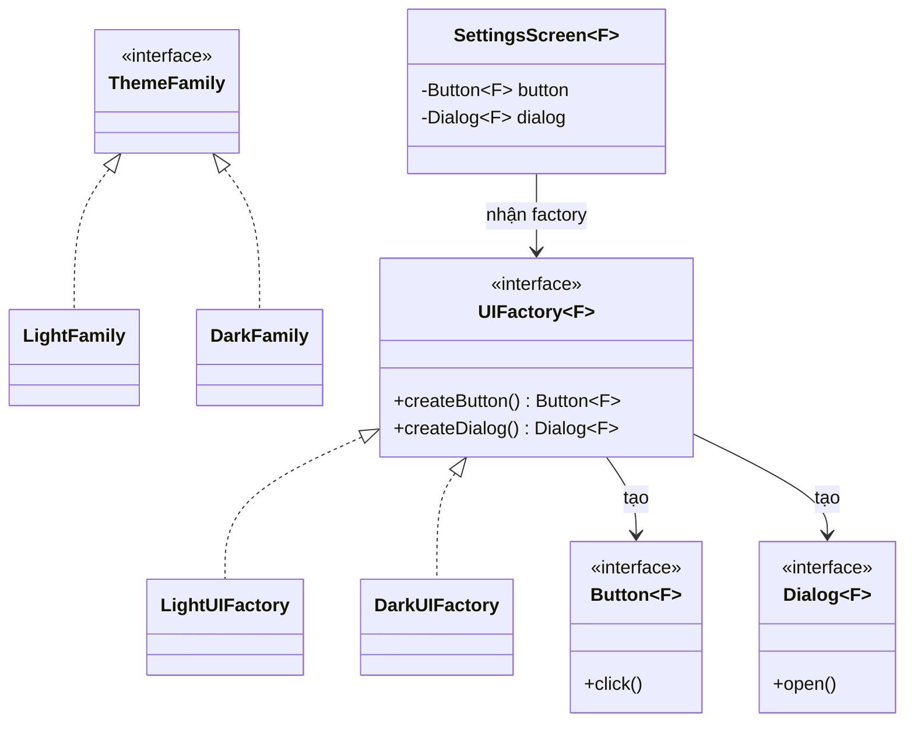

# Cân nhắc generic và kiểu đánh dấu họ sản phẩm khi cần ràng buộc tương thích

> **Chương:** Thiết kế interface  
> **Module:** `SOFTWARE_DESIGN_DESIGN_PATTERN_CREATIONAL_ABSTRACT_FACTORY` — Học về abstract factory trong design pattern.

## 1. Mục tiêu học tập

Trong Abstract Factory, mỗi concrete factory có trách nhiệm tạo ra một **họ các sản phẩm liên quan**. Chẳng hạn `LightUIFactory` tạo cả `LightButton` và `LightDialog`, còn `DarkUIFactory` tạo `DarkButton` và `DarkDialog`. Khi mọi client chỉ sử dụng các interface `Button`, `Dialog` và `UIFactory`, ta đã tách phần sử dụng khỏi chi tiết khởi tạo.

Tuy nhiên, hợp đồng thông thường chưa thể diễn đạt trực tiếp bằng hệ kiểu rằng **một `Button` và một `Dialog` phải cùng họ**. Với hệ thống có nhiều chỗ kết hợp sản phẩm hoặc API chuyển sản phẩm qua nhiều lớp, có thể cân nhắc dùng **generic** và **kiểu đánh dấu họ sản phẩm** (*family marker type*) để làm ràng buộc này rõ hơn ở thời điểm biên dịch.

Sau bài học, bạn có thể:

- Nhận biết ranh giới tương thích của các sản phẩm trong Abstract Factory.
- Phân biệt **đánh dấu họ bằng kiểu generic** với **ghi mã họ bằng dữ liệu runtime**.
- Thiết kế `Button<F>`, `Dialog<F>` và `UIFactory<F>` để truyền cùng một kiểu họ qua nhiều interface.
- Giải thích cơ chế **invariance**, wildcard và *capture conversion* trong Java khi xử lý factory được chọn tại runtime.
- Phân biệt lỗi **có thể bị trình biên dịch ngăn chặn** với lỗi **phải kiểm tra khi chạy**.
- Quyết định khi nào giải pháp generic đáng với độ phức tạp tăng thêm và khi nào Abstract Factory thông thường là đủ.

## 2. Bài toán: các sản phẩm cùng họ phải tương thích

Ứng dụng quản lý giao diện có hai họ Light và Dark, mỗi họ tạo một nút và một hộp thoại.

| Loại sản phẩm | Họ Light | Họ Dark |
| --- | --- | --- |
| `Button` | `LightButton` | `DarkButton` |
| `Dialog` | `LightDialog` | `DarkDialog` |
| Concrete factory | `LightUIFactory` | `DarkUIFactory` |

**Bất biến thiết kế:** Khi một màn hình phối hợp `Button` với `Dialog`, hai thành phần phải thuộc cùng họ giao diện.

Với phiên bản Abstract Factory cơ bản:

```java
interface Button {
    void click();
}

interface Dialog {
    void open();
}

interface UIFactory {
    Button createButton();
    Dialog createDialog();
}
```

Một client nhận **một** `UIFactory` rồi tạo cả hai sản phẩm từ factory đó có thể bảo đảm tính nhất quán **về cách sử dụng**:

```java
void render(UIFactory factory) {
    Button button = factory.createButton();
    Dialog dialog = factory.createDialog();
    button.click();
    dialog.open();
}
```

Nhưng nếu một API cho phép truyền hai sản phẩm được tạo ở **hai nơi độc lập**, kiểu `Button` và `Dialog` không cung cấp thông tin nào để kiểm tra rằng chúng cùng Light hay cùng Dark:

```java
void show(Button button, Dialog dialog) {
    button.click();
    dialog.open();
}

// Có thể biên dịch với interface không generic, dù không đúng họ.
show(new LightButton(), new DarkDialog());
```

**Đây là vấn đề mà generic family marker có thể hỗ trợ:** đặt mối liên hệ về họ vào chữ ký, để compiler loại bỏ một số tổ hợp không hợp lệ trước khi chạy chương trình.

## 3. Một kiểu đánh dấu họ là gì?

Một **family marker type** là kiểu đại diện cho danh tính của một họ, được dùng trong chữ ký generic. Nó không nhất thiết phải có hành vi.

Ví dụ trong Java:

```java
interface ThemeFamily {}

final class LightFamily implements ThemeFamily {}
final class DarkFamily implements ThemeFamily {}
```

Ở đây, `LightFamily` và `DarkFamily` đại diện cho **hai kiểu khác nhau**. Một cách dùng là:

```java
interface Button<F extends ThemeFamily> {
    void click();
}

interface Dialog<F extends ThemeFamily> {
    void open();
}
```

`F` không phải là dữ liệu màu sắc hoặc một đối tượng giao diện. Nó là **tham số kiểu** để mô tả sản phẩm thuộc họ nào:

- `Button<LightFamily>`: một nút được khai báo thuộc họ Light.
- `Dialog<LightFamily>`: một hộp thoại được khai báo thuộc họ Light.
- `Button<DarkFamily>`: một nút được khai báo thuộc họ Dark.

Việc sử dụng `F` chỉ trong kiểu generic, không dùng trong giá trị hay hành vi, thường được gọi là kỹ thuật **phantom type**. “Phantom” ở đây chỉ việc kiểu `F` tồn tại chủ yếu để phục vụ **kiểm tra tĩnh**, chứ không có nghĩa là marker type vô dụng.

Đừng nhầm với một trường dữ liệu như:

```java
enum Theme { LIGHT, DARK }
```

`Theme.LIGHT` là **giá trị runtime**, không phải một kiểu có thể viết thành tham số `Button<Theme.LIGHT>` trong Java. Để gắn danh tính họ vào generic, ta dùng các kiểu marker như `LightFamily` và `DarkFamily`.

## 4. Truyền cùng một kiểu họ qua Abstract Factory

Một ràng buộc quan trọng phải đi **xuyên suốt các hợp đồng**, không chỉ nằm trong từng sản phẩm riêng lẻ.

```java
interface Button<F extends ThemeFamily> {
    void click();
}

interface Dialog<F extends ThemeFamily> {
    void open();
}

interface UIFactory<F extends ThemeFamily> {
    Button<F> createButton();
    Dialog<F> createDialog();
}
```

Ý nghĩa của `UIFactory<F>` là:

- Factory này tạo `Button<F>`.
- Cùng factory này tạo `Dialog<F>`.
- Cả hai có **cùng một tham số kiểu `F`**.

Các implementation cụ thể sẽ định nghĩa rõ họ:

```java
final class LightUIFactory implements UIFactory<LightFamily> {
    @Override
    public Button<LightFamily> createButton() {
        return new LightButton();
    }

    @Override
    public Dialog<LightFamily> createDialog() {
        return new LightDialog();
    }
}
```

`LightButton` phải implements `Button<LightFamily>` và `LightDialog` phải implements `Dialog<LightFamily>`. Vì thế, một `DarkDialog` chỉ implements `Dialog<DarkFamily>` sẽ không thể được trả về trực tiếp từ `LightUIFactory.createDialog()`.

**Tuy nhiên:** một tác giả vẫn có thể cố ý hoặc vô tình khai báo class có giao diện Dark nhưng implements `Dialog<LightFamily>`. Compiler kiểm tra **khai báo kiểu**, không xác minh màu sắc, giao thức hay hành vi bên trong class. Cần contract test và compatibility test cho các bất biến thực tế.

### Ràng buộc ở phía client

Client cũng cần truyền `F` xuyên suốt chữ ký:

```java
final class SettingsScreen<F extends ThemeFamily> {
    private final Button<F> button;
    private final Dialog<F> dialog;

    SettingsScreen(Button<F> button, Dialog<F> dialog) {
        this.button = button;
        this.dialog = dialog;
    }

    void show() {
        button.click();
        dialog.open();
    }
}
```

Khi tạo `SettingsScreen<LightFamily>`, hai tham số phải có kiểu `Button<LightFamily>` và `Dialog<LightFamily>`. Việc truyền `Dialog<DarkFamily>` sẽ bị từ chối tại thời điểm biên dịch trong code Java được kiểm tra kiểu đầy đủ.

## 5. Sơ đồ quan hệ kiểu



Sơ đồ thể hiện ý định: mọi mối quan hệ cần bảo toàn một họ đều dùng **chung `F`**. Trong UML và Mermaid, ký hiệu generic ở đây có tính minh họa; nguồn xác nhận chính xác việc kiểm tra kiểu vẫn là chữ ký Java và kết quả biên dịch.

## 6. Ví dụ Java 17 hoàn chỉnh

Ví dụ này dùng hai họ Light/Dark với các kiểu marker, hai abstract product, abstract factory generic và một `SettingsScreen<F>` chỉ nhận sản phẩm cùng họ. Mã chạy độc lập bằng JDK 17+.

Lưu thành `GenericFamilyFactoryDemo.java`:

```java
import java.util.Objects;

public class GenericFamilyFactoryDemo {
    // Marker types dùng để đánh dấu họ tại compile time.
    interface ThemeFamily {}

    static final class LightFamily implements ThemeFamily {
        private LightFamily() {}
    }

    static final class DarkFamily implements ThemeFamily {
        private DarkFamily() {}
    }

    // Abstract products được tham số hóa theo cùng F.
    interface Button<F extends ThemeFamily> {
        void click();
    }

    interface Dialog<F extends ThemeFamily> {
        void open();
    }

    // Abstract factory bảo toàn F trong mọi phương thức tạo.
    interface UIFactory<F extends ThemeFamily> {
        Button<F> createButton();
        Dialog<F> createDialog();
    }

    // Concrete products thuộc họ Light.
    static final class LightButton implements Button<LightFamily> {
        @Override
        public void click() {
            System.out.println("[Light] Button clicked");
        }
    }

    static final class LightDialog implements Dialog<LightFamily> {
        @Override
        public void open() {
            System.out.println("[Light] Dialog opened");
        }
    }

    // Concrete products thuộc họ Dark.
    static final class DarkButton implements Button<DarkFamily> {
        @Override
        public void click() {
            System.out.println("[Dark] Button clicked");
        }
    }

    static final class DarkDialog implements Dialog<DarkFamily> {
        @Override
        public void open() {
            System.out.println("[Dark] Dialog opened");
        }
    }

    static final class LightUIFactory implements UIFactory<LightFamily> {
        @Override
        public Button<LightFamily> createButton() {
            return new LightButton();
        }

        @Override
        public Dialog<LightFamily> createDialog() {
            return new LightDialog();
        }
    }

    static final class DarkUIFactory implements UIFactory<DarkFamily> {
        @Override
        public Button<DarkFamily> createButton() {
            return new DarkButton();
        }

        @Override
        public Dialog<DarkFamily> createDialog() {
            return new DarkDialog();
        }
    }

    // Client chỉ phụ thuộc vào các abstraction mang cùng F.
    static final class SettingsScreen<F extends ThemeFamily> {
        private final Button<F> button;
        private final Dialog<F> dialog;

        SettingsScreen(Button<F> button, Dialog<F> dialog) {
            this.button = Objects.requireNonNull(button, "button");
            this.dialog = Objects.requireNonNull(dialog, "dialog");
        }

        SettingsScreen(UIFactory<F> factory) {
            this(factory.createButton(), factory.createDialog());
        }

        void show() {
            button.click();
            dialog.open();
        }
    }

    // Điểm chọn họ được phép biết concrete factories.
    // Wildcard cho phép mang factory được chọn ở runtime.
    static UIFactory<? extends ThemeFamily> chooseFactory(String theme) {
        if ("light".equalsIgnoreCase(theme)) {
            return new LightUIFactory();
        }
        if ("dark".equalsIgnoreCase(theme)) {
            return new DarkUIFactory();
        }
        throw new IllegalArgumentException("Theme không hỗ trợ: " + theme);
    }

    // Capture conversion: giữ một F thống nhất sau khi chọn factory.
    static <F extends ThemeFamily> void launch(UIFactory<F> factory) {
        SettingsScreen<F> screen = new SettingsScreen<>(factory);
        screen.show();
    }

    public static void main(String[] args) {
        String theme = args.length == 0 ? "light" : args[0];
        UIFactory<? extends ThemeFamily> factory = chooseFactory(theme);
        launch(factory);
    }
}
```

Chạy:

```bash
javac GenericFamilyFactoryDemo.java
java GenericFamilyFactoryDemo light
java GenericFamilyFactoryDemo dark
```

Kết quả dự kiến:

```text
# java GenericFamilyFactoryDemo light
[Light] Button clicked
[Light] Dialog opened

# java GenericFamilyFactoryDemo dark
[Dark] Button clicked
[Dark] Dialog opened
```

Điểm đáng chú ý:

1. `LightUIFactory` triển khai `UIFactory<LightFamily>` nên cả hai phương thức phải trả về sản phẩm gắn `LightFamily`.
2. `SettingsScreen<F>` chỉ nhận hai sản phẩm mang **cùng `F`**.
3. `chooseFactory()` quyết định họ ở runtime; `launch()` tiếp nhận factory đó mà không cần ép kiểu.
4. Client `SettingsScreen` không nhắc tới class cụ thể Light/Dark, dù tham số generic vẫn giữ được ràng buộc tương thích.

## 7. Ví dụ bị compiler từ chối và ví dụ hợp lệ

### 7.1. Trộn sản phẩm từ hai họ

Đoạn **cố ý sai** sau không thuộc chương trình chạy được ở mục 6:

```java
Button<LightFamily> lightButton = new LightButton();
Dialog<DarkFamily> darkDialog = new DarkDialog();

// Lỗi biên dịch: Dialog<DarkFamily> không phải Dialog<LightFamily>.
SettingsScreen<LightFamily> invalid =
        new SettingsScreen<LightFamily>(lightButton, darkDialog);
```

Tham số kiểu `F` đã cố định là `LightFamily` trong `SettingsScreen<LightFamily>`. Compiler có thể từ chối tổ hợp này ngay cả khi cả hai sản phẩm có đúng hành vi `click()` và `open()`.

### 7.2. Concrete factory trả về sai marker

```java
// Không hợp lệ: Light factory trả về Dialog<DarkFamily>.
final class BrokenLightFactory implements UIFactory<LightFamily> {
    @Override
    public Button<LightFamily> createButton() {
        return new LightButton();
    }

    @Override
    public Dialog<LightFamily> createDialog() {
        return new DarkDialog(); // Lỗi kiểu tại compile time.
    }
}
```

Đây là một lợi ích trực tiếp của generic family marker: chữ ký sản phẩm cho compiler đủ thông tin để phát hiện **nhiều lỗi gán sai họ**.

### 7.3. Cùng họ nhưng khác instance

```java
UIFactory<LightFamily> lightFactory = new LightUIFactory();

Button<LightFamily> buttonA = lightFactory.createButton();
Dialog<LightFamily> dialogA = lightFactory.createDialog();
Button<LightFamily> buttonB = lightFactory.createButton();

SettingsScreen<LightFamily> screen =
        new SettingsScreen<>(buttonB, dialogA);
```

Điều này hợp lệ: hai sản phẩm không cần được tạo **cùng lúc** hoặc có cùng object identity. Điều cần giữ là **cùng marker họ**, cộng các ràng buộc runtime khác nếu sản phẩm liên quan đến session, tenant, cấu hình cụ thể hoặc tài nguyên dùng chung.

**Giới hạn quan trọng:** Hai sản phẩm cùng `LightFamily` nhưng đến từ **hai tenant khác nhau** vẫn có thể không tương thích ở cấp nghiệp vụ. Marker Light/Dark không chứng minh mọi bất biến có thể tồn tại.

## 8. Invariance: vì sao không thể thay thế các kiểu tùy ý?

Generic trong Java mặc định **invariant**. Ví dụ:

- `LightFamily` implements `ThemeFamily`.
- Nhưng `Button<LightFamily>` **không** phải subtype của `Button<ThemeFamily>`.
- Tương tự, `UIFactory<LightFamily>` **không** phải subtype của `UIFactory<ThemeFamily>`.

Đó là lý do dòng sau không hợp lệ:

```java
// Không biên dịch:
UIFactory<ThemeFamily> factory = new LightUIFactory();
```

Nếu được phép gán như vậy, API sẽ làm mất thông tin marker cụ thể trong một số ngữ cảnh. Cách biểu diễn một factory có tham số họ chưa biết là:

```java
UIFactory<? extends ThemeFamily> factory = new LightUIFactory();
```

Nhưng wildcard `? extends ThemeFamily` có nghĩa là **một họ cụ thể nào đó chưa biết**, chứ không mang ý nghĩa “mọi sản phẩm cùng mọi họ đều có thể tự do ghép với nhau”.

### Dùng capture conversion để giữ quan hệ kiểu

Giả sử factory được chọn từ cấu hình runtime:

```java
UIFactory<? extends ThemeFamily> selected = chooseFactory(theme);
launch(selected);
```

Hàm `launch` được khai báo:

```java
static <F extends ThemeFamily> void launch(UIFactory<F> factory) {
    SettingsScreen<F> screen = new SettingsScreen<>(factory);
    screen.show();
}
```

Java có thể **capture** kiểu wildcard của `selected` thành một kiểu `F` riêng cho lời gọi. Bên trong `launch`, `createButton()` và `createDialog()` đều mang **cùng `F`**.

Điều này cho phép ứng dụng **chọn factory lúc chạy** mà vẫn giữ quan hệ kiểu trong phạm vi thao tác tiếp theo, thay vì dùng cast không kiểm tra.

### Tránh wildcard ở ranh giới cần ghép cặp

Chữ ký sau **làm mất ràng buộc cùng họ**:

```java
// Quá rộng nếu yêu cầu cùng một họ.
void showAny(
        Button<? extends ThemeFamily> button,
        Dialog<? extends ThemeFamily> dialog) {
    button.click();
    dialog.open();
}
```

Hai wildcard trong chữ ký này là **hai kiểu chưa biết độc lập**. Phương thức có thể nhận một `Button<LightFamily>` và một `Dialog<DarkFamily>`.

Để bảo toàn tính tương thích trong API ghép sản phẩm, dùng một tham số kiểu **chung**:

```java
static <F extends ThemeFamily> void showTogether(
        Button<F> button,
        Dialog<F> dialog) {
    button.click();
    dialog.open();
}
```

Đừng thay các tham số trên bằng `Button<? extends F>` và `Dialog<? extends F>` nếu mục tiêu là **bắt buộc cùng một marker chính xác**: Java có thể suy ra một `F` chung rộng hơn cho các wildcard độc lập.

## 9. Generic marker bảo vệ được điều gì, không bảo vệ được điều gì?

| Tình huống | Generic marker giúp? | Vì sao? |
| --- | --- | --- |
| Truyền `Dialog<DarkFamily>` cho `SettingsScreen<LightFamily>` | **Có** | Hai tham số kiểu không tương thích |
| Viết `LightUIFactory.createDialog()` trả về `DarkDialog implements Dialog<DarkFamily>` | **Có** | Concrete product không khớp chữ ký factory |
| `LightButton` bị viết nhầm màu tối nhưng khai báo `Button<LightFamily>` | **Không** | Compiler không đọc ý nghĩa hình ảnh của implementation |
| Hai đối tượng cùng marker Light nhưng khác tenant/session | **Không** | Marker hiện tại không mô tả tenant/session |
| Dùng raw type `Button` và cast không kiểm tra | **Không bảo đảm** | Raw type và unchecked cast có thể vượt qua generic checking |
| Chọn factory từ một giá trị theme không hợp lệ | **Không** | Theme đến từ runtime và cần xác thực |
| Nhận sản phẩm qua JSON, database hoặc plugin | **Không tự động** | Tham số kiểu Java không đi theo dữ liệu tuần tự hóa |
| Lắp ghép sản phẩm đúng marker nhưng dùng palette không tương thích | **Không** | Phải kiểm tra contract và style thực tế |

Điều đáng chú ý nhất là **type erasure** của Java: phần lớn thông tin tham số generic không tồn tại dưới dạng tham số kiểu để so khớp trực tiếp ở runtime.

Ví dụ không được viết:

```java
// Java không cho phép kiểm tra tham số generic như thế này.
if (button instanceof Button<LightFamily>) {
    // ...
}
```

Do type erasure, cần dữ liệu runtime khác nếu muốn kiểm tra họ khi nhận đối tượng từ nguồn động.

### Có nên mang mã họ ở runtime?

Khi cần kiểm tra sản phẩm đến từ network, plugin hoặc registry, có thể bổ sung một hợp đồng rõ ràng:

```java
enum ThemeId { LIGHT, DARK }

interface HasThemeId {
    ThemeId themeId();
}
```

Một product có thể triển khai cả `Button<LightFamily>` và `HasThemeId`; test có thể xác nhận `themeId() == ThemeId.LIGHT`. Nếu ghép cặp ở runtime, kiểm tra cả hai sản phẩm có cùng `ThemeId`.

**Nhưng:** `themeId()` vẫn là giá trị do implementation tự công bố, nên cần kiểm thử với output thật. Dùng cùng mã họ chưa chứng minh mọi palette, phiên bản tài nguyên hay hành vi liên sản phẩm đều tương thích.

Hai cơ chế có mục đích khác nhau:

- **Marker generic:** biểu diễn quan hệ **tĩnh** giữa các kiểu.
- **Mã họ runtime:** hỗ trợ **quan sát, định tuyến và xác minh** sau khi đối tượng đã được tạo.

Chỉ dùng cả hai nếu những ranh giới trong ứng dụng thật sự cần cả hai mức bảo vệ.

## 10. Không phải mọi Abstract Factory đều cần generic

Một thiết kế thông thường, không generic, có thể hoàn toàn phù hợp:

```java
interface UIFactory {
    Button createButton();
    Dialog createDialog();
}

final class SettingsScreen {
    SettingsScreen(UIFactory factory) {
        // Luôn lấy các sản phẩm từ cùng factory.
    }
}
```

Nếu client **chỉ nhận một factory** và không có API nào cho phép ghép những product được tạo độc lập, ranh giới tạo đối tượng đã đủ rõ. Lúc này việc thêm `<F>` vào mọi interface có thể khiến API khó đọc mà ít tăng giá trị.

Ngược lại, generic marker đáng cân nhắc khi:

- Nhiều đối tượng thuộc một họ được truyền qua các lớp, module hoặc callback khác nhau trước khi kết hợp.
- API công khai nhận **nhiều product** và cần loại bỏ tổ hợp khác họ ngay tại compile time.
- Họ sản phẩm là một **khái niệm ổn định** và có ý nghĩa rõ ràng.
- Nhóm phát triển chấp nhận quản lý tham số kiểu, wildcard và các factory có kiểu được chọn lúc chạy.
- Các test và công cụ xây dựng có thể rà soát đầy đủ những implementation đang hỗ trợ.

### Bảng quyết định

| Cách thiết kế | Khi nên chọn | Ưu điểm | Giới hạn |
| --- | --- | --- | --- |
| **Abstract Factory không generic** | Client nhận một factory và dùng trực tiếp trọn bộ sản phẩm từ đó | Đơn giản, dễ hiểu, ít tham số kiểu | Compiler không chặn ghép product khác họ ở API ngoài |
| **Factory và product generic theo `F`** | API truyền, lưu hoặc ghép sản phẩm qua nhiều ranh giới, cần ràng buộc tĩnh | Chặn nhiều tổ hợp sai họ tại compile time | Wildcard và generic inference phức tạp hơn |
| **Runtime family ID / capability metadata** | Họ được xác định từ cấu hình, dữ liệu hoặc plugin động | Quan sát và so khớp lúc chạy | ID đúng không tự bảo đảm behavior đúng |
| **Generic + runtime check** | Vừa có API tĩnh được kiểm tra kiểu, vừa cần xác minh nguồn dữ liệu động | Bao phủ hai nhóm lỗi khác nhau | Chi phí thiết kế, kiểm thử và bảo trì cao hơn |

**Quy tắc thực dụng:** Hãy bắt đầu từ **bất biến cần bảo vệ**. Nếu một client chỉ cần một factory và các rủi ro chủ yếu nằm trong implementation, tăng kiểm thử theo họ có thể hiệu quả hơn việc mở rộng generic trên toàn bộ mã.

## 11. Những lỗi thường gặp khi thêm generic

### Lỗi 1 — Có marker nhưng không truyền xuyên qua các interface

```java
interface Button<F extends ThemeFamily> {
    void click();
}

// Sai mục tiêu: factory đánh mất F ở kiểu trả về.
interface UIFactory<F extends ThemeFamily> {
    Button<?> createButton();
}
```

Nếu `createButton()` trả về `Button<?>`, marker cụ thể của factory không còn được gắn với sản phẩm. Đúng hơn là:

```java
interface UIFactory<F extends ThemeFamily> {
    Button<F> createButton();
}
```

### Lỗi 2 — Dùng một generic rộng rồi cast về họ cụ thể

```java
// Không nên dùng để né kiểm tra kiểu:
@SuppressWarnings("unchecked")
static <F extends ThemeFamily> UIFactory<F> unsafeChoose(String theme) {
    return (UIFactory<F>) chooseFactory(theme);
}
```

Hàm này hứa trả về **bất kỳ `F` nào mà caller yêu cầu**, trong khi factory thực tế do chuỗi `theme` quyết định. Caller có thể yêu cầu `UIFactory<LightFamily>` nhưng nhận Dark; unchecked cast sẽ che giấu sự bất nhất.

Hãy giữ `UIFactory<? extends ThemeFamily>` ở ranh giới lựa chọn và chuyển sang helper generic có capture như `launch(factory)`.

### Lỗi 3 — Lưu sản phẩm khác họ vào một collection rồi tưởng vẫn an toàn

```java
// Tập hợp này chứa được nhiều họ.
List<Button<? extends ThemeFamily>> buttons = new ArrayList<>();
buttons.add(new LightButton());
buttons.add(new DarkButton());
```

Cấu trúc này **không bảo toàn** quan hệ giữa một nút cụ thể và một dialog cụ thể. Nếu nghiệp vụ cần lưu cặp tương thích, hãy gói chúng trong `ScreenParts<F>` hoặc trong `SettingsScreen<F>` và chỉ tạo cặp qua factory mang cùng `F`.

### Lỗi 4 — Nhầm “marker đúng” với “hành vi đúng”

Class có thể khai báo `Button<LightFamily>` nhưng sử dụng CSS Dark, hoặc tạo tài nguyên giao diện của một phiên bản không tương thích. Trình biên dịch không phát hiện sự sai lệch ấy.

Cần kiểm thử riêng rằng mỗi concrete factory tạo **đầy đủ và đúng họ**, đồng thời những sản phẩm có thể phối hợp được trong màn hình thực.

### Lỗi 5 — Dùng generic để mô hình hóa mọi thông tin runtime

Không nên tạo vô số kiểu marker cho mỗi người dùng, mỗi request hoặc mỗi bộ cấu hình thay đổi liên tục. Những giá trị này thường chỉ được biết ở runtime và có số lượng lớn.

Nếu ràng buộc là “hai đối tượng phải thuộc cùng tenant đang đăng nhập”, một `tenantId`, đối tượng context được truyền tường minh hoặc cơ chế kiểm tra quyền có thể phù hợp hơn. Generic family marker chỉ phù hợp với **tập họ có ý nghĩa ở mức thiết kế kiểu**.

## 12. Kiểm tra tính tương thích trong hệ thống thực tế

Đề xuất một ma trận kiểm thử cho hai họ:

| Ca kiểm tra | Light | Dark | Lý do |
| --- | --- | --- | --- |
| Factory tạo đủ `Button` và `Dialog` | PASS kỳ vọng | PASS kỳ vọng | Factory contract |
| Các sản phẩm triển khai hành vi chung | PASS kỳ vọng | PASS kỳ vọng | Product contract |
| Factory trả về product có marker khai báo đúng | Compile + review | Compile + review | Quan hệ kiểu tĩnh |
| Phong cách render đúng họ và phối hợp được | Test UI Light | Test UI Dark | Tính nhất quán runtime |
| API `SettingsScreen<LightFamily>` nhận `Dialog<DarkFamily>` | Compiler phải từ chối | Không áp dụng | Test âm về tương thích kiểu |
| Chọn factory bằng cấu hình bất hợp lệ | Từ chối rõ ràng | Từ chối rõ ràng | Kiểm tra runtime |
| Thay Light bằng Dark không sửa logic client | Được | Được | Khả năng thay cả họ |

Có thể bổ sung một **compile-negative test** ở dự án chuyên về thư viện generic: cố ý biên dịch một ví dụ sai để xác nhận compiler **không chấp nhận** việc ghép hai họ. Không nên chèn các đoạn cố ý không biên dịch vào file production.

Ngoài ra, contract test nên sử dụng **cùng bộ test** cho các factory cũ và mới. Khi bổ sung `HighContrastFamily`, cần kiểm tra cả product contract lẫn compatibility theo họ. Marker mới giúp ràng buộc kiểu, nhưng không thay thế các kiểm thử về khả năng truy cập, hành vi và tài nguyên giao diện.

## 13. Bài tập thực hành

Bạn đang thiết kế công cụ xuất chứng từ có hai họ định dạng `XmlFamily` và `JsonFamily`. Mỗi họ cung cấp:

- `Parser<F>` để đọc dữ liệu đầu vào.
- `Validator<F>` để kiểm tra quy tắc định dạng.
- `Serializer<F>` để ghi dữ liệu đầu ra.
- `DocumentFactory<F>` để tạo cả ba product.

Một số luồng đọc và ghi độc lập có thể truyền sản phẩm qua service khác nhau trước khi cùng xử lý một tài liệu.

**Nhiệm vụ:**

1. Viết hai marker type `XmlFamily`, `JsonFamily` cùng interface `DocumentFamily`.
2. Viết chữ ký cho `Parser<F>`, `Validator<F>`, `Serializer<F>` và `DocumentFactory<F>`; bảo đảm các phương thức tạo đều giữ nguyên `F`.
3. Viết một `DocumentPipeline<F>` nhận ba sản phẩm **cùng `F`** và xử lý `parse → validate → serialize`.
4. Chỉ ra vì sao `new DocumentPipeline<XmlFamily>(xmlParser, jsonValidator, xmlSerializer)` phải bị compiler từ chối.
5. Xây dựng một bộ chọn factory theo tham số runtime `format` sao cho không phải dùng unchecked cast.
6. Giải thích vì sao parser XML và serializer JSON **có thể cùng xuất hiện trong một nghiệp vụ chuyển đổi có chủ đích**, nhưng không thuộc **một pipeline round-trip cùng định dạng**.
7. Nêu ít nhất hai điều generic marker không bảo đảm: ví dụ schema XML thực sự hợp lệ, khả năng bảo toàn dữ liệu hay phiên bản của tài liệu.

**Gợi ý chữ ký:**

```java
interface DocumentFamily {}

interface Parser<F extends DocumentFamily> {
    Document parse(String input);
}

interface Validator<F extends DocumentFamily> {
    void validate(Document document);
}

interface Serializer<F extends DocumentFamily> {
    String serialize(Document document);
}

interface DocumentFactory<F extends DocumentFamily> {
    Parser<F> createParser();
    Validator<F> createValidator();
    Serializer<F> createSerializer();
}
```

`Document` ở đây là mô hình nội bộ dùng chung mà bài tập giả định đã tồn tại. Các product interface dùng `F` để ràng buộc **họ implementation**, không nhất thiết buộc `Document` cũng phải generic nếu mô hình nội bộ thực sự dùng chung.

### Câu hỏi nâng cao

Giả sử cần tích hợp cả `XmlFamily` và `JsonFamily` vào một luồng chuyển đổi. Bạn nên:

- Ép cả hai factory về `DocumentFactory<DocumentFamily>` để dùng chung?
- Hay tách rõ **pipeline đọc của họ nguồn** và **pipeline ghi của họ đích**, mỗi bên giữ marker riêng và có một bước chuyển đổi dữ liệu nội bộ rõ ràng?

**Định hướng:** Chọn cách thứ hai. Hai họ khác nhau có thể cùng tồn tại trong một **use case chuyển đổi**, nhưng không nên xóa quan hệ kiểu chỉ để khiến chúng trông như một họ duy nhất.

## 14. Checklist thiết kế

- [ ] Đã xác định rõ **loại sản phẩm**, **họ sản phẩm** và bất biến tương thích cần bảo vệ.
- [ ] Nếu sử dụng marker type, mỗi họ có một kiểu riêng thay vì dùng chung một kiểu marker quá rộng.
- [ ] Abstract product interface đều sử dụng cùng tham số `F` khi cần liên kết họ.
- [ ] Abstract factory trả về `Product<F>`, không làm mất thông tin thành `Product<?>`.
- [ ] Client cần ghép sản phẩm cùng họ truyền **cùng một `F`** qua các tham số, field và constructor.
- [ ] Đã phân biệt ranh giới **runtime selection** với ranh giới **compile-time matching**.
- [ ] Không dùng raw type hoặc unchecked cast để né ràng buộc họ.
- [ ] Đã kiểm tra xem wildcard ở API có vô tình cho phép ghép sản phẩm khác họ hay không.
- [ ] Có contract test và compatibility test cho hành vi thực tế của các concrete factory.
- [ ] Generic chỉ được áp dụng khi lợi ích phát hiện lỗi tĩnh đủ lớn so với độ phức tạp bổ sung.

**Ghi nhớ:** Generic và kiểu đánh dấu có thể giúp compiler bảo vệ quan hệ **“các sản phẩm này thuộc cùng họ `F`”**, nếu `F` được truyền nhất quán qua **abstract products, abstract factory và client**. Chúng không thể chứng minh mọi hành vi và dữ liệu runtime đều đúng. Thiết kế Abstract Factory tốt kết hợp **ranh giới trách nhiệm rõ**, **hợp đồng kiểu đủ dùng** và **kiểm thử tương thích thực tế**.
