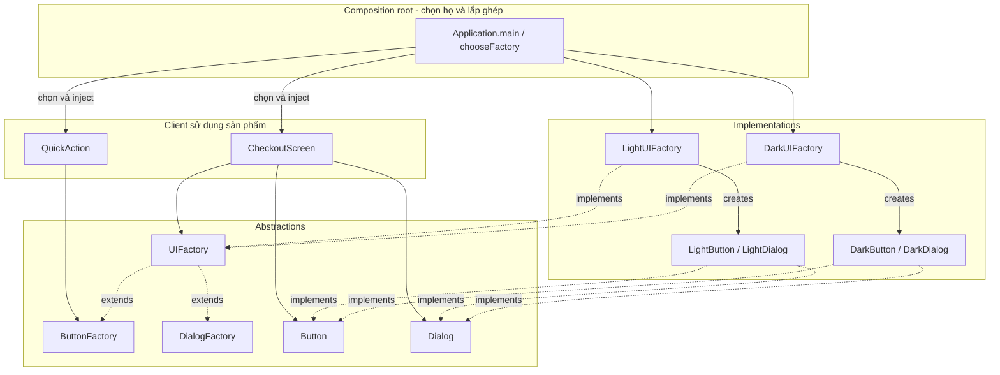
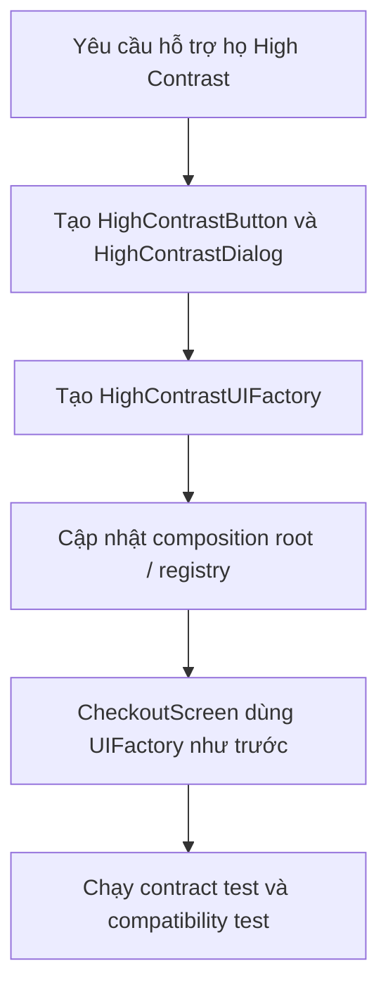

# Áp dụng DIP, OCP và ISP vào ranh giới giữa client, factory và product

> **Chương:** Thiết kế interface  
> **Module:** `SOFTWARE_DESIGN_DESIGN_PATTERN_CREATIONAL_ABSTRACT_FACTORY` — Học về abstract factory trong design pattern.

## 1. Mục tiêu bài học

Trong mẫu thiết kế **Abstract Factory**, client yêu cầu tạo ra **các loại sản phẩm liên quan** thông qua một abstract factory, còn concrete factory quyết định dùng biến thể nào của từng loại sản phẩm. Thiết kế này có liên hệ chặt chẽ với ba nguyên tắc SOLID:

- **DIP (Dependency Inversion Principle):** thành phần điều phối nghiệp vụ cấp cao và thành phần triển khai cấp thấp phụ thuộc vào các abstraction phù hợp, thay vì client phụ thuộc trực tiếp vào concrete class.
- **OCP (Open/Closed Principle):** xác định những phần có thể được **mở rộng bằng implementation mới** mà không phải sửa mã sử dụng đã ổn định, đồng thời nhìn nhận những điểm vẫn phải chỉnh sửa.
- **ISP (Interface Segregation Principle):** một client chỉ cần phụ thuộc vào những phương thức mà nó sử dụng; không ép client hay implementation làm việc với một interface quá nhiều trách nhiệm.

Sau bài học, bạn có thể đọc một thiết kế Abstract Factory, xác định **ranh giới giữa client–factory–product**, phân tích ba nguyên tắc trên từng ranh giới, thiết kế các interface vừa đủ và đánh giá chi phí khi **thêm họ sản phẩm** hoặc **thêm loại sản phẩm**.

## 2. Tình huống: giao diện thanh toán có nhiều họ UI

Giả sử ứng dụng bán vé có hai họ thành phần giao diện:

| Loại sản phẩm | Họ Light | Họ Dark |
| --- | --- | --- |
| `Button` | `LightButton` | `DarkButton` |
| `Dialog` | `LightDialog` | `DarkDialog` |
| Factory | `LightUIFactory` | `DarkUIFactory` |

Ứng dụng có hai client:

1. **`CheckoutScreen`** cần **cả `Button` và `Dialog`**: nhấn nút thanh toán và mở hộp thoại xác nhận. Hai sản phẩm phải cùng một họ giao diện.
2. **`QuickAction`** chỉ cần **`Button`**: một thao tác nhỏ trên thanh công cụ, không có nhu cầu tạo hộp thoại.

Sau này có thể bổ sung họ **High Contrast** và những loại sản phẩm khác như `Tooltip` hoặc `Slider`.

Yêu cầu thiết kế:

- Logic của `CheckoutScreen` không có nhánh `if (theme)` để trực tiếp tạo từng class Light/Dark.
- Đổi họ UI không buộc viết lại phần thao tác của hai client.
- `QuickAction` không phải phụ thuộc vào khả năng tạo `Dialog` mà nó không dùng.
- Đối với `CheckoutScreen`, nút và hộp thoại phải được tạo từ **cùng một factory đã chọn**.

Đây là một ví dụ vừa đủ để chỉ ra vì sao DIP, OCP và ISP **bổ trợ nhau nhưng có thể tạo ra các quyết định thiết kế khác nhau**.

## 3. Sơ đồ các ranh giới phụ thuộc



Sơ đồ thể hiện:

- **DIP:** hai client hướng tới các hợp đồng `UIFactory`, `ButtonFactory` và product interface, không gọi concrete class.
- **OCP:** bổ sung `HighContrastUIFactory` và các concrete product tương ứng mà không đổi mã thao tác đã viết theo interface.
- **ISP:** `QuickAction` chỉ phụ thuộc `ButtonFactory`; `CheckoutScreen` dùng `UIFactory` vì cần cả hai loại sản phẩm cùng họ.

**Composition root** là ngoại lệ có chủ đích: nó được phép biết concrete factories để tạo và truyền implementation vào client. DIP không yêu cầu toàn bộ chương trình không bao giờ nhắc đến `new LightUIFactory()`.

## 4. DIP: đảo chiều phụ thuộc tại đúng ranh giới

### 4.1. Phụ thuộc sai: client biết biến thể cụ thể

Một thiết kế ban đầu thường đặt lựa chọn theme ngay trong màn hình:

```java
// Ví dụ cần cải thiện: mỗi màn hình tự chọn sản phẩm cụ thể.
final class CheckoutScreen {
    private final Button payButton;
    private final Dialog confirmDialog;

    CheckoutScreen(String theme) {
        if ("dark".equalsIgnoreCase(theme)) {
            payButton = new DarkButton();
            confirmDialog = new DarkDialog();
        } else {
            payButton = new LightButton();
            confirmDialog = new LightDialog();
        }
    }
}
```

Vấn đề không nằm ở sự tồn tại của `if`. Vấn đề là **mã điều phối màn hình cấp cao đang phụ thuộc vào tên và constructor của các concrete product**. Khi thêm theme, nhiều màn hình có thể phải sửa cùng một logic lựa chọn. Việc giữ nút và dialog cùng họ phụ thuộc vào lập trình viên nhớ cập nhật cả hai nhánh.

### 4.2. Đặt abstraction ở ranh giới sử dụng

Bắt đầu bằng các product interface:

```java
interface Button {
    void click();
}

interface Dialog {
    void open();
}
```

Và hợp đồng tạo sản phẩm:

```java
interface UIFactory {
    Button createButton();
    Dialog createDialog();
}
```

Client sử dụng factory được **truyền vào**:

```java
final class CheckoutScreen {
    private final Button payButton;
    private final Dialog confirmDialog;

    CheckoutScreen(UIFactory factory) {
        payButton = factory.createButton();
        confirmDialog = factory.createDialog();
    }

    void submit() {
        payButton.click();
        confirmDialog.open();
    }
}
```

Điểm lắp ghép quyết định họ:

```java
UIFactory factory = new DarkUIFactory();
CheckoutScreen screen = new CheckoutScreen(factory);
screen.submit();
```

Giờ hai phía có trách nhiệm khác nhau:

| Phía | Phụ thuộc chính | Trách nhiệm |
| --- | --- | --- |
| `CheckoutScreen` (client cấp cao) | `UIFactory`, `Button`, `Dialog` | Điều phối thao tác màn hình |
| `UIFactory` (abstraction) | `Button`, `Dialog` | Định nghĩa khả năng tạo các loại sản phẩm |
| `DarkUIFactory` (implementation) | `UIFactory`, `DarkButton`, `DarkDialog` | Tạo bộ sản phẩm của họ Dark |
| `Application` (composition root) | Các concrete factory và abstract factory | Đọc cấu hình, chọn họ và lắp ghép |

### 4.3. Hướng phụ thuộc mã nguồn

Về **phụ thuộc mã nguồn ở thời điểm biên dịch**:

- Client biết `UIFactory` nhưng **không cần biết** `DarkUIFactory`.
- Concrete factory implements `UIFactory`.
- Client nhận product interface `Button`/`Dialog`; concrete products implements các interface đó.

Do đó cả mã cấp cao và implementation cấp thấp đều được tổ chức quanh hợp đồng mà client cần. Đây là ý nghĩa của DIP trong tình huống này.

**Một điểm tinh tế:** định nghĩa interface ở một package có tên `api` chưa tự tạo ra DIP. Nếu interface phơi bày class cụ thể, ví dụ `DarkButton createButton()`, client vẫn bị buộc vào Dark. Tương tự, nếu client nhận `UIFactory` nhưng sau đó ép kiểu sản phẩm sang `DarkButton`, ranh giới phụ thuộc vẫn bị phá vỡ.

### 4.4. Không đánh đồng DIP với dependency injection

**DIP là nguyên tắc thiết kế hướng phụ thuộc.** **Dependency injection (DI)** là một cách cung cấp dependency từ bên ngoài, thường qua constructor hoặc một framework lắp ghép.

Trong ví dụ, constructor `CheckoutScreen(UIFactory factory)` là **constructor injection**; nó hỗ trợ DIP, nhưng DIP không đòi hỏi phải có DI framework.

Một dự án có thể dùng DI framework nhưng vẫn vi phạm DIP nếu client yêu cầu trực tiếp `DarkUIFactory` hoặc kiểm tra concrete type bên trong nghiệp vụ.

## 5. OCP: mở rộng họ sản phẩm mà ít sửa client

### 5.1. Mở rộng theo chiều họ

Giả sử ứng dụng bổ sung họ `HighContrast`:

| Loại sản phẩm | Light | Dark | High Contrast |
| --- | --- | --- | --- |
| `Button` | `LightButton` | `DarkButton` | `HighContrastButton` |
| `Dialog` | `LightDialog` | `DarkDialog` | `HighContrastDialog` |
| Factory | `LightUIFactory` | `DarkUIFactory` | `HighContrastUIFactory` |

Nếu những interface hiện tại vẫn đáp ứng nhu cầu, ta có thể triển khai:

```java
final class HighContrastUIFactory implements UIFactory {
    @Override
    public Button createButton() {
        return new HighContrastButton();
    }

    @Override
    public Dialog createDialog() {
        return new HighContrastDialog();
    }
}
```

Mã `CheckoutScreen` và `submit()` **giữ nguyên**. Đây là lợi ích OCP của Abstract Factory trên chiều mở rộng **họ sản phẩm**: phần sử dụng đã ổn định, còn những họ mới được bổ sung qua implementation mới.

**Không nên khẳng định “không sửa dòng code nào”.** Composition root hoặc registry có thể cần cập nhật để người dùng chọn `high-contrast`. OCP tập trung vào việc giới hạn phạm vi chỉnh sửa ở **điểm cấu hình/lắp ghép**, tránh lan vào mã điều phối nghiệp vụ của nhiều client.

### 5.2. Ranh giới đóng và điểm mở



Thiết kế có lợi khi:

- Hệ thống dự kiến thêm nhiều theme, nhà cung cấp hoặc nền tảng.
- Các **loại sản phẩm tương đối ổn định**, ví dụ nhiều họ cùng có Button và Dialog.
- Client nên tiếp tục làm việc qua cùng một hợp đồng.

### 5.3. OCP không đồng nghĩa dễ thêm mọi thứ

Nếu yêu cầu mới là thêm **loại sản phẩm `Tooltip`** cho mọi họ, abstract factory hiện tại không đủ khả năng tạo nó. Ta thường phải:

1. Thêm `Tooltip` interface.
2. Thêm `Tooltip createTooltip()` vào abstract factory.
3. Thêm `LightTooltip`, `DarkTooltip` và các biến thể của những họ còn lại.
4. Cập nhật **mọi concrete factory** đang triển khai hợp đồng.
5. Mở rộng kiểm thử và client thực sự cần tooltip.

| Thay đổi | Phần thường được giữ ổn định | Phần phải mở rộng/chỉnh sửa |
| --- | --- | --- |
| **Thêm họ High Contrast** | Product interfaces, `UIFactory`, mã client | Một concrete factory, sản phẩm của họ mới, điểm chọn họ, test |
| **Thêm loại Tooltip** | Nhiều client không dùng tooltip | Abstract product, abstract factory, concrete products và **mọi concrete factory** |
| **Thay đổi hợp đồng Button** | Có thể không giữ được mã cũ | Interface, implementation và client liên quan theo quy mô thay đổi |

OCP có nghĩa là **chọn những trục thay đổi chủ yếu để thiết kế cho khả năng mở rộng**, chứ không thể dự đoán và ngăn mọi sửa đổi trong tương lai.

## 6. ISP: client chỉ phụ thuộc vào khả năng nó dùng

### 6.1. Dấu hiệu một interface quá rộng

Giả sử toàn bộ hệ thống dùng interface chung:

```java
interface MegaUIFactory {
    Button createButton();
    Dialog createDialog();
    Tooltip createTooltip();
    Chart createChart();
    AudioPlayer createAudioPlayer();
}
```

Một client chỉ cần nút bấm vẫn bị gắn với abstraction định nghĩa cả dialog, tooltip, chart và audio player. Mỗi lần hợp đồng phình thêm một loại sản phẩm, các implementation phải cập nhật, và client có thể chịu ảnh hưởng của thay đổi ở những khả năng nó không dùng.

ISP đề nghị tổ chức các **giao diện hướng tới nhu cầu client**. Ta có thể tách:

```java
interface ButtonFactory {
    Button createButton();
}

interface DialogFactory {
    Dialog createDialog();
}

interface UIFactory extends ButtonFactory, DialogFactory {
    // Hợp đồng tổng hợp: sản phẩm của cùng một họ UI.
}
```

Giờ:

- `QuickAction` chỉ nhận `ButtonFactory`.
- `CheckoutScreen` nhận `UIFactory` vì cần cả `Button` và `Dialog` thuộc **cùng một họ**.
- Mỗi concrete family factory implements `UIFactory` và nhờ đó cung cấp đầy đủ hai khả năng.

### 6.2. ISP không có nghĩa “mỗi method một interface” mọi lúc

Nếu `Button` và `Dialog` cần được tạo đồng bộ theo một trục theme, một **composite factory** như `UIFactory` vẫn có giá trị. Không nên thay nó bằng hai factory hoàn toàn độc lập rồi để `CheckoutScreen` nhận một `ButtonFactory` Light và một `DialogFactory` Dark mà không có ràng buộc.

ISP hướng tới **những abstraction đủ nhỏ cho từng nhóm client**, trong khi Abstract Factory hướng tới **tính nhất quán của họ sản phẩm**. Cách tiếp cận thường tốt là:

- Có các **capability interface** nhỏ cho client chỉ cần một tập con.
- Có một **composite family factory** cho các luồng cần nhiều loại sản phẩm cùng họ.
- Để composition root cấp đúng interface cho client tương ứng.

### 6.3. ISP cũng áp dụng cho product interface

Ví dụ giao diện `Dialog` chứa nhiều khả năng:

```java
// Có thể quá rộng nếu các client chỉ cần mở/đóng.
interface HugeDialog {
    void open();
    void close();
    void playVideo();
    void exportPdf();
    void recordAudio();
}
```

Nếu một loại hộp thoại chỉ dùng để xác nhận thao tác, nó không cần giả vờ hỗ trợ `playVideo()` hoặc `recordAudio()`. Hãy cân nhắc các abstraction như `Dialog` (mở/đóng), `VideoPlayer` (phát video) và `DocumentExporter` (xuất tệp) theo các nhóm client thực sự cần.

**Nhưng:** không nên tách mọi phương thức nhỏ thành một interface khi các hành vi cùng tạo thành một hợp đồng nghiệp vụ gắn kết. ISP không có quy tắc định lượng về số phương thức tối đa.

## 7. Ví dụ Java 17 hoàn chỉnh: kết hợp DIP, OCP và ISP

Ví dụ sau minh họa một cấu trúc có ba họ `Light`, `Dark` và `HighContrast`. `CheckoutScreen` dùng composite factory, còn `QuickAction` chỉ yêu cầu `ButtonFactory`.

Lưu thành `SolidAbstractFactoryDemo.java`:

```java
import java.util.Objects;

public class SolidAbstractFactoryDemo {
    // Abstract products: client chỉ dùng hành vi chung.
    interface Button {
        String click();
    }

    interface Dialog {
        String open();
    }

    // Capability interfaces nhỏ cho từng nhóm client.
    interface ButtonFactory {
        Button createButton();
    }

    interface DialogFactory {
        Dialog createDialog();
    }

    // Composite Abstract Factory: tạo một họ giao diện.
    interface UIFactory extends ButtonFactory, DialogFactory {
    }

    static final class LightButton implements Button {
        @Override
        public String click() {
            return "[Light] Đã nhấn nút";
        }
    }

    static final class LightDialog implements Dialog {
        @Override
        public String open() {
            return "[Light] Đã mở hộp thoại";
        }
    }

    static final class DarkButton implements Button {
        @Override
        public String click() {
            return "[Dark] Đã nhấn nút";
        }
    }

    static final class DarkDialog implements Dialog {
        @Override
        public String open() {
            return "[Dark] Đã mở hộp thoại";
        }
    }

    static final class HighContrastButton implements Button {
        @Override
        public String click() {
            return "[HighContrast] Đã nhấn nút";
        }
    }

    static final class HighContrastDialog implements Dialog {
        @Override
        public String open() {
            return "[HighContrast] Đã mở hộp thoại";
        }
    }

    // Các concrete factory chỉ tạo sản phẩm của họ tương ứng.
    static final class LightUIFactory implements UIFactory {
        @Override
        public Button createButton() {
            return new LightButton();
        }

        @Override
        public Dialog createDialog() {
            return new LightDialog();
        }
    }

    static final class DarkUIFactory implements UIFactory {
        @Override
        public Button createButton() {
            return new DarkButton();
        }

        @Override
        public Dialog createDialog() {
            return new DarkDialog();
        }
    }

    static final class HighContrastUIFactory implements UIFactory {
        @Override
        public Button createButton() {
            return new HighContrastButton();
        }

        @Override
        public Dialog createDialog() {
            return new HighContrastDialog();
        }
    }

    // Client cần hai sản phẩm cùng họ.
    static final class CheckoutScreen {
        private final Button payButton;
        private final Dialog confirmDialog;

        CheckoutScreen(UIFactory factory) {
            Objects.requireNonNull(factory, "factory");
            payButton = factory.createButton();
            confirmDialog = factory.createDialog();
        }

        void submit() {
            System.out.println(payButton.click());
            System.out.println(confirmDialog.open());
        }
    }

    // Client chỉ cần một capability, không cần DialogFactory.
    static final class QuickAction {
        private final Button actionButton;

        QuickAction(ButtonFactory factory) {
            Objects.requireNonNull(factory, "factory");
            actionButton = factory.createButton();
        }

        void run() {
            System.out.println(actionButton.click());
        }
    }

    // Composition root: nơi hợp lệ để biết concrete factory.
    static UIFactory chooseFactory(String theme) {
        return switch (theme.toLowerCase(java.util.Locale.ROOT)) {
            case "light" -> new LightUIFactory();
            case "dark" -> new DarkUIFactory();
            case "high-contrast" -> new HighContrastUIFactory();
            default -> throw new IllegalArgumentException(
                    "Theme không hỗ trợ: " + theme);
        };
    }

    public static void main(String[] args) {
        String theme = args.length == 0 ? "high-contrast" : args[0];
        UIFactory factory = chooseFactory(theme);

        CheckoutScreen checkout = new CheckoutScreen(factory);
        QuickAction quickAction = new QuickAction(factory);

        checkout.submit();
        quickAction.run();
    }
}
```

Biên dịch và chạy với JDK 17+:

```bash
javac SolidAbstractFactoryDemo.java
java SolidAbstractFactoryDemo high-contrast
```

Kết quả dự kiến:

```text
[HighContrast] Đã nhấn nút
[HighContrast] Đã mở hộp thoại
[HighContrast] Đã nhấn nút
```

Thay tham số bằng `light` hoặc `dark` sẽ đổi bộ implementation tại `chooseFactory()`; cả hai client vẫn chạy cùng phần xử lý.

### Đối chiếu ba nguyên tắc trong code

| Nguyên tắc | Dấu hiệu trong ví dụ | Lợi ích trực tiếp |
| --- | --- | --- |
| **DIP** | `CheckoutScreen(UIFactory)`, `QuickAction(ButtonFactory)` và các product interface | Mã client không phải import/tạo Light/Dark/HighContrast products |
| **OCP** | `HighContrastUIFactory` implements hợp đồng đang có; không sửa `CheckoutScreen.submit()` | Thêm họ bằng implementation mới và cập nhật nơi chọn |
| **ISP** | `ButtonFactory` và `DialogFactory`; `UIFactory` extends cả hai | Client chỉ dùng một khả năng có thể yêu cầu interface nhỏ |
| **Ràng buộc của Abstract Factory** | `CheckoutScreen` lấy hai product từ một `UIFactory` | Hạn chế việc trộn sản phẩm từ các họ khác nhau |

**Giới hạn:** code trên không chứng minh ở cấp hệ kiểu rằng một concrete factory không bao giờ tạo nhầm họ. Ví dụ `HighContrastUIFactory.createDialog()` có thể trả về `DarkDialog` mà vẫn hợp lệ về kiểu `Dialog`. Cần contract test và kiểm thử tương thích cho mỗi họ.

## 8. Phân tích một số lựa chọn thiết kế khó

### 8.1. Có nên luôn tách `UIFactory` thành nhiều factory nhỏ?

**Không nhất thiết.** Nếu mọi client trong hệ thống đều cần một bộ sản phẩm đầy đủ và tập loại sản phẩm ổn định, một `UIFactory` duy nhất có thể dễ hiểu nhất.

Việc tách capability interfaces hữu ích khi có các client rõ ràng chỉ dùng một phần nhỏ, khi nhiều implementation không cần cùng khả năng, hoặc khi thay đổi ở một nhóm khả năng thường xuyên gây ảnh hưởng không cần thiết đến các client khác.

Ngay cả khi có interface nhỏ, **concrete factory tổng hợp** vẫn phải bảo đảm các sản phẩm của mình cùng họ. Không nên áp dụng ISP theo cách phá bỏ bất biến của Abstract Factory.

### 8.2. Client nhận `ButtonFactory` có tạo ra Button đúng theme không?

`QuickAction` chỉ biết `ButtonFactory`; nó không thể tự khẳng định rằng factory được truyền vào tương ứng với theme hiện tại. Quyết định đó thuộc composition root.

Nếu cùng một phạm vi màn hình cần đồng bộ các sản phẩm, thành phần lắp ghép phải cấp cùng một quyết định họ. Dùng singleton factory toàn cục có thể thay đổi theo thời gian cũng không tự bảo đảm tính nhất quán giữa các request hoặc session.

### 8.3. Vì sao không đưa `theme` vào client?

```java
// Không nên đưa logic cấu hình theme quay về client.
void submit(String theme) {
    if ("dark".equals(theme)) {
        new DarkButton().click();
    } else {
        new LightButton().click();
    }
}
```

Cách này lại làm client phụ thuộc vào các concrete products. Có thể giữ `theme` làm dữ liệu trình bày khi client thực sự cần, nhưng việc **tạo bộ sản phẩm** nên được thực hiện bởi factory đã chọn.

### 8.4. Có cần interface cho mọi class?

Không. DIP và ISP không yêu cầu mọi class đều có một interface “đối xứng” với duy nhất một implementation. Nên tạo abstraction khi có **hợp đồng sử dụng ổn định** hoặc khi sự khác biệt implementation là một chiều thay đổi cần che giấu.

Các value object thuần dữ liệu, helper nội bộ hay class không nằm ở ranh giới thay thế có thể không cần interface riêng.

## 9. Anti-pattern: dấu hiệu áp dụng sai DIP, OCP hoặc ISP

### Lỗi 1 — Abstract Factory phơi bày concrete product

```java
interface UIFactory {
    DarkButton createButton(); // Client vẫn bị buộc vào Dark.
}
```

Đây là một interface về hình thức nhưng không bảo vệ ranh giới phụ thuộc. Hãy trả về `Button` và để concrete factory quyết định implementation.

### Lỗi 2 — Ép kiểu để gọi hành vi riêng của họ

```java
Button button = factory.createButton();
((DarkButton) button).enableDarkGlow(); // Phá tính thay thế.
```

Nếu client cần một khả năng chung, hãy mô hình hóa bằng hợp đồng thích hợp. Nếu đây là chi tiết riêng của một họ, hãy xử lý phía implementation/configuration. Đừng thêm vô số `instanceof` để vá từng họ.

### Lỗi 3 — Dùng `UnsupportedOperationException` để né ISP

```java
final class LegacyFactory implements MegaUIFactory {
    @Override
    public Chart createChart() {
        throw new UnsupportedOperationException("Không hỗ trợ chart");
    }
    // Các phương thức khác...
}
```

Nếu các client được hứa rằng `createChart()` luôn khả dụng nhưng implementation không thể cung cấp, hợp đồng đã không khớp khả năng thật. Cần xem lại phạm vi factory, tách capability thích hợp hoặc biểu diễn khả năng tùy chọn một cách tường minh.

### Lỗi 4 — Tách factory khiến client trộn hai họ

```java
// Cả hai factory đều hợp lệ riêng lẻ, nhưng nguồn khác nhau.
Button button = lightButtonFactory.createButton();
Dialog dialog = darkDialogFactory.createDialog();
```

ISP không cho phép bỏ qua ràng buộc **cùng họ**. Với client cần phối hợp sản phẩm, nên nhận một composite `UIFactory` hoặc dùng cơ chế ràng buộc tương thích phù hợp.

### Lỗi 5 — Đòi OCP tuyệt đối

“Thêm bất kỳ sản phẩm mới nào cũng không sửa interface” là kỳ vọng không thực tế đối với Abstract Factory dùng interface cố định. Mỗi lần thêm **loại sản phẩm** vào bộ bắt buộc, contract phải phản ánh loại mới và tất cả concrete factory cần đáp ứng.

Một số thiết kế dynamic registry có thể làm giảm thay đổi chữ ký, nhưng đổi lại mất một phần kiểm tra kiểu và tăng gánh nặng xác minh runtime. Đừng chọn dynamic registry chỉ vì muốn không bao giờ sửa interface.

### Lỗi 6 — Tạo hàng chục interface quá nhỏ không có người dùng

Tách `ButtonFactory`, `DialogFactory`, `ChartFactory`, `TooltipFactory`, rồi bắt mọi client ghép nhiều factory theo cách tùy ý sẽ làm tăng độ phức tạp và có thể tạo sản phẩm lệch họ.

ISP cần dựa vào **nhóm client và nhu cầu có thật**. Một composite factory có trách nhiệm rõ ràng vẫn là một abstraction hữu ích.

## 10. Quy trình review thiết kế theo ba nguyên tắc

Khi review một pull request liên quan Abstract Factory, hãy thực hiện theo thứ tự:

### Bước 1 — Xác định client, family và product

Vẽ ma trận **loại sản phẩm × họ sản phẩm**. Ghi rõ client nào cần một loại, client nào cần nhiều loại và bất biến tương thích của từng phạm vi.

### Bước 2 — Kiểm tra DIP tại từng client

Đọc constructor, field, kiểu trả về, import và thân phương thức:

- Client có gọi `new LightButton()` hoặc `new DarkDialog()` không?
- Client có phụ thuộc vào `LightUIFactory` thay vì `UIFactory` khi không cần thiết không?
- Product interface có phơi bày kiểu trả về concrete không?
- Client có `instanceof` hoặc ép kiểu sang implementation không?

Phân biệt **composition root** (được phép biết concrete class) với **client logic** (cần dùng abstraction). Không dùng tìm kiếm từ khóa `new` làm quy tắc cấm tuyệt đối.

### Bước 3 — Kiểm tra OCP bằng tình huống thêm họ

Hãy giả định bổ sung `HighContrastUIFactory`:

- Có cần sửa `CheckoutScreen` hoặc `QuickAction` không?
- Có cần thêm điều kiện vào nhiều client không?
- Thay đổi có tập trung ở việc tạo implementation, đăng ký/chọn factory và test không?

Nếu phải sửa nhiều client chỉ để thêm một họ cùng hợp đồng, ranh giới có thể chưa đủ tách biệt.

### Bước 4 — Kiểm tra ISP bằng ma trận khả năng của client

| Client | Cần Button? | Cần Dialog? | Interface phù hợp |
| --- | ---: | ---: | --- |
| `QuickAction` | Có | Không | `ButtonFactory` |
| `CheckoutScreen` | Có | Có, phải cùng họ | `UIFactory` tổng hợp |
| `ConfirmationDialogOnly` | Không | Có | `DialogFactory` |

Nếu một client chỉ cần một khả năng nhưng đang phụ thuộc interface lớn, cân nhắc có cần một **abstraction hẹp hơn**. Nếu hai sản phẩm phải đồng bộ, bảo đảm interface hẹp không vô tình làm mất ràng buộc họ.

### Bước 5 — Kiểm tra implementation và chạy test

- Mỗi concrete factory phải tạo sản phẩm đầy đủ, đúng họ.
- Các sản phẩm phải đáp ứng hợp đồng hành vi chung.
- Client có thể hoạt động với factory giả trong test mà không cần concrete Light/Dark.
- Thêm họ mới phải tiếp tục qua các contract test và compatibility test dùng chung.
- Nơi chọn factory phải có trường hợp cấu hình họ mới và xử lý giá trị không được hỗ trợ.

Một thiết kế có thể **đạt DIP trên chữ ký** nhưng vẫn tạo sai họ tại runtime; đó là lý do phải kiểm chứng cả cấu trúc lẫn hành vi.

## 11. Kiểm thử minh họa với factory giả

Để kiểm tra client phụ thuộc vào abstraction, có thể cấp một factory giả:

```java
// Phác thảo; dùng cùng các interface từ ví dụ trước.
final class FakeUIFactory implements UIFactory {
    int buttonsCreated;
    int dialogsCreated;

    @Override
    public Button createButton() {
        buttonsCreated++;
        return () -> "Fake button clicked";
    }

    @Override
    public Dialog createDialog() {
        dialogsCreated++;
        return () -> "Fake dialog opened";
    }
}
```

Vì `Button` và `Dialog` trong ví dụ đều là functional interface một phương thức, có thể dùng lambda.

Khi khởi tạo `CheckoutScreen` với `FakeUIFactory`, số lượt tạo nút và dialog phải tương ứng với cách client sử dụng; có thể khẳng định hai loại đều được yêu cầu mà không cần đến `LightUIFactory`. Khi khởi tạo `QuickAction`, factory giả chỉ cần cung cấp khả năng `ButtonFactory`.

Ví dụ để kiểm tra tính hẹp của contract:

```java
final class FakeButtonFactory implements ButtonFactory {
    @Override
    public Button createButton() {
        return () -> "Quick action";
    }
}

QuickAction action = new QuickAction(new FakeButtonFactory());
action.run();
```

`FakeButtonFactory` không phải triển khai `createDialog()`. Đây là một bằng chứng đơn giản về lợi ích ISP.

Tuy nhiên, factory giả chỉ kiểm tra **mức độ độc lập của client**. Nó không thay thế việc kiểm tra `DarkUIFactory` thực sự tạo `DarkButton`, `DarkDialog` hoặc các sản phẩm tương thích. Phần đó thuộc contract test/compatibility test trên từng factory thực.

## 12. Bài tập thực hành: hệ thống giao diện đa nền tảng

Giả sử một ứng dụng chạy trên **Windows** và **macOS**, mỗi nền tảng có `Button`, `Dialog` và `NotificationBadge`. Các sản phẩm phải thống nhất theo nền tảng trong cùng một màn hình.

Có ba client:

- `CheckoutScreen` cần `Button` và `Dialog` cùng nền tảng.
- `NotificationCounter` chỉ cần `NotificationBadge`.
- `SettingsScreen` cần cả ba loại.

### Nhiệm vụ

1. Lập ma trận ba loại sản phẩm với hai họ Windows/macOS.
2. Phác thảo `Button`, `Dialog`, `NotificationBadge` và một abstract factory tổng hợp.
3. Xác định những capability interface nhỏ hợp lý cho `NotificationCounter` và giải thích vì sao `CheckoutScreen` nên nhận một factory bảo đảm cùng họ.
4. Viết lại một `CheckoutScreen` đang gọi `new WindowsButton()` và `new WindowsDialog()` thành client dùng abstraction; chỉ ra điểm áp dụng DIP.
5. Thêm họ `Linux`. Liệt kê những class mới và điểm chọn factory cần cập nhật; lý giải phần nào được giữ ổn định theo OCP.
6. Bổ sung loại sản phẩm `Slider` bắt buộc cho mọi họ; chỉ ra vì sao abstract factory và từng concrete factory phải thay đổi.
7. Giả sử `LinuxNotificationBadge` chưa được hỗ trợ nhưng client vẫn yêu cầu khả năng này. Hãy đề xuất cách làm rõ hợp đồng thay vì trả `null` hoặc ném `UnsupportedOperationException` bất ngờ.
8. Nêu ít nhất ba ca kiểm thử: tính thay thế client, tính tương thích trong họ và kiểm tra factory mới đã được đăng ký.

### Gợi ý thiết kế

Một hướng khai báo:

```java
interface ButtonFactory {
    Button createButton();
}

interface DialogFactory {
    Dialog createDialog();
}

interface BadgeFactory {
    NotificationBadge createBadge();
}

// Khi cần đảm bảo một bộ sản phẩm theo cùng một nền tảng:
interface PlatformUIFactory
        extends ButtonFactory, DialogFactory, BadgeFactory {
}
```

Khi đó `NotificationCounter` chỉ nhận `BadgeFactory`; `SettingsScreen` nhận `PlatformUIFactory`. Với `CheckoutScreen`, có thể nhận `PlatformUIFactory` hoặc một composite interface được thiết kế cho cặp Button/Dialog, miễn là **việc cấp implementation giữ ràng buộc cùng họ**.

## 13. Bảng tiêu chí tự đánh giá

| Tiêu chí | Điểm tối đa | Dấu hiệu đạt |
| --- | ---: | --- |
| **DIP** | 25 | Client chỉ dùng factory/product interface tại ranh giới đã định; biết phân biệt composition root |
| **OCP** | 25 | Thêm họ mới không buộc sửa logic client; hiểu giới hạn khi thêm loại sản phẩm |
| **ISP** | 20 | Client nhỏ chỉ nhận khả năng cần dùng; composite factory được dùng khi cần cùng họ |
| **Tính tương thích** | 20 | Không trộn các product khác họ; có kiểm thử behavior và family consistency |
| **Khả năng giải thích và kiểm thử** | 10 | Có ví dụ thay đổi, factory giả và quy trình review |
| **Tổng** | **100** | |

## 14. Checklist áp dụng trong dự án

- [ ] Đã định nghĩa rõ các loại sản phẩm, các họ và bất biến tương thích.
- [ ] Client dùng factory/product interface thay vì tạo concrete product trực tiếp.
- [ ] Interface không để lộ concrete class trong các phương thức trả về khi không có lý do rõ ràng.
- [ ] Composition root chịu trách nhiệm chọn concrete factory và truyền vào client.
- [ ] Thêm **họ mới** không buộc sửa mã điều phối của những client dùng hợp đồng chung.
- [ ] Khi thêm **loại sản phẩm**, đã rà soát tác động tới toàn bộ concrete factories.
- [ ] Mỗi client phụ thuộc vào những khả năng tạo sản phẩm nó thực sự cần.
- [ ] Những client cần các product phối hợp không nhận các factory độc lập có nguy cơ lệch họ.
- [ ] Không che giấu khả năng thiếu bằng `null`, default no-op hoặc ngoại lệ bất ngờ.
- [ ] Có contract test cho sản phẩm, compatibility test cho bộ sản phẩm cùng họ và integration test cho điểm chọn factory.

**Ghi nhớ:** Trong Abstract Factory, **DIP** giúp client phụ thuộc vào những hợp đồng phù hợp; **OCP** làm việc bổ sung **họ sản phẩm** tập trung ở các implementation và điểm lắp ghép; **ISP** giữ interface vừa đủ cho từng nhóm client. Áp dụng cả ba cần luôn bảo vệ bất biến quan trọng của pattern: **những sản phẩm được phối hợp trong cùng phạm vi phải thuộc một họ tương thích**.
