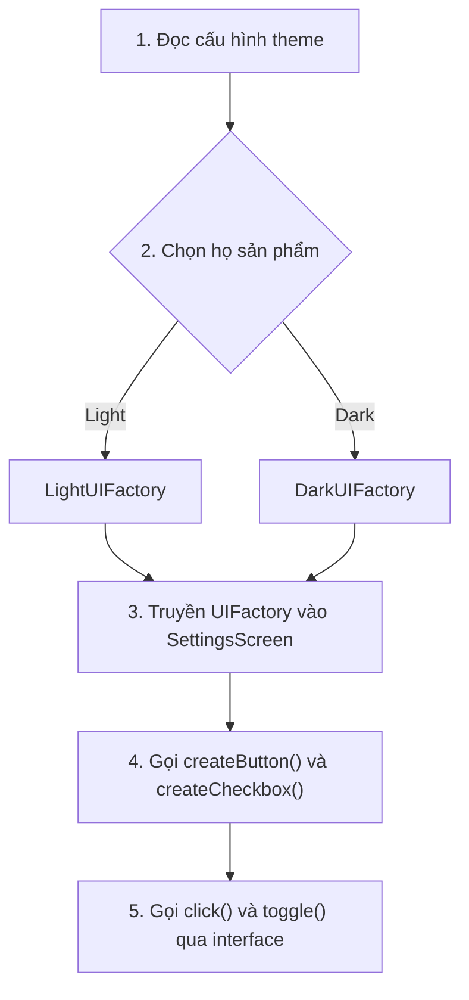

# Tách bước chọn họ sản phẩm khỏi bước tạo đối tượng và sử dụng hành vi

> **Chương:** Luồng khởi tạo  
> **Module:** `SOFTWARE_DESIGN_DESIGN_PATTERN_CREATIONAL_ABSTRACT_FACTORY` — Học về abstract factory trong design pattern.

## 1. Mục tiêu học tập

Sau bài này, bạn có thể:

- Phân biệt **chọn họ sản phẩm**, **tạo đối tượng** và **sử dụng hành vi** trong luồng khởi tạo của Abstract Factory.
- Đặt quyết định chọn họ sản phẩm ở một vị trí rõ ràng, thay vì rải `if/else` cho từng loại sản phẩm trong mã nghiệp vụ.
- Truyền factory đã chọn vào thành phần sử dụng, để thành phần đó chỉ phụ thuộc vào interface của factory và sản phẩm.
- Giải thích vì sao các sản phẩm được tạo từ cùng một concrete factory phải tương thích với nhau, và điều gì xảy ra khi cần đổi họ sản phẩm.

## 2. Bài toán: cùng một màn hình, nhiều họ thành phần

Giả sử ứng dụng có màn hình cài đặt gồm nút **Lưu** và ô chọn **Bật thông báo**. Ứng dụng hỗ trợ hai giao diện:

| Họ sản phẩm | Nút Lưu | Ô chọn thông báo |
| --- | --- | --- |
| `Light` | `LightButton` | `LightCheckbox` |
| `Dark` | `DarkButton` | `DarkCheckbox` |

Các thành phần của cùng một giao diện phải được dùng cùng nhau. Nếu mỗi vị trí tự chọn kiểu sản phẩm, ứng dụng có thể vô tình tạo `LightButton` bên cạnh `DarkCheckbox`. Khi có thêm thành phần hoặc thêm giao diện, mã điều kiện cũng xuất hiện ở nhiều nơi.

**Abstract Factory** giải quyết bài toán bằng cách đưa việc tạo **một họ các sản phẩm liên quan** vào một factory chung. Màn hình chỉ cần biết `UIFactory` có thể tạo `Button` và `Checkbox`; màn hình không cần biết các class `Light*` hoặc `Dark*`.

Ý tưởng quan trọng nhất của luồng khởi tạo là: **quyết định chọn họ xảy ra trước**, còn việc tạo đối tượng và gọi hành vi xảy ra **sau**, thông qua các interface đã thống nhất.

## 3. Ba giai đoạn tách biệt

### Giai đoạn A — Chọn họ sản phẩm

Một vị trí khởi động hoặc lắp ghép ứng dụng (thường gọi là *composition root*) đọc cấu hình và quyết định dùng `LightUIFactory` hay `DarkUIFactory`.

```java
UIFactory factory = chooseFactory(theme);
```

Ở đây, chương trình **chưa cần tạo nút hay checkbox**. Nó mới chọn một đối tượng có khả năng tạo đúng họ sản phẩm. Nơi chọn factory được phép biết các concrete factory, vì trách nhiệm của nơi này chính là liên kết cấu hình với cách triển khai.

### Giai đoạn B — Tạo các đối tượng thuộc họ đã chọn

Thành phần cần sản phẩm nhận `UIFactory` và yêu cầu tạo từng loại sản phẩm:

```java
Button saveButton = factory.createButton();
Checkbox notificationsCheckbox = factory.createCheckbox();
```

Nếu `factory` là `DarkUIFactory`, cả hai sản phẩm đều thuộc họ `Dark`. Phần gọi chỉ thấy kiểu `Button` và `Checkbox`; việc gọi constructor cụ thể thuộc trách nhiệm của concrete factory.

### Giai đoạn C — Sử dụng hành vi của sản phẩm

Sau khi tạo xong, màn hình làm việc với các sản phẩm qua interface:

```java
saveButton.click();
notificationsCheckbox.toggle();
```

Màn hình không kiểm tra `theme`, không ép kiểu sang `DarkButton`, cũng không chọn lại họ sản phẩm trước mỗi lần gọi. Đó là điểm tách biệt giữa **quyết định cấu hình** và **hành vi nghiệp vụ**.

### Sơ đồ luồng



Hai nhánh `Light` và `Dark` hội tụ tại bước truyền `UIFactory`: từ đó trở đi, luồng sử dụng là như nhau với mọi họ sản phẩm.

## 4. Ví dụ Java hoàn chỉnh

Ví dụ dưới đây cố ý đặt việc chọn factory ở `main()`, còn việc tạo và sử dụng sản phẩm ở `SettingsScreen`. Lưu vào file `AbstractFactoryFlowDemo.java`.

```java
public class AbstractFactoryFlowDemo {
    // Abstract products: hợp đồng mà màn hình sử dụng.
    interface Button {
        void click();
    }

    interface Checkbox {
        void toggle();
    }

    // Abstract factory: tạo đủ các loại sản phẩm của một họ.
    interface UIFactory {
        Button createButton();
        Checkbox createCheckbox();
    }

    // Họ Light.
    static final class LightButton implements Button {
        @Override
        public void click() {
            System.out.println("Nhấn nút Lưu [Light]");
        }
    }

    static final class LightCheckbox implements Checkbox {
        @Override
        public void toggle() {
            System.out.println("Đổi trạng thái thông báo [Light]");
        }
    }

    static final class LightUIFactory implements UIFactory {
        @Override
        public Button createButton() {
            return new LightButton();
        }

        @Override
        public Checkbox createCheckbox() {
            return new LightCheckbox();
        }
    }

    // Họ Dark.
    static final class DarkButton implements Button {
        @Override
        public void click() {
            System.out.println("Nhấn nút Lưu [Dark]");
        }
    }

    static final class DarkCheckbox implements Checkbox {
        @Override
        public void toggle() {
            System.out.println("Đổi trạng thái thông báo [Dark]");
        }
    }

    static final class DarkUIFactory implements UIFactory {
        @Override
        public Button createButton() {
            return new DarkButton();
        }

        @Override
        public Checkbox createCheckbox() {
            return new DarkCheckbox();
        }
    }

    // Client: tạo sản phẩm rồi sử dụng, không biết class Light/Dark.
    static final class SettingsScreen {
        private final Button saveButton;
        private final Checkbox notificationsCheckbox;

        SettingsScreen(UIFactory factory) {
            this.saveButton = factory.createButton();
            this.notificationsCheckbox = factory.createCheckbox();
        }

        void interact() {
            saveButton.click();
            notificationsCheckbox.toggle();
        }
    }

    // Điểm chọn họ: chỉ nơi này cần biết concrete factories.
    static UIFactory chooseFactory(String theme) {
        if ("light".equalsIgnoreCase(theme)) {
            return new LightUIFactory();
        }
        if ("dark".equalsIgnoreCase(theme)) {
            return new DarkUIFactory();
        }
        throw new IllegalArgumentException("Theme không hỗ trợ: " + theme);
    }

    public static void main(String[] args) {
        String theme = args.length > 0 ? args[0] : "light";

        // A. Chọn họ.
        UIFactory factory = chooseFactory(theme);
        // B. Tạo sản phẩm thuộc cùng họ.
        SettingsScreen screen = new SettingsScreen(factory);
        // C. Sử dụng hành vi qua interface.
        screen.interact();
    }
}
```

Biên dịch và chạy với JDK:

```bash
javac AbstractFactoryFlowDemo.java
java AbstractFactoryFlowDemo dark
```

Kết quả:

```text
Nhấn nút Lưu [Dark]
Đổi trạng thái thông báo [Dark]
```

Nếu đổi tham số thành `light`, **chỉ quyết định ở giai đoạn A thay đổi**. `SettingsScreen` vẫn gọi cùng hai phương thức và nhận hai đối tượng thuộc họ `Light`.

## 5. Vai trò và hướng phụ thuộc

| Thành phần | Biết về điều gì? | Trách nhiệm |
| --- | --- | --- |
| `main()` / `chooseFactory()` | Cấu hình `theme`, `LightUIFactory`, `DarkUIFactory` | Chọn họ sản phẩm và lắp ghép ứng dụng |
| `UIFactory` | Các interface `Button`, `Checkbox` | Định nghĩa những sản phẩm có thể yêu cầu tạo |
| `LightUIFactory`, `DarkUIFactory` | Các class sản phẩm tương ứng trong một họ | Cung cấp hiện thực tạo sản phẩm đồng bộ trong cùng họ |
| `Button`, `Checkbox` | Hợp đồng hành vi | Cho phép client sử dụng sản phẩm mà không lệ thuộc class cụ thể |
| `SettingsScreen` | `UIFactory`, `Button`, `Checkbox` | Yêu cầu tạo và gọi hành vi, không chọn họ sản phẩm |

Quan hệ phụ thuộc cần giữ là:

- Nơi **chọn họ** phụ thuộc vào các concrete factory.
- Nơi **tạo và dùng sản phẩm** phụ thuộc vào `UIFactory` và các product interface.
- **Concrete factory** phụ thuộc vào các concrete product cùng họ.

Vì vậy, thêm họ `HighContrast` có thể thực hiện bằng cách thêm `HighContrastButton`, `HighContrastCheckbox`, `HighContrastUIFactory` và cập nhật điểm chọn họ. Nếu hợp đồng `UIFactory`, `Button`, `Checkbox` vẫn giữ nguyên, không cần sửa `SettingsScreen`.

Ngược lại, nếu thêm **loại sản phẩm mới** như `Slider`, bạn thường phải thêm `createSlider()` vào `UIFactory` rồi triển khai ở **tất cả** concrete factory. Đây là chi phí mở rộng theo chiều loại sản phẩm của Abstract Factory.

## 6. Những lỗi dễ mắc trong luồng khởi tạo

### Chọn theme riêng khi tạo từng sản phẩm

```java
Button button = theme.equals("dark") ? new DarkButton() : new LightButton();
Checkbox checkbox = otherTheme.equals("dark")
        ? new DarkCheckbox() : new LightCheckbox();
```

Hai điều kiện có thể dùng hai giá trị cấu hình khác nhau và tạo ra sản phẩm lệch họ. Khi thêm sản phẩm, số nơi cần thay đổi tiếp tục tăng. Hãy chọn **một factory cho phạm vi cần nhất quán**, sau đó tạo mọi sản phẩm trong phạm vi đó từ factory ấy.

### Đưa quyết định chọn họ vào client

```java
// Bất lợi: SettingsScreen biết class cụ thể của từng họ.
if (theme.equals("dark")) {
    button = new DarkButton();
} else {
    button = new LightButton();
}
```

Lúc này `SettingsScreen` đồng thời làm hai việc: quyết định cấu hình và sử dụng sản phẩm. Thêm theme mới sẽ buộc sửa mã của màn hình. Truyền `UIFactory` qua constructor giúp phân chia trách nhiệm rõ ràng.

### Cho rằng thay factory sẽ tự thay sản phẩm đã tạo

Nếu màn hình đã được tạo với `LightUIFactory`, việc gán biến `factory` sang `DarkUIFactory` **không biến** các `LightButton` và `LightCheckbox` hiện có thành sản phẩm Dark. Muốn đổi theme lúc chạy, ứng dụng phải có chiến lược tạo lại thành phần, hoặc cơ chế cập nhật phù hợp với framework giao diện. Khi tái tạo, hãy dùng một factory nhất quán cho cùng phạm vi màn hình.

### Dùng một factory toàn cục có thể thay đổi tùy ý

Trong ứng dụng nhiều người dùng hoặc nhiều request, trạng thái `currentFactory` dùng chung có thể làm request này vô tình lấy cấu hình của request khác. Chọn factory theo phạm vi phù hợp — ví dụ theo session, request hoặc màn hình — và truyền tường minh vào client.

## 7. Khi nào cách tách ba bước này hữu ích?

Abstract Factory phù hợp khi hệ thống có **nhiều loại sản phẩm liên quan**, mỗi loại có **nhiều biến thể theo cùng một họ**, và cần giữ các biến thể đó nhất quán. Ví dụ: bộ thành phần giao diện cho các theme, hoặc tập adapter cho các nền tảng triển khai khác nhau.

Nếu chỉ có một kiểu đối tượng đơn lẻ và không có ràng buộc giữa nhiều sản phẩm cùng họ, Abstract Factory có thể làm thiết kế phức tạp không cần thiết. Một constructor, Factory Method hoặc factory đơn giản có thể đủ, tùy yêu cầu.

Với thiết kế Abstract Factory, có thể kiểm thử `SettingsScreen` bằng một `UIFactory` giả trả về các `Button` và `Checkbox` giả có ghi nhận lời gọi. Phép thử chỉ cần kiểm tra `interact()` gọi đúng `click()` và `toggle()`; kiểm thử chọn theme nằm riêng ở `chooseFactory()`. Cách tách này giúp kiểm thử từng trách nhiệm độc lập.

## 8. Tự kiểm tra kiến thức

1. Vì sao việc chọn `DarkUIFactory` nên xảy ra trước khi tạo `Button` và `Checkbox`? Việc chọn hai sản phẩm bằng hai câu `if` riêng có rủi ro gì?
2. `SettingsScreen` cần biết những interface nào để dùng được cả hai theme? Nó có cần import `DarkButton` không?
3. Nếu người dùng chuyển từ Light sang Dark sau khi màn hình đã khởi tạo, đối tượng nào cần được tạo lại và vì sao?
4. Muốn thêm họ `HighContrast`, những thành phần nào phải bổ sung? Muốn thêm loại sản phẩm `Slider`, hợp đồng nào sẽ thay đổi?

**Ghi nhớ:** Trong luồng khởi tạo Abstract Factory, **chọn một họ phù hợp → dùng concrete factory của họ đó để tạo các sản phẩm liên quan → gọi hành vi qua interface**. Khi ba trách nhiệm này được đặt đúng chỗ, mã sử dụng sản phẩm có thể giữ nguyên khi chuyển giữa các họ tương thích.
