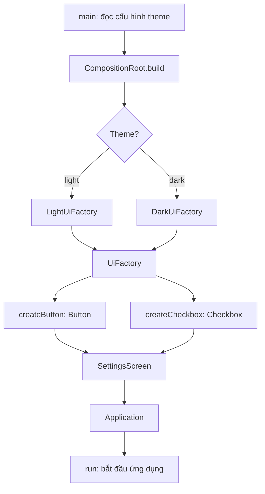

# Tổ chức composition root làm nơi duy nhất lắp ráp các lớp triển khai

**Chương:** Luồng khởi tạo  
**Chuyên đề:** `SOFTWARE_DESIGN_DESIGN_PATTERN_CREATIONAL_ABSTRACT_FACTORY` — Học về abstract factory trong design pattern.

## Mục tiêu học tập

Sau bài học, bạn có thể:

- Giải thích **composition root** là gì và nó nằm ở đâu trong luồng khởi động ứng dụng.
- Phân biệt trách nhiệm của **composition root** với trách nhiệm của **Abstract Factory**.
- Tổ chức việc chọn một họ sản phẩm (`Light` hoặc `Dark`) và lắp ráp các đối tượng Java tại một nơi tập trung.
- Truyền dependency qua constructor để các lớp nghiệp vụ/giao diện không trực tiếp tạo lớp triển khai cụ thể.
- Nhận biết các giới hạn của cách lắp ráp thủ công, đặc biệt khi đổi cấu hình hoặc bổ sung dependency.

## 1. Bài toán: mã khởi tạo bị phân tán

Giả sử ứng dụng Java có màn hình cài đặt gồm `Button` và `Checkbox`. Chương trình hỗ trợ hai họ giao diện: `Light` và `Dark`. Mỗi họ cần cung cấp một cặp sản phẩm nhất quán.

Một cách thiết kế thiếu tập trung là để mỗi màn hình tự đọc cấu hình và tự chọn lớp cần khởi tạo:

```java
// Phản ví dụ: mỗi màn hình tự quyết định lớp triển khai.
class SettingsScreen {
    SettingsScreen(String theme) {
        if (theme.equals("dark")) {
            // Lớp màn hình bị buộc chặt với các lớp cụ thể.
            button = new DarkButton();
            checkbox = new DarkCheckbox();
        } else {
            button = new LightButton();
            checkbox = new LightCheckbox();
        }
    }
    // ...
}
```

Nếu có thêm `ProfileScreen`, `DashboardScreen` và các dịch vụ liên quan, cùng đoạn chọn `dark/light` dễ xuất hiện tại nhiều nơi. Khi bổ sung họ `HighContrast`, lập trình viên phải tìm và chỉnh nhiều nhánh điều kiện; một số màn hình có thể quên cập nhật hoặc tạo sản phẩm từ hai họ khác nhau.

**Ý tưởng giải quyết:** chỉ điểm khởi động ứng dụng quyết định dùng **triển khai nào** và cách **nối các đối tượng với nhau**. Các màn hình nhận những dependency chúng cần thông qua constructor. Trong ví dụ, phần tập trung việc đó là `CompositionRoot`.

## 2. Composition root thực sự làm gì?

**Composition root** là vị trí nằm gần điểm vào ứng dụng, nơi chương trình tạo object graph: chọn các implementation, tạo đối tượng, thiết lập quan hệ phụ thuộc và chuyển quyền điều khiển cho ứng dụng. Trong chương trình Java chạy độc lập, nó thường được gọi từ `main()`. Trong ứng dụng dùng framework, nó có thể được thể hiện qua cấu hình dependency injection hoặc module khởi tạo ứng dụng.

Ví dụ, một object graph rất nhỏ:

```text
CompositionRoot
  ├── chọn UiFactory: LightUiFactory hoặc DarkUiFactory
  ├── yêu cầu UiFactory tạo Button và Checkbox cùng họ
  ├── new SettingsScreen(button, checkbox)
  └── new Application(settingsScreen)
          └── Application.run()
```

Trong thiết kế này, `SettingsScreen` chỉ biết hai **interface** là `Button` và `Checkbox`. Nó không biết người dùng đã chọn theme nào, không gọi `new DarkButton()` và cũng không chọn factory.

Điểm quan trọng cần phân biệt:

| Thành phần | Trách nhiệm | Biết điều gì? |
| --- | --- | --- |
| `CompositionRoot` | Chọn họ, tạo/lấy các dependency và lắp ráp object graph | Các lớp factory cụ thể và cấu hình khởi động |
| `UiFactory` (abstract factory) | Mô tả cách tạo **một bộ sản phẩm có liên quan** | Interface `Button` và `Checkbox` |
| `LightUiFactory`, `DarkUiFactory` | Tạo các sản phẩm cụ thể thuộc **cùng một họ** | `LightButton`/`LightCheckbox` hoặc `DarkButton`/`DarkCheckbox` |
| `SettingsScreen` (client) | Thực hiện logic hiển thị màn hình | Chỉ các hành vi do `Button` và `Checkbox` công bố |
| `Application` | Điều phối luồng chạy của ứng dụng | Màn hình đã được lắp ráp sẵn |

Composition root **không thay thế** Abstract Factory. Factory vẫn chứa các lệnh `new LightButton()` hay `new DarkCheckbox()` vì đó là công việc **tạo sản phẩm bên trong một họ**. Quy ước “một nơi duy nhất lắp ráp” nghĩa là **quyết định chọn implementation và kết nối dependency ở ranh giới ứng dụng**, không phải mọi câu lệnh `new` trên toàn hệ thống đều phải dồn vào một lớp.

## 3. Sơ đồ luồng khởi tạo



Điểm chuyển từ **chọn implementation** sang **làm việc với abstraction** diễn ra trong `CompositionRoot`: sau khi chọn factory, các biến `button` và `checkbox` có kiểu `Button` và `Checkbox`. Phần còn lại không cần biết sản phẩm thuộc họ nào.

## 4. Ví dụ Java hoàn chỉnh: khởi tạo tại một nơi

Ví dụ sau dùng `render()` để tạo chuỗi hiển thị ra console. Nó minh họa **luồng khởi tạo và tiêm phụ thuộc**, không cần thư viện giao diện. Toàn bộ mã có thể nằm trong một file **`CompositionRootDemo.java`** và chạy bằng Java 8 trở lên.

```java
import java.util.Locale;
import java.util.Objects;

// 1. Các abstract product: ứng dụng làm việc với interface.
interface Button {
    String render();
}

interface Checkbox {
    String render(boolean checked);
}

// 2. Abstract Factory quy định bộ sản phẩm của một họ.
interface UiFactory {
    Button createButton();
    Checkbox createCheckbox();
}

// 3. Các sản phẩm cụ thể thuộc họ Light.
final class LightButton implements Button {
    @Override
    public String render() {
        return "[Light] Nút Lưu (nền sáng)";
    }
}

final class LightCheckbox implements Checkbox {
    @Override
    public String render(boolean checked) {
        return "[Light] Nhận thông báo: " + (checked ? "[x]" : "[ ]");
    }
}

final class LightUiFactory implements UiFactory {
    @Override
    public Button createButton() {
        return new LightButton();
    }

    @Override
    public Checkbox createCheckbox() {
        return new LightCheckbox();
    }
}

// 4. Các sản phẩm cụ thể thuộc họ Dark.
final class DarkButton implements Button {
    @Override
    public String render() {
        return "[Dark] Nút Lưu (nền tối)";
    }
}

final class DarkCheckbox implements Checkbox {
    @Override
    public String render(boolean checked) {
        return "[Dark] Nhận thông báo: " + (checked ? "[x]" : "[ ]");
    }
}

final class DarkUiFactory implements UiFactory {
    @Override
    public Button createButton() {
        return new DarkButton();
    }

    @Override
    public Checkbox createCheckbox() {
        return new DarkCheckbox();
    }
}

// 5. Client nhận dependency đã được tạo sẵn.
//    Không có "new DarkButton()" hoặc "if (theme ...)" ở đây.
final class SettingsScreen {
    private final Button saveButton;
    private final Checkbox notificationsCheckbox;

    SettingsScreen(Button saveButton, Checkbox notificationsCheckbox) {
        this.saveButton = Objects.requireNonNull(saveButton, "saveButton");
        this.notificationsCheckbox = Objects.requireNonNull(
            notificationsCheckbox, "notificationsCheckbox");
    }

    String render() {
        return notificationsCheckbox.render(true) + System.lineSeparator()
             + saveButton.render();
    }
}

// 6. Ứng dụng chỉ nhận đối tượng màn hình đã được lắp ráp.
final class Application {
    private final SettingsScreen settingsScreen;

    Application(SettingsScreen settingsScreen) {
        this.settingsScreen = Objects.requireNonNull(
            settingsScreen, "settingsScreen");
    }

    void run() {
        System.out.println(settingsScreen.render());
    }
}

// 7. Composition root: nơi duy nhất chọn triển khai và nối object graph.
final class CompositionRoot {
    private CompositionRoot() { }

    static Application build(String theme) {
        UiFactory uiFactory = selectUiFactory(theme);

        // Một factory cho cả màn hình: tránh trộn các họ sản phẩm.
        Button button = uiFactory.createButton();
        Checkbox checkbox = uiFactory.createCheckbox();

        SettingsScreen settingsScreen = new SettingsScreen(button, checkbox);
        return new Application(settingsScreen);
    }

    private static UiFactory selectUiFactory(String theme) {
        String normalizedTheme = Objects.requireNonNull(theme, "theme")
                .trim().toLowerCase(Locale.ROOT);

        switch (normalizedTheme) {
            case "light":
                return new LightUiFactory();
            case "dark":
                return new DarkUiFactory();
            default:
                throw new IllegalArgumentException("Theme không hỗ trợ: " + theme);
        }
    }
}

// 8. Điểm vào: đọc lựa chọn, gọi composition root, chạy ứng dụng.
public final class CompositionRootDemo {
    public static void main(String[] args) {
        String theme = args.length == 0 ? "light" : args[0];
        Application application = CompositionRoot.build(theme);
        application.run();
    }
}
```

### Chạy chương trình

Lưu mã vào `CompositionRootDemo.java`, mở terminal tại thư mục chứa file và chạy:

```bash
javac -encoding UTF-8 CompositionRootDemo.java
java CompositionRootDemo light
java CompositionRootDemo dark
```

Đầu ra với `light`:

```text
[Light] Nhận thông báo: [x]
[Light] Nút Lưu (nền sáng)
```

Đầu ra với `dark`:

```text
[Dark] Nhận thông báo: [x]
[Dark] Nút Lưu (nền tối)
```

Không truyền đối số sẽ chọn `light`. Truyền một giá trị không được hỗ trợ, như `blue`, sẽ dừng khởi tạo với `IllegalArgumentException`, qua đó tránh tạo ứng dụng trong trạng thái cấu hình không xác định.

### Theo dõi luồng khi chạy với `dark`

1. `main()` đọc `args[0]` và gọi `CompositionRoot.build("dark")`.
2. `selectUiFactory()` chọn `new DarkUiFactory()` tại **composition root**.
3. `DarkUiFactory` tạo `DarkButton` và `DarkCheckbox`; cả hai được gán vào biến kiểu interface `Button`/`Checkbox`.
4. Composition root truyền hai dependency vào `new SettingsScreen(button, checkbox)`.
5. Composition root tạo `new Application(settingsScreen)` và trả về cho `main()`.
6. `main()` gọi `application.run()`; màn hình chỉ gọi `render()` trên các interface đã nhận.

Lớp `SettingsScreen` không chứa bất kỳ điều kiện nào phụ thuộc `dark` hay `light`. Đổi giá trị cấu hình ở đầu vào là đủ để lắp ráp một object graph thuộc họ giao diện khác.

## 5. Hai loại phụ thuộc: tạo sản phẩm và lắp ráp ứng dụng

Trong ví dụ có **hai cấp tạo đối tượng** dễ gây nhầm lẫn:

**Cấp 1 — Factory tạo sản phẩm thuộc cùng họ.** `DarkUiFactory.createButton()` biết cần `new DarkButton()`, còn `DarkUiFactory.createCheckbox()` biết cần `new DarkCheckbox()`. Factory đóng gói quy tắc tạo bộ sản phẩm liên quan; nếu đổi cấu trúc nội bộ của sản phẩm, client không cần biết.

**Cấp 2 — Composition root lắp ráp các phần của ứng dụng.** `CompositionRoot.build()` chọn một `UiFactory`, lấy sản phẩm từ đó, truyền chúng vào `SettingsScreen`, rồi truyền màn hình vào `Application`. Đây là nơi quyết định một đối tượng cụ thể được cấp cho client nào và dùng trong vòng đời nào.

Tách hai cấp này giúp mỗi lớp có một trách nhiệm rõ ràng:

| Khi có thay đổi | Phần thường cần sửa | Phần thường giữ nguyên |
| --- | --- | --- |
| Thay cách tạo `DarkButton` | `DarkUiFactory` hoặc sản phẩm `DarkButton` | `SettingsScreen`, `Application` |
| Chọn họ dựa trên cấu hình mới | `CompositionRoot` và chỗ đọc cấu hình | `SettingsScreen`, sản phẩm cụ thể |
| Thêm màn hình nhận `Button`, `Checkbox` | Thành phần mới và `CompositionRoot.build()` | Hợp đồng `UiFactory` |
| Thêm họ `HighContrast` | Các sản phẩm mới, factory mới và nhánh chọn factory tại root | Các client chỉ dùng interface |
| Thêm loại sản phẩm `TextField` vào mọi họ | `UiFactory`, mỗi factory cụ thể, mỗi họ sản phẩm; root/client nếu cần sử dụng | Các sản phẩm cũ không liên quan |

Mẫu thiết kế giúp cô lập thay đổi nhưng **không bảo đảm mọi thay đổi chỉ sửa đúng một file**. Ví dụ, thêm một *loại sản phẩm* vào hợp đồng factory vẫn đòi hỏi cập nhật các factory cụ thể hiện có.

## 6. Vì sao constructor injection phù hợp với composition root?

Đoạn code sau là nguyên tắc cốt lõi:

```java
SettingsScreen(Button saveButton, Checkbox notificationsCheckbox) {
    this.saveButton = Objects.requireNonNull(saveButton, "saveButton");
    this.notificationsCheckbox = Objects.requireNonNull(
        notificationsCheckbox, "notificationsCheckbox");
}
```

`SettingsScreen` **nhận** các dependency thay vì **tìm** hoặc **tạo** chúng. Điều này mang lại:

- **Phụ thuộc hiện rõ trong constructor:** muốn tạo màn hình phải cung cấp `Button` và `Checkbox`.
- **Dễ kiểm thử:** bài test có thể truyền các implementation giả ghi lại lệnh gọi `render()` mà không khởi tạo bất kỳ factory thật nào.
- **Không rải nhánh chọn cấu hình:** màn hình không cần hỏi theme hiện tại.
- **Kiểm soát vòng đời:** composition root quyết định tái sử dụng hay tạo mới đối tượng, thay vì để mỗi lớp tùy ý làm vậy.

Ví dụ giả lập nhanh một sản phẩm trong bài test, không cần sửa `SettingsScreen`:

```java
Button fakeButton = () -> "fake button";
Checkbox fakeCheckbox = checked -> "fake checkbox: " + checked;
SettingsScreen screen = new SettingsScreen(fakeButton, fakeCheckbox);

String output = screen.render();
// Có thể kiểm tra output chứa "fake button" và "fake checkbox: true".
```

Lưu ý: `Button` và `Checkbox` ở ví dụ này là các interface có đúng một abstract method nên có thể dùng lambda trong Java 8. Ở dự án thực tế, bài test có thể chọn fake/mock phù hợp với hợp đồng giao diện của hệ thống.

## 7. Một composition root cho toàn bộ ứng dụng có nghĩa là gì?

“Một nơi duy nhất” là **một ranh giới lắp ráp có chủ đích**, không nhất thiết phải là một phương thức khổng lồ hoặc một file Java duy nhất. Với ứng dụng lớn, composition root có thể phân chia thành các hàm/module cấu hình nhỏ, nhưng quyết định chọn triển khai và nối các lớp vẫn tập trung trong **vùng khởi tạo**, thay vì để các client tự lấy đối tượng từ một nơi ẩn hoặc tự gọi `new` implementation theo cấu hình.

Ví dụ cách phân tầng khi ứng dụng mở rộng:

```text
main()
  └── CompositionRoot.build(config)
        ├── buildUiFactory(config.theme)
        ├── buildStorage(config.storage)
        ├── buildServices(storage)
        └── buildScreens(uiFactory, services)
              └── new Application(...)
```

Các hàm `build*` là chi tiết bên trong vùng lắp ráp. Chúng có thể được tách ra những lớp/module cấu hình, nhưng **màn hình và dịch vụ nghiệp vụ** vẫn chỉ nhận các interface hoặc dữ liệu đã chuẩn bị sẵn. Ở ứng dụng có dependency injection container, phần khai báo binding/registration thường đóng vai trò này, còn container hỗ trợ thực hiện quá trình xây dựng object graph.

Một lưu ý khác: `CompositionRoot.build("dark")` tạo một đồ thị đối tượng theo họ `Dark` tại thời điểm gọi. **Đổi giá trị cấu hình sau đó không tự biến đối tượng đang dùng thành `Light`**. Nếu ứng dụng cần đổi theme khi đang chạy, phải thiết kế luồng riêng: tạo lại các widget/màn hình phụ thuộc theme, cập nhật state theo cơ chế giao diện, hoặc dùng một abstraction có thể đổi theme. Không nên coi việc chọn factory một lần là cơ chế tự động cập nhật giao diện.

## 8. Các sai lầm thường gặp

| Sai lầm | Vì sao có vấn đề? | Hướng chỉnh sửa |
| --- | --- | --- |
| Mỗi màn hình tự `new LightButton()` hoặc `new DarkButton()` | Phụ thuộc cụ thể và nhánh cấu hình bị phân tán | Truyền `Button`/`Checkbox` qua constructor từ composition root |
| `SettingsScreen` tự đọc environment variable để chọn theme | Logic giao diện gắn với cơ chế cấu hình | Đọc cấu hình ở ranh giới ứng dụng và chọn factory tại root |
| Root trực tiếp `new DarkButton()` và `new LightCheckbox()` | Vô tình trộn sản phẩm khác họ, bỏ qua lợi ích Abstract Factory | Chọn một `UiFactory`, lấy **đầy đủ** sản phẩm qua factory đó |
| Để client gọi `GlobalContainer.get(Button.class)` | Dependency bị ẩn, khó kiểm tra và kiểm thử | Khai báo dependency trong constructor |
| Chia sẻ một `Checkbox` mang state giữa màn hình không liên quan | State có thể rò rỉ giữa các màn hình | Chọn vòng đời phù hợp cho từng đối tượng tại root/factory |
| Giữ cấu hình factory mặc định âm thầm khi theme sai | Lỗi cấu hình khó được phát hiện | Kiểm tra đầu vào, báo lỗi rõ ràng hoặc định nghĩa quy tắc fallback có chủ đích |

## 9. Tự kiểm tra kiến thức

1. **Câu hỏi:** `DarkUiFactory` có được dùng lệnh `new DarkButton()` không, nếu nói composition root là nơi duy nhất lắp ráp?  
   **Trả lời:** Có. Factory phụ trách tạo sản phẩm cụ thể. Composition root phụ trách chọn factory, tạo dependency ở cấp ứng dụng và nối chúng vào client.

2. **Câu hỏi:** Khi thêm `HighContrastUiFactory`, `SettingsScreen` có cần một nhánh `if (theme.equals("high-contrast"))` không?  
   **Trả lời:** Không. Client vẫn nhận `Button` và `Checkbox`; thêm các sản phẩm và factory mới, rồi mở rộng lựa chọn ở composition root.

3. **Câu hỏi:** Vì sao `SettingsScreen(Button, Checkbox)` thường dễ kiểm thử hơn `SettingsScreen(String theme)` tự tạo sản phẩm?  
   **Trả lời:** Có thể đưa vào fake/mock qua constructor và kiểm tra hành vi mà không phụ thuộc chọn theme hoặc khởi tạo implementation thật.

4. **Bài tập:** Thêm `ProfileScreen(Button editButton)` vào chương trình. Hãy tạo `Button` từ **cùng `uiFactory` được chọn trong `CompositionRoot.build()`** và truyền vào `ProfileScreen`; không đưa `new LightButton()` hay điều kiện `theme` vào `ProfileScreen`.

5. **Bài tập mở rộng:** Mô tả cách đổi từ `dark` sang `light` khi ứng dụng đang chạy. Bạn sẽ tạo lại những đối tượng nào?  
   **Gợi ý:** Với ví dụ hiện tại, có thể gọi `CompositionRoot.build("light")` để nhận một `Application` mới gồm các sản phẩm `Light`, sau đó thay thế đồ thị đang sử dụng theo vòng đời ứng dụng; hệ thống UI thực tế cần cơ chế cập nhật màn hình phù hợp.

## Kết luận

Trong luồng khởi tạo của một ứng dụng áp dụng **Abstract Factory**, **composition root** là nơi tập trung quyết định *dùng họ sản phẩm nào* và *đưa dependency nào cho client nào*. Concrete factory vẫn chịu trách nhiệm tạo các sản phẩm thuộc cùng một họ. Khi màn hình chỉ nhận `Button` và `Checkbox` qua constructor, nó không cần biết `Light`, `Dark` hay cấu hình khởi động. Cách tổ chức này làm rõ object graph, giữ tính nhất quán của họ sản phẩm và giúp mở rộng hoặc kiểm thử mà không phát tán logic khởi tạo khắp ứng dụng.
