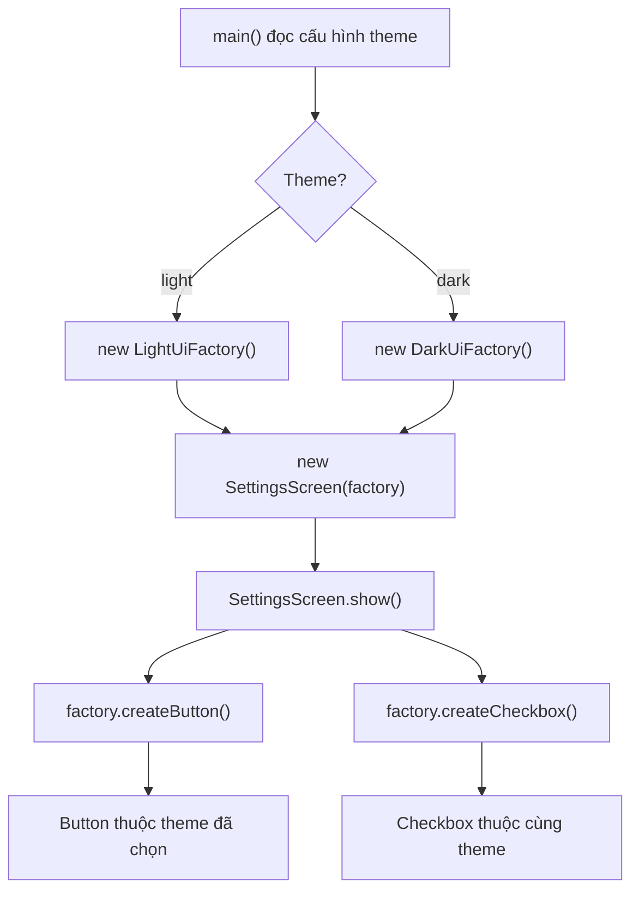
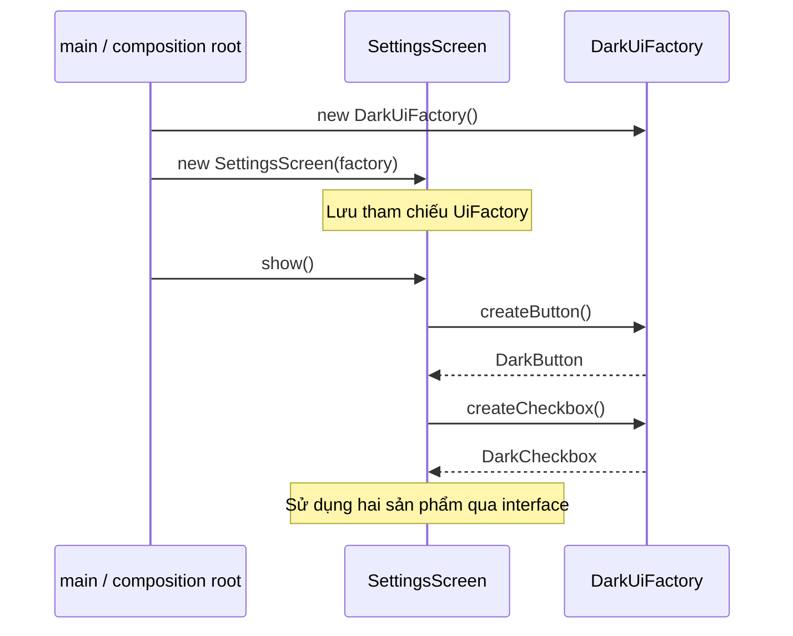

# Truyền AbstractFactory vào client qua constructor injection

Trong module `SOFTWARE_DESIGN_DESIGN_PATTERN_CREATIONAL_ABSTRACT_FACTORY` (*Học về abstract factory trong design pattern*), **Abstract Factory** cho phép client tạo một bộ đối tượng có liên quan mà không phụ thuộc trực tiếp vào các lớp cụ thể. Tuy nhiên, còn một câu hỏi thực tế quan trọng: **client lấy được factory phù hợp bằng cách nào?** 

Trong chương **Luồng khởi tạo**, bài này trình bày cách **truyền AbstractFactory vào client qua constructor injection** (tiêm phụ thuộc qua hàm khởi tạo). Ta sẽ theo dõi đường đi từ lựa chọn biến thể ở điểm khởi động ứng dụng đến lúc client yêu cầu factory tạo sản phẩm, dùng một ví dụ Java hoàn chỉnh và phân tích các lựa chọn thiết kế liên quan.

## 1. Bài toán: client cần sản phẩm nhưng không nên tự chọn biến thể

Giả sử ứng dụng có màn hình cài đặt (`SettingsScreen`) chứa một nút lưu (`Button`) và một ô chọn nhận thông báo (`Checkbox`). Ứng dụng hỗ trợ hai giao diện **Light** và **Dark**. Các sản phẩm thuộc cùng một theme phải nhất quán với nhau:

| Loại sản phẩm | Họ Light | Họ Dark |
| --- | --- | --- |
| `Button` | `LightButton` | `DarkButton` |
| `Checkbox` | `LightCheckbox` | `DarkCheckbox` |
| Factory | `LightUiFactory` | `DarkUiFactory` |

Màn hình biết **cần một Button và một Checkbox**, nhưng không cần biết lớp nào tạo ra chúng. Vì vậy, client chỉ làm việc với hợp đồng `UiFactory`:

```java
interface UiFactory {
    Button createButton();
    Checkbox createCheckbox();
}
```

Vấn đề còn lại là: nơi nào quyết định dùng `LightUiFactory` hay `DarkUiFactory`? Ta đặt quyết định này ở **composition root** — điểm tập hợp và kết nối các phụ thuộc khi ứng dụng khởi tạo, thường là `main()`, lớp bootstrap hoặc phần cấu hình dependency injection.

Composition root tạo một concrete factory rồi **truyền đối tượng đó vào constructor của client**. Client giữ tham chiếu kiểu `UiFactory` và sử dụng nó khi cần sản phẩm.

## 2. Constructor injection trong Abstract Factory là gì?

**Constructor injection** nghĩa là đối tượng nhận các phụ thuộc bắt buộc thông qua tham số của hàm khởi tạo. Với Abstract Factory, phụ thuộc đó chính là **một factory mang kiểu interface**:

```java
final class SettingsScreen {
    private final UiFactory factory;

    SettingsScreen(UiFactory factory) {
        this.factory = java.util.Objects.requireNonNull(factory, "factory");
    }

    void show() {
        Button button = factory.createButton();
        Checkbox checkbox = factory.createCheckbox();
        // Hiển thị button và checkbox...
    }
}
```

Trong đoạn mã trên:

- `SettingsScreen` **nhận** một `UiFactory` qua constructor; nó không khởi tạo `LightUiFactory` hay `DarkUiFactory`.
- Trường `private final` bảo đảm tham chiếu factory đã gán không bị thay đổi sau khi đối tượng màn hình được tạo. Điều này **không có nghĩa factory hoặc sản phẩm là bất biến**.
- `Objects.requireNonNull(...)` phát hiện việc truyền thiếu phụ thuộc ngay khi tạo màn hình, thay vì chờ đến lúc gọi `show()` mới gặp `NullPointerException`.
- Khi cần UI, client gọi các phương thức của **cùng factory**. Concrete factory quyết định tạo sản phẩm nào.

Đây là một cách kết hợp **Dependency Injection (DI)** với **Abstract Factory**. DI giải quyết việc *cấp phụ thuộc cho client*; Abstract Factory giải quyết việc *tạo một họ sản phẩm thông qua hợp đồng thống nhất*. Hai khái niệm bổ sung cho nhau, không đồng nghĩa với nhau.

## 3. Luồng khởi tạo từ ứng dụng đến sản phẩm

Ta có thể chia luồng thành hai pha: **kết nối phụ thuộc** và **sử dụng phụ thuộc**.



Một biểu đồ tương tác cho trường hợp người dùng chọn Dark:



Trình tự có ý nghĩa:

1. **Chọn họ:** `main()` đọc theme từ cấu hình hoặc tham số đầu vào.
2. **Tạo factory:** `main()` khởi tạo `LightUiFactory` hoặc `DarkUiFactory`.
3. **Tiêm phụ thuộc:** `main()` gọi `new SettingsScreen(factory)`; constructor chỉ nhận kiểu `UiFactory`.
4. **Yêu cầu sản phẩm:** `SettingsScreen` gọi `factory.createButton()` và `factory.createCheckbox()`.
5. **Sử dụng sản phẩm:** client làm việc với `Button` và `Checkbox`, không cần ép kiểu hoặc kiểm tra theme.

Điểm cần phân biệt: **constructor injection không bắt buộc phải tạo các sản phẩm ngay trong constructor**. Trong ví dụ, constructor chỉ lưu factory; các sản phẩm được tạo khi `show()` chạy. Nếu màn hình cần các thành phần ngay từ đầu, nó cũng có thể gọi factory trong constructor, nhưng nên cân nhắc chi phí khởi tạo và vòng đời UI.

## 4. Ví dụ Java hoàn chỉnh

Ví dụ dùng `render()` trả về chuỗi mô phỏng để thấy rõ biến thể sản phẩm; đây không phải mã vẽ widget GUI thật. Mục tiêu là kiểm chứng luồng tiêm factory và tạo bộ sản phẩm cùng theme.

Lưu thành file `ConstructorInjectionAbstractFactoryDemo.java`:

```java
import java.util.Locale;
import java.util.Objects;

public class ConstructorInjectionAbstractFactoryDemo {

    // 1. Abstract products: những gì client thực sự cần.
    interface Button {
        String render(String label);
    }

    interface Checkbox {
        String render(String label, boolean checked);
    }

    // 2. Abstract factory: hợp đồng tạo cả một họ sản phẩm.
    interface UiFactory {
        Button createButton();
        Checkbox createCheckbox();
    }

    // 3. Các concrete product của họ Light.
    static final class LightButton implements Button {
        @Override
        public String render(String label) {
            return "[Light] Button: " + label;
        }
    }

    static final class LightCheckbox implements Checkbox {
        @Override
        public String render(String label, boolean checked) {
            return "[Light] Checkbox: " + label
                    + (checked ? " [checked]" : " [unchecked]");
        }
    }

    // 4. Các concrete product của họ Dark.
    static final class DarkButton implements Button {
        @Override
        public String render(String label) {
            return "[Dark] Button: " + label;
        }
    }

    static final class DarkCheckbox implements Checkbox {
        @Override
        public String render(String label, boolean checked) {
            return "[Dark] Checkbox: " + label
                    + (checked ? " [checked]" : " [unchecked]");
        }
    }

    // 5. Mỗi concrete factory tạo đủ sản phẩm đúng họ.
    static final class LightUiFactory implements UiFactory {
        @Override
        public Button createButton() {
            return new LightButton();
        }

        @Override
        public Checkbox createCheckbox() {
            return new LightCheckbox();
        }
    }

    static final class DarkUiFactory implements UiFactory {
        @Override
        public Button createButton() {
            return new DarkButton();
        }

        @Override
        public Checkbox createCheckbox() {
            return new DarkCheckbox();
        }
    }

    // 6. Client: chỉ phụ thuộc vào interface UiFactory.
    static final class SettingsScreen {
        private final UiFactory factory;

        // Đây chính là constructor injection.
        SettingsScreen(UiFactory factory) {
            this.factory = Objects.requireNonNull(factory, "factory");
        }

        void show() {
            Button saveButton = factory.createButton();
            Checkbox notifications = factory.createCheckbox();

            System.out.println(saveButton.render("Lưu cài đặt"));
            System.out.println(
                    notifications.render("Nhận thông báo", true));
        }
    }

    // 7. Composition root: biết các lớp factory cụ thể.
    static UiFactory selectFactory(String theme) {
        switch (theme.toLowerCase(Locale.ROOT)) {
            case "light":
                return new LightUiFactory();
            case "dark":
                return new DarkUiFactory();
            default:
                throw new IllegalArgumentException(
                        "Theme không hỗ trợ: " + theme);
        }
    }

    public static void main(String[] args) {
        String theme = args.length == 0 ? "light" : args[0];

        // Tạo một factory phù hợp ở điểm khởi tạo.
        UiFactory factory = selectFactory(theme);

        // Truyền factory vào client, rồi mới dùng client.
        SettingsScreen screen = new SettingsScreen(factory);
        screen.show();
    }
}
```

Biên dịch và chạy (ở thư mục chứa file):

```bash
javac -encoding UTF-8 ConstructorInjectionAbstractFactoryDemo.java
java ConstructorInjectionAbstractFactoryDemo
java ConstructorInjectionAbstractFactoryDemo dark
```

Khi không truyền tham số, `main()` chọn Light:

```text
[Light] Button: Lưu cài đặt
[Light] Checkbox: Nhận thông báo [checked]
```

Khi truyền `dark`, cùng một `SettingsScreen` nhận factory khác:

```text
[Dark] Button: Lưu cài đặt
[Dark] Checkbox: Nhận thông báo [checked]
```

**Quan sát:** hai lần chạy không cần sửa `SettingsScreen` hay các interface. Điều kiện chọn theme chỉ xuất hiện tại `selectFactory()`, còn màn hình tiếp tục làm việc với `UiFactory`, `Button` và `Checkbox`. Nếu sau này cần thêm theme mới, ta có thể thêm các concrete product và concrete factory của theme đó, rồi bổ sung cách chọn nó ở composition root.

## 5. Vì sao nên truyền qua constructor?

So sánh ba cách client có thể lấy factory:

| Cách lấy factory | Ví dụ | Hệ quả |
| --- | --- | --- |
| **Constructor injection** | `new SettingsScreen(factory)` | Phụ thuộc bắt buộc hiện rõ khi tạo client; dễ thay factory trong kiểm thử |
| Client tự tạo | `private final UiFactory factory = new DarkUiFactory();` | Client phụ thuộc trực tiếp vào Dark; khó dùng lại với Light hoặc theme mới |
| Tra cứu toàn cục | `FactoryRegistry.getCurrentFactory()` | Phụ thuộc bị ẩn; dễ gặp trạng thái toàn cục hoặc khó cô lập các bài kiểm thử |

Constructor injection đặc biệt phù hợp khi **một client bắt buộc phải có factory để hoạt động**, và factory được quyết định từ trước ở tầng khởi tạo. Trường `final` diễn đạt rõ rằng factory là cấu hình của client tại thời điểm tạo đối tượng.

Một ví dụ cần tránh trong `SettingsScreen`:

```java
// Mã minh họa cách ràng buộc client với concrete factory:
final class SettingsScreen {
    private final UiFactory factory = new DarkUiFactory();
    // ...
}
```

Ở đây `SettingsScreen` đã tự quyết định theme Dark. Để chuyển sang Light, ta phải sửa client hoặc đưa thêm điều kiện chọn theme vào client; đó là phần trách nhiệm mà composition root nên đảm nhận.

Một sai lầm khác là **truyền sai loại phụ thuộc**:

```java
// Làm client bị gắn chặt vào Dark:
SettingsScreen(DarkUiFactory factory) { /* ... */ }

// Giữ khả năng hoán đổi:
SettingsScreen(UiFactory factory) { /* ... */ }
```

Sử dụng kiểu interface trong constructor giúp client chấp nhận bất kỳ concrete factory nào tuân thủ hợp đồng. Đây là ý tưởng của **Dependency Inversion Principle** ở mức phụ thuộc giữa client và factory.

## 6. Tách nơi chọn factory khỏi nơi sử dụng sản phẩm

Trong ứng dụng có nhiều màn hình, `main()` có thể truyền **cùng một tham chiếu factory** cho nhiều client:

```java
UiFactory factory = selectFactory("dark");

SettingsScreen settings = new SettingsScreen(factory);
// ProfileScreen profile = new ProfileScreen(factory);
// CheckoutScreen checkout = new CheckoutScreen(factory);

settings.show();
```

Các dòng có `ProfileScreen` và `CheckoutScreen` chỉ là ví dụ cho kiến trúc nhiều client; hai lớp này không nằm trong chương trình hoàn chỉnh ở mục 4. Nếu các client tạo sản phẩm thông qua cùng factory được cấu hình đúng, chúng sẽ nhận cùng **họ sản phẩm**, phù hợp với theme của ứng dụng.

Cần lưu ý:

- **Cùng factory không có nghĩa cùng đối tượng sản phẩm.** Trong mã minh họa, mỗi lần gọi `createButton()` sẽ tạo một `Button` mới. Nếu muốn tái sử dụng sản phẩm, factory phải cài đặt cơ chế cache hoặc phạm vi sống tương ứng.
- **Factory có thể không có trạng thái hoặc có trạng thái.** Một factory giữ cấu hình theme, tài nguyên đồ họa hoặc kết nối cần được quản lý vòng đời phù hợp. Constructor injection không tự quản lý tài nguyên hoặc đồng bộ luồng.
- **Chuyển theme khi ứng dụng đang chạy cần cơ chế riêng.** Vì `SettingsScreen` giữ một tham chiếu `final`, việc thay factory ở `main()` không tự thay các sản phẩm đã được tạo. Ứng dụng có thể tạo màn hình mới với factory mới hoặc dùng cơ chế theme động của UI framework.

Trong ứng dụng dùng container DI (chẳng hạn Spring), container có thể cung cấp `UiFactory` vào constructor của client theo cấu hình. Nhưng **không cần thư viện DI** để áp dụng constructor injection: lệnh `new SettingsScreen(factory)` đã thực hiện kỹ thuật này.

## 7. Kiểm thử client bằng một fake factory

Lợi thế thực tế của constructor injection là có thể thay factory thật bằng factory phục vụ kiểm thử. Thay vì khởi tạo các lớp Light/Dark, ta có thể đưa vào một `RecordingFactory` để kiểm tra client đã yêu cầu đủ các sản phẩm.

Đoạn minh họa sau có thể đặt **bên trong** lớp `ConstructorInjectionAbstractFactoryDemo` ở mục 4:

```java
static final class RecordingFactory implements UiFactory {
    int buttonCalls;
    int checkboxCalls;

    @Override
    public Button createButton() {
        buttonCalls++;
        return label -> "[Test] Button: " + label;
    }

    @Override
    public Checkbox createCheckbox() {
        checkboxCalls++;
        return (label, checked) ->
                "[Test] Checkbox: " + label + " = " + checked;
    }
}

static void verifyClientRequestsBothProducts() {
    RecordingFactory fake = new RecordingFactory();
    SettingsScreen screen = new SettingsScreen(fake);
    screen.show();

    if (fake.buttonCalls != 1 || fake.checkboxCalls != 1) {
        throw new AssertionError(
                "SettingsScreen phải yêu cầu mỗi loại sản phẩm một lần");
    }
}
```

Để chạy đoạn kiểm tra, gọi `verifyClientRequestsBothProducts()` từ `main()` sau phần chạy chính. **Client vẫn giữ nguyên**: chỉ cấu hình một triển khai khác của `UiFactory`. Trong dự án thực tế, có thể dùng JUnit hoặc framework mocking để viết các kiểm thử riêng, đồng thời kiểm tra factory thật tạo đúng họ Light/Dark. Fake factory kiểm tra **cách client tương tác với factory**, không thay thế việc kiểm tra tính tương thích của các concrete product thật.

## 8. Các lỗi thường gặp trong luồng khởi tạo

**1. Quên truyền factory cho client.** Constructor không nhận dependency hoặc nhận `null` khiến ứng dụng lỗi khi dùng. Khai báo tham số bắt buộc, kiểm tra `null` ngay tại constructor và đảm bảo composition root luôn cung cấp factory.

**2. Tạo lẫn nhiều concrete factory trong cùng màn hình.**

```java
// Sai ý tưởng: Button và Checkbox được tạo từ hai họ.
Button button = new DarkUiFactory().createButton();
Checkbox checkbox = new LightUiFactory().createCheckbox();
```

Nên yêu cầu cả hai qua factory đã được truyền vào cùng một client.

**3. Đưa điều kiện chọn theme vào từng client.** Nếu các màn hình cùng chứa `if (darkMode)` để tạo concrete product, mỗi lần thêm theme mới sẽ phải sửa nhiều màn hình. Tập trung lựa chọn ở composition root hoặc cơ chế cấu hình chung.

**4. Nhầm constructor injection với truyền sản phẩm trực tiếp.** Constructor nhận `UiFactory` cho phép client chủ động tạo **nhiều loại sản phẩm khi cần**. Ngược lại, truyền sẵn `Button` và `Checkbox` qua constructor là cách tiêm **đối tượng sản phẩm**, có thể phù hợp ở tình huống khác nhưng không minh họa client sử dụng Abstract Factory để tạo sản phẩm.

**5. Cho rằng `final` giúp thay theme tự động.** `final` chỉ ngăn việc gán lại tham chiếu factory sau khi xây dựng client; nó không tự làm mới UI. Nếu có yêu cầu đổi theme khi đang chạy, phải thiết kế rõ cơ chế cập nhật màn hình và bảo toàn trạng thái người dùng.

## 9. Bài tập thực hành

**Bài tập 1 — Thêm họ High Contrast.** Viết `HighContrastButton`, `HighContrastCheckbox` và `HighContrastUiFactory`. Thêm lựa chọn `contrast` trong `selectFactory()`. Xác minh `SettingsScreen` không cần chỉnh sửa.

**Bài tập 2 — Thêm client thứ hai.** Tạo `ProfileScreen` cũng nhận `UiFactory` qua constructor, rồi dùng factory tạo button và checkbox. Truyền cùng `factory` vào hai màn hình từ `main()`. Kiểm tra chúng đều sử dụng đúng họ khi thay tham số `light`/`dark`.

**Bài tập 3 — Quan sát vòng đời.** Sửa `SettingsScreen` để phương thức `show()` được gọi hai lần. Theo dõi số lượng `Button` và `Checkbox` được tạo; sau đó cân nhắc tạo sản phẩm một lần trong constructor. Giải thích khi nào cách nào phù hợp với vòng đời màn hình.

**Câu hỏi tự đánh giá:** Khi nào nên chọn concrete factory? Ai nên chịu trách nhiệm về việc đó? Constructor của client cần nhận kiểu interface hay kiểu concrete? Sau khi được tiêm, client gọi phương thức nào để nhận sản phẩm mà không phụ thuộc vào theme?

## Kết luận

Trong **luồng khởi tạo** của Abstract Factory, composition root chọn **một concrete factory**, truyền nó vào client qua **constructor injection**, rồi client dùng **interface factory** để yêu cầu các sản phẩm liên quan. Cách này giúp dependencies của client rõ ràng, tách quyết định chọn họ khỏi logic sử dụng sản phẩm, hỗ trợ kiểm thử bằng factory giả và giữ các thành phần thuộc cùng một họ. Constructor injection là kỹ thuật kết nối phụ thuộc; việc sản phẩm được tạo thế nào và nhất quán ra sao vẫn là trách nhiệm của Abstract Factory và các concrete implementation.
