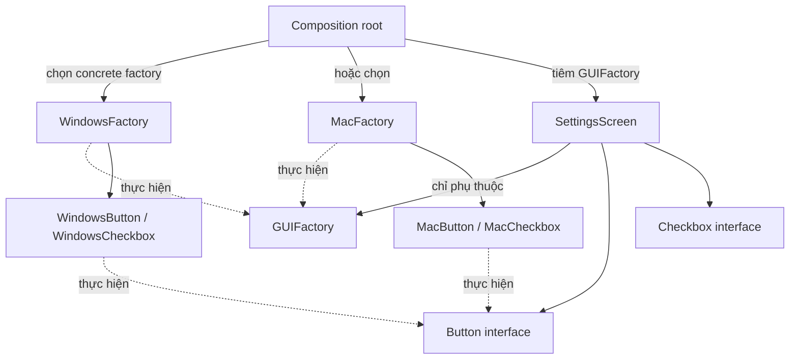

# Xác định nơi còn phụ thuộc lớp cụ thể sau khi áp dụng mẫu thiết kế

Trong module `SOFTWARE_DESIGN_DESIGN_PATTERN_CREATIONAL_ABSTRACT_FACTORY` — **Học về abstract factory trong design pattern** — việc tạo interface `GUIFactory` và các concrete factory mới chỉ là bước đầu. Sau khi áp dụng **Abstract Factory**, ta cần rà soát xem mã nghiệp vụ còn biết và phụ thuộc vào **concrete product** hoặc **concrete factory** hay không. Những phụ thuộc còn sót có thể khiến việc thay đổi họ sản phẩm vẫn phải sửa nhiều màn hình, dù dự án đã có đủ các interface.

Bài thuộc chương **Luồng khởi tạo** và tập trung trả lời ba câu hỏi: **phụ thuộc lớp cụ thể nằm ở đâu, phụ thuộc nào là hợp lý và sửa các phụ thuộc sai vị trí như thế nào?** Ta sẽ lần theo luồng chọn factory → truyền factory cho client → tạo sản phẩm → sử dụng sản phẩm, minh họa bằng Java và cách kiểm chứng sau khi chỉnh sửa.

## 1. Phân biệt phụ thuộc vào interface với phụ thuộc vào lớp cụ thể

Giả sử ứng dụng desktop hỗ trợ hai họ giao diện Windows và macOS, mỗi họ gồm:

| Loại sản phẩm | Họ Windows | Họ macOS |
| --- | --- | --- |
| `Button` | `WindowsButton` | `MacButton` |
| `Checkbox` | `WindowsCheckbox` | `MacCheckbox` |
| Factory | `WindowsFactory` | `MacFactory` |

Các **abstract product** mô tả hành vi chung; **abstract factory** mô tả cách yêu cầu tạo từng loại sản phẩm:

```java
interface Button {
    String render(String label);
}

interface Checkbox {
    String render(String label, boolean checked);
}

interface GUIFactory {
    Button createButton();
    Checkbox createCheckbox();
}
```

Client dùng hai interface sản phẩm và một interface factory như sau:

```java
final class SettingsScreen {
    private final GUIFactory factory;

    SettingsScreen(GUIFactory factory) {
        this.factory = java.util.Objects.requireNonNull(factory);
    }

    String render() {
        Button save = factory.createButton();
        Checkbox notify = factory.createCheckbox();
        return save.render("Lưu") + " | "
                + notify.render("Nhận thông báo", true);
    }
}
```

Trong mã này, `SettingsScreen` không gọi `new WindowsButton()`, không kiểm tra `instanceof MacCheckbox` và không nhận đối số kiểu `WindowsFactory`. Vì vậy, **cùng một class client** có thể nhận các factory tương thích khác nhau mà không cần sửa mã.

Ngược lại, một client như sau **vẫn phụ thuộc vào concrete class** dù đã có `GUIFactory`:

```java
// Minh họa cách dùng cần refactor; giả định các lớp đã tồn tại.
final class SettingsScreenWithLeak {
    private final GUIFactory factory;

    SettingsScreenWithLeak(GUIFactory factory) {
        this.factory = factory;
    }

    String render() {
        Button save = factory.createButton();
        Checkbox notify = new WindowsCheckbox(); // Phụ thuộc còn sót
        return save.render("Lưu") + " | "
                + notify.render("Nhận thông báo", true);
    }
}
```

Khi truyền `MacFactory` vào, nút có thể là `MacButton` nhưng ô chọn luôn là `WindowsCheckbox`. Vấn đề không nằm ở việc thiếu interface: **client đã bỏ qua factory tại một điểm tạo đối tượng**.

## 2. Nơi phụ thuộc concrete được phép tồn tại

Abstract Factory **không xóa mọi tham chiếu tới lớp cụ thể khỏi codebase**. Ai đó vẫn phải biết tạo `WindowsFactory`, và bản thân `WindowsFactory` phải biết tạo `WindowsButton`. Điều quan trọng là **đặt phụ thuộc ở đúng ranh giới**.

| Vị trí | Có thể biết concrete class? | Giải thích |
| --- | --- | --- |
| **Composition root** (`main`, bootstrap, cấu hình DI) | Có | Chọn `WindowsFactory` hay `MacFactory` theo cấu hình |
| **Concrete factory** | Có | `WindowsFactory` phải biết `WindowsButton` và `WindowsCheckbox` |
| **Concrete product** và adapter nền tảng | Có | Hiện thực chi tiết widget hoặc toolkit |
| **Client nghiệp vụ** (`SettingsScreen`) | Nên tránh | Nên phụ thuộc `GUIFactory`, `Button`, `Checkbox` |
| **Abstract factory / abstract product** | Nên tránh | Hợp đồng chung không nên trả về hoặc yêu cầu kiểu Windows/macOS |
| **Bộ kiểm thử factory** | Có thể | Kiểm tra factory trả đúng biến thể cụ thể |
| **Cấu hình DI/registry** | Có thể | Liên kết interface với hiện thực tại ranh giới cấu hình |



Sơ đồ mô tả **phụ thuộc giữa thành phần**; không hàm ý rằng cả Windows lẫn macOS cùng được khởi tạo trong một lần chạy. `main` có thể biết nhiều hiện thực để lựa chọn, còn một `SettingsScreen` cụ thể chỉ nhận một factory tại thời điểm khởi tạo.

Một quy tắc thực hành hữu ích: **tên lớp thuộc biến thể cụ thể nên tập trung ở nơi lắp ghép phụ thuộc, nơi triển khai factory/product và các kiểm thử phù hợp**. Việc xuất hiện tên lớp ở những vị trí này không tự động là lỗi.

## 3. Năm dấu hiệu cho thấy abstraction đang bị rò rỉ

### Dấu hiệu 1 — Client vẫn gọi `new` concrete product

```java
Button save = factory.createButton();
Checkbox notify = new WindowsCheckbox(); // Lẫn cách tạo trực tiếp
```

**Sửa:** dùng `factory.createCheckbox()` để nhận sản phẩm thuộc cùng họ với `save`.

### Dấu hiệu 2 — Constructor hoặc trường dữ liệu dùng kiểu concrete factory

```java
// Client bị khóa vào Windows:
final class WindowsOnlyScreen {
    private final WindowsFactory factory;

    WindowsOnlyScreen(WindowsFactory factory) {
        this.factory = factory;
    }
}
```

Đổi trường và tham số constructor thành `GUIFactory` nếu màn hình thực sự hoạt động với mọi họ. Khi constructor đòi `WindowsFactory`, client không thể nhận `MacFactory`, dù hai lớp đều triển khai `GUIFactory`.

### Dấu hiệu 3 — Client có `if`, `switch` hoặc `instanceof` theo biến thể

```java
// Nếu có một nhánh tương tự trong mỗi phương thức nghiệp vụ:
if (platform.equals("mac")) {
    return new MacButton().render("Lưu");
}
return new WindowsButton().render("Lưu");
```

Đây là quyết định *chọn họ để tạo đối tượng*. Nếu nhiều client có cùng phép chọn, hãy chuyển nó về composition root rồi truyền `GUIFactory` vào client. Cần phân biệt với `if` phục vụ quy tắc nghiệp vụ thật sự (ví dụ người dùng có được phép lưu hay không): điều kiện nghiệp vụ như vậy không nhất thiết cần loại bỏ.

### Dấu hiệu 4 — Client ép kiểu để gọi phương thức riêng của product

```java
Button button = factory.createButton();
// Ví dụ dễ vỡ nếu factory hiện tại không tạo WindowsButton:
WindowsButton windows = (WindowsButton) button;
```

Phép ép kiểu có thể ném `ClassCastException` khi truyền `MacFactory`. Nếu chức năng đó là **hành vi chung** mà client cần, hãy cân nhắc đưa nó vào hợp đồng `Button`. Nếu hành vi thực sự chỉ dành cho Windows, cần thiết kế một ranh giới nền tảng phù hợp thay vì buộc client dùng sai một interface chung.

### Dấu hiệu 5 — Interface chung vô tình chứa tên biến thể

```java
// Hợp đồng gây phụ thuộc Windows cho mọi client:
interface GUIFactoryWithLeak {
    WindowsButton createButton();
    Checkbox createCheckbox();
}
```

Ngay cả `MacFactory` cũng bị ép trả về kiểu `WindowsButton`. Hợp đồng đúng nên là `Button createButton()`. Một interface abstract trả về concrete class là dấu hiệu cần kiểm tra; không phải mọi kiểu trả về cụ thể đều sai, nhưng nó đi ngược mục tiêu hoán đổi **họ sản phẩm** trong ví dụ này.

## 4. Ví dụ Java hoàn chỉnh: client chỉ làm việc qua các interface

Ví dụ dưới đây mô phỏng giao diện bằng chuỗi để dễ quan sát; đó không phải widget native thật. Lưu thành `ConcreteDependencyAuditDemo.java`:

```java
import java.util.Locale;
import java.util.Objects;

public class ConcreteDependencyAuditDemo {

    // Các abstract product đã được thống nhất giữa các họ.
    interface Button {
        String render(String label);
    }

    interface Checkbox {
        String render(String label, boolean checked);
    }

    // Abstract factory: không nhắc tới Windows hay macOS.
    interface GUIFactory {
        Button createButton();
        Checkbox createCheckbox();
    }

    // Concrete products của họ Windows.
    static final class WindowsButton implements Button {
        @Override
        public String render(String label) {
            return "[Windows] Button: " + label;
        }
    }

    static final class WindowsCheckbox implements Checkbox {
        @Override
        public String render(String label, boolean checked) {
            return "[Windows] Checkbox: " + label
                    + (checked ? " [checked]" : " [unchecked]");
        }
    }

    // Concrete products của họ macOS.
    static final class MacButton implements Button {
        @Override
        public String render(String label) {
            return "[macOS] Button: " + label;
        }
    }

    static final class MacCheckbox implements Checkbox {
        @Override
        public String render(String label, boolean checked) {
            return "[macOS] Checkbox: " + label
                    + (checked ? " [checked]" : " [unchecked]");
        }
    }

    // Concrete factories: đây là nơi tạo các concrete product.
    static final class WindowsFactory implements GUIFactory {
        @Override
        public Button createButton() {
            return new WindowsButton();
        }

        @Override
        public Checkbox createCheckbox() {
            return new WindowsCheckbox();
        }
    }

    static final class MacFactory implements GUIFactory {
        @Override
        public Button createButton() {
            return new MacButton();
        }

        @Override
        public Checkbox createCheckbox() {
            return new MacCheckbox();
        }
    }

    // Client: không import, new hoặc cast tới concrete product.
    static final class SettingsScreen {
        private final GUIFactory factory;

        SettingsScreen(GUIFactory factory) {
            this.factory = Objects.requireNonNull(factory, "factory");
        }

        String render() {
            Button save = factory.createButton();
            Checkbox notifications = factory.createCheckbox();
            return save.render("Lưu cài đặt")
                    + " | "
                    + notifications.render("Nhận thông báo", true);
        }
    }

    // Composition root là nơi chọn biến thể theo cấu hình.
    static GUIFactory selectFactory(String platform) {
        String normalized = Objects.requireNonNull(platform, "platform")
                .trim().toLowerCase(Locale.ROOT);

        switch (normalized) {
            case "windows":
                return new WindowsFactory();
            case "mac":
            case "macos":
                return new MacFactory();
            default:
                throw new IllegalArgumentException(
                        "Nền tảng chưa được hỗ trợ: " + platform);
        }
    }

    public static void main(String[] args) {
        String platform = args.length == 0 ? "windows" : args[0];
        GUIFactory factory = selectFactory(platform);
        SettingsScreen screen = new SettingsScreen(factory);
        System.out.println(screen.render());
    }
}
```

Biên dịch và chạy trong thư mục chứa file:

```bash
javac -encoding UTF-8 ConcreteDependencyAuditDemo.java
java ConcreteDependencyAuditDemo windows
java ConcreteDependencyAuditDemo mac
```

Kết quả với `windows`:

```text
[Windows] Button: Lưu cài đặt | [Windows] Checkbox: Nhận thông báo [checked]
```

Kết quả với `mac`:

```text
[macOS] Button: Lưu cài đặt | [macOS] Checkbox: Nhận thông báo [checked]
```

Có thể nhận xét từ mã nguồn:

- `SettingsScreen` chỉ khai báo `GUIFactory`, `Button` và `Checkbox`; không xuất hiện tên `WindowsButton` hay `MacButton`.
- `WindowsFactory` và `MacFactory` chứa các lệnh `new` sản phẩm tương ứng. Đây là **phụ thuộc có chủ đích**.
- `selectFactory()` có `switch` để chọn concrete factory. Đây là **điểm cấu hình**, khác với việc lặp `switch` trong từng thao tác nghiệp vụ.
- Hai lần chạy chỉ đổi tham số đầu vào. Logic `SettingsScreen.render()` giữ nguyên và sử dụng bộ sản phẩm của factory được truyền qua constructor.

## 5. Quy trình kiểm tra phụ thuộc còn sót trong dự án

Để kiểm tra một codebase đã chuyển sang Abstract Factory, ta cần **xác định ranh giới**, **tìm các chỗ dùng concrete class**, rồi **phân loại theo trách nhiệm**.

### Bước 1 — Xác định client và hợp đồng

Liệt kê các client có thể dùng nhiều họ, ví dụ `SettingsScreen`, `ProfileScreen` hoặc `SettingsController`. Với từng client, xác định rõ những interface được phép xuất hiện trong chữ ký constructor, trường và biến cục bộ: trong ví dụ này là `GUIFactory`, `Button` và `Checkbox`.

Đừng kết luận chỉ từ việc dự án có file `GUIFactory.java`. Điều cần kiểm tra là **các client có thực sự đi qua hợp đồng đó không**.

### Bước 2 — Tìm nơi nhắc tới lớp concrete

Sử dụng chức năng *Find Usages* của IDE hoặc tìm kiếm trong mã nguồn. Ví dụ minh họa với `rg` khi dự án có thư mục `src`:

```bash
rg -n 'WindowsButton|MacButton|WindowsCheckbox|MacCheckbox' src
rg -n 'new WindowsFactory|new MacFactory|instanceof Windows|instanceof Mac' src
rg -n 'WindowsFactory|MacFactory' src
```

Những lệnh trên chỉ là **gợi ý tìm kiếm** cho dự án có tên lớp như ví dụ; hãy thay tên lớp và thư mục bằng tên thực tế. Kết quả là các **vị trí cần đọc**, không phải danh sách lỗi chắc chắn. Tên lớp trong concrete factory, composition root và kiểm thử có thể hợp lý.

Cần rà soát thêm các dạng không hiện ra trong mẫu tìm kiếm đơn giản: `import` kiểu concrete, biến/trường/constructor mang kiểu concrete, ép kiểu, các overload nhận lớp cụ thể, tham chiếu constructor (`WindowsButton::new`), cơ chế reflection theo chuỗi tên lớp, registry hoặc service locator.

### Bước 3 — Xem xét từng kết quả theo ranh giới

| Vị trí được tìm thấy | Nhận định | Hướng xử lý |
| --- | --- | --- |
| `WindowsFactory.createButton()` gọi `new WindowsButton()` | Đúng trách nhiệm | Giữ nguyên |
| `main()` gọi `new WindowsFactory()` | Hợp lý tại composition root | Giữ hoặc thay bằng cấu hình DI |
| `SettingsScreen` gọi `new WindowsCheckbox()` | Client biết concrete product | Dùng `factory.createCheckbox()` |
| `ProfileScreen` nhận tham số `MacFactory` | Client bị ràng buộc họ macOS | Chuyển sang `GUIFactory` nếu có thể dùng nhiều họ |
| `SettingsController` có `if (platform)` để tạo widget | Quy tắc chọn họ bị lặp | Chọn factory trước khi tạo client |
| `GUIFactory.createButton()` trả `WindowsButton` | Hợp đồng chung rò rỉ biến thể | Trả `Button` |
| Kiểm thử `instanceof WindowsButton` trong `WindowsFactoryTest` | Có thể hợp lý | Giữ để kiểm tra quy tắc đúng họ |

**Lưu ý:** khi một màn hình thật sự chỉ phục vụ Windows và sử dụng tính năng riêng của Windows, việc nó phụ thuộc vào một API Windows có thể là quyết định hợp lý. Không nên cưỡng ép mọi phụ thuộc vào cùng một interface nếu chức năng không có hợp đồng chung. Cần đánh giá theo **mục tiêu hoán đổi** của client.

### Bước 4 — Sửa ở đúng cấp độ

- Nếu client **tự tạo product**, chuyển lệnh tạo sang concrete factory và gọi phương thức trên `GUIFactory`.
- Nếu client **tự chọn họ**, chuyển điều kiện chọn sang composition root hoặc cơ chế cấu hình và tiêm một factory phù hợp.
- Nếu client **ép kiểu product**, xác định hành vi chung cần đưa vào abstract product hoặc tách tính năng đặc thù sau một ranh giới nền tảng rõ ràng.
- Nếu interface **chứa kiểu concrete**, điều chỉnh hợp đồng để biểu diễn khả năng chung; rà soát các nơi đang dùng hợp đồng cũ vì đây có thể là thay đổi API.

Không nên sửa bằng cách đổi mọi kiểu thành `Object` rồi ép kiểu ở chỗ khác. Làm vậy chỉ che giấu phụ thuộc và đánh mất kiểm tra kiểu tĩnh.

### Bước 5 — Chứng minh client thật sự độc lập

Kiểm tra cả mã và hành vi:

1. **Đọc mã client:** không còn `new`, `instanceof`, cast hoặc nhánh chọn họ cho các product thuộc phạm vi Abstract Factory.
2. **Đọc chữ ký:** constructor của client nhận `GUIFactory`, các biến dùng `Button` và `Checkbox` thay vì tên concrete.
3. **Chạy với từng factory:** cùng một client làm việc với cả `WindowsFactory` và `MacFactory`.
4. **Đối chiếu họ sản phẩm:** cả hai product tạo từ mỗi factory thuộc đúng họ; không lẫn Windows/macOS.
5. **Thử họ mới:** thêm một concrete factory thứ ba mà không sửa client. Điểm cấu hình có thể cần đăng ký lựa chọn mới.

## 6. Kiểm thử giúp phát hiện phụ thuộc ẩn

Một cách thực tế để chứng minh client dùng **abstraction** là truyền **fake factory** vào constructor. Fake không trả về lớp Windows hay macOS, nên nếu client cố ép kiểu hoặc dựa vào class concrete, lỗi sẽ lộ ra.

Thêm lớp sau **bên trong** `ConcreteDependencyAuditDemo` ở ví dụ mục 4:

```java
static final class RecordingFactory implements GUIFactory {
    int buttonCalls;
    int checkboxCalls;

    @Override
    public Button createButton() {
        buttonCalls++;
        return label -> "[Fake] Button: " + label;
    }

    @Override
    public Checkbox createCheckbox() {
        checkboxCalls++;
        return (label, checked) ->
                "[Fake] Checkbox: " + label + " = " + checked;
    }
}

static void verifyClientUsesOnlyFactory() {
    RecordingFactory fake = new RecordingFactory();
    SettingsScreen client = new SettingsScreen(fake);
    String output = client.render();

    if (fake.buttonCalls != 1 || fake.checkboxCalls != 1) {
        throw new AssertionError("Client chưa dùng factory cho đủ sản phẩm");
    }
    if (!output.contains("[Fake] Button")
            || !output.contains("[Fake] Checkbox")) {
        throw new AssertionError("Client không dùng sản phẩm do factory cấp");
    }
}
```

Gọi `verifyClientUsesOnlyFactory()` từ `main()` nếu muốn chạy thử đoạn bổ sung. Đó là phép kiểm tra **cách client yêu cầu và sử dụng sản phẩm**. Nó không thay thế việc kiểm tra concrete factory có tạo đúng họ hay không. Ví dụ, `MacFactory.createCheckbox()` trả về `WindowsCheckbox` vẫn có thể thỏa kiểu trả về `Checkbox`; cần kiểm tra riêng quy tắc **không trộn họ** ở cấp factory.

Một tình huống cần kiểm tra thêm là **lớp cụ thể bị tham chiếu bằng chuỗi** trong reflection hoặc cấu hình. Fake factory và phép tìm kiếm tên class bằng công cụ tĩnh có thể không phát hiện mọi trường hợp. Hãy xem đường khởi tạo thực tế và kiểm tra việc chọn factory trong môi trường tích hợp.

## 7. Các hiểu lầm thường gặp khi rà soát

**“Có chữ `new` là vi phạm Abstract Factory.”** Sai. `new WindowsButton()` bên trong `WindowsFactory` là điều bình thường. Lỗi thường nằm ở việc **client nghiệp vụ** trực tiếp khởi tạo concrete product và bỏ qua factory.

**“Chỉ cần xóa import lớp cụ thể.”** Chưa đủ. Phụ thuộc cũng có thể tồn tại trong chữ ký phương thức, ép kiểu, nhánh chọn biến thể, reflection hoặc bộ định vị dịch vụ. Cần theo dõi **luồng khởi tạo đối tượng**.

**“Có interface rồi thì factory chắc chắn tạo đúng họ.”** Interface kiểm tra khả năng tương thích kiểu, không tự kiểm tra phong cách/đặc tính cùng họ. Concrete factory vẫn có thể trả nhầm một concrete product khác.

**“Không được có `switch` ở đâu.”** Việc chọn `WindowsFactory` hay `MacFactory` một lần tại điểm cấu hình là hợp lý. Vấn đề là sao chép lựa chọn đó vào từng thao tác nghiệp vụ.

**“Constructor injection giải quyết mọi phụ thuộc.”** Tiêm `GUIFactory` chưa đủ nếu client vẫn gọi `new WindowsCheckbox()` ở một nhánh. Phải bảo đảm **mọi đường tạo các product liên quan** đều sử dụng abstraction thích hợp.

**“Client có thể chuyển theme tự động khi đổi factory.”** Nếu client đã tạo widget Light, việc thay biến factory ở nơi khác không tự làm widget đó biến thành Dark. Khi cần chuyển theme lúc chạy, phải có cơ chế cập nhật hoặc tạo lại UI và giữ trạng thái người dùng.

## 8. Bài tập thực hành

**Bài tập 1 — Tìm phụ thuộc bị giấu.** Xem đoạn sau và liệt kê các vị trí chưa tách khỏi concrete class:

```java
class ReportScreen {
    private final GUIFactory factory;

    ReportScreen(GUIFactory factory) {
        this.factory = factory;
    }

    void show() {
        Button button = factory.createButton();
        Checkbox checkbox = new WindowsCheckbox();
        if (button instanceof MacButton) {
            System.out.println("macOS");
        }
    }
}
```

Đáp án gợi ý: việc tạo `WindowsCheckbox` trực tiếp và phép kiểm tra `instanceof MacButton` trong client là hai điểm phụ thuộc concrete. Hãy refactor để cả hai sản phẩm lấy từ `GUIFactory` và logic nhận diện nền tảng không nằm trong màn hình nếu nó không phục vụ nghiệp vụ thực sự.

**Bài tập 2 — Thêm một họ.** Tạo `LinuxButton`, `LinuxCheckbox` và `LinuxFactory` cho ví dụ hoàn chỉnh. Bổ sung lựa chọn `linux` ở `selectFactory()`. Kiểm tra rằng `SettingsScreen` không cần một nhánh `if` mới hoặc một tên lớp Linux nào.

**Bài tập 3 — Thử bằng fake.** Chèn phương thức `verifyClientUsesOnlyFactory()` vào ví dụ. Chạy trước, sau đó cố tình đổi một lệnh `factory.createCheckbox()` thành `new WindowsCheckbox()`. Phân tích tại sao số lần gọi fake phát hiện sự lệ thuộc còn sót.

**Bài tập 4 — Phân loại phụ thuộc.** Trong một dự án có `Main.java`, `WindowsFactory.java`, `SettingsScreen.java`, `WindowsFactoryTest.java` cùng nhắc đến `WindowsButton`, vị trí nào là kỳ vọng và vị trí nào đáng nghi? Hãy giải thích dựa trên **trách nhiệm của từng thành phần**, không chỉ đếm số lần xuất hiện từ khóa.

**Câu hỏi tự đánh giá:** Sau khi áp dụng Abstract Factory, vì sao vẫn còn lớp cụ thể tại composition root và concrete factory? Những dấu hiệu nào cho biết logic client còn phụ thuộc biến thể? Việc biên dịch thành công có đủ để bảo đảm factory trả về một bộ sản phẩm đúng họ không?

## Kết luận

Để xác định nơi còn phụ thuộc lớp cụ thể sau khi áp dụng **Abstract Factory**, hãy bắt đầu từ **client**, đi theo toàn bộ đường tạo đối tượng và kiểm tra xem client có tự `new`, ép kiểu, kiểm tra class hoặc chọn họ hay không. Các phụ thuộc concrete tại **concrete factory**, **composition root** và một số phép kiểm thử thường có chủ đích; phần client có khả năng hoán đổi họ nên tiếp tục làm việc với `GUIFactory` và các abstract product. Cuối cùng, dùng kiểm tra mã nguồn, fake factory và thử hoán đổi các họ để xác nhận **việc thay biến thể không kéo theo sửa logic client**.
