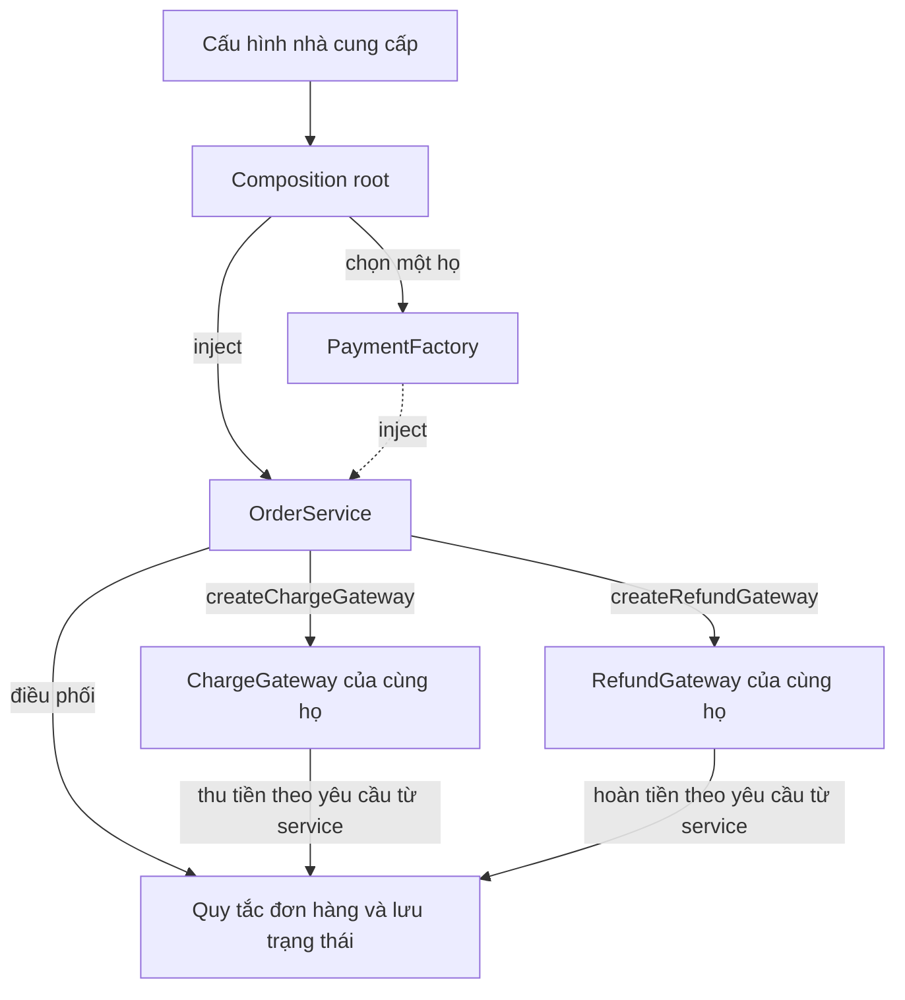
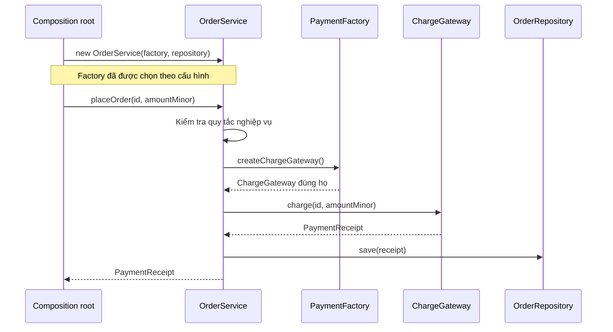

# Phân biệt trách nhiệm tạo sản phẩm với trách nhiệm điều phối nghiệp vụ

Trong **Abstract Factory**, client có thể yêu cầu nhiều loại sản phẩm thuộc cùng một họ mà không phụ thuộc vào lớp triển khai cụ thể. Tuy nhiên, một câu hỏi dễ gây nhầm lẫn là: **factory nên làm đến đâu, và phần điều phối quy trình nghiệp vụ phải nằm ở đâu?**

Ví dụ, một hệ thống thanh toán hỗ trợ hai nhà cung cấp ACME và NOVA. Mỗi nhà cung cấp cần một bộ xử lý **thu tiền** và **hoàn tiền** phù hợp với nhau. Abstract Factory có nhiệm vụ cung cấp hai sản phẩm cùng nhà cung cấp. Còn việc **kiểm tra đơn hàng, quyết định khi nào thu tiền, lưu kết quả và xử lý yêu cầu hủy** là công việc của lớp điều phối nghiệp vụ.

Phân chia này giúp luồng khởi tạo rõ ràng: **chọn một factory → yêu cầu sản phẩm phù hợp → thực thi quy trình nghiệp vụ bằng các sản phẩm đó**. Nó cũng giúp thay nhà cung cấp mà không phải viết lại trình tự xử lý đơn hàng.

## 1. Hai trách nhiệm khác nhau ở chỗ nào?

| Câu hỏi | Trách nhiệm **tạo sản phẩm** | Trách nhiệm **điều phối nghiệp vụ** |
| --- | --- | --- |
| Đối tượng trung tâm | Abstract Factory và concrete factory | Application service, use case hoặc workflow |
| Mục tiêu | Cung cấp **đúng loại** và **đúng họ** sản phẩm | Thực hiện **đúng thứ tự** và **đúng quy tắc nghiệp vụ** |
| Quyết định chính | Dùng triển khai ACME hay NOVA? Đưa cấu hình nào vào adapter? | Đơn có hợp lệ không? Khi nào thu tiền, hoàn tiền, lưu trạng thái? |
| Biết những gì? | Các interface sản phẩm, cấu hình cần để khởi tạo và cách lắp ghép chúng | Quy tắc nghiệp vụ và các interface mà quy trình cần gọi |
| Trả về | Đối tượng sản phẩm, có thể đã được cấu hình | Kết quả tác vụ, trạng thái nghiệp vụ hoặc lỗi |
| Thay đổi điển hình | Bổ sung nhà cung cấp, loại adapter hoặc cách tạo adapter | Bổ sung điều kiện hủy, chính sách hoàn tiền hoặc thứ tự bước xử lý |
| Điều cần tránh | Thực hiện trọn quy trình đặt hàng bên trong `createChargeGateway()` | Viết `new AcmeChargeGateway()` ở giữa logic xử lý đơn hàng |

Một concrete factory **được phép thực hiện các bước kỹ thuật cần thiết để tạo sản phẩm**, chẳng hạn kiểm tra cấu hình, gắn dependency, khởi tạo client hoặc lấy đối tượng từ pool. Ranh giới không dựa vào việc factory “có logic hay không”, mà dựa vào **bản chất của logic**: tạo và cấu hình sản phẩm là trách nhiệm của factory; đưa ra quyết định nghiệp vụ và điều phối nhiều thao tác thuộc trách nhiệm của lớp điều phối.

Ví dụ:

- `PaymentFactory.createChargeGateway()` tạo adapter thu tiền theo nhà cung cấp đã chọn: **tạo sản phẩm**.
- `OrderService.placeOrder()` xác minh số tiền, gọi adapter để thu, rồi ghi nhận đơn hàng: **điều phối nghiệp vụ**.
- `OrderService.cancelOrder()` tìm giao dịch đã thu, gọi adapter hoàn tiền và cập nhật trạng thái nếu thành công: **điều phối nghiệp vụ**.
- `PaymentFactory.createRefundGateway()` tạo adapter hoàn tiền cùng họ: **tạo sản phẩm**.

## 2. Đọc một luồng khởi tạo theo đúng thứ tự

Giả sử ứng dụng chọn ACME khi khởi động một phiên thanh toán. Luồng phù hợp có thể diễn ra như sau:

1. **Điểm lắp ghép đối tượng (*composition root*)** đọc cấu hình và chọn `AcmePaymentFactory`.
2. Điểm lắp ghép truyền factory vào `OrderService` qua constructor.
3. Khi người dùng đặt hàng, `OrderService` kiểm tra đầu vào và điều kiện nghiệp vụ.
4. `OrderService` gọi `factory.createChargeGateway()` để lấy sản phẩm thu tiền.
5. Concrete factory trả về `AcmeChargeGateway`. Service gọi `charge(...)` và xử lý kết quả.
6. Khi cần hủy đơn, service lấy chứng từ thanh toán đã lưu, gọi `factory.createRefundGateway()` rồi gọi `refund(...)` theo chính sách nghiệp vụ.



Điểm quan trọng là **client có thể yêu cầu sản phẩm ở thời điểm thật sự cần sử dụng**. Abstract Factory không bắt buộc phải tạo toàn bộ sản phẩm ngay khi factory được chọn. Cách tạo chủ động, tạo lười (*lazy*), chia sẻ instance hoặc tạo mới mỗi lần phụ thuộc vào hợp đồng và vòng đời của từng sản phẩm.

### Sơ đồ tương tác của thao tác đặt hàng



Sơ đồ cho thấy factory **chỉ tham gia vào đoạn tạo adapter**. Nó không quyết định đơn hàng có hợp lệ hay khi nào lưu trạng thái. Ngược lại, service biết cần gọi `charge()` nhưng không biết tên lớp adapter cụ thể.

## 3. Xác định một họ sản phẩm trước khi viết code

Ta dùng hai loại sản phẩm trừu tượng:

| Vai trò | Interface | ACME | NOVA |
| --- | --- | --- | --- |
| Thu tiền | `ChargeGateway` | `AcmeChargeGateway` | `NovaChargeGateway` |
| Hoàn tiền | `RefundGateway` | `AcmeRefundGateway` | `NovaRefundGateway` |

Hai sản phẩm phải cùng nhà cung cấp vì **chứng từ do adapter thu tiền tạo ra chỉ được adapter hoàn tiền tương ứng chấp nhận** trong ví dụ này.

Từ ma trận trên suy ra:

```java
interface PaymentFactory {
    ChargeGateway createChargeGateway();
    RefundGateway createRefundGateway();
}
```

Đây là **hợp đồng khởi tạo**. Nó không chứa phương thức `placeOrder()`, `cancelOrder()` hay `approveRefund()` vì những thao tác đó mô tả **quy trình nghiệp vụ**, không mô tả loại sản phẩm cần được tạo.

### Tại sao không đưa toàn bộ nghiệp vụ vào factory?

Hãy tưởng tượng một factory có phương thức `placeOrderAndCharge(...)`, tự kiểm tra giỏ hàng, tính khuyến mãi, thu tiền và cập nhật database. Khi có yêu cầu thay chính sách tính khuyến mãi, factory phải thay đổi dù **cách tạo hai adapter thanh toán không đổi**. Khi thêm nhà cung cấp mới, mỗi concrete factory còn dễ phải lặp lại quy trình đặt hàng.

Cách tổ chức đó làm lẫn **hai lý do thay đổi**: thêm/sửa *họ sản phẩm* và thêm/sửa *quy tắc nghiệp vụ*. Một application service tách riêng giúp giữ quy trình nghiệp vụ chung và chỉ thay adapter thông qua factory.

## 4. Ví dụ Java hoàn chỉnh: factory tạo, service điều phối

Chương trình sau mô phỏng ACME/NOVA bằng các lớp trong bộ nhớ. Nó cho thấy **một lượt đặt hàng và một lượt hủy**. Không có yêu cầu mạng hay kết nối hệ thống thanh toán thật; việc in thông báo chỉ để quan sát thứ tự gọi.

Ví dụ sử dụng `long amountMinor` cho số tiền ở **đơn vị nhỏ nhất**, tránh dùng số thực trong minh họa. `PaymentReceipt` giữ nhà cung cấp đã thực hiện thu tiền để gateway hoàn tiền kiểm tra tính tương thích.

```java
import java.util.HashMap;
import java.util.Map;
import java.util.Objects;

public class CreationFlowDemo {
    enum Provider { ACME, NOVA }

    // Dữ liệu nghiệp vụ được lưu sau khi thu tiền thành công.
    static final class PaymentReceipt {
        final Provider provider;
        final String orderId;
        final long amountMinor;

        PaymentReceipt(Provider provider, String orderId, long amountMinor) {
            this.provider = Objects.requireNonNull(provider);
            this.orderId = Objects.requireNonNull(orderId);
            this.amountMinor = amountMinor;
        }
    }

    // Abstract products: cách service sử dụng adapter.
    interface ChargeGateway {
        PaymentReceipt charge(String orderId, long amountMinor);
    }

    interface RefundGateway {
        void refund(PaymentReceipt receipt);
    }

    // Abstract Factory: chỉ quy định cách tạo hai sản phẩm.
    interface PaymentFactory {
        ChargeGateway createChargeGateway();
        RefundGateway createRefundGateway();
    }

    // Các sản phẩm thuộc họ ACME.
    static final class AcmeChargeGateway implements ChargeGateway {
        public PaymentReceipt charge(String orderId, long amountMinor) {
            System.out.println("ACME thu " + amountMinor);
            return new PaymentReceipt(Provider.ACME, orderId, amountMinor);
        }
    }

    static final class AcmeRefundGateway implements RefundGateway {
        public void refund(PaymentReceipt receipt) {
            requireProvider(receipt, Provider.ACME);
            System.out.println("ACME hoàn " + receipt.amountMinor);
        }
    }

    // Các sản phẩm thuộc họ NOVA.
    static final class NovaChargeGateway implements ChargeGateway {
        public PaymentReceipt charge(String orderId, long amountMinor) {
            System.out.println("NOVA thu " + amountMinor);
            return new PaymentReceipt(Provider.NOVA, orderId, amountMinor);
        }
    }

    static final class NovaRefundGateway implements RefundGateway {
        public void refund(PaymentReceipt receipt) {
            requireProvider(receipt, Provider.NOVA);
            System.out.println("NOVA hoàn " + receipt.amountMinor);
        }
    }

    static void requireProvider(
            PaymentReceipt receipt, Provider expected) {
        if (receipt == null || receipt.provider != expected) {
            throw new IllegalArgumentException(
                    "Chứng từ không thuộc nhà cung cấp " + expected);
        }
    }

    // Concrete factories: mỗi lớp cung cấp một cột của ma trận.
    static final class AcmePaymentFactory implements PaymentFactory {
        public ChargeGateway createChargeGateway() {
            return new AcmeChargeGateway();
        }

        public RefundGateway createRefundGateway() {
            return new AcmeRefundGateway();
        }
    }

    static final class NovaPaymentFactory implements PaymentFactory {
        public ChargeGateway createChargeGateway() {
            return new NovaChargeGateway();
        }

        public RefundGateway createRefundGateway() {
            return new NovaRefundGateway();
        }
    }

    // Lưu trữ đơn hàng là một dependency khác, độc lập với họ payment.
    interface OrderRepository {
        PaymentReceipt find(String orderId);
        void save(PaymentReceipt receipt);
        void remove(String orderId);
    }

    static final class InMemoryOrderRepository implements OrderRepository {
        private final Map<String, PaymentReceipt> receipts = new HashMap<>();

        public PaymentReceipt find(String orderId) {
            return receipts.get(orderId);
        }

        public void save(PaymentReceipt receipt) {
            receipts.put(receipt.orderId, receipt);
        }

        public void remove(String orderId) {
            receipts.remove(orderId);
        }
    }

    // Điều phối nghiệp vụ: phụ thuộc interface, không biết tên adapter cụ thể.
    static final class OrderService {
        private final PaymentFactory factory;
        private final OrderRepository repository;

        OrderService(PaymentFactory factory, OrderRepository repository) {
            this.factory = Objects.requireNonNull(factory);
            this.repository = Objects.requireNonNull(repository);
        }

        PaymentReceipt placeOrder(String orderId, long amountMinor) {
            // Quy tắc nghiệp vụ nằm ở service.
            if (orderId == null || orderId.trim().isEmpty()) {
                throw new IllegalArgumentException("Thiếu mã đơn");
            }
            if (amountMinor <= 0) {
                throw new IllegalArgumentException("Số tiền phải dương");
            }
            if (repository.find(orderId) != null) {
                throw new IllegalStateException("Đơn đã được ghi nhận");
            }

            // Factory chỉ tạo adapter; service quyết định khi nào gọi.
            ChargeGateway charge = factory.createChargeGateway();
            PaymentReceipt receipt = charge.charge(orderId, amountMinor);

            repository.save(receipt);
            System.out.println("Đã lưu đơn " + orderId);
            return receipt;
        }

        void cancelOrder(String orderId) {
            // Quy tắc: chỉ được hủy đơn đã có chứng từ.
            PaymentReceipt receipt = repository.find(orderId);
            if (receipt == null) {
                throw new IllegalStateException("Không tìm thấy đơn");
            }

            RefundGateway refund = factory.createRefundGateway();
            refund.refund(receipt);

            // Chỉ xóa khi lời gọi refund kết thúc thành công.
            repository.remove(orderId);
            System.out.println("Đã hủy đơn " + orderId);
        }
    }

    // Composition root: nơi duy nhất ví dụ biết các concrete factory.
    static PaymentFactory selectPaymentFactory(String providerCode) {
        if ("ACME".equalsIgnoreCase(providerCode)) {
            return new AcmePaymentFactory();
        }
        if ("NOVA".equalsIgnoreCase(providerCode)) {
            return new NovaPaymentFactory();
        }
        throw new IllegalArgumentException(
                "Không hỗ trợ nhà cung cấp: " + providerCode);
    }

    public static void main(String[] args) {
        String providerCode = args.length == 0 ? "ACME" : args[0];
        PaymentFactory factory = selectPaymentFactory(providerCode);
        OrderRepository repository = new InMemoryOrderRepository();
        OrderService orders = new OrderService(factory, repository);

        orders.placeOrder("ORDER-001", 125_000L);
        orders.cancelOrder("ORDER-001");
    }
}
```

Lưu vào `CreationFlowDemo.java` rồi chạy với JDK:

```bash
javac -encoding UTF-8 CreationFlowDemo.java
java CreationFlowDemo
```

Kết quả minh họa với ACME:

```text
ACME thu 125000
Đã lưu đơn ORDER-001
ACME hoàn 125000
Đã hủy đơn ORDER-001
```

Chạy `java CreationFlowDemo NOVA` để thay toàn bộ cặp xử lý thu/hoàn tiền sang NOVA. **Không cần thay một dòng nào trong `OrderService`**.

Các điểm đáng quan sát:

1. **Lựa chọn họ** diễn ra tại `selectPaymentFactory(...)`, trước khi service thực hiện nghiệp vụ.
2. **Concrete factory** chỉ tạo `ChargeGateway` và `RefundGateway` đúng nhà cung cấp.
3. **OrderService** kiểm tra mã đơn, số tiền và sự tồn tại của đơn trước khi gọi sản phẩm.
4. **OrderService** quyết định thứ tự **thu tiền → lưu chứng từ** và **hoàn tiền → cập nhật trạng thái**.
5. **OrderRepository** là dependency độc lập; không có lý do đưa nó vào `PaymentFactory` nếu lựa chọn nhà cung cấp thanh toán không làm thay đổi loại repository.

**Giới hạn của ví dụ:** bộ nhớ `HashMap` chỉ để minh họa, không phải lưu trữ bền vững hoặc an toàn đồng thời. Các lời gọi thanh toán giả lập không thực hiện giao dịch mạng. Trong hệ thống thật, việc thanh toán thành công nhưng lưu đơn thất bại cần cơ chế phục hồi hoặc đối soát; không thể xem ba câu lệnh liên tiếp là một giao dịch nguyên tử.

## 5. Điều gì xảy ra khi đưa nhầm nghiệp vụ vào factory?

Xét một thiết kế mang nhiều trách nhiệm:

```java
// Minh họa hướng thiết kế dễ gây lẫn trách nhiệm.
interface OverloadedPaymentFactory {
    PaymentReceipt placeOrderAndCharge(
            String orderId, long amountMinor);
    void cancelOrderAndRefund(String orderId);
}
```

Nếu concrete factory ACME/NOVA cùng phải kiểm tra số tiền, truy vấn đơn, thu tiền, lưu trạng thái và áp dụng chính sách hủy, logic nghiệp vụ sẽ bị **sao chép giữa các nhà cung cấp**. Khi thêm luật “chỉ hủy trong vòng 24 giờ”, ta có nguy cơ sửa nhiều factory và nhận hành vi khác nhau ngoài ý muốn.

Trong thiết kế có phân tách trách nhiệm:

- **Thay nhà cung cấp:** thêm concrete factory và các adapter phù hợp; `OrderService` tiếp tục điều phối bằng interface cũ.
- **Thay điều kiện hủy:** sửa chính sách trong `OrderService` hoặc một policy component mà service dùng; không cần sửa phương thức tạo sản phẩm.
- **Thay cách khởi tạo adapter:** factory có thể chuyển từ `new` sang DI, prototype hoặc pool mà không đổi quy trình đặt hàng.

Sự phân tách này gắn với **Single Responsibility Principle**: mỗi thành phần nên có lý do thay đổi chủ đạo và rõ ràng. Đây là nguyên tắc định hướng, không đồng nghĩa với việc mỗi class chỉ được có một phương thức.

## 6. Điều gì xảy ra khi service tự tạo lớp cụ thể?

Một cách làm khác cũng dễ gây phụ thuộc quá mức:

```java
// Ví dụ minh họa anti-pattern trong tầng điều phối:
// if (provider.equals("ACME")) {
//     charge = new AcmeChargeGateway();
// } else {
//     charge = new NovaChargeGateway();
// }
// ... chạy nghiệp vụ ...
// if (provider.equals("ACME")) {
//     refund = new AcmeRefundGateway();
// } else {
//     refund = new NovaRefundGateway();
// }
```

Tầng điều phối vừa phải biết tên lớp concrete vừa có nguy cơ chọn sai họ ở hai chỗ. Khi thêm NOVA hoặc nhà cung cấp thứ ba, phải sửa logic xử lý đơn. Khi kiểm thử service, ta cũng khó thay adapter bằng giả lập theo interface.

Thay vào đó, **chọn một factory tại điểm cấu hình** rồi inject vào service. Các phương thức điều phối gọi `createChargeGateway()`, `createRefundGateway()` mà không phân nhánh theo tên nhà cung cấp.

### Một factory nhưng có nhiều phương thức tạo thì có phải điều phối không?

Không. Abstract Factory vốn có thể khai báo nhiều phương thức tạo sản phẩm. Việc một factory cung cấp cả `createChargeGateway()` và `createRefundGateway()` **không có nghĩa** nó đang điều phối quy trình thu rồi hoàn tiền. Chỉ khi nó tự quyết định **khi nào thực hiện từng hành động nghiệp vụ**, quy tắc điều kiện và cập nhật trạng thái, trách nhiệm mới bị trộn.

Một concrete factory cũng có thể cần tạo các dependency theo thứ tự kỹ thuật, ví dụ tạo client HTTP trước rồi đưa client đó vào adapter. Đó là **lắp ghép sản phẩm**, không phải điều phối quy trình đơn hàng.

## 7. Phạm vi sống của factory và trạng thái nghiệp vụ

Không có quy tắc bắt buộc mỗi request phải tạo mới factory hoặc mỗi ứng dụng phải có một singleton factory. Phạm vi lựa chọn factory cần bám vào **phạm vi mà các sản phẩm phải tương thích**:

| Bối cảnh | Phạm vi chọn factory phù hợp | Lưu ý |
| --- | --- | --- |
| Một hệ thống chỉ dùng ACME | Chọn khi lắp ghép ứng dụng | Có thể tái sử dụng factory nếu nó an toàn và cấu hình không đổi |
| Các tenant dùng nhà cung cấp khác nhau | Chọn theo tenant hoặc request | Không ghi đè một biến factory dùng chung khi nhiều request đang chạy |
| Một đơn hàng phải thu/hoàn qua cùng provider | Lưu provider trong chứng từ và dùng đúng họ lúc hoàn | Không đọc lại “provider mặc định hiện tại” nếu nó đã thay đổi |
| Factory giữ connection pool hoặc HTTP client dùng chung | Gắn với vòng đời của chủ sở hữu tài nguyên | Xác định rõ ai đóng factory và khi nào |
| Adapter có trạng thái theo giao dịch | Tạo hoặc quản lý adapter theo scope giao dịch | Không chia sẻ bừa một instance mutable giữa các giao dịch |

Trong chương trình ví dụ, `OrderService` dùng **cùng factory** khi đặt và hủy một đơn. Trong hệ thống thực, yêu cầu hủy có thể diễn ra sau nhiều ngày, khi cấu hình nhà cung cấp mặc định đã đổi. Vì vậy, **chứng từ phải giữ nhà cung cấp đã thu tiền**, và điểm lắp ghép của luồng hủy phải chọn factory phù hợp dựa trên thông tin đã lưu. Đây là quyết định về **ngữ cảnh công việc**, không phải lý do để nhét toàn bộ quy trình hoàn tiền vào factory.

## 8. Tạo thành công chưa đủ: ai xử lý lỗi và trạng thái?

Abstract Factory cung cấp sản phẩm đúng họ nhưng **không thay service quyết định cách xử lý lỗi nghiệp vụ**. Trong ví dụ:

| Tình huống | Bên xử lý chính | Lý do |
| --- | --- | --- |
| Không tìm thấy cấu hình adapter hoặc thiếu thông tin xác thực khi tạo | Concrete factory / thành phần cấu hình | Vấn đề thuộc việc cung cấp sản phẩm sẵn sàng sử dụng |
| Mã đơn trống, số tiền không hợp lệ | `OrderService` hoặc domain rule | Là quy tắc của tác vụ đặt hàng |
| Adapter trả lỗi thu tiền | Gateway biểu diễn lỗi tích hợp; service quyết định bước tiếp theo | Adapter biết chi tiết giao thức, service biết trạng thái đơn |
| Thu tiền thành công nhưng lưu đơn thất bại | Orchestrator / cơ chế phục hồi của ứng dụng | Cần đối soát, bù trừ, retry có kiểm soát hoặc xử lý giao dịch phân tán |
| Hoàn tiền thất bại | Gateway mô tả lỗi; service giữ trạng thái và quyết định retry/đối soát | Không thể tự coi đơn đã hủy thành công |
| Hai adapter được tạo từ hai họ khác nhau | Concrete factory và kiểm thử hợp đồng | Factory phải đáp ứng quy ước tương thích của họ |

Đặc biệt, **không nên tự động hoàn tiền ở mọi khối `catch`** nếu không biết trạng thái cuối cùng của lời gọi thu tiền. Trong hệ thống thanh toán thật, timeout có thể xảy ra sau khi nhà cung cấp đã xử lý giao dịch. Service cần một quy trình đáng tin cậy với **idempotency key**, truy vấn trạng thái, cơ chế đối soát hoặc bù trừ tùy đặc tả của nhà cung cấp.

Một thiết kế có thể phân công như sau: gateway chuyển lỗi giao thức thành lỗi tích hợp có cấu trúc; service quyết định trạng thái đơn và chính sách retry; repository ghi lại trạng thái; job đối soát xử lý kết quả chưa chắc chắn. Factory chỉ chịu trách nhiệm tạo các gateway với cấu hình nhất quán.

## 9. Kiểm thử từng trách nhiệm theo cách khác nhau

Vì factory và service có mục tiêu khác nhau, **bài kiểm thử cũng cần tập trung vào các hợp đồng khác nhau**.

### Kiểm thử factory và họ sản phẩm

Với mỗi concrete factory, xác minh:

1. `createChargeGateway()` và `createRefundGateway()` trả về đối tượng đáp ứng các interface yêu cầu.
2. Các sản phẩm cùng factory dùng đúng ngữ cảnh cấu hình: nhà cung cấp, môi trường, merchant account hoặc phiên bản giao thức.
3. Hai sản phẩm tương tác đúng: chứng từ do gateway thu tiền tạo ra được gateway hoàn tiền **cùng họ** chấp nhận.
4. Các tình huống trộn sai họ bị phát hiện hoặc có quy tắc chuyển đổi rõ ràng nếu nghiệp vụ thực sự hỗ trợ.

Với chương trình `CreationFlowDemo`, có thể thử một trường hợp sai họ:

```java
// Minh họa đoạn kiểm tra có thể đặt trong một method của CreationFlowDemo.
PaymentReceipt fromAcme =
        new AcmeChargeGateway().charge("DEMO", 100L);

try {
    new NovaRefundGateway().refund(fromAcme);
    throw new AssertionError("Đã chấp nhận chứng từ sai provider");
} catch (IllegalArgumentException expected) {
    // Hợp đồng của ví dụ: NOVA từ chối chứng từ ACME.
}
```

### Kiểm thử `OrderService`

Đối với service, có thể thay factory và repository bằng **test double** để kiểm tra thứ tự gọi và điều kiện nghiệp vụ:

- Mã đơn và số tiền không hợp lệ phải bị từ chối **trước khi gọi thu tiền**.
- Nếu thu tiền thất bại, service không ghi nhận đơn là đã thanh toán.
- Nếu hoàn tiền thất bại, service không xóa trạng thái còn cần để xử lý tiếp.
- Khi đặt và hủy thành công, service gọi đúng gateway và repository theo thứ tự đã thiết kế.
- Thay `AcmePaymentFactory` bằng `NovaPaymentFactory` không làm thay đổi mã `OrderService`.

Những test service này **không thay thế** test tích hợp cặp gateway thật. Test double kiểm tra **luồng điều phối**, còn kiểm thử sản phẩm thật kiểm tra **tính tương thích và cách tích hợp**.

## 10. Những nhầm lẫn dễ gặp

**“Factory tạo được sản phẩm thì nên tự gọi luôn phương thức nghiệp vụ.”** Việc factory tạo một `ChargeGateway` không đồng nghĩa nó nên tự thu tiền. Thao tác thu tiền cần được thực hiện khi workflow đã thỏa điều kiện nghiệp vụ.

**“Mọi `new` đều phải nằm trong Abstract Factory.”** Không nhất thiết. DTO, value object hoặc các dependency độc lập có thể được tạo theo cách phù hợp với bối cảnh. Abstract Factory đặc biệt hữu ích khi **nhiều loại sản phẩm phải được chọn nhất quán theo một họ**.

**“Điều phối nghiệp vụ chỉ là nối các lời gọi nên có thể đặt ở bất kỳ đâu.”** Thứ tự, điều kiện, lỗi, retry và cập nhật trạng thái là phần cốt lõi của một use case. Đặt nó trong factory làm thay đổi trọng tâm và khiến việc bảo trì khó hơn.

**“Dùng Abstract Factory sẽ tự xử lý lỗi transaction.”** Không. Factory tạo các adapter phù hợp; giao dịch, bù trừ, idempotency và đối soát là những vấn đề riêng cần được giải quyết theo hợp đồng của hệ thống.

**“Factory phải tạo mọi sản phẩm cùng lúc.”** Không. Các phương thức tạo có thể được gọi khi cần. Tuy nhiên, nếu sản phẩm cùng một giao dịch phụ thuộc cấu hình hoặc session chung, factory phải giữ nhất quán ngữ cảnh ấy.

**“Cùng loại factory thì mọi instance luôn tương thích.”** Chưa chắc. Hai factory cùng class nhưng khác tài khoản merchant, môi trường sandbox/production hoặc thông tin phiên vẫn có thể tạo sản phẩm không thể phối hợp. Cần định nghĩa đúng phạm vi cấu hình.

## 11. Bài tập vận dụng

Một ứng dụng hỗ trợ xuất báo cáo qua hai nhà cung cấp lưu trữ **Cloud A** và **Cloud B**. Mỗi nhà cung cấp cần một `FileUploader` và `ShareLinkGenerator` có khả năng làm việc trên cùng hệ thống lưu trữ. Quy trình nghiệp vụ yêu cầu kiểm tra quyền xuất báo cáo, sinh nội dung, tải file lên, lấy đường dẫn chia sẻ và ghi nhật ký.

Hãy xác định:

1. **Những loại sản phẩm** nào nên nằm trong `StorageFactory` và tại sao chúng phải cùng họ?
2. Các bước **kiểm tra quyền, sinh báo cáo, tải file, tạo link và ghi nhật ký** nên thuộc trách nhiệm của thành phần nào?
3. Tại sao `StorageFactory.createUploader()` không nên tự động kiểm tra quyền người dùng và ghi nhật ký xuất báo cáo?
4. Khi tải file thành công nhưng tạo link thất bại, thành phần nào quyết định retry, xóa file hoặc đánh dấu báo cáo cần xử lý tiếp?
5. Nếu một báo cáo đã tải lên Cloud A nhưng cấu hình mặc định đổi sang Cloud B, quá trình tạo lại link nên dựa vào thông tin nào?

**Hướng giải:** `StorageFactory` cung cấp `createUploader()` và `createShareLinkGenerator()` cùng provider; một `ExportReportService` điều phối điều kiện nghiệp vụ, thứ tự tải file, tạo link và cập nhật trạng thái. Kết quả upload cần lưu **provider và định danh file** để lần xử lý tiếp theo chọn đúng họ, ngay cả khi cấu hình mặc định đã thay đổi. Việc phục hồi lỗi thuộc workflow, còn mỗi adapter chịu trách nhiệm giao tiếp với provider cụ thể.

## Tổng kết

Trong Abstract Factory, **tạo sản phẩm** và **điều phối nghiệp vụ** là hai trách nhiệm liên quan nhưng khác nhau. Abstract Factory cung cấp các sản phẩm **đúng loại, đúng họ và đúng cấu hình**; application service quyết định **khi nào dùng sản phẩm, theo thứ tự nào, với điều kiện nghiệp vụ nào và xử lý kết quả ra sao**.

Luồng khởi tạo rõ ràng thường đi từ **composition root chọn concrete factory**, tới **service nhận factory qua abstraction**, rồi **service tạo và sử dụng sản phẩm trong từng bước nghiệp vụ**. Khi giữ được ranh giới đó, việc bổ sung một họ sản phẩm mới chủ yếu tác động đến phần khởi tạo và adapter, còn thay đổi quy trình nghiệp vụ tập trung ở lớp điều phối; cả hai có thể được kiểm thử riêng bằng những hợp đồng phù hợp.
