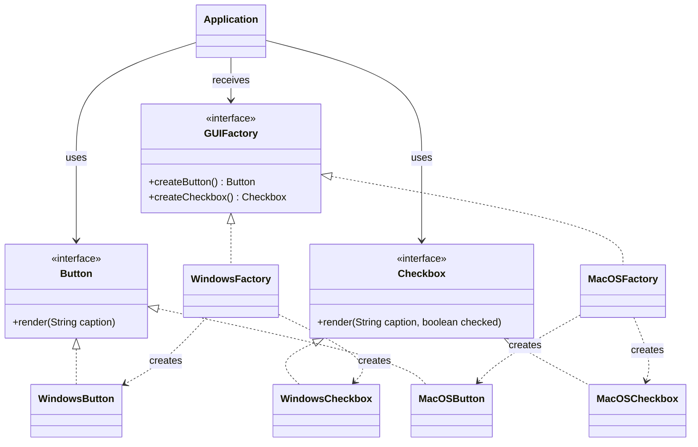
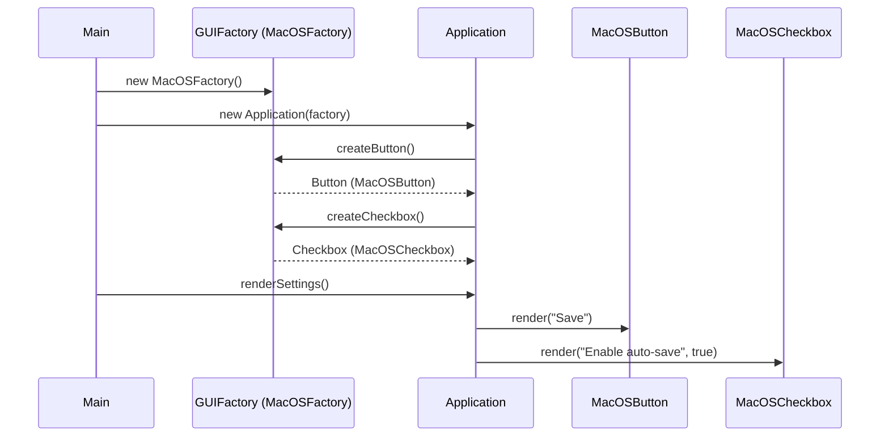

# Xây dựng ví dụ xuyên suốt với `GUIFactory`, `Button` và `Checkbox`

## 1. Bài toán: nhiều giao diện, cùng một bộ thành phần

Giả sử chúng ta đang xây dựng một ứng dụng Java chạy trên **Windows** và **macOS**. Màn hình cài đặt của ứng dụng có hai thành phần:

- `Button`: nút **Save** để lưu cài đặt.
- `Checkbox`: ô chọn **Enable auto-save** để bật tính năng tự động lưu.

Hai nền tảng đều cần nút và ô chọn, nhưng mỗi nền tảng có quy tắc hiển thị riêng. Nếu tạo từng thành phần một cách tùy ý, chương trình có thể vô tình dùng nút kiểu Windows với ô chọn kiểu macOS, tạo nên giao diện thiếu nhất quán.

**Abstract Factory** giải quyết bài toán này bằng cách đặt việc tạo ra **cả một họ sản phẩm liên quan** sau một giao diện nhà máy thống nhất. Trong ví dụ này:

| Vai trò trong mẫu thiết kế | Thành phần Java | Trách nhiệm |
| --- | --- | --- |
| Abstract Product | `Button`, `Checkbox` | Khai báo các thao tác mà ứng dụng sử dụng, không phụ thuộc nền tảng. |
| Concrete Product | `WindowsButton`, `WindowsCheckbox` | Cài đặt thành phần thuộc họ Windows. |
| Concrete Product | `MacOSButton`, `MacOSCheckbox` | Cài đặt thành phần thuộc họ macOS. |
| Abstract Factory | `GUIFactory` | Khai báo các phương thức tạo từng loại sản phẩm. |
| Concrete Factory | `WindowsFactory`, `MacOSFactory` | Tạo trọn bộ sản phẩm của một nền tảng. |
| Client | `Application` | Chỉ làm việc với `GUIFactory`, `Button` và `Checkbox`. |
| Composition Root | `Main` | Chọn nhà máy phù hợp với cấu hình lúc chạy. |

> **Phạm vi mô phỏng:** Ví dụ dùng `System.out.println` để biểu diễn khác biệt về phong cách giao diện. Đây là mô hình minh họa cách tổ chức mã Java, **không tạo cửa sổ GUI thật**. Khi dùng Swing, JavaFX hay thư viện UI khác, phần hiện thực `render` sẽ được thay bằng mã xây dựng thành phần đồ họa tương ứng; cấu trúc Abstract Factory vẫn giữ nguyên.

## 2. Sơ đồ các thành phần



Điểm cốt lõi nằm ở cặp phương thức `createButton()` và `createCheckbox()`: chúng thuộc **cùng một `GUIFactory`**. Mỗi nhà máy cụ thể chịu trách nhiệm cung cấp hai sản phẩm tương thích về mặt giao diện.

## 3. Triển khai Java hoàn chỉnh

Để có thể sao chép và chạy ngay, toàn bộ mã dưới đây được đặt trong **một tệp `Main.java`**. Java chỉ cho phép một lớp `public` cấp cao nhất trong tệp này; các interface và lớp còn lại dùng phạm vi truy cập mặc định. Trong dự án thực tế, có thể tách mỗi kiểu ra một tệp riêng và đặt chúng trong các package phù hợp.

```java
// Main.java

// 1. Hai Abstract Product: ứng dụng chỉ biết những hợp đồng này.
interface Button {
    void render(String caption);
}

interface Checkbox {
    void render(String caption, boolean checked);
}

// 2. Abstract Factory: định nghĩa một họ sản phẩm GUI.
interface GUIFactory {
    Button createButton();

    Checkbox createCheckbox();
}

// 3. Họ sản phẩm Windows.
final class WindowsButton implements Button {
    @Override
    public void render(String caption) {
        System.out.println("Windows | Button   | [ " + caption + " ]");
    }
}

final class WindowsCheckbox implements Checkbox {
    @Override
    public void render(String caption, boolean checked) {
        System.out.println("Windows | Checkbox | [" + (checked ? "x" : " ") + "] " + caption);
    }
}

// 4. Họ sản phẩm macOS.
final class MacOSButton implements Button {
    @Override
    public void render(String caption) {
        System.out.println("macOS   | Button   | ( " + caption + " )");
    }
}

final class MacOSCheckbox implements Checkbox {
    @Override
    public void render(String caption, boolean checked) {
        System.out.println("macOS   | Checkbox | (" + (checked ? "x" : " ") + ") " + caption);
    }
}

// 5. Mỗi Concrete Factory chỉ tạo sản phẩm cùng một họ.
final class WindowsFactory implements GUIFactory {
    @Override
    public Button createButton() {
        return new WindowsButton();
    }

    @Override
    public Checkbox createCheckbox() {
        return new WindowsCheckbox();
    }
}

final class MacOSFactory implements GUIFactory {
    @Override
    public Button createButton() {
        return new MacOSButton();
    }

    @Override
    public Checkbox createCheckbox() {
        return new MacOSCheckbox();
    }
}

// 6. Client không cần biết WindowsButton hay MacOSCheckbox.
final class Application {
    private final Button saveButton;
    private final Checkbox autoSaveCheckbox;

    Application(GUIFactory factory) {
        this.saveButton = factory.createButton();
        this.autoSaveCheckbox = factory.createCheckbox();
    }

    void renderSettings() {
        saveButton.render("Save");
        autoSaveCheckbox.render("Enable auto-save", true);
    }
}

// 7. Điểm khởi chạy chọn họ GUI theo đối số dòng lệnh.
public class Main {
    public static void main(String[] args) {
        String platform = args.length > 0 ? args[0] : "windows";
        GUIFactory factory;

        if ("windows".equalsIgnoreCase(platform)) {
            factory = new WindowsFactory();
        } else if ("macos".equalsIgnoreCase(platform)) {
            factory = new MacOSFactory();
        } else {
            System.err.println("Unsupported platform: " + platform);
            System.err.println("Usage: java Main [windows|macos]");
            return;
        }

        Application application = new Application(factory);
        application.renderSettings();
    }
}
```

### Chạy thử

Cần cài **JDK** và có lệnh `javac`, `java` trong terminal. Lưu đoạn mã thành `Main.java`, mở terminal tại thư mục chứa tệp và thực hiện:

```bash
javac Main.java
java Main windows
```

Kết quả kỳ vọng:

```text
Windows | Button   | [ Save ]
Windows | Checkbox | [x] Enable auto-save
```

Chạy với họ macOS:

```bash
java Main macos
```

Kết quả kỳ vọng:

```text
macOS   | Button   | ( Save )
macOS   | Checkbox | (x) Enable auto-save
```

Nếu không truyền đối số, chương trình dùng mặc định `windows`. Đối số không hợp lệ, chẳng hạn `linux`, sẽ in hướng dẫn sử dụng và kết thúc; hiện tại ví dụ chưa cung cấp họ Linux.

## 4. Đọc luồng hoạt động từ `Main` đến sản phẩm

Khi gọi `java Main macos`, chương trình thực hiện lần lượt:

1. `Main` đọc cấu hình `macos` rồi khởi tạo **một** `MacOSFactory`.
2. `Main` truyền nhà máy này vào constructor của `Application` dưới kiểu `GUIFactory`.
3. `Application` gọi `factory.createButton()` và nhận một `MacOSButton`, nhưng giữ nó trong biến kiểu `Button`.
4. `Application` gọi `factory.createCheckbox()` và nhận một `MacOSCheckbox`, nhưng giữ nó trong biến kiểu `Checkbox`.
5. `renderSettings()` gọi các phương thức theo hợp đồng sản phẩm; Java tự phân phối lời gọi tới bản cài đặt macOS.



Hai chi tiết có ý nghĩa thiết kế:

- **Phụ thuộc vào abstraction:** `Application` khai báo các biến `Button`, `Checkbox` và nhận `GUIFactory`; không có lệnh `new WindowsButton()` hay `new MacOSCheckbox()` trong mã client. Việc chọn sản phẩm được chuyển ra biên của hệ thống (`Main`).
- **Nhất quán theo họ:** nếu nhận `WindowsFactory`, ứng dụng nhận cả `WindowsButton` lẫn `WindowsCheckbox`; nếu nhận `MacOSFactory`, cả hai đều thuộc họ macOS. Tính nhất quán này dựa trên việc các Concrete Factory cài đặt đúng hợp đồng: bản thân Java không ngăn người viết factory cố ý trả về sản phẩm sai họ.

`Application` đang lấy sản phẩm từ factory trong constructor để lưu dùng lâu dài. Một ứng dụng khác có thể lưu `GUIFactory` rồi gọi phương thức tạo sản phẩm khi cần thêm nút/ô chọn. Cả hai cách đều phù hợp nếu các đối tượng giữ đúng vòng đời cần thiết.

## 5. Tại sao cần `GUIFactory` thay vì tạo đối tượng trực tiếp?

Giả sử `Application` tự khởi tạo như sau:

```java
// Mã minh họa thiết kế phụ thuộc nền tảng, không thuộc ví dụ hoàn chỉnh.
Button button = new WindowsButton();
Checkbox checkbox = new MacOSCheckbox(); // Hai phong cách bị trộn.
```

Khi đó `Application` phải biết lớp cụ thể, tự lựa chọn nền tảng cho từng thành phần và dễ tạo ra một bộ GUI không đồng nhất. Khi có thêm các màn hình hoặc thêm kiểu nền tảng, các nhánh lựa chọn có thể xuất hiện ở nhiều nơi.

Với Abstract Factory, mỗi nhóm lớp sản phẩm liên quan nằm sau một factory. Chỉ điểm khởi chạy hoặc thành phần cấu hình cần chọn `WindowsFactory` hay `MacOSFactory`; phần nghiệp vụ hiển thị tiếp tục dùng chung một lớp `Application`.

Điều này khác với **Factory Method** ở trọng tâm thiết kế: Factory Method thường tập trung vào một phương thức tạo một loại sản phẩm, còn Abstract Factory mô tả **nhiều phương thức tạo các loại sản phẩm phối hợp thành một họ**. Trong ví dụ, cả `Button` và `Checkbox` phải thay đổi đồng bộ theo nền tảng.

## 6. Mở rộng và cái giá của sự linh hoạt

### Thêm họ sản phẩm Linux

Nếu ứng dụng cần hỗ trợ Linux, ta bổ sung `LinuxButton`, `LinuxCheckbox` cùng `LinuxFactory`:

```java
// Ví dụ mở rộng (cần các interface Button, Checkbox, GUIFactory ở trên).
final class LinuxButton implements Button {
    @Override
    public void render(String caption) {
        System.out.println("Linux   | Button   | < " + caption + " >");
    }
}

final class LinuxCheckbox implements Checkbox {
    @Override
    public void render(String caption, boolean checked) {
        System.out.println("Linux   | Checkbox | <" + (checked ? "x" : " ") + "> " + caption);
    }
}

final class LinuxFactory implements GUIFactory {
    @Override
    public Button createButton() {
        return new LinuxButton();
    }

    @Override
    public Checkbox createCheckbox() {
        return new LinuxCheckbox();
    }
}
```

Sau đó thêm lựa chọn `linux` vào đoạn chọn factory trong `Main`. **Không phải sửa `Application`**, vì ứng dụng vốn chỉ dùng các interface. Đây là điểm mạnh khi cần thêm **họ sản phẩm mới**.

### Thêm loại thành phần mới: `Slider`

Khi yêu cầu sản phẩm thay đổi theo chiều ngang, ví dụ mỗi nền tảng cần thêm `Slider`, phải mở rộng hợp đồng:

```java
interface Slider {
    void render(int value);
}

// Bổ sung vào GUIFactory hiện có:
// Slider createSlider();
```

Mọi factory hiện có (`WindowsFactory`, `MacOSFactory` và `LinuxFactory` nếu đã thêm) đều cần cài đặt `createSlider()` và một Concrete Product tương ứng. Với Java, nếu cập nhật `GUIFactory` mà bỏ sót bất kỳ lớp cài đặt nào, mã sẽ lỗi biên dịch. Đây là đánh đổi thường gặp: **thêm họ mới tương đối dễ, thêm loại sản phẩm mới cần sửa nhiều factory**.

## 7. Lưu ý khi áp dụng vào dự án thật

| Tình huống | Cách xử lý |
| --- | --- |
| Dự án có nhiều họ UI hoặc nhiều bộ sản phẩm cần dùng đồng bộ. | Tạo interface cho từng loại sản phẩm và factory cho từng họ. |
| Cần chọn giao diện theo cấu hình lúc chạy. | Chọn factory ở `Main`, bộ phận cấu hình hoặc nơi thiết lập phụ thuộc; truyền factory cho client qua constructor. |
| Cần kiểm thử client độc lập với lớp nền tảng. | Truyền một `GUIFactory` giả lập trả về `Button`/`Checkbox` giả lập để ghi nhận các lời gọi `render`. |
| Factory cài đặt nhầm sản phẩm khác họ. | Kiểm tra ánh xạ từng concrete factory; có thể bổ sung kiểm thử đảm bảo từng factory trả về đúng cặp sản phẩm. |
| Chỉ có một loại sản phẩm và không có ý nghĩa phối hợp theo họ. | Xem xét dùng constructor trực tiếp hoặc Factory Method để tránh tạo thêm cấu trúc không cần thiết. |
| Muốn thay đổi họ giao diện trong khi `Application` đang chạy. | Tạo một `Application` mới từ factory mới, hoặc thiết kế cơ chế thay thế lại các sản phẩm; vì ví dụ lưu sản phẩm từ constructor nên việc đổi biến factory bên ngoài không tự cập nhật UI đã tạo. |

Không nên hiểu Abstract Factory là cách tự động tạo ra giao diện đẹp hoặc bảo đảm toàn bộ các quy tắc giao diện bằng hệ thống kiểu. Mẫu này giúp **tổ chức và kiểm soát điểm tạo sản phẩm liên quan**, còn tính đúng đắn của từng factory, vòng đời đối tượng và chất lượng UI vẫn do phần hiện thực quyết định.

## 8. Tự kiểm tra hiểu biết

Hãy thử thực hiện ba thay đổi nhỏ trên ví dụ hoàn chỉnh:

1. Chạy `java Main windows` rồi `java Main macos`: xác nhận chỉ thay đổi factory được chọn nhưng `Application.renderSettings()` không đổi.
2. Chuyển giá trị `checked` từ `true` sang `false`: kiểm tra cả hai kiểu `Checkbox` vẫn dùng đúng ký hiệu trạng thái của họ mình.
3. Tạo `LinuxFactory` như phần mở rộng và thêm nhánh `linux` trong `Main`: kiểm tra nút và ô chọn cùng mang phong cách Linux.

Khi hiểu được vì sao `Application` không cần biết `WindowsButton` hay `MacOSCheckbox`, cũng như vì sao một factory phải tạo **đầy đủ cặp `Button`–`Checkbox`**, bạn đã nắm được cách triển khai Abstract Factory trong Java cho bài toán nhiều họ sản phẩm tương thích.
