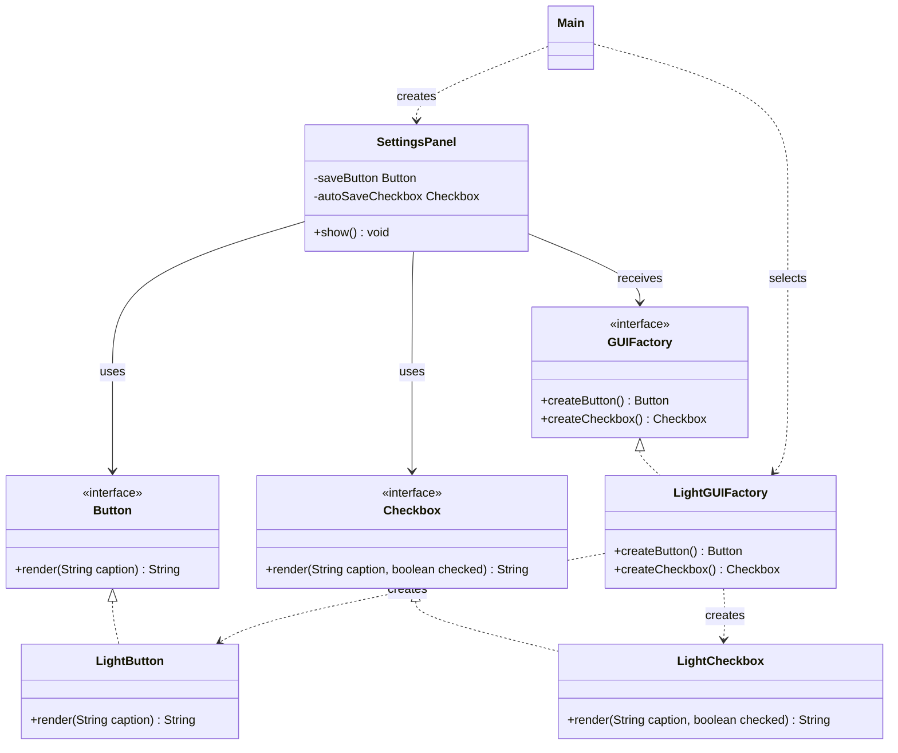
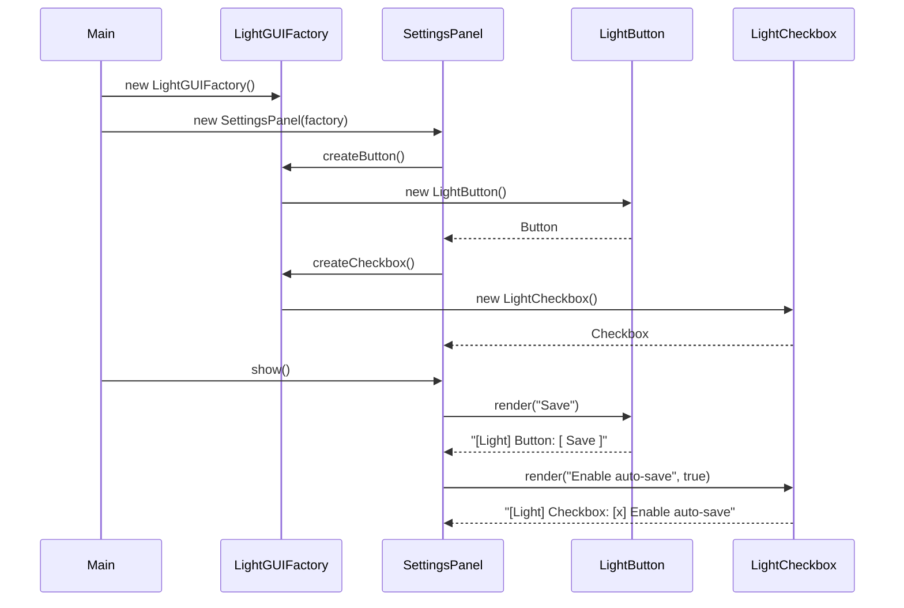

# Hiện thực họ LightButton và LightCheckbox cùng LightGUIFactory

## 1. Mục tiêu của bài thực hành

Trong mô-đun **Abstract Factory** thuộc nhóm *Creational Design Patterns*, một factory không chỉ tạo ra một đối tượng bất kỳ mà còn có thể cung cấp **nhiều loại sản phẩm có quan hệ với nhau**. Bài này triển khai một họ giao diện mang phong cách **Light** bằng Java, gồm:

- `LightButton`: nút bấm theo giao diện sáng.
- `LightCheckbox`: ô chọn theo giao diện sáng.
- `LightGUIFactory`: nhà máy tạo đồng thời được **cả hai loại sản phẩm** nói trên.

Mục tiêu không chỉ là viết các lớp trên cho đúng cú pháp Java. Người học cần hiểu vì sao `LightButton` và `LightCheckbox` được xem là **cùng một họ**, vai trò của các interface `Button`, `Checkbox` và `GUIFactory`, cũng như cách client sử dụng bộ sản phẩm này mà không trực tiếp khởi tạo các lớp Light.

Tình huống thực tế: một ứng dụng có màn hình cài đặt gồm nút `Save` và ô chọn `Enable auto-save`. Khi người dùng chọn giao diện sáng, **cả hai thành phần** phải dùng quy tắc hiển thị tương thích với Light theme.

> Ví dụ sử dụng chuỗi ký tự để mô phỏng việc vẽ UI và có thể chạy bằng JDK thuần. Đây **không phải cửa sổ Swing/JavaFX thực tế**. Nếu chuyển sang thư viện GUI thật, phần hiện thực của các product thay đổi nhưng ranh giới trách nhiệm của Abstract Factory vẫn tương tự.

## 2. Xác định các thành phần trong mẫu thiết kế

| Vai trò | Lớp/interface | Trách nhiệm |
| --- | --- | --- |
| **Abstract Product** | `Button` | Khai báo hành vi chung mà client cần để hiển thị nút. |
| **Abstract Product** | `Checkbox` | Khai báo hành vi chung mà client cần để hiển thị ô chọn. |
| **Concrete Product** | `LightButton` | Hiện thực `Button` theo phong cách Light. |
| **Concrete Product** | `LightCheckbox` | Hiện thực `Checkbox` theo phong cách Light. |
| **Abstract Factory** | `GUIFactory` | Khai báo các phương thức cấp `Button` và `Checkbox`. |
| **Concrete Factory** | `LightGUIFactory` | Cung cấp đúng cặp product thuộc họ Light. |
| **Client** | `SettingsPanel` | Yêu cầu sản phẩm qua `GUIFactory` và sử dụng qua interface. |
| **Composition root** | `Main` | Chọn concrete factory và truyền cho client. |

Sơ đồ quan hệ:



**Loại sản phẩm** và **họ sản phẩm** là hai khái niệm khác nhau:

- `LightButton` và một `DarkButton` *nếu được bổ sung sau này* thuộc cùng **loại** `Button`, nhưng thuộc hai **họ** khác nhau.
- `LightButton` và `LightCheckbox` thuộc cùng **họ Light**, dù chúng là hai loại product riêng biệt.

Đây là lý do factory khai báo **hai phương thức** `createButton()` và `createCheckbox()`: nó chịu trách nhiệm cấp **một tập sản phẩm liên quan** cho client.

## 3. Hiện thực đầy đủ bằng một tệp Java

Để có thể sao chép và chạy ngay, hãy tạo tệp `Main.java` với nội dung sau. Mã sử dụng Java cơ bản, không yêu cầu Maven, Gradle hoặc thư viện bên ngoài.

```java
// Main.java
import java.util.Objects;

// 1. Abstract Products: hợp đồng dùng chung cho các theme.
interface Button {
    String render(String caption);
}

interface Checkbox {
    String render(String caption, boolean checked);
}

// 2. Abstract Factory: tạo một họ gồm Button và Checkbox.
interface GUIFactory {
    Button createButton();

    Checkbox createCheckbox();
}

// 3. Concrete Product: nút bấm mang phong cách Light.
final class LightButton implements Button {
    @Override
    public String render(String caption) {
        return "[Light] Button: [ " + caption + " ]";
    }
}

// 4. Concrete Product: ô chọn mang phong cách Light.
final class LightCheckbox implements Checkbox {
    @Override
    public String render(String caption, boolean checked) {
        String mark = checked ? "x" : " ";
        return "[Light] Checkbox: [" + mark + "] " + caption;
    }
}

// 5. Concrete Factory: cấp đủ hai product thuộc cùng họ Light.
final class LightGUIFactory implements GUIFactory {
    @Override
    public Button createButton() {
        return new LightButton();
    }

    @Override
    public Checkbox createCheckbox() {
        return new LightCheckbox();
    }
}

// 6. Client: không phụ thuộc trực tiếp vào LightButton/LightCheckbox.
final class SettingsPanel {
    private final Button saveButton;
    private final Checkbox autoSaveCheckbox;

    SettingsPanel(GUIFactory factory) {
        Objects.requireNonNull(factory, "factory");
        this.saveButton = factory.createButton();
        this.autoSaveCheckbox = factory.createCheckbox();
    }

    void show() {
        System.out.println(saveButton.render("Save"));
        System.out.println(
                autoSaveCheckbox.render("Enable auto-save", true));
    }
}

// 7. Composition root: nơi ứng dụng chọn concrete factory.
public class Main {
    public static void main(String[] args) {
        GUIFactory factory = new LightGUIFactory();
        SettingsPanel panel = new SettingsPanel(factory);
        panel.show();
    }
}
```

### 3.1. Chạy chương trình

Cần có JDK với `javac` và `java`. Lưu mã vào `Main.java`, mở terminal trong thư mục chứa tệp và chạy:

```bash
javac Main.java
java Main
```

Kết quả mong đợi:

```text
[Light] Button: [ Save ]
[Light] Checkbox: [x] Enable auto-save
```

Chương trình chạy từ đầu đến cuối theo cách sau:

1. `Main` khởi tạo `LightGUIFactory` và giữ tham chiếu dưới kiểu `GUIFactory`.
2. `Main` truyền factory vào constructor của `SettingsPanel`.
3. `SettingsPanel` gọi `factory.createButton()` để nhận một đối tượng thực tế là `LightButton`.
4. `SettingsPanel` gọi `factory.createCheckbox()` để nhận một đối tượng thực tế là `LightCheckbox`.
5. `SettingsPanel.show()` gọi `render()` trên hai interface product; phương thức của các concrete product tạo chuỗi hiển thị Light.

Việc client dùng kiểu `Button` và `Checkbox` không làm “mất” phần hiện thực Light. Khi phương thức được gọi, Java thực thi implementation thích hợp trên đối tượng thực tế.

## 4. Đọc kỹ từng lớp Light

### 4.1. Vì sao `LightButton implements Button`?

`LightButton` hiện thực hợp đồng `Button`:

```java
interface Button {
    String render(String caption);
}

final class LightButton implements Button {
    @Override
    public String render(String caption) {
        return "[Light] Button: [ " + caption + " ]";
    }
}
```

`Button` mô tả **khả năng client cần**: đưa vào nhãn và nhận biểu diễn của nút. Nó không ấn định theme, kích thước hay thư viện giao diện.

`LightButton` cung cấp cách hiển thị riêng cho Light. Trong một UI framework thật, phương thức hoặc lớp product có thể tạo một component có nền sáng, chữ tối và đường viền phù hợp. Ở ví dụ này, tiền tố `[Light]` và cặp dấu `[ ... ]` là biểu diễn đơn giản để nhìn thấy rõ lựa chọn theme.

Nếu về sau thêm theme Dark, lớp `SettingsPanel` vẫn có thể gọi `Button.render()`; chỉ lớp concrete product được cung cấp sẽ khác.

### 4.2. Vì sao `LightCheckbox implements Checkbox`?

`LightCheckbox` chịu trách nhiệm hiển thị ô chọn với trạng thái:

```java
final class LightCheckbox implements Checkbox {
    @Override
    public String render(String caption, boolean checked) {
        String mark = checked ? "x" : " ";
        return "[Light] Checkbox: [" + mark + "] " + caption;
    }
}
```

- Với `checked = true`, ô chọn được biểu diễn bởi `[x]`.
- Với `checked = false`, ô chọn được biểu diễn bởi `[ ]`.
- Phần tiền tố `[Light]` giúp phân biệt family khi chạy chương trình mô phỏng.

`Checkbox` và `Button` có phương thức `render()` nhưng tham số khác nhau vì hai loại thành phần có trách nhiệm khác nhau. Abstract Factory **không yêu cầu mọi loại product phải có cùng interface**; nó yêu cầu factory có thể cung cấp nhiều loại product liên quan.

### 4.3. Vai trò của `LightGUIFactory`

`LightGUIFactory` hiện thực hợp đồng `GUIFactory`:

```java
final class LightGUIFactory implements GUIFactory {
    @Override
    public Button createButton() {
        return new LightButton();
    }

    @Override
    public Checkbox createCheckbox() {
        return new LightCheckbox();
    }
}
```

Chính hai lệnh `new` xác định các biến thể được tạo. Nếu code client cần thêm một `Button`, nó không phải biết constructor của `LightButton`; client chỉ yêu cầu qua `createButton()`. Ngay cả khi giao diện `GUIFactory` trả về kiểu chung `Button` và `Checkbox`, concrete factory vẫn chịu trách nhiệm cung cấp **cặp đúng họ**.

Trong mã mẫu, mỗi lời gọi `createButton()` hoặc `createCheckbox()` tạo đối tượng mới. Đây là một **quyết định hiện thực**, không phải ràng buộc của Abstract Factory. Với product bất biến, factory có thể trả về đối tượng đã lưu; với product có trạng thái riêng theo từng màn hình, tạo mới thường phù hợp hơn.

### 4.4. Tại sao client nhận `GUIFactory` qua constructor?

`SettingsPanel` lưu hai sản phẩm đã được factory tạo:

```java
SettingsPanel(GUIFactory factory) {
    Objects.requireNonNull(factory, "factory");
    this.saveButton = factory.createButton();
    this.autoSaveCheckbox = factory.createCheckbox();
}
```

Client **không viết**:

```java
// Cách ghép cứng product vào client, không sử dụng trong ví dụ chính.
this.saveButton = new LightButton();
this.autoSaveCheckbox = new LightCheckbox();
```

Việc phụ thuộc vào interface có hai lợi ích cụ thể:

1. **Thay họ sản phẩm:** một factory cho theme khác có thể được truyền vào cùng constructor của `SettingsPanel` mà không sửa logic `show()`.
2. **Kiểm thử độc lập:** một factory giả lập có thể trả các product đơn giản để kiểm tra client. Không cần theme thật hoặc hệ thống GUI thật để thử hành vi sử dụng sản phẩm.

`Objects.requireNonNull` chỉ kiểm tra tham số factory khác `null`. Nó không kiểm tra sản phẩm do factory trả về. Trong sản phẩm thực tế, nên nêu rõ hợp đồng factory có cho phép trả `null` hay không; phần lớn trường hợp nên cung cấp product hợp lệ hoặc báo lỗi cụ thể.

## 5. Họ Light được đảm bảo nhất quán như thế nào?

Một factory cho họ Light phải đồng thời thỏa hai yêu cầu:

| Phương thức của `GUIFactory` | Kiểu trả về | Concrete product kỳ vọng |
| --- | --- | --- |
| `createButton()` | `Button` | `LightButton` |
| `createCheckbox()` | `Checkbox` | `LightCheckbox` |

Hợp đồng Java bảo đảm **loại sản phẩm**: `createButton()` phải trả thứ hiện thực `Button` và `createCheckbox()` phải trả thứ hiện thực `Checkbox`. Tuy nhiên, Java **không tự bảo đảm họ** chỉ qua hai kiểu trả về đó.

Ví dụ, nếu một lập trình viên vô tình sửa `LightGUIFactory.createCheckbox()` để trả về một lớp `DarkCheckbox` (giả định có hiện thực `Checkbox`), chương trình vẫn có thể biên dịch. Nhưng client nhận một nút Light và một checkbox Dark, vi phạm quy tắc giao diện đồng bộ.

Vì vậy, tính nhất quán của họ dựa trên:

- **Trách nhiệm của concrete factory:** các phương thức trong `LightGUIFactory` phải chọn đúng biến thể Light.
- **Cách client sử dụng:** lấy cả `Button` và `Checkbox` từ **cùng một factory** được truyền vào.
- **Kiểm thử hợp đồng:** xác nhận từng concrete factory trả về đúng các biến thể đã công bố.

Một factory có tên `LightGUIFactory` nhưng chỉ tạo một nút Light rồi tạo các sản phẩm khác từ họ khác **không hoàn thành đúng vai trò**, dù vẫn hiện thực được interface `GUIFactory`.

## 6. Luồng gọi bằng sequence diagram



Factory tạo product khi `SettingsPanel` được khởi tạo; về sau, `show()` chỉ sử dụng các product đã lưu. Nếu ứng dụng cần đổi theme khi đang chạy, nó phải chủ động tạo lại product hoặc tạo một `SettingsPanel` khác từ factory tương ứng. Chỉ thay một biến factory bên ngoài không tự thay đổi các đối tượng đang được client lưu giữ.

## 7. Kiểm tra kết quả bằng mã Java thuần

Ngoài việc đọc hai dòng console, có thể kiểm tra **cả kiểu product** và **hành vi hiển thị** của họ Light. Hãy lưu tệp thứ hai có tên `LightFamilyCheck.java` trong cùng thư mục với `Main.java`:

```java
// LightFamilyCheck.java
public class LightFamilyCheck {
    public static void main(String[] args) {
        GUIFactory factory = new LightGUIFactory();

        Button button = factory.createButton();
        Checkbox checkbox = factory.createCheckbox();

        if (!(button instanceof LightButton)) {
            throw new AssertionError("Expected LightButton");
        }

        if (!(checkbox instanceof LightCheckbox)) {
            throw new AssertionError("Expected LightCheckbox");
        }

        if (!"[Light] Button: [ Save ]".equals(button.render("Save"))) {
            throw new AssertionError("Unexpected LightButton output");
        }

        if (!"[Light] Checkbox: [x] Enable auto-save"
                .equals(checkbox.render("Enable auto-save", true))) {
            throw new AssertionError("Unexpected checked state");
        }

        if (!"[Light] Checkbox: [ ] Enable auto-save"
                .equals(checkbox.render("Enable auto-save", false))) {
            throw new AssertionError("Unexpected unchecked state");
        }

        System.out.println("Light family: PASS");
    }
}
```

Biên dịch và chạy:

```bash
javac Main.java LightFamilyCheck.java
java LightFamilyCheck
```

Kết quả mong đợi khi mọi điều kiện đều đúng:

```text
Light family: PASS
```

Nếu một điều kiện sai, chương trình ném `AssertionError` và không in thông báo PASS. Đây là **ví dụ kiểm tra thủ công bằng mã**, không phụ thuộc JUnit và cũng không cần cờ `-ea` (vì gọi `throw new AssertionError(...)` trực tiếp). Trong dự án thật, có thể chuyển các kiểm tra này sang unit test của JUnit và tạo bộ kiểm thử hợp đồng chung cho từng factory.

Lưu ý: kiểm tra bằng `instanceof` là phù hợp khi **kiểm tra implementation của factory cụ thể**. Logic ứng dụng trong `SettingsPanel` không cần kiểm tra kiểu này; nếu client phải thường xuyên phân nhánh theo product cụ thể, ý nghĩa tách biệt của Abstract Factory đã suy giảm.

## 8. Mở rộng thêm theme mới mà giữ nguyên client

Giả sử ứng dụng bổ sung theme Dark. Ta sẽ tạo thêm:

- `DarkButton implements Button`;
- `DarkCheckbox implements Checkbox`;
- `DarkGUIFactory implements GUIFactory`, với `createButton()` trả `DarkButton` và `createCheckbox()` trả `DarkCheckbox`.

Sau khi ba lớp đó tồn tại, nơi khởi tạo ứng dụng có thể chọn:

```java
// Minh họa cho ứng dụng đã hiện thực thêm DarkGUIFactory.
GUIFactory factory = useDarkTheme
        ? new DarkGUIFactory()
        : new LightGUIFactory();
SettingsPanel panel = new SettingsPanel(factory);
panel.show();
```

Đây là **đoạn minh họa hướng mở rộng**, chưa thuộc chương trình chạy được ở mục 3 vì `DarkGUIFactory` và biến `useDarkTheme` chưa được định nghĩa. Ý nghĩa cần thấy: `SettingsPanel` tiếp tục yêu cầu `Button` và `Checkbox` thông qua cùng một interface; **nó không cần viết thêm các nhánh lựa chọn Light/Dark**.

Đổi lại, nếu muốn thêm **một loại sản phẩm mới**, chẳng hạn `Slider`, phải mở rộng `GUIFactory` bằng phương thức tạo slider và bổ sung implementation vào tất cả concrete factory. Abstract Factory thuận tiện khi bổ sung **họ mới**, nhưng thêm **loại sản phẩm mới** thường tác động đến toàn bộ hệ thống factory.

## 9. Những lỗi thường gặp khi hiện thực họ Light

### 9.1. Đặt lệnh `new LightButton()` ngay trong client

Nếu `SettingsPanel` tự tạo `LightButton`, nó bị cố định vào Light theme. Việc truyền factory vào constructor chỉ có ích khi client thật sự lấy sản phẩm qua factory và dùng các interface chung.

### 9.2. `LightGUIFactory` chỉ tạo `LightButton` mà quên `LightCheckbox`

Nếu `GUIFactory` khai báo cả `createButton()` lẫn `createCheckbox()`, lớp cụ thể phải cài đặt **cả hai** phương thức (trừ khi lớp được khai báo abstract). Bỏ sót phương thức sẽ gây lỗi biên dịch. Đây là cơ chế Java hỗ trợ bảo đảm factory cung cấp đủ **loại sản phẩm** mà hợp đồng yêu cầu.

### 9.3. Tạo sản phẩm đúng loại nhưng sai họ

`LightGUIFactory.createCheckbox()` không nên trả về `DarkCheckbox` (nếu lớp này tồn tại). Java có thể không báo lỗi kiểu vì chúng đều là `Checkbox`. Đây là lỗi **quy tắc nhất quán họ**, cần nhận diện bằng việc xem hiện thực factory và kiểm tra hợp đồng.

### 9.4. Cho rằng factory phải là singleton

Abstract Factory không bắt buộc factory hay product phải là singleton. `LightGUIFactory` trong ví dụ không lưu trạng thái và tạo product mới mỗi lần gọi. Khi thiết kế hệ thống thật, cân nhắc tái sử dụng đối tượng dựa trên trạng thái, tài nguyên, vòng đời UI và thread safety chứ không dựa vào tên mẫu thiết kế.

### 9.5. Đưa logic tùy biến Light vào interface chung

Không nên bắt `Button` phải khai báo những phương thức chỉ có ý nghĩa với Light theme như `setLightBorderColor()`. Interface product nên mô tả **hành vi client cần và các họ đều có thể đáp ứng**; chi tiết cách vẽ giao diện sáng nên được đóng gói trong `LightButton`.

### 9.6. Nhầm factory với product

`LightGUIFactory` không phải một `Button` hay `Checkbox`. Nó **cung cấp các product** qua `createButton()` và `createCheckbox()`. `LightButton`/`LightCheckbox` là các đối tượng client thực sự dùng; `SettingsPanel` là client, còn `Main` chọn và kết nối factory lúc khởi tạo.

## 10. Tự luyện tập

1. Sửa `SettingsPanel.show()` để gọi thêm `autoSaveCheckbox.render("Enable auto-save", false)`. Dự đoán đầu ra trước khi chạy; giải thích vì sao thay đổi trạng thái ô chọn không ảnh hưởng đến việc chọn họ Light.
2. Tạo thêm một nút `Cancel` bằng cách gọi `factory.createButton()`. Lý giải vì sao hai nút cùng là `LightButton` khi nhận factory Light, dù là hai đối tượng khác nhau.
3. Thử thay việc tạo checkbox trong `LightGUIFactory` bằng một concrete checkbox của họ khác (sau khi đã định nghĩa họ đó). Biên dịch có báo lỗi không? Bài kiểm tra nào phát hiện vấn đề?
4. Tự hiện thực đầy đủ họ Dark và sửa **chỉ nơi chọn factory** ở `Main` để thay đổi theme cho toàn màn hình. Kiểm tra rằng mã `SettingsPanel` không phải sửa.
5. Giải thích sự khác nhau giữa câu “`GUIFactory` yêu cầu tạo một `Checkbox`” và “`LightGUIFactory` quyết định cấp một `LightCheckbox`”.

### Gợi ý đối chiếu kết quả

- Khi truyền `false`, `LightCheckbox` in `[ ]` thay cho `[x]`.
- Khi gọi `createButton()` hai lần với implementation hiện tại, factory tạo hai instance `LightButton` riêng biệt; cả hai vẫn cùng họ Light.
- Một concrete product của họ khác vẫn có thể hiện thực `Checkbox` và qua kiểm tra kiểu Java; **đúng kiểu chưa đồng nghĩa đúng họ**.
- Đổi concrete factory ở điểm khởi tạo là đủ để đổi họ nếu factory mới cung cấp đúng các product và client chỉ phụ thuộc vào abstraction.

Với `LightButton`, `LightCheckbox` và `LightGUIFactory`, cốt lõi của Abstract Factory hiện rõ: **client chỉ yêu cầu các loại sản phẩm chung, còn một concrete factory chịu trách nhiệm cấp trọn bộ sản phẩm thuộc cùng một họ**. Việc đóng gói lựa chọn họ Light vào một nơi duy nhất giúp mã Java dễ mở rộng theme và kiểm tra tính nhất quán hơn.
