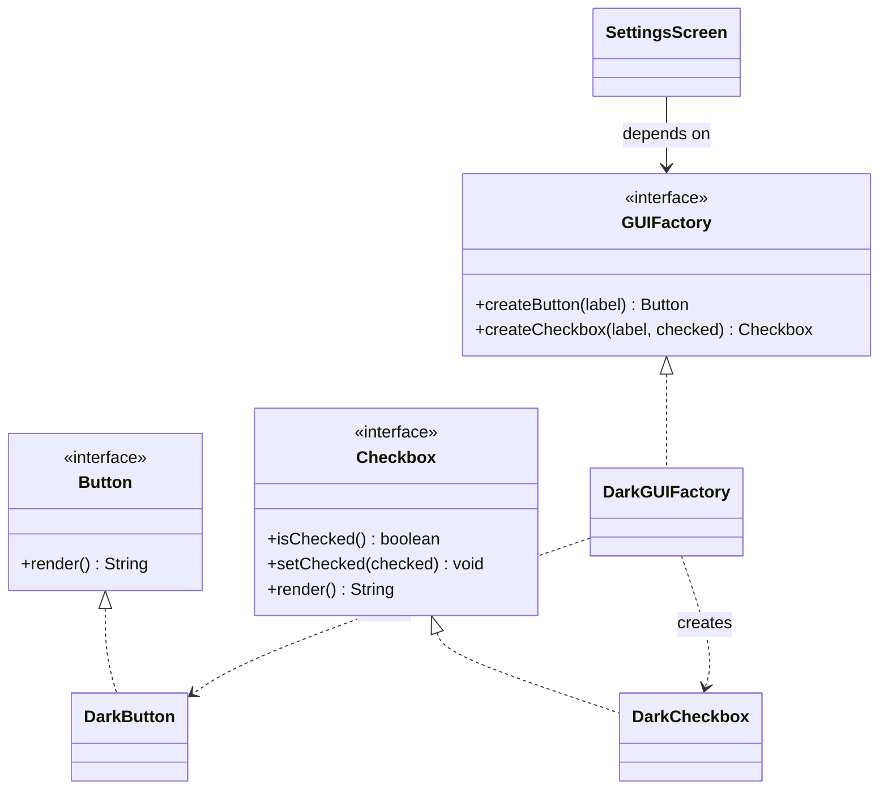
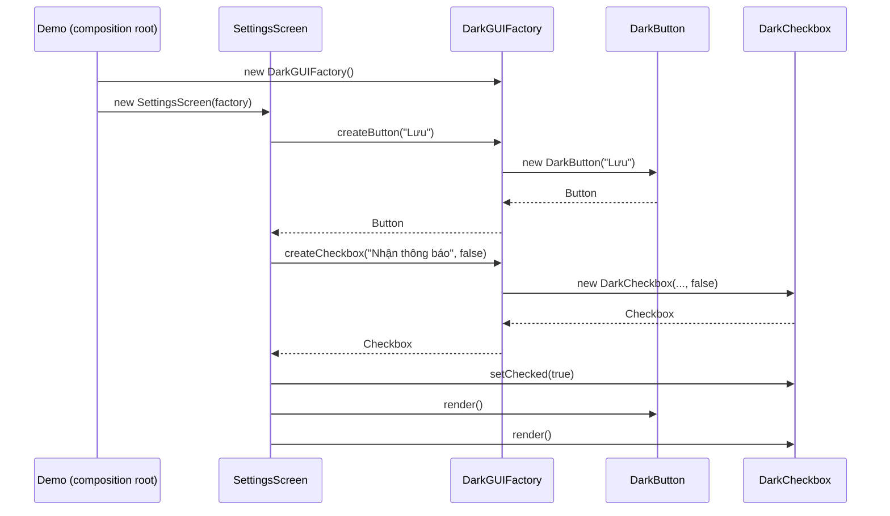

# Hiện thực họ DarkButton và DarkCheckbox cùng DarkGUIFactory

## 1. Mục tiêu và bối cảnh

Bài học thuộc chương **Hiện thực bằng Java** của chủ đề **Abstract Factory** trong nhóm *Creational Design Patterns*. Ta sẽ hiện thực một **họ sản phẩm Dark** gồm hai thành phần giao diện:

- `DarkButton`: nút bấm có nhãn, sử dụng quy ước màu của giao diện tối.
- `DarkCheckbox`: ô chọn có nhãn, trạng thái được chọn và quy ước màu của giao diện tối.

Cả hai được tạo bởi **`DarkGUIFactory`**. Client chỉ phụ thuộc vào **`GUIFactory`**, **`Button`** và **`Checkbox`**, nên không phải gọi constructor của từng concrete product.

Sau bài này, bạn có thể:

1. Cài đặt `DarkButton implements Button` và `DarkCheckbox implements Checkbox`.
2. Cài đặt `DarkGUIFactory implements GUIFactory` với hai phương thức tạo **đúng họ Dark**.
3. Đặt chính sách kiểm tra đầu vào, trạng thái sản phẩm và kiểu trả về đúng vị trí.
4. Dùng `GUIFactory` trong client và chọn concrete factory ở điểm khởi tạo ứng dụng.
5. Kiểm tra kiểu, hành vi, tính nhất quán họ sản phẩm và tính độc lập giữa các đối tượng.

Ví dụ sử dụng **Java 17+** và biểu diễn widget bằng chuỗi để tập trung vào mẫu thiết kế. Đây là mô phỏng kiến trúc, **không tạo cửa sổ GUI thực** và không phải phép đo khả năng tiếp cận giao diện.

## 2. Xác định rõ các vai trò trong Abstract Factory

Trước khi viết code, phân biệt các thành phần:

| Vai trò pattern | Kiểu Java | Trách nhiệm |
|---|---|---|
| AbstractFactory | `GUIFactory` | Khai báo cách yêu cầu một `Button` và một `Checkbox` |
| AbstractProduct A | `Button` | Khai báo những thao tác client có thể thực hiện với nút |
| AbstractProduct B | `Checkbox` | Khai báo thao tác với ô chọn và trạng thái của nó |
| ConcreteProduct A | `DarkButton` | Triển khai hợp đồng `Button` theo giao diện tối |
| ConcreteProduct B | `DarkCheckbox` | Triển khai hợp đồng `Checkbox` theo giao diện tối |
| ConcreteFactory | `DarkGUIFactory` | Tạo hai concrete product thuộc **cùng họ Dark** |
| Client | `SettingsScreen` | Sử dụng sản phẩm qua các interface |



**Hai tầng abstraction khác nhau:**

- `GUIFactory` là hợp đồng **tạo sản phẩm**: client yêu cầu các loại đối tượng mà không biết constructor.
- `Button` và `Checkbox` là hợp đồng **sử dụng sản phẩm**: client gọi hành vi mà không cần biết implementation.

Chỉ dùng interface cho factory nhưng để `createButton()` trả về `DarkButton` sẽ khiến client vẫn phụ thuộc vào lớp Dark. Vì vậy, **kiểu trả về của phương thức factory nên là product interface**.

## 3. Khai báo các interface trước khi tạo sản phẩm

### 3.1. AbstractProduct: Button

Ở ví dụ này, client cần biểu diễn nút dưới dạng chuỗi:

```java
interface Button {
    String render();
}
```

`Button` định nghĩa hành vi chung, không quy định màu sắc, nhãn được lưu như thế nào hay dùng thư viện UI nào. Các lớp `DarkButton`, `LightButton` hoặc một biến thể khác đều có thể implement `Button`.

### 3.2. AbstractProduct: Checkbox

Checkbox có trạng thái tương tác; vì thế contract rộng hơn:

```java
interface Checkbox {
    boolean isChecked();
    void setChecked(boolean checked);
    String render();
}
```

Ý nghĩa các phương thức:

- `isChecked()` trả trạng thái hiện tại.
- `setChecked(boolean)` cập nhật trạng thái của **chính đối tượng đó**.
- `render()` phản ánh giao diện và trạng thái hiện tại.

Đây là **sản phẩm mutable**: hai checkbox được tạo riêng không được vô tình chia sẻ trường trạng thái. Phần sau sẽ kiểm tra điều này.

### 3.3. AbstractFactory: GUIFactory

Khi đã biết client cần những loại sản phẩm nào, khai báo interface factory:

```java
interface GUIFactory {
    Button createButton(String label);
    Checkbox createCheckbox(String label, boolean initiallyChecked);
}
```

Điểm cần nhớ:

1. `createButton` trả về **`Button`**, không phải `DarkButton`.
2. `createCheckbox` trả về **`Checkbox`**, không phải `DarkCheckbox`.
3. Các tham số mô tả dữ liệu cần thiết của **sản phẩm**, không yêu cầu client truyền tên theme.
4. **Concrete factory được chọn** sẽ quyết định lớp cụ thể và họ sản phẩm.

Trong ví dụ, các phương thức tạo **đối tượng mới ở mỗi lần gọi**. Abstract Factory không mặc định bắt buộc mọi sản phẩm đều mới: việc dùng lại hay cache là chính sách vòng đời riêng, phải được thiết kế rõ nếu áp dụng.

## 4. Hiện thực DarkButton

`DarkButton` cần giữ nhãn và mô tả nút thuộc giao diện tối. Dùng class `final` vì ví dụ này không cần mở rộng qua kế thừa:

```java
final class DarkButton implements Button {
    private static final String BACKGROUND = "#202124";
    private static final String FOREGROUND = "#FFFFFF";

    private final String label;

    DarkButton(String label) {
        if (label == null || label.isBlank()) {
            throw new IllegalArgumentException(
                    "Button label must not be blank");
        }
        this.label = label;
    }

    @Override
    public String render() {
        return "[Dark] Button[label=" + label
                + ", bg=" + BACKGROUND
                + ", fg=" + FOREGROUND + "]";
    }
}
```

Phân tích từng phần:

- `implements Button` cho phép instance của `DarkButton` được dùng như một `Button`.
- `label` là `private final`: sau khi tạo, nhãn nút không thay đổi.
- Constructor từ chối `null` và chuỗi chỉ có khoảng trắng. Đây là **quy ước của ví dụ**; nếu hệ thống thực cho phép nút không nhãn thì cần xác định contract khác.
- `BACKGROUND` và `FOREGROUND` là giá trị mô phỏng của theme Dark.
- `render()` có `@Override`, giúp trình biên dịch kiểm tra phương thức thật sự triển khai hợp đồng của `Button`.

Khi gọi `new DarkButton("Lưu").render()`, chuỗi dự kiến là:

```text
[Dark] Button[label=Lưu, bg=#202124, fg=#FFFFFF]
```

Việc chọn màu trong ví dụ là **chi tiết của concrete product**. `Button` không cần có phương thức `getDarkBackgroundColor()` hoặc bất kỳ API chỉ dành cho một theme.

**Lưu ý:** Các giá trị màu là dữ liệu minh họa. Muốn triển khai UI thật cần tính tương phản theo trạng thái, font, nền thực tế và các yêu cầu accessibility; tên `DarkButton` tự nó không bảo đảm những điều đó.

## 5. Hiện thực DarkCheckbox

Checkbox có hai phần dữ liệu: **nhãn bất biến** và **trạng thái mutable**.

```java
final class DarkCheckbox implements Checkbox {
    private static final String ACCENT = "#8AB4F8";

    private final String label;
    private boolean checked;

    DarkCheckbox(String label, boolean initiallyChecked) {
        if (label == null || label.isBlank()) {
            throw new IllegalArgumentException(
                    "Checkbox label must not be blank");
        }
        this.label = label;
        this.checked = initiallyChecked;
    }

    @Override
    public boolean isChecked() {
        return checked;
    }

    @Override
    public void setChecked(boolean checked) {
        this.checked = checked;
    }

    @Override
    public String render() {
        String state = checked ? "checked" : "unchecked";
        return "[Dark] Checkbox[label=" + label
                + ", state=" + state
                + ", accent=" + ACCENT + "]";
    }
}
```

Thử tương tác với sản phẩm:

```java
Checkbox notifications = new DarkCheckbox("Nhận thông báo", false);

System.out.println(notifications.isChecked()); // false
notifications.setChecked(true);
System.out.println(notifications.isChecked()); // true
System.out.println(notifications.render());
```

Kết quả cuối:

```text
[Dark] Checkbox[label=Nhận thông báo, state=checked, accent=#8AB4F8]
```

`DarkCheckbox` triển khai **đúng hợp đồng của Checkbox**: `setChecked(true)` làm `isChecked()` trả `true` và `render()` phản ánh trạng thái mới. Dữ liệu `checked` là trường của từng object, vì vậy nếu cấp phát riêng hai checkbox thì thay đổi một object không ảnh hưởng object còn lại.

Đây là khác biệt với `DarkButton`: cả hai cùng thuộc họ Dark nhưng có **hành vi và trạng thái khác nhau**. Không nên gộp chúng vào một interface kiểu `GenericWidget` chứa mọi thao tác của cả nút và ô chọn.

## 6. Hiện thực DarkGUIFactory

Sau khi có hai concrete product, implement **một factory tạo đủ cả hai loại**:

```java
final class DarkGUIFactory implements GUIFactory {
    @Override
    public Button createButton(String label) {
        return new DarkButton(label);
    }

    @Override
    public Checkbox createCheckbox(
            String label, boolean initiallyChecked) {
        return new DarkCheckbox(label, initiallyChecked);
    }
}
```

`DarkGUIFactory` có ba trách nhiệm trực tiếp:

1. **Ánh xạ đúng loại sản phẩm**: `createButton` tạo `DarkButton`, `createCheckbox` tạo `DarkCheckbox`.
2. **Giữ đúng họ**: hai phương thức đều trả sản phẩm Dark, tránh phối trộn `DarkButton` với `LightCheckbox`.
3. **Ẩn concrete constructor khỏi client**: mã sử dụng factory chỉ thấy `GUIFactory` và các product interface.

Một lần sử dụng qua abstraction:

```java
GUIFactory factory = new DarkGUIFactory();

Button save = factory.createButton("Lưu");
Checkbox notifications = factory.createCheckbox("Nhận thông báo", true);

System.out.println(save.render());
System.out.println(notifications.render());
```

Trình biên dịch biết `save` là `Button` và `notifications` là `Checkbox`. Nó không yêu cầu client ép kiểu sang `DarkButton` hay `DarkCheckbox`.

### Vì sao không tạo mỗi sản phẩm bằng factory riêng?

Nếu tách thành `DarkButtonFactory` và `DarkCheckboxFactory`, client sẽ cần chọn **hai factory** và tự bảo đảm chúng cùng theme. Một `DarkGUIFactory` giúp chuyển cả **họ sản phẩm** sang cùng một điểm lựa chọn. Nếu các loại sản phẩm không có yêu cầu tương thích, việc dùng Abstract Factory có thể chưa cần thiết.

### Có được trả kiểu cụ thể trong concrete factory không?

Java cho phép kiểu trả về **hiệp biến** khi override, ví dụ một phương thức của `DarkGUIFactory` khai báo `DarkButton createButton(String label)` vẫn có thể triển khai `Button createButton(String label)` từ `GUIFactory`. Tuy nhiên, khi client gọi qua biến kiểu `GUIFactory`, kết quả vẫn được xem là `Button`.

Trong bài này ta khai báo các kiểu trả về bằng **product interface ngay tại concrete factory** để nhấn mạnh contract chung và hạn chế lệ thuộc vào implementation.

## 7. Chương trình Java 17+ chạy độc lập

Để chạy ví dụ từ đầu đến cuối, đặt **toàn bộ đoạn sau** vào file `Demo.java`. Đây là một ví dụ độc lập, không cần thư viện ngoài JDK.

```java
import java.util.Objects;

// AbstractProduct A
interface Button {
    String render();
}

// AbstractProduct B
interface Checkbox {
    boolean isChecked();
    void setChecked(boolean checked);
    String render();
}

// AbstractFactory
interface GUIFactory {
    Button createButton(String label);
    Checkbox createCheckbox(String label, boolean initiallyChecked);
}

// ConcreteProduct A: thuộc họ Dark
final class DarkButton implements Button {
    private static final String BACKGROUND = "#202124";
    private static final String FOREGROUND = "#FFFFFF";

    private final String label;

    DarkButton(String label) {
        if (label == null || label.isBlank()) {
            throw new IllegalArgumentException(
                    "Button label must not be blank");
        }
        this.label = label;
    }

    @Override
    public String render() {
        return "[Dark] Button[label=" + label
                + ", bg=" + BACKGROUND
                + ", fg=" + FOREGROUND + "]";
    }
}

// ConcreteProduct B: thuộc họ Dark
final class DarkCheckbox implements Checkbox {
    private static final String ACCENT = "#8AB4F8";

    private final String label;
    private boolean checked;

    DarkCheckbox(String label, boolean initiallyChecked) {
        if (label == null || label.isBlank()) {
            throw new IllegalArgumentException(
                    "Checkbox label must not be blank");
        }
        this.label = label;
        this.checked = initiallyChecked;
    }

    @Override
    public boolean isChecked() {
        return checked;
    }

    @Override
    public void setChecked(boolean checked) {
        this.checked = checked;
    }

    @Override
    public String render() {
        String state = checked ? "checked" : "unchecked";
        return "[Dark] Checkbox[label=" + label
                + ", state=" + state
                + ", accent=" + ACCENT + "]";
    }
}

// ConcreteFactory: tạo đủ các loại sản phẩm thuộc họ Dark
final class DarkGUIFactory implements GUIFactory {
    @Override
    public Button createButton(String label) {
        return new DarkButton(label);
    }

    @Override
    public Checkbox createCheckbox(
            String label, boolean initiallyChecked) {
        return new DarkCheckbox(label, initiallyChecked);
    }
}

// Client không phụ thuộc DarkButton/DarkCheckbox
final class SettingsScreen {
    private final GUIFactory factory;

    SettingsScreen(GUIFactory factory) {
        this.factory = Objects.requireNonNull(factory, "factory");
    }

    void show() {
        Button save = factory.createButton("Lưu");
        Checkbox notifications =
                factory.createCheckbox("Nhận thông báo", false);

        notifications.setChecked(true);

        System.out.println(save.render());
        System.out.println(notifications.render());
    }
}

public class Demo {
    public static void main(String[] args) {
        // Composition root chọn concrete factory.
        GUIFactory factory = new DarkGUIFactory();

        new SettingsScreen(factory).show();

        // Kiểm tra tính độc lập của hai sản phẩm mutable.
        Checkbox first = factory.createCheckbox("Điều khoản", false);
        Checkbox second = factory.createCheckbox("Điều khoản", false);
        first.setChecked(true);

        System.out.println("First checked: " + first.isChecked());
        System.out.println("Second checked: " + second.isChecked());
    }
}
```

Chạy từ thư mục chứa file:

```powershell
javac -encoding UTF-8 Demo.java
java Demo
```

Kết quả dự kiến:

```text
[Dark] Button[label=Lưu, bg=#202124, fg=#FFFFFF]
[Dark] Checkbox[label=Nhận thông báo, state=checked, accent=#8AB4F8]
First checked: true
Second checked: false
```

Hai dòng đầu được tạo bởi `SettingsScreen`. Hai dòng sau xác nhận hai lời gọi `createCheckbox` tạo ra các đối tượng **có trạng thái riêng**: thay đổi `first` không làm `second` đổi trạng thái.

Nếu tách chương trình thành nhiều file Java, bạn có thể tổ chức theo tên interface/class, chẳng hạn `GUIFactory.java`, `Button.java`, `Checkbox.java`, `DarkButton.java`, `DarkCheckbox.java`, `DarkGUIFactory.java` và `SettingsScreen.java`. Ví dụ một file giữ các kiểu hỗ trợ ở phạm vi package để dễ chạy; trong dự án thật, cần quyết định `public` và package theo ranh giới API.

## 8. Luồng cộng tác trong runtime

Khi client cần nút và ô chọn, trình tự diễn ra như sau:



Sơ đồ thể hiện **các lớp thực thi ở runtime**. Ở mức khai báo biến và hợp đồng, `SettingsScreen` chỉ nhìn thấy `GUIFactory`, `Button` và `Checkbox`. Điều này khác với việc client tự gọi `new DarkButton(...)`: trách nhiệm tạo được đưa về concrete factory.

### Thành phần nào nên biết tên lớp Dark?

| Thành phần | Có cần biết `DarkButton` / `DarkCheckbox`? | Lý do |
|---|---|---|
| `DarkGUIFactory` | **Có** | Chịu trách nhiệm tạo các concrete product thuộc họ Dark |
| `SettingsScreen` | **Không** | Chỉ sử dụng contract của các product interface |
| `GUIFactory` | **Không** | Khai báo loại sản phẩm, độc lập theme |
| `Button`, `Checkbox` | **Không** | Mô tả hành vi chung cho mọi họ |
| `Demo.main` | Biết `DarkGUIFactory` | Điểm cấu hình chọn họ cho ứng dụng |

Trong ứng dụng thật, `Demo.main` có thể chọn factory thông qua dependency injection, cấu hình hoặc một factory registry. Chính sách lựa chọn đó không cần đưa vào mã xử lý của `SettingsScreen`.

## 9. Kiểm tra contract và tính nhất quán họ Dark

Đoạn mẫu có thể biên dịch nhưng vẫn có lỗi nghiệp vụ nếu factory trả về sản phẩm sai họ, không cập nhật trạng thái đúng hoặc chia sẻ object mutable không mong muốn. Một bộ kiểm tra thủ công đơn giản có thể viết riêng như sau.

Các phương thức dưới đây **giả định các kiểu Java ở phần 7 đã tồn tại**; có thể đặt vào lớp kiểm thử hoặc thêm vào một lớp helper chạy riêng:

```java
static void check(boolean condition, String message) {
    if (!condition) {
        throw new AssertionError(message);
    }
}

static void verifyDarkFactory(GUIFactory factory) {
    Button button = factory.createButton("Lưu");
    Checkbox first = factory.createCheckbox("Đồng ý", false);
    Checkbox second = factory.createCheckbox("Đồng ý", false);

    check(button != null, "Button must not be null");
    check(first != null && second != null,
            "Checkbox must not be null");

    // Kiểm tra cả loại sản phẩm lẫn biểu diễn theo họ.
    check(button.render().startsWith("[Dark] Button["),
            "Button is not from Dark family");
    check(first.render().startsWith("[Dark] Checkbox["),
            "Checkbox is not from Dark family");

    // Kiểm tra mỗi lần tạo checkbox có trạng thái độc lập.
    check(first != second, "Checkboxes must be distinct instances");
    check(!first.isChecked() && !second.isChecked(),
            "Initial state must be false");
    first.setChecked(true);
    check(first.isChecked(), "First checkbox must be checked");
    check(!second.isChecked(),
            "Second checkbox state must not change");

    try {
        factory.createButton("  ");
        throw new AssertionError("Blank label was accepted");
    } catch (IllegalArgumentException expected) {
        // Đúng quy ước kiểm tra đầu vào của ví dụ.
    }
}

// Gọi khi chạy bộ kiểm tra:
// verifyDarkFactory(new DarkGUIFactory());
```

Ở đây việc kiểm tra chuỗi `"[Dark]"` phù hợp vì ví dụ quy định định dạng `render()` rõ ràng. Trong GUI thật, hãy kiểm tra **kiểu style, token màu, trạng thái và hành vi quan sát được**, thay vì giả định tên lớp hay tiền tố chuỗi luôn là dấu hiệu đủ để phân biệt theme.

### Phân biệt đúng loại và đúng họ

Java bảo đảm `DarkButton` có thể gán cho `Button` và `DarkCheckbox` có thể gán cho `Checkbox`. Nhưng Java **không tự chứng minh** rằng `DarkGUIFactory` chỉ tạo ra sản phẩm Dark. Ví dụ sai:

```java
// Giả sử LightCheckbox cũng implements Checkbox.
// Đoạn này có thể đúng kiểu Java nhưng sai mục tiêu Abstract Factory.
@Override
public Checkbox createCheckbox(
        String label, boolean initiallyChecked) {
    return new LightCheckbox(label, initiallyChecked);
}
```

Do đó, cần kiểm tra **tính nhất quán của họ sản phẩm** bên cạnh việc kiểm tra phương thức có trả đúng product interface hay không.

## 10. Lỗi thường gặp khi cài đặt họ Dark

| Lỗi | Vì sao gây vấn đề | Cách sửa |
|---|---|---|
| `DarkGUIFactory.createButton` trả `DarkButton` trực tiếp trong contract chung | Client dùng `GUIFactory` bị buộc biết concrete product | Khai báo kiểu trả về `Button` trong `GUIFactory` |
| Client gọi `new DarkCheckbox(...)` rải rác | Lựa chọn họ và logic tạo bị phân tán | Gọi `factory.createCheckbox(...)` |
| `DarkGUIFactory` trả một sản phẩm Dark, một sản phẩm Light | Hai widget có thể không tương thích | Mọi phương thức của factory phải tuân cùng chính sách họ |
| Cả hai lời gọi factory trả chung một `DarkCheckbox` mutable | Trạng thái checkbox của client này ảnh hưởng client khác | Tạo mới mỗi lần hoặc thiết kế rõ cơ chế ownership |
| Một concrete product bỏ qua `checked` đầu vào | Hành vi không khớp contract | Lưu `initiallyChecked` và kiểm tra `isChecked()` |
| Factory kiểm tra theme trong từng `create...` | Trách nhiệm chọn họ bị lặp, factory không còn đại diện một họ cố định | Chọn concrete factory trước; mỗi factory thuộc một họ |
| Product interface lộ màu sắc hoặc API đặc thù Dark | Các họ khác khó implement hợp đồng | Giữ chi tiết theme trong concrete product hoặc trong cấu hình riêng của factory |
| Factory trả `null` khi đầu vào sai | Client dễ gặp `NullPointerException` ở nơi khác | Chọn quy tắc đầu vào/lỗi rõ ràng, nhất quán |
| Mỗi chỗ tự dùng màu Dark khác nhau | Họ sản phẩm có phong cách thiếu thống nhất | Cân nhắc chia sẻ theme token bất biến trong cùng họ |

## 11. Mở rộng sang theme khác mà không sửa client

Với các interface hiện có, ta có thể thêm một concrete factory khác như `LightGUIFactory implements GUIFactory`, rồi cung cấp `LightButton implements Button` và `LightCheckbox implements Checkbox`. Khi đó, `SettingsScreen` vẫn dùng API như cũ.

Ví dụ ở mức **ý tưởng**, không phải một chương trình chạy độc lập:

```java
// Giả sử đã có LightButton và LightCheckbox implement
// hai product interface tương ứng.
final class LightGUIFactory implements GUIFactory {
    @Override
    public Button createButton(String label) {
        return new LightButton(label);
    }

    @Override
    public Checkbox createCheckbox(
            String label, boolean initiallyChecked) {
        return new LightCheckbox(label, initiallyChecked);
    }
}
```

Ở composition root, chọn **một** concrete factory để cấp cho toàn bộ client:

```java
// Minh họa khi cả LightGUIFactory và DarkGUIFactory đã có:
GUIFactory factory = useDarkTheme
        ? new DarkGUIFactory()
        : new LightGUIFactory();

SettingsScreen screen = new SettingsScreen(factory);
screen.show();
```

Lợi ích chính của Abstract Factory chỉ bộc lộ rõ khi cần **thay cả họ sản phẩm** nhưng client không phải đổi lệnh tạo và thao tác sử dụng. Ví dụ chỉ có Dark là bước xây dựng một concrete factory; thêm một họ khác dùng cùng abstraction minh họa khả năng mở rộng của pattern.

## 12. Cân nhắc vòng đời, thread safety và tài nguyên

Trong ví dụ:

- `createButton` tạo một `DarkButton` mới mỗi lần gọi.
- `createCheckbox` tạo một `DarkCheckbox` mới mỗi lần gọi.
- `DarkButton` giữ dữ liệu bất biến; `DarkCheckbox` giữ trạng thái mutable của **từng instance**.
- `DarkGUIFactory` không giữ tài nguyên ngoài, nên không có bước `close()` trong mẫu.

Các điều đó là **lựa chọn của triển khai này**, không phải quy tắc bắt buộc cho mọi Abstract Factory.

Nếu muốn **cache sản phẩm**, hãy chỉ cache loại chia sẻ an toàn (thường bất biến) và xác định rõ khóa, phạm vi lưu, thời hạn và chính sách vô hiệu hóa. Không cache checkbox mutable theo nhãn nếu nhiều màn hình cần trạng thái riêng.

Nếu một concrete product chứa tài nguyên cần đóng (chẳng hạn handle hình ảnh), phải xác định ai sở hữu và đóng tài nguyên; shared/cached product không nên bị client đóng tùy ý nếu client khác còn sử dụng. Nếu nhiều luồng truy cập cùng một `DarkCheckbox`, trường `checked` trong ví dụ **không được đồng bộ hóa**; đối tượng này được thiết kế cho ngữ cảnh thông thường có một luồng sở hữu/truy cập. Cần bổ sung cơ chế đồng bộ hoặc mô hình trạng thái khác khi sử dụng chung nhiều luồng.

Ở ứng dụng GUI thật, cần tuân thủ quy tắc luồng giao diện của toolkit (ví dụ UI thread); mẫu hiển thị chuỗi ở đây không thay thế các quy tắc đó.

## 13. Bài tập tự luyện

**Bài 1 — Thêm hành vi của Button.** Client cần biết nút có được bật hay không. Bạn sẽ bổ sung phương thức nào vào `Button` và cài đặt trong `DarkButton` ra sao? Lưu ý không đưa tên theme vào chữ ký phương thức.

**Bài 2 — Kiểm tra việc tạo mới.** Viết đoạn code gọi `createCheckbox("A", false)` hai lần, thay đổi object thứ nhất và xác nhận object thứ hai giữ `false`. Giải thích vì sao việc cache checkbox theo nhãn là không phù hợp trong ngữ cảnh này.

**Bài 3 — Họ HighContrast.** Tạo `HighContrastButton`, `HighContrastCheckbox` và `HighContrastGUIFactory` theo đúng ba interface có sẵn. Kiểm tra rằng `SettingsScreen` không cần sửa logic để dùng factory mới.

**Bài 4 — Phát hiện lỗi cùng họ.** Một `DarkGUIFactory` trả `DarkButton` và `LightCheckbox`. Hãy cho biết vì sao Java có thể vẫn biên dịch và cách viết kiểm tra để phát hiện lỗi ở mức yêu cầu nghiệp vụ.

<details>
<summary>Gợi ý đánh giá</summary>

- **Bài 1:** Thêm contract như `boolean isEnabled()` vào `Button`, rồi cho các concrete button triển khai nhất quán. Nếu chọn dùng trạng thái mutable, cân nhắc thêm `setEnabled(boolean)` và quy định rõ semantics.
- **Bài 2:** Hai lần gọi phải trả các đối tượng độc lập theo **chính sách tạo mới của ví dụ**; cập nhật object đầu không ảnh hưởng object thứ hai.
- **Bài 3:** Thêm ba kiểu concrete mới và thay factory tại composition root; `GUIFactory`, `Button`, `Checkbox` và `SettingsScreen` có thể giữ nguyên.
- **Bài 4:** `LightCheckbox` vẫn implements `Checkbox` nên đúng kiểu trả về. Cần kiểm tra tính tương thích của họ, ví dụ qua thuộc tính hiển thị hoặc test contract đặc thù Dark.

</details>

### Checklist hoàn thành

- [ ] `DarkButton implements Button`, render theo quy ước của họ Dark.
- [ ] `DarkCheckbox implements Checkbox`, đọc/ghi trạng thái chính xác.
- [ ] `DarkGUIFactory implements GUIFactory` và triển khai đủ hai phương thức.
- [ ] Factory trả về `Button` và `Checkbox` qua abstraction.
- [ ] Hai sản phẩm mà factory tạo ra đều thuộc họ Dark.
- [ ] Client chỉ biết interface, không ép kiểu hoặc tạo concrete product trực tiếp.
- [ ] Tham số không hợp lệ được xử lý theo một quy ước rõ ràng.
- [ ] Hai checkbox được tạo mới có trạng thái độc lập.
- [ ] Có thể thay bằng concrete factory của họ khác mà không sửa client.

**Ghi nhớ:** `DarkButton` và `DarkCheckbox` hiện thực **hai loại AbstractProduct**, còn `DarkGUIFactory` hiện thực **AbstractFactory** để tạo **một họ Dark nhất quán**. Client phụ thuộc `GUIFactory`, `Button` và `Checkbox`; chi tiết lớp cụ thể, phong cách Dark và việc khởi tạo nằm trong concrete factory/concrete product. Đây là nền tảng để bổ sung họ giao diện khác mà vẫn giữ nguyên mã sử dụng sản phẩm.

