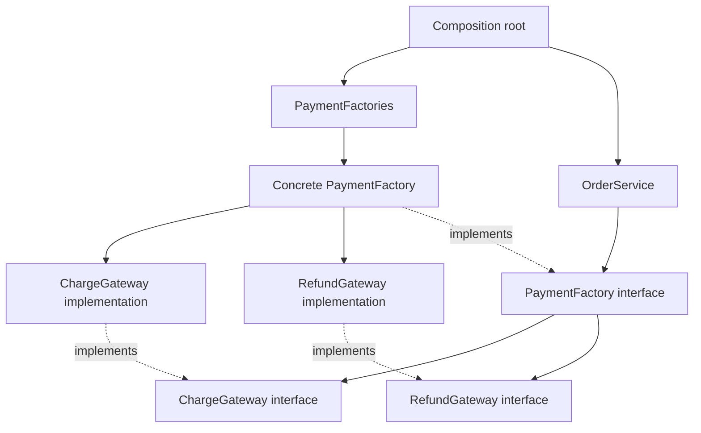

# Tổ chức package, phạm vi truy cập và constructor để hạn chế phụ thuộc sai

Khi hiện thực **Abstract Factory bằng Java**, chỉ khai báo một interface factory và vài concrete factory vẫn chưa đủ để bảo vệ kiến trúc. Nếu lớp nghiệp vụ có thể tùy tiện `new` một sản phẩm cụ thể, import một triển khai của nhà cung cấp, hoặc kết hợp các sản phẩm được tạo ở những nơi khác nhau, hệ thống vẫn dễ **phụ thuộc sai tầng** và **trộn các họ sản phẩm không tương thích**.

Ba công cụ quen thuộc của Java giúp thu hẹp rủi ro đó:

1. **Package:** đặt interface công khai, lớp triển khai và điểm lắp ghép ở những vị trí có chủ đích.
2. **Phạm vi truy cập:** chỉ `public` hóa những kiểu cần cho client; giữ implementation và constructor trong phạm vi package khi có thể.
3. **Constructor và dependency injection:** để application service nhận **abstraction** thay vì tự tạo concrete class; đặt quyền chọn họ tại một điểm cấu hình rõ ràng.

Bài học thuộc chương **Hiện thực bằng Java** của Abstract Factory. Mục tiêu là biết cách biến ý tưởng “client phụ thuộc vào abstract products và abstract factory” thành **cấu trúc mã nguồn cụ thể**, không chỉ thành một sơ đồ lớp.

## 1. Kiến trúc mong muốn: phụ thuộc hướng về hợp đồng

Xét hệ thống hỗ trợ hai nhà cung cấp thanh toán **ACME** và **NOVA**. Một yêu cầu thanh toán có thể cần:

- `ChargeGateway`: thực hiện thu tiền.
- `RefundGateway`: hoàn tiền cho giao dịch được tạo bởi gateway thu tiền cùng nhà cung cấp.
- `PaymentFactory`: tạo hai sản phẩm cùng họ.
- `OrderService`: kiểm tra đơn hàng và điều phối thời điểm sử dụng những sản phẩm đó.

Ma trận sản phẩm:

| Loại sản phẩm / Họ | ACME | NOVA |
| --- | --- | --- |
| `ChargeGateway` | `AcmeChargeGateway` | `NovaChargeGateway` |
| `RefundGateway` | `AcmeRefundGateway` | `NovaRefundGateway` |
| Concrete factory | `AcmePaymentFactory` | `NovaPaymentFactory` |

Client chỉ cần biết những interface của hàng đầu tiên, hàng thứ hai và `PaymentFactory`. Tên lớp `AcmeChargeGateway` hoặc `NovaRefundGateway` là **chi tiết triển khai** được giới hạn trong phần cung cấp sản phẩm.



**Phụ thuộc mong muốn:** `OrderService → PaymentFactory / ChargeGateway / RefundGateway`. **Phụ thuộc cần tránh:** `OrderService → AcmeChargeGateway` hay `OrderService → NovaPaymentFactory`.

Điểm lắp ghép (*composition root*) là nơi chấp nhận biết **cách chọn một họ cụ thể**. Nó thường nằm ở tầng khởi động ứng dụng hoặc cấu hình dependency injection, không nằm rải rác trong các use case.

## 2. Tổ chức package theo ranh giới API và implementation

Một cấu trúc phù hợp cho ví dụ:

```text
src/
└── com/
    └── example/
        ├── payment/
        │   ├── api/
        │   │   ├── PaymentFactory.java
        │   │   ├── ChargeGateway.java
        │   │   ├── RefundGateway.java
        │   │   └── PaymentReceipt.java
        │   └── PaymentFactories.java
        ├── order/
        │   └── OrderService.java
        └── app/
            └── Main.java
```

Trong ví dụ tự chứa, `PaymentFactories.java` sẽ chứa một **lớp facade `public`** và một số lớp top-level **package-private** cho ACME/NOVA để giảm số tệp cần đọc. Ở dự án lớn, các lớp package-private có thể nằm trong **những tệp riêng nhưng cùng package `com.example.payment`**, không bắt buộc dồn chung một tệp.

| Khu vực | Nên đặt gì? | Ai cần phụ thuộc? |
| --- | --- | --- |
| `com.example.payment.api` | Abstract products, abstract factory, kiểu dữ liệu giao tiếp | Client và implementation |
| `com.example.payment` | Điểm chọn factory công khai; các concrete factory/product không công khai | Composition root và mã nội bộ của package |
| `com.example.order` | Quy tắc đặt/hủy đơn, phối hợp thao tác nghiệp vụ | Phụ thuộc `payment.api`, không import implementation |
| `com.example.app` | Đọc cấu hình và lắp ghép dependency | Có thể gọi `PaymentFactories` để chọn họ |

**Quan trọng:** trong Java, `com.example.payment` và `com.example.payment.internal` là **hai package khác nhau**. Quan hệ tên cha–con **không cấp quyền package-private**. Nếu chuyển concrete class vào `internal`, một facade ở `com.example.payment` không thể gọi constructor package-private của nó chỉ vì hai tên package có chung tiền tố. Khi chia package, phải thiết kế lại ranh giới khởi tạo, chẳng hạn đặt điểm chọn factory cùng package với implementation hoặc sử dụng provider/registration interface phù hợp.

## 3. Chọn access modifier theo loại trách nhiệm

Java có bốn mức truy cập thường gặp:

| Mức truy cập | Truy cập từ đâu? | Cách dùng thích hợp ở đây |
| --- | --- | --- |
| `public` | Mã nguồn có thể nhìn thấy kiểu/thành viên theo các quy tắc truy cập của Java và module | Interface sản phẩm, `PaymentFactory`, facade và constructor injection của service |
| `protected` | Cùng package và các trường hợp lớp con được phép theo quy tắc Java | Ít cần thiết trong thiết kế ưu tiên composition; có thể hữu ích ở abstraction có kế thừa chủ đích |
| *Package-private* (không viết modifier) | Chỉ mã trong **cùng package** | Concrete factory và sản phẩm chỉ dành cho hạ tầng nội bộ |
| `private` | Trong phạm vi khai báo tương ứng (với các quy tắc nestmates của Java) | Trường dữ liệu, hàm hỗ trợ và constructor của utility/facade không cần instance |

Ví dụ:

```java
// PaymentFactories.java, package com.example.payment
public final class PaymentFactories {
    private PaymentFactories() {
        throw new AssertionError("Không tạo instance facade");
    }
}

// Cùng tệp và cùng package; KHÔNG có public.
final class AcmePaymentFactory implements PaymentFactory {
    AcmePaymentFactory() { } // Constructor package-private.
    // ... các phương thức của interface ...
}
```

Mục tiêu không phải là “ẩn tất cả lớp” bằng mọi giá. Ta **công khai những hợp đồng mà client thực sự cần**, còn tên lớp và chi tiết khởi tạo cụ thể được giữ sau một điểm cung cấp ổn định. Khi có yêu cầu plugin bên ngoài tự triển khai factory, có thể cần công khai thêm provider interface hoặc contract đăng ký, nhưng nên làm **có chủ đích**.

### Vì sao package-private giúp hạn chế phụ thuộc sai?

Nếu `OrderService` nằm trong package `com.example.order`, nó **không thể import và tạo trực tiếp** một lớp package-private `AcmeChargeGateway` trong `com.example.payment` bằng Java source code thông thường. Compiler sẽ từ chối truy cập không hợp lệ.

Nhờ đó, việc phụ thuộc vào implementation không chỉ bị ngăn bởi quy ước review; một phần ranh giới được **hệ thống truy cập Java thực thi khi biên dịch**. Tuy nhiên, điều này **không thay thế cơ chế bảo mật** và không chặn mọi cách tạo phụ thuộc (ví dụ mã khác cùng package hoặc reflective access trong môi trường được cho phép). Cần kết hợp thiết kế package với quy định phụ thuộc và kiểm thử kiến trúc.

## 4. Constructor là nơi thể hiện quyền sở hữu dependency

Có hai loại constructor khác nhau cần chú ý:

**Constructor của application service.** Service cần được cung cấp `PaymentFactory` qua tham số:

```java
public OrderService(PaymentFactory factory) {
    this.factory = Objects.requireNonNull(factory);
}
```

Đây là **constructor injection**: dependency bắt buộc được khai báo rõ ràng, không cần lấy từ biến toàn cục hoặc service locator. Trường `final` còn giúp ngăn việc đổi factory ngầm sau khi service đã được cấu hình.

**Constructor của concrete product/factory.** Nếu chỉ factory và lớp cùng package cần tạo sản phẩm cụ thể, constructor nên để **package-private** (hoặc `private` nếu chỉ dùng bên trong một lớp và có phương thức tạo thích hợp). Không cần cung cấp constructor `public` cho client chỉ để mã ví dụ tiện chạy.

| Thành phần | Mức constructor gợi ý | Vì sao? |
| --- | --- | --- |
| `OrderService` | `public OrderService(PaymentFactory factory)` | Client hoặc điểm lắp ghép được phép inject abstraction |
| `PaymentFactories` (utility/facade) | `private PaymentFactories()` | Chỉ gọi các phương thức tạo `static` |
| `AcmePaymentFactory` | Package-private | Chỉ thành phần cùng package chịu trách nhiệm chọn họ có thể tạo |
| `AcmeChargeGateway` | Package-private | Client không cần tạo trực tiếp một sản phẩm của họ |
| `PaymentReceipt` | `public` constructor có kiểm tra dữ liệu (trong ví dụ) | Giá trị giao tiếp được phép khởi tạo, nhưng phải giữ bất biến dữ liệu |

Access modifier của constructor **không bảo đảm tương thích ngữ nghĩa**. Một factory bị viết sai vẫn có thể trả về sản phẩm của họ khác qua interface chung. Cần kiểm thử hợp đồng cho từng concrete factory và đảm bảo cùng ngữ cảnh cấu hình.

## 5. Ví dụ Java đa tệp: API công khai, implementation giới hạn

Ví dụ dưới đây dùng **Java 8+**, không cần thư viện bên ngoài. Mỗi khối mã là nội dung đầy đủ của tệp được ghi trong tiêu đề. Để dễ học, adapter ACME/NOVA chỉ in thông báo, không kết nối cổng thanh toán thật. Việc đặt hàng rồi hủy ngay sau đó chỉ để minh họa cặp sản phẩm cùng họ.

### 5.1. Abstract product: `ChargeGateway.java`

**`src/com/example/payment/api/ChargeGateway.java`**

```java
package com.example.payment.api;

public interface ChargeGateway {
    PaymentReceipt charge(String orderId, long amountMinor);
}
```

### 5.2. Abstract product: `RefundGateway.java`

**`src/com/example/payment/api/RefundGateway.java`**

```java
package com.example.payment.api;

public interface RefundGateway {
    void refund(PaymentReceipt receipt);
}
```

Hai interface mô tả **vai trò nghiệp vụ của sản phẩm**, không phụ thuộc vào tên nhà cung cấp cụ thể.

### 5.3. Kiểu dữ liệu giao tiếp: `PaymentReceipt.java`

**`src/com/example/payment/api/PaymentReceipt.java`**

```java
package com.example.payment.api;

import java.util.Objects;

public final class PaymentReceipt {
    private final String providerId;
    private final String orderId;
    private final long amountMinor;

    public PaymentReceipt(
            String providerId, String orderId, long amountMinor) {
        this.providerId = requireNonBlank(providerId, "providerId");
        this.orderId = requireNonBlank(orderId, "orderId");
        if (amountMinor <= 0) {
            throw new IllegalArgumentException("amountMinor phải dương");
        }
        this.amountMinor = amountMinor;
    }

    private static String requireNonBlank(String value, String field) {
        Objects.requireNonNull(value, field);
        if (value.trim().isEmpty()) {
            throw new IllegalArgumentException(field + " không được rỗng");
        }
        return value;
    }

    public String providerId() {
        return providerId;
    }

    public String orderId() {
        return orderId;
    }

    public long amountMinor() {
        return amountMinor;
    }
}
```

Các trường `private final` tránh để client tự ý thay đổi một chứng từ sau khi tạo. Kiểu dữ liệu mang `providerId` để minh họa **ngữ cảnh tương thích** khi hoàn tiền. Đối với hệ thống thật, dữ liệu giao dịch cần được kiểm tra tính xác thực ở hệ thống có thẩm quyền; **một constructor công khai không khiến chứng từ trở thành bằng chứng thanh toán đáng tin**.

### 5.4. Abstract factory: `PaymentFactory.java`

**`src/com/example/payment/api/PaymentFactory.java`**

```java
package com.example.payment.api;

public interface PaymentFactory {
    ChargeGateway createChargeGateway();
    RefundGateway createRefundGateway();
}
```

Đây là hợp đồng duy nhất mà service cần để **yêu cầu cả một họ sản phẩm**. Không có `new Acme...` và không có phương thức điều phối `placeOrder()` trong interface này.

### 5.5. Facade chọn họ và các lớp implementation: `PaymentFactories.java`

**`src/com/example/payment/PaymentFactories.java`**

```java
package com.example.payment;

import com.example.payment.api.ChargeGateway;
import com.example.payment.api.PaymentFactory;
import com.example.payment.api.PaymentReceipt;
import com.example.payment.api.RefundGateway;
import java.util.Objects;

// Public facade: composition root chỉ biết tên lớp này.
public final class PaymentFactories {
    private PaymentFactories() {
        throw new AssertionError("Không khởi tạo PaymentFactories");
    }

    public static PaymentFactory forProvider(String providerId) {
        if ("ACME".equalsIgnoreCase(providerId)) {
            return new AcmePaymentFactory();
        }
        if ("NOVA".equalsIgnoreCase(providerId)) {
            return new NovaPaymentFactory();
        }
        throw new IllegalArgumentException(
                "Nhà cung cấp không được hỗ trợ: " + providerId);
    }
}

// Tất cả lớp dưới đây đều package-private.
final class AcmePaymentFactory implements PaymentFactory {
    AcmePaymentFactory() { }

    @Override
    public ChargeGateway createChargeGateway() {
        return new AcmeChargeGateway();
    }

    @Override
    public RefundGateway createRefundGateway() {
        return new AcmeRefundGateway();
    }
}

final class NovaPaymentFactory implements PaymentFactory {
    NovaPaymentFactory() { }

    @Override
    public ChargeGateway createChargeGateway() {
        return new NovaChargeGateway();
    }

    @Override
    public RefundGateway createRefundGateway() {
        return new NovaRefundGateway();
    }
}

final class AcmeChargeGateway implements ChargeGateway {
    AcmeChargeGateway() { }

    @Override
    public PaymentReceipt charge(String orderId, long amountMinor) {
        System.out.println("ACME thu " + amountMinor);
        return new PaymentReceipt("ACME", orderId, amountMinor);
    }
}

final class NovaChargeGateway implements ChargeGateway {
    NovaChargeGateway() { }

    @Override
    public PaymentReceipt charge(String orderId, long amountMinor) {
        System.out.println("NOVA thu " + amountMinor);
        return new PaymentReceipt("NOVA", orderId, amountMinor);
    }
}

final class AcmeRefundGateway implements RefundGateway {
    AcmeRefundGateway() { }

    @Override
    public void refund(PaymentReceipt receipt) {
        PaymentChecks.requireProvider(receipt, "ACME");
        System.out.println("ACME hoàn " + receipt.amountMinor());
    }
}

final class NovaRefundGateway implements RefundGateway {
    NovaRefundGateway() { }

    @Override
    public void refund(PaymentReceipt receipt) {
        PaymentChecks.requireProvider(receipt, "NOVA");
        System.out.println("NOVA hoàn " + receipt.amountMinor());
    }
}

final class PaymentChecks {
    private PaymentChecks() { }

    static void requireProvider(PaymentReceipt receipt, String expected) {
        Objects.requireNonNull(receipt, "receipt");
        if (!expected.equals(receipt.providerId())) {
            throw new IllegalArgumentException(
                    "Giao dịch không thuộc nhà cung cấp " + expected);
        }
    }
}
```

Trong Java, một tệp `.java` chỉ được có **tối đa một top-level class/interface `public`**, và tên tệp phải trùng tên top-level `public` đó. Các lớp top-level khác trong ví dụ được phép đặt cùng tệp vì **không có modifier `public`**. Chúng vẫn thuộc package `com.example.payment`.

Đáng chú ý:

- `PaymentFactories` là **lối vào công khai** để chọn một họ.
- `AcmePaymentFactory` và `NovaPaymentFactory` là những concrete factory **không công khai**.
- Các gateway cụ thể cũng **không công khai**, nên mã ở `com.example.order` không thể gọi constructor của chúng.
- Những phương thức implement interface `public` vẫn phải khai báo `public`, vì implementation không được thu hẹp quyền truy cập của phương thức interface.
- `PaymentChecks` là lớp hỗ trợ nội bộ; client không cần biết sự tồn tại của nó.

### 5.6. Service chỉ phụ thuộc abstraction: `OrderService.java`

**`src/com/example/order/OrderService.java`**

```java
package com.example.order;

import com.example.payment.api.ChargeGateway;
import com.example.payment.api.PaymentFactory;
import com.example.payment.api.PaymentReceipt;
import com.example.payment.api.RefundGateway;
import java.util.HashMap;
import java.util.Map;
import java.util.Objects;

public final class OrderService {
    private final PaymentFactory factory;
    private final Map<String, PaymentReceipt> orders = new HashMap<>();

    public OrderService(PaymentFactory factory) {
        this.factory = Objects.requireNonNull(factory, "factory");
    }

    public PaymentReceipt placeOrder(String orderId, long amountMinor) {
        if (orderId == null || orderId.trim().isEmpty()) {
            throw new IllegalArgumentException("Mã đơn không hợp lệ");
        }
        if (amountMinor <= 0) {
            throw new IllegalArgumentException("Số tiền không hợp lệ");
        }
        if (orders.containsKey(orderId)) {
            throw new IllegalStateException("Đơn đã được ghi nhận");
        }

        ChargeGateway gateway = factory.createChargeGateway();
        PaymentReceipt receipt = gateway.charge(orderId, amountMinor);
        orders.put(orderId, receipt);
        return receipt;
    }

    public void cancelOrder(String orderId) {
        PaymentReceipt receipt = orders.get(orderId);
        if (receipt == null) {
            throw new IllegalStateException("Không tìm thấy đơn");
        }

        RefundGateway gateway = factory.createRefundGateway();
        gateway.refund(receipt);
        orders.remove(orderId);
    }
}
```

Import của `OrderService` chỉ trỏ đến `com.example.payment.api`. Đây là một dấu hiệu đơn giản để review ranh giới phụ thuộc. Khi thêm một nhà cung cấp mới đáp ứng `PaymentFactory`, không cần sửa logic của service.

Ví dụ lưu đơn trong `HashMap` nhằm tập trung vào kiến trúc, **không phải thiết kế an toàn cho hệ thống thanh toán thật**. Nó không lưu bền, không đồng bộ đa luồng và không giải quyết tình huống thu tiền thành công nhưng lưu đơn thất bại.

### 5.7. Composition root: `Main.java`

**`src/com/example/app/Main.java`**

```java
package com.example.app;

import com.example.order.OrderService;
import com.example.payment.PaymentFactories;
import com.example.payment.api.PaymentFactory;

public final class Main {
    public static void main(String[] args) {
        String provider = args.length == 0 ? "ACME" : args[0];

        // Nơi duy nhất ứng dụng chọn họ sản phẩm cụ thể.
        PaymentFactory factory = PaymentFactories.forProvider(provider);

        // Service nhận abstraction qua constructor.
        OrderService service = new OrderService(factory);
        service.placeOrder("ORDER-001", 120_000L);
        service.cancelOrder("ORDER-001");
    }
}
```

`Main` có quyền biết `PaymentFactories` vì nó thực hiện công việc **lắp ghép hệ thống**. Nhưng `OrderService` không biết ACME hay NOVA là lớp nào.

### 5.8. Biên dịch và chạy ví dụ

Tạo đúng bảy tệp theo các đường dẫn trong phần 5.1–5.7, sau đó chạy từ thư mục chứa `src`:

```bash
javac -encoding UTF-8 -d out -sourcepath src src/com/example/app/Main.java
java -cp out com.example.app.Main
java -cp out com.example.app.Main NOVA
```

Lệnh `javac` sẽ tìm source của những lớp phụ thuộc theo `-sourcepath src` và biên dịch các tệp cần thiết. `-d out` đặt những tệp `.class` dưới cấu trúc package tương ứng. Chạy ví dụ bằng **tên lớp đầy đủ theo package**, không dùng `java Main`.

Đầu ra kỳ vọng khi chạy với ACME:

```text
ACME thu 120000
ACME hoàn 120000
```

Với tham số `NOVA`:

```text
NOVA thu 120000
NOVA hoàn 120000
```

Kết quả giống nhau ở tầng nghiệp vụ, trong khi concrete factory và bộ gateway được thay theo cấu hình.

## 6. Kiểm tra compiler có thực sự ngăn phụ thuộc sai không?

Từ một lớp thuộc package `com.example.order`, giả sử lập trình viên cố gắng tạo trực tiếp sản phẩm:

```java
// Minh họa đoạn KHÔNG biên dịch nếu đặt ngoài com.example.payment.
import com.example.payment.AcmeChargeGateway;

class BadOrderService {
    // ...
}
```

Vì `AcmeChargeGateway` là top-level class **package-private**, Java không cho phép mã ở package khác truy cập nó. Nếu dùng tên đầy đủ `new com.example.payment.AcmeChargeGateway()` thì cũng không giải quyết được.

Tuy nhiên, nên phân biệt ba mức bảo đảm:

| Cơ chế | Giúp ngăn điều gì? | Không tự ngăn điều gì? |
| --- | --- | --- |
| Interface và constructor injection | Client không cần biết concrete class; dependency rõ ràng | Client vẫn có thể tự tạo concrete class khác nếu lớp đó công khai |
| Lớp/constructor package-private | Mã nguồn ở package khác không thể trực tiếp tạo implementation | Mã cùng package; reflection được cho phép; factory viết sai |
| Contract/integration tests | Phát hiện sản phẩm khác họ hoặc không tương thích về hành vi | Không thay thế thiết kế quyền sở hữu, phân quyền hoặc quy trình vận hành |

**Access modifier là cơ chế quản lý cấu trúc mã nguồn, không phải ranh giới bảo mật cho dữ liệu nhạy cảm.** Đừng dựa vào việc lớp không `public` để bảo vệ khóa API, tài khoản hoặc quyền truy cập dữ liệu.

## 7. Tại sao không đặt mọi thứ trong cùng một package?

Nếu `OrderService`, `AcmeChargeGateway` và `PaymentFactory` cùng nằm trong `com.example.payment`, mã trong service sẽ **nhìn thấy** các lớp package-private và có thể dễ dàng tạo chúng trực tiếp. Ta sẽ mất một phần rào chắn do access modifier đem lại.

Ngược lại, chia package quá vụn cũng gây bất tiện nếu các implementation cần hợp tác nội bộ với nhau. Nên chọn ranh giới phản ánh **ai được phép phụ thuộc vào ai**:

- Client nằm ở package ứng dụng hoặc nghiệp vụ riêng.
- API mà client được phép dùng nằm ở package công khai.
- Implementation có phạm vi truy cập hẹp, đủ dùng cho factory và những helper cùng package.
- Composition root có một điểm mở phù hợp để chọn family mà không phải làm mọi implementation thành `public`.

Package của Java không tự tạo hệ thống module mạnh: nhiều lớp `public` trong classpath vẫn có thể bị import từ bất kỳ nơi nào được phép theo quy tắc Java. Vì vậy, việc **không export concrete class và không import implementation trong client** vẫn cần được duy trì bằng review, kiểm thử kiến trúc và thiết kế module.

## 8. Java 9+ module: tăng kiểm soát API khi cần

Nếu dự án dùng **Java Platform Module System (JPMS)**, `module-info.java` có thể khai báo những package được export cho các module khác. Với kiến trúc có module payment riêng, một khai báo **minh họa** có thể là:

```java
module com.example.payment.module {
    exports com.example.payment.api;
    exports com.example.payment;
}
```

Hai package được export vì module khác cần sử dụng interface và facade `PaymentFactories`. Các lớp cụ thể package-private vẫn **không trở thành public** chỉ vì package của chúng được export.

Với ứng dụng thật, có thể dùng một cơ chế đăng ký provider hoặc một package API khác để giới hạn bề mặt export hơn nữa. Một module không export package implementation sẽ giúp giảm khả năng code module ngoài phụ thuộc tĩnh vào các kiểu `public` trong package ấy. Cần nhớ:

- `exports` điều khiển truy cập tới **public types và thành viên public/protected phù hợp** của package từ module khác; nó không thay đổi package-private thành public.
- `opens` là cơ chế khác phục vụ reflective access trong JPMS; không nên mở package rộng chỉ để sửa một thiết kế dependency chưa hợp lý.
- Khi chỉ chạy ví dụ Java 8/classpath ở phần 5, **không cần** `module-info.java`. Đoạn JPMS ở đây là một bước tổ chức nâng cao, không nằm trong bảy tệp cần biên dịch của ví dụ.

## 9. Các biến thể về constructor và DI nên cân nhắc

### Constructor injection so với service locator

Thiết kế dễ đọc:

```java
public OrderService(PaymentFactory factory) {
    this.factory = Objects.requireNonNull(factory);
}
```

So với việc service tự làm:

```java
// Anti-pattern minh họa: service tự chọn và lấy dependency.
// this.factory = GlobalServiceLocator.getPaymentFactory();
```

Constructor injection thể hiện rõ service cần gì để hoạt động. Khi kiểm thử, có thể cung cấp một `PaymentFactory` giả hoặc một implementation chỉ dành cho test mà **không sửa mã service**.

### Public constructor của concrete factory có luôn sai không?

Không. Khi concrete factory là **extension point** cho plugin, module bên ngoài hoặc DI framework cần khởi tạo trực tiếp, constructor `public` có thể hợp lý. Điều quan trọng là **client nghiệp vụ không được phụ thuộc vào lớp ấy một cách không cần thiết**.

Thậm chí một concrete factory `public` có thể có constructor hạn chế và được tạo thông qua provider API phù hợp. Cách tổ chức phải tương thích với cơ chế lắp ghép, framework, JPMS và yêu cầu vận hành thực tế. **Không nên ép mọi lớp thành package-private nếu làm mất khả năng cấu hình được yêu cầu.**

### Constructor tạo sản phẩm nên nhận cấu hình gì?

Một factory của nhà cung cấp có thể được khởi tạo cùng `accountId`, `region`, `apiEndpoint` hoặc dependency HTTP client. Các cấu hình đó nên được kiểm tra sớm và lưu **bất biến** khi chúng phải nhất quán trong cùng họ. Tránh:

```java
// Minh họa hướng cần tránh nếu factory đang được nhiều request chia sẻ.
// sharedFactory.setProvider("ACME");
// ... request khác ...
// sharedFactory.setProvider("NOVA");
```

Biến cấu hình chung có thể bị đổi giữa lúc tạo `ChargeGateway` và `RefundGateway`, khiến client vô tình nhận hai sản phẩm khác họ. Thay vì dùng mutable singleton factory, hãy **chọn factory bất biến theo scope** hoặc truyền một đối tượng ngữ cảnh bất biến cho từng luồng.

## 10. Chặn phụ thuộc sai mà không lẫn trách nhiệm nghiệp vụ

Không nên xem factory là nơi chứa mọi logic liên quan đến nhà cung cấp. Trong ví dụ:

- `PaymentFactories.forProvider(...)`: **chọn concrete factory** theo cấu hình.
- `AcmePaymentFactory.createChargeGateway()`: **tạo sản phẩm** với cấu hình ACME.
- `OrderService.placeOrder(...)`: **kiểm tra quy tắc nghiệp vụ**, gọi gateway và lưu kết quả.
- `OrderService.cancelOrder(...)`: **kiểm tra trạng thái đơn**, gọi gateway hoàn tiền và cập nhật trạng thái.

Nếu concrete factory bắt đầu xử lý cả giảm giá, trạng thái đơn, retry nghiệp vụ và ghi database, hãy xem lại việc trộn **khởi tạo sản phẩm** với **điều phối use case**.

Một dịch vụ khác có thể cần `PaymentFactory` nhưng không cần toàn bộ quy trình đặt hàng. Khi trách nhiệm được tách đúng, factory vẫn tái sử dụng được ở nhiều use case, còn mỗi service chỉ phụ thuộc các hợp đồng mà nó thực sự sử dụng.

## 11. Kiểm thử và kiểm soát kiến trúc

Các access modifier giúp compiler chặn **một số** phụ thuộc không hợp lệ. Để kiểm tra cả **ý định kiến trúc** và **hành vi ngữ nghĩa**, cần kết hợp nhiều loại kiểm thử:

| Kiểm thử | Điều cần xác minh | Ví dụ |
| --- | --- | --- |
| Biên dịch / kiểm tra truy cập | Client không thể trực tiếp import implementation package-private | `AcmeChargeGateway` không truy cập được từ `com.example.order` |
| Unit test service | Service chỉ điều phối qua abstraction | Inject factory test và theo dõi gọi `charge` / `refund` |
| Contract test factory | Mỗi factory tạo đủ loại sản phẩm và cùng họ | ACME charge tạo biên lai mà ACME refund chấp nhận |
| Negative test | Phát hiện trộn sản phẩm không tương thích | NOVA refund từ chối biên lai ACME theo hợp đồng ví dụ |
| Kiểm thử kiến trúc | Code nghiệp vụ không phụ thuộc package implementation | Quy tắc phụ thuộc trong review hoặc công cụ như ArchUnit |
| Integration test thật | Adapter cùng nhà cung cấp phối hợp đúng qua API/DB thực | Thu và hoàn tiền trong sandbox với account/môi trường phù hợp |

Ví dụ một đoạn kiểm tra đơn giản có thể viết trong **bài test riêng** có quyền dùng API:

```java
PaymentFactory acme = PaymentFactories.forProvider("ACME");
PaymentReceipt receipt =
        acme.createChargeGateway().charge("CHECK-001", 100L);
acme.createRefundGateway().refund(receipt);

PaymentFactory nova = PaymentFactories.forProvider("NOVA");
try {
    nova.createRefundGateway().refund(receipt);
    throw new AssertionError("Đã chấp nhận biên lai sai provider");
} catch (IllegalArgumentException expected) {
    // Phù hợp hợp đồng ví dụ: hai nhà cung cấp không dùng chung biên lai.
}
```

Với hệ thống thật, kiểm tra `providerId` đơn thuần **không chứng minh** các sản phẩm cùng tài khoản merchant, môi trường sandbox/production hoặc quyền truy cập giao dịch. Những ràng buộc ấy cần xuất hiện trong **hợp đồng cấu hình và kiểm thử tích hợp**. Access modifier cũng không thay thế xác thực/phân quyền khi gọi hệ thống bên ngoài.

### Tình huống cần đặc biệt chú ý: thêm provider mới

Khi bổ sung nhà cung cấp ORBIT, nhóm phát triển có thể:

1. Thêm những implementation `OrbitChargeGateway`, `OrbitRefundGateway` và `OrbitPaymentFactory` vào package implementation hoặc module phù hợp.
2. Bổ sung cách chọn/đăng ký ORBIT ở điểm lắp ghép.
3. Chạy cùng một bộ contract test cho ORBIT, kiểm tra tương thích về ngữ nghĩa.
4. Giữ nguyên `OrderService` nếu hợp đồng `PaymentFactory` và hành vi nghiệp vụ chung không thay đổi.

Nếu việc thêm ORBIT bắt buộc sửa các câu lệnh import trong `OrderService` để trỏ tới `OrbitChargeGateway`, đó là dấu hiệu **abstraction đang bị vượt qua**.

## 12. Những lỗi tổ chức Java thường gặp

### Đặt interface và implementation vào cùng package nghiệp vụ

Điều này làm lớp nghiệp vụ dễ truy cập implementation package-private, tăng khả năng `new` trực tiếp và trộn họ. Nên tách API và mã điều phối ra package khác khi có ranh giới phụ thuộc rõ.

### Cho mọi class và constructor là `public` để “dễ sử dụng”

Điều đó mở rộng bề mặt phụ thuộc. Sau này thay concrete class có thể ảnh hưởng nhiều client đã import nó. Chỉ nên công khai những điểm extension hoặc integration thực sự cần thiết.

### Chuyển implementation sang subpackage rồi cho rằng vẫn có quyền package-private

`com.example.payment.internal` **không** được quyền truy cập package-private của `com.example.payment`, và ngược lại. Nếu muốn bảo vệ constructor trong cùng package, các lớp phải **thực sự cùng package**, không phải chỉ có tiền tố giống nhau.

### Public constructor của service tự gọi `new` implementation

Một `OrderService()` không tham số tự tạo `AcmePaymentFactory` sẽ khóa service vào ACME. Constructor injection qua `PaymentFactory` giúp cấu hình rõ ràng và dễ kiểm thử hơn.

### Dùng mutable singleton factory cho nhiều tenant

Nếu factory bị đổi provider hoặc account khi đang phục vụ request khác, các sản phẩm tạo ở hai thời điểm có thể không cùng ngữ cảnh. Cần scope và dữ liệu cấu hình bất biến.

### Giấu quá kỹ khiến việc cấu hình trở nên bất khả thi

Khi hệ thống cần plugin hoặc module độc lập, một API provider/registration công khai có thể là cần thiết. Package-private là **phương tiện**, không phải mục đích cuối cùng; nên thiết kế đường mở rộng có chủ đích thay vì tạo một hệ thống không thể lắp ghép.

## 13. Bài tập thiết kế: hệ thống xuất báo cáo

Một ứng dụng hỗ trợ **Cloud A** và **Cloud B**. Khi xuất báo cáo, nó cần `ReportUploader` và `ShareLinkGenerator` cùng nhà cung cấp. Phần nghiệp vụ `ExportService` phải kiểm tra quyền, tải báo cáo lên, tạo link và ghi nhận kết quả. Các lớp triển khai của cloud **không được là dependency trực tiếp** của `ExportService`.

Hãy trả lời:

1. Bạn sẽ tổ chức những package nào cho abstract products, abstract factory, implementation và application service?
2. Interface và facade nào nên `public`? Concrete class nào có thể package-private?
3. Constructor `ExportService` nên nhận kiểu nào? Nó có nên nhận chuỗi `"CloudA"` rồi tự tạo adapter không?
4. Nếu concrete factory giữ `accountId` và `region`, làm sao giữ hai sản phẩm được tạo cùng ngữ cảnh?
5. Nếu thêm Cloud C, phần nào của hệ thống cần sửa và phần nào nên giữ nguyên?
6. Nếu dự án dùng nhiều module Java 9+, bạn sẽ export package nào và vì sao?
7. Bài kiểm thử nào chứng minh `ExportService` không tạo implementation trực tiếp và cặp uploader/link generator tương thích?

**Gợi ý:** xây `StorageFactory` với `createUploader()` và `createLinkGenerator()`; giữ abstract products trong một package API công khai. Đặt concrete factory và các sản phẩm trong phạm vi implementation được kiểm soát, cung cấp một điểm chọn factory cho composition root. Inject `StorageFactory` vào `ExportService`; lưu ngữ cảnh account/region bất biến, đưa nó vào cả hai adapter và kiểm tra bằng contract/integration tests. Khi thêm Cloud C, bổ sung implementation, đăng ký và kiểm thử; logic điều phối không phải biết tên lớp cụ thể.

## Tổng kết

Trong Java, Abstract Factory đạt hiệu quả tốt khi **kiến trúc package, access modifier và constructor cùng thể hiện một hướng phụ thuộc rõ ràng**. Client sử dụng interface sản phẩm và interface factory; implementation có phạm vi truy cập hẹp; một điểm lắp ghép công khai chọn họ; service nhận factory qua constructor injection thay vì tự tạo lớp cụ thể.

Package-private và constructor hạn chế giúp compiler chặn một phần phụ thuộc sai, nhưng **không tự chứng minh tương thích ngữ nghĩa, không thay thế kiểm thử và không phải cơ chế bảo mật**. Quyết định cuối cùng là giữ API nhỏ, quyền khởi tạo có chủ đích, ngữ cảnh họ nhất quán và các quy tắc dependency đủ rõ để đội phát triển bảo trì khi thêm nhà cung cấp hoặc thay đổi cấu trúc hệ thống.
