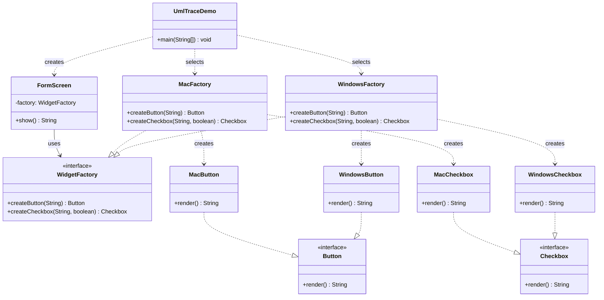
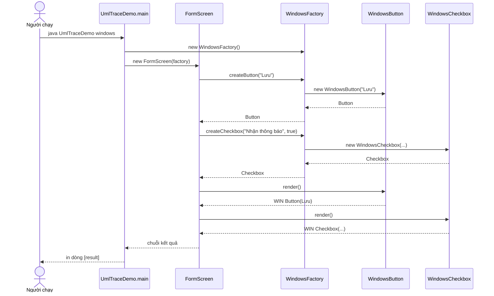

# Đọc kết quả chạy và đối chiếu mã Java với các vai trò trong sơ đồ UML

Khi đọc một ví dụ **Abstract Factory**, việc hiểu tên các interface và lớp trong sơ đồ UML mới là bước đầu. Ta còn phải xác định **đối tượng nào thực sự được chọn khi chạy**, vì sao client có thể gọi phương thức qua interface, và dòng kết quả nào chứng minh một `ConcreteFactory` đã tạo đúng **họ sản phẩm** của mình.

Bài học thuộc chương **Hiện thực bằng Java** của module **SOFTWARE_DESIGN_DESIGN_PATTERN_CREATIONAL_ABSTRACT_FACTORY** — học về Abstract Factory trong nhóm *creational design pattern*. Ta sẽ dùng Java 17, một sơ đồ UML, mã có thể chạy trực tiếp và log theo thứ tự thực thi để đối chiếu đầy đủ các vai trò **Abstract Factory, Concrete Factory, Abstract Product, Concrete Product, Client** và **composition root**.

## 1. Bài toán và mục tiêu quan sát

Một ứng dụng biểu mẫu cần hai loại thành phần giao diện:

- `Button`: biểu diễn nút lưu dữ liệu.
- `Checkbox`: biểu diễn tùy chọn nhận thông báo.

Ứng dụng chạy theo một trong hai biến thể: `WINDOWS` hoặc `MACOS`. Mỗi biến thể có một **họ sản phẩm** tương thích:

| Họ sản phẩm | Loại `Button` | Loại `Checkbox` | Factory tạo cả họ |
| --- | --- | --- | --- |
| `WINDOWS` | `WindowsButton` | `WindowsCheckbox` | `WindowsFactory` |
| `MACOS` | `MacButton` | `MacCheckbox` | `MacFactory` |

Yêu cầu là `FormScreen` sử dụng nút và checkbox **cùng nền tảng**, nhưng không chứa mã `new WindowsButton(...)`, `new MacCheckbox(...)` hoặc nhánh chọn theo `platform`. Khi đổi tham số dòng lệnh từ `windows` sang `macos`, chỉ quyết định chọn **concrete factory** ở nơi khởi động thay đổi.

Sau bài học, người đọc cần tự trả lời được:

1. Trong UML, mũi tên nào thể hiện lớp **implements interface**, lớp nào **sử dụng** interface và lớp nào **tạo** sản phẩm?
2. Từ một dòng log như `[factory/windows] createButton -> WindowsButton`, có thể truy ngược về phương thức Java và quan hệ nào trong UML?
3. Vì sao biến khai báo kiểu `Button` vẫn chạy `WindowsButton.render()` hoặc `MacButton.render()`?
4. Kết quả chạy chứng minh được điều gì về họ sản phẩm, và giới hạn của bằng chứng đó ở đâu?

## 2. Sơ đồ UML: nhận diện các vai trò trước khi đọc mã



Đây là **sơ đồ lớp (class diagram)**, tập trung vào quan hệ kiểu dữ liệu và trách nhiệm. Các class trong ví dụ Java sẽ được đặt lồng bên trong `UmlTraceDemo` để thuận tiện chạy bằng một file; sơ đồ lược bỏ lớp bao ngoài trong tên kiểu như `UmlTraceDemo.WindowsButton` để dễ nhìn.

| Vai trò Abstract Factory | Phần tử UML / Java | Ý nghĩa |
| --- | --- | --- |
| **Abstract Factory** | `WidgetFactory` | Khai báo `createButton` và `createCheckbox`; các kiểu trả về là interface |
| **Concrete Factory** | `WindowsFactory`, `MacFactory` | Triển khai hợp đồng, tạo cặp sản phẩm thuộc đúng một nền tảng |
| **Abstract Product** | `Button`, `Checkbox` | Định nghĩa hành vi client cần gọi, ở đây là `render()` |
| **Concrete Product** | `WindowsButton`, `WindowsCheckbox`, `MacButton`, `MacCheckbox` | Hiện thực `render()` theo từng nền tảng |
| **Client** | `FormScreen` | Chỉ lưu `WidgetFactory`, gọi factory để lấy sản phẩm rồi sử dụng chúng |
| **Composition root** | `UmlTraceDemo.main()` | Đọc lựa chọn nền tảng, tạo concrete factory và truyền cho client |

### Cách đọc các mũi tên trong sơ đồ

- `WindowsFactory ..|> WidgetFactory` là quan hệ **realization**: class `WindowsFactory` dùng `implements WidgetFactory`.
- `WindowsButton ..|> Button` có cùng ý nghĩa ở phía sản phẩm: class cụ thể triển khai interface sản phẩm.
- `WindowsFactory ..> WindowsButton : creates` là quan hệ **phụ thuộc khi tạo**: trong `createButton()`, factory gọi constructor của `WindowsButton`.
- `FormScreen --> WidgetFactory : uses` biểu diễn client giữ tham chiếu và dùng abstract factory, không biết các concrete factory.
- `UmlTraceDemo ..> MacFactory : selects` biểu diễn mã tại điểm khởi động biết cách tạo `MacFactory` khi cấu hình yêu cầu.

**Chú ý:** UML class diagram cho biết *cấu trúc mã nguồn*. Nó không khẳng định tại một lần chạy cả `WindowsFactory` và `MacFactory` đều được tạo. Factory thực sự được chọn phụ thuộc **tham số lúc chạy**; ta sẽ xác nhận bằng log.

## 3. Chương trình Java 17 hoàn chỉnh để đối chiếu

Lưu toàn bộ mã sau vào file **`UmlTraceDemo.java`**. Các sản phẩm chỉ tạo chuỗi và in log, không dựng UI thật; nhờ vậy toàn bộ đường đi của lời gọi được quan sát rõ mà không cần Swing, JavaFX hay thư viện ngoài JDK.

```java
import java.util.Locale;
import java.util.Objects;

public final class UmlTraceDemo {
    enum Platform {
        WINDOWS, MACOS;

        static Platform parse(String raw) {
            if (raw == null || raw.isBlank()) {
                throw new IllegalArgumentException("Platform không được rỗng");
            }

            return switch (raw.trim().toLowerCase(Locale.ROOT)) {
                case "windows", "win" -> WINDOWS;
                case "macos", "mac" -> MACOS;
                default -> throw new IllegalArgumentException(
                        "Platform không hỗ trợ: " + raw);
            };
        }
    }

    // ABSTRACT PRODUCTS: client chỉ dựa vào hai interface này.
    interface Button {
        String render();
    }

    interface Checkbox {
        String render();
    }

    // ABSTRACT FACTORY: cách tạo một bộ sản phẩm tương thích.
    interface WidgetFactory {
        Button createButton(String label);

        Checkbox createCheckbox(String label, boolean checked);
    }

    // CONCRETE PRODUCTS của họ WINDOWS.
    record WindowsButton(String label) implements Button {
        @Override
        public String render() {
            System.out.println("[product/windows] render WindowsButton");
            return "WIN Button(" + label + ")";
        }
    }

    record WindowsCheckbox(String label, boolean checked) implements Checkbox {
        @Override
        public String render() {
            System.out.println("[product/windows] render WindowsCheckbox");
            return "WIN Checkbox(" + label + ", checked=" + checked + ")";
        }
    }

    // CONCRETE PRODUCTS của họ MACOS.
    record MacButton(String label) implements Button {
        @Override
        public String render() {
            System.out.println("[product/macos] render MacButton");
            return "MAC Button(" + label + ")";
        }
    }

    record MacCheckbox(String label, boolean checked) implements Checkbox {
        @Override
        public String render() {
            System.out.println("[product/macos] render MacCheckbox");
            return "MAC Checkbox(" + label + ", checked=" + checked + ")";
        }
    }

    // CONCRETE FACTORY của họ WINDOWS.
    static final class WindowsFactory implements WidgetFactory {
        @Override
        public Button createButton(String label) {
            System.out.println("[factory/windows] createButton -> WindowsButton");
            return new WindowsButton(label);
        }

        @Override
        public Checkbox createCheckbox(String label, boolean checked) {
            System.out.println("[factory/windows] createCheckbox -> WindowsCheckbox");
            return new WindowsCheckbox(label, checked);
        }
    }

    // CONCRETE FACTORY của họ MACOS.
    static final class MacFactory implements WidgetFactory {
        @Override
        public Button createButton(String label) {
            System.out.println("[factory/macos] createButton -> MacButton");
            return new MacButton(label);
        }

        @Override
        public Checkbox createCheckbox(String label, boolean checked) {
            System.out.println("[factory/macos] createCheckbox -> MacCheckbox");
            return new MacCheckbox(label, checked);
        }
    }

    // CLIENT: không import hay tự new sản phẩm cụ thể.
    static final class FormScreen {
        private final WidgetFactory factory;

        FormScreen(WidgetFactory factory) {
            this.factory = Objects.requireNonNull(factory);
        }

        String show() {
            System.out.println("[client] request Button");
            Button button = factory.createButton("Lưu");

            System.out.println("[client] request Checkbox");
            Checkbox checkbox = factory.createCheckbox("Nhận thông báo", true);

            System.out.println("[client] render Button");
            String buttonView = button.render();

            System.out.println("[client] render Checkbox");
            String checkboxView = checkbox.render();

            return buttonView + " | " + checkboxView;
        }
    }

    // COMPOSITION ROOT: là nơi chọn concrete factory.
    public static void main(String[] args) {
        if (args.length > 1) {
            throw new IllegalArgumentException("Chỉ nhận tối đa một platform");
        }

        Platform platform = Platform.parse(
                args.length == 0 ? "windows" : args[0]);

        WidgetFactory selected = switch (platform) {
            case WINDOWS -> new WindowsFactory();
            case MACOS -> new MacFactory();
        };

        System.out.println("[bootstrap] platform=" + platform);
        System.out.println("[bootstrap] factory="
                + selected.getClass().getSimpleName());

        String rendered = new FormScreen(selected).show();
        System.out.println("[result] " + rendered);
    }
}
```

Các từ khóa Java ứng với vai trò UML khá trực tiếp: `interface` định nghĩa **hợp đồng**, `implements` gắn class vào hợp đồng, `new WindowsButton(...)` cho biết quan hệ **creates**, và biến `private final WidgetFactory factory` của `FormScreen` chính là quan hệ **uses**. Những `record` sản phẩm vẫn là **class cụ thể** có constructor và triển khai interface, hoàn toàn phù hợp với vai trò Concrete Product.

## 4. Chạy thử và đọc kết quả theo đúng thứ tự

Trong thư mục chứa `UmlTraceDemo.java`, dùng JDK 17 hoặc mới hơn:

```bash
javac -encoding UTF-8 UmlTraceDemo.java
java UmlTraceDemo windows
```

Kết quả dự kiến khi chọn **WINDOWS**:

```text
[bootstrap] platform=WINDOWS
[bootstrap] factory=WindowsFactory
[client] request Button
[factory/windows] createButton -> WindowsButton
[client] request Checkbox
[factory/windows] createCheckbox -> WindowsCheckbox
[client] render Button
[product/windows] render WindowsButton
[client] render Checkbox
[product/windows] render WindowsCheckbox
[result] WIN Button(Lưu) | WIN Checkbox(Nhận thông báo, checked=true)
```

Chạy lại với biến thể còn lại:

```bash
java UmlTraceDemo macos
```

Kết quả dự kiến khi chọn **MACOS**:

```text
[bootstrap] platform=MACOS
[bootstrap] factory=MacFactory
[client] request Button
[factory/macos] createButton -> MacButton
[client] request Checkbox
[factory/macos] createCheckbox -> MacCheckbox
[client] render Button
[product/macos] render MacButton
[client] render Checkbox
[product/macos] render MacCheckbox
[result] MAC Button(Lưu) | MAC Checkbox(Nhận thông báo, checked=true)
```

Đối chiếu hai lần chạy, có thể thấy **các dòng `[client] ...` không thay đổi**. Điều thay đổi là factory được tạo ở bootstrap, class sản phẩm được factory tạo và phần hành vi do các concrete product cung cấp. Đây là một biểu hiện quan sát được của việc **client phụ thuộc vào abstraction thay vì class cụ thể**.

Nếu bỏ tham số, chương trình mặc định chọn `windows`. Nếu truyền `linux`, `Platform.parse()` báo `IllegalArgumentException` trước khi có dòng `[bootstrap]` nào được in ra. Điều này giúp lỗi cấu hình được phát hiện sớm, thay vì tùy tiện chọn một họ không được yêu cầu.

## 5. Bảng đối chiếu từng dòng log WINDOWS với mã và UML

| Dòng | Kết quả hoặc tiền tố log | Nơi phát sinh trong Java | Vai trò / quan hệ UML |
| --- | --- | --- | --- |
| 1 | `[bootstrap] platform=WINDOWS` | `main()` sau `Platform.parse(...)` | **Composition root** đọc và chuẩn hóa biến thể |
| 2 | `[bootstrap] factory=WindowsFactory` | `selected.getClass().getSimpleName()` | Composition root đã chọn **Concrete Factory** `WindowsFactory` |
| 3 | `[client] request Button` | `FormScreen.show()` | **Client** chuẩn bị dùng `WidgetFactory.createButton()` |
| 4 | `[factory/windows] createButton -> WindowsButton` | `WindowsFactory.createButton()` | **Concrete Factory** tạo **Concrete Product** qua quan hệ `creates` |
| 5 | `[client] request Checkbox` | `FormScreen.show()` | Client gọi tiếp phương thức thứ hai trên **cùng factory** |
| 6 | `[factory/windows] createCheckbox -> WindowsCheckbox` | `WindowsFactory.createCheckbox()` | Concrete Factory tạo sản phẩm thứ hai thuộc **cùng họ WINDOWS** |
| 7 | `[client] render Button` | `FormScreen.show()` | Client gọi hành vi qua **Abstract Product** `Button` |
| 8 | `[product/windows] render WindowsButton` | `WindowsButton.render()` | **Concrete Product** hiện thực hành vi của interface `Button` |
| 9 | `[client] render Checkbox` | `FormScreen.show()` | Client gọi hành vi qua interface `Checkbox` |
| 10 | `[product/windows] render WindowsCheckbox` | `WindowsCheckbox.render()` | Concrete Product hiện thực hành vi của interface `Checkbox` |
| 11 | `[result] WIN Button(...) \| WIN Checkbox(...)` | `main()` in chuỗi mà `show()` trả về | Kết quả **ghép từ hai sản phẩm của họ WINDOWS** |

Khi đọc dòng 4, đừng chỉ nhìn `-> WindowsButton` và kết luận client đã khởi tạo trực tiếp class này. Chính **`WindowsFactory.createButton()`** thực thi lệnh `new WindowsButton(label)`. Từ phía client, mã chỉ là:

```java
Button button = factory.createButton("Lưu");
```

Mối liên hệ giữa **lời gọi phía client**, **thân phương thức ở concrete factory** và **class sản phẩm thực tế** chính là đường đi trọng tâm cần đối chiếu với UML.

## 6. Vì sao gọi qua interface lại chạy vào lớp cụ thể?

Hai câu lệnh trong `main()` chứa chìa khóa:

```java
WidgetFactory selected = new WindowsFactory();
FormScreen screen = new FormScreen(selected);
```

Đây là biến thể rút gọn cho lần chạy WINDOWS. Java cho phép gán một instance `WindowsFactory` cho biến kiểu `WidgetFactory` vì `WindowsFactory implements WidgetFactory`.

Trong `FormScreen`, biến `factory` có **kiểu khai báo (compile-time type)** là `WidgetFactory`, nhưng đối tượng thực nó tham chiếu ở lần chạy này có **kiểu runtime** là `WindowsFactory`. Do đó lời gọi:

```java
Button button = factory.createButton("Lưu");
```

được **dynamic dispatch** tới `WindowsFactory.createButton(...)`. Phương thức đó tạo một `WindowsButton` và trả về dưới kiểu `Button`. Khi client tiếp tục gọi `button.render()`, Java dispatch tới `WindowsButton.render()`, dẫn đến dòng log `[product/windows] ...`.

Một bản đối chiếu ngắn:

| Biểu thức trong client | Kiểu khai báo | Đối tượng thật ở lần chạy WINDOWS | Hành vi được gọi |
| --- | --- | --- | --- |
| `factory` | `WidgetFactory` | `WindowsFactory` | `WindowsFactory.createButton/Checkbox` |
| `button` | `Button` | `WindowsButton` | `WindowsButton.render()` |
| `checkbox` | `Checkbox` | `WindowsCheckbox` | `WindowsCheckbox.render()` |

Khi chuyển sang MACOS, **kiểu khai báo không đổi**, nhưng đối tượng runtime lần lượt là `MacFactory`, `MacButton`, `MacCheckbox`. Đó là cách Abstract Factory cô lập lựa chọn họ sản phẩm khỏi `FormScreen`.

## 7. Sơ đồ tuần tự cho lần chạy WINDOWS

**Class diagram** ở phần 2 trả lời *những lớp nào liên quan và quan hệ của chúng là gì*. **Sequence diagram** dưới đây trả lời *đối tượng nào gọi phương thức nào, theo thứ tự nào trong một lần chạy*:



Sơ đồ tuần tự lược bỏ các dòng log trung gian để nhấn mạnh luồng lời gọi và trả về. Nó **không bổ sung loại sản phẩm** nào ngoài hai abstract products đã có trong class diagram.

Một khác biệt cần nhớ: `render()` là **hành vi của sản phẩm**, còn `createButton()` và `createCheckbox()` là **trách nhiệm khởi tạo của factory**. Log `[factory/...]` giúp xác định **nơi tạo**, log `[product/...]` giúp xác định **nơi thực hiện hành vi**.

## 8. Dùng log để kiểm tra tính nhất quán theo họ

Ở lần chạy WINDOWS, hai dòng quan trọng là:

```text
[factory/windows] createButton -> WindowsButton
[factory/windows] createCheckbox -> WindowsCheckbox
```

Cả hai sản phẩm do **cùng một `WindowsFactory`** tạo và đều thuộc `WINDOWS`. Tương ứng, lần chạy MACOS có `MacButton` và `MacCheckbox`. Đây là kết quả đúng theo bất biến của ví dụ: *một màn hình chỉ sử dụng sản phẩm cùng nền tảng*.

Nếu sửa nhầm `WindowsFactory.createCheckbox()` thành:

```java
@Override
public Checkbox createCheckbox(String label, boolean checked) {
    return new MacCheckbox(label, checked); // Sai họ dù đúng interface.
}
```

Java vẫn có thể biên dịch vì `MacCheckbox implements Checkbox`. `WidgetFactory` quy định **loại** sản phẩm (`Checkbox`), nhưng không mang sẵn ràng buộc tĩnh rằng mọi kết quả phải thuộc họ WINDOWS. Khi chỉnh lỗi như vậy, log hoặc kết quả theo họ sẽ khác và cần kiểm tra lại. **Không nên tin log được viết thủ công như bằng chứng tuyệt đối**: nếu lập trình viên quên cập nhật câu `System.out.println`, log có thể nói `WindowsCheckbox` trong khi factory thực sự trả về `MacCheckbox`.

Trong dự án thật, nên có kiểm thử hành vi hoặc kiểm tra bất biến (theme, platform, provider, dialect...) trên sản phẩm thực, ngoài việc quan sát log.

## 9. Một bài kiểm tra nhỏ để nối UML với hành vi

Nếu dự án có JUnit 5 (JUnit Jupiter), có thể kiểm tra trực tiếp hai bộ sản phẩm của ví dụ. Test bên dưới dùng các lớp lồng của `UmlTraceDemo`, đặt cùng package mặc định như demo:

```java
import org.junit.jupiter.api.Test;

import static org.junit.jupiter.api.Assertions.assertEquals;

class UmlTraceDemoTest {
    @Test
    void windowsFactoryCreatesWindowsFamily() {
        UmlTraceDemo.WidgetFactory factory = new UmlTraceDemo.WindowsFactory();

        assertEquals("WIN Button(Lưu)",
                factory.createButton("Lưu").render());
        assertEquals("WIN Checkbox(Nhận thông báo, checked=true)",
                factory.createCheckbox("Nhận thông báo", true).render());
    }

    @Test
    void macFactoryCreatesMacFamily() {
        UmlTraceDemo.WidgetFactory factory = new UmlTraceDemo.MacFactory();

        assertEquals("MAC Button(Lưu)",
                factory.createButton("Lưu").render());
        assertEquals("MAC Checkbox(Nhận thông báo, checked=true)",
                factory.createCheckbox("Nhận thông báo", true).render());
    }
}
```

Bài test minh họa xác nhận output của hai loại sản phẩm trên mỗi factory theo đúng mô hình chuỗi. Nó **không thay thế** test UI trên Windows/macOS thật, nhưng giúp kiểm tra hai quan hệ `creates` mà UML đã mô tả.

Để kiểm tra client độc lập với implementation, có thể truyền một `WidgetFactory` giả vào `FormScreen`. Nếu `FormScreen` chỉ gọi `createButton()` và `createCheckbox()` trên interface, nó vẫn chạy được mà không cần khởi tạo `WindowsFactory` hoặc `MacFactory` trong mã client.

## 10. Những nhầm lẫn thường gặp khi đối chiếu UML và kết quả chạy

| Nhầm lẫn | Cách hiểu chính xác |
| --- | --- |
| “Có hai concrete factory trong UML nên cả hai đều được tạo khi chạy” | UML mô tả **cấu trúc khả dĩ**; composition root chỉ chọn một factory theo cấu hình cho lần chạy hiện tại |
| “`FormScreen` trả về `WindowsButton` nên nó phụ thuộc `WindowsButton`” | Biến trong client có kiểu `Button`; đối tượng thật ở runtime là `WindowsButton`, còn client vẫn chỉ phụ thuộc interface |
| “`WindowsFactory` kế thừa `WidgetFactory` như một class cha” | Trong ví dụ, `WidgetFactory` là **interface** và `WindowsFactory implements WidgetFactory`; UML dùng quan hệ realization |
| “`createButton()` và `render()` đều là phương thức tạo sản phẩm” | `createButton()` tạo object; `render()` gọi hành vi trên object đã có |
| “Log `WindowsFactory` chứng minh mọi sản phẩm đều Windows” | Cần kiểm tra **tất cả phương thức tạo** và hành vi/tính chất của sản phẩm; một phương thức vẫn có thể trả sai họ |
| “Dòng `[result]` là output do `WindowsFactory` trực tiếp in” | `FormScreen.show()` ghép chuỗi; `main()` in dòng cuối; concrete product cung cấp từng đoạn chuỗi |
| “Chọn factory mới có nghĩa sản phẩm cũ tự đổi” | Factory mới chỉ ảnh hưởng những lần tạo object tiếp theo; product đã tạo không tự chuyển họ |
| “UML class diagram là thứ tự lời gọi” | Class diagram là **quan hệ tĩnh**; dùng sequence diagram hoặc trace runtime để hiểu trình tự |

## 11. Bài tập tự đọc log và đáp án

**Bài tập A.** Một lần chạy ghi:

```text
[bootstrap] factory=MacFactory
[client] request Button
[factory/macos] createButton -> MacButton
[client] render Button
[product/macos] render MacButton
```

Hãy xác định Abstract Factory, Concrete Factory, Abstract Product, Concrete Product và Client.

**Đáp án:** `WidgetFactory` là Abstract Factory mà `FormScreen` giữ; `MacFactory` là Concrete Factory; `Button` là Abstract Product; `MacButton` là Concrete Product; `FormScreen` là Client. Dòng `factory=MacFactory` chỉ ra lựa chọn ở bootstrap, hai dòng về `Button` lần lượt thể hiện **tạo** rồi **sử dụng** sản phẩm.

**Bài tập B.** Giả sử dòng `[bootstrap] factory=WindowsFactory` đúng, nhưng ở kết quả cuối xuất hiện `MAC Checkbox(...)`. Mã nào cần kiểm tra đầu tiên?

**Đáp án:** Bắt đầu ở `WindowsFactory.createCheckbox(...)` vì nơi này phải trả `WindowsCheckbox`. Tiếp theo kiểm tra đường nhận sản phẩm của client: client có dùng lại widget từ cache, lấy từ factory khác hoặc DI bean bên ngoài hay không. **Không vội sửa `Checkbox` interface** vì cả hai concrete checkbox đều có thể triển khai interface đúng.

**Bài tập C.** Muốn thêm biến thể `LINUX`, phần nào thường cần thêm/sửa, phần nào thường giữ nguyên?

**Đáp án:** Bổ sung `LinuxButton`, `LinuxCheckbox`, `LinuxFactory`, thêm giá trị/ánh xạ `LINUX` trong `Platform.parse()` và lựa chọn tại composition root. Các interface `WidgetFactory`, `Button`, `Checkbox` và `FormScreen` có thể giữ nguyên nếu yêu cầu về loại sản phẩm không thay đổi. Đây là lợi thế khi **thêm họ sản phẩm**, còn khi thêm loại sản phẩm mới (ví dụ `Menu`) thì hợp đồng factory và mọi concrete factory thường phải cập nhật.

## 12. Checklist đọc một bài Java Abstract Factory qua UML

- [ ] Xác định **Abstract Factory** và tất cả phương thức tạo sản phẩm trong UML.
- [ ] Xác định mỗi **Abstract Product** và những class nào `implements` interface đó.
- [ ] Xác định mỗi **Concrete Factory** và cặp/nhóm Concrete Product mà factory tạo.
- [ ] Xác định **Client** giữ tham chiếu kiểu abstract nào; kiểm tra nó không tự `new` concrete product.
- [ ] Xác định **composition root** chọn factory theo tham số hoặc cấu hình ở đâu.
- [ ] Khi chạy, đọc lần lượt các log: cấu hình → factory được chọn → lời gọi client → object được tạo → hành vi sản phẩm → kết quả cuối.
- [ ] Phân biệt **kiểu khai báo** trong code và **class của đối tượng runtime** khi giải thích dynamic dispatch.
- [ ] Đối chiếu từng dòng log với phương thức Java **thực sự phát sinh dòng đó**, không suy luận chỉ từ tên hiển thị.
- [ ] Kiểm tra các sản phẩm dùng trong cùng ngữ cảnh có thuộc **một họ tương thích** hay không.
- [ ] Khi cần diễn giải thứ tự lời gọi, dùng **sequence diagram** bổ sung cho class diagram.

**Ghi nhớ:** UML cho thấy **ai phụ thuộc vào hợp đồng nào, ai triển khai hợp đồng và ai tạo sản phẩm**. Log khi chạy cho thấy **factory nào được chọn và phương thức cụ thể nào thực thi trong một lần sử dụng**. Đọc kết hợp cả hai giúp nhận diện đúng các vai trò của Abstract Factory, giải thích cơ chế đa hình trong Java và kiểm chứng đường tạo một họ sản phẩm nhất quán, thay vì chỉ ghi nhớ tên lớp trong sơ đồ.
