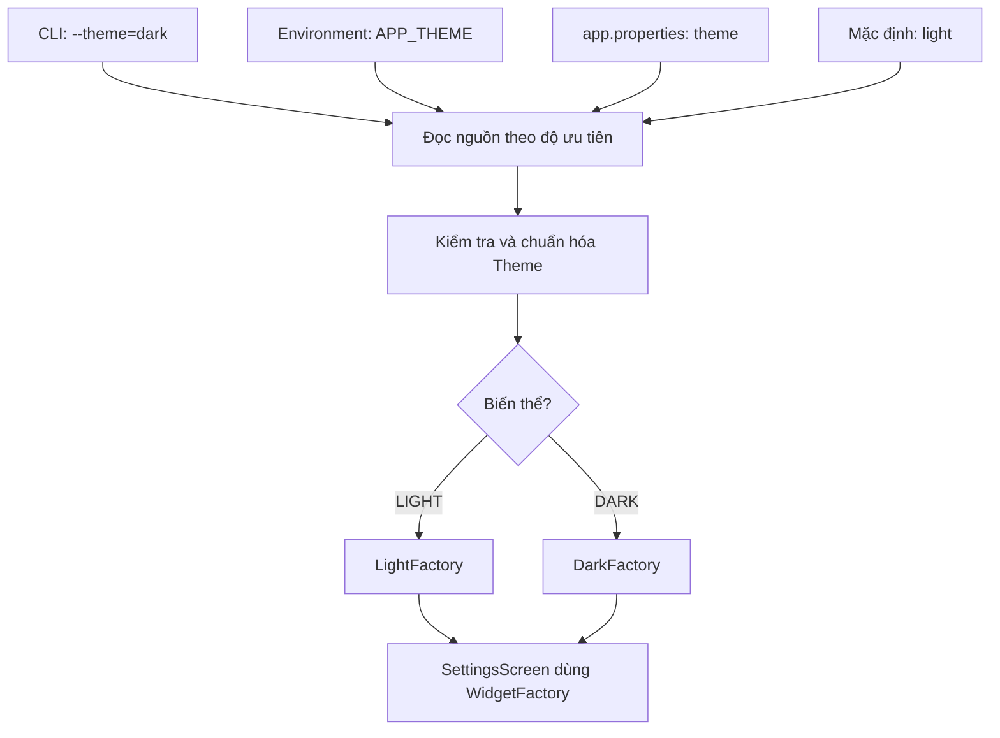

# Chọn factory từ tham số dòng lệnh, tệp cấu hình hoặc biến môi trường

## 1. Bài toán: chọn một họ đối tượng khi ứng dụng khởi động

**Abstract Factory** là mẫu thiết kế khởi tạo cung cấp một giao diện để tạo ra **cả họ đối tượng có liên quan và tương thích với nhau**, mà mã sử dụng không cần biết lớp cụ thể của từng đối tượng. Sau khi có nhiều concrete factory, ứng dụng phải quyết định **factory nào sẽ được dùng**. Quyết định này thường phụ thuộc vào môi trường chạy, cách triển khai hoặc yêu cầu của người vận hành.

Giả sử ứng dụng hỗ trợ hai giao diện:

- `LightFactory` tạo `LightButton` và `LightCheckbox`.
- `DarkFactory` tạo `DarkButton` và `DarkCheckbox`.

`SettingsScreen` chỉ làm việc với `WidgetFactory`, `Button` và `Checkbox`. Nó không tự đọc biến môi trường, phân tích tham số dòng lệnh hay tạo trực tiếp các lớp `Light*`/`Dark*`.

Nhu cầu cụ thể: người chạy ứng dụng có thể chọn giao diện bằng một trong ba nguồn cấu hình:

1. Tham số dòng lệnh, ví dụ `--theme=dark`.
2. Biến môi trường, ví dụ `APP_THEME=dark`.
3. Tệp cấu hình, ví dụ `theme=dark` trong `app.properties`.

Nếu không có nguồn nào khai báo, ứng dụng sử dụng biến thể mặc định `light`. Việc **chọn concrete factory diễn ra ở điểm khởi tạo ứng dụng** (*composition root*); các phần còn lại chỉ nhận và dùng giao diện factory.

## 2. Phân chia trách nhiệm

| Thành phần | Trách nhiệm | Không nên làm |
| --- | --- | --- |
| Tham số dòng lệnh / biến môi trường / tệp cấu hình | Cung cấp tên biến thể theo cách vận hành ứng dụng | Chứa logic tạo `Button`, `Checkbox` |
| `Theme` và logic đọc cấu hình | Chuẩn hóa, kiểm tra giá trị và xác định biến thể hiệu lực | Tạo từng sản phẩm giao diện |
| `createFactory(Theme)` | Ánh xạ biến thể hợp lệ sang một concrete factory | Đọc lại nhiều nguồn cấu hình |
| `WidgetFactory` | Khai báo các phương thức tạo sản phẩm cùng họ | Quyết định nên dùng `light` hay `dark` |
| `SettingsScreen` | Sử dụng sản phẩm qua abstraction | Gọi `new LightButton()` hay kiểm tra `APP_THEME` |



Sơ đồ cho thấy **nguồn cấu hình chỉ quyết định biến thể**, còn concrete factory mới quyết định cách tạo *toàn bộ họ sản phẩm*. Nhờ vậy, đổi giao diện không làm phát sinh các câu lệnh `if (theme == ...)` rải rác ở từng màn hình.

## 3. Quy tắc chọn biến thể và độ ưu tiên

Một ứng dụng nên công bố thứ tự ưu tiên rõ ràng, vì nhiều nguồn có thể cùng tồn tại. Trong ví dụ này:

**Tham số dòng lệnh > Biến môi trường > Tệp cấu hình > Giá trị mặc định.**

| Nguồn | Cách khai báo | Độ ưu tiên | Cách sử dụng điển hình |
| --- | --- | --- | --- |
| CLI | `--theme=light` hoặc `--theme=dark` | 1 — cao nhất | Chạy thủ công, kiểm thử, ghi đè cho một lần chạy |
| Biến môi trường | `APP_THEME=light` hoặc `APP_THEME=dark` | 2 | Container, CI/CD, cấu hình theo môi trường triển khai |
| Tệp cấu hình | `theme=light` hoặc `theme=dark` trong `app.properties` | 3 | Cấu hình mặc định của bản triển khai |
| Giá trị mặc định | `light` | 4 — thấp nhất | Chạy nhanh khi không có cấu hình |

Ví dụ, nếu `app.properties` ghi `theme=dark` nhưng `APP_THEME=light`, kết quả là `light`. Nếu bổ sung `--theme=dark`, kết quả cuối là `dark`. Nguồn có độ ưu tiên cao hơn **ghi đè toàn bộ lựa chọn biến thể**, chứ không tạo một phần sản phẩm từ factory này và phần còn lại từ factory khác.

Điểm cần phân biệt: **không khai báo** khác với **khai báo một giá trị sai**. Nếu truyền `--theme=blue` hoặc đặt `APP_THEME` thành chuỗi rỗng, ứng dụng nên báo lỗi rõ ràng thay vì âm thầm chuyển sang nguồn có độ ưu tiên thấp hơn. Cách này giúp phát hiện lỗi cấu hình sớm và tránh ứng dụng chạy với giao diện ngoài ý muốn.

## 4. Ví dụ Java 17 có thể chạy độc lập

Tạo tệp `VariantSelectionDemo.java` với mã dưới đây. Ví dụ dùng kết quả chuỗi từ `render()` để quan sát họ sản phẩm; trong ứng dụng giao diện thực, sản phẩm có thể là widget, renderer hoặc đối tượng tích hợp nền tảng.

```java
import java.io.IOException;
import java.io.Reader;
import java.nio.charset.StandardCharsets;
import java.nio.file.Files;
import java.nio.file.Path;
import java.util.Locale;
import java.util.Properties;

public final class VariantSelectionDemo {

    // Abstract products: mã sử dụng chỉ biết các interface này.
    interface Button {
        String render();
    }

    interface Checkbox {
        String render();
    }

    // Abstract factory: tạo một họ sản phẩm tương thích.
    interface WidgetFactory {
        Button createButton();
        Checkbox createCheckbox();
    }

    // Các sản phẩm của họ Light.
    static final class LightButton implements Button {
        public String render() { return "[Light] Button: Lưu"; }
    }

    static final class LightCheckbox implements Checkbox {
        public String render() { return "[Light] Checkbox: Đồng ý"; }
    }

    // Các sản phẩm của họ Dark.
    static final class DarkButton implements Button {
        public String render() { return "[Dark] Button: Lưu"; }
    }

    static final class DarkCheckbox implements Checkbox {
        public String render() { return "[Dark] Checkbox: Đồng ý"; }
    }

    static final class LightFactory implements WidgetFactory {
        public Button createButton() { return new LightButton(); }
        public Checkbox createCheckbox() { return new LightCheckbox(); }
    }

    static final class DarkFactory implements WidgetFactory {
        public Button createButton() { return new DarkButton(); }
        public Checkbox createCheckbox() { return new DarkCheckbox(); }
    }

    // Client không biết concrete products hay nguồn cấu hình.
    static final class SettingsScreen {
        private final WidgetFactory factory;

        SettingsScreen(WidgetFactory factory) {
            this.factory = factory;
        }

        void render() {
            System.out.println(factory.createButton().render());
            System.out.println(factory.createCheckbox().render());
        }
    }

    enum Theme {
        LIGHT, DARK;

        static Theme parse(String raw) {
            String normalized = raw.strip().toLowerCase(Locale.ROOT);
            return switch (normalized) {
                case "light" -> LIGHT;
                case "dark" -> DARK;
                default -> throw new IllegalArgumentException(
                    "theme không hợp lệ: '" + raw + "' (chỉ nhận light hoặc dark)"
                );
            };
        }
    }

    record Options(String themeFromCli, Path configPath, boolean explicitConfig) {}

    // Ví dụ chấp nhận cú pháp --theme=... và --config=...
    static Options parseArgs(String[] args) {
        String theme = null;
        Path config = Path.of("app.properties");
        boolean explicitConfig = false;

        for (String arg : args) {
            if (arg.startsWith("--theme=")) {
                if (theme != null) {
                    throw new IllegalArgumentException("--theme được khai báo nhiều lần");
                }
                theme = arg.substring("--theme=".length());
            } else if (arg.startsWith("--config=")) {
                if (explicitConfig) {
                    throw new IllegalArgumentException("--config được khai báo nhiều lần");
                }
                String value = arg.substring("--config=".length());
                if (value.isBlank()) {
                    throw new IllegalArgumentException("--config cần đường dẫn tệp");
                }
                config = Path.of(value);
                explicitConfig = true;
            } else {
                throw new IllegalArgumentException("Tham số không hỗ trợ: " + arg);
            }
        }
        return new Options(theme, config, explicitConfig);
    }

    static Properties loadConfig(Path path, boolean required) throws IOException {
        Properties properties = new Properties();
        if (Files.notExists(path)) {
            if (required) {
                throw new IOException("Không tìm thấy tệp cấu hình: " + path);
            }
            return properties; // Tệp mặc định là tùy chọn.
        }
        try (Reader reader = Files.newBufferedReader(path, StandardCharsets.UTF_8)) {
            properties.load(reader);
        }
        return properties;
    }

    static Theme resolveTheme(Options options, Properties properties) {
        String value;
        if (options.themeFromCli() != null) {
            value = options.themeFromCli();
        } else if (System.getenv("APP_THEME") != null) {
            value = System.getenv("APP_THEME");
        } else {
            value = properties.getProperty("theme", "light");
        }
        return Theme.parse(value);
    }

    // Chỉ ánh xạ Theme -> concrete factory ở composition root.
    static WidgetFactory createFactory(Theme theme) {
        return switch (theme) {
            case LIGHT -> new LightFactory();
            case DARK -> new DarkFactory();
        };
    }

    public static void main(String[] args) {
        try {
            Options options = parseArgs(args);
            Properties properties = loadConfig(options.configPath(), options.explicitConfig());
            Theme theme = resolveTheme(options, properties);
            WidgetFactory factory = createFactory(theme);

            System.out.println("Đã chọn theme: " + theme);
            new SettingsScreen(factory).render();
        } catch (IllegalArgumentException | IOException ex) {
            System.err.println("Lỗi cấu hình: " + ex.getMessage());
            System.exit(2);
        }
    }
}
```

Các điểm quan trọng trong mã:

- `parseArgs` chỉ phân tích tham số và phát hiện tham số lặp/không hỗ trợ; nó không tạo đối tượng giao diện.
- `loadConfig` đọc tệp mặc định `app.properties` nếu tệp tồn tại. Khi người dùng chỉ rõ `--config=...`, việc không tìm thấy tệp trở thành lỗi.
- `resolveTheme` áp dụng đúng một thứ tự ưu tiên và dùng `Theme.parse` để kiểm tra giá trị. Giá trị chữ hoa/thường như `DARK` và khoảng trắng đầu/cuối vẫn được chấp nhận.
- `createFactory` gom việc chọn concrete factory vào một nơi. `SettingsScreen` chỉ phụ thuộc `WidgetFactory` nên không cần thay đổi khi chuyển giữa hai họ sản phẩm.

### Chạy thử

Biên dịch (JDK 17 trở lên):

```bash
javac -encoding UTF-8 VariantSelectionDemo.java
java VariantSelectionDemo --theme=dark
```

Kết quả mong đợi:

```text
Đã chọn theme: DARK
[Dark] Button: Lưu
[Dark] Checkbox: Đồng ý
```

Tạo `app.properties` cùng thư mục chạy chương trình:

```properties
theme=dark
```

Sau đó chạy `java VariantSelectionDemo` sẽ chọn `DARK`, miễn là không có `APP_THEME` hoặc `--theme` ghi đè. Có thể chỉ định tệp khác bằng `java VariantSelectionDemo --config=config/production.properties` (đường dẫn tính từ thư mục hiện hành). Ví dụ đặt biến môi trường trong PowerShell:

```powershell
$env:APP_THEME = 'light'
java VariantSelectionDemo
Remove-Item Env:APP_THEME
```

Trên Linux/macOS, có thể áp dụng biến môi trường cho đúng một lệnh bằng `APP_THEME=light java VariantSelectionDemo`.

## 5. Các tình huống cần kiểm chứng

| Tệp `app.properties` | `APP_THEME` | CLI | Factory được tạo |
| --- | --- | --- | --- |
| Không có tệp | Không đặt | Không đặt | `LightFactory` (mặc định) |
| `theme=dark` | Không đặt | Không đặt | `DarkFactory` |
| `theme=dark` | `light` | Không đặt | `LightFactory` |
| `theme=light` | `light` | `--theme=dark` | `DarkFactory` |
| `theme=dark` | `unknown` | Không đặt | Lỗi cấu hình, không tạo factory |
| `theme=dark` | `unknown` | `--theme=light` | `LightFactory` vì CLI có độ ưu tiên cao hơn |
| `theme=dark` | Không đặt | `--theme=` | Lỗi cấu hình, không tự quay về `dark` |

Ví dụ này cố ý **đọc cấu hình khi khởi động rồi chọn một factory cho phiên chạy**. Đổi tệp hoặc biến môi trường sau khi chương trình đã chạy sẽ không tự thay factory. Muốn hỗ trợ thay đổi động phải thiết kế thêm cơ chế cập nhật trạng thái, quản lý vòng đời đối tượng và tái tạo nhất quán các sản phẩm liên quan.

## 6. Những lỗi thiết kế thường gặp

**Rải việc chọn biến thể ở nhiều nơi.** Nếu `SettingsScreen`, `ProfileScreen` và `Dialog` đều đọc `APP_THEME` rồi tự chọn từng lớp, quy tắc ưu tiên dễ bị sai lệch và các sản phẩm có thể không đồng bộ. Nên chọn `WidgetFactory` một lần, sau đó truyền qua constructor hoặc cơ chế dependency injection.

**Trộn hai họ sản phẩm.** Ví dụ sử dụng `LightButton` với `DarkCheckbox` có thể làm giao diện thiếu nhất quán. Một concrete factory phải chịu trách nhiệm tạo đủ các loại sản phẩm mà client cần. Nếu họ sản phẩm có thêm `Menu`, nên bổ sung `createMenu()` vào hợp đồng factory và thực hiện tại các concrete factory tương ứng.

**Phân tích tên biến thể ngay trong concrete factory.** Các factory như `DarkFactory` nên biết *cách tạo* sản phẩm Dark, không cần biết tên biến môi trường, đường dẫn cấu hình hay cú pháp CLI. Việc tách biệt này cho phép dùng cùng factory trong ứng dụng desktop, dịch vụ hoặc bài kiểm thử.

**Âm thầm sử dụng mặc định khi cấu hình sai.** `darkk` rất có thể là lỗi gõ. Nên thất bại sớm với thông báo chứa khóa cấu hình và tập giá trị được phép. Mặc định chỉ áp dụng khi không có nguồn nào cung cấp giá trị.

**Gắn chặt client với số lượng biến thể.** Mã kiểu `if (theme == DARK) new DarkButton()` trong client khiến mỗi biến thể mới kéo theo nhiều thay đổi. Client nên phụ thuộc vào abstract factory; chỉ logic ánh xạ và lớp concrete mới cần được mở rộng. Nếu số lượng biến thể lớn hoặc được cung cấp qua plugin, có thể thay `switch` tập trung bằng một registry `Map<Theme, Supplier<WidgetFactory>>`.

## 7. Khi nào nên dùng cách chọn này?

Cách chọn từ CLI/tệp cấu hình/biến môi trường hữu ích khi ứng dụng có các **họ thành phần thay thế nhau**: giao diện sáng/tối, adapter cho nhiều nhà cung cấp, bộ mã hóa/giải mã tương thích, hoặc tầng lưu trữ thử nghiệm/sản xuất. Nó đặc biệt phù hợp khi biến thể được quyết định ở lúc triển khai hoặc khởi động.

Tuy nhiên, **chỉ có một cờ cấu hình không tự động tạo ra nhu cầu Abstract Factory**. Nếu biến thể chỉ thay đổi một giá trị đơn lẻ, enum hoặc cấu hình thông thường có thể đủ. Abstract Factory có ích khi một lựa chọn phải quyết định **nhiều sản phẩm liên quan** và bảo đảm client dùng chúng như một bộ nhất quán.

**Ghi nhớ:** nguồn cấu hình trả lời câu hỏi *“chọn biến thể nào?”*; Abstract Factory trả lời câu hỏi *“tạo cả họ đối tượng của biến thể đó như thế nào?”*. Giữ hai trách nhiệm riêng biệt giúp ứng dụng có thể thay đổi cách triển khai mà không sửa logic nghiệp vụ sử dụng các sản phẩm.
