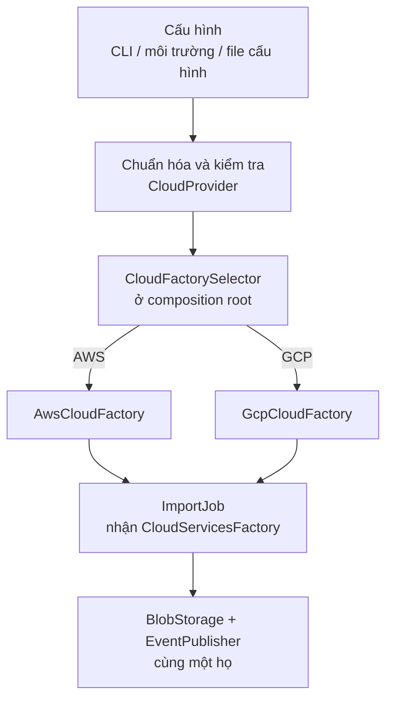

# Tập trung ánh xạ cấu hình sang ConcreteFactory tại điểm lắp ráp

Trong **Abstract Factory**, các lớp `ConcreteFactory` chịu trách nhiệm tạo những **họ sản phẩm tương thích**, còn ứng dụng phải quyết định **họ nào được sử dụng**. Một lỗi thiết kế phổ biến là để nhiều service tự đọc biến môi trường, tự kiểm tra tên nhà cung cấp rồi tự khởi tạo factory. Khi ấy, logic chọn biến thể bị rải rác và việc thay cấu hình có thể khiến các phần của hệ thống sử dụng những họ sản phẩm khác nhau.

Bài này thuộc chương **Lựa chọn biến thể** của module **SOFTWARE_DESIGN_DESIGN_PATTERN_CREATIONAL_ABSTRACT_FACTORY** — học về Abstract Factory trong nhóm creational design pattern. Trọng tâm là **đọc cấu hình, ánh xạ nó sang đúng `ConcreteFactory` tại điểm lắp ráp (composition root), rồi truyền factory dưới dạng interface cho mã sử dụng**.

## 1. Vì sao phải tập trung quyết định chọn biến thể?

Giả sử một ứng dụng nhập dữ liệu cần dùng đồng thời:

- Một dịch vụ lưu tệp: `BlobStorage`.
- Một dịch vụ phát sự kiện sau khi nhập xong: `EventPublisher`.

Ứng dụng chạy trên **AWS** thì dùng cặp `S3BlobStorage` và `SnsEventPublisher`; chạy trên **GCP** thì dùng cặp `GcsBlobStorage` và `PubSubEventPublisher`. Cả hai cặp là những **họ sản phẩm** của Abstract Factory. Các tên lớp dịch vụ ở đây chỉ minh họa kiến trúc; mã ví dụ không thực sự gọi API của AWS hoặc Google Cloud.

Một cách viết dễ gây rắc rối là:

```java
// Ví dụ KHÔNG NÊN áp dụng trong logic nghiệp vụ.
String provider = System.getenv("CLOUD_PROVIDER");

BlobStorage storage = provider.equals("aws")
        ? new S3BlobStorage()
        : new GcsBlobStorage();

// Ở một service khác lại có logic chọn nhà cung cấp riêng.
EventPublisher publisher = provider.equals("gcp")
        ? new PubSubEventPublisher()
        : new SnsEventPublisher();
```

Đoạn mã trên chỉ mô tả **phản ví dụ**, không phải chương trình độc lập có thể biên dịch ngay. Vấn đề không nằm ở cú pháp `if` hoặc toán tử ba ngôi; vấn đề là **quyết định kiến trúc bị nhân bản**. Mỗi nơi có thể chuẩn hóa cấu hình khác nhau, xử lý giá trị sai khác nhau hoặc chọn nhầm sản phẩm không cùng họ.

Cách tổ chức tốt hơn là **một điểm lắp ráp** nhận cấu hình, tạo đúng `CloudServicesFactory` và truyền nó vào ứng dụng. Các service chỉ biết `CloudServicesFactory`, `BlobStorage` và `EventPublisher`.

## 2. Luồng ánh xạ cấu hình tại composition root



Sơ đồ thể hiện **luồng cấu hình và lắp ghép lúc chạy**. Còn về phụ thuộc lúc biên dịch, `ImportJob` chỉ phụ thuộc vào các interface; `CloudFactorySelector` và chương trình khởi động mới được phép biết `AwsCloudFactory` và `GcpCloudFactory`.

Ta có thể tách trách nhiệm theo bốn bước:

| Bước | Thành phần phụ trách | Việc phải làm |
| --- | --- | --- |
| 1. Đọc | Composition root hoặc bộ nạp cấu hình | Lấy `CLOUD_PROVIDER` từ nguồn cấu hình có thứ tự ưu tiên rõ ràng |
| 2. Diễn giải | `CloudProvider.parse` | Chuẩn hóa chữ hoa/thường, loại khoảng trắng, từ chối giá trị thiếu hoặc không hỗ trợ |
| 3. Ánh xạ | `CloudFactorySelector` | Ánh xạ `CloudProvider.AWS`/`GCP` sang một `ConcreteFactory` tương ứng |
| 4. Lắp ghép | `Main` / DI container | Truyền `CloudServicesFactory` vào `ImportJob`, không cho `ImportJob` tự chọn biến thể |

**Nguyên tắc cần nhớ:** cấu hình là **dữ liệu đầu vào** của quyết định lựa chọn; sau điểm lắp ráp, mã nghiệp vụ làm việc với một **đối tượng đã được chọn** thay vì liên tục kiểm tra chuỗi cấu hình.

## 3. Xây dựng các hợp đồng và hai ConcreteFactory

Ví dụ dùng **Java 17** và package gốc `com.example.importer`. Cấu trúc nguồn:

```text
src/main/java/com/example/importer/
├── api/
│   ├── BlobStorage.java
│   ├── EventPublisher.java
│   └── CloudServicesFactory.java
├── app/
│   └── ImportJob.java
├── infrastructure/
│   ├── aws/
│   │   └── AwsCloudFactory.java
│   └── gcp/
│       └── GcpCloudFactory.java
└── bootstrap/
    ├── CloudProvider.java
    ├── CloudFactorySelector.java
    └── Main.java
```

### 3.1. Abstract products và Abstract Factory

`api/BlobStorage.java`:

```java
package com.example.importer.api;

public interface BlobStorage {
    String put(String key, String content);
}
```

`api/EventPublisher.java`:

```java
package com.example.importer.api;

public interface EventPublisher {
    String publish(String eventName);
}
```

`api/CloudServicesFactory.java`:

```java
package com.example.importer.api;

public interface CloudServicesFactory {
    BlobStorage createBlobStorage();

    EventPublisher createEventPublisher();
}
```

Client sẽ nhận kiểu `CloudServicesFactory`. Hợp đồng này **không có phương thức `getProviderName()` để client tự quyết định nhánh xử lý**, cũng không trả về kiểu sản phẩm cụ thể như `S3BlobStorage`.

### 3.2. ConcreteFactory của AWS

`infrastructure/aws/AwsCloudFactory.java`:

```java
package com.example.importer.infrastructure.aws;

import com.example.importer.api.BlobStorage;
import com.example.importer.api.CloudServicesFactory;
import com.example.importer.api.EventPublisher;

public final class AwsCloudFactory implements CloudServicesFactory {
    @Override
    public BlobStorage createBlobStorage() {
        return new S3BlobStorage();
    }

    @Override
    public EventPublisher createEventPublisher() {
        return new SnsEventPublisher();
    }

    private static final class S3BlobStorage implements BlobStorage {
        @Override
        public String put(String key, String content) {
            return "AWS S3: " + key + " (" + content.length() + " ký tự)";
        }
    }

    private static final class SnsEventPublisher implements EventPublisher {
        @Override
        public String publish(String eventName) {
            return "AWS SNS: " + eventName;
        }
    }
}
```

Factory AWS luôn tạo **cặp sản phẩm AWS**. Các class sản phẩm được viết lồng và để `private` để ví dụ gọn hơn; trong ứng dụng thực, chúng có thể là những class riêng trong cùng package.

### 3.3. ConcreteFactory của GCP

`infrastructure/gcp/GcpCloudFactory.java`:

```java
package com.example.importer.infrastructure.gcp;

import com.example.importer.api.BlobStorage;
import com.example.importer.api.CloudServicesFactory;
import com.example.importer.api.EventPublisher;

public final class GcpCloudFactory implements CloudServicesFactory {
    @Override
    public BlobStorage createBlobStorage() {
        return new GcsBlobStorage();
    }

    @Override
    public EventPublisher createEventPublisher() {
        return new PubSubEventPublisher();
    }

    private static final class GcsBlobStorage implements BlobStorage {
        @Override
        public String put(String key, String content) {
            return "GCP Cloud Storage: " + key + " (" + content.length() + " ký tự)";
        }
    }

    private static final class PubSubEventPublisher implements EventPublisher {
        @Override
        public String publish(String eventName) {
            return "GCP Pub/Sub: " + eventName;
        }
    }
}
```

Hai concrete factory tuân theo cùng một contract, nhưng mỗi factory **đóng gói riêng cách tạo bộ sản phẩm của nhà cung cấp đó**. Đây là lý do việc chọn factory một lần có thể thay thế nhiều lựa chọn sản phẩm nhỏ lẻ.

## 4. Chuẩn hóa cấu hình trước khi chọn ConcreteFactory

Không nên so sánh một chuỗi thô như `" AWS "` với `"aws"` ở mọi service. Ta chuyển dữ liệu cấu hình thành một tập giá trị hợp lệ trước khi ánh xạ.

`bootstrap/CloudProvider.java`:

```java
package com.example.importer.bootstrap;

import java.util.Locale;

public enum CloudProvider {
    AWS,
    GCP;

    public static CloudProvider parse(String raw) {
        if (raw == null || raw.isBlank()) {
            throw new IllegalArgumentException("Thiếu cấu hình CLOUD_PROVIDER");
        }

        return switch (raw.trim().toLowerCase(Locale.ROOT)) {
            case "aws" -> AWS;
            case "gcp" -> GCP;
            default -> throw new IllegalArgumentException(
                    "CLOUD_PROVIDER không được hỗ trợ; giá trị hợp lệ: aws, gcp");
        };
    }
}
```

Điểm đáng chú ý:

- `raw` được kiểm tra trước khi dùng; giá trị trống không được âm thầm chọn một nhà cung cấp.
- `trim()` và `toLowerCase(Locale.ROOT)` giúp `" AWS "` và `"aws"` có cùng ý nghĩa.
- Chuỗi không được hỗ trợ gây lỗi ngay khi khởi động (**fail fast**), thay vì tạo nhầm sản phẩm rồi phát hiện ở bước xử lý dữ liệu.
- `enum CloudProvider` giúp selector hoạt động với tập biến thể được định nghĩa rõ, không dựa vào các chuỗi phân tán trong code.

Trong hệ thống thực, có thể cho phép giá trị mặc định **nếu** đó là chính sách được xác định rõ. Ví dụ này cố ý yêu cầu cấu hình tường minh vì việc âm thầm chọn nhầm cloud provider có thể gây lưu trữ hoặc phát sự kiện sai môi trường.

## 5. Đặt ánh xạ ConcreteFactory ở đúng điểm lắp ráp

`bootstrap/CloudFactorySelector.java`:

```java
package com.example.importer.bootstrap;

import com.example.importer.api.CloudServicesFactory;
import com.example.importer.infrastructure.aws.AwsCloudFactory;
import com.example.importer.infrastructure.gcp.GcpCloudFactory;
import java.util.Objects;

public final class CloudFactorySelector {
    private CloudFactorySelector() {
    }

    public static CloudServicesFactory select(CloudProvider provider) {
        Objects.requireNonNull(provider, "provider");

        return switch (provider) {
            case AWS -> new AwsCloudFactory();
            case GCP -> new GcpCloudFactory();
        };
    }
}
```

**Đây là chỗ duy nhất ánh xạ `CloudProvider` sang `ConcreteFactory`.** Selector biết tên các class cụ thể nhưng **trả về interface `CloudServicesFactory`**. Không đặt selector trong `app/ImportJob`, vì như vậy sẽ khiến client phụ thuộc trở lại vào các package hạ tầng.

Với Java 17, `switch` expression trên `enum` không có `default` sẽ buộc ta xử lý thêm một biến thể enum mới trước khi biên dịch thành công. Ví dụ sau này thêm `AZURE`, selector phải được cập nhật để chỉ ra `AzureCloudFactory` tương ứng.

### 5.1. Client chỉ sử dụng factory đã được chọn

`app/ImportJob.java`:

```java
package com.example.importer.app;

import com.example.importer.api.BlobStorage;
import com.example.importer.api.CloudServicesFactory;
import com.example.importer.api.EventPublisher;

public final class ImportJob {
    private final CloudServicesFactory factory;

    public ImportJob(CloudServicesFactory factory) {
        this.factory = factory;
    }

    public String run(String content) {
        BlobStorage storage = factory.createBlobStorage();
        EventPublisher publisher = factory.createEventPublisher();

        String stored = storage.put("imports/latest.csv", content);
        String event = publisher.publish("import.finished");
        return stored + "\n" + event;
    }
}
```

`ImportJob` không gọi `System.getenv()`, không kiểm tra `CloudProvider`, không import `AwsCloudFactory` hay `GcpCloudFactory`. Mọi thành phần cần một họ sản phẩm sẽ cùng nhận factory đã được lắp ghép. Nếu một số sản phẩm là tài nguyên tốn chi phí khởi tạo, concrete factory có thể quản lý vòng đời và tái sử dụng client bên trong thay vì luôn tạo kết nối mới.

### 5.2. Composition root đọc cấu hình và lắp ghép

`bootstrap/Main.java`:

```java
package com.example.importer.bootstrap;

import com.example.importer.api.CloudServicesFactory;
import com.example.importer.app.ImportJob;

public final class Main {
    public static void main(String[] args) {
        if (args.length > 1) {
            throw new IllegalArgumentException("Chỉ nhận tối đa một tham số provider");
        }

        // CLI ưu tiên hơn biến môi trường; cả hai đều được kiểm tra như nhau.
        String rawProvider = args.length == 1
                ? args[0]
                : System.getenv("CLOUD_PROVIDER");

        CloudProvider provider = CloudProvider.parse(rawProvider);
        CloudServicesFactory factory = CloudFactorySelector.select(provider);

        ImportJob job = new ImportJob(factory);
        System.out.println(job.run("id,name\n1,An"));
    }
}
```

Chạy lớp `com.example.importer.bootstrap.Main` với tham số `aws`:

```text
AWS S3: imports/latest.csv (12 ký tự)
AWS SNS: import.finished
```

Chạy với `gcp`:

```text
GCP Cloud Storage: imports/latest.csv (12 ký tự)
GCP Pub/Sub: import.finished
```

Kết quả chuỗi minh họa được tạo **trong bộ nhớ**; để dùng AWS/GCP thật, các lớp hạ tầng cần SDK, thông tin xác thực, xử lý lỗi và chính sách retry phù hợp. Việc thay SDK không làm thay đổi vị trí ánh xạ `CloudProvider` sang `ConcreteFactory`.

Nếu truyền `azure` hoặc để trống cả tham số và biến môi trường, chương trình dừng ở bước `CloudProvider.parse`. Không có khả năng âm thầm đưa hai sản phẩm khác họ vào `ImportJob`.

## 6. Phân biệt ba quyết định thường bị trộn vào nhau

| Câu hỏi | Nên giải quyết ở đâu? | Ví dụ |
| --- | --- | --- |
| **Cấu hình hiện tại muốn dùng biến thể nào?** | Bộ nạp/chuẩn hóa cấu hình ở biên ứng dụng | `" AWS " → CloudProvider.AWS` |
| **Biến thể đó ứng với factory nào?** | Selector hoặc cấu hình DI ở composition root | `AWS → new AwsCloudFactory()` |
| **Factory đó tạo sản phẩm cụ thể nào?** | Bên trong từng `ConcreteFactory` | `AwsCloudFactory → S3BlobStorage + SnsEventPublisher` |

Giữ ba quyết định ở ba vai trò phù hợp giúp kiểm tra lỗi dễ hơn: dữ liệu cấu hình sai bị từ chối ngay; mapping sai được phát hiện trong bài kiểm tra selector; tạo sai họ sản phẩm được kiểm tra tại concrete factory.

Điểm dễ nhầm là **`CloudFactorySelector` không thay thế Abstract Factory**. Selector chỉ chọn *một factory*. Abstract Factory vẫn là `CloudServicesFactory` cùng các phương thức tạo nhiều loại sản phẩm tương thích.

## 7. Kiểm tra ánh xạ và khả năng thay thế

Hai lớp cần được kiểm tra theo hai hướng khác nhau:

1. **Kiểm tra quyết định lắp ghép:** mỗi giá trị cấu hình hợp lệ chọn đúng concrete factory; giá trị không hỗ trợ bị từ chối.
2. **Kiểm tra client độc lập với biến thể:** `ImportJob` chạy được với factory giả trong test, không cần AWS/GCP SDK hay biến môi trường.

Ví dụ kiểm tra selector bằng JUnit 5 (cần cấu hình JUnit Jupiter trong dự án):

```java
package com.example.importer.bootstrap;

import com.example.importer.infrastructure.aws.AwsCloudFactory;
import com.example.importer.infrastructure.gcp.GcpCloudFactory;
import org.junit.jupiter.api.Test;

import static org.junit.jupiter.api.Assertions.assertInstanceOf;
import static org.junit.jupiter.api.Assertions.assertThrows;

class CloudFactorySelectorTest {
    @Test
    void awsConfigChoosesAwsFamily() {
        assertInstanceOf(AwsCloudFactory.class,
                CloudFactorySelector.select(CloudProvider.parse(" AWS ")));
    }

    @Test
    void gcpConfigChoosesGcpFamily() {
        assertInstanceOf(GcpCloudFactory.class,
                CloudFactorySelector.select(CloudProvider.parse("gcp")));
    }

    @Test
    void unknownConfigIsRejected() {
        assertThrows(IllegalArgumentException.class,
                () -> CloudProvider.parse("unknown"));
    }
}
```

Ví dụ kiểm tra `ImportJob` bằng factory giả để chứng minh không cần chọn provider trong client:

```java
package com.example.importer.app;

import com.example.importer.api.BlobStorage;
import com.example.importer.api.CloudServicesFactory;
import com.example.importer.api.EventPublisher;
import org.junit.jupiter.api.Test;

import static org.junit.jupiter.api.Assertions.assertEquals;

class ImportJobTest {
    @Test
    void acceptsAnyFactoryThatImplementsTheContract() {
        CloudServicesFactory fake = new CloudServicesFactory() {
            @Override
            public BlobStorage createBlobStorage() {
                return (key, content) -> "saved:" + key;
            }

            @Override
            public EventPublisher createEventPublisher() {
                return eventName -> "sent:" + eventName;
            }
        };

        assertEquals("saved:imports/latest.csv\nsent:import.finished",
                new ImportJob(fake).run("test"));
    }
}
```

Không cần mô phỏng lại toàn bộ cloud provider trong bài test client: chỉ cần một factory tuân theo hợp đồng để xác minh `ImportJob` làm việc với abstraction. Trong hệ thống thực, kiểm tra tích hợp từng concrete factory vẫn cần thiết để bảo đảm sản phẩm cùng họ và SDK hoạt động đúng.

## 8. Khi chọn bằng `switch`, khi dùng registry hoặc DI container?

Với hai hoặc ba biến thể được biết trước, `switch` tập trung ở `CloudFactorySelector` là giải pháp dễ đọc và dễ kiểm soát. Khi có rất nhiều biến thể hoặc cần cơ chế đăng ký provider, có thể dùng `Map<CloudProvider, Supplier<CloudServicesFactory>>` tại cùng ranh giới:

```java
// Mã minh họa thay thế phần thân selector; các import vẫn ở bootstrap.
Map<CloudProvider, Supplier<CloudServicesFactory>> registry = Map.of(
        CloudProvider.AWS, AwsCloudFactory::new,
        CloudProvider.GCP, GcpCloudFactory::new);

Supplier<CloudServicesFactory> supplier = registry.get(provider);
if (supplier == null) {
    throw new IllegalArgumentException("Provider chưa được đăng ký: " + provider);
}
CloudServicesFactory factory = supplier.get();
```

Đoạn này dùng `java.util.Map` và `java.util.function.Supplier`; đặt nó ở `bootstrap`, không mang registry vào lớp nghiệp vụ. Registry có ích khi danh sách biến thể được cấu hình từ các module, nhưng không cần thêm nó chỉ để thay thế một `switch` ngắn.

Trong Spring hoặc một dependency injection container, composition root có thể khai báo bean `CloudServicesFactory` dựa trên property cấu hình. Container đảm nhiệm việc khởi tạo và inject, nhưng **nơi chọn một concrete factory vẫn phải rõ ràng**. Cần xử lý tình huống có nhiều bean cùng kiểu, ví dụ bằng cấu hình điều kiện, qualifier hoặc một selector duy nhất. Các lớp `ImportJob` vẫn chỉ phụ thuộc vào `CloudServicesFactory`.

### 8.1. Chọn một lần khi khởi động hay chọn theo yêu cầu?

| Tình huống | Cách đặt điểm lắp ráp |
| --- | --- |
| Toàn ứng dụng luôn sử dụng một provider | Đọc cấu hình, chọn factory **một lần ở lúc khởi động**, inject vào các client |
| Mỗi tenant có provider khác nhau | Ở **biên xử lý tenant/request**, lấy cấu hình đã xác thực của tenant, chọn factory tương ứng cho phạm vi xử lý đó |
| Provider được thay qua cấu hình sau khi ứng dụng đang chạy | Có cơ chế tái lắp ghép và quản lý vòng đời tài nguyên rõ ràng; không giả định factory đã inject tự động đổi |

Với mô hình đa tenant, không nên lưu `currentProvider` trong biến `static` có thể bị thay đổi bởi nhiều request đồng thời. Nơi lắp ghép có thể chọn factory theo tenant rồi truyền trực tiếp cho một tác vụ, hoặc sử dụng registry factory bất biến theo provider. Nguyên tắc vẫn là **logic nghiệp vụ không tự giải mã cấu hình và khởi tạo class cụ thể**.

## 9. Các lỗi thường gặp khi ánh xạ cấu hình

| Cách làm có vấn đề | Vì sao gây lỗi? | Hướng xử lý |
| --- | --- | --- |
| Mỗi service tự gọi `System.getenv("CLOUD_PROVIDER")` | Quyết định chọn provider lặp lại và khó kiểm soát | Đọc một lần tại biên ứng dụng, inject factory đã chọn |
| `switch(provider)` xuất hiện trong từng phương thức tạo sản phẩm | Hai loại sản phẩm có thể chọn provider khác nhau khi code thay đổi | Chọn **một concrete factory**; để nó tạo cả họ |
| Client nhận `String provider` thay vì `CloudServicesFactory` | Client phải biết tên và cách tạo triển khai | Truyền abstraction qua constructor hoặc DI |
| Giá trị không rõ được xử lý bằng `default -> AWS` | Lỗi cấu hình có thể bị che giấu; dễ chọn sai môi trường | Kiểm tra rõ giá trị cho phép; chỉ default khi có chính sách |
| Dùng `Class.forName(rawConfig)` trực tiếp | Cấu hình điều khiển tên class được nạp; khó kiểm soát và bảo trì | Ánh xạ qua `enum`/registry các factory được đăng ký tường minh |
| Selector được đặt trong package nghiệp vụ | Tầng nghiệp vụ phải import triển khai hạ tầng | Đặt selector ở bootstrap hoặc cấu hình DI |
| Đăng ký factory thành singleton có trạng thái tenant biến đổi | Dữ liệu hoặc cấu hình có thể lẫn giữa các request | Chọn scope phù hợp; chia sẻ chỉ những object an toàn dùng chung |
| Thêm provider mới chỉ sửa `enum` | Mapping chưa có và các loại sản phẩm có thể chưa đầy đủ | Bổ sung trọn bộ concrete products, concrete factory, selector và kiểm tra |

Cấu hình và thông tin xác thực cũng nên được xử lý riêng: `CLOUD_PROVIDER` xác định **loại triển khai**, còn khóa API, region, bucket hay topic là **tham số cần cho triển khai đó**. Composition root có thể lấy các tham số này từ cơ chế cấu hình/bí mật phù hợp và truyền vào constructor của concrete factory. Không hardcode thông tin xác thực vào client và không ghi giá trị bí mật vào thông báo lỗi.

## 10. Checklist áp dụng trong dự án

- [ ] Có một nơi được chỉ định để đọc, chuẩn hóa và kiểm tra cấu hình chọn biến thể.
- [ ] Có một nơi ánh xạ giá trị cấu hình hợp lệ sang `ConcreteFactory`, thường thuộc composition root.
- [ ] Selector trả về **interface Abstract Factory**, không buộc client xử lý class cụ thể.
- [ ] Từng concrete factory tạo đầy đủ các sản phẩm tương thích thuộc cùng một họ.
- [ ] Client không đọc cấu hình provider, không dùng `switch` provider và không import concrete factory.
- [ ] Giá trị thiếu/sai có cách xử lý rõ ràng, ưu tiên báo lỗi sớm nếu chọn sai provider gây hậu quả.
- [ ] Có bài kiểm tra cấu hình → factory và kiểm tra client dùng factory giả.
- [ ] Khi cần chọn theo request/tenant, vòng đời factory và phạm vi cấu hình được xác định, tránh trạng thái global có thể thay đổi.

**Ghi nhớ:** Abstract Factory quy định *cách tạo một họ sản phẩm*. Còn **composition root quyết định sử dụng họ nào**. Tập trung ánh xạ `configuration → ConcreteFactory` ở biên ứng dụng giúp mỗi client nhận một factory nhất quán, tránh nhân bản nhánh lựa chọn, đồng thời khiến việc thêm hoặc thay biến thể dễ kiểm soát và kiểm tra hơn.
