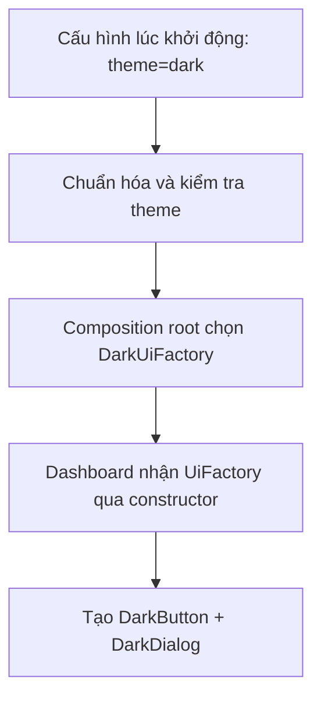
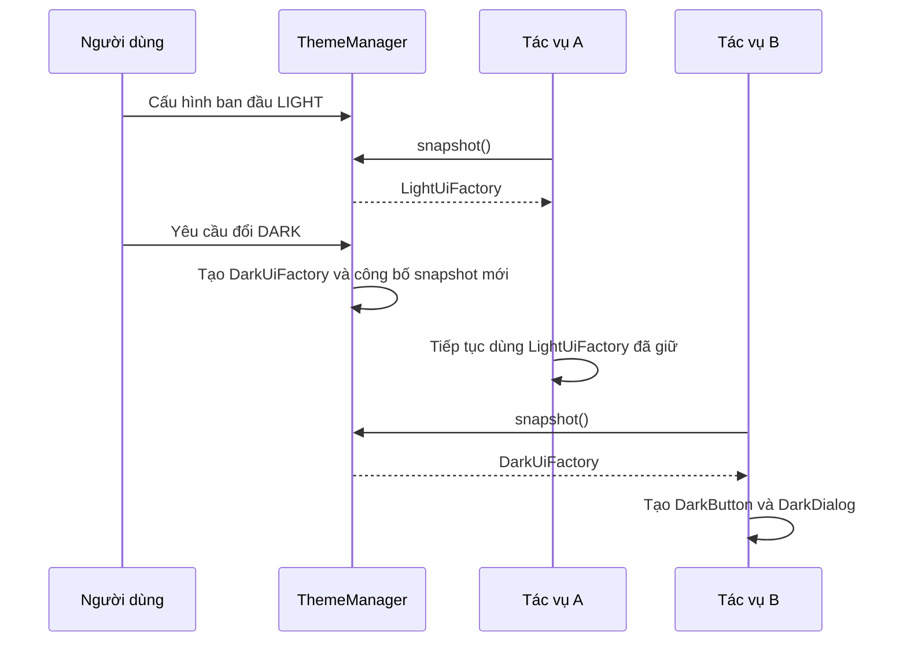
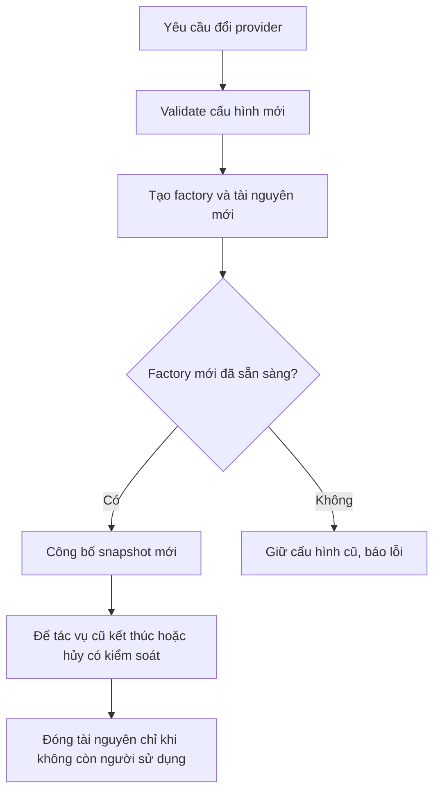

# Phân biệt đổi biến thể khi khởi động với đổi biến thể trong lúc chạy

Trong **Abstract Factory**, một factory cụ thể đại diện cho một **họ sản phẩm tương thích**: `LightUiFactory` tạo `LightButton` và `LightDialog`, còn `DarkUiFactory` tạo `DarkButton` và `DarkDialog`. Client nhận interface `UiFactory` để sử dụng sản phẩm mà không phải biết class cụ thể. Tuy nhiên, thiết kế sẽ khác đáng kể tùy yêu cầu: **chọn một factory khi ứng dụng khởi động** hay **cho phép thay factory trong lúc ứng dụng đang chạy**.

Bài học thuộc chương **Lựa chọn biến thể** của module **SOFTWARE_DESIGN_DESIGN_PATTERN_CREATIONAL_ABSTRACT_FACTORY**, học về Abstract Factory trong nhóm creational design pattern. Trọng tâm là xác định **thời điểm lựa chọn factory, phạm vi hiệu lực của lựa chọn, cách bảo toàn một họ sản phẩm trong mỗi tác vụ và chi phí quản lý vòng đời khi đổi biến thể**.

## 1. Hai yêu cầu nghe giống nhau nhưng có ý nghĩa khác nhau

Giả sử phần mềm có giao diện sáng (`light`) và tối (`dark`), cần tạo đồng thời nút (`Button`) và hộp thoại (`Dialog`). Cả hai phương án đều có thể sử dụng cùng các interface và concrete factory; điều khác nhau là **chúng được chọn và sử dụng trong bao lâu**.

| Câu hỏi | Chọn khi khởi động (startup selection) | Đổi khi đang chạy (runtime switching) |
| --- | --- | --- |
| Khi nào chọn `ConcreteFactory`? | Trong bootstrap/composition root lúc khởi động | Khi cấu hình hoặc ngữ cảnh thay đổi trong quá trình chạy |
| Factory có hiệu lực bao lâu? | Thường đến khi tiến trình hoặc một thành phần được khởi tạo lại | Theo phiên bản cấu hình, phiên làm việc, request hoặc tác vụ |
| Client nhận gì? | Một `UiFactory` đã chọn từ constructor | Một snapshot factory theo tác vụ hoặc một provider lấy snapshot |
| Muốn đổi `light` sang `dark`? | Thường đổi cấu hình và khởi động/lắp ghép lại ứng dụng | Chọn factory mới và chuyển hướng tác vụ tiếp theo sang nó |
| Đối tượng đã tạo trước đó? | Tiếp tục tồn tại đến khi bị hủy hoặc khởi tạo lại | **Không tự chuyển họ** chỉ vì tham chiếu factory được đổi |
| Rủi ro chính | Sai cấu hình lúc bootstrap; khó đổi nóng nếu có yêu cầu mới | Trộn họ giữa hai thời điểm, tranh chấp đồng thời, tài nguyên cũ chưa giải phóng |
| Mức độ triển khai | Thường đơn giản, dễ kiểm thử | Phải định nghĩa điểm chuyển, trạng thái nhất quán và vòng đời |

Không nên hiểu "đổi biến thể lúc chạy" là client nào cũng tự đọc cấu hình mới trước mỗi lệnh tạo sản phẩm. Trong Abstract Factory, cần giữ nguyên nguyên tắc: **một ngữ cảnh sử dụng phải dùng một factory phù hợp để tạo trọn họ sản phẩm liên quan**.

## 2. Chọn factory một lần ở startup

Trường hợp này phù hợp khi biến thể là một thuộc tính **cố định trong vòng đời ứng dụng**: ví dụ backend chỉ dùng PostgreSQL hoặc SQL Server theo môi trường triển khai; một tiến trình tích hợp chỉ chọn một bộ SDK của provider; một ứng dụng desktop dùng theme được xác định lúc khởi động.

Luồng đơn giản:



Ví dụ về cách lắp ghép ở `main`:

```java
Theme theme = Theme.parse(configuredTheme);
UiFactory selectedFactory = switch (theme) {
    case LIGHT -> new LightUiFactory();
    case DARK -> new DarkUiFactory();
};

Dashboard dashboard = new Dashboard(selectedFactory);
dashboard.render();
```

Đây là **đoạn minh họa**, với các type `Theme`, `Dashboard`, `UiFactory` được định nghĩa trong dự án. Sau khi `selectedFactory` được truyền vào `Dashboard`, object `Dashboard` tiếp tục giữ cùng tham chiếu. Việc sửa biến môi trường hoặc file cấu hình **không làm biến `selectedFactory` đổi đối tượng**. Nếu cần áp dụng cấu hình mới, phải khởi động lại hoặc có cơ chế tái lắp ghép chủ động.

### Vì sao startup selection thường là lựa chọn mặc định tốt?

- Quyết định chọn biến thể tập trung tại composition root; các client không biết cấu hình.
- Mỗi client nhận một factory ổn định; việc tạo `Button` và `Dialog` ở các thời điểm khác nhau vẫn thuộc cùng họ nếu concrete factory luôn tuân thủ contract.
- Ít trạng thái biến đổi, ít rủi ro đồng thời và vòng đời tài nguyên dễ xác định.
- Cấu hình sai có thể bị phát hiện **trước khi nhận công việc** (fail fast).

Nhưng mô hình này **không đáp ứng** yêu cầu đổi giao diện ngay khi người dùng bấm nút chuyển theme hoặc đổi provider riêng cho mỗi tenant mà không khởi động lại.

## 3. Đổi biến thể lúc chạy là thay **ngữ cảnh lắp ghép**

Nếu người dùng được phép chuyển theme mà không thoát ứng dụng, ta cần một ranh giới xác định **từ khi nào factory mới có hiệu lực**. Một cách dễ hiểu là: tác vụ đã bắt đầu giữ factory cũ; tác vụ mới lấy snapshot mới.



**Tính nhất quán theo tác vụ** là điểm then chốt. Nếu một tác vụ dùng `LightButton` ở đầu nhưng lại lấy `DarkDialog` ở cuối chỉ vì cấu hình thay đổi giữa chừng, Abstract Factory không còn bảo vệ được ý nghĩa *cùng họ*.

Mặt khác, nếu yêu cầu nghiệp vụ bắt buộc mọi tác vụ đang chạy chuyển sang biến thể mới ngay lập tức, **giữ snapshot cũ đến hết tác vụ chưa đủ**. Khi ấy cần xác định rõ chiến lược dừng, hủy, khởi động lại hoặc di chuyển trạng thái của những tác vụ đang hoạt động. Pattern tự nó không cung cấp cơ chế chuyển đổi nóng này.

## 4. Phản ví dụ: chọn factory nhiều lần trong một tác vụ

Đoạn dưới đây có rủi ro ngay cả khi `currentFactory()` luôn trả về một factory hợp lệ:

```java
// Phản ví dụ: provider có thể thay đổi giữa hai lời gọi.
Button button = provider.currentFactory().createButton();

// Một thread khác hoặc người dùng đổi theme từ LIGHT sang DARK ở đây.

Dialog dialog = provider.currentFactory().createDialog();
return button.render() + " | " + dialog.render();
```

Nếu lần gọi đầu trả `LightUiFactory`, còn lần gọi sau trả `DarkUiFactory`, tác vụ tạo ra cặp `LightButton` và `DarkDialog`. Mỗi lời gọi đều đúng interface và đều chạy được, nhưng kết quả không thống nhất.

Cách sửa là **chụp một snapshot trước khi bắt đầu tạo bộ sản phẩm**:

```java
// Chỉ đọc trạng thái chọn biến thể một lần cho tác vụ hiện tại.
UiFactory factory = provider.currentFactory();

Button button = factory.createButton();
Dialog dialog = factory.createDialog();
return button.render() + " | " + dialog.render();
```

Hai đoạn trên là phần thân minh họa; giả định provider là một thành phần an toàn khi truy cập đồng thời. Snapshot tham chiếu chỉ đủ bảo vệ khi **chính factory và cấu hình bên trong nó không bị đột ngột mutate** trong lúc chạy. Nếu factory đọc một biến `currentTheme` có thể thay đổi trong mỗi `create*()`, việc giữ cùng tham chiếu **vẫn có thể tạo sản phẩm khác họ**.

## 5. Ví dụ Java 17 hoàn chỉnh: chọn một lần và đổi lúc chạy

Ví dụ trong file `VariantSwitchDemo.java` dùng hai họ `LIGHT`/`DARK`; mỗi factory tạo `Button` và `Dialog`. Ta có thể chạy để thấy sự khác biệt giữa một `Dashboard` đã nhận factory lúc startup và một `ThemeManager` công bố snapshot mới ở runtime.

```java
import java.util.Locale;
import java.util.Objects;
import java.util.concurrent.atomic.AtomicReference;

public final class VariantSwitchDemo {
    enum Theme {
        LIGHT, DARK;

        static Theme parse(String raw) {
            if (raw == null || raw.isBlank()) {
                throw new IllegalArgumentException("Theme cannot be blank");
            }
            return switch (raw.trim().toLowerCase(Locale.ROOT)) {
                case "light" -> LIGHT;
                case "dark" -> DARK;
                default -> throw new IllegalArgumentException("Unknown theme: " + raw);
            };
        }
    }

    interface Button {
        String render();
    }

    interface Dialog {
        String render();
    }

    interface UiFactory {
        Button createButton();
        Dialog createDialog();
    }

    record LightButton() implements Button {
        @Override
        public String render() { return "LIGHT button"; }
    }

    record LightDialog() implements Dialog {
        @Override
        public String render() { return "LIGHT dialog"; }
    }

    record DarkButton() implements Button {
        @Override
        public String render() { return "DARK button"; }
    }

    record DarkDialog() implements Dialog {
        @Override
        public String render() { return "DARK dialog"; }
    }

    static final class LightUiFactory implements UiFactory {
        @Override
        public Button createButton() { return new LightButton(); }

        @Override
        public Dialog createDialog() { return new LightDialog(); }
    }

    static final class DarkUiFactory implements UiFactory {
        @Override
        public Button createButton() { return new DarkButton(); }

        @Override
        public Dialog createDialog() { return new DarkDialog(); }
    }

    // Hàm chọn factory chỉ biết theme và các ConcreteFactory.
    static UiFactory selectFactory(Theme theme) {
        return switch (Objects.requireNonNull(theme)) {
            case LIGHT -> new LightUiFactory();
            case DARK -> new DarkUiFactory();
        };
    }

    // Đóng gói theme và factory vào một trạng thái bất biến.
    record ThemeSnapshot(Theme theme, UiFactory factory) {
        ThemeSnapshot {
            Objects.requireNonNull(theme);
            Objects.requireNonNull(factory);
        }
    }

    static final class ThemeManager {
        private final AtomicReference<ThemeSnapshot> current;

        ThemeManager(Theme initialTheme) {
            current = new AtomicReference<>(build(initialTheme));
        }

        private static ThemeSnapshot build(Theme theme) {
            return new ThemeSnapshot(theme, selectFactory(theme));
        }

        ThemeSnapshot snapshot() {
            return current.get();
        }

        void switchTo(Theme newTheme) {
            // Tạo xong trạng thái hợp lệ trước khi công bố cho tác vụ mới.
            ThemeSnapshot replacement = build(newTheme);
            current.set(replacement);
        }
    }

    static final class Dashboard {
        private final UiFactory factory;

        Dashboard(UiFactory factory) {
            this.factory = Objects.requireNonNull(factory);
        }

        String render() {
            Button button = factory.createButton();
            Dialog dialog = factory.createDialog();
            return button.render() + " | " + dialog.render();
        }
    }

    public static void main(String[] args) {
        if (args.length > 1) {
            throw new IllegalArgumentException("Expected at most one theme");
        }

        // Trường hợp A: biến thể của ứng dụng được chọn tại startup.
        Theme startupTheme = Theme.parse(args.length == 0 ? "light" : args[0]);
        UiFactory fixedFactory = selectFactory(startupTheme);
        Dashboard fixedDashboard = new Dashboard(fixedFactory);
        System.out.println("startup: " + fixedDashboard.render());

        // Trường hợp B: quản lý snapshot factory có thể thay lúc chạy.
        ThemeManager manager = new ThemeManager(Theme.LIGHT);
        ThemeSnapshot inProgress = manager.snapshot();
        System.out.println("runtime before: "
                + new Dashboard(inProgress.factory()).render());

        manager.switchTo(Theme.DARK);

        // Tác vụ đã giữ snapshot LIGHT không bị đổi nửa chừng.
        System.out.println("runtime existing: "
                + new Dashboard(inProgress.factory()).render());

        // Tác vụ mới nhìn thấy snapshot DARK.
        ThemeSnapshot next = manager.snapshot();
        System.out.println("runtime next: "
                + new Dashboard(next.factory()).render());
    }
}
```

Biên dịch/chạy bằng JDK 17 hoặc mới hơn:

```bash
javac -encoding UTF-8 VariantSwitchDemo.java
java VariantSwitchDemo light
```

Kết quả mong đợi:

```text
startup: LIGHT button | LIGHT dialog
runtime before: LIGHT button | LIGHT dialog
runtime existing: LIGHT button | LIGHT dialog
runtime next: DARK button | DARK dialog
```

Nếu chạy `java VariantSwitchDemo dark`, chỉ dòng **`startup`** đổi thành `DARK button | DARK dialog`: đây là ví dụ cố ý minh họa hai cơ chế **độc lập** trong cùng chương trình, không phải đồng bộ chung một cấu hình cho cả hai.

Giải thích các quyết định:

1. `fixedDashboard` giữ `fixedFactory` từ startup; sau đó nó không tự theo cấu hình nào khác.
2. `ThemeManager` giữ một `AtomicReference<ThemeSnapshot>`; mỗi snapshot chứa **cả tên biến thể và factory tương ứng**.
3. `switchTo()` tạo snapshot mới trước, rồi công bố nó bằng một lần `set()`. Nếu tạo snapshot thất bại trước `set()`, trạng thái cũ vẫn còn.
4. `inProgress` đã lấy snapshot cũ nên `Button` và `Dialog` do tác vụ đó tạo ra cùng là `LIGHT`. Tác vụ mới đọc `snapshot()` sau `set()` sẽ nhận `DARK`.

`AtomicReference` bảo đảm cập nhật/tham chiếu snapshot được **công bố nguyên tử** và an toàn cho các luồng cùng đọc. Nó **không tự quản lý** vòng đời tài nguyên hay cập nhật UI đã hiển thị; ví dụ cũng không chứng minh bất kỳ cơ chế xử lý request song song nào. Nếu nhiều thao tác cập nhật xảy ra đồng thời và cần thứ tự phiên bản, có thể phải dùng `compareAndSet`, khóa hoặc cơ chế điều phối khác.

## 6. Điều gì xảy ra với những sản phẩm đã được tạo?

Đổi `ThemeManager.current` sang `DarkUiFactory` chỉ ảnh hưởng **việc chọn factory trong tương lai**. Các đối tượng `LightButton`, `LightDialog` đã được tạo trước đó không trở thành `DarkButton` hay `DarkDialog`. Muốn hiển thị màn hình mới theo theme tối, phải có chính sách **render lại/recreate component** hoặc cho phép component cập nhật style thông qua một cơ chế khác do UI framework hỗ trợ.

Phân biệt ba trường hợp:

| Thành phần đang tồn tại | Sau khi đổi sang `DARK` | Việc cần làm nếu muốn áp dụng ngay |
| --- | --- | --- |
| `Dashboard` đã inject `LightUiFactory` qua constructor | Vẫn tạo sản phẩm `LIGHT` | Tạo lại Dashboard với factory mới hoặc thiết kế lấy snapshot mỗi phiên render |
| Tác vụ đang dùng một `ThemeSnapshot(LIGHT, ...)` | Hoàn thành theo họ `LIGHT` | Cho chạy hết nếu được phép; nếu không thì hủy và khởi tạo lại có kiểm soát |
| Widget `LightButton` đã được render trên màn hình | Vẫn là widget của họ cũ | Re-render toàn bộ vùng liên quan hoặc cập nhật theme bằng API riêng của framework |
| Tác vụ mới bắt đầu sau khi đổi snapshot | Nhận `DarkUiFactory` | Không cần thao tác đặc biệt ngoài lấy một snapshot mới |

Điều này đặc biệt quan trọng khi **đổi provider hạ tầng**, không chỉ đổi theme. Một request lưu tệp và phát sự kiện cùng tác vụ không nên dùng storage của provider cũ rồi publisher của provider mới. Việc đổi nóng kết nối CSDL hoặc cloud provider còn đòi hỏi xét dữ liệu đang xử lý, tính liên tục dịch vụ và tài nguyên đang mở.

## 7. Phạm vi của biến thể: toàn ứng dụng, phiên, request hay tác vụ?

"Đổi lúc chạy" không có nghĩa luôn phải dùng một biến toàn cục. Trước khi thiết kế selector/provider, hãy xác định **phạm vi hiệu lực** của quyết định:

| Phạm vi | Ví dụ | Cách chọn factory phù hợp |
| --- | --- | --- |
| Toàn tiến trình | Dịch vụ dùng một database dialect cố định | Chọn một lần khi khởi động; inject factory ổn định |
| Toàn ứng dụng có thể đổi nóng | Desktop app có nút đổi theme | Manager công bố snapshot mới; màn hình/tác vụ mới nhận factory mới |
| Theo phiên người dùng | Mỗi tài khoản tự chọn theme hoặc ngôn ngữ widget | Factory gắn với session hoặc ngữ cảnh phiên, không làm ảnh hưởng người khác |
| Theo tenant | Tenant A dùng provider A, tenant B dùng provider B | Chọn factory từ cấu hình tenant đã xác thực ở biên request |
| Theo tác vụ/request | Job xuất PDF/HTML theo tùy chọn của từng lần chạy | Chọn một factory cho **toàn bộ job**, truyền xuyên suốt các bước tạo sản phẩm |

Với hệ thống đa tenant, lưu `currentTenant` trong một biến `static` rồi đổi trước mỗi request là nguồn lỗi đồng thời. Tốt hơn là truyền context đã được xác thực cho selector hoặc gắn một factory đã chọn vào **request scope**. Đây là việc chọn biến thể theo ngữ cảnh của từng request, **không phải chuyển cấu hình chung của toàn ứng dụng qua lại liên tục**.

### Nếu client cần lấy factory mới khi mỗi tác vụ bắt đầu

Có thể inject một provider có API `snapshot()` vào đối tượng sống lâu. Tuy nhiên, client cần gọi provider **một lần ở đầu tác vụ** rồi dùng factory trong snapshot đó xuyên suốt. Ví dụ:

```java
// Mã minh họa bên trong một service nhận ThemeManager qua constructor.
ThemeSnapshot snapshot = themeManager.snapshot();
UiFactory factory = snapshot.factory();

Button button = factory.createButton();
Dialog dialog = factory.createDialog();
return button.render() + " | " + dialog.render();
```

Đặt tên rõ ràng cho API snapshot cũng giúp tránh nhầm rằng gọi hai lần `currentFactory()` trong cùng một tác vụ là hoàn toàn tương đương.

## 8. Nhất quán và đồng thời khi đổi nóng

Không cần đưa concurrency vào mô hình startup đơn giản. Khi có yêu cầu đổi lúc chạy, ít nhất cần xác định các bất biến:

- **Snapshot nguyên tử:** mọi thành phần của một snapshot (tên theme, factory, phiên bản cấu hình) phải mô tả cùng lựa chọn.
- **Một factory cho một thao tác:** tạo tất cả product liên quan từ cùng snapshot; không chuyển factory ở giữa workflow.
- **Không mutate factory theo theme:** một `UiFactory` đã được xuất bản nên giữ ổn định hành vi tạo họ sản phẩm, hoặc có đồng bộ/định nghĩa nhất quán phù hợp.
- **Thứ tự thay đổi:** khi có hai yêu cầu đổi đồng thời, xác định quy tắc "lệnh cuối thắng" hay kiểm soát version bằng compare-and-set.
- **Tác vụ cũ:** quyết định chúng được hoàn thành bằng factory cũ, bị hủy, hay phải khởi chạy lại.
- **Lỗi chuyển đổi:** nếu không tạo/khởi tạo được factory mới, không công bố một trạng thái mới chỉ hoạt động một phần.

`AtomicReference` phù hợp cho **con trỏ đến một snapshot bất biến**, nhưng không biến những object bên trong thành thread-safe. Với factory có thể tạo HTTP client, session hoặc object giữ trạng thái, cần bảo đảm thread safety, scope và quyền sở hữu tài nguyên. Một factory mới sẵn sàng ở cấp object Java chưa chắc đã sẵn sàng ở cấp kết nối hạ tầng.

## 9. Quản lý vòng đời khi factory sở hữu tài nguyên

Với ví dụ UI, factory chỉ tạo các object đơn giản nên có thể bỏ qua chi phí giải phóng. Với backend, concrete factory có thể giữ connection pool, HTTP client hoặc thread pool. Việc đổi provider lúc chạy cần thêm một quy trình:



Chỉ gọi `oldFactory.close()` ngay sau khi `AtomicReference.set(newFactory)` có thể làm hỏng request đang giữ factory cũ. Những hệ thống có tài nguyên cần một chính sách **drain / reference counting / versioned lifecycle** phù hợp. Nếu khởi tạo factory mới thất bại sau khi đã cấp phát một phần tài nguyên, cần thu hồi phần đã mở. Nếu hệ thống yêu cầu rollback, phải xác định làm thế nào để tránh thực hiện song song những hành động không thể đảo ngược trên hai provider.

Đổi theme và đổi database provider đều là "runtime switching" ở mức tên gọi, nhưng **rủi ro của chúng không tương đương**. Với dữ liệu/hạ tầng, cần đánh giá tác động transaction, kết nối, idempotency, định tuyến và các thao tác đã nhận trước khi đổi.

## 10. Kiểm thử hai cơ chế lựa chọn

Với **startup selection**, các test quan trọng là: giá trị cấu hình hợp lệ ánh xạ đúng factory, giá trị lạ báo lỗi sớm, client dùng được product interface mà không import concrete class. Không cần mô phỏng đổi nóng nếu yêu cầu sản phẩm không hỗ trợ tính năng đó.

Với **runtime switching**, cần kiểm tra thêm tính nhất quán snapshot và tác vụ cũ/mới. Ví dụ JUnit 5 dưới đây sử dụng các class lồng trong `VariantSwitchDemo` (test cùng package mặc định của file minh họa; dự án thật nên đặt package rõ ràng):

```java
import org.junit.jupiter.api.Test;

import static org.junit.jupiter.api.Assertions.assertEquals;
import static org.junit.jupiter.api.Assertions.assertThrows;

class VariantSwitchDemoTest {
    @Test
    void existingWorkUsesOldFamilyAndNewWorkUsesNewFamily() {
        var manager = new VariantSwitchDemo.ThemeManager(
                VariantSwitchDemo.Theme.LIGHT);

        var ongoing = manager.snapshot();
        manager.switchTo(VariantSwitchDemo.Theme.DARK);

        assertEquals("LIGHT button | LIGHT dialog",
                new VariantSwitchDemo.Dashboard(ongoing.factory()).render());
        assertEquals("DARK button | DARK dialog",
                new VariantSwitchDemo.Dashboard(manager.snapshot().factory()).render());
    }

    @Test
    void invalidThemeIsRejected() {
        assertThrows(IllegalArgumentException.class,
                () -> VariantSwitchDemo.Theme.parse("unknown"));
    }
}
```

Bài test minh họa này cần dependency JUnit Jupiter. Nó khẳng định **hành vi với snapshot cũ và mới**, nhưng chưa kiểm chứng race condition thực tế, vòng đời resource hoặc quá trình chuyển giao không gián đoạn. Với factory có tài nguyên, cần test tích hợp cho các tác vụ còn hoạt động trong lúc swap và khi khởi tạo factory mới thất bại.

Một kịch bản test quan trọng khác: **yêu cầu đổi hai lần liên tiếp**. Ví dụ `LIGHT → DARK → LIGHT`, task đã lấy snapshot ở từng giai đoạn vẫn phải dùng factory của chính snapshot đó; task mới chỉ sử dụng phiên bản hiệu lực gần nhất. Nếu có logic cập nhật version, test thêm trường hợp hai lệnh cùng sửa để bảo đảm chính sách thứ tự được giữ.

## 11. Các lỗi thiết kế thường gặp

| Lỗi | Hậu quả | Cách xử lý |
| --- | --- | --- |
| Đọc lại biến môi trường mỗi lần `create*()` | Một workflow có thể tạo product từ hai họ khác nhau | Chuẩn hóa lựa chọn ở biên và chụp snapshot mỗi workflow |
| Factory giữ trường `currentTheme` có thể thay đổi | Cùng một instance factory có thể đổi họ giữa hai lời gọi | Dùng các concrete factory bất biến cho từng họ, thay tham chiếu snapshot |
| Đổi factory trong manager nhưng mong widget cũ tự đổi | UI đang hiển thị vẫn thuộc họ cũ | Re-render hoặc tạo lại component theo quy định UI framework |
| Inject factory lúc startup nhưng mong mọi client tự theo cập nhật | Client vẫn giữ tham chiếu ban đầu | Thiết kế provider/snapshot cho những client cần hỗ trợ đổi nóng |
| Đọc `provider.currentFactory()` hai lần trong một tác vụ | Có thể trộn `LightButton` và `DarkDialog` | Lấy một snapshot ở đầu tác vụ |
| Đóng factory cũ ngay sau `set()` | Request đang dùng tài nguyên cũ có thể lỗi | Drain/ref-count và chỉ đóng sau khi hết người dùng |
| Thay `static currentTenant` khi nhận request mới | Tenant/request khác có thể bị định tuyến sai | Chọn factory theo request/tenant context, tránh mutable global |
| Không validate cấu hình trước khi công bố | Client mới có thể nhận factory chưa sẵn sàng | Build/validate, công bố snapshot nguyên tử khi sẵn sàng |
| Giữ trạng thái theme và factory trong hai biến độc lập | Log/theme có thể không khớp factory thực tế | Gộp cùng snapshot bất biến |
| Dùng giải pháp runtime switching dù không có yêu cầu đổi nóng | Tăng độ phức tạp cấu hình, đồng thời và tài nguyên | Dùng startup selection khi biến thể cố định |

## 12. Chọn thiết kế nào cho tình huống cụ thể?

Xem ba yêu cầu:

**A.** Một service báo cáo dùng một dialect CSDL theo `DB_VENDOR` từ file triển khai; chỉ đổi khi deploy lại. Chọn factory **tại startup** là đủ. Việc hỗ trợ đổi database lúc chạy sẽ tạo thêm yêu cầu quản lý connection pool và transaction mà sản phẩm chưa cần.

**B.** Người dùng muốn đổi theme sáng/tối ngay trong màn hình cài đặt. Cần **runtime switching** tại ranh giới render/phiên: khi theme đổi, cập nhật snapshot và re-render các component cần thiết bằng một factory nhất quán. Component cũ không tự biến đổi vì factory đã đổi.

**C.** Mỗi tenant chọn một cloud provider, nhiều tenant chạy đồng thời. Không dùng một biến provider toàn cục có thể bị request thay đổi. Hãy chọn factory **theo ngữ cảnh tenant của từng tác vụ** và giữ lựa chọn đó cho toàn bộ workflow; các tenant không cần đổi cấu hình chung của cùng tiến trình.

| Điều kiện | Hướng thiết kế nên xem xét |
| --- | --- |
| Biến thể ổn định suốt vòng đời ứng dụng | Startup selection, constructor injection |
| Người dùng đổi biến thể tức thời, không yêu cầu task cũ đổi theo | Runtime snapshot, tác vụ mới lấy factory mới |
| Nhiều request có lựa chọn độc lập | Factory theo request/session/tenant scope |
| Tác vụ cũ bắt buộc dừng hoặc chuyển sang provider mới | Chuyển đổi nóng với protocol hủy/drain/restart rõ ràng |
| Factory nắm giữ tài nguyên mạng/connection pool | Quản lý readiness, ownership và vòng đời trước khi công bố/thu hồi |

## 13. Checklist đánh giá trước khi triển khai

- [ ] Đã xác định rõ việc đổi biến thể chỉ diễn ra **khi khởi động** hay có yêu cầu **trong lúc chạy**.
- [ ] Đã xác định phạm vi lựa chọn: toàn tiến trình, ứng dụng, phiên, tenant hay tác vụ.
- [ ] Cấu hình được kiểm tra và ánh xạ tới một `ConcreteFactory` phù hợp ở điểm lắp ráp.
- [ ] Client dùng interface Abstract Factory, không tự chọn riêng từng concrete product.
- [ ] Khi có runtime switching, một workflow giữ **cùng một snapshot factory** từ đầu đến cuối.
- [ ] Trạng thái biến thể được công bố nhất quán, tránh giữ theme và factory trong hai biến có thể lệch nhau.
- [ ] Đã xác định cách xử lý các product, widget và tác vụ đã được tạo trước khi đổi.
- [ ] Nếu factory chứa tài nguyên, có chiến lược khởi tạo, health/readiness và giải phóng sau khi hết người dùng.
- [ ] Kiểm thử bao gồm cấu hình sai, snapshot cũ/mới, tính tương thích sản phẩm và hành vi tại điểm chuyển đổi.
- [ ] Không tạo cơ chế đổi nóng phức tạp nếu chỉ cần thay cấu hình khi khởi động lại.

**Ghi nhớ:** Abstract Factory giúp bảo đảm một factory tạo **một họ sản phẩm nhất quán**, nhưng **không quyết định hộ lúc nào ứng dụng được đổi factory**. Khi chỉ chọn lúc khởi động, cấu trúc đơn giản và factory ổn định. Khi đổi lúc chạy, cần chọn ranh giới hiệu lực, giữ một factory cho từng tác vụ, công bố snapshot an toàn và xử lý product/tài nguyên cũ. Chỉ khi những quy tắc đó rõ ràng, việc chuyển giữa các Concrete Factory mới tránh được rủi ro trộn họ sản phẩm.
