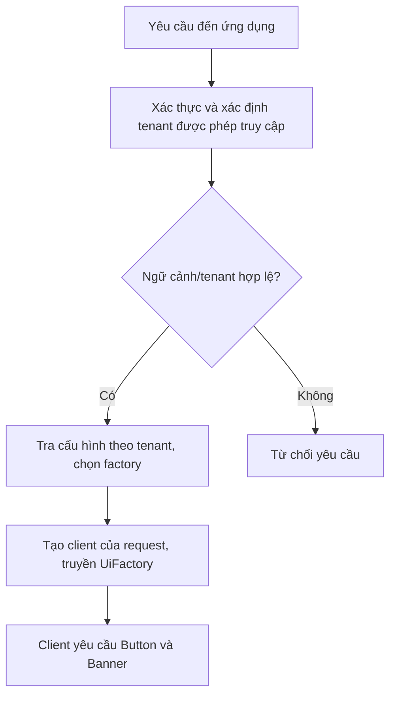
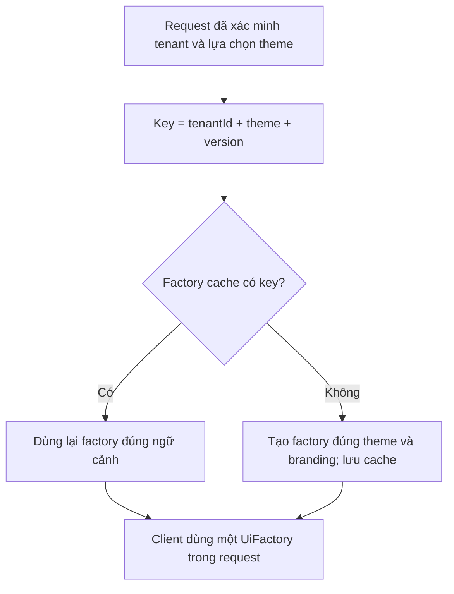

# Giới hạn phạm vi factory theo ứng dụng, yêu cầu hoặc tenant để tránh dùng nhầm

## 1. Vấn đề: chọn đúng họ sản phẩm vẫn chưa đủ

Trong **Abstract Factory** (*Creational Design Pattern*), một concrete factory chịu trách nhiệm tạo **một họ sản phẩm có liên quan**. Ví dụ, `LightUiFactory` tạo `LightButton` và `LightBanner`, còn `DarkUiFactory` tạo `DarkButton` và `DarkBanner`. Client dùng chúng qua các interface `UiFactory`, `Button` và `Banner`.

Tuy nhiên, một ứng dụng có thể phục vụ nhiều người dùng, nhiều yêu cầu hoặc nhiều **tenant** (đơn vị khách hàng dùng chung hệ thống). Khi đó, câu hỏi không chỉ là **nên dùng họ Light hay Dark**, mà còn là:

> Factory đã chọn có được phép phục vụ **những client nào**, **trong bao lâu**, và **theo ngữ cảnh nào**?

Nếu đặt factory của tenant A vào một biến dùng chung và sau đó dùng biến ấy để xử lý yêu cầu của tenant B, client vẫn biên dịch đúng kiểu Java nhưng có thể tạo sản phẩm với **màu sắc, cấu hình hoặc dữ liệu của sai tenant**.

Bài thuộc chương **Lựa chọn biến thể**, tập trung vào cách giới hạn phạm vi factory ở **cấp ứng dụng**, **cấp yêu cầu** hoặc **cấp tenant**. Kết thúc bài, bạn cần:

- Phân biệt **họ sản phẩm** với **phạm vi sử dụng factory**.
- Biết khi nào một factory có thể dùng chung cho cả ứng dụng và khi nào phải chọn riêng theo request/tenant.
- Đặt bước chọn concrete factory đúng tại ranh giới của ứng dụng, request hoặc tenant.
- Ngăn client dùng nhầm factory bằng cách truyền qua tham số/constructor thay vì dùng biến toàn cục mutable.
- Xác định cách quản lý vòng đời, khóa cache và điểm kiểm thử để tránh rò ngữ cảnh giữa tenant.

**Lưu ý:** Abstract Factory tổ chức việc tạo sản phẩm; bản thân pattern **không thay thế xác thực, phân quyền hay cô lập dữ liệu**. Nếu cần bảo vệ tenant, hệ thống vẫn phải thực thi các kiểm tra bảo mật ở ranh giới yêu cầu và ở tầng truy cập dữ liệu.

## 2. Hai chiều quyết định: biến thể và phạm vi

Giả sử một nền tảng phục vụ hai khách hàng:

- Tenant `north` dùng thương hiệu *Acme North* và họ giao diện Light.
- Tenant `south` dùng thương hiệu *Beta South* và họ giao diện Dark.

Mỗi tenant cần hai **loại sản phẩm**:

- `Button`: nút bấm trên giao diện.
- `Banner`: vùng đầu trang chứa tên thương hiệu.

Ma trận **họ sản phẩm**:

| Loại sản phẩm | Họ Light | Họ Dark |
|---|---|---|
| Button | `LightButton` | `DarkButton` |
| Banner | `LightBanner` | `DarkBanner` |
| Factory | `LightUiFactory` | `DarkUiFactory` |

Ma trận **ngữ cảnh sử dụng** lại là một chiều khác:

| Tenant | Họ giao diện đã cấu hình | Thông tin thương hiệu | Factory được chọn |
|---|---|---|---|
| `north` | Light | Acme North | `LightUiFactory` gắn cấu hình `north` |
| `south` | Dark | Beta South | `DarkUiFactory` gắn cấu hình `south` |

Hai factory thuộc cùng một họ **không nhất thiết có cùng phạm vi**: nếu `north` và một tenant thứ ba đều dùng Light nhưng có branding khác nhau, họ có thể cần **hai instance `LightUiFactory` khác nhau**. Chỉ lấy theme làm khóa cache có thể khiến cấu hình tenant này được dùng cho tenant khác.

Ở đây có ba khái niệm dễ nhầm:

1. **Họ sản phẩm** (*family*): Light hay Dark, quyết định các concrete product nào được tạo.
2. **Ngữ cảnh** (*context*): tenant, request hoặc cấu hình ứng dụng đang được phục vụ.
3. **Phạm vi sống** (*scope/lifetime*): factory có thể được chia sẻ ở đâu và được giữ đến khi nào.

Ví dụ, một `LightUiFactory` cho tenant `north` có thể sống theo **tenant**; còn `HomePage` xử lý một lần gọi nên sống theo **request**. Client request nhận tham chiếu tới factory phù hợp và không được chuyển nó sang request thuộc tenant khác.

## 3. Ba phạm vi thường gặp

| Phạm vi | Khi nào chọn factory? | Ai có thể dùng chung? | Khi nào kết thúc/đổi? | Rủi ro khi chọn sai |
|---|---|---|---|---|
| **Ứng dụng** (*application*) | Lúc khởi động hoặc nạp cấu hình toàn cục | Mọi client trong ứng dụng nếu chính sách giống nhau | Ứng dụng dừng hoặc cấu hình chung được thay | Một factory cố định không phản ánh yêu cầu/tenant khác nhau |
| **Yêu cầu** (*request*) | Sau khi xác định ngữ cảnh của **từng yêu cầu** | Các thành phần đang xử lý **cùng yêu cầu** | Sau khi yêu cầu kết thúc | Dùng nhầm factory từ yêu cầu trước hoặc đưa context sang tác vụ nền |
| **Tenant** | Sau khi xác định tenant hợp lệ và cấu hình của tenant | Các yêu cầu thuộc **cùng tenant**, nếu factory chia sẻ an toàn | Khi cấu hình tenant đổi, cache bị vô hiệu hóa hoặc ứng dụng dừng | Cấu hình/sản phẩm của tenant A xuất hiện ở tenant B |

Phạm vi này là **quyết định thiết kế**, không phải ba kiểu factory riêng bắt buộc của Abstract Factory. Có thể triển khai với constructor, registry, dependency injection hoặc container hỗ trợ scope.

### 3.1. Phạm vi ứng dụng

Nếu toàn bộ ứng dụng **luôn dùng cùng một họ và cùng cấu hình**, một factory bất biến có thể được tạo tại composition root và chia sẻ:

```java
// Chỉ phù hợp khi tất cả client dùng cùng một cấu hình.
UiFactory appFactory = new LightUiFactory(
        new TenantDesign("single-app", "Ứng dụng nội bộ"));

HomePage pageA = new HomePage(appFactory);
HomePage pageB = new HomePage(appFactory);
```

Ưu điểm là đơn giản và ít đối tượng phải khởi tạo. Nhưng nếu cùng process phục vụ nhiều tenant có branding riêng, **không nên** dùng duy nhất một factory đã gắn cấu hình tenant cụ thể cho mọi request.

### 3.2. Phạm vi yêu cầu

Nếu một người dùng được quyền chọn Light/Dark **cho mỗi lần gọi**, hãy xác định lựa chọn hợp lệ ở ranh giới request, rồi đưa factory đó vào các client tham gia xử lý:

```java
// Minh họa cấu trúc, không phải chương trình chạy độc lập.
void handle(VerifiedRequest request) {
    UiFactory factory = selectFactoryFor(request);
    HomePage page = new HomePage(factory);
    sendResponse(page.render());
}
```

`VerifiedRequest`, `selectFactoryFor` và `sendResponse` ở đây là **tên minh họa**, cần được triển khai bởi tầng web thực tế. Ý tưởng chính: mỗi lần xử lý yêu cầu có một quyết định chọn factory rõ ràng, không lấy biến “currentFactory” thay đổi toàn cục.

Một factory request-scoped có thể được tạo mới cho mỗi yêu cầu, hoặc request có thể **mượn tham chiếu tới factory bất biến đã cache** theo tenant/theme. “Chọn theo request” **không bắt buộc** factory vật lý phải luôn là đối tượng mới.

### 3.3. Phạm vi tenant

Nếu các yêu cầu của một tenant cùng dùng một bộ cấu hình ổn định, có thể giữ một factory **cho mỗi tenant**:

```text
tenant north -> LightUiFactory(branding của north)
tenant south -> DarkUiFactory(branding của south)
```

Mỗi request phải tra factory theo **tenant đã được xác thực và được cấp quyền truy cập**. Factory có thể được dùng lại giữa nhiều request của cùng tenant nếu không giữ dữ liệu mutable riêng của request, không chứa state phiên/người dùng và thread-safe khi dùng đồng thời.

**Phân biệt hai vòng đời:** registry có thể tồn tại suốt ứng dụng, trong khi mỗi entry là factory phục vụ **một tenant**. Registry dùng chung **không có nghĩa** một factory của tenant được phép dùng chung cho tất cả tenant.

## 4. Vị trí nên đặt bước lựa chọn factory

Một request thường đi qua các bước:



**Thứ tự quan trọng:** hệ thống phải xác định tenant từ ngữ cảnh tin cậy hoặc kiểm tra quyền sử dụng tenant được yêu cầu **trước** khi tra và cấp factory tương ứng. Không được coi một tham số `tenantId` do client tự gửi là bằng chứng đã được phép truy cập tenant đó.

Một số nguồn ngữ cảnh có thể được kiểm chứng gồm thông tin identity/tenant từ session đã xác thực, token đã xác minh hoặc kết quả phân quyền của tầng ứng dụng. Cách triển khai cụ thể phụ thuộc hệ thống và không phải trách nhiệm của Abstract Factory.

Nên chọn factory tại một **ranh giới rõ ràng**:

- **Composition root ứng dụng:** nơi thiết lập các dependency dùng chung và registry.
- **Request handler/middleware:** nơi xác định tenant/theme cho từng yêu cầu và gọi resolver.
- **Bộ tạo client của request:** nơi truyền `UiFactory` phù hợp vào service/page mà request sẽ dùng.

Bên trong client nghiệp vụ, không nên lặp lại `if (tenantId.equals(...))` để tạo từng sản phẩm. Điều đó làm rò quyết định lựa chọn họ vào những nơi chỉ nên biết product interface.

## 5. Ví dụ Java 17: registry dùng chung, factory riêng theo tenant

Ví dụ này minh họa hai tenant với hai họ giao diện. Registry tồn tại ở cấp ứng dụng; mỗi tenant đã cấu hình có một factory **bất biến** gắn thông tin thương hiệu của chính tenant đó. Request chỉ nhận factory được tra theo tenant đã xác thực.

Đặt **toàn bộ mã** vào file `Demo.java`. Chương trình không cần thư viện ngoài JDK.

```java
import java.util.Map;
import java.util.Objects;

// AbstractProduct A
interface Button {
    String render();
}

// AbstractProduct B
interface Banner {
    String render();
}

// AbstractFactory
interface UiFactory {
    Button createButton(String label);
    Banner createBanner();
}

// Cấu hình bất biến được gắn vào một tenant.
record TenantDesign(String tenantId, String displayName) {
    TenantDesign {
        Objects.requireNonNull(tenantId, "tenantId");
        Objects.requireNonNull(displayName, "displayName");
    }
}

// ConcreteProducts của họ Light
record LightButton(String label, TenantDesign design)
        implements Button {
    @Override
    public String render() {
        return "[Light][" + design.tenantId()
                + "] Button: " + label;
    }
}

record LightBanner(TenantDesign design) implements Banner {
    @Override
    public String render() {
        return "[Light][" + design.tenantId()
                + "] Banner: " + design.displayName();
    }
}

// ConcreteProducts của họ Dark
record DarkButton(String label, TenantDesign design)
        implements Button {
    @Override
    public String render() {
        return "[Dark][" + design.tenantId()
                + "] Button: " + label;
    }
}

record DarkBanner(TenantDesign design) implements Banner {
    @Override
    public String render() {
        return "[Dark][" + design.tenantId()
                + "] Banner: " + design.displayName();
    }
}

// ConcreteFactory Light: giữ cấu hình chỉ của tenant này.
final class LightUiFactory implements UiFactory {
    private final TenantDesign design;

    LightUiFactory(TenantDesign design) {
        this.design = Objects.requireNonNull(design, "design");
    }

    @Override
    public Button createButton(String label) {
        return new LightButton(label, design);
    }

    @Override
    public Banner createBanner() {
        return new LightBanner(design);
    }
}

// ConcreteFactory Dark: giữ cấu hình chỉ của tenant này.
final class DarkUiFactory implements UiFactory {
    private final TenantDesign design;

    DarkUiFactory(TenantDesign design) {
        this.design = Objects.requireNonNull(design, "design");
    }

    @Override
    public Button createButton(String label) {
        return new DarkButton(label, design);
    }

    @Override
    public Banner createBanner() {
        return new DarkBanner(design);
    }
}

// Registry dùng chung, nhưng lưu factory theo khóa tenant.
final class TenantFactoryCatalog {
    private final Map<String, UiFactory> byTenant;

    TenantFactoryCatalog(Map<String, UiFactory> byTenant) {
        this.byTenant = Map.copyOf(byTenant);
    }

    UiFactory resolve(String verifiedTenantId) {
        UiFactory factory = byTenant.get(
                Objects.requireNonNull(verifiedTenantId));
        if (factory == null) {
            throw new IllegalArgumentException(
                    "Tenant is not configured");
        }
        return factory;
    }
}

// Ngữ cảnh request đã được tầng xác thực/phân quyền xác minh.
// Bản Demo chỉ mô phỏng giá trị đó, không thực hiện xác thực.
record TrustedRequestContext(String tenantId) {
    TrustedRequestContext {
        Objects.requireNonNull(tenantId, "tenantId");
    }
}

// Client dùng AbstractFactory, không biết Light/Dark/tenant khác.
final class HomePage {
    private final UiFactory factory;

    HomePage(UiFactory factory) {
        this.factory = Objects.requireNonNull(factory, "factory");
    }

    String render() {
        Banner header = factory.createBanner();
        Button action = factory.createButton("Tiếp tục");
        return header.render() + "\n" + action.render();
    }
}

public class Demo {
    // Ranh giới request: chỉ tra factory bằng tenant đã xác minh.
    static String renderRequest(
            TrustedRequestContext context,
            TenantFactoryCatalog catalog) {
        UiFactory factory = catalog.resolve(context.tenantId());
        return new HomePage(factory).render();
    }

    static void check(boolean condition, String message) {
        if (!condition) {
            throw new AssertionError(message);
        }
    }

    public static void main(String[] args) {
        // Composition root: một registry với hai tenant tách biệt.
        TenantFactoryCatalog catalog = new TenantFactoryCatalog(
                Map.of(
                    "north", new LightUiFactory(
                            new TenantDesign("north", "Acme North")),
                    "south", new DarkUiFactory(
                            new TenantDesign("south", "Beta South"))
                ));

        String north = renderRequest(
                new TrustedRequestContext("north"), catalog);
        String south = renderRequest(
                new TrustedRequestContext("south"), catalog);

        System.out.println(north);
        System.out.println(south);

        // Cả hai loại sản phẩm phải mang đúng họ và tenant.
        check(north.contains("[Light][north] Banner: Acme North"),
                "Wrong north banner");
        check(north.contains("[Light][north] Button: Tiếp tục"),
                "Wrong north button");
        check(south.contains("[Dark][south] Banner: Beta South"),
                "Wrong south banner");
        check(south.contains("[Dark][south] Button: Tiếp tục"),
                "Wrong south button");
        check(!north.contains("Beta South")
                && !south.contains("Acme North"),
                "Cross-tenant branding leak");

        // Không fallback sang factory mặc định cho tenant lạ.
        boolean rejected = false;
        try {
            renderRequest(
                    new TrustedRequestContext("unknown"), catalog);
        } catch (IllegalArgumentException expected) {
            rejected = true;
        }
        check(rejected, "Unknown tenant must be rejected");

        System.out.println("PASS: tenant factory isolation");
    }
}
```

Chạy:

```powershell
javac -encoding UTF-8 Demo.java
java Demo
```

Kết quả mong đợi:

```text
[Light][north] Banner: Acme North
[Light][north] Button: Tiếp tục
[Dark][south] Banner: Beta South
[Dark][south] Button: Tiếp tục
PASS: tenant factory isolation
```

### Vì sao ví dụ này giới hạn phạm vi đúng?

1. `TenantFactoryCatalog` sống ở cấp ứng dụng và là **map bất biến**: mã xử lý request không thể tự thay factory của tenant khác bằng cách gọi `put`.
2. **Mỗi tenant có một entry**. `north` giữ `LightUiFactory` mang `TenantDesign("north", ...)`, `south` giữ `DarkUiFactory` mang `TenantDesign("south", ...)`.
3. `renderRequest` chọn factory theo **ngữ cảnh tin cậy**; sau đó `HomePage` nhận `UiFactory` qua constructor.
4. `HomePage` không chứa `switch(theme)`, không tự tìm tenant và không tạo concrete product.
5. `createBanner` và `createButton` trên một factory luôn tạo sản phẩm cùng họ, dùng cùng `TenantDesign`.
6. Tenant không cấu hình bị từ chối, không tự nhận factory của tenant mặc định.

**Giới hạn bảo mật của mẫu chạy:** việc gọi `new TrustedRequestContext("north")` chỉ mô phỏng tình huống request đã được xác minh. Nó **không kiểm tra identity hoặc quyền truy cập tenant**. Hệ thống thật phải tự kiểm tra điều này trước `renderRequest`; đặt tên class là `TrustedRequestContext` không khiến một chuỗi tùy ý trở thành tin cậy.

Các product trong ví dụ là `record` bất biến; factory chỉ chứa `TenantDesign` bất biến. Vì vậy chúng thích hợp để dùng lại giữa request của **cùng tenant** trong ví dụ này. Nếu factory sau này giữ trạng thái phiên, đối tượng mutable hoặc tài nguyên không thread-safe, cần xem lại phạm vi.

## 6. Dùng nhầm factory thường xảy ra như thế nào?

### 6.1. Biến toàn cục mutable mang “tenant hiện tại”

Một thiết kế dễ mắc lỗi là lưu factory hiện tại ở trạng thái dùng chung:

```java
// Ví dụ phản diện: không dùng cho hệ thống nhiều request đồng thời.
final class BadFactoryHolder {
    static UiFactory currentFactory;
}

// Request A:
BadFactoryHolder.currentFactory = northFactory;

// Request B đến đồng thời:
BadFactoryHolder.currentFactory = southFactory;

// Request A tiếp tục: có thể vô tình dùng southFactory.
UiFactory factory = BadFactoryHolder.currentFactory;
```

Các lời gọi có thể xen kẽ giữa các thread. Việc đặt `currentFactory` là `volatile` hay dùng một setter thread-safe cũng **không sửa được lỗi thiết kế**: một biến vẫn chỉ có **một giá trị hiện tại chung** trong khi các request cần các ngữ cảnh khác nhau.

**Cách sửa:** chọn factory một lần cho request và truyền nó như biến local hoặc dependency riêng của client. Nếu factory được cache trong registry, luôn tra theo khóa tenant đúng tại ranh giới request.

### 6.2. Cache theo theme nhưng bỏ quên tenant

Giả sử hai tenant cùng dùng Light nhưng có thương hiệu khác nhau:

```text
north -> Light, branding Acme North
west  -> Light, branding Gamma West
```

Nếu cache chỉ có khóa `Theme.LIGHT`, request của `west` có thể nhận lại `LightUiFactory` chứa branding của `north`. Như vậy **đúng họ Light** nhưng **sai tenant**.

Khi sản phẩm phụ thuộc nhiều thuộc tính, khóa cache phải bao gồm **mọi thông tin ảnh hưởng đến cấu hình được lưu**. Một cách diễn tả khóa là:

```java
record FactoryKey(String tenantId, String theme, long version) {}

// Ví dụ cấu trúc cache:
// Map<FactoryKey, UiFactory> factories;
```

`version` có thể đại diện phiên bản cấu hình tenant nếu muốn giữ nhiều phiên bản hoặc invalidate khi đổi branding. Đây chỉ là **phác thảo khóa**, không phải yêu cầu mọi triển khai đều phải dùng cache và không phải cách duy nhất quản lý invalidation.

### 6.3. Factory giữ trạng thái của một request nhưng được dùng chung

Ví dụ một factory chứa field `currentUserId` mutable và được lưu trong singleton registry. Request B có thể ghi đè field khi request A còn đang xử lý, hoặc sản phẩm tạo ra sau đó mang user ID của request B.

Phương án tốt hơn:

- Giữ factory dùng chung **bất biến**, chỉ chứa cấu hình thuộc phạm vi chia sẻ.
- Truyền thông tin riêng của request vào từng lời gọi có contract phù hợp, hoặc tạo **request-scoped factory** riêng khi thực sự cần state theo request.
- Không giữ reference tới request/response/session trong một factory được cache theo tenant lâu dài.

### 6.4. Chọn theme trong từng phương thức tạo sản phẩm

```java
// Thiết kế dễ phối trộn họ nếu mỗi lần tạo lại quyết định theme.
Button button = chooseFactory(request).createButton("Gửi");
Banner banner = chooseFactory(request).createBanner();
```

Nếu cấu hình hoặc dữ liệu request có thể đổi giữa hai lần chọn, `Button` và `Banner` có thể đến từ **hai factory khác nhau**. Nên chọn **một factory cho phiên làm việc logic** rồi dùng nó cho cả họ:

```java
UiFactory factory = chooseFactory(request);
Button button = factory.createButton("Gửi");
Banner banner = factory.createBanner();
```

Đây là yêu cầu về **nhất quán khi tạo một họ sản phẩm**, không nhất thiết mọi instance factory phải sống lâu như nhau.

## 7. Nếu một tenant được đổi theme theo từng request?

Kịch bản trong `Demo.java` có **một theme cố định cho mỗi tenant**. Nhưng có hệ thống cho phép người dùng trong tenant `north` chọn Light hoặc Dark cho từng request.

Khi đó, chỉ dùng `tenantId` để tra factory là chưa đủ. Quyết định chọn biến thể còn phụ thuộc **theme của request**. Có hai hướng phổ biến:

1. **Tạo factory request-scoped** từ branding tenant và theme đã được kiểm tra. Factory chỉ dùng trong một request; dễ quản lý nếu khởi tạo nhẹ.
2. **Cache factory bất biến theo khóa kết hợp** `(tenantId, theme, configVersion)`. Các request cùng ngữ cảnh có thể dùng chung factory nếu contract, vòng đời và thread safety cho phép.

Sơ đồ:



Nếu dùng cache, tránh đưa dữ liệu riêng của request hoặc user vào factory dùng chung. Trong tình huống đó, dù có chung tenant và theme, hai request vẫn có thể cần sản phẩm riêng.

**Một ví dụ phản biện:** tenant A và tenant B đều đang chọn Dark. Không thể suy ra họ dùng chung **cùng instance `DarkUiFactory`** nếu factory giữ tenant-specific API key, logo, tên thương hiệu hoặc resource handle. “Cùng họ” không đồng nghĩa “cùng cấu hình” hay “được phép chia sẻ state”.

## 8. Chọn scope nào? Quy tắc ra quyết định

Trước khi quyết định lifetime của factory, hãy trả lời những câu hỏi theo thứ tự:

1. **Đầu vào nào ảnh hưởng kết quả tạo sản phẩm?** Chỉ theme chung, hay còn tenant, locale, phiên bản cấu hình, tính năng được cấp quyền hoặc dữ liệu request?
2. **Thông tin đó thay đổi ở phạm vi nào?** Toàn ứng dụng, theo tenant hay từng request?
3. **Factory có giữ state mutable hay tài nguyên không?** Nếu có, state ấy thuộc ai và có thể chia sẻ giữa request/thread không?
4. **Ai được quyền chọn biến thể?** Ngữ cảnh tenant phải được kiểm tra trước khi cấp factory; thông tin từ request chưa xác minh không phải khóa truy cập an toàn.
5. **Khi cấu hình đổi, factory cũ có còn hợp lệ không?** Cần thay toàn bộ registry, invalidate cache, dùng khóa phiên bản hay tạo factory mới?
6. **Ai sở hữu và đóng factory?** Nếu nó quản lý tài nguyên, vòng đời đóng phải tương ứng với scope thực tế.

Bảng quyết định ngắn:

| Tình huống | Chọn scope gợi ý | Lý do |
|---|---|---|
| Ứng dụng nội bộ chỉ có một theme/cấu hình cố định | **Application** | Một factory bất biến đủ phục vụ mọi client |
| Một request được phép chọn giao diện riêng và factory có state theo request | **Request** | Không để state lan sang request khác |
| Nhiều tenant có branding, endpoint hoặc theme khác nhau nhưng ổn định theo tenant | **Tenant** | Mỗi tenant có factory đúng cấu hình, có thể dùng lại an toàn |
| Theme thay theo user/request trong một tenant | **Request** hoặc **cache kết hợp tenant + theme** | Tenant ID một mình không xác định duy nhất biến thể |
| Factory chứa kết nối/state giao dịch | **Scope phù hợp với transaction/lease**, thường qua pool chuyên dụng | Không chia sẻ transaction đang hoạt động giữa các request |

**Quy tắc chủ đạo:** phạm vi sử dụng factory **không được rộng hơn phạm vi an toàn của state mà factory đang giữ**. Một factory chứa dữ liệu riêng request không nên trở thành singleton; factory chỉ giữ cấu hình bất biến của tenant có thể được tái sử dụng trong tenant nếu các phụ thuộc bên trong cũng cho phép.

## 9. Vòng đời, đồng thời và thay đổi cấu hình

### Factory bất biến dùng chung khác factory mutable dùng chung

Trong `Demo.java`, `Map.copyOf` tạo bản map không thể chỉnh sửa qua tham chiếu đó, `TenantDesign` là record bất biến và các factory chỉ giữ `final TenantDesign`. Vì vậy nhiều luồng có thể đọc registry và gọi các factory cùng tenant **mà không sửa trạng thái chung trong factory**. Các sản phẩm đều mới và bất biến.

Nếu factory chứa cache mutable, kết nối hoặc bộ đếm được dùng giữa các thread, cần đánh giá thread safety riêng. **Registry thread-safe không tự làm sản phẩm và mọi dependency trở nên thread-safe**.

### Vòng đời được quản lý bởi ai?

- Application-scoped factory: container hoặc composition root đóng tài nguyên khi ứng dụng dừng.
- Request-scoped factory: request lifecycle kết thúc và xử lý tài nguyên request; không để các tác vụ nền giữ reference tới đối tượng đã hết hạn.
- Tenant-scoped factory: registry/container quản lý việc thay factory khi tenant bị xóa/đổi cấu hình và dọn tài nguyên của factory cũ khi không còn request sử dụng.

Nếu factory đang được sử dụng, không thể đơn giản **xóa cache rồi đóng ngay mọi tài nguyên**. Với tài nguyên có thể đóng, hệ thống có thể cần reference counting, lease, cơ chế chuyển phiên bản hoặc chờ các request đang xử lý kết thúc. Việc này không có sẵn trong Abstract Factory.

### Khi một tenant thay đổi theme

Nếu `north` đổi từ Light sang Dark, registry mới phải gán tenant đó với `DarkUiFactory` và branding phù hợp. Hai chiến lược thường dùng:

- **Thay snapshot cấu hình bất biến** để request mới nhận factory mới; request đang xử lý được phép hoàn thành với snapshot cũ nếu yêu cầu nhất quán cho phép.
- **Dùng cache có version/invalidation** để request tiếp theo không nhận factory cũ.

Không sửa trường theme của một factory đang dùng chung giữa các request chỉ để đổi toàn bộ hành vi tức thời; điều đó dễ khiến một request nhận sản phẩm Light rồi tiếp tục nhận Dark giữa chừng.

### ThreadLocal và tác vụ bất đồng bộ

Một số framework dùng `ThreadLocal` để giữ request/tenant context. Cần chú ý:

- Thread pool tái sử dụng thread: nếu quên xóa context sau request, request kế tiếp có thể nhìn thấy tenant cũ.
- Xử lý bất đồng bộ/chuyển thread: context không nhất thiết được truyền tự động sang worker thread.
- Coroutine/reactive pipeline có mô hình context riêng; đừng giả định “thread hiện tại = request hiện tại”.

Trong logic tạo và sử dụng sản phẩm, **truyền factory hoặc context rõ ràng qua tham số** thường dễ theo dõi và kiểm thử hơn việc phụ thuộc vào trạng thái thread ngầm. Nếu framework có request scope/tenant scope, dùng đúng cơ chế của framework và kiểm tra việc dọn context.

## 10. Kiểm thử không dùng nhầm tenant và họ sản phẩm

Một test tốt cần kiểm tra **phạm vi và tính nhất quán**, ngoài việc kiểm tra interface có biên dịch hay không.

### 10.1. Ma trận kiểm thử tối thiểu

| Trường hợp | Kết quả mong đợi |
|---|---|
| Request `north` | Button và Banner đều Light, branding Acme North |
| Request `south` | Button và Banner đều Dark, branding Beta South |
| Hai request xen kẽ `north` → `south` → `north` | Request `north` cuối vẫn là Acme North/Light |
| Tenant không cấu hình | Bị từ chối rõ ràng, không fallback sang tenant khác |
| Hai tenant cùng theme nhưng khác branding | Không dùng nhầm branding do cache khóa theme |
| Tenant được đổi theme | Request mới dùng phiên bản cấu hình mới theo quy tắc của hệ thống |
| Request thực tế chưa xác thực hoặc chưa được phép truy cập tenant | Tầng bảo mật từ chối **trước** khi cấp tenant factory |

Kiểm tra đầu tiên chứng minh **đúng họ**; kiểm tra tenant ID/branding chứng minh **đúng phạm vi**. Cần cả hai vì một factory có thể tạo đủ sản phẩm Light nhưng gắn thương hiệu sai tenant.

### 10.2. Thử xen kẽ hai request trong ví dụ

Có thể bổ sung vào `Demo.main` (sau khi tạo `catalog`):

```java
String northFirst = renderRequest(
        new TrustedRequestContext("north"), catalog);
String southOnce = renderRequest(
        new TrustedRequestContext("south"), catalog);
String northAgain = renderRequest(
        new TrustedRequestContext("north"), catalog);

check(northFirst.equals(northAgain),
        "North result changed after serving south");
check(!northAgain.contains("Beta South"),
        "South branding leaked into north");
check(southOnce.contains("[Dark][south]"),
        "Wrong south factory");
```

Đoạn này kiểm tra hành vi **tuần tự xen kẽ**; nó **không chứng minh** thread safety trong mọi trường hợp concurrent. Nếu factory giữ state mutable hoặc cache, nên bổ sung kiểm tra đồng thời và test lifetime theo framework thực tế.

### 10.3. Test resolver tách khỏi test client

Có hai trách nhiệm khác nhau:

- **Test resolver/registry:** với tenant hợp lệ, nhận đúng instance/cấu hình/họ; với tenant không hợp lệ, từ chối. Có thể dùng fake factory để kiểm tra ánh xạ khóa mà không phải render UI.
- **Test client `HomePage`:** truyền một fake `UiFactory` tạo fake `Button` và `Banner`; xác minh client gọi đúng phương thức và sử dụng kết quả. Client test không cần biết tenant registry.

Ngoài ra, integration test cần xác minh request thực được xác thực, xác định tenant và phân quyền chính xác **trước** khi gọi resolver. Unit test với `TrustedRequestContext` tự tạo không chứng minh hệ thống thực đã làm được bước đó.

## 11. Các lỗi thường gặp và cách xử lý

| Lỗi | Hậu quả | Cách xử lý |
|---|---|---|
| Dùng `static UiFactory currentFactory` cho tất cả request | Request ghi đè factory của nhau | Chọn factory ở ranh giới request và truyền tham chiếu cục bộ |
| Cache factory chỉ theo theme khi factory chứa branding tenant | Dùng đúng theme nhưng sai tenant | Dùng khóa chứa tenant và mọi phụ thuộc cấu hình liên quan |
| Tin vào `tenantId` từ input chưa được kiểm tra | Người dùng có thể chọn factory của tenant không được phép | Xác thực/phân quyền trước khi resolve factory |
| Factory singleton giữ `currentUser` hoặc request data | Rò state, race condition và sai kết quả | Tách state request hoặc dùng request-scoped factory |
| Chọn lại factory độc lập cho mỗi sản phẩm | Một màn hình có thể lẫn Light/Dark | Chọn một factory rồi tạo trọn họ sản phẩm |
| Factory tenant vẫn được dùng sau khi config thay đổi | Theme/branding cũ tiếp tục xuất hiện | Versioning, invalidation hoặc thay snapshot registry |
| Đóng tài nguyên của factory tenant ngay khi cache bị evict | Request đang dùng gặp tài nguyên đã đóng | Quản lý lease hoặc đảm bảo không còn người sử dụng |
| Dùng `ThreadLocal` mà không dọn/không truyền context đúng | Tenant của request trước hoặc context bị mất | Lifecycle rõ ràng và truyền context/factory tường minh |
| Chỉ kiểm thử kiểu trả về `Button`/`Banner` | Không phát hiện sản phẩm sai tenant/họ | Kiểm tra cả họ, branding và ngữ cảnh đã chọn |

## 12. Bài tập áp dụng

### Bài 1 — Phạm vi ứng dụng hay tenant?

Một dịch vụ chỉ chạy cho một khách hàng và dùng theme Dark cố định. Có cần tạo `DarkUiFactory` mới cho mỗi request không?

<details>
<summary>Gợi ý</summary>

Không nhất thiết. Nếu `DarkUiFactory` giữ cấu hình bất biến, không có state riêng theo request và các dependency có thể chia sẻ an toàn, composition root có thể tạo một factory dùng chung ở phạm vi ứng dụng. Nếu factory giữ transaction/request data thì phải xét lại scope.

</details>

### Bài 2 — Phát hiện lỗi cache key

Tenant `north` và `west` cùng dùng Light nhưng thương hiệu khác nhau. Một cache dạng `Map<Theme, UiFactory>` có phù hợp nếu factory giữ `TenantDesign` không?

<details>
<summary>Gợi ý</summary>

Không. Khóa `Theme.LIGHT` không phân biệt tenant nên có thể trả lại factory có branding của tenant khác. Cần tách factory theo tenant hoặc cache bằng khóa kết hợp đủ các thuộc tính ảnh hưởng đến kết quả.

</details>

### Bài 3 — Đổi theme theo request

Tenant `north` cho phép người dùng chọn Light/Dark trong một request. Hãy đề xuất khóa cache cho factory bất biến nếu cần dùng lại, và giải thích vì sao không nên giữ `currentTheme` mutable trong singleton factory.

<details>
<summary>Gợi ý</summary>

Khóa có thể gồm `tenantId`, `theme` và phiên bản cấu hình; chỉ dùng cache nếu factory và các dependency an toàn khi chia sẻ. Một trường mutable `currentTheme` có thể đổi giữa hai lời gọi tạo sản phẩm hoặc giữa các request đồng thời, dẫn đến phối trộn sản phẩm.

</details>

### Bài 4 — Ranh giới xác thực

Một HTTP request gửi header `X-Tenant-Id: south`. Người dùng đã đăng nhập thuộc tenant `north`. Có nên dùng trực tiếp header đó để gọi `catalog.resolve("south")`?

<details>
<summary>Gợi ý</summary>

Không. Header do client gửi chưa chứng minh quyền truy cập tenant `south`. Hệ thống phải kiểm tra tenant được yêu cầu với identity/quyền của người dùng trước khi tạo `TrustedRequestContext` và cấp factory. Abstract Factory không thay thế việc phân quyền.

</details>

### Bài 5 — Kiểm thử xen kẽ

Viết test gọi lần lượt `renderRequest(north)`, `renderRequest(south)`, `renderRequest(north)`. Xác nhận cả hai lần render `north` đều mang thương hiệu Acme North và cùng họ Light. Sau đó giải thích vì sao test này chưa đủ để chứng minh mọi tương tác nhiều luồng đều an toàn.

<details>
<summary>Gợi ý</summary>

So sánh kết quả `north` trước/sau và xác minh không có dữ liệu `south`. Test tuần tự có thể phát hiện state bị giữ sai, nhưng không thực hiện các interleaving đồng thời; factory mutable, cache hoặc tài nguyên thật vẫn cần kiểm thử thread safety riêng.

</details>

## 13. Checklist thiết kế trước khi triển khai thực tế

- [ ] Tôi xác định rõ **loại sản phẩm**, **họ sản phẩm** và **ngữ cảnh lựa chọn**.
- [ ] Tôi biết factory nào dùng chung toàn ứng dụng, factory nào riêng từng request/tenant.
- [ ] Tôi chọn factory tại ranh giới request/tenant phù hợp và truyền nó qua constructor hoặc tham số.
- [ ] Client không tự đọc biến `currentTenant`/`currentFactory` toàn cục mutable.
- [ ] Mọi sản phẩm được tạo cho một lần xử lý logic dùng cùng factory đã chọn.
- [ ] Nếu cache factory, khóa chứa đủ tenant, theme và cấu hình ảnh hưởng đến sản phẩm.
- [ ] Tôi không coi tenant ID do client tự gửi là bằng chứng đã được cấp quyền.
- [ ] Factory dùng chung không chứa state mutable riêng của request/người dùng.
- [ ] Tôi có chính sách thay/invalidate factory khi cấu hình tenant đổi.
- [ ] Tôi có cơ chế dọn tài nguyên phù hợp khi factory hết scope, không đóng khi đang được sử dụng.
- [ ] Kiểm thử bao phủ đúng họ, đúng tenant, tenant không hợp lệ và việc xử lý các request xen kẽ.
- [ ] Kiểm thử tích hợp có xác nhận quyền tenant ở ranh giới thực, không chỉ dùng context giả trong unit test.

**Ghi nhớ:** Abstract Factory giúp client tạo **cả một họ sản phẩm tương thích** qua interface, nhưng việc **chọn factory nào và chia sẻ nó ở phạm vi nào** phải dựa trên ngữ cảnh ứng dụng, request hoặc tenant. Một registry dùng chung có thể quản lý **nhiều factory tách biệt theo tenant**; request chỉ nhận factory sau khi ngữ cảnh đã được xác minh. Thiết kế đúng scope giúp tránh trộn họ sản phẩm, dùng nhầm branding/cấu hình và chia sẻ trạng thái ngoài phạm vi cho phép.

