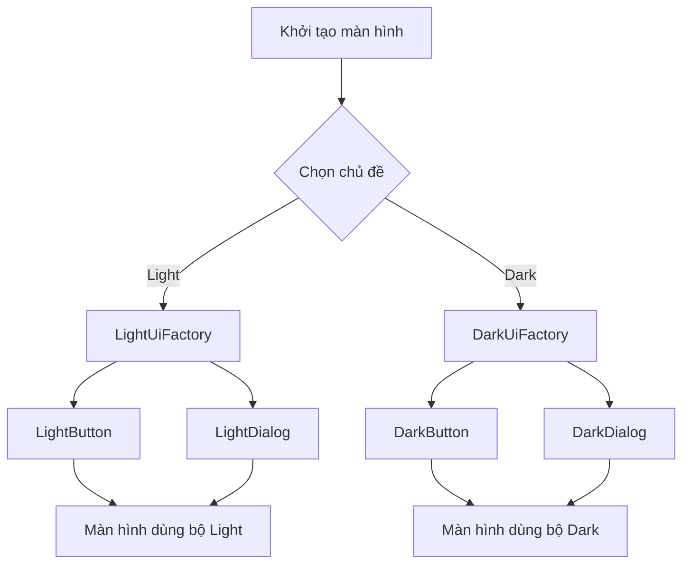

# Duy trì một factory nhất quán cho các sản phẩm cần cộng tác

Trong **Abstract Factory**, một factory không chỉ tạo ra nhiều đối tượng. Nó đại diện cho **một họ sản phẩm được thiết kế để hoạt động cùng nhau**. Khi một chức năng cần nhiều sản phẩm phối hợp, client nên lấy tất cả sản phẩm đó từ **cùng một factory đã được chọn cho chức năng ấy**.

Đây là ý nghĩa thực tế của việc *bảo đảm tương thích*: những đối tượng do một concrete factory cung cấp cùng tuân thủ các quy ước của một họ, chẳng hạn giao diện, chủ đề hiển thị, giao thức, cấu hình hoặc phiên bản tích hợp. Nếu client tự trộn sản phẩm từ những họ khác nhau, từng đối tượng có thể vẫn hợp lệ theo interface, nhưng cách chúng cộng tác có thể sai.

## 1. Vì sao cần giữ các sản phẩm trong cùng một họ?

Giả sử ứng dụng hỗ trợ hai chủ đề giao diện: **Light** và **Dark**. Mỗi chủ đề cần một `Button` và một `Dialog`. Dialog có thể nhận Button làm hành động xác nhận, vì vậy cả hai phải sử dụng cùng bộ quy tắc hiển thị.

| Họ sản phẩm | Button | Dialog | Quy ước chung |
| --- | --- | --- | --- |
| Light | `LightButton` | `LightDialog` | Màu, độ tương phản và trạng thái tương tác của chủ đề sáng |
| Dark | `DarkButton` | `DarkDialog` | Màu, độ tương phản và trạng thái tương tác của chủ đề tối |

Một `LightButton` và một `DarkDialog` đều có thể triển khai các interface tương ứng. Tuy nhiên, nếu Dialog tối hiển thị Button sáng, ứng dụng có thể gặp màu sắc không đồng bộ, trạng thái tương tác khó đọc hoặc lỗi khi hai thành phần giả định những cấu hình khác nhau.

Vấn đề có hai tầng:

- **Tương thích về kiểu:** `LightButton` và `DarkButton` cùng triển khai `Button`; `LightDialog` và `DarkDialog` cùng triển khai `Dialog`. Compiler cho phép client làm việc qua các interface này.
- **Tương thích khi cộng tác:** Button và Dialog cần thuộc **cùng một họ** để tuân thủ những bất biến mà hệ thống yêu cầu. Interface chung tự nó không chứng minh được bất biến đó.

Abstract Factory giải quyết tầng thứ hai ở **ranh giới khởi tạo**: một concrete factory cung cấp những biến thể đã được thiết kế thành bộ.

## 2. Quy tắc: chọn một factory, rồi tạo cả bộ sản phẩm từ factory ấy



Ba vai trò cần phân biệt:

1. **Abstract products** (`Button`, `Dialog`) định nghĩa các khả năng mà client được sử dụng.
2. **Abstract factory** (`UiFactory`) định nghĩa cách yêu cầu toàn bộ những loại sản phẩm cần thiết.
3. **Concrete factories** (`LightUiFactory`, `DarkUiFactory`) quyết định các lớp cụ thể và duy trì quy ước chung của từng họ.

Client chỉ cần nhận một `UiFactory`, tạo `Button` và `Dialog` qua tham chiếu đó, rồi cho chúng cộng tác. Việc chọn `LightUiFactory` hay `DarkUiFactory` nên nằm ở điểm cấu hình hoặc điểm lắp ghép đối tượng, thay vì rải rác trong từng thao tác của client.

## 3. Ví dụ Java hoàn chỉnh

Ví dụ sau dùng một `Screen` nhận `UiFactory` qua constructor. `Screen` không biết tên lớp Button hoặc Dialog cụ thể; nó chỉ yêu cầu hai sản phẩm từ factory đã được cung cấp. Phương thức `show` kiểm tra chủ đề của Button như một **lớp bảo vệ lúc chạy** để phát hiện trường hợp trộn họ ngoài ý muốn.

```java
public class Demo {
    enum Theme { LIGHT, DARK }

    // Abstract products: hợp đồng mà màn hình sử dụng.
    interface Button {
        Theme theme();
        void render();
    }

    interface Dialog {
        Theme theme();
        void show(Button action);
    }

    // Abstract factory: luôn cung cấp đủ sản phẩm cần cộng tác.
    interface UiFactory {
        Button createButton();
        Dialog createDialog();
    }

    static final class LightButton implements Button {
        public Theme theme() { return Theme.LIGHT; }
        public void render() {
            System.out.println("Hiển thị nút Light");
        }
    }

    static final class DarkButton implements Button {
        public Theme theme() { return Theme.DARK; }
        public void render() {
            System.out.println("Hiển thị nút Dark");
        }
    }

    static final class LightDialog implements Dialog {
        public Theme theme() { return Theme.LIGHT; }
        public void show(Button action) {
            requireCompatible(theme(), action);
            System.out.println("Mở hộp thoại Light với hành động:");
            action.render();
        }
    }

    static final class DarkDialog implements Dialog {
        public Theme theme() { return Theme.DARK; }
        public void show(Button action) {
            requireCompatible(theme(), action);
            System.out.println("Mở hộp thoại Dark với hành động:");
            action.render();
        }
    }

    // Concrete factories: mỗi factory cung cấp một họ nhất quán.
    static final class LightUiFactory implements UiFactory {
        public Button createButton() { return new LightButton(); }
        public Dialog createDialog() { return new LightDialog(); }
    }

    static final class DarkUiFactory implements UiFactory {
        public Button createButton() { return new DarkButton(); }
        public Dialog createDialog() { return new DarkDialog(); }
    }

    static final class Screen {
        private final UiFactory factory;

        Screen(UiFactory factory) {
            this.factory = factory;
        }

        void render() {
            Button confirmButton = factory.createButton();
            Dialog confirmDialog = factory.createDialog();
            confirmDialog.show(confirmButton);
        }
    }

    static void requireCompatible(Theme expected, Button action) {
        if (action == null || action.theme() != expected) {
            throw new IllegalArgumentException(
                "Button không tương thích với Dialog " + expected
            );
        }
    }

    public static void main(String[] args) {
        UiFactory factory = args.length > 0
                && "dark".equalsIgnoreCase(args[0])
            ? new DarkUiFactory()
            : new LightUiFactory();

        new Screen(factory).render();
    }
}
```

Lưu thành `Demo.java` rồi chạy với Java hỗ trợ `javac`:

```bash
javac -encoding UTF-8 Demo.java
java Demo dark
```

Kết quả minh họa:

```text
Mở hộp thoại Dark với hành động:
Hiển thị nút Dark
```

Chạy `java Demo` không có tham số sẽ dùng họ Light. Quan sát rằng `Screen.render()` không chứa điều kiện `if` để chọn từng biến thể sản phẩm: nó luôn làm việc với một factory duy nhất.

## 4. Điều gì xảy ra nếu lấy sản phẩm từ hai factory?

Đoạn sau minh họa cách **phá vỡ** quy tắc. Đây là mã minh họa đặt trong phạm vi lớp `Demo`, không phải cách sử dụng nên áp dụng:

```java
Button button = new LightUiFactory().createButton();
Dialog dialog = new DarkUiFactory().createDialog();
dialog.show(button); // IllegalArgumentException: khác họ
```

Compiler vẫn chấp nhận việc truyền `button` cho `dialog.show(...)` vì tham số có kiểu `Button`. Kiểm tra `requireCompatible` mới phát hiện sự khác biệt giữa `LIGHT` và `DARK` tại thời điểm chạy.

**Giới hạn quan trọng:** Abstract Factory theo cách triển khai thông thường **không tự động cấm việc trộn họ ở cấp độ kiểu dữ liệu**. Nó đưa ra cấu trúc để client có thể tạo các sản phẩm tương thích khi tuân theo hợp đồng của factory. Nếu ứng dụng cho phép tự do truyền sản phẩm từ những factory khác nhau vào nhau, vẫn cần thiết kế API, kiểm tra bất biến và bài kiểm thử phù hợp.

Trong hệ thống có yêu cầu mạnh hơn, có thể đóng gói cả bộ sản phẩm thành một đối tượng, giới hạn khả năng tạo sản phẩm trực tiếp hoặc dùng kiểu tổng quát (generics) để biểu diễn họ ngay trong hệ kiểu. Mức bảo đảm nào cần thiết phụ thuộc vào mức độ nguy hiểm của việc phối hợp sai.

## 5. Giữ factory nhất quán theo đúng phạm vi sử dụng

Không nhất thiết toàn ứng dụng chỉ có một factory. Điều cần giữ nhất quán là **nhóm sản phẩm thực sự cộng tác trong cùng một phạm vi**: một màn hình, một yêu cầu xử lý, một phiên giao dịch hoặc một tác vụ nghiệp vụ.

| Tình huống | Cách tổ chức phù hợp | Rủi ro nếu làm sai |
| --- | --- | --- |
| Một màn hình cần Button và Dialog cùng chủ đề | Inject một `UiFactory` vào màn hình; tạo cả hai từ factory đó | Nút sáng xuất hiện trong hộp thoại tối |
| Mỗi người dùng chọn một chủ đề khác nhau | Mỗi màn hình hoặc phiên có factory tương ứng | Factory toàn cục bị thay đổi giữa chừng làm lẫn sản phẩm của hai phiên |
| Tích hợp thanh toán cần tạo giao dịch và hoàn tiền theo cùng nhà cung cấp | Chọn một factory theo nhà cung cấp cho luồng nghiệp vụ | Tạo giao dịch qua nhà cung cấp A nhưng hoàn tiền bằng adapter B |
| Factory dùng một cấu hình hoặc tài nguyên dùng chung | Gắn cấu hình/tài nguyên vào phạm vi sống của factory | Các sản phẩm tuy cùng lớp họ nhưng trỏ tới cấu hình hoặc phiên làm việc không tương thích |

Đặc biệt, **cùng loại factory** không phải lúc nào cũng có nghĩa là **cùng ngữ cảnh hoạt động**. Ví dụ, hai sản phẩm cùng do `PaymentFactory` tạo ra nhưng ở hai merchant account hoặc hai môi trường *sandbox/production* khác nhau vẫn có thể không tương thích. Khi ngữ cảnh là một phần của hợp đồng, factory phải được cấu hình và chia sẻ đúng phạm vi; không nên chỉ so sánh tên lớp sản phẩm.

Một cách tổ chức dễ kiểm soát là chọn concrete factory tại *composition root* (nơi khởi tạo và kết nối các thành phần), truyền nó vào đối tượng điều phối, rồi tạo các sản phẩm cần thiết thông qua đúng tham chiếu đó. Tránh chọn lại factory độc lập trong từng hàm xử lý hoặc thay đổi một biến factory dùng chung khi nhiều luồng đang hoạt động.

## 6. Kiểm chứng hợp đồng tương thích

Chọn một factory duy nhất là điều kiện cần trong cách sử dụng. Để đó thực sự là một **bảo đảm**, mỗi concrete factory còn phải được triển khai và kiểm tra sao cho mọi sản phẩm nó tạo ra thuộc cùng họ và có thể cộng tác đúng cách.

Có thể kiểm tra bằng một hàm hợp đồng áp dụng cho **tất cả** concrete factory:

```java
// Có thể đặt đoạn này trong Demo.main để kiểm tra cả hai họ.
UiFactory[] factories = {
    new LightUiFactory(),
    new DarkUiFactory()
};

for (UiFactory factory : factories) {
    Button button = factory.createButton();
    Dialog dialog = factory.createDialog();

    if (button.theme() != dialog.theme()) {
        throw new AssertionError("Factory tạo hai sản phẩm khác họ");
    }
    dialog.show(button); // Kiểm tra cả hành vi cộng tác thực tế.
}
```

Khi mở rộng hệ thống, nên bổ sung các trường hợp kiểm thử tương ứng với hợp đồng thực tế:

- **Từng factory:** sản phẩm tạo ra có đúng cấu hình, phiên bản, giao thức và các thuộc tính chung của họ hay không.
- **Cộng tác giữa sản phẩm:** thao tác đi qua cả hai hoặc nhiều sản phẩm có thành công không; trạng thái và dữ liệu có được hiểu nhất quán không.
- **Trường hợp sai họ:** nếu client có thể tạo phối hợp sai, hệ thống có từ chối rõ ràng hay phát hiện bằng kiểm tra đủ sớm không.
- **Thay thế họ:** đổi từ factory A sang factory B có giữ nguyên logic client và hợp đồng quan sát được không.

Để tránh tự tin quá mức, chỉ so sánh `theme()` như trong ví dụ chưa đủ chứng minh toàn bộ tính tương thích. Một hệ thống thật còn phải kiểm tra các quy tắc sâu hơn như định dạng dữ liệu, hành vi lỗi, bảo mật, tài nguyên dùng chung và vòng đời đối tượng.

## 7. Các lỗi thiết kế thường gặp

**Chọn từng sản phẩm bằng các nhánh độc lập.** Ví dụ `if (dark) createDarkButton()` ở một nơi nhưng `if (themeFromCache) createDarkDialog()` ở nơi khác. Khi hai nguồn cấu hình không đồng bộ, cùng một màn hình có thể nhận hai họ khác nhau. Hãy tập trung quyết định chọn họ tại một điểm và truyền `UiFactory` xuống nơi sử dụng.

**Tạo factory mới ở giữa một luồng đang chạy.** Một tác vụ bắt đầu bằng factory của nhà cung cấp A nhưng helper tự tạo factory B để xử lý bước tiếp theo. Hãy truyền factory hoặc một bộ sản phẩm đã tạo sẵn theo phạm vi của luồng đó.

**Xem interface chung là bằng chứng đủ của tương thích.** Hai thành phần thỏa interface vẫn có thể khác ngữ nghĩa, phiên bản hoặc cấu hình. Hãy xác định rõ bất biến của họ và kiểm thử các tương tác giữa sản phẩm.

**Thêm một họ mới nhưng bỏ sót sản phẩm.** Nếu client cần `Button` và `Dialog`, một concrete factory mới phải cung cấp cả hai theo hợp đồng. Không nên tùy tiện trả về sản phẩm Light từ `DarkUiFactory` để lấp chỗ trống mà không xác nhận tính tương thích.

**Lạm dụng một factory toàn cục có trạng thái thay đổi.** Khi nhiều request hoặc người dùng dùng cấu hình khác nhau, một factory biến đổi toàn cục dễ gây lỗi chéo phiên. Hãy quản lý factory theo phạm vi phù hợp và xem xét tính an toàn khi dùng đa luồng.

## 8. Khi nào quy tắc này đặc biệt hữu ích?

Abstract Factory phát huy giá trị khi có **nhiều họ sản phẩm thay thế được cho nhau**, mỗi họ chứa **nhiều loại sản phẩm phải phối hợp**, và client cần chuyển đổi giữa các họ mà không biết lớp triển khai cụ thể. Những ví dụ điển hình gồm bộ thành phần giao diện theo hệ điều hành/chủ đề, bộ adapter theo nhà cung cấp dịch vụ, hoặc nhóm thành phần truy cập dữ liệu theo một hệ quản trị cơ sở dữ liệu.

Ngược lại, nếu chỉ tạo một loại sản phẩm độc lập, không có yêu cầu phối hợp theo họ, một factory đơn giản hoặc Factory Method có thể đủ. Abstract Factory làm tăng số interface và lớp triển khai; lợi ích lớn nhất của nó nằm ở việc **quản lý cả một bộ sản phẩm có quan hệ tương thích**.

**Điểm cần ghi nhớ:** client nhận **một factory cho phạm vi cộng tác**, lấy **toàn bộ sản phẩm cần làm việc cùng nhau** từ factory đó và tin vào một hợp đồng đã được concrete factory kiểm chứng. Cấu trúc Abstract Factory giúp giữ ranh giới các họ rõ ràng; việc bảo đảm tính tương thích trong thực tế còn phụ thuộc vào thiết kế bất biến và kiểm thử hành vi của từng họ.
