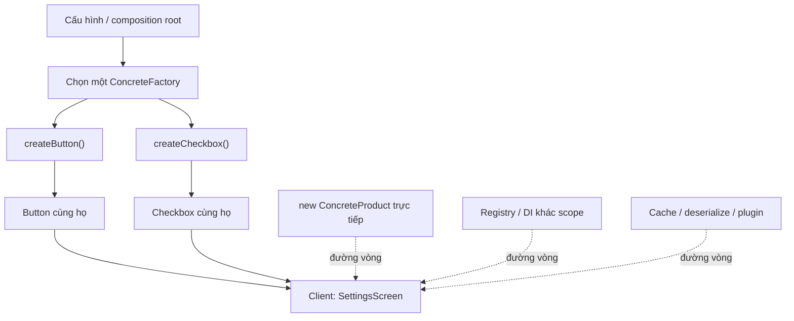

# Nhận diện các đường khởi tạo có thể đưa sản phẩm khác họ vào client

## 1. Vì sao cần kiểm tra *đường khởi tạo*?

Trong mẫu thiết kế **Abstract Factory**, một *họ sản phẩm* là tập các sản phẩm được thiết kế để dùng cùng nhau. Ví dụ, hệ thống giao diện cung cấp hai vai trò sản phẩm `Button` và `Checkbox`, với hai họ:

| Vai trò | Họ Classic | Họ Modern |
| --- | --- | --- |
| `Button` | `ClassicButton` | `ModernButton` |
| `Checkbox` | `ClassicCheckbox` | `ModernCheckbox` |

Một màn hình dùng `ClassicButton` cùng `ClassicCheckbox` là nhất quán về biến thể. Nếu nó nhận `ClassicButton` và `ModernCheckbox`, màn hình đã **trộn sản phẩm khác họ**, dù cả hai đối tượng vẫn tuân thủ interface của riêng mình.

Abstract Factory giúp tổ chức việc tạo theo họ:

```java
interface UIFactory {
    Button createButton();
    Checkbox createCheckbox();
}
```

Nhưng **sự tồn tại của `UIFactory` chưa bảo đảm mọi sản phẩm đi vào client đều cùng họ**. Client có thể còn nhận một `Button` qua constructor, lấy `Checkbox` từ cache, gọi `new` trực tiếp hoặc nhận sản phẩm từ một factory khác. Muốn phát hiện nguy cơ, cần theo dấu **tất cả đường mà đối tượng có thể được tạo, lấy lại và đưa vào client**.

> **Nguyên tắc kiểm tra:** Với một nhóm sản phẩm cần tương thích, hãy xác định ai chọn họ, ai tạo từng sản phẩm, sản phẩm được chuyển qua đâu và liệu chúng có cùng xuất phát từ một quyết định chọn họ hay không.

## 2. “Đường khởi tạo” bao gồm những gì?

Trong phạm vi bài này, **đường khởi tạo** (creation path) là chuỗi thao tác dẫn đến việc client nhận và sử dụng một sản phẩm. Chuỗi đó có thể chứa:

1. **Lựa chọn họ:** đọc cấu hình, chọn nền tảng, chọn tenant hoặc theme.
2. **Lựa chọn cơ chế tạo:** chọn một `ConcreteFactory`, constructor, builder, dependency injection hoặc registry.
3. **Tạo hay khôi phục sản phẩm:** `new`, factory method, lấy từ pool/cache, clone hoặc giải tuần tự hóa dữ liệu.
4. **Đưa sản phẩm vào client:** constructor injection, setter, tham số phương thức, sự kiện/callback hoặc đọc từ một holder dùng chung.

Đối tượng đã tồn tại trước khi client nhận nó vẫn có **nguồn gốc họ sản phẩm** cần kiểm tra; chỉ xét nơi gọi `new` sẽ bỏ sót cache và đối tượng được phục hồi.

Sơ đồ sau thể hiện đường chủ động kiểm soát và các đường có thể đi vòng qua cùng một factory:



Đường liền có một **quyết định chọn factory dùng chung**; các đường nét đứt cần được kiểm tra vì chúng có thể đưa sản phẩm của họ khác vào client. Chúng không mặc nhiên sai: rủi ro xuất hiện khi sản phẩm đến từ những quyết định về họ không đồng nhất.

## 3. Bản đồ các nguồn gây trộn họ sản phẩm

| Nguồn/đường đi | Ví dụ | Vì sao có nguy cơ? | Dấu hiệu cần tìm |
| --- | --- | --- | --- |
| **Khởi tạo trực tiếp trong client** | `new ModernCheckbox()` khi client đang dùng `ClassicFactory` | Bỏ qua lựa chọn họ đã được thống nhất | Constructor của concrete product xuất hiện trong lớp nghiệp vụ/UI |
| **Nhận hai sản phẩm từ hai factory** | `factoryA.createButton()`, `factoryB.createCheckbox()` | Hai factory có thể đại diện cho hai họ | Một đối tượng client nhận nhiều `UIFactory` hoặc hai nguồn sản phẩm khác nhau |
| **Gọi lại bộ chọn factory ở từng lần tạo** | `registry.current().createButton()` rồi `registry.current().createCheckbox()` | Lựa chọn có thể đổi giữa hai lần gọi | Truy vấn cấu hình/registry lặp lại trong một lần dựng thành phần |
| **Dependency injection sai phạm vi** | `Button` singleton cũ, `Checkbox` theo request mới | Vòng đời và giá trị cấu hình khác nhau | Scope singleton/request/session trộn nhau, binding thay đổi lúc chạy |
| **Service locator hoặc hàm tiện ích** | `UiServices.getCheckbox()` | Ẩn việc chọn factory bên trong lớp trợ giúp | Global service, static helper, fallback không dùng factory của client |
| **Cache, pool, prototype, clone** | Lấy `ClassicButton` từ cache sau khi chuyển sang Modern | Tái sử dụng sản phẩm được tạo theo cấu hình cũ | Cache key thiếu `family`, pool dùng chung các biến thể |
| **Giải tuần tự hóa/khôi phục trạng thái** | Đọc đối tượng đã lưu theo schema Classic | Dữ liệu cũ có thể mang biến thể khác | Deserializer tạo concrete class hoặc khôi phục tên lớp |
| **Plugin, adapter hoặc dependency ngoài** | Plugin trả về `ModernCheckbox` | Nguồn bên ngoài có chính sách chọn họ riêng | API trả về concrete product hoặc factory do plugin tự chọn |
| **Cập nhật cấu hình khi đang hoạt động** | Đổi theme giữa hai thao tác tạo | Client chứa sản phẩm cũ và mới cùng lúc | Live reload, hot swap, callbacks hoặc luồng bất đồng bộ |
| **Đường dự phòng khi có lỗi** | Modern thất bại và rơi về `ClassicButton` | Fallback thay đổi họ chỉ cho một vai trò | `catch`/retry/fallback tạo biến thể khác với các sản phẩm còn lại |

Danh sách là **các điểm kiểm tra**, không phải kết luận rằng DI, cache, plugin hay fallback luôn nguy hiểm. Cần xác minh thực tế một đường đi có thể kết thúc bằng sản phẩm của họ nào.

## 4. Ví dụ Java: trộn họ dù vẫn đúng kiểu

Chương trình sau mô phỏng hai họ sản phẩm. `Screen(UIFactory)` tạo cả hai sản phẩm qua **một factory đã chọn**. Constructor `Screen(Button, Checkbox)` được giữ trong ví dụ để minh họa trường hợp hai đối tượng đến từ hai đường khác nhau. Một bước kiểm tra `family()` sẽ phát hiện cặp không đồng nhất.

```java
// Lưu thành CompatibilityPathDemo.java
public class CompatibilityPathDemo {
    enum Family { CLASSIC, MODERN }

    interface Button {
        Family family();
        String render();
    }

    interface Checkbox {
        Family family();
        String render();
    }

    interface UIFactory {
        Button createButton();
        Checkbox createCheckbox();
    }

    static final class ClassicButton implements Button {
        public Family family() { return Family.CLASSIC; }
        public String render() { return "Classic button"; }
    }

    static final class ClassicCheckbox implements Checkbox {
        public Family family() { return Family.CLASSIC; }
        public String render() { return "Classic checkbox"; }
    }

    static final class ModernButton implements Button {
        public Family family() { return Family.MODERN; }
        public String render() { return "Modern button"; }
    }

    static final class ModernCheckbox implements Checkbox {
        public Family family() { return Family.MODERN; }
        public String render() { return "Modern checkbox"; }
    }

    static final class ClassicFactory implements UIFactory {
        public Button createButton() { return new ClassicButton(); }
        public Checkbox createCheckbox() { return new ClassicCheckbox(); }
    }

    static final class ModernFactory implements UIFactory {
        public Button createButton() { return new ModernButton(); }
        public Checkbox createCheckbox() { return new ModernCheckbox(); }
    }

    static final class Screen {
        private final Button button;
        private final Checkbox checkbox;

        // Đường chuẩn: cùng một factory tạo ra cả hai sản phẩm.
        Screen(UIFactory factory) {
            this(factory.createButton(), factory.createCheckbox());
        }

        // Đường linh hoạt: cho phép caller truyền hai sản phẩm riêng.
        // Vì vậy phải kiểm tra ranh giới tương thích tại đây.
        Screen(Button button, Checkbox checkbox) {
            if (button == null || checkbox == null) {
                throw new IllegalArgumentException("Missing product");
            }
            if (button.family() != checkbox.family()) {
                throw new IllegalArgumentException(
                        "Mixed families: " + button.family()
                        + " and " + checkbox.family());
            }
            this.button = button;
            this.checkbox = checkbox;
        }

        String render() {
            return button.render() + " + " + checkbox.render();
        }
    }

    public static void main(String[] args) {
        UIFactory selected = new ClassicFactory();
        System.out.println(new Screen(selected).render());

        // Hai đường khởi tạo riêng, các interface vẫn đúng kiểu:
        Button fromAnotherFactory = new ModernFactory().createButton();
        Checkbox fromSelectedFactory = selected.createCheckbox();

        try {
            new Screen(fromAnotherFactory, fromSelectedFactory);
        } catch (IllegalArgumentException ex) {
            System.out.println("Rejected: " + ex.getMessage());
        }

        System.out.println(new Screen(new ModernFactory()).render());
    }
}
```

Chạy:

```bash
javac CompatibilityPathDemo.java
java CompatibilityPathDemo
```

Kết quả mong đợi:

```text
Classic button + Classic checkbox
Rejected: Mixed families: MODERN and CLASSIC
Modern button + Modern checkbox
```

**Điều cần rút ra:** `Button` và `Checkbox` là hai interface đúng nên trình biên dịch Java không báo lỗi khi kết hợp `ModernButton` với `ClassicCheckbox`. Đó là lỗi **tương thích ở mức họ sản phẩm**, không phải lỗi kiểu trả về. Ví dụ dùng `family()` như một phép kiểm tra lúc chạy nhằm làm lỗi lộ rõ; đây là một lựa chọn phòng vệ, **không phải thành phần bắt buộc của Abstract Factory**.

Trong ứng dụng có thể kiểm soát hoàn toàn đường tạo, cách chặt chẽ hơn là chỉ công bố constructor nhận `UIFactory` và giới hạn đường nhận trực tiếp hai sản phẩm. Nhưng nếu client còn nhận sản phẩm từ dữ liệu ngoài, plugin hoặc cache, cần kiểm tra ngay tại ranh giới tương ứng.

## 5. Nhận diện lỗi theo thời điểm chọn factory

### 5.1. Chọn factory một lần cho một nhóm sản phẩm

Một luồng tạo tốt thường có dạng:

```java
UIFactory selected = resolveFactory(configuration);
Button button = selected.createButton();
Checkbox checkbox = selected.createCheckbox();
```

`selected` là một **ảnh chụp lựa chọn họ** tại thời điểm xây dựng nhóm sản phẩm. Việc sử dụng cùng đối tượng factory giúp thống nhất nguồn gốc, **với điều kiện concrete factory thực sự tạo đúng họ và không tự chuyển biến thể giữa các lần gọi**.

### 5.2. Gọi lại factory provider có thể đổi kết quả

Xét một provider có thể thay đổi theo cấu hình:

```java
Button button = provider.currentFactory().createButton();
// Người dùng đổi theme, hoặc cấu hình được cập nhật ở luồng khác.
Checkbox checkbox = provider.currentFactory().createCheckbox();
```

`provider.currentFactory()` có thể lần đầu trả `ClassicFactory`, lần sau trả `ModernFactory`. Khi đó các sản phẩm không còn cùng họ.

Giảm nguy cơ bằng cách lấy một factory đã chọn cho **toàn bộ vòng dựng**:

```java
UIFactory factoryForThisScreen = provider.currentFactory();
Button button = factoryForThisScreen.createButton();
Checkbox checkbox = factoryForThisScreen.createCheckbox();
```

Nếu bản thân factory là đối tượng có thể thay đổi họ trong lúc chạy, cách trên vẫn chưa đủ. Có thể dùng factory bất biến theo họ hoặc tạo một đối tượng **cấu hình/phiên bản đã chốt** trước khi dựng sản phẩm. Với UI sống lâu, thay đổi theme thường cần dựng lại nhóm sản phẩm hoặc áp dụng một cơ chế chuyển đổi thống nhất thay vì thay riêng một nút.

### 5.3. Tạo qua factory rồi sửa một phần từ đường khác

Ngay cả khi một màn hình ban đầu được tạo nhất quán, đường cập nhật có thể phá vỡ tính tương thích:

```java
// Ban đầu có ClassicButton và ClassicCheckbox.
screen.setCheckbox(new ModernCheckbox()); // Gắn sản phẩm khác họ.
```

Các setter, callbacks, event handlers và luồng cập nhật sản phẩm đều là **đường đưa đối tượng vào client**. Nếu client hỗ trợ thay thế từng thành phần, cần giới hạn nguồn cấp hoặc xác minh họ của đối tượng mới trước khi gán.

## 6. Kiểm tra các đường khởi tạo gián tiếp

### Dependency injection

Hãy xem một `Screen` có nhận `Button` và `Checkbox` từ hai binding độc lập không. Nếu có, cả hai binding cần cùng lấy sản phẩm từ **một cấu hình họ**; scope của chúng cũng phải phù hợp. Ví dụ, một `Button` singleton được tạo khi ứng dụng còn ở Classic và một `Checkbox` tạo theo yêu cầu sau khi chuyển sang Modern có thể bị trộn. Không có bảo đảm tự động rằng cùng dùng DI container thì cùng họ.

Một phương án rõ ràng hơn là inject `UIFactory` hoặc một đối tượng `ProductBundle` đã được tạo và xác minh nhất quán. Chọn scope theo vòng đời nhóm sản phẩm: ứng dụng, cửa sổ, phiên người dùng hoặc yêu cầu.

### Cache và object pool

Lời gọi `cache.get("button")` không chứa thông tin biến thể. Sau khi chuyển theme, nó có thể trả lại sản phẩm cũ. Nếu cache giữ các sản phẩm khác họ, khóa cache thường cần phân biệt theo `family` và các giá trị cấu hình tác động đến tính tương thích, ví dụ `(family, themeVersion, role)`.

Chỉ thêm khóa cũng chưa đủ nếu đối tượng chứa trạng thái gắn với tài nguyên cũ; khi chuyển cấu hình, có thể cần hủy hoặc làm mới cache. Với pool, cần có quy tắc không cấp nhầm sản phẩm từ nhóm khác.

### Deserializer, plugin và adapter

Giải tuần tự hóa có thể tái tạo trực tiếp `ClassicButton` mà không đi qua factory hiện tại. Plugin cũng có thể tự chọn concrete product. Tại điểm nhận dữ liệu, cần kiểm tra thông tin họ/khả năng tương thích, hoặc **chuyển dữ liệu sang mô hình trung gian rồi tạo sản phẩm mới qua factory được chọn**.

Không nên coi chuỗi tên lớp được lưu trong dữ liệu ngoài là bằng chứng cho việc đối tượng tương thích. Ngoài họ sản phẩm, còn có thể cần kiểm tra phiên bản API, giao thức hoặc tài nguyên mà sản phẩm sử dụng.

### Fallback và retry

Nếu `ModernFactory.createButton()` thất bại mà fallback âm thầm tạo `ClassicButton`, trong khi `createCheckbox()` vẫn tạo `ModernCheckbox`, tính nhất quán bị phá vỡ. Khi cần fallback về một họ khác, thông thường nên **chọn lại cả factory rồi dựng lại toàn bộ nhóm**; hoặc quy định rõ rằng các biến thể cụ thể được phép dùng chung và kiểm chứng điều đó.

## 7. Cách rà soát trong mã nguồn

Không nhất thiết bắt đầu từ mọi constructor trong dự án. Hãy chọn **một client cần nhiều sản phẩm tương thích** và lần ngược từng trường dữ liệu của nó:

1. **Liệt kê sản phẩm đang giữ:** ví dụ `Button`, `Checkbox`, `Menu`; phân biệt sản phẩm cần cùng họ với sản phẩm độc lập.
2. **Liệt kê mọi cửa nhận đối tượng:** constructor, factory method, setter, callback, DI binding, registry, cache, deserialize và đường cập nhật khi chạy.
3. **Truy ngược nguồn tạo:** tên concrete factory, constructor concrete product, provider hoặc adapter nào đã cung cấp đối tượng?
4. **Xác định thời điểm chọn họ và scope:** các nguồn có dùng một lựa chọn đã chốt không? Có khả năng thay đổi giữa hai lần tạo hay trong thời gian client giữ đối tượng không?
5. **Kiểm tra đường lỗi và dự phòng:** exception, giá trị mặc định, retry, cache miss/hit có thể chuyển họ không?
6. **Xác minh tại ranh giới:** loại bỏ đường vượt kiểm soát hoặc thêm kiểm tra thích hợp; thử cả trường hợp cùng họ và khác họ.

Các cụm từ thường hữu ích khi tìm trong mã: `new ConcreteProduct`, `createButton`, `createCheckbox`, `getBean`, `getInstance`, `currentFactory`, `getFromCache`, `deserialize`, `clone`, `fallback`, `setButton` và `setCheckbox`. Đây là **gợi ý tìm kiếm**, không có một cú pháp nào bao quát mọi hệ thống.

### Ví dụ bảng kiểm nguồn gốc cho một màn hình

| Sản phẩm client nhận | Đường đi hiện tại | Chọn họ ở đâu? | Cùng họ có được bảo đảm? |
| --- | --- | --- | --- |
| `Button` | `factory.createButton()` | Factory chọn lúc mở màn hình | Có, nếu factory đúng hợp đồng |
| `Checkbox` | `registry.currentFactory().createCheckbox()` | Registry được hỏi mỗi lần | **Chưa chắc**: có thể khác lựa chọn của `Button` |
| `Menu` | `menuCache.get(...)` | Lúc cache được điền | **Chưa chắc**: phải xét khóa và vòng đời |

Bảng này đưa ra câu hỏi hành động cụ thể: **đưa `Checkbox` về cùng factory đã chốt, đồng thời bảo đảm cache của `Menu` được phân vùng theo họ hoặc tạo lại khi đổi cấu hình**.

## 8. Xác minh: điều gì có thể và không thể được bảo đảm?

| Cơ chế | Giúp kiểm soát điều gì? | Giới hạn |
| --- | --- | --- |
| `AbstractProduct` + kiểu trả về của `AbstractFactory` | Đúng **vai trò** sản phẩm (`Button` hay `Checkbox`) | Không tự chứng minh hai sản phẩm thuộc cùng họ |
| Một `ConcreteFactory` bất biến được dùng cho cả nhóm | Tập trung quyết định họ tại một nơi | Vẫn phải hiện thực các phương thức tạo chính xác |
| Giới hạn constructor/setter và đường cập nhật | Giảm cơ hội đưa sản phẩm ngoài factory vào client | Không kiểm soát được mọi plugin/dữ liệu ngoài nếu chưa xác minh |
| Family ID hoặc kiểm tra tại ranh giới | Phát hiện một số trường hợp trộn họ lúc chạy | Metadata có thể sai; cùng ID không đủ bảo đảm tương thích hành vi |
| Kiểm thử hợp đồng và kiểm thử tích hợp | Kiểm tra ánh xạ sản phẩm, hành vi kết hợp và đường fallback | Phạm vi kiểm thử hữu hạn; cần bao phủ các đường đi thực tế |

Ví dụ kiểm thử nên bao gồm:

- Với mỗi `ConcreteFactory`, tạo **toàn bộ** vai trò sản phẩm và xác nhận chúng thuộc họ mong đợi.
- Tạo client từ **một factory** và kiểm tra các sản phẩm có thể cùng hoạt động.
- Cố ý cung cấp `Button` và `Checkbox` khác họ qua đường nhận trực tiếp, xác nhận ứng dụng từ chối hoặc xử lý theo chính sách đã định.
- Đổi cấu hình trong khi client còn sống; xác nhận không trộn thành phần cũ và mới.
- Mô phỏng cache hit, phục hồi dữ liệu hoặc fallback; kiểm tra những đường này không vượt qua ranh giới tương thích.

**Không nên đồng nhất “cùng họ” với “luôn tương thích”.** Hai sản phẩm do cùng factory tạo có thể vẫn lỗi ở mức dữ liệu, phiên bản API hoặc tài nguyên. Abstract Factory cho một **cấu trúc giúp quản lý tính nhất quán**, còn bảo đảm thực tế cần được hỗ trợ bởi hợp đồng sản phẩm, triển khai factory và xác minh hành vi.

## Ghi nhớ

Khi nhận diện rủi ro trộn họ trong Abstract Factory, đừng chỉ xem `ConcreteFactory` tạo những lớp nào. Hãy **lần theo tất cả đường một sản phẩm có thể đi vào client**, kể cả tạo trực tiếp, DI, registry, cache, phục hồi dữ liệu và cập nhật khi chạy. Chốt **một quyết định chọn họ** cho nhóm sản phẩm cần dùng chung, giữ ranh giới đưa sản phẩm vào client rõ ràng và kiểm tra các đường vòng. Đây là nền tảng để bảo đảm `AbstractFactory` thực sự giúp client nhận những sản phẩm tương thích.
