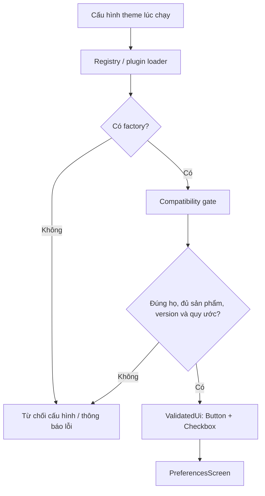

# Kiểm tra tương thích lúc chạy khi cấu hình động hoặc plugin không bảo đảm được lúc biên dịch

**Chương:** Bảo đảm tương thích  
**Chuyên đề:** `SOFTWARE_DESIGN_DESIGN_PATTERN_CREATIONAL_ABSTRACT_FACTORY` — Học về abstract factory trong design pattern.

## Mục tiêu học tập

Sau bài học, bạn có thể:

- Giải thích ranh giới giữa những gì **trình biên dịch Java** bảo đảm và những gì chỉ có thể quyết định khi một **factory được chọn hoặc nạp lúc chạy**.
- Xác định các điều kiện tương thích cần kiểm tra khi sử dụng Abstract Factory với cấu hình động hoặc hệ plugin.
- Thiết kế một bước **kiểm tra trước khi bàn giao sản phẩm cho client**: factory tồn tại, đúng họ, sản phẩm đầy đủ, phiên bản hợp đồng phù hợp và các quy tắc chung được đáp ứng.
- Xử lý trường hợp plugin sai hợp đồng bằng cách báo lỗi rõ ràng tại ranh giới khởi tạo, tránh tạo màn hình bằng bộ sản phẩm hỗn hợp.
- Phân biệt **kiểm tra metadata**, **contract test**, **kiểm tra tích hợp** và **an toàn khi nạp mã plugin**.

## 1. Vì sao kiểm tra lúc biên dịch có thể chưa đủ?

Giả sử một ứng dụng Java có màn hình cài đặt gồm hai loại sản phẩm: `Button` và `Checkbox`. Mỗi họ giao diện được đại diện bằng một concrete factory: `LightUiFactory`, `DarkUiFactory` hoặc factory do plugin bên ngoài cung cấp.

Trong ứng dụng đơn giản, composition root có thể chọn một factory đã biết từ mã nguồn:

```java
UiFactory factory = new DarkUiFactory();
Button button = factory.createButton();
Checkbox checkbox = factory.createCheckbox();
```

Nhưng trong hệ thống có **cấu hình động**, tên theme có thể đến từ tệp cấu hình, biến môi trường, tenant hoặc lựa chọn của người dùng. Trong hệ **plugin**, implementation của `UiFactory` có thể được đăng ký khi khởi động hoặc được nạp từ một JAR không có mặt khi biên dịch ứng dụng chính.

Ví dụ:

```text
application.theme = dark
plugins.enabled   = [light, dark, partner-theme]
                       |
                       v
             Registry / plugin loader
                       |
                       v
             UiFactory được chọn lúc chạy
                       |
                       v
            Button + Checkbox cho màn hình
```

Tại thời điểm biên dịch phần ứng dụng chính, Java không biết chắc:

- Cấu hình `application.theme` sẽ là giá trị nào khi ứng dụng thực sự chạy.
- Một plugin có được đăng ký hay không; mã và các dependency của plugin có nạp được trong môi trường hiện tại không.
- Factory được đăng ký dưới tên `dark` có **thực sự** tạo hai sản phẩm Dark hay chỉ trả về sản phẩm có kiểu interface hợp lệ.
- Plugin có trả về `null`, sản phẩm phiên bản hợp đồng cũ, hoặc các sản phẩm dùng bộ quy tắc không tương thích không.

Đây là vấn đề **kiểm tra tính tương thích khi giải quyết dependency ở runtime**, không phải bằng chứng Abstract Factory thiếu giá trị. Abstract Factory vẫn tạo một hợp đồng ổn định để client thay cả một họ sản phẩm; khi nguồn implementation thay đổi động, hệ thống cần **xác nhận factory thực tế** trước khi sử dụng.

## 2. Những bảo đảm của compiler và khoảng trống ở runtime

Giả sử ứng dụng khai báo:

```java
interface Button {
    String render(String label);
}

interface Checkbox {
    String render(String label, boolean checked);
}

interface UiFactory {
    Button createButton();
    Checkbox createCheckbox();
}
```

Với một **concrete class** biên dịch thành công và khai báo `implements UiFactory`, compiler kiểm tra rằng lớp đó triển khai các phương thức bắt buộc với kiểu trả về tương thích. Nếu thiếu `createCheckbox()` hoặc trả về kiểu không tương thích với `Checkbox`, lớp cụ thể thông thường sẽ không biên dịch.

Tuy nhiên, những factory sau **vẫn có thể biên dịch**:

```java
// Các lớp sản phẩm được giả định đã triển khai Button/Checkbox.
final class MixedDarkFactory implements UiFactory {
    public Button createButton() {
        return new DarkButton();
    }

    public Checkbox createCheckbox() {
        return new LightCheckbox(); // Đúng kiểu; sai họ Dark.
    }
}

final class EmptyDarkFactory implements UiFactory {
    public Button createButton() {
        return new DarkButton();
    }

    public Checkbox createCheckbox() {
        return null; // Kiểu tham chiếu hợp lệ; thiếu sản phẩm.
    }
}
```

| Điều cần biết | Compiler Java | Kiểm tra runtime |
| --- | --- | --- |
| Concrete factory có đủ các phương thức của `UiFactory`? | **Có**, khi lớp được biên dịch và triển khai interface đúng cách. | Không cần kiểm tra lại chỉ để xác nhận chữ ký đã được kiểm tra, nhưng vẫn cần xử lý lỗi nạp plugin. |
| Một khóa cấu hình như `dark` có provider được đăng ký? | Không. | **Có**, tra cứu registry. |
| Provider nạp thành công và tạo được factory? | Không bảo đảm cho plugin nạp động. | **Có**, kiểm tra tại điểm nạp/khởi tạo. |
| `createCheckbox()` không trả về `null`? | Không. | **Có**, kiểm tra kết quả. |
| Sản phẩm thực sự thuộc họ `dark`? | Không mặc định. | **Có**, dựa trên hợp đồng/metadata hoặc hành vi có thể quan sát. |
| Plugin có cùng phiên bản giao thức/hợp đồng hành vi? | Không đầy đủ, nhất là khi biên dịch độc lập. | **Có**, xác minh version/capability và chạy contract test phù hợp. |
| Mọi hành vi và khả năng truy cập của UI đều đúng? | Không. | **Chỉ có thể đánh giá bằng kiểm thử và quan sát thích hợp**; một lần kiểm tra lúc khởi động là chưa đủ. |

Lưu ý: việc plugin “không bảo đảm được lúc biên dịch” không có nghĩa plugin hoàn toàn không qua compiler. Plugin có thể được biên dịch riêng dựa trên một bản API cũ; khi nạp vào ứng dụng hiện tại vẫn có thể gặp vấn đề nhị phân như `LinkageError` hoặc không đáp ứng quy ước ngữ nghĩa mới. Runtime validation nhằm phát hiện sớm những điều kiện ứng dụng có thể kiểm tra, **không thay thế kiểm thử tương thích binary và hành vi**.

## 3. Xác định hợp đồng tương thích trước khi viết bộ kiểm tra

Một kiểm tra runtime chỉ có ý nghĩa khi biết rõ “tương thích” là gì. Với ví dụ giao diện, ta chọn các điều kiện:

1. **Identity của factory:** factory lấy từ registry theo khóa `dark` phải tự nhận diện đúng họ `dark`. Registry không được âm thầm chuyển sang một họ khác khi cấu hình không hợp lệ.
2. **Tính đầy đủ:** `createButton()` và `createCheckbox()` đều trả về đối tượng không `null`.
3. **Tính nhất quán của họ:** `Button` và `Checkbox` cùng mang định danh họ được chọn, không trộn `dark` với `light`.
4. **Phiên bản hợp đồng:** host yêu cầu `apiMajor = 1`; sản phẩm tuy đúng interface nhưng quảng bá phiên bản ngữ nghĩa không hỗ trợ phải bị từ chối.
5. **Schema cho quy ước giao diện:** sản phẩm hỗ trợ định dạng token `ui-tokens-v1` mà host mong đợi; cùng tên họ nhưng schema cũ hoặc không nhận diện cũng bị từ chối.
6. **Hành vi tối thiểu:** sản phẩm phản hồi được các thao tác mà client cần trong một tập thử nghiệm an toàn và không đưa ra dữ liệu rỗng trái hợp đồng.

Đây là **hợp đồng minh họa của ứng dụng này**, không phải quy định chung do Abstract Factory bắt buộc. Một phần mềm khác có thể yêu cầu protocol version, locale, quyền truy cập, transaction scope hoặc capability khác.

### “Cùng họ” là điều kiện cần, chưa phải điều kiện đủ

Hai plugin có thể cùng khai báo họ `dark` và cùng `apiMajor = 1` nhưng render hoàn toàn khác quy tắc, hoặc một plugin có lỗi ở trạng thái disabled. Metadata bị khai báo sai cũng có thể đánh lừa kiểm tra. Vì thế, kiểm tra tại bootstrap giúp **fail fast với những vi phạm nhận biết được**; tính đúng đắn toàn diện cần thêm contract tests, kiểm tra thành phần thật và kiểm thử tích hợp.

Ví dụ, nếu cả hai product cùng có `tokenSchema = "ui-tokens-v1"`, ta mới biết chúng tuyên bố dùng cùng một **kiểu hợp đồng token**. Ta chưa chứng minh màu chữ đủ tương phản hoặc cách vẽ focus đúng yêu cầu. Muốn kiểm chứng điều đó phải xem dữ liệu token thực tế, trạng thái UI và quy tắc tương ứng.

## 4. Đặt cổng kiểm tra ở ranh giới lắp ráp

Không nên cho từng màn hình tự đọc cấu hình, chọn plugin và xác minh compatibility. Việc đó làm logic kiểm tra phân tán, khiến một số client có thể bỏ qua kiểm tra.

Trong kiến trúc có **composition root**, đưa bước kiểm tra vào đường khởi tạo:



**Nguyên tắc:** chỉ bàn giao một **bộ sản phẩm đã được kiểm tra** cho client. Nếu một product sai họ, không tạo màn hình với product còn lại theo kiểu “cố chạy”. Hệ thống có thể có chính sách fallback, nhưng fallback phải **được đặc tả và thực hiện cho cả họ**, tránh thay mỗi một thành phần rồi gây trộn họ.

Với plugin nạp động, việc xác thực/cho phép nguồn plugin, nạp provider và chọn factory nằm ở ranh giới bên ngoài ứng dụng. Cổng compatibility được gọi **trước khi client nhận sản phẩm**. Khi cấu hình đổi lúc chạy, cần lặp lại việc tạo và kiểm tra một bộ mới trước khi thay bộ đang sử dụng.

## 5. Ví dụ Java hoàn chỉnh: kiểm tra factory được chọn lúc chạy

Ví dụ dưới đây dùng registry `Map<String, Supplier<UiFactory>>` để **mô phỏng việc đăng ký provider tại runtime**. Nó chưa thực sự tải JAR bên ngoài; phần tiếp theo sẽ chỉ ra cách mở rộng sang `ServiceLoader`. Mọi lớp nằm trong một file để dễ chạy với Java 8.

Hai họ chuẩn `light` và `dark` được chấp nhận. Sau đó, chương trình thay đăng ký `dark` bằng các factory lỗi nhằm chứng minh các vi phạm có thể **qua compiler** nhưng bị cổng kiểm tra từ chối.

Lưu mã vào file **`RuntimeCompatibilityDemo.java`**:

```java
import java.util.HashMap;
import java.util.Locale;
import java.util.Map;
import java.util.Objects;
import java.util.function.Supplier;

// Metadata do product công bố theo hợp đồng của ứng dụng.
final class ProductContract {
    final String family;
    final int apiMajor;
    final String tokenSchema;

    ProductContract(String family, int apiMajor, String tokenSchema) {
        this.family = Objects.requireNonNull(family, "family");
        this.apiMajor = apiMajor;
        this.tokenSchema = Objects.requireNonNull(tokenSchema, "tokenSchema");
    }
}

// Hai abstract products.
interface Button {
    ProductContract contract();
    String render(String label);
}

interface Checkbox {
    ProductContract contract();
    String render(String label, boolean checked);
}

// Abstract Factory: client không cần biết class sản phẩm cụ thể.
interface UiFactory {
    String familyId();
    Button createButton();
    Checkbox createCheckbox();
}

// Concrete products dùng để minh họa; ứng dụng thật sẽ render UI.
final class DemoButton implements Button {
    private final ProductContract info;

    DemoButton(ProductContract info) {
        this.info = Objects.requireNonNull(info, "info");
    }

    @Override
    public ProductContract contract() {
        return info;
    }

    @Override
    public String render(String label) {
        return "Button[" + info.family + "]: " + label;
    }
}

final class DemoCheckbox implements Checkbox {
    private final ProductContract info;

    DemoCheckbox(ProductContract info) {
        this.info = Objects.requireNonNull(info, "info");
    }

    @Override
    public ProductContract contract() {
        return info;
    }

    @Override
    public String render(String label, boolean checked) {
        return "Checkbox[" + info.family + "]: " + label
             + (checked ? " [x]" : " [ ]");
    }
}

// Hai factory hợp lệ.
final class LightUiFactory implements UiFactory {
    private final ProductContract info =
            new ProductContract("light", 1, "ui-tokens-v1");

    public String familyId() {
        return "light";
    }

    public Button createButton() {
        return new DemoButton(info);
    }

    public Checkbox createCheckbox() {
        return new DemoCheckbox(info);
    }
}

final class DarkUiFactory implements UiFactory {
    private final ProductContract info =
            new ProductContract("dark", 1, "ui-tokens-v1");

    public String familyId() {
        return "dark";
    }

    public Button createButton() {
        return new DemoButton(info);
    }

    public Checkbox createCheckbox() {
        return new DemoCheckbox(info);
    }
}

// Sai họ: factory nói là Dark nhưng Checkbox thuộc Light.
final class MixedDarkPluginFactory implements UiFactory {
    public String familyId() {
        return "dark";
    }

    public Button createButton() {
        return new DemoButton(new ProductContract("dark", 1, "ui-tokens-v1"));
    }

    public Checkbox createCheckbox() {
        return new DemoCheckbox(
                new ProductContract("light", 1, "ui-tokens-v1"));
    }
}

// Sai version: cả hai sản phẩm công bố API major cũ.
final class LegacyDarkPluginFactory implements UiFactory {
    public String familyId() {
        return "dark";
    }

    public Button createButton() {
        return new DemoButton(new ProductContract("dark", 0, "ui-tokens-v1"));
    }

    public Checkbox createCheckbox() {
        return new DemoCheckbox(
                new ProductContract("dark", 0, "ui-tokens-v1"));
    }
}

// Thiếu sản phẩm: Java cho phép trả về null cho kiểu tham chiếu.
final class NullDarkPluginFactory implements UiFactory {
    public String familyId() {
        return "dark";
    }

    public Button createButton() {
        return new DemoButton(new ProductContract("dark", 1, "ui-tokens-v1"));
    }

    public Checkbox createCheckbox() {
        return null;
    }
}

// Bộ đã kiểm tra; client không phải chọn hoặc phối trộn factory.
final class ValidatedUi {
    private final Button button;
    private final Checkbox checkbox;

    ValidatedUi(Button button, Checkbox checkbox) {
        this.button = Objects.requireNonNull(button, "button");
        this.checkbox = Objects.requireNonNull(checkbox, "checkbox");
    }

    String renderScreen() {
        return button.render("Lưu") + System.lineSeparator()
             + checkbox.render("Nhận thông báo", true);
    }
}

// Compatibility gate chạy tại ranh giới khởi tạo ứng dụng.
final class RuntimeCompatibilityGate {
    private static final int SUPPORTED_API_MAJOR = 1;
    private static final String SUPPORTED_TOKENS = "ui-tokens-v1";

    private RuntimeCompatibilityGate() { }

    private static void ensure(boolean condition, String message) {
        if (!condition) {
            throw new IllegalStateException(message);
        }
    }

    private static void validateProduct(
            ProductContract info, String expectedFamily, String productName) {
        ensure(info != null, productName + " không có metadata");
        ensure(expectedFamily.equals(info.family),
                productName + " thuộc họ " + info.family
                + "; yêu cầu " + expectedFamily);
        ensure(info.apiMajor == SUPPORTED_API_MAJOR,
                productName + " API major " + info.apiMajor
                + "; yêu cầu " + SUPPORTED_API_MAJOR);
        ensure(SUPPORTED_TOKENS.equals(info.tokenSchema),
                productName + " không hỗ trợ token schema: "
                + info.tokenSchema);
    }

    static ValidatedUi resolve(
            String requestedTheme,
            Map<String, Supplier<UiFactory>> providers) {
        Objects.requireNonNull(requestedTheme, "requestedTheme");
        Objects.requireNonNull(providers, "providers");
        String family = requestedTheme.trim().toLowerCase(Locale.ROOT);

        Supplier<UiFactory> provider = providers.get(family);
        if (provider == null) {
            throw new IllegalArgumentException(
                    "Không có provider cho theme: " + family);
        }

        UiFactory factory = provider.get();
        ensure(factory != null, "Provider không tạo được factory");
        ensure(family.equals(factory.familyId()),
                "Factory không khớp họ đã đăng ký: " + factory.familyId());

        Button button = factory.createButton();
        Checkbox checkbox = factory.createCheckbox();
        ensure(button != null, "Button bị null");
        ensure(checkbox != null, "Checkbox bị null");
        validateProduct(button.contract(), family, "Button");
        validateProduct(checkbox.contract(), family, "Checkbox");

        // Chỉ bàn giao cả bộ khi mọi điều kiện đều đạt.
        return new ValidatedUi(button, checkbox);
    }
}

public final class RuntimeCompatibilityDemo {
    private static void showRejected(
            String reason, String theme, Map<String, Supplier<UiFactory>> providers) {
        try {
            RuntimeCompatibilityGate.resolve(theme, providers);
            throw new AssertionError("Đáng lẽ phải từ chối: " + reason);
        } catch (IllegalArgumentException | IllegalStateException violation) {
            System.out.println("REJECT " + reason + ": "
                    + violation.getMessage());
        }
    }

    public static void main(String[] args) {
        // Giả lập registry được cấu hình lúc chạy.
        Map<String, Supplier<UiFactory>> providers = new HashMap<>();
        providers.put("light", LightUiFactory::new);
        providers.put("dark", DarkUiFactory::new);

        for (String theme : new String[] {"light", "dark"}) {
            ValidatedUi screen = RuntimeCompatibilityGate.resolve(theme, providers);
            System.out.println("ACCEPT " + theme);
            System.out.println(screen.renderScreen());
        }

        // Giả lập plugin khác lần lượt thay provider đăng ký dưới key dark.
        providers.put("dark", MixedDarkPluginFactory::new);
        showRejected("mixed", "dark", providers);

        providers.put("dark", LegacyDarkPluginFactory::new);
        showRejected("legacy", "dark", providers);

        providers.put("dark", NullDarkPluginFactory::new);
        showRejected("missing", "dark", providers);

        showRejected("unknown", "solarized", providers);
    }
}
```

### Biên dịch và chạy

```bash
javac -encoding UTF-8 RuntimeCompatibilityDemo.java
java RuntimeCompatibilityDemo
```

Kết quả dự kiến:

```text
ACCEPT light
Button[light]: Lưu
Checkbox[light]: Nhận thông báo [x]
ACCEPT dark
Button[dark]: Lưu
Checkbox[dark]: Nhận thông báo [x]
REJECT mixed: Checkbox thuộc họ light; yêu cầu dark
REJECT legacy: Button API major 0; yêu cầu 1
REJECT missing: Checkbox bị null
REJECT unknown: Không có provider cho theme: solarized
```

Những tình huống lỗi là một phần **có chủ đích của ví dụ**: chương trình vẫn kết thúc bình thường vì `showRejected(...)` bắt đúng các ngoại lệ do gate tạo ra, để in thông báo minh họa. Trong ứng dụng thật, khi một provider không hợp lệ, bootstrap thường **dừng khởi tạo phạm vi phụ thuộc** và chuyển lỗi đến cơ chế ghi log/xử lý cấu hình có kiểm soát; không nuốt lỗi rồi trả về bộ UI chưa được kiểm tra.

### Vì sao ví dụ chỉ tạo sản phẩm một lần?

`RuntimeCompatibilityGate.resolve()` gọi mỗi phương thức `create...()` một lần, kiểm tra **chính những đối tượng đó**, rồi đóng gói chúng trong `ValidatedUi`. Nếu chỉ tạo sản phẩm thử để kiểm tra, sau đó để client gọi lại factory, kết quả lần sau có thể khác (factory có state, plugin thay đổi cấu hình, hoặc logic ngẫu nhiên). Khi sản phẩm được tạo theo yêu cầu trong suốt vòng đời client, ứng dụng cần một **factory wrapper đã được kiểm tra** tiếp tục bảo đảm mỗi lần tạo, hoặc một ràng buộc tạo sản phẩm mạnh hơn ở bên trong implementation.

Một vấn đề tương tự xuất hiện khi UI có thể đổi theme khi đang chạy: phải tạo và xác nhận **bộ mới** trước khi thay toàn bộ bộ cũ, thay vì lần lượt thay từng widget rồi để màn hình ở trạng thái trộn họ.

## 6. Từ registry mô phỏng sang plugin thật bằng `ServiceLoader`

Trong Java, có thể sử dụng `ServiceLoader` để khám phá các provider trên classpath/module path. Một thiết kế mở rộng là khai báo **provider contract** riêng:

```java
interface UiFactoryProvider {
    String id();
    UiFactory createFactory();
}
```

Ở ranh giới bootstrap, mã khám phá provider có thể theo ý tưởng:

```java
// Mã minh họa để tích hợp vào bootstrap, không phải toàn bộ chương trình.
Map<String, Supplier<UiFactory>> providers = new HashMap<>();
for (UiFactoryProvider discovered
        : java.util.ServiceLoader.load(UiFactoryProvider.class)) {
    String id = discovered.id().trim().toLowerCase(Locale.ROOT);
    if (id.isEmpty() || providers.putIfAbsent(id, discovered::createFactory) != null) {
        throw new IllegalStateException("ID plugin thiếu hoặc trùng: " + id);
    }
}

ValidatedUi selected =
        RuntimeCompatibilityGate.resolve(configuredTheme, providers);
```

Để `ServiceLoader` khám phá được provider bên ngoài, JAR phải được khai báo đúng bằng cấu hình dịch vụ (`META-INF/services/...` trong mô hình classpath) hoặc cơ chế `provides ... with ...` phù hợp trong Java module system. Provider cũng phải thỏa điều kiện visibility/khởi tạo theo cơ chế nạp được dùng.

Các điểm cần lưu ý:

- **Đăng ký trùng ID** nên bị từ chối hoặc được giải quyết theo một chính sách ưu tiên được định nghĩa rõ; tránh để thứ tự khám phá quyết định theme cuối cùng một cách vô tình.
- **Sai bản API nhị phân** hoặc khai báo provider lỗi có thể dẫn đến lỗi nạp như `ServiceConfigurationError` hay `LinkageError` **trước khi** `resolve()` chạy. Đây là một lớp lỗi riêng tại bootstrap, cần thông báo có ngữ cảnh.
- **`ServiceLoader` không phải sandbox bảo mật.** Việc nạp một class plugin có thể chạy mã của plugin. Cần áp dụng quy trình xác thực nguồn plugin, quyền triển khai, kiểm tra dependency và chính sách bảo mật tương ứng với mức độ tin cậy; metadata do plugin tự công bố không chứng minh plugin an toàn.
- **ServiceLoader không tự giải quyết mọi khác biệt phiên bản.** Nếu API thay đổi không tương thích nhị phân, cần kiểm tra tương thích khi đóng gói/phát hành và chiến lược version hóa, trước cả kiểm tra sản phẩm ở runtime.

Đoạn `ServiceLoader` minh họa **một lựa chọn tích hợp**, không bắt buộc tất cả ứng dụng phải dùng plugin framework. Với cấu hình động nhưng factory đều được đóng gói trong ứng dụng, registry hoặc dependency injection container có thể đủ.

## 7. Cách thiết kế chính sách version và capability

Ví dụ dùng `apiMajor == 1` và `tokenSchema == "ui-tokens-v1"` như một chính sách **khớp chính xác**. Trong hệ thống thật có thể cần phân biệt:

| Loại tương thích | Ví dụ | Cách kiểm tra phù hợp |
| --- | --- | --- |
| **Binary/API** | Plugin được biên dịch theo phiên bản interface nào? | Kiểm tra metadata/artifact, dependency, khả năng nạp và test tích hợp; xử lý lỗi nạp. |
| **Semantic version/protocol** | Host đòi major 2, plugin chỉ hỗ trợ major 1. | Từ chối hoặc dùng adapter chuyển đổi nếu có cơ chế đã được kiểm chứng. |
| **Capabilities** | Host cần khả năng `focus-visible`, nhưng plugin không khai báo hỗ trợ. | Kiểm tra tập capability bắt buộc; chạy contract test cho từng capability. |
| **Family compatibility** | Button báo `dark`, Checkbox báo `light`. | Kiểm tra mọi sản phẩm theo family ID và các invariant đã đặc tả. |
| **Lifecycle** | Plugin tạo product mới mỗi lần gọi, nhưng client giả định singleton. | Hợp đồng vòng đời và test trong các kịch bản sử dụng thật. |
| **Configuration** | Theme được yêu cầu không có trong registry. | Từ chối sớm hoặc fallback cả họ theo chính sách công khai. |

Không nên suy đoán rằng mọi minor version luôn tương thích hoặc chỉ cần chuỗi version “trông giống nhau” là đủ. Quy tắc semver chỉ hữu ích khi đội phát triển **thực sự tuân thủ** và có test xác nhận. Nếu một plugin có nhiều capability tùy chọn, nên thương lượng theo **khả năng mà client yêu cầu**, thay vì chọn theo tên phiên bản duy nhất.

Ví dụ ý tưởng với capability, khi hợp đồng có bổ sung method `capabilities()`:

```java
// Giả định UiFactory đã có phương thức capabilities() trả Set<String>.
// Set<String> required = new HashSet<>(Arrays.asList("focus-visible", "checked-state"));
// if (!factory.capabilities().containsAll(required)) {
//     throw new IllegalStateException("Plugin thiếu khả năng bắt buộc");
// }
```

Đây là **mã minh họa chính sách**, không phải phần có thể chép riêng vào chương trình ở mục 5 mà không sửa interface. Capability được plugin công bố phải được đối chiếu bằng các test phù hợp; chỉ kiểm tra tên capability chưa đủ bảo đảm hành vi thực.

## 8. Kiểm tra runtime không thay thế các lớp kiểm thử khác

Một hệ plugin hoặc cấu hình động nên kết hợp nhiều tầng đánh giá:

| Giai đoạn | Kiểm tra chính | Lỗi có thể phát hiện |
| --- | --- | --- |
| **Build và compile** | Interface, implementation, dependency của các module có mặt khi build. | Sai method signature, thiếu method, lỗi kiểu. |
| **Đóng gói plugin** | API version, metadata, phụ thuộc và khả năng nạp với phiên bản host hỗ trợ. | Sai JAR, lỗi binary, thiếu dependency. |
| **Bootstrap / runtime gate** | ID được chọn, factory tồn tại, product non-null, cùng họ, schema/version hợp lệ. | Cấu hình sai, provider bị thiếu, trộn họ, sai version. |
| **Contract test** | Các implementation phản hồi đúng tập hành vi được đặc tả. | Sai trạng thái, sai semantic dù metadata hợp lệ. |
| **Integration / UI test** | Thành phần thực tế cùng hoạt động trong màn hình, kể cả đổi theme và lỗi tài nguyên. | Sai focus, trạng thái, lifecycle, khả năng truy cập, lỗi tích hợp. |
| **Vận hành** | Log sự kiện nạp/chọn plugin, cảnh báo lỗi, khả năng rollback an toàn. | Sự cố chỉ xuất hiện theo cấu hình hoặc dữ liệu thực. |

Đặc biệt, không nên kiểm tra chỉ bằng cách so sánh tên class chứa chuỗi `Dark` hoặc kiểm tra `instanceof Button`. Những cách này không chứng minh sản phẩm thuộc đúng họ và thỏa quy tắc tương thích. Metadata được thiết kế theo hợp đồng giúp validation rõ ràng hơn; **hành vi và tương thích thực tế** vẫn phải được kiểm tra.

Nếu `Button` và `Checkbox` là các interface có behavior thay đổi theo state, việc chạy một lần lúc bootstrap chỉ kiểm tra trạng thái được quan sát. Sau một lần đổi theme hoặc cập nhật plugin, những đối tượng đã tồn tại không tự động biến thành sản phẩm của họ mới.

## 9. Các lỗi thường gặp khi kiểm tra compatibility động

| Lỗi | Hệ quả | Hướng khắc phục |
| --- | --- | --- |
| Tin rằng `implements UiFactory` bảo đảm toàn bộ họ tương thích | Factory vẫn có thể trả về `null` hoặc sản phẩm sai họ. | Kiểm tra từng product và quy tắc chung tại runtime. |
| Mỗi client tự lấy provider từ registry | Logic chọn và kiểm tra bị phân tán; dễ trộn họ. | Giải quyết ở composition root, cấp bộ đã kiểm tra cho client. |
| Chỉ kiểm tra factory ID mà không kiểm tra sản phẩm | Factory khai báo `dark` nhưng trả Checkbox Light vẫn qua. | Kiểm tra tất cả product thực tế của họ. |
| Dùng metadata version như bằng chứng hành vi hoàn chỉnh | Plugin có thể khai báo sai hoặc có lỗi implementation. | Kết hợp contract test và integration test. |
| Tự chuyển sang Light khi chỉ thiếu Checkbox Dark | Màn hình trộn thành phần hai họ. | Nếu fallback, chọn lại và kiểm tra **toàn bộ họ**. |
| Kiểm tra instance mẫu nhưng client lại gọi factory lần nữa | Product mới có thể không giống instance đã kiểm tra. | Cấp bộ đã kiểm tra, hoặc đặt gate trước mọi lần tạo sản phẩm. |
| Đổi theme dần dần khi màn hình đang dùng | Có thể có trạng thái tạm thời không tương thích. | Chuẩn bị bộ mới hoàn chỉnh rồi thay theo chính sách cập nhật nhất quán. |
| Coi `ServiceLoader` là cơ chế bảo vệ trước plugin không tin cậy | Nạp class có thể thực thi mã bên ngoài. | Kiểm soát nguồn plugin và quy trình bảo mật tách biệt. |
| Bắt mọi `Throwable` rồi tiếp tục chạy | Che giấu lỗi nghiêm trọng và có thể duy trì object graph hỏng. | Xử lý lỗi có chủ đích tại bootstrap; dừng hoặc rollback phạm vi lỗi. |

## 10. Bài luyện tập

**Câu 1.** Tại sao `MixedDarkPluginFactory` ở mục 5 có thể biên dịch nhưng bị từ chối tại runtime?

**Đáp án gợi ý:** `DemoCheckbox` vẫn là `Checkbox`, nên chữ ký phương thức đúng kiểu. Cổng kiểm tra phát hiện metadata của Checkbox mang family `light` trong khi cấu hình yêu cầu `dark`.

**Câu 2.** Vì sao một plugin trả về hai sản phẩm đúng họ `dark` vẫn có thể bị từ chối?

**Đáp án gợi ý:** Có thể thiếu sản phẩm, dùng major version không được hỗ trợ, không có schema/capability bắt buộc hoặc không thỏa hành vi hợp đồng. Cùng họ chỉ giải quyết một phần của tương thích.

**Câu 3.** Khi cấu hình yêu cầu `solarized` nhưng registry không có provider, nên để mọi màn hình tự chọn `light` làm fallback không?

**Đáp án gợi ý:** Không nên để từng client tự fallback. Nếu ứng dụng hỗ trợ fallback, hãy định nghĩa chính sách ở ranh giới khởi tạo: chọn một họ thay thế đầy đủ, kiểm tra cả họ đó, thông báo/lưu dấu lý do lựa chọn rồi cấp bộ nhất quán cho client.

**Câu 4.** Nếu plugin đã qua kiểm tra tại bootstrap, có thể bỏ toàn bộ UI integration test không?

**Đáp án gợi ý:** Không. Runtime gate chỉ kiểm tra các invariant đã lập trình và những đối tượng/trạng thái đã quan sát. UI thực tế còn nhiều trạng thái, tương tác và yêu cầu khả năng truy cập cần kiểm chứng.

**Bài thực hành A.** Bổ sung `WrongSchemaDarkPluginFactory` vào ví dụ, trả về `ProductContract("dark", 1, "ui-tokens-v0")` cho cả hai sản phẩm. Thay đăng ký `dark` bằng factory này và dự đoán thông báo từ gate. Sau đó khôi phục `DarkUiFactory` và xác nhận được chấp nhận.

**Bài thực hành B.** Điều chỉnh `RuntimeCompatibilityGate.resolve()` để nhận tập capability bắt buộc khi `UiFactory` đã công bố capability phù hợp. Thử một plugin báo thiếu `focus-visible`. Chỉ chấp nhận khi plugin có capability cần thiết và bộ contract test kiểm chứng behavior tương ứng.

**Bài thực hành C.** Giả sử một factory có thể tạo sản phẩm mới sau mỗi sự kiện của người dùng. Giải thích vì sao việc chỉ kiểm tra product đầu tiên chưa đủ; đề xuất wrapper kiểm tra mọi kết quả tạo mới, hoặc thiết kế client dùng một bộ đã xác nhận trong phạm vi màn hình.

## Kết luận

Khi **cấu hình được chọn lúc chạy** hoặc **Abstract Factory đến từ plugin**, compiler vẫn bảo vệ hợp đồng kiểu của mã đã được biên dịch phù hợp, nhưng không thể tự bảo đảm **provider thực sự tồn tại, nạp thành công, trả đủ sản phẩm đúng họ và đáp ứng quy tắc tương thích của ứng dụng**. Một **compatibility gate tại ranh giới khởi tạo** nên kiểm tra ID, sản phẩm, metadata version/schema và các điều kiện tối thiểu rồi mới trao bộ sản phẩm cho client. Kiểm tra này hỗ trợ phát hiện lỗi sớm và tránh trộn họ; nó phải đi cùng kiểm tra binary, contract tests, kiểm thử tích hợp và chính sách nạp plugin an toàn để tạo ra mức tin cậy phù hợp cho hệ thống thực tế.
