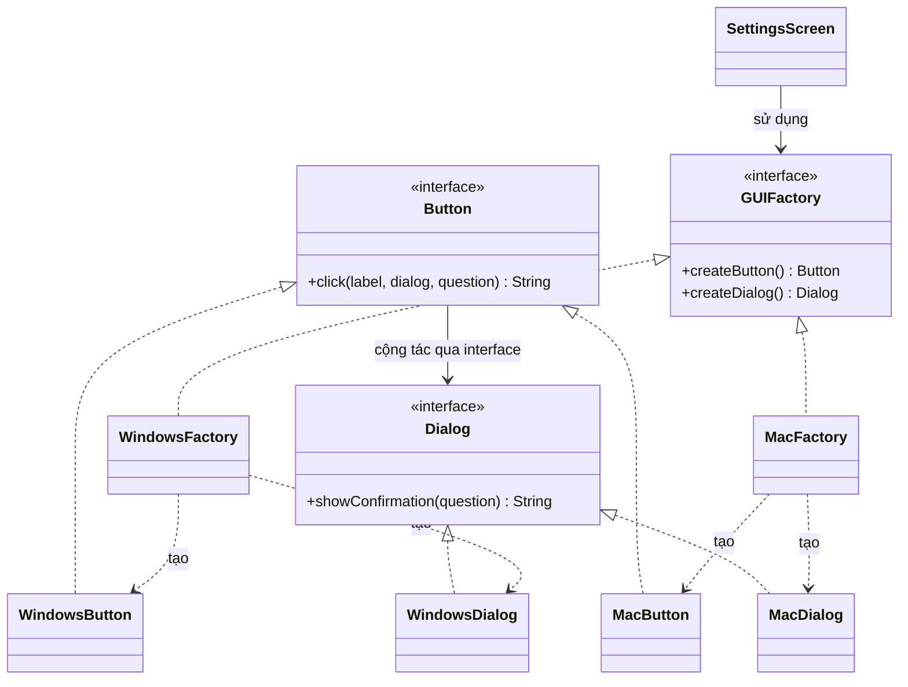
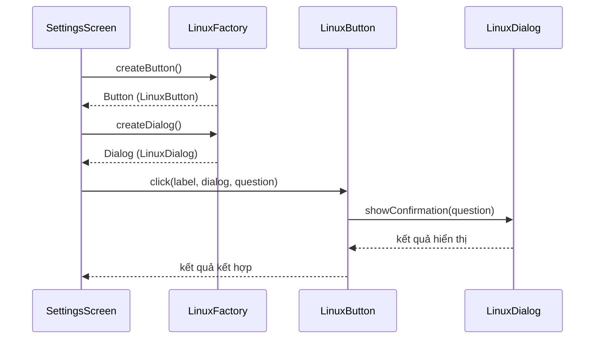

# Thiết kế sản phẩm cộng tác qua hợp đồng chung thay vì ép kiểu sang lớp cụ thể

Trong module `SOFTWARE_DESIGN_DESIGN_PATTERN_CREATIONAL_ABSTRACT_FACTORY` (*Học về abstract factory trong design pattern*), **Abstract Factory** giúp tạo các đối tượng thuộc một **họ sản phẩm** thống nhất. Tuy nhiên, một câu hỏi quan trọng xuất hiện khi các sản phẩm **cần làm việc với nhau**: làm thế nào để chúng trao đổi mà không phụ thuộc vào lớp hiện thực cụ thể của nhau?

Bài học thuộc chương **Bảo đảm tương thích**. Ta sẽ thiết kế hai loại sản phẩm giao diện, `Button` và `Dialog`, sao cho một nút bấm có thể yêu cầu hộp thoại hiển thị thông báo **qua hợp đồng `Dialog` chung**, thay vì ép kiểu sang `WindowsDialog` hoặc `MacDialog`. Qua đó, ta phân biệt rõ **tương thích về kiểu**, **tương thích về hành vi** và **tính nhất quán của các sản phẩm cùng họ**.

## 1. Tình huống: Button cần phối hợp với Dialog

Giả sử ứng dụng có màn hình cài đặt. Khi người dùng bấm nút **Lưu**, ứng dụng cần hiển thị một hộp thoại xác nhận. Giao diện hỗ trợ hai họ: **Windows** và **macOS**.

| Loại sản phẩm | Họ Windows | Họ macOS |
| --- | --- | --- |
| Nút bấm | `WindowsButton` | `MacButton` |
| Hộp thoại | `WindowsDialog` | `MacDialog` |
| Factory tạo cả bộ | `WindowsFactory` | `MacFactory` |

Yêu cầu của ứng dụng có hai phần:

1. **Cùng họ:** nếu factory được cấu hình là Windows, cả button và dialog cần mang kiểu hiển thị Windows; với macOS thì cả hai cùng theo macOS.
2. **Cộng tác qua hợp đồng:** để yêu cầu hiển thị xác nhận, một button chỉ cần biết rằng đối tượng nhận được **có thể thực hiện thao tác của `Dialog`**. Button không cần biết dialog thuộc class nào.

Trong ví dụ này, hành vi tương tác được mô phỏng bằng chuỗi trả về; đây không phải sự kiện nhấn nút hay hộp thoại native thực. Nguyên tắc về phụ thuộc vẫn áp dụng cho GUI thực, nơi callback hoặc controller thường điều phối các widget.

## 2. Lỗi thiết kế: ép kiểu một sản phẩm sang lớp của họ cụ thể

Xem một đoạn mã có vấn đề:

```java
// Ví dụ phản diện: giả định WindowsDialog có sẵn.
class WindowsButtonWithCast implements Button {
    @Override
    public String click(String label, Dialog dialog, String question) {
        WindowsDialog concreteDialog = (WindowsDialog) dialog;
        return "[Windows] Button: " + label + "\n"
                + concreteDialog.showConfirmation(question);
    }
}
```

Mặc dù tham số được khai báo là `Dialog`, dòng `(WindowsDialog) dialog` lại đưa **phụ thuộc vào lớp cụ thể** trở vào mã button. Nếu đối tượng truyền vào thực tế là `MacDialog`, phép ép kiểu có thể ném `ClassCastException` tại runtime.

Một cách xử lý còn nguy hiểm hơn là kiểm tra kiểu từng biến thể:

```java
// Cách viết khiến Button phải biết các họ Dialog.
if (dialog instanceof WindowsDialog) {
    // Cách xử lý Windows...
} else if (dialog instanceof MacDialog) {
    // Cách xử lý macOS...
}
```

Khi thêm họ Linux, lập trình viên lại phải sửa chính các button hoặc các nơi có nhánh kiểm tra như trên. Việc này đi ngược mục tiêu tách **abstract product** khỏi các lớp hiện thực.

Điểm cần sửa không phải là “ép kiểu cho đúng hơn”, mà là thiết kế một **hợp đồng chung đủ diễn đạt thao tác cộng tác**.

## 3. Thiết kế hai abstract product có thể cộng tác

Ta định nghĩa `Dialog` công bố chức năng mà các button thực sự cần, rồi cho `Button` nhận một đối tượng `Dialog`:

```java
interface Dialog {
    String showConfirmation(String question);
}

interface Button {
    String click(String label, Dialog dialog, String question);
}
```

Khi đó, `WindowsButton` có thể gọi trực tiếp `dialog.showConfirmation(question)` mà không biết tên class của dialog. `MacButton` cũng sử dụng cùng hợp đồng. Mỗi `Dialog` có thể tự chọn cách hiển thị phù hợp với nền tảng của nó.

Điều này tạo ra hai tầng abstraction:

- **Abstraction của sản phẩm cộng tác:** `Button` phụ thuộc vào `Dialog` (interface), chứ không phụ thuộc vào `WindowsDialog` hoặc `MacDialog`.
- **Abstraction của việc khởi tạo:** client nhận một `GUIFactory` và gọi `createButton()`, `createDialog()` để lấy một bộ sản phẩm từ cùng factory.



Sơ đồ có một chi tiết đáng chú ý: mũi tên **`Button → Dialog` trỏ đến interface**. Không có mối phụ thuộc `WindowsButton → WindowsDialog` trong hợp đồng của button. Các concrete factory vẫn biết các concrete product vì **khởi tạo chúng là trách nhiệm của factory**.

## 4. Ví dụ Java hoàn chỉnh

Lưu đoạn mã sau vào `CollaboratingProductsDemo.java`. Chương trình cho phép chọn `windows` hoặc `mac` và có kiểm tra minh họa rằng button có thể gọi một dialog giả chỉ triển khai hợp đồng chung.

```java
import java.util.Locale;
import java.util.Objects;

public class CollaboratingProductsDemo {

    // 1. Abstract products: mô tả khả năng cộng tác.
    interface Dialog {
        String showConfirmation(String question);
    }

    interface Button {
        String click(String label, Dialog dialog, String question);
    }

    // 2. Abstract factory: tạo đủ loại sản phẩm của một họ.
    interface GUIFactory {
        Button createButton();
        Dialog createDialog();
    }

    // 3. Concrete products của họ Windows.
    static final class WindowsDialog implements Dialog {
        @Override
        public String showConfirmation(String question) {
            return "[Windows] Dialog: " + question;
        }
    }

    static final class WindowsButton implements Button {
        @Override
        public String click(String label, Dialog dialog, String question) {
            Objects.requireNonNull(dialog, "dialog");
            return "[Windows] Button: " + label + "\n"
                    + dialog.showConfirmation(question);
        }
    }

    // 4. Concrete products của họ macOS.
    static final class MacDialog implements Dialog {
        @Override
        public String showConfirmation(String question) {
            return "[macOS] Dialog: " + question;
        }
    }

    static final class MacButton implements Button {
        @Override
        public String click(String label, Dialog dialog, String question) {
            Objects.requireNonNull(dialog, "dialog");
            return "[macOS] Button: " + label + "\n"
                    + dialog.showConfirmation(question);
        }
    }

    // 5. Concrete factories tạo các sản phẩm của đúng họ.
    static final class WindowsFactory implements GUIFactory {
        @Override
        public Button createButton() {
            return new WindowsButton();
        }

        @Override
        public Dialog createDialog() {
            return new WindowsDialog();
        }
    }

    static final class MacFactory implements GUIFactory {
        @Override
        public Button createButton() {
            return new MacButton();
        }

        @Override
        public Dialog createDialog() {
            return new MacDialog();
        }
    }

    // 6. Client chỉ biết GUIFactory, Button và Dialog.
    static final class SettingsScreen {
        private final GUIFactory factory;

        SettingsScreen(GUIFactory factory) {
            this.factory = Objects.requireNonNull(factory, "factory");
        }

        String previewSave() {
            Button save = factory.createButton();
            Dialog confirmation = factory.createDialog();

            return save.click(
                    "Lưu cài đặt",
                    confirmation,
                    "Bạn có muốn lưu các thay đổi?");
        }
    }

    // 7. Điểm khởi tạo ứng dụng chọn một factory.
    static GUIFactory selectFactory(String platform) {
        String key = Objects.requireNonNull(platform, "platform")
                .trim().toLowerCase(Locale.ROOT);

        switch (key) {
            case "windows":
                return new WindowsFactory();
            case "mac":
            case "macos":
                return new MacFactory();
            default:
                throw new IllegalArgumentException(
                        "Nền tảng không hỗ trợ: " + platform);
        }
    }

    // 8. Kiểm tra cộng tác bằng một Dialog khác.
    static void verifyCommonContract() {
        final String[] receivedQuestion = {null};

        // Dialog giả không phải WindowsDialog hoặc MacDialog.
        Dialog fakeDialog = question -> {
            receivedQuestion[0] = question;
            return "[Fake] Dialog: " + question;
        };

        Button button = new WindowsButton();
        String result = button.click(
                "Kiểm tra", fakeDialog, "Có tiếp tục không?");

        if (!"Có tiếp tục không?".equals(receivedQuestion[0])
                || !result.contains("[Fake] Dialog: Có tiếp tục không?")) {
            throw new AssertionError(
                    "Button chưa cộng tác đúng qua interface Dialog");
        }
    }

    // 9. Kiểm tra factory không trộn hai họ sản phẩm.
    static void verifyFactoryFamilies() {
        GUIFactory windows = new WindowsFactory();
        GUIFactory mac = new MacFactory();

        if (!(windows.createButton() instanceof WindowsButton)
                || !(windows.createDialog() instanceof WindowsDialog)) {
            throw new AssertionError("WindowsFactory trả sai họ");
        }

        if (!(mac.createButton() instanceof MacButton)
                || !(mac.createDialog() instanceof MacDialog)) {
            throw new AssertionError("MacFactory trả sai họ");
        }
    }

    public static void main(String[] args) {
        verifyCommonContract();
        verifyFactoryFamilies();

        String platform = args.length == 0 ? "windows" : args[0];
        GUIFactory factory = selectFactory(platform);
        SettingsScreen screen = new SettingsScreen(factory);
        System.out.println(screen.previewSave());
    }
}
```

Biên dịch và chạy trong thư mục chứa file:

```bash
javac -encoding UTF-8 CollaboratingProductsDemo.java
java CollaboratingProductsDemo windows
java CollaboratingProductsDemo mac
```

Khi chọn `windows`, chương trình in:

```text
[Windows] Button: Lưu cài đặt
[Windows] Dialog: Bạn có muốn lưu các thay đổi?
```

Khi chọn `mac`, chương trình in:

```text
[macOS] Button: Lưu cài đặt
[macOS] Dialog: Bạn có muốn lưu các thay đổi?
```

Hai phép kiểm tra trong `main()` không in thêm dòng nào nếu thành công; chúng ném `AssertionError` khi phát hiện sai quy tắc. Trong cả hai lần chạy, `SettingsScreen` đều lấy hai sản phẩm từ **cùng một `GUIFactory`** và `Button.click()` gọi `Dialog.showConfirmation()` **mà không cần ép kiểu**.

Việc button trả về một chuỗi “kết hợp” chỉ phục vụ minh họa rõ mối cộng tác. Trong GUI thực tế, nút có thể phát sự kiện, controller nhận sự kiện rồi yêu cầu dialog hiển thị; cả hai cách tổ chức đều có thể giữ phụ thuộc vào **interface** thay vì concrete class.

## 5. Phân biệt ba mức độ “tương thích”

Một điểm dễ nhầm là coi các sản phẩm cùng implement interface thì **chắc chắn** là một họ phù hợp. Thực tế cần phân biệt:

| Mức độ | Ví dụ kiểm tra | Điều được bảo đảm |
| --- | --- | --- |
| **Tương thích kiểu** | `WindowsButton.click(Dialog, ...)` chấp nhận một đối tượng implement `Dialog` | Java kiểm tra chữ ký phương thức lúc biên dịch |
| **Tương thích hành vi** | `showConfirmation()` thực sự hiển thị/xử lý yêu cầu xác nhận theo hợp đồng | Cần quy ước ngữ nghĩa và kiểm thử hành vi |
| **Nhất quán cùng họ** | `WindowsFactory` trả `WindowsButton` và `WindowsDialog` | Phụ thuộc implementation của factory và kiểm thử quy tắc họ |

Ví dụ sau có thể **biên dịch và chạy** vì hai sản phẩm thỏa mãn interface:

```java
Button button = new WindowsButton();
Dialog dialog = new MacDialog();
System.out.println(
        button.click("Lưu", dialog, "Xác nhận?"));
```

Tuy nhiên, kết quả sẽ trộn nhãn `[Windows] Button` và `[macOS] Dialog`. Điều đó **không phải lỗi hệ thống kiểu của Java**; nó là lỗi **tổ hợp họ sản phẩm**. Abstract Factory giúp tập trung việc chọn các sản phẩm cùng họ, nhưng chỉ riêng interface **không tự ngăn** người khác cố tình hoặc vô ý trộn chúng bằng tay.

Vì vậy, để duy trì tính nhất quán:

- Client lấy **toàn bộ sản phẩm liên quan** từ cùng một factory.
- Concrete factory tạo đúng biến thể cho mỗi phương thức.
- Kiểm thử factory phát hiện việc trả nhầm hoặc thiếu loại sản phẩm.
- Các quy tắc về màu sắc, trạng thái, giao tiếp và khả năng truy cập được kiểm chứng ngoài kiểm tra kiểu.

Không nên dùng các phép ép kiểu concrete trong client để “ép” cùng họ. Chúng vừa tạo phụ thuộc mới, vừa có thể thất bại tại runtime.

## 6. Điều gì xảy ra khi thêm một họ mới?

Giả sử cần thêm Linux. Nếu thiết kế cộng tác đã dùng `Button` và `Dialog` chung, ta chỉ cần tạo `LinuxButton`, `LinuxDialog` và `LinuxFactory`, rồi đăng ký factory ở điểm lựa chọn. `LinuxButton` gọi `dialog.showConfirmation(question)` qua interface như các button khác; không cần sửa Windows hoặc macOS để thêm một nhánh `instanceof LinuxDialog`.



**Điều kiện:** hợp đồng `Dialog.showConfirmation()` đã đáp ứng các hành vi cần dùng cho họ Linux. Nếu một nền tảng có khả năng hoàn toàn khác, cần cân nhắc cách biểu diễn nó trong abstraction hoặc tách giao diện chuyên biệt. Không nên ép mọi sản phẩm phải biết chi tiết của nền tảng khác.

Với một họ mới, việc mở rộng thường tập trung ở **concrete product**, **concrete factory** và **cấu hình lựa chọn**. Trái lại, nếu bổ sung **loại sản phẩm** mới (ví dụ `Slider`), thường phải mở rộng interface factory và tất cả concrete factory tương ứng. Đây là hai chiều thay đổi khác nhau của Abstract Factory.

## 7. Khi hợp đồng chung không đủ cho nhu cầu cộng tác

Giả sử `WindowsDialog` có phương thức riêng `showWithWindowsAnimation()`, trong khi `MacDialog` chỉ có `showWithMacAnimation()`. Nếu `Button` phải ép kiểu để gọi từng phương thức, đó là dấu hiệu hợp đồng chưa mô tả đúng mục đích cộng tác.

Có thể cân nhắc các hướng sau:

| Nhu cầu thật sự | Hướng thiết kế |
| --- | --- |
| Mọi dialog đều cần “hiển thị xác nhận” | Định nghĩa `showConfirmation()` trong `Dialog` và để từng concrete dialog hiện thực |
| Chỉ cần truyền dữ liệu chung (thông điệp, nhãn nút, mức độ cảnh báo) | Tạo đối tượng yêu cầu/giá trị chung, chẳng hạn `ConfirmationRequest`, thay vì truyền class riêng của nền tảng |
| Chỉ một số dialog có khả năng đặc biệt | Cân nhắc interface hẹp theo khả năng, adapter hoặc chính sách riêng; tránh nhồi mọi hành vi đặc thù vào interface chung |
| Quy trình tương tác thuộc nghiệp vụ, không thuộc nút | Để controller/service điều phối `Button` và `Dialog` qua interface, không đặt logic nghiệp vụ vào widget |
| Các sản phẩm phải tuân thủ ràng buộc cùng họ nghiêm ngặt hơn | Giới hạn đường tạo đối tượng, cung cấp factory qua DI và kiểm thử tổ hợp; có thể dùng kiểu mạnh hơn nếu thực sự cần |

**Interface Segregation Principle** gợi ý mỗi interface chỉ nên công bố những khả năng mà các bên sử dụng thực sự cần. Thêm `showWithWindowsAnimation()` vào `Dialog` chỉ để tránh cast có thể không đúng nếu các họ khác không thể hoặc không cần hiện thực hành vi đó.

Vì thế, sửa lỗi ép kiểu cần bắt đầu bằng câu hỏi **“hai sản phẩm cần trao đổi thông tin hoặc yêu cầu hành vi gì?”**. Hợp đồng nên mô tả câu trả lời đó theo cách độc lập nền tảng.

## 8. Kiểm chứng cộng tác và tính nhất quán

Trong ví dụ hoàn chỉnh, hai kiểm tra giải quyết **hai lỗi khác nhau**:

### Kiểm tra 1 — Cộng tác qua interface

`verifyCommonContract()` truyền vào `WindowsButton` một `Dialog` giả được tạo bằng lambda. Nó không phải `WindowsDialog`, nhưng vẫn nhận được câu hỏi và trả kết quả. Nếu trong button còn phép ép kiểu `(WindowsDialog) dialog`, phép thử sẽ thất bại bằng `ClassCastException` thay vì chạy thành công.

Phép thử này chứng minh **button dùng khả năng chung của Dialog**, chứ không chứng minh mọi cặp widget khác họ có giao diện nhất quán.

### Kiểm tra 2 — Factory tạo sản phẩm cùng họ

`verifyFactoryFamilies()` kiểm tra `WindowsFactory` trả về cả hai sản phẩm Windows và `MacFactory` trả về cả hai sản phẩm macOS. Nếu một factory trả nhầm dialog của họ khác, phép thử sẽ phát hiện.

Kiểm tra `instanceof` **ở vùng kiểm thử factory** có thể phù hợp, vì bài kiểm thử cần biết class cụ thể để xác nhận tổ hợp. Trong **client nghiệp vụ**, `instanceof` theo tên họ thường là tín hiệu abstraction bị rò rỉ.

### Kiểm tra 3 — Hành vi trong ứng dụng thật

Với GUI thực tế, cần kiểm tra thêm: callback có được kích hoạt đúng lúc, dialog có mở/đóng hợp lý, xử lý hủy/xác nhận có đúng không, kiểu hiển thị có đồng bộ và các trạng thái bàn phím, focus, accessibility có đáp ứng yêu cầu không. Một interface chung chỉ bảo đảm **các phương thức có thể được gọi**, không thay thế kiểm thử ngữ nghĩa và tích hợp.

## 9. Các lỗi thường gặp và cách sửa

1. **Cast concrete trong sản phẩm:** `(WindowsDialog) dialog` khiến button biết class khác. Sửa bằng cách gọi một phương thức chung trên `Dialog`.
2. **Tạo sản phẩm ngoài factory:** client gọi `new WindowsDialog()` nhưng lấy `MacButton` từ factory. Sửa bằng cách tạo cả hai qua factory đã cấu hình.
3. **Giả định biên dịch được nghĩa là cùng họ:** `WindowsButton` và `MacDialog` cùng thỏa hợp đồng nhưng có thể trộn phong cách. Bổ sung kiểm thử concrete factory.
4. **Đặt mọi chức năng nền tảng vào interface chung:** interface phình to, một số họ phải dùng `UnsupportedOperationException`. Tách khả năng hoặc điều phối qua abstraction hợp lý.
5. **Đẩy quy trình nghiệp vụ vào widget:** một button trực tiếp gọi API lưu dữ liệu hoặc quyết định phân quyền. Giữ phần nghiệp vụ trong controller/service và để widget xử lý nhiệm vụ giao diện.
6. **Dựa vào cast để kiểm tra tính đúng họ:** cast chỉ kiểm tra một kiểu cụ thể lúc chạy, không phải cơ chế thiết kế giúp client độc lập nền tảng. Bảo đảm tổ hợp họ tại factory và giới hạn đường tạo sản phẩm.

## 10. Bài tập thực hành

**Bài tập 1 — Loại bỏ ép kiểu.** Viết một `MacButtonWithCast` nhận `Dialog` rồi ép kiểu thành `MacDialog`. Truyền vào một dialog giả có cùng interface và quan sát lỗi. Sau đó thay cast bằng lời gọi `dialog.showConfirmation(question)` và thử lại.

**Bài tập 2 — Bổ sung họ Linux.** Hiện thực `LinuxButton`, `LinuxDialog`, `LinuxFactory`. Cập nhật `selectFactory()`, rồi chạy màn hình cài đặt với Linux. Kiểm tra có cần sửa chữ ký `Button.click()` và `Dialog.showConfirmation()` không.

**Bài tập 3 — Phát hiện trộn họ.** Cố tình sửa `MacFactory.createDialog()` để trả về `WindowsDialog`. Mã có biên dịch không? Kiểm tra nào sẽ bắt lỗi? Vì sao `verifyCommonContract()` vẫn có thể thành công trong tình huống này?

**Bài tập 4 — Thiết kế hợp đồng dữ liệu.** Nâng cấp yêu cầu xác nhận để chứa `title`, `message` và mức độ cảnh báo. Thiết kế một `ConfirmationRequest` độc lập nền tảng rồi đổi `showConfirmation()` nhận đối tượng đó. Không thêm class `WindowsConfirmationRequest` chỉ để phục vụ một lệnh ép kiểu trong button.

**Câu hỏi tự đánh giá:** Tại sao `Button` phụ thuộc vào interface `Dialog` vẫn có thể cộng tác với các hiện thực mới? Vì sao riêng interface không bảo đảm hai sản phẩm cùng họ? Nên đặt các phép kiểm tra kiểu concrete ở client nghiệp vụ hay trong kiểm thử và mã triển khai factory?

## Kết luận

Để thiết kế các **sản phẩm cộng tác qua hợp đồng chung** trong Abstract Factory, hãy định nghĩa rõ khả năng cần trao đổi giữa các **abstract product** và cho chúng gọi nhau qua interface, không ép kiểu sang concrete class. Sau đó, tạo trọn bộ sản phẩm liên quan từ **cùng một concrete factory** và kiểm tra riêng cả **hợp đồng hành vi** lẫn **tính nhất quán của họ**. Cách tổ chức này giúp thêm biến thể mới mà không kéo theo các lệnh cast, nhánh phân biệt nền tảng hoặc sửa đổi không cần thiết trong client.
