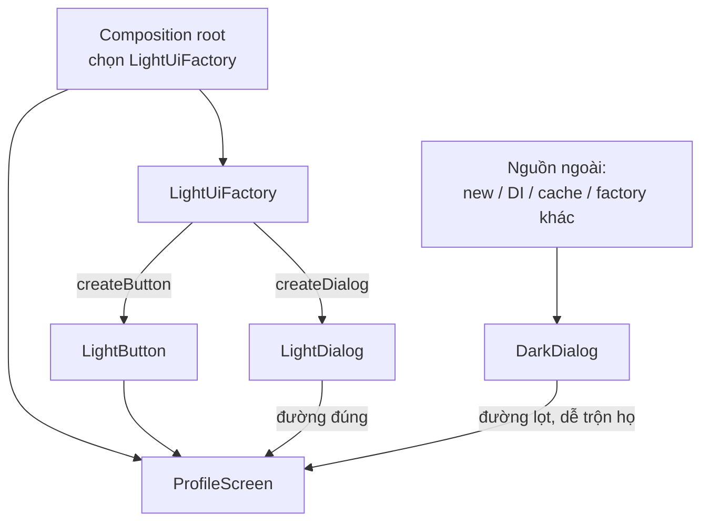

# Phân tích giới hạn của Abstract Factory khi client vẫn có thể lấy sản phẩm từ nguồn khác

**Abstract Factory** là mẫu thiết kế khởi tạo (creational design pattern) giúp client yêu cầu **một họ sản phẩm tương thích** thông qua một hợp đồng chung. Ví dụ, `LightUiFactory` tạo `LightButton` và `LightDialog`, còn `DarkUiFactory` tạo `DarkButton` và `DarkDialog`. Nếu client luôn tạo cả hai sản phẩm qua **cùng một factory đã chọn**, việc giữ chúng trong cùng một họ trở nên dễ quản lý.

Nhưng **Abstract Factory không tự cấm client lấy một sản phẩm từ nguồn khác**. Client vẫn có thể tự `new DarkDialog()`, nhận dialog từ một dependency injection (DI) container, lấy một widget cũ từ cache, hoặc gọi một factory khác. Khi ấy, giao diện factory được thiết kế tốt vẫn không ngăn được cặp `LightButton` và `DarkDialog` xuất hiện cùng nhau.

Bài thuộc chương **Bảo đảm tương thích** của module **SOFTWARE_DESIGN_DESIGN_PATTERN_CREATIONAL_ABSTRACT_FACTORY** — học về Abstract Factory trong design pattern. Mục tiêu là xác định chính xác **pattern bảo đảm được gì, không bảo đảm được gì**, vì sao chỉ dùng product interface chưa đủ, và cách tăng mức bảo vệ bằng ranh giới phụ thuộc, thiết kế API, kiểm tra runtime và kiểm thử.

## 1. Bảo đảm có điều kiện: tất cả sản phẩm phải đi qua cùng một factory

Giả sử giao diện cần hai loại sản phẩm: `Button` và `Dialog`. Mỗi loại có hai biến thể theo theme:

| Họ sản phẩm | `Button` | `Dialog` |
| --- | --- | --- |
| `LIGHT` | `LightButton` | `LightDialog` |
| `DARK` | `DarkButton` | `DarkDialog` |

Một `LightUiFactory` triển khai đúng hợp đồng sẽ trả về sản phẩm LIGHT ở **cả hai phương thức**:

```java
UiFactory factory = new LightUiFactory();
Button button = factory.createButton();
Dialog dialog = factory.createDialog();
// Cả hai thuộc họ LIGHT nếu LightUiFactory được triển khai đúng.
```

Đây là đoạn minh họa ngắn; chương trình Java đầy đủ có ở phần 4. Phát biểu **"nếu factory được triển khai đúng"** là thiết yếu. Giao diện `UiFactory` quy định kiểu trả về là `Button` và `Dialog`, nhưng bản thân Java không biết `LIGHT` hoặc `DARK` là yêu cầu tương thích nghiệp vụ.

Hãy phân biệt ba tầng:

| Tầng | Có thể bảo vệ điều gì? | Không tự bảo vệ điều gì? |
| --- | --- | --- |
| **Hệ thống kiểu Java** | `createButton()` phải trả về một giá trị tương thích với `Button` | Không biết `LightButton` phải ghép với `LightDialog` |
| **Quy ước Abstract Factory** | Một concrete factory có trách nhiệm tạo đúng một họ sản phẩm | Không cấm client bỏ qua factory hoặc concrete factory triển khai sai |
| **Ranh giới kiến trúc + kiểm tra bổ sung** | Có thể hạn chế đường khởi tạo, phát hiện tổ hợp không hợp lệ và kiểm chứng hành vi | Không tự chứng minh mọi tương thích ở cấp SDK, giao thức hoặc môi trường triển khai |

Vì vậy, câu **"Abstract Factory bảo đảm mọi sản phẩm luôn tương thích"** chỉ đúng theo nghĩa thiết kế có điều kiện: *các sản phẩm được tạo qua cùng một concrete factory, concrete factory tuân thủ bất biến cùng họ, và client không trộn sản phẩm đến từ những nguồn khác*.

## 2. Các đường dẫn khiến một sản phẩm lọt ra ngoài ranh giới factory



Sơ đồ thể hiện **các nguồn sản phẩm lúc chạy**. Client có thể giữ tham chiếu kiểu `Dialog` tới cả `LightDialog` lẫn `DarkDialog`, nên lỗi khó được phát hiện chỉ qua chữ ký method.

Những nguồn ngoài factory thường gặp:

| Nguồn khác | Một ví dụ | Rủi ro |
| --- | --- | --- |
| **Khởi tạo trực tiếp** | `new DarkDialog()` trong client | Bỏ qua factory đã chọn cho màn hình LIGHT |
| **Factory thứ hai** | `buttonFactory` dùng LIGHT, `dialogFactory` dùng DARK | Hai quyết định chọn họ độc lập, có thể lệch nhau |
| **DI container inject sản phẩm riêng lẻ** | Inject `UiFactory` LIGHT nhưng `Dialog` bean DARK | Cùng interface không chứng minh bean thuộc đúng họ |
| **Cache hoặc object sống lâu** | Giữ `LightDialog` sau khi đổi sang DARK | Sản phẩm mới và sản phẩm cũ cùng xuất hiện |
| **Service locator/static accessor** | `GlobalWidgets.getDialog()` | Nguồn tạo sản phẩm bị ẩn, khó xác định họ |
| **Đối tượng truyền từ module/plugin khác** | Plugin trả một `Dialog` không cùng theme | Không có cam kết về provenance của đối tượng |
| **Dữ liệu được khôi phục từ trạng thái cũ** | Deserialize widget config theo theme cũ | Cấu hình hiện tại và trạng thái phục hồi không đồng nhất |

Không phải mọi trường hợp kết hợp sản phẩm khác họ đều sai. **Sai hay đúng phụ thuộc bất biến của ứng dụng**. Nếu màn hình yêu cầu tất cả widget cùng theme, cặp LIGHT/DARK là không mong muốn. Nếu sản phẩm được thiết kế độc lập với theme và tương thích chéo, việc trộn có thể hoàn toàn hợp lệ. Phải xác định yêu cầu trước khi áp quy tắc.

## 3. Phản ví dụ: đã inject Abstract Factory nhưng client vẫn trộn họ

Xem đoạn mã:

```java
final class ProfileScreen {
    private final UiFactory factory;
    private final Dialog dialogFromAnotherSource;

    ProfileScreen(UiFactory factory, Dialog dialogFromAnotherSource) {
        this.factory = factory;
        this.dialogFromAnotherSource = dialogFromAnotherSource;
    }

    void render() {
        Button button = factory.createButton();
        show(button, dialogFromAnotherSource);
    }
}
```

Đoạn này minh họa vấn đề thiết kế, với `show(...)`, `UiFactory`, `Button`, `Dialog` được giả định đã định nghĩa. `ProfileScreen` **có phụ thuộc vào abstract factory** nhưng lại còn nhận một `Dialog` từ bên ngoài. Nếu composition root inject `LightUiFactory` và `DarkDialog`, không có lỗi kiểu dữ liệu nào: cả hai dependency đều hợp lệ theo interface của riêng chúng.

Điểm quan trọng là **constructor injection không tự động tạo ra bất biến cùng họ**. Nó chỉ làm rõ dependency. Người lắp ghép phải bảo đảm tính nhất quán giữa các dependency hoặc giới hạn API để không có đường đưa `Dialog` từ nguồn không kiểm soát vào client.

Hai cách tổ chức thường được cân nhắc:

- **Client chỉ nhận `UiFactory`** và yêu cầu cả `Button`, `Dialog` từ factory đó trong một tác vụ.
- **Client nhận một bộ sản phẩm đã lắp ghép** theo hợp đồng chặt hơn, ví dụ `UiKit` gồm `Button` và `Dialog` cùng một theme, và điểm tạo `UiKit` chịu trách nhiệm kiểm tra bất biến.

Cách thứ hai phù hợp khi cần dựng sẵn bộ widget hoặc khi client không nên tự quyết định thời điểm tạo. Nhưng một `UiKit` có constructor công khai nhận hai object bất kỳ vẫn có thể bị tạo từ sản phẩm khác họ nếu không có kiểm tra hoặc hạn chế quyền tạo.

## 4. Java 17 chạy độc lập: quan sát lỗi lọt nguồn

Ví dụ `ExternalProductLeakDemo.java` dưới đây minh họa ba việc: factory tạo đúng họ, một client cố ý lấy `Dialog` từ nguồn ngoài, và bộ kiểm tra runtime phát hiện tổ hợp không hợp lệ. Chỉ dùng chuỗi để người học thấy lỗi mà không cần framework UI.

```java
import java.util.Objects;
import java.util.function.Supplier;

public final class ExternalProductLeakDemo {
    enum Theme { LIGHT, DARK }

    interface Button {
        Theme theme();
        String render();
    }

    interface Dialog {
        Theme theme();
        String render();
    }

    interface UiFactory {
        Button createButton();
        Dialog createDialog();
    }

    record LightButton() implements Button {
        @Override
        public Theme theme() { return Theme.LIGHT; }
        @Override
        public String render() { return "LIGHT button"; }
    }

    record LightDialog() implements Dialog {
        @Override
        public Theme theme() { return Theme.LIGHT; }
        @Override
        public String render() { return "LIGHT dialog"; }
    }

    record DarkButton() implements Button {
        @Override
        public Theme theme() { return Theme.DARK; }
        @Override
        public String render() { return "DARK button"; }
    }

    record DarkDialog() implements Dialog {
        @Override
        public Theme theme() { return Theme.DARK; }
        @Override
        public String render() { return "DARK dialog"; }
    }

    static final class LightUiFactory implements UiFactory {
        @Override
        public Button createButton() { return new LightButton(); }
        @Override
        public Dialog createDialog() { return new LightDialog(); }
    }

    static final class DarkUiFactory implements UiFactory {
        @Override
        public Button createButton() { return new DarkButton(); }
        @Override
        public Dialog createDialog() { return new DarkDialog(); }
    }

    // Cho phép truyền hai sản phẩm hợp lệ về kiểu nhưng có thể khác họ.
    static String renderUnchecked(Button button, Dialog dialog) {
        return button.render() + " | " + dialog.render();
    }

    // Ràng buộc mạnh hơn: kiểm tra theme của bộ sản phẩm tại ranh giới.
    record UiKit(Button button, Dialog dialog) {
        UiKit {
            Objects.requireNonNull(button, "button");
            Objects.requireNonNull(dialog, "dialog");
            if (button.theme() != dialog.theme()) {
                throw new IllegalArgumentException("Không thể trộn hai theme");
            }
        }

        String render() {
            return button.render() + " | " + dialog.render();
        }
    }

    static final class Screen {
        private final UiFactory factory;
        private final Supplier<Dialog> externalDialog;

        Screen(UiFactory factory, Supplier<Dialog> externalDialog) {
            this.factory = Objects.requireNonNull(factory);
            this.externalDialog = Objects.requireNonNull(externalDialog);
        }

        // Lỗi: lấy Button từ factory nhưng Dialog từ nguồn bên ngoài.
        String renderUnsafe() {
            Button button = factory.createButton();
            Dialog dialog = externalDialog.get();
            return renderUnchecked(button, dialog);
        }

        // Đúng: cả hai sản phẩm từ cùng một factory đã chọn.
        String renderSafe() {
            Button button = factory.createButton();
            Dialog dialog = factory.createDialog();
            return new UiKit(button, dialog).render();
        }

        // Phát hiện lỗi nếu buộc phải tiếp nhận nguồn bên ngoài.
        String renderCheckedExternal() {
            return new UiKit(factory.createButton(), externalDialog.get()).render();
        }
    }

    public static void main(String[] args) {
        UiFactory chosen = new LightUiFactory();
        Screen screen = new Screen(chosen, DarkDialog::new);

        System.out.println("unsafe: " + screen.renderUnsafe());
        System.out.println("safe: " + screen.renderSafe());

        try {
            screen.renderCheckedExternal();
        } catch (IllegalArgumentException ex) {
            System.out.println("checked: " + ex.getMessage());
        }
    }
}
```

Biên dịch và chạy bằng JDK 17 trở lên:

```bash
javac -encoding UTF-8 ExternalProductLeakDemo.java
java ExternalProductLeakDemo
```

Kết quả mong đợi:

```text
unsafe: LIGHT button | DARK dialog
safe: LIGHT button | LIGHT dialog
checked: Không thể trộn hai theme
```

**Phân tích:** `LightUiFactory` vẫn được viết đúng và luôn tạo `LightButton`/`LightDialog`. Lỗi của `renderUnsafe()` xuất hiện vì client **không dùng factory để tạo dialog**. `renderSafe()` giải quyết tại nguồn bằng cách giữ một đường tạo bộ sản phẩm. `renderCheckedExternal()` thêm một rào chắn khi phải nhận đối tượng từ bên ngoài, nhưng nó **chỉ kiểm tra được dữ liệu mà `UiKit` nhìn thấy**.

Trường `theme()` là **metadata được bổ sung có chủ đích trong ví dụ**, không phải phương thức bắt buộc của Abstract Factory. Trong hệ thống thật, độ tương thích có thể phụ thuộc phiên bản giao thức, dialect CSDL, tenant, khóa mã hóa hoặc ngữ cảnh vận hành mà một enum theme chưa mô tả hết.

## 5. Vì sao interface không thể chứng minh sản phẩm cùng họ?

Hai interface `Button` và `Dialog` mô tả **loại đối tượng** và các phương thức client được phép gọi. Chúng không mô tả quan hệ **giữa hai instance**. Java kiểm tra rằng một giá trị phù hợp với kiểu `Button`, nhưng không kiểm tra rằng một `Button` và một `Dialog` phải được tạo bởi cùng factory.

Ngay cả khi client chỉ gọi phương thức qua `UiFactory`, một concrete factory vẫn có thể triển khai sai:

```java
// Sai bất biến nhưng vẫn hợp lệ theo kiểu trả về Dialog.
final class BrokenLightFactory implements UiFactory {
    @Override
    public Button createButton() { return new LightButton(); }

    @Override
    public Dialog createDialog() { return new DarkDialog(); }
}
```

Đoạn mã minh họa giả định các interface và product class cùng phạm vi truy cập. Trình biên dịch chấp nhận vì `DarkDialog implements Dialog`. Vì vậy cần tách hai dạng lỗi:

1. **Factory tạo nhầm sản phẩm:** cần sửa implementation và bổ sung contract test áp dụng cho từng concrete factory.
2. **Client lấy sản phẩm ngoài factory:** cần sửa đường phụ thuộc, API hoặc chính sách kết hợp; kiểm thử mỗi factory riêng lẻ **không phát hiện được** đường trộn này.

Một bộ test chỉ kiểm tra `new LightUiFactory().createButton()` và `createDialog()` sẽ bỏ sót trường hợp `Screen` vẫn nhận dialog từ cache hoặc container bên ngoài. Điều cần kiểm tra là **luồng sử dụng thực tế**.

## 6. Bốn lớp bảo vệ, từ quy ước tới kiểm chứng

### 6.1. Ràng buộc kiến trúc: client không được tạo concrete product

Đặt product interface và abstract factory ở package contract; concrete product/factory ở package triển khai. Cho client chỉ phụ thuộc vào contract, nhận một `UiFactory` qua constructor rồi dùng nó để tạo toàn bộ sản phẩm của một tác vụ.

```text
ui.api: Button, Dialog, UiFactory
ui.theme.light: LightButton, LightDialog, LightUiFactory
ui.theme.dark: DarkButton, DarkDialog, DarkUiFactory
app: Screen
bootstrap: Main / UiFactorySelector
```

Concrete product có thể dùng visibility `package-private` để hạn chế client gọi constructor trực tiếp, hoặc chia module để `app` không phụ thuộc tới implementation. Tuy nhiên, **package không tự cấm import class public** nếu module/classpath cho phép; cần kiểm tra dependency và ranh giới truy cập cụ thể.

Ví dụ quy tắc kiến trúc có thể kiểm tra: `app` không được phụ thuộc vào `..ui.theme..`; chỉ `bootstrap` được phép chọn concrete factory. Quy tắc này giúp giảm đường khởi tạo ngoài ý muốn, nhưng chưa ngăn một dependency bên ngoài trả về product khác họ qua cùng interface.

### 6.2. Ràng buộc API: đưa cả bộ sản phẩm vào một hợp đồng

Nếu client luôn cần `Button` và `Dialog` cùng nhau, có thể cho factory tạo một `UiKit` thay vì để client tự ghép hai sản phẩm:

```java
interface UiKitFactory {
    UiKit createKit();
}
```

Đây là hướng thiết kế minh họa, giả định `UiKit` được định nghĩa với ràng buộc tương thích. Một nhà máy tạo sẵn bộ sản phẩm giúp **giảm số chỗ có thể ghép sai**. Nó đặc biệt phù hợp với nhóm sản phẩm luôn cùng vòng đời. Ngược lại, nếu `Button` và `Dialog` có vòng đời và nhu cầu tạo độc lập, bắt mọi nơi tạo cả bộ có thể lãng phí hoặc làm API cồng kềnh.

Tăng mức bảo vệ có thể bao gồm constructor hạn chế visibility, factory method tập trung, `record` bất biến hoặc kiểu dữ liệu biểu diễn ngữ cảnh. **Nhưng chỉ đóng gói sản phẩm vào record không tự bảo đảm tương thích** nếu caller được tự do truyền hai sản phẩm bất kỳ và record không kiểm tra ràng buộc.

### 6.3. Ràng buộc runtime: kiểm tra bất biến tại ranh giới tin cậy

Khi ứng dụng phải nhận đối tượng từ plugin, thư viện cũ, cache hoặc một service khác, có thể không loại bỏ được đường sản phẩm bên ngoài. Khi đó, hãy kiểm tra bất biến ở ranh giới ghép sản phẩm:

- Theme hoặc platform của các sản phẩm phải khớp.
- Dialect của `Connection` và `SqlQueryBuilder` phải tương thích.
- `MessageEncoder` và `MessageDecoder` phải thống nhất phiên bản giao thức được hỗ trợ.
- Storage và event publisher phải dùng đúng tenant/namespace của cùng workflow.

Kiểm tra `button.theme() == dialog.theme()` trong ví dụ là phù hợp cho demo, nhưng **không thể thay thế phép thử tương thích thực tế** của SDK hoặc hệ thống dữ liệu. Metadata có thể sai, thiếu hoặc không bao quát trường hợp ngoại lệ. Với API quan trọng, cần test hành vi tổ hợp và xử lý lỗi khi ràng buộc không đạt.

### 6.4. Ràng buộc bằng kiểu mạnh hơn: dùng khi đáng chi phí

Trong một số hệ thống, kiểu generic hoặc marker type có thể biểu diễn họ ngay trên chữ ký, ví dụ về mặt ý tưởng:

```java
interface Button<F> { String render(); }
interface Dialog<F> { String render(); }

static <F> void renderTogether(Button<F> button, Dialog<F> dialog) {
    System.out.println(button.render() + " | " + dialog.render());
}
```

Nếu các factory trả `Button<LightTheme>` và `Dialog<LightTheme>`, một lời gọi truyền lẫn `Button<LightTheme>` với `Dialog<DarkTheme>` sẽ khó được chấp nhận theo kiểu tĩnh **khi API gắn đúng ràng buộc**. Đây chỉ là ví dụ phác thảo API, không phải mô hình đầy đủ cho mọi Java class; việc dùng raw type, ép kiểu không an toàn hoặc thiết kế generic lỏng vẫn có thể phá bảo đảm. Generic tăng độ phức tạp và không phù hợp mọi UI framework hoặc plugin API.

## 7. Cẩn thận với dependency injection: một bean type không chứng minh một họ

Giả sử composition root có:

```java
// Mã minh họa lắp ghép dependency.
UiFactory factory = new LightUiFactory();
Dialog dialog = new DarkDialog();
ProfileScreen screen = new ProfileScreen(factory, dialog);
```

Không có cơ chế DI nào tự hiểu yêu cầu “`Dialog` phải thuộc cùng theme với `UiFactory`”. Một container có thể inject đúng type nhưng sai **qualifier, scope hoặc điều kiện cấu hình**. Với Spring hoặc Guice, cần định nghĩa rõ nơi chọn factory, mức scope, bean name/qualifier và quy tắc tạo bộ sản phẩm.

Giải pháp thường gọn nhất là **inject một abstract factory đã được chọn**, để client gọi nó tạo mọi sản phẩm liên quan. Nếu phải inject các sản phẩm riêng lẻ vì hiệu năng hoặc vòng đời, composition root cần tạo chúng từ **cùng một ngữ cảnh cấu hình** và kiểm tra ràng buộc khi cần. Không dựa vào tên bean giống nhau để coi là bằng chứng tương thích.

## 8. Bài toán thời gian: cùng factory ở hai thời điểm vẫn có thể sai

Sản phẩm có thể đến từ **factory đúng nhưng của hai phiên cấu hình khác nhau**:

1. Người dùng mở màn hình khi theme là LIGHT. `LightDialog` được lưu trong cache.
2. Ứng dụng chuyển sang DARK và cấp `DarkUiFactory` cho tác vụ mới.
3. Tác vụ mới tạo `DarkButton` nhưng lấy lại `LightDialog` trong cache.
4. Màn hình trộn họ dù cả hai sản phẩm đều từng được tạo bởi factory hợp lệ.

Vì vậy, ngoài câu hỏi **"factory nào tạo sản phẩm?"**, cần hỏi **"sản phẩm đó thuộc phiên/ngữ cảnh nào?"**. Một số biện pháp:

- Gắn version/theme/tenant vào cache key; vô hiệu hóa hoặc tái tạo cả nhóm sản phẩm khi đổi ngữ cảnh.
- Khi bắt đầu một workflow, lấy **một snapshot factory** rồi dùng xuyên suốt tác vụ; không tra `currentFactory()` lại sau mỗi bước.
- Nếu một factory đổi hành vi theo mutable state, cân nhắc dùng các concrete factory ổn định, bất biến theo họ thay vì thay đổi nội bộ liên tục.
- Với tài nguyên như connection pool hoặc SDK client, không đóng tài nguyên thuộc factory cũ trước khi tác vụ đang sử dụng nó hoàn thành.

Abstract Factory giải quyết cách tạo một họ; **chính sách chuyển đổi phiên và vòng đời sản phẩm** cần được thiết kế bổ sung.

## 9. Kiểm thử đúng mức: kiểm tra cả nguồn sản phẩm và tổ hợp cuối

Chỉ kiểm thử từng concrete factory là chưa đủ nếu client có thêm một đường nhận sản phẩm. Nên kết hợp:

| Loại kiểm tra | Phát hiện điều gì? | Ví dụ |
| --- | --- | --- |
| **Contract test từng factory** | Factory tạo các loại sản phẩm đúng họ | `LightUiFactory` trả `LightButton` và `LightDialog` |
| **Client test** | Client có tự trộn product từ nguồn khác không? | `Screen.renderSafe()` không gọi `externalDialog` |
| **Negative test** | Tổ hợp sai có được phát hiện ở biên ghép không? | `UiKit(LightButton, DarkDialog)` bị từ chối |
| **Architecture test** | Client có import concrete product/factory không? | `app` không import `ui.theme.*` |
| **Integration test** | Các sản phẩm tương tác đúng trong workflow thật không? | Encoder/decoder cùng protocol; storage/publisher đúng tenant |
| **Lifecycle test** | Có trộn trạng thái sau đổi theme/tenant không? | Cache cũ không lọt vào tác vụ của phiên mới |

Ví dụ test JUnit 5 cho file `ExternalProductLeakDemo.java` ở phần 4. Đặt test cùng package mặc định của file demo; dự án thật cần cấu hình dependency JUnit Jupiter và package theo quy ước của dự án.

```java
import org.junit.jupiter.api.Test;

import static org.junit.jupiter.api.Assertions.assertEquals;
import static org.junit.jupiter.api.Assertions.assertThrows;

class ExternalProductLeakDemoTest {
    @Test
    void oneFactoryBuildsMatchingFamily() {
        var screen = new ExternalProductLeakDemo.Screen(
                new ExternalProductLeakDemo.LightUiFactory(),
                ExternalProductLeakDemo.DarkDialog::new);

        assertEquals("LIGHT button | LIGHT dialog", screen.renderSafe());
    }

    @Test
    void outsideDialogCanLeakIntoClient() {
        var screen = new ExternalProductLeakDemo.Screen(
                new ExternalProductLeakDemo.LightUiFactory(),
                ExternalProductLeakDemo.DarkDialog::new);

        assertEquals("LIGHT button | DARK dialog", screen.renderUnsafe());
    }

    @Test
    void validatingBundleRejectsMixedFamilies() {
        assertThrows(IllegalArgumentException.class,
                () -> new ExternalProductLeakDemo.UiKit(
                        new ExternalProductLeakDemo.LightButton(),
                        new ExternalProductLeakDemo.DarkDialog()));
    }
}
```

Ở đây test thứ hai **cố ý tái hiện phản ví dụ** để minh họa đường lọt sản phẩm. Nó không phải bài test bắt buộc giữ nguyên sau khi refactor loại bỏ `renderUnsafe()`. Sau khi khóa đường trộn họ, nên thay bằng test xác minh client không còn phụ thuộc vào nguồn ngoài, và kiểm tra invariant ở ranh giới lắp ghép thực tế.

## 10. Phân biệt rủi ro trộn họ với các hình thức tương thích khác

**Tương thích theo họ** thường nói về việc các sản phẩm cùng sử dụng một lựa chọn cấu hình chung. Nhưng sản phẩm **cùng họ** vẫn có thể không tương thích về hành vi nếu implementation lỗi hoặc môi trường không đúng. Ví dụ:

| Tình huống | Cùng họ đã đủ chưa? | Cần kiểm tra thêm |
| --- | --- | --- |
| `LightButton` + `LightDialog` cùng một theme | Thường đủ về yêu cầu theme cơ bản | Layout, accessibility, trạng thái UI |
| Query builder và connection đều gắn nhãn PostgreSQL | Chưa chắc | Phiên bản engine, SQL dialect thực tế, quyền truy cập |
| Encoder và decoder cùng ghi protocol v2 | Chưa chắc | Schema, cấu hình mã hóa, khả năng round-trip dữ liệu |
| Storage và publisher cùng provider AWS | Chưa chắc | Region, account, tenant, topic, permission và transaction semantics |

Abstract Factory **tập trung quyền chọn họ** và có thể giảm số đường tạo không nhất quán; nó **không thay cho test tích hợp, kiểm tra cấu hình, quản lý vòng đời hay ràng buộc giao thức**. Việc nói rõ giới hạn này giúp tránh nhầm “dùng đúng design pattern” với “hệ thống đã được chứng minh đúng”.

## 11. Khi nào cần bảo vệ chặt, khi nào có thể giữ thiết kế đơn giản?

Không phải mọi ứng dụng đều cần generic phức tạp, runtime guard cho từng widget hoặc một module riêng cho mỗi theme. Mức bảo vệ nên tương xứng với hậu quả khi trộn sản phẩm:

| Bối cảnh | Biện pháp thường phù hợp |
| --- | --- |
| Demo UI, một client, theme cố định | Một `UiFactory` được inject và test đúng họ có thể đủ |
| Nhiều client cùng tạo widget theo theme | Tập trung chọn factory, giới hạn import concrete product, contract test |
| UI có thể đổi theme trong lúc chạy | Snapshot theo tác vụ/render, tái tạo hoặc vô hiệu hóa widget cũ |
| Plugin bên thứ ba trả product | Bundle có kiểm tra invariant tại ranh giới nhận plugin, test contract |
| Nhiều tenant / cloud provider có nguy cơ định tuyến dữ liệu sai | Ràng buộc tenant/provider theo request, kiểm tra scope, test tích hợp và giám sát |
| API nội bộ cần kiểm soát rất mạnh về họ | Cân nhắc marker/generic type hoặc module visibility nếu lợi ích bù được chi phí |

Một cách đánh giá là: **có bao nhiêu đường đưa product vào cùng workflow và mức độ nguy hiểm nếu một đường chọn sai?** Nếu mọi sản phẩm đều do một factory tạo và không có cache/plugin/DI riêng lẻ, thiết kế đơn giản có thể đáp ứng. Nếu có nhiều nguồn khó kiểm soát, cần tăng ràng buộc ở nơi chúng giao nhau.

## 12. Bài tập tình huống: trộn hai nhà cung cấp trong một lần nhập dữ liệu

Ứng dụng dùng `CloudFactory` tạo `BlobStore` và `EventPublisher`. Theo cấu hình tenant A, composition root inject `AwsCloudFactory` vào `ImportWorkflow`. Nhưng team tối ưu hiệu năng tạo một bean `EventPublisher` dùng chung, được cấu hình sẵn cho GCP. Workflow dùng `factory.createBlobStore()` để lưu tệp rồi dùng bean `EventPublisher` kia để gửi sự kiện.

Hãy phân tích:

1. **Có vi phạm contract Java không?** Không nhất thiết. `BlobStore` và `EventPublisher` đều đúng kiểu; Java không biết chúng phải cùng provider/tenant.
2. **`AwsCloudFactory` có sai không?** Không nhất thiết. Factory có thể tạo đúng cả hai sản phẩm AWS, nhưng workflow đã **bỏ qua** một phương thức của nó.
3. **Rủi ro nghiệp vụ là gì?** Dữ liệu được lưu ở AWS nhưng sự kiện được phát qua GCP; consumer mong nhận sự kiện trong hạ tầng AWS có thể không thấy thông báo, hoặc dữ liệu bị định tuyến sang ngữ cảnh sai.
4. **Sửa tại đâu?** Đưa việc chọn cặp storage/publisher về **một factory theo tenant/tác vụ**, hoặc thiết kế một bundle có ràng buộc provider/tenant được dựng tại composition root.
5. **Kiểm thử gì?** Test luồng `ImportWorkflow` với cặp đồng bộ; test cấu hình DI, trường hợp cache/singleton dùng chung và kiểm tra integration của nhà cung cấp thực.

Tình huống cho thấy **sự hiện diện của Abstract Factory trong kiến trúc chưa đủ**. Để đạt bất biến tương thích, **các đối tượng thực sự được sử dụng phải nằm trong ranh giới tạo và lắp ghép đã được kiểm soát**.

## 13. Checklist review giới hạn bảo đảm tương thích

- [ ] Đã xác định rõ các **loại sản phẩm** và **họ sản phẩm** phải tương thích trong cùng một tác vụ.
- [ ] Mỗi concrete factory có contract test bảo đảm các phương thức trả về sản phẩm đúng họ.
- [ ] Client cần phối hợp nhiều sản phẩm nhận **một factory thống nhất** hoặc một bundle đã kiểm tra.
- [ ] Đã rà soát các đường lấy sản phẩm ngoài factory: `new`, factory khác, DI, service locator, cache, plugin và dữ liệu phục hồi.
- [ ] Có quy tắc package/module hoặc kiểm tra kiến trúc hạn chế client phụ thuộc vào concrete product khi cần.
- [ ] Nếu bắt buộc nhận sản phẩm từ nguồn ngoài, có ràng buộc runtime/contract đủ để phát hiện tổ hợp không hợp lệ.
- [ ] Có chính sách scope theo request, tenant, phiên hoặc tác vụ; không trộn sản phẩm của các phiên cấu hình khác nhau.
- [ ] Khi chuyển biến thể trong lúc chạy, product cũ được tái tạo, vô hiệu hóa hoặc sử dụng theo chính sách rõ ràng.
- [ ] Đã kiểm tra DI wiring và các cache/singleton không đưa product sai họ vào workflow.
- [ ] Test tích hợp xác nhận tương thích **hành vi thực tế**, không chỉ tên class hoặc nhãn theme/provider.
- [ ] Không dùng cơ chế generic/guard phức tạp hơn mức rủi ro cần kiểm soát.

**Ghi nhớ:** Abstract Factory giúp **một concrete factory chịu trách nhiệm tạo một họ sản phẩm nhất quán**; nó không tự kiểm soát mọi nguồn sản phẩm mà client có thể sử dụng. Khi client vẫn tự khởi tạo, nhận bean độc lập, đọc cache hoặc dùng factory khác, rủi ro trộn họ vẫn tồn tại. Muốn tăng mức bảo đảm, cần **khép kín đường tạo sản phẩm trong ngữ cảnh sử dụng**, giữ đúng scope, giới hạn những lối đi ngoài contract, kiểm tra bất biến ở ranh giới cần thiết và kiểm thử cả **tổ hợp cuối cùng**.
