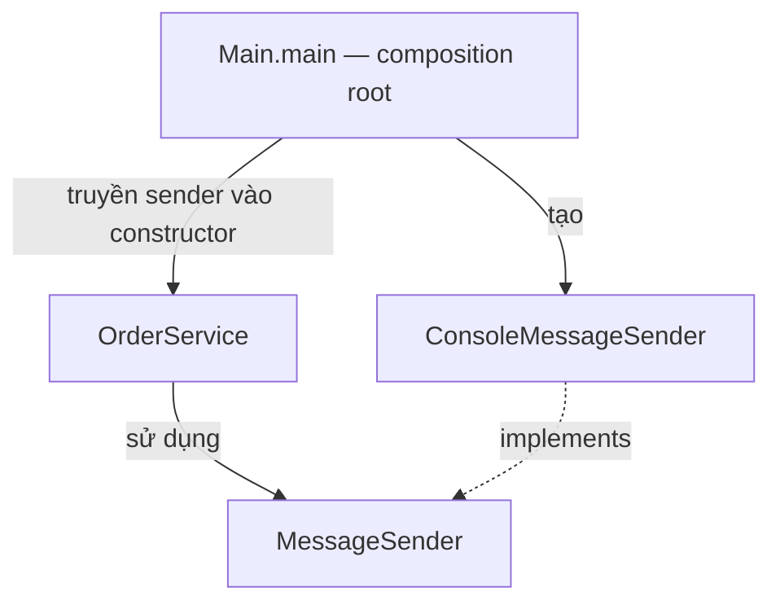

# Tiêm phụ thuộc (Dependency Injection) là gì và bài toán nó giải quyết

> **Chương:** Tổng quan  
> **Chủ đề:** Dependency Injection (DI), Inversion of Control (IoC) và cách tổ chức phụ thuộc trong Java thuần.

## 1. Mục tiêu học tập

Sau bài này, bạn có thể:

1. Giải thích *phụ thuộc* và *tiêm phụ thuộc* bằng một ví dụ Java cụ thể.
2. Nhận diện vấn đề khi lớp vừa thực hiện nghiệp vụ vừa tự tạo các dịch vụ mà nó sử dụng.
3. Dùng **constructor injection** để chuyển trách nhiệm tạo và lắp ghép đối tượng ra bên ngoài lớp nghiệp vụ.
4. Phân biệt DI, IoC và Dependency Inversion Principle (DIP) mà không đánh đồng ba khái niệm.
5. Tự lắp ghép ứng dụng ở **composition root**, thay thế phụ thuộc khi kiểm thử và bước đầu nhận biết các vấn đề về scope, vòng đời đối tượng.

## 2. Vấn đề bắt đầu từ đâu?

Giả sử một ứng dụng bán hàng cần gửi thông báo sau khi xác nhận đơn hàng. `OrderService` xử lý quy tắc nghiệp vụ, còn `ConsoleMessageSender` đảm nhiệm việc gửi thông báo (ở ví dụ học tập này là in ra màn hình).

Một cách viết ban đầu có thể là:

```java
final class ConsoleMessageSender {
    void send(String recipient, String content) {
        System.out.printf("To %s: %s%n", recipient, content);
    }
}

final class OrderService {
    // Lớp nghiệp vụ tự quyết định tạo phụ thuộc cụ thể.
    private final ConsoleMessageSender sender = new ConsoleMessageSender();

    void confirmOrder(String customerEmail) {
        // Giả sử các quy tắc xác nhận đơn hàng đã được xử lý.
        sender.send(customerEmail, "Đơn hàng đã được xác nhận");
    }
}
```

Đoạn code nhỏ này vẫn chạy được, nhưng có một sự ràng buộc: **`OrderService` vừa sử dụng, vừa quyết định cách tạo `ConsoleMessageSender`.** Trong chương trình lớn hơn, phụ thuộc có thể là trình gửi email thật, kho dữ liệu, hệ thống thanh toán hoặc HTTP client.

Khi đó, cách viết trên gây ra các khó khăn:

| Tình huống | Hệ quả khi `OrderService` tự tạo phụ thuộc |
| --- | --- |
| Chuyển từ thông báo console sang email hoặc SMS | Phải sửa `OrderService` hoặc thêm nhánh lựa chọn cách gửi. |
| Kiểm thử riêng quy tắc xác nhận đơn hàng | Khó thay trình gửi thật bằng đối tượng giả; bài test có thể gây tác dụng phụ. |
| Phụ thuộc cần URL, token, connection pool hoặc đối tượng khác | Constructor của phụ thuộc ngày càng phức tạp, kéo chi tiết cấu hình vào lớp nghiệp vụ. |
| Nhiều dịch vụ cùng dùng một tài nguyên | Mỗi lớp tự tạo có thể làm phát sinh nhiều tài nguyên không cần thiết và khó quản lý việc đóng chúng. |

Vấn đề cốt lõi **không phải** từ khóa `new` tự nó có hại. Vấn đề là *quyết định tạo, cấu hình và chọn phiên bản phụ thuộc* nằm rải rác bên trong các lớp chỉ nên tập trung sử dụng chúng.

## 3. Dependency Injection là gì?

**Dependency Injection (DI, tiêm phụ thuộc)** là cách cung cấp các đối tượng mà một lớp cần dùng **từ bên ngoài**, thay vì để lớp đó tự tạo hoặc tự tìm chúng trong một nơi lưu trữ toàn cục.

Ba vai trò cần phân biệt:

- **Client/consumer:** đối tượng cần sử dụng chức năng, ví dụ `OrderService`.
- **Dependency:** đối tượng cung cấp chức năng được sử dụng, ví dụ một `MessageSender`.
- **Assembler/composition root:** nơi tạo các đối tượng và truyền phụ thuộc vào đúng chỗ, ví dụ `Main.main`.

Với **constructor injection**, phụ thuộc được khai báo ngay trong constructor. Đây thường là lựa chọn mặc định tốt cho những phụ thuộc bắt buộc phải có để đối tượng hoạt động hợp lệ.

### 3.1. Ví dụ Java thuần, không cần framework

Tạo file `Main.java` với toàn bộ nội dung sau:

```java
import java.util.Objects;

interface MessageSender {
    void send(String recipient, String content);
}

final class ConsoleMessageSender implements MessageSender {
    @Override
    public void send(String recipient, String content) {
        System.out.printf("To %s: %s%n", recipient, content);
    }
}

final class OrderService {
    private final MessageSender sender;

    // Constructor injection: khai báo rõ phụ thuộc bắt buộc.
    OrderService(MessageSender sender) {
        this.sender = Objects.requireNonNull(sender, "sender");
    }

    void confirmOrder(String customerEmail) {
        sender.send(customerEmail, "Đơn hàng đã được xác nhận");
    }
}

public class Main {
    public static void main(String[] args) {
        // Composition root: nơi tạo và lắp ghép object graph.
        MessageSender sender = new ConsoleMessageSender();
        OrderService orderService = new OrderService(sender);

        orderService.confirmOrder("customer@example.test");
    }
}
```

Chạy bằng JDK (không cần thư viện DI):

```bash
javac Main.java
java Main
```

Kết quả mong đợi:

```text
To customer@example.test: Đơn hàng đã được xác nhận
```

Ở đây `ConsoleMessageSender` chỉ mô phỏng việc gửi thông báo bằng `System.out`, **không gửi email thực tế**.

Điểm khác biệt nằm ở hai dòng:

```java
MessageSender sender = new ConsoleMessageSender();
OrderService orderService = new OrderService(sender);
```

`Main` quyết định cách khởi tạo và truyền `sender`; `OrderService` chỉ biết hợp đồng `MessageSender.send(...)`. Để đổi sang `EmailMessageSender` hay `SmsMessageSender` cùng triển khai `MessageSender`, ta thay cách lắp ghép tại composition root. Phần nghiệp vụ `confirmOrder` không cần biết đối tượng đang gửi bằng công nghệ gì.



> **Nhận diện DI:** Hãy nhìn vào nơi `OrderService` nhận `MessageSender`. Nếu `OrderService` nhận nó qua constructor thay vì tự `new ConsoleMessageSender()` hoặc tự tra cứu từ registry, đó là constructor injection. Việc `Main` dùng `new` vẫn hoàn toàn bình thường.

### 3.2. Interface có bắt buộc không?

**Không.** Ví dụ sau vẫn là DI vì `ReportService` nhận phụ thuộc từ bên ngoài:

```java
final class ReportService {
    private final PdfRenderer renderer;

    ReportService(PdfRenderer renderer) {
        this.renderer = renderer;
    }
}
```

Đoạn trên giả định `PdfRenderer` là một lớp đã được định nghĩa. DI mô tả **cách cung cấp phụ thuộc**; còn việc chọn interface hay lớp cụ thể phụ thuộc vào nhu cầu mở rộng, mức độ ổn định của API và mục đích kiểm thử. Không nên tạo interface cho mọi lớp chỉ để có vẻ đang dùng DI.

## 4. DI giải quyết bài toán nào?

### 4.1. Giảm sự gắn chặt giữa nghiệp vụ và hạ tầng

`OrderService` cần **khả năng gửi thông báo**, chứ không nhất thiết cần biết cách kết nối SMTP hoặc API SMS. Khi lớp phụ thuộc vào một hợp đồng phù hợp, thay đổi công nghệ gửi thông báo ít tác động tới logic xác nhận đơn hàng.

Lưu ý: DI **không tự động xóa mọi coupling**. Nếu constructor vẫn nhận một lớp cụ thể, client vẫn phụ thuộc vào kiểu đó; DI chỉ chuyển trách nhiệm khởi tạo ra ngoài. Dùng abstraction phù hợp có thể giảm coupling thêm một bước.

### 4.2. Kiểm thử nhanh và có thể kiểm soát

Một bài kiểm thử đơn vị nên xác minh rằng xác nhận đơn hàng tạo đúng yêu cầu gửi thông báo, **không cần** gửi thông báo qua mạng. Ta có thể truyền một fake ghi lại lời gọi.

Giữ file `Main.java` ở mục 3 và tạo thêm file `OrderServiceTest.java` cùng thư mục:

```java
final class RecordingMessageSender implements MessageSender {
    String lastRecipient;
    String lastContent;
    int callCount;

    @Override
    public void send(String recipient, String content) {
        lastRecipient = recipient;
        lastContent = content;
        callCount++;
    }
}

public class OrderServiceTest {
    public static void main(String[] args) {
        RecordingMessageSender fake = new RecordingMessageSender();
        OrderService service = new OrderService(fake);

        service.confirmOrder("customer@example.test");

        if (fake.callCount != 1
                || !"customer@example.test".equals(fake.lastRecipient)
                || !"Đơn hàng đã được xác nhận".equals(fake.lastContent)) {
            throw new AssertionError("OrderService gửi sai thông báo");
        }

        System.out.println("PASS");
    }
}
```

```bash
javac Main.java OrderServiceTest.java
java OrderServiceTest
```

Kết quả mong đợi: `PASS`. Đây là một bài test Java thuần dùng `AssertionError`, không phụ thuộc JUnit, DI container, database hay dịch vụ ngoài. Trong dự án thật, có thể chuyển cùng ý tưởng sang JUnit/Mockito khi cần.

**Điều test chứng minh:** `OrderService` hoạt động với một implementation bất kỳ đáp ứng `MessageSender`; trách nhiệm tạo fake thuộc về code kiểm thử. **Điều test chưa chứng minh:** hệ thống gửi email thật hoạt động; phần đó cần kiểm thử tích hợp riêng.

### 4.3. Gom cấu hình và lắp ghép vào một điểm

Khi chương trình cần `NotificationService`, `OrderRepository`, `PaymentGateway`, `Clock`..., mỗi đối tượng có thể có phụ thuộc riêng. Nếu từng service tự tạo mọi thứ bên trong, logic cấu hình sẽ phân tán.

**Composition root** là nơi lắp ghép *object graph* (mạng các đối tượng và quan hệ phụ thuộc). Với ứng dụng Java nhỏ, đây có thể là `main` hoặc một factory khởi tạo ứng dụng; với web app, đây thường là giai đoạn bootstrapping. Quy tắc thực hành: **tạo phụ thuộc ở rìa ứng dụng, truyền chúng vào nơi sử dụng**.

Ví dụ sơ đồ luồng lắp ghép:

```text
Main / composition root
    ├── tạo cấu hình và các adapter hạ tầng
    ├── tạo MessageSender (implementation cụ thể)
    └── tạo OrderService(sender)
            └── gọi MessageSender.send(...) khi xác nhận đơn
```

Không nhất thiết đưa **mọi** thao tác `new` về composition root. Việc tạo đối tượng dữ liệu nhỏ như `new Order(...)` hoặc `new ArrayList<>()` ngay trong logic phù hợp thường không phải là vấn đề DI. Ưu tiên inject các **collaborator** có tác động, tài nguyên, cấu hình hoặc cần khả năng thay thế.

## 5. DI, IoC và DIP khác nhau thế nào?

Ba thuật ngữ liên quan nhau nhưng trả lời ba câu hỏi khác nhau:

| Khái niệm | Câu hỏi nó trả lời | Cách hiểu trong ví dụ |
| --- | --- | --- |
| **Inversion of Control (IoC)** — đảo ngược quyền điều khiển | Ai quyết định quá trình tạo, liên kết và điều phối đối tượng? | Quyết định chọn và lắp ghép `MessageSender` được chuyển ra khỏi `OrderService`. |
| **Dependency Injection (DI)** — tiêm phụ thuộc | Đối tượng nhận các cộng tác viên cần dùng bằng cách nào? | `OrderService(MessageSender sender)` nhận dependency qua constructor. |
| **Dependency Inversion Principle (DIP)** — nguyên lý đảo ngược phụ thuộc | Các phần nghiệp vụ cấp cao và chi tiết cấp thấp nên phụ thuộc vào loại hợp đồng nào? | `OrderService` dựa vào `MessageSender`; `ConsoleMessageSender` hiện thực hợp đồng đó. |

**IoC là ý tưởng rộng hơn DI.** DI là một kỹ thuật hiện thực IoC ở khâu cung cấp phụ thuộc; IoC còn xuất hiện trong callback, event loop và framework gọi code ứng dụng. **DIP là nguyên lý thiết kế**, không phải tên khác của DI. Một ứng dụng có thể dùng DI với constructor nhận class cụ thể mà chưa áp dụng DIP đầy đủ. Cũng có thể thiết kế module dựa trên abstraction mà chưa dùng DI container.

DI container như Spring là **công cụ hỗ trợ tự động hóa việc lắp ghép**; sử dụng container không phải điều kiện để gọi một thiết kế là DI. Ngược lại, có container nhưng code vẫn tự tạo mọi adapter quan trọng bên trong thì lợi ích DI có thể rất ít.

## 6. Các hình thức tiêm phụ thuộc thường gặp

| Hình thức | Cách truyền | Phù hợp khi | Điểm cần lưu ý |
| --- | --- | --- | --- |
| **Constructor injection** | `new OrderService(sender)` | Phụ thuộc bắt buộc, ổn định suốt vòng đời đối tượng | Constructor thể hiện rõ yêu cầu; có thể kiểm tra `null` ngay khi tạo. |
| **Method injection** | `service.execute(sender)` | Phụ thuộc thay đổi theo từng lần gọi hoặc chỉ cần cho một thao tác | Tránh biến danh sách tham số thành quá nhiều dịch vụ hạ tầng. |
| **Setter injection** | `service.setSender(sender)` | Phụ thuộc thực sự tùy chọn hoặc cần thay đổi sau khi tạo | Dễ xuất hiện trạng thái thiếu phụ thuộc nếu không có mặc định và kiểm soát hợp lệ. |
| **Field injection** | Framework gán trực tiếp vào field | Một số framework hỗ trợ | Khó khởi tạo bằng Java thuần, phụ thuộc bị che khuất; không ưu tiên trong thiết kế mới. |

Ưu tiên **constructor injection** cho những dependency cần thiết để đối tượng dùng được ngay sau khi khởi tạo. Không biến một thành phần thành đối tượng có thể ở trạng thái chưa hợp lệ chỉ vì muốn tránh tham số constructor.

## 7. Scope và vòng đời: ai tạo, ai dùng, ai dọn dẹp?

DI không dừng ở việc truyền tham số. Người lắp ghép còn cần hiểu **vòng đời** của phụ thuộc:

- **Dùng chung trong ứng dụng (application-wide/shared):** ví dụ một client được thiết kế an toàn để nhiều service cùng dùng. Đối tượng chia sẻ có thể tồn tại đến khi ứng dụng dừng.
- **Tạo mới khi cần (transient):** mỗi lần lắp ghép tạo một instance riêng, phù hợp với thành phần có trạng thái độc lập, ngắn hạn.
- **Theo request hoặc đơn vị công việc (request/unit-of-work scoped):** ví dụ một transaction context gắn với một request; kết thúc request thì giải phóng theo cơ chế tương ứng.

Scope là **chính sách về thời gian sống và chia sẻ đối tượng**, không phải đặc tính cố hữu của interface. Java thuần vẫn có scope vì người lập trình có thể chọn tạo một instance rồi tái sử dụng hoặc tạo instance mới; DI container chỉ giúp quản lý chính sách đó có hệ thống.

Các câu hỏi cần đặt ra khi lắp ghép:

1. Đối tượng này có chứa trạng thái thay đổi hay không? Nếu chia sẻ giữa nhiều luồng, nó có an toàn về luồng không?
2. Tài nguyên như kết nối, stream, executor có cần đóng không? **Nơi sở hữu việc tạo và quản lý vòng đời** cần có chiến lược dọn dẹp rõ ràng (ví dụ `AutoCloseable`/`try-with-resources` khi thích hợp).
3. Một service sống lâu có đang giữ trực tiếp một dependency chỉ hợp lệ trong request ngắn hạn không? Việc giữ như vậy có thể khiến nó dùng dữ liệu sai ngữ cảnh hoặc tài nguyên đã đóng.

Đối với bài nhập môn, chỉ cần nhớ: **tách tạo khỏi sử dụng giúp việc chọn và quản lý vòng đời có một nơi chịu trách nhiệm**, nhưng bản thân DI không bảo đảm thread safety, không tự đóng tài nguyên và không tự ngăn rò rỉ bộ nhớ.

## 8. Những nhầm lẫn và lỗi thiết kế cần tránh

**Nhầm lẫn 1 — “Có `new` là sai DI”.** `new` trong `Main` hoặc factory để lắp ghép là bình thường. Vấn đề là lớp nghiệp vụ tự quyết định hoặc cứng mã hóa các phụ thuộc hạ tầng cần thay thế.

**Nhầm lẫn 2 — “Phải có Spring mới dùng được DI”.** Mục 3 đã tự lắp ghép và mục 4 đã kiểm thử bằng Java thuần. Container có ích khi hệ thống lớn và cần tự động wiring/scope, nhưng có chi phí cấu hình, vòng đời và debug riêng.

**Nhầm lẫn 3 — “Mọi lớp phải có interface”.** Không cần tạo `IOrderService`, `IMessageSender`... hàng loạt nếu không có lý do thiết kế. Chỉ trừu tượng hóa tại ranh giới thật sự cần tách nghiệp vụ khỏi chi tiết hoặc cần thay thế.

**Nhầm lẫn 4 — “Service locator tương đương DI”.** Code như sau che giấu dependency thực và gắn service vào registry toàn cục:

```java
// Minh họa phản ví dụ; GlobalRegistry là API giả định.
final class OrderService {
    private final MessageSender sender = GlobalRegistry.get(MessageSender.class);
}
```

Với DI, caller truyền `MessageSender` một cách tường minh; constructor cho biết đối tượng cần gì. Service locator thường làm bài test phụ thuộc vào trạng thái registry và khó lần theo nguồn tạo đối tượng.

**Nhầm lẫn 5 — “DI tự giải quyết mọi vấn đề kiến trúc”.** DI không thay thế ranh giới module rõ ràng, không ngăn logic nghiệp vụ bị đặt sai lớp và không tự chữa **circular dependency** (`A` cần `B` trong khi `B` lại cần `A`). Vòng phụ thuộc thường là dấu hiệu nên xem lại phân chia trách nhiệm.

**Dấu hiệu cần điều chỉnh:** constructor có quá nhiều dependency không liên quan, mỗi test phải lắp ghép cả hệ thống, hoặc việc thay adapter vẫn đòi sửa nhiều lớp nghiệp vụ. Khi gặp những dấu hiệu đó, xem lại mức độ tập trung trách nhiệm và vị trí đặt abstraction trước khi thêm một framework mới.

## 9. Tự kiểm tra mức độ hiểu

**Tình huống A.** Một `UserService` tự gọi `new JdbcUserRepository(...)`. Đổi database hoặc dùng repository giả để test đều phải sửa `UserService`. Bạn sẽ chuyển trách nhiệm nào ra ngoài? Nêu tên tham số constructor thích hợp và nơi tạo implementation cụ thể.

**Tình huống B.** Một `InvoiceService` nhận `PdfRenderer` cụ thể qua constructor. Đây có phải DI không? Có nhất thiết là DIP không? Giải thích bằng một câu cho từng khái niệm.

**Tình huống C.** `OrderService` dùng một HTTP client chung an toàn cho đa luồng; một thành phần khác lưu thông tin request hiện tại. Hai dependency này có nên có cùng scope không? Điều gì có thể xảy ra nếu service toàn ứng dụng giữ trực tiếp dữ liệu request?

**Gợi ý đối chiếu:**

1. A: Truyền `UserRepository` hoặc một abstraction tương ứng vào constructor; tạo `JdbcUserRepository` tại composition root. Khi chưa cần nhiều adapter, vẫn có thể inject lớp cụ thể để trước hết tách việc tạo khỏi việc dùng.
2. B: **Có DI** vì phụ thuộc đến từ bên ngoài; **không mặc nhiên áp dụng DIP** vì `InvoiceService` vẫn phụ thuộc trực tiếp vào một concrete class.
3. C: Có thể chia sẻ HTTP client nếu bản thân client hỗ trợ chia sẻ an toàn; dữ liệu request thường cần scope theo request. Giữ nó trong singleton có thể dẫn đến dữ liệu cũ, rò rỉ ngữ cảnh hoặc truy cập đối tượng đã hết vòng đời.

## 10. Ghi nhớ

Trọng tâm của Dependency Injection là **đối tượng mô tả thứ nó cần; nơi lắp ghép chịu trách nhiệm cung cấp thứ đó**. Trong Java thuần, constructor injection cùng một composition root rõ ràng là điểm khởi đầu đủ mạnh: giảm sự gắn chặt giữa sử dụng và khởi tạo, giúp thay dependency trong test và đặt quyết định cấu hình, scope, vòng đời ở vị trí có thể kiểm soát. Khi bài toán lớn hơn, DI container có thể tự động hóa quá trình lắp ghép, nhưng các nguyên tắc thiết kế cơ bản vẫn giữ nguyên.
