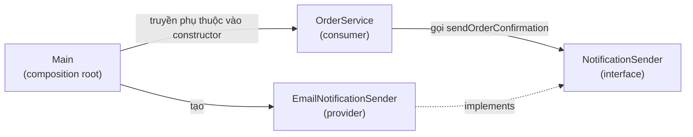

# Phụ thuộc, đối tượng sử dụng và đối tượng cung cấp trong một ví dụ xuyên suốt

## Mục tiêu học tập

Sau bài này, bạn có thể:

- Chỉ ra **phụ thuộc (dependency)**, **đối tượng sử dụng (consumer)** và **đối tượng cung cấp (provider)** trong một chương trình Java.
- Phân biệt **đối tượng thực thi chức năng** với **nơi tạo và lắp ghép đối tượng**.
- Nhận ra sự khác nhau giữa việc một lớp tự `new` phụ thuộc và việc nhận phụ thuộc qua constructor.
- Giải thích vì sao **Dependency Injection (DI)** giúp tách việc *sử dụng* phụ thuộc khỏi việc *tạo và lựa chọn* phụ thuộc, qua đó thể hiện nguyên tắc **Inversion of Control (IoC)**.
- Thay phụ thuộc thật bằng một đối tượng giả khi kiểm thử bằng Java thuần, chưa cần DI container.

## 1. Bối cảnh: xác nhận đơn hàng cho khách

Giả sử ứng dụng bán hàng có một bước xử lý đơn giản: khi đơn hàng đã được tiếp nhận, hệ thống xác nhận đơn và gửi thông báo cho khách. Ta tạm bỏ qua lưu cơ sở dữ liệu, thanh toán và vận chuyển để chỉ tập trung vào **quan hệ giữa các đối tượng**.

Ta cần hai trách nhiệm:

1. `OrderService` điều phối bước xác nhận đơn hàng.
2. `EmailNotificationSender` thực hiện thao tác gửi thông báo bằng email.

`OrderService` **cần** khả năng gửi thông báo để hoàn thành bước xử lý. Khả năng đó chính là một *phụ thuộc* của `OrderService`. Không nhất thiết chính `OrderService` phải biết cách gửi email hoặc phải tự tạo đối tượng gửi email.

Trong ví dụ này, thao tác gửi email sẽ được **giả lập bằng cách in ra console**. Code không kết nối dịch vụ email thật, nên có thể chạy và thử nghiệm chỉ với JDK.

## 2. Ba vai trò và một vai trò dễ bị nhầm

| Khái niệm | Thành phần trong ví dụ | Trách nhiệm |
| --- | --- | --- |
| **Đối tượng sử dụng (consumer)** | Một instance của `OrderService` | Gọi chức năng gửi thông báo để hoàn tất việc xác nhận đơn. |
| **Phụ thuộc (dependency)** | Một đối tượng đáp ứng hợp đồng `NotificationSender` | Cung cấp chức năng `sendOrderConfirmation(...)` mà `OrderService` cần dùng. |
| **Đối tượng cung cấp hành vi (provider/implementation)** | Một instance của `EmailNotificationSender` | Thực hiện cách gửi thông báo cụ thể: qua email. |
| **Nơi tạo và lắp ghép (composition root)** | `Main.main(...)` | Chọn implementation, tạo instance và truyền nó vào `OrderService`. |

Ở đây, **`NotificationSender` là interface mô tả hợp đồng**; bản thân interface không phải một đối tượng chạy được. `EmailNotificationSender` là lớp hiện thực hợp đồng; `new EmailNotificationSender()` mới tạo ra đối tượng cụ thể được truyền vào consumer.

Từ **“cung cấp”** dễ có hai nghĩa cần phân biệt:

- `EmailNotificationSender` **cung cấp hành vi** gửi thông báo mà `OrderService` sử dụng.
- `Main` **cung cấp tham chiếu phụ thuộc** cho `OrderService` bằng cách tạo đối tượng và truyền vào constructor. `Main` không tự thực hiện hành vi gửi email.

Sơ đồ các vai trò:



Mũi tên từ `OrderService` đến `NotificationSender` thể hiện **quan hệ sử dụng trong mã nguồn**. Khi chương trình chạy, tham chiếu `NotificationSender` trong `OrderService` trỏ tới một instance `EmailNotificationSender` cụ thể.

## 3. Khi consumer tự tạo phụ thuộc

Ban đầu, ta có thể viết `OrderService` theo cách sau (đoạn mã rút gọn, giả sử `EmailNotificationSender` có phương thức tương ứng):

```java
class OrderService {
    private final EmailNotificationSender sender = new EmailNotificationSender();

    void confirmOrder(String orderId, String customerEmail) {
        System.out.println("Đã xác nhận đơn " + orderId);
        sender.sendOrderConfirmation(customerEmail, orderId);
    }
}
```

Code này có thể hoạt động, nhưng `OrderService` đang làm **hai việc**: dùng chức năng gửi thông báo **và** quyết định tạo `EmailNotificationSender`.

Hệ quả:

- Muốn thay cách gửi thông báo, thường phải sửa `OrderService`, mặc dù nghiệp vụ xác nhận đơn không đổi.
- Khó đưa một đối tượng ghi nhận lời gọi vào bài kiểm thử vì `OrderService` đã tự tạo sender.
- Cách khởi tạo, cấu hình và vòng đời sender bị gắn vào lớp sử dụng nó.

Sự phụ thuộc vào một lớp cụ thể không phải lúc nào cũng sai. Điểm cần nhận ra là **quyết định tạo đối tượng đang nằm trong consumer**. DI cho phép chuyển quyết định đó ra bên ngoài.

## 4. Đưa phụ thuộc vào constructor: một ví dụ Java hoàn chỉnh

Ta định nghĩa interface biểu diễn điều `OrderService` cần, cho lớp gửi email triển khai interface, rồi truyền implementation từ `Main` vào constructor của `OrderService`.

Lưu toàn bộ đoạn sau vào **`Main.java`**:

```java
import java.util.Objects;

// Hợp đồng mà OrderService cần, không quy định cách gửi cụ thể.
interface NotificationSender {
    void sendOrderConfirmation(String recipient, String orderId);
}

// Đối tượng cung cấp hành vi gửi email (giả lập qua console).
final class EmailNotificationSender implements NotificationSender {
    @Override
    public void sendOrderConfirmation(String recipient, String orderId) {
        System.out.printf(
            "[DEMO] Gửi email xác nhận đơn %s đến %s%n",
            orderId, recipient
        );
    }
}

// Consumer: sử dụng phụ thuộc, không tự tạo implementation.
final class OrderService {
    private final NotificationSender sender;

    OrderService(NotificationSender sender) {
        this.sender = Objects.requireNonNull(sender, "sender");
    }

    void confirmOrder(String orderId, String customerEmail) {
        System.out.println("Đã xác nhận đơn " + orderId);
        sender.sendOrderConfirmation(customerEmail, orderId);
    }
}

// Composition root: nơi chọn, tạo và lắp ghép các đối tượng.
public class Main {
    public static void main(String[] args) {
        NotificationSender sender = new EmailNotificationSender();
        OrderService orderService = new OrderService(sender);

        orderService.confirmOrder("DH-001", "khach@example.com");
    }
}
```

Chạy bằng JDK:

```bash
javac Main.java
java Main
```

Kết quả dự kiến:

```text
Đã xác nhận đơn DH-001
[DEMO] Gửi email xác nhận đơn DH-001 đến khach@example.com
```

### Theo dõi đối tượng qua từng bước

1. `Main` chạy `new EmailNotificationSender()` để tạo **provider thực tế**.
2. `Main` gọi `new OrderService(sender)` để **tiêm (inject)** tham chiếu sender vào constructor của consumer.
3. `OrderService` giữ tham chiếu đó trong trường `private final NotificationSender sender`; `Objects.requireNonNull` giúp phát hiện ngay việc truyền `null`.
4. Khi `confirmOrder(...)` được gọi, `OrderService` chỉ biết rằng sender có phương thức `sendOrderConfirmation(...)`.
5. Java gọi implementation của đối tượng thực tế `EmailNotificationSender` thông qua interface `NotificationSender`.

**Điểm mấu chốt:** `OrderService` biết *mình cần một sender làm được việc gì*, còn `Main` quyết định *sử dụng sender nào và tạo nó ra sao*.

Constructor injection là cách phù hợp ở đây vì khả năng gửi thông báo là **phụ thuộc bắt buộc** của `OrderService`: muốn tạo một `OrderService` hợp lệ phải cung cấp sender ngay từ đầu.

## 5. DI và IoC nằm ở đâu?

**Dependency Injection** là kỹ thuật đưa đối tượng phụ thuộc từ bên ngoài vào đối tượng sử dụng, thay vì để đối tượng sử dụng tự khởi tạo nó. Trong ví dụ, thao tác DI là:

```java
NotificationSender sender = new EmailNotificationSender();
OrderService orderService = new OrderService(sender);
```

**Inversion of Control** là ý tưởng rộng hơn: quyền điều khiển một phần quá trình tạo và nối các thành phần được chuyển ra ngoài thành phần sử dụng. Trước đó, `OrderService` tự chọn `EmailNotificationSender`; sau khi áp dụng DI, quyết định này nằm tại `Main`.

DI là **một cách thể hiện IoC**, không phải hai khái niệm đồng nghĩa. Ví dụ trên dùng **Java thuần**; không cần Spring, CDI, annotation `@Inject` hay một DI container mới được gọi là dependency injection.

Interface `NotificationSender` cũng **không phải điều kiện bắt buộc** để có DI: constructor có thể nhận một lớp cụ thể. Tuy nhiên, phụ thuộc vào interface giúp `OrderService` ít bị ràng buộc vào cách gửi cụ thể và dễ thay implementation hơn.

## 6. Dùng chính ví dụ để kiểm thử bằng Java thuần

Để kiểm tra `OrderService` có yêu cầu gửi đúng thông báo hay không, ta không cần gửi email thật. Thay vào đó, tạo một sender ghi lại thông số đã nhận.

Đặt tệp **`OrderServiceCheck.java`** cạnh `Main.java`:

```java
public class OrderServiceCheck {
    static final class RecordingSender implements NotificationSender {
        String recipient;
        String orderId;
        int callCount;

        @Override
        public void sendOrderConfirmation(String recipient, String orderId) {
            this.recipient = recipient;
            this.orderId = orderId;
            callCount++;
        }
    }

    public static void main(String[] args) {
        RecordingSender fake = new RecordingSender();
        OrderService service = new OrderService(fake);

        service.confirmOrder("DH-TEST", "test@example.com");

        if (fake.callCount != 1
                || !"DH-TEST".equals(fake.orderId)
                || !"test@example.com".equals(fake.recipient)) {
            throw new AssertionError("Thông báo không được gửi đúng yêu cầu");
        }

        System.out.println("PASS: OrderService đã gọi sender đúng một lần");
    }
}
```

Chạy:

```bash
javac Main.java OrderServiceCheck.java
java OrderServiceCheck
```

Trong lần kiểm tra này, **consumer vẫn là `OrderService`**, **phụ thuộc vẫn có kiểu `NotificationSender`**, nhưng **provider thực tế đã đổi** từ `EmailNotificationSender` sang `RecordingSender`. Không cần sửa mã nguồn `OrderService`, không gửi email thật và không cần thư viện kiểm thử. Đây là lợi ích trực tiếp của việc tách sử dụng phụ thuộc khỏi tạo phụ thuộc.

## 7. Ai quản lý scope và vòng đời?

Trong ví dụ, `Main` tạo một sender rồi truyền cho một `OrderService`. Nếu tạo thêm một `OrderService` bằng cùng biến `sender`, cả hai service sẽ tham chiếu đến **cùng một instance**:

```java
NotificationSender sender = new EmailNotificationSender();
OrderService first = new OrderService(sender);
OrderService second = new OrderService(sender);
```

Nếu thay bằng `new EmailNotificationSender()` cho từng service, mỗi service nhận **một instance riêng**. Đây là lựa chọn về cách quản lý **scope và vòng đời** của phụ thuộc, do mã lắp ghép quyết định. Ví dụ hiện tại không đòi hỏi phạm vi quản lý phức tạp; khi hệ thống mở rộng, một DI container có thể hỗ trợ tạo, chia sẻ và hủy các đối tượng theo scope được cấu hình.

## 8. Các nhầm lẫn thường gặp

| Nhận định | Cách hiểu đúng |
| --- | --- |
| “`NotificationSender` là đối tượng được tạo bằng `new`.” | `NotificationSender` là **interface**; đối tượng thực tế là instance của lớp triển khai như `EmailNotificationSender`. |
| “`Main` là lớp gửi email vì nó cung cấp sender.” | `Main` chỉ **chọn, khởi tạo và lắp ghép**; `EmailNotificationSender` mới cung cấp hành vi gửi. |
| “Có interface là đã áp dụng DI.” | Cần quan sát **đối tượng phụ thuộc được truyền từ ngoài vào đâu**; chỉ khai báo interface chưa đủ. |
| “Phải có DI container mới sử dụng được DI.” | `new OrderService(sender)` là **constructor injection bằng Java thuần**. |
| “Dùng DI thì không còn `new` ở bất kỳ đâu.” | Việc khởi tạo vẫn diễn ra, nhưng được **tập trung tại nơi lắp ghép**, thay vì rải trong các consumer. |

## 9. Tự kiểm tra hiểu bài

Hãy trả lời trước khi đọc phần gợi ý:

1. Trong `new OrderService(new EmailNotificationSender())`, đối tượng nào là consumer, đối tượng nào cung cấp hành vi? Có DI không?
2. Nếu muốn kiểm thử mà không gửi email, ta cần thay lớp nào? Vì sao không phải sửa `OrderService`?
3. Khi hai `OrderService` dùng chung một biến `sender`, chúng đang chia sẻ điều gì?

**Gợi ý:** (1) `OrderService` là consumer, `EmailNotificationSender` là provider; vẫn có DI vì phụ thuộc được truyền qua constructor dù viết gộp một dòng. (2) Truyền `RecordingSender` hoặc một implementation thay thế của `NotificationSender`; consumer chỉ dựa vào hợp đồng. (3) Chúng chia sẻ **cùng instance sender**, không chỉ cùng kiểu dữ liệu.

Qua ví dụ này, hãy luôn hỏi ba câu khi đọc mã: **Ai cần chức năng? Ai thực hiện chức năng? Ai tạo và đưa đối tượng thực hiện vào nơi cần dùng?** Trả lời được ba câu đó sẽ giúp bạn nhận diện cấu trúc DI, phân tích mức độ gắn kết và chuẩn bị cho các bài tiếp theo về constructor injection, composition root và quản lý vòng đời.
